# Dev log & playtest guide

## How to send results back

1. **Terminal logs:** every bot run writes `logs/bots-<time>.log`. Attach the file to the chat. For the server, copy the last ~50 lines of the terminal running `npm run dev` (on Oracle: `journalctl -u city-life-auto -n 100 > server.log`).
2. **Screenshots:** take them with the in-game HUD visible. The bottom-right corner shows `fps · ping · entity count`, which helps diagnose. Name them after the checklist item, e.g. `M3-4-crate-fell-through.png`.
3. **Videos:** short phone/OBS clips are fine for your own reference, but I review **3–5 screenshots of the key moments + the matching log** much more reliably than video.
4. **Bug report template** (paste in chat):
   ```
   Milestone / step: M5-3
   Device + browser: Pixel 8 Chrome / Windows Firefox
   What I did:
   What I expected:
   What happened:
   Screenshot(s) / log attached: yes
   ```
5. **Browser console errors:** press F12 → Console, screenshot anything red.

Dev mode (`npm run dev`) adds a playtest panel, opened with the **`** (backtick) key. It has rain/night toggles, money, weapons, wanted levels, a loaded cargo truck, a contraband drop and more, so each checklist below can be done in minutes.

---

## 2026-10-03 · M0 → M8 first full build

**Automated verification run before this entry:**
- `npm test`: 19/19 pass (rules + a 4-minute chaos simulation with 24 random players, 0 system errors).
- `npm run bots -- 100 40 ws://localhost:8080/ws --spread`: 100 players, ~1,300 entities, avg tick ~19 ms (50 ms budget), ~35 KB/s per player, 0 errors.
- Headless-browser playtests on desktop 1280×720, phone landscape 844×390 and portrait 390×844: title, driving, combat, arrest, shop menu, courier job, night, rain.

### M0 · Foundations
Built: zero-dependency Node server (HTTP + hand-written WebSocket), 20 Hz world tick, signed guest tokens, atomic auto-saving profiles, deterministic city generator shared with the client, `/health` + `/stats` endpoints.

Playtest:
1. `npm run dev`, open http://localhost:8080 → title screen shows *Signed in as GuestXXXX*.
2. Press PLAY, walk around, reload the page → you return as the **same guest name** with the same money.
3. Open http://localhost:8080/stats → JSON with `online: 1`.
4. Stop the server with Ctrl+C → terminal prints *saving and shutting down*; restart → money is still there.

### M1 · Playable skeleton
Built: canvas renderer (baked ground chunks, rooftops, signage, lane markings, crosswalks, traffic lights), client-side prediction + server reconciliation, 110 ms interpolation of everyone else, chunk net-culling, keyboard/mouse + Xbox gamepad + touch sticks/buttons, 16:9 scaling with a portrait strip, speed-based camera zoom, radar + big map (M), sprite atlas from your concept art.

Playtest:
1. Two browser windows side by side → each sees the other player move smoothly with a name tag.
2. Walk into a parked car, press **F** → drive; **Space** handbrake-drifts (tire marks); camera zooms out at speed.
3. Plug in an Xbox controller → it works without settings. On a phone (same Wi-Fi, `http://<PC-IP>:8080`) → touch sticks appear.
4. Rotate the phone to portrait → the view becomes a narrow strip (no zoom) with a "rotate" banner.
5. `npm run bots -- 30 60 ws://localhost:8080/ws` while playing → bots appear, game stays smooth; attach the `logs/bots-*.log`.

### M2 · Life cycle & saving
Built: health, bleeding below 30% with red footprints on dry concrete, death → WASTED screen → hospital respawn, value-tiered loot bags (duffel → backpack → security case → gold lockbox), **30-second ghost state** on disconnect, banked money survives death, continuous autosave.

Playtest:
1. Dev panel → *Give weapons*, walk up to a citizen and fight; get hurt below 30 → HUD says BLEEDING and red footprints trail on sidewalks.
2. Die (or drive into traffic) → WASTED, respawn at St. Neon General with $0; a loot bag sits where you died. In a second window, walk to it and press **E** to loot it.
3. With $ in your wallet, close the tab. In the other window watch your body stay ~30 s, then pop into a loot bag.
4. Reopen within 30 s instead → you're back in the same body with your money.
5. Deposit at First Pixel Bank / ATM (E) → die → bank balance is unchanged.

### M3 · Vehicles & open cargo
Built: 15 vehicle models (compact, sedan, taxi, sports, pickup, flatbed, van, bus, police, SWAT, ambulance, armored, motorcycle, speedboat, dinghy), multi-seat passengers, surfaces (grass/sand/dirt slow you), wrecks + explosions + fire, hydrant geysers, motorcycle crash ejection, physical crates: carry (−40% speed), throw, load into visible slots, knocked off in hard crashes, tossed crates land in truck beds, crates sink in water.

Playtest:
1. Dev panel → *Loaded flatbed* → a truck with one crate of each tier appears; drive it into a wall hard → crates fly off.
2. Walk to a crate, **E** pick up (you slow down), **Q** or click to throw it; stand near an empty pickup bed holding a crate → prompt *Load onto Pickup Truck*.
3. Throw a crate onto an empty pickup bed from beside it → it snaps into the bed.
4. Two players: one drives, the other presses **F** on the same car → passenger; passenger can aim and shoot (mouse/right stick + click).
5. Harbor Marina (B on radar) or the piers: take a boat; press F at the dock edge to get out.

### M4 · Combat
Built: fists, bat, knife, crowbar, sledgehammer, baton, taser, pistol, revolver, shotgun, rifle, SMG, bazooka; hitscan with walls blocking, tracers, muzzle flashes that light the night, blood sprays + stains, hood blood on cars that hit people, stun/knockdown, reload (R), heal items (X), passenger drive-bys.

Playtest:
1. Dev panel → *Give weapons*. Cycle with Tab/wheel/1-9; check the ammo counter and reload.
2. Shoot at a car until it smokes, burns and explodes; nearby people get knocked back.
3. Run someone over → blood on your hood; Fresh Coat Garage (R on radar) → *Car wash* cleans it.

### M5 · Law & tri-faction
Built: witness network (NPC sight cones + traffic cameras, both weaker at night), 3-second red "!" public flare, wanted stars, out-of-sight search circle on police radar that grows as heat cools, legal immunity (self-defense, flagged outlaws, gang turf), NPC police units (taser + baton at 1–2★, firearms at 3★, SWAT at 4–5★), arrests with fines and confiscation, contraband spotting, **disguise system with peak-wanted memory**, enforcer badge (25 Samaritan, no felonies) with misconduct firing, bounty hunter license, player-placed bounties at the courthouse.

Playtest:
1. Punch someone in an empty alley with nobody looking → toast *nobody saw it*. Do it in front of people → stars + red "!" over your head for 3 s.
2. Dev → *4 stars* → police cruisers with sirens arrive; hide behind buildings and watch the stars cool off. A traffic camera blinks red and beeps when it spots you.
3. Get 3 stars, break line of sight, go to Threads Outfitters (D) → buy an outfit → stars drop to 0, HUD shows *Record on file ★★★*. Commit any small crime in view → straight back to 3★.
4. Dev → *+50 Samaritan*, go to Police HQ (P) → pick up badge → uniform + taser/baton/pistol; *Requisition a Police Interceptor*, H toggles the siren. In a second window give that player stars; arrest them by tasing then pressing E.
5. As an on-duty cop, punch a clean citizen → Samaritan points drop; keep doing it → FIRED.
6. Have player B punch player A; A goes to the courthouse (J) → place a bounty on B → hunters see a pulsing ring on the radar.

### M6 · Living city
Built: demographic pedestrians (executives, socialites, construction crews, sweepers, athletes, seniors, hustlers, drunks; more shady types at night), sidewalk wandering + jaywalking, reflex dive rolls away from speeding cars (athletes ~80%, drunks ~5%), fight-or-flight when attacked, carjacking (50% flee screaming / 50% fight and drag you out), syndicate gangs in the south-west turf that defend it, NPC traffic on a lane graph obeying traffic lights, parked cars, panicked drivers, ambulances that revive downed NPCs in 3 s, bodies dissolve after 45 s if unreachable, snatch-and-grab street muggings, scattering pigeons and gulls.

Playtest:
1. Stand at a big intersection for a minute: cars stop on red, go on green, turn at corners.
2. Drive fast along a busy sidewalk → some people dive out of the way, slow ones don't.
3. Pull a driver out of their car (F on an NPC car) several times → some run, some beat you up.
4. Knock someone down and wait nearby with no shooting → an ambulance arrives, medics revive them.
5. Wait for a *Snatch-and-grab!* toast → chase the mugger, knock them down, grab the purse, then either return it to the victim (E → +Samaritan) or sell it at Second Chance Pawn.

### M7 · World systems
Built: 20-minute chrono loop (15 min day / 5 min night) synced to all players, night darkness with street lamps, headlight cones, siren glow, shop-front light pools; rare rain (−35% asphalt grip, double braking distance, umbrellas, rain streaks, slick boats); waterfront with beach, piers and ocean; river and bridges to the rural Refuge Island with farm fields.

Playtest:
1. Dev → *Jump to night*: lamps and headlights light the streets; more hustlers/drunks appear.
2. Dev → *Start rain*: brake from top speed on asphalt → you slide about twice as far; umbrellas pop up.
3. Drive east across a bridge: the camera at the bridge approach pings wanted players.

### M8 · Economy & jobs
Built: Iron Sights Arms, Second Chance Pawn (sells stolen goods safely), Back-Alley Exchange black market (SMG, bazooka, fences contraband), Home Run Sports (bat, fishing pole), Nail & Gear Hardware, MediMart Pharmacy, Bean Machine Coffee + vending machines (stamina buffs), ER reception auto-heal ($150), bank + ATM, Motor Row dealership + Harbor Marina (owned vehicles saved to your profile, retrievable anytime), Fresh Coat Garage (respray disguise, wash, repair), Portside Logistics courier contracts, Refuge Island harvest contracts (4 produce boxes → FreshHub Grocery), contraband drops (iron vaults / carbon-gold cases with a map rumor; fence them or turn them in at PD for Samaritan points), fishing with bite timing + time/location tables (catfish at night, tuna in deep water, lures).

Playtest:
1. Portside Logistics (W) → courier contract → load the crate on any vehicle with a bed → drive to the yellow marker → carry it to the door → E → paid.
2. Refuge Island farm (¥ on the east island) → harvest contract → load 4 boxes on the co-op pickup → FreshHub Grocery (F) → paid + bonus.
3. Dev → *Contraband drop* → follow the dashed rumor ring → grab the glowing case → choose Back-Alley Exchange (X) for big cash, or Police HQ for Samaritan points. Carrying it past a cop gets you wanted.
4. Buy a fishing pole at Home Run Sports, stand at a pier edge facing water → E to cast → when **BITE! PRESS E** flashes, press E → sell fish at Dockside Fish Market (≈).
5. Buy a pickup at Motor Row (V) → log out and back in → retrieve it from the dealership or garage menu.

### Known gaps / next
- **M9 accounts & social:** Discord/Google sign-in, username choice, chat with filter, mute/report, leaderboards.
- **Final art:** characters, buildings and tiles are procedural stand-ins in your palette; vehicles and crates come from your concept sheets. See ART_SPEC.md.
- Bridges don't open (drawbridges), no jet skis or lost-pet events yet, gang alignment perks are basic (≥200 Criminal EXP stops gangs reacting to gunfire).
- NPC traffic uses straight lane graphs; police can drive onto sidewalks during direct pursuit (intended), and occasionally get wedged on corners (they reverse out).

---

## 2026-10-03 · Offline practice mode

**Built:** a **PRACTICE OFFLINE** button on the title screen. It runs the complete authoritative city simulation (the same `server/` code) inside a Web Worker on your own device. It needs no server and no internet once the page has loaded. You start with $2,000 cash and $5,000 bank, and the cheats panel is always on (` key, or the DEV button on phones). Nothing is saved, and your online guest token/profile is never touched.

Code changes: `server/session.js` (handshake + message routing shared by the Node server and the worker), `server/store.js` (environment-neutral profile store; the Node server plugs in `server/file-store.js`), `client/practice-worker.js`, and a WebSocket-compatible worker transport in `client/main.js`.

Playtest:
1. Open https://deadbaron.com/city-life-auto/ (even before the Oracle server exists) → title says the online city isn't reachable → press **PRACTICE OFFLINE** → you're in.
2. HUD shows *CITIZEN · PRACTICE*. Press ` (or DEV) → spawn the loaded flatbed, give weapons, start rain, etc.
3. Reload the page → practice money/items are gone (by design). Your online guest (once the server is live) is unaffected.
4. On a phone: same flow; the DEV button sits under the touch buttons.

---

## 2026-10-03 · Art pass, GTA-style city, punches, hospitals & homes

**City layout.** The generator was rewritten (`shared/map.js`). Four avenues and two bridges split the mainland into **nine districts with their own look**: Pine Hills (suburbs), Midtown (shops), Northgate (apartments, school, fire station), The Yards (industrial Syndicate turf, potholed asphalt), Downtown (towers, slate plazas, PD, bank, courthouse), Civic Center (hospital, chapel, Central Park), Southside (rough houses + turf), Neon Strip (clubs, hotels, red-brick sidewalks) and Harbor, plus Sunset Beach, the piers and Refuge Island. Each district is cut into irregular blocks with mixed street widths and T-junctions. A district title card pops up when you cross into one. The map grew from 256x256 to 384x352 tiles.

**Art.** Buildings are the actual lots from your building sheet. Roads, sidewalks, plazas and water use textures cut from your style-guide sheets, and about 70 street props come from the props sheet (`tools/build_art.py`). The bus and armored truck now use concept art too.

**Vehicles.** The dark rectangles under cars are gone; shadows follow the car outline. Every car keeps the art's own proportions and its collision box is the sprite itself.

**Combat feel.** Fists throw alternating left/right jabs (4 frames), and bats/crowbars/etc. swing in an arc with a motion trail. Hits make the victim flinch and flash, with an impact burst and screen shake. Your own punch animates instantly (predicted locally). Quick clicks can no longer be lost.

**Respawning.** There are 3 hospitals (St. Neon General, Westside Medical, Southside Clinic). The WASTED screen has a picker for where to wake up; by default you wake at your home, or else a hospital away from where you died.

**Homes.** There are 70+ buyable houses ($25k, $12k in turf) and apartments ($15k). Walk to the door and press E to buy. A home becomes your respawn point, has a Rest option (full heal), and comes with a garage: drive *any* car (yes, stolen ones too) up to your driveway and press E to park it, then take it out again from the door menu. Garage space is 2 + 3 per house / 2 per apartment, up to 3 homes.

Playtest (offline practice works for all of these):
1. Walk/drive across the city and watch the district title cards; compare Pine Hills, Downtown, Neon Strip and The Yards.
2. Punch the air and a pedestrian: arms should visibly jab; the victim flinches with a white impact burst.
3. Dev panel → +$25k → walk to any house door ("For sale" prompt) → buy it. Die (drive into traffic): the WASTED screen lists your home + 3 hospitals; pick one.
4. Steal any car, drive up to your house's driveway, press E → "parked in your garage". Walk to the door → E → *Take out*.
5. Check cars: no boxes around them; bumping into one should match where the art is.

### Screenshots from the automated browser playtest (2026-10-03)
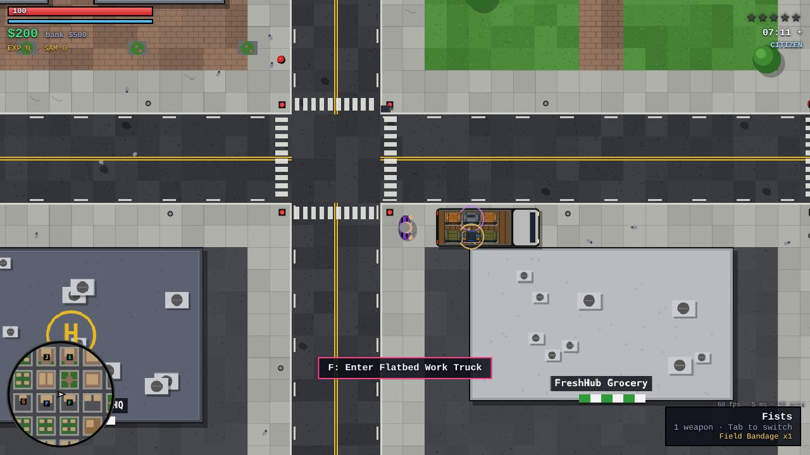
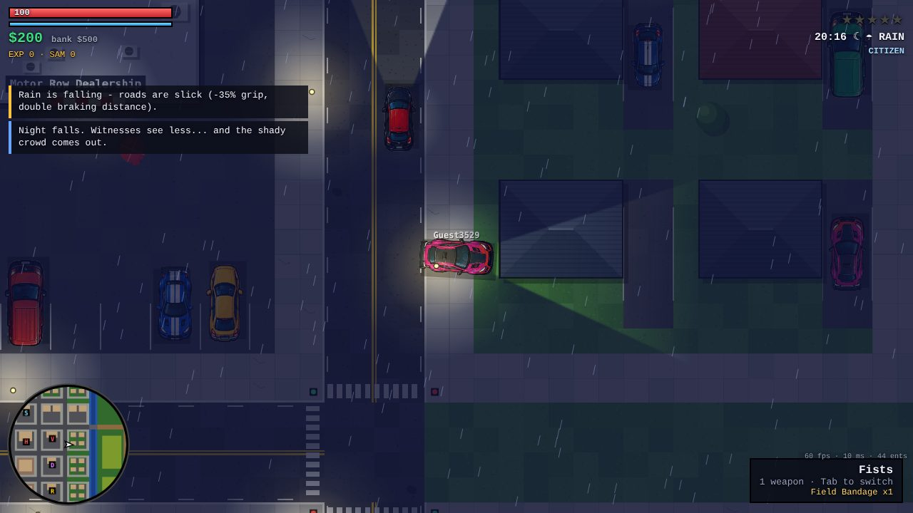
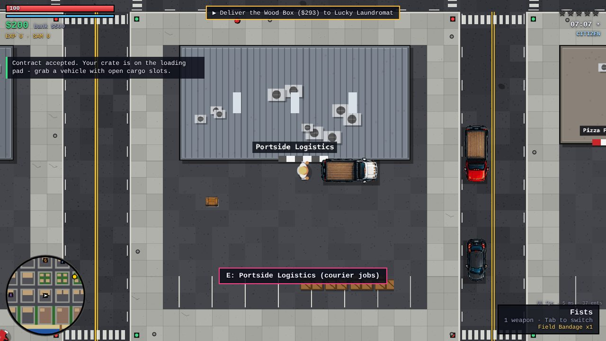
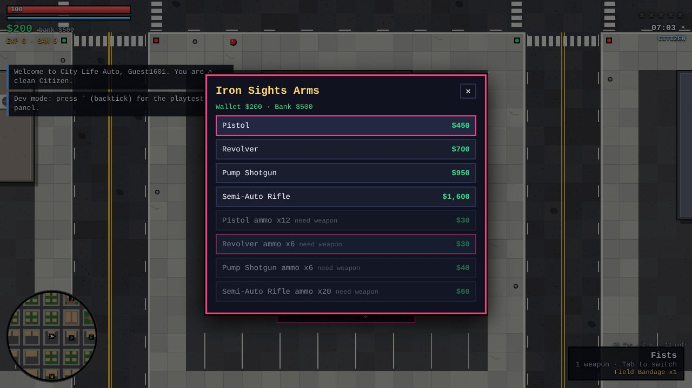
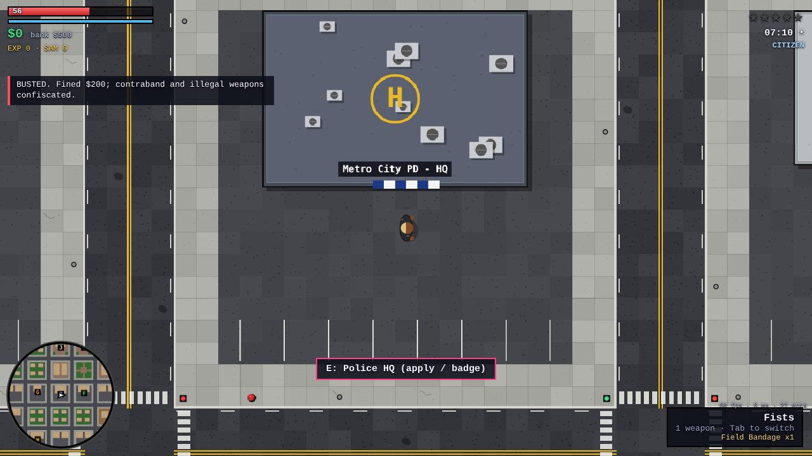
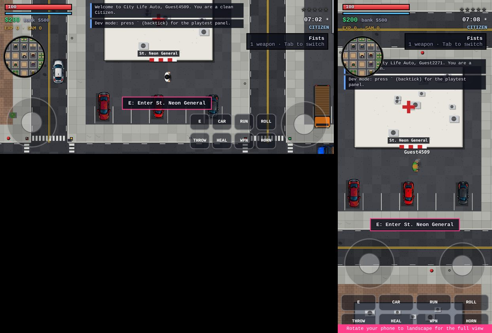

## 2026-10-03 · Character redraw

Players and every NPC archetype are now redrawn as top-down 16-bit pixel art in the concept-sheet style: a 24x24 art grid (1 art px = 2 world px, the same scale as the buildings), 3-tone shading, and a dark outline. They are drawn crisp, with no blur. Outfits are layered from the appearance the server already sends, so each archetype reads at a glance:
- suit and tie (executives)
- hard hat and hi-vis vest (construction)
- sun hat and dress (socialites)
- uniform and badge (cops)
- helmet and visor (SWAT)
- red bandana (gang)
- fur coat, hoodie, cardigan, briefcase, purse and tool bag

Animations:
- 8-frame walk and run, with legs that visibly step out
- breathing idle
- left/right jabs, where the fist extends past the body
- melee arc swing with weapons in hand
- aim, carry, fishing, dive roll, knocked down and dead

Each sprite is cached per look, pose and frame. You can preview every archetype and pose at `/tools/character-preview.html`.

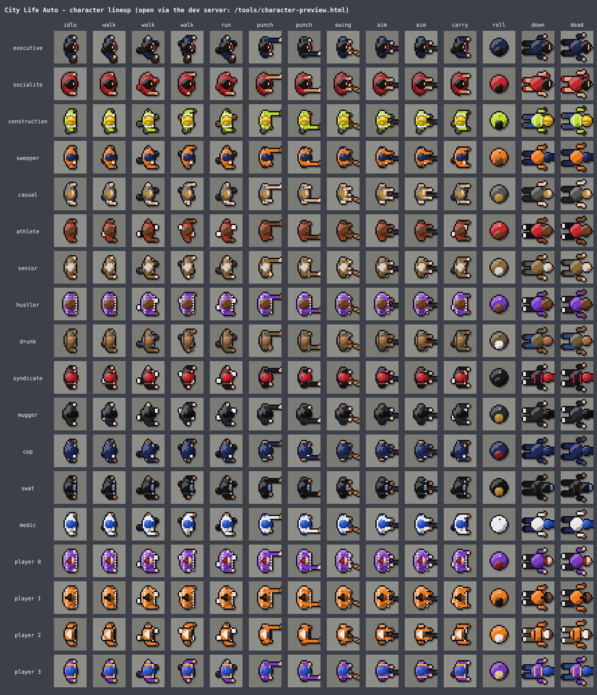

## 2026-10-03 · GTA2-style city layout + sharp art

**World layout (modelled on the GTA1/GTA2 level maps).** The city is now three islands separated by water channels and joined by bridges, plus a farm island:
- **Industrial:** Harbor docks, Ironworks, Greenfield Park with a pond, and The Yards (gang turf).
- **Residential:** Pine Hills, Northgate, Southside (gang turf) and Sunset Beach with piers.
- **Downtown:** Civic Center with Central Park, the Downtown towers, Midtown shops and the Neon Strip.
- **Refuge Island:** reached over a causeway from Neon Blvd; farm, fields and woods.

Each island has a coast ring road with a waterfront outside it: quays, promenade, lawns or beach, with piers and marinas. Inside, a hand-laid avenue grid has T-junction stubs, and every cell is cut into irregular blocks of mixed sizes. Blocks are lined with the concept building lots. Leftover lots and small blocks become solid rooftop buildings, so the city reads dense like the originals:
- tar, gravel, corrugated metal, glass or terracotta roofs
- parapets
- AC units, tanks, skylights and helipads cut from the concept roof tiles

The district title now shows the island under it. Crossing a bridge shows "Liberty Bay". The map is 432x416 tiles, up from 384x352. Three hospitals, one per island: St. Neon General, Westside Medical and Ironworks Clinic.

**Sharper graphics.** Buildings were blurry because the concept-sheet lots were stretched 2x at runtime. The art build now upscales them 4x with Real-ESRGAN, using a small torch-free numpy port in `tools/sr_upscale.py`. It then stores them at exactly 1 art px per world px, drawn nearest-neighbour. Grass, sand and dirt are new seamless pixel-art textures. The world only uses smoothing while zoomed out at speed, to avoid shimmer.

**Tools.** `/tools/map-preview.html?scale=0.125` renders the whole city with the game's own chunk baker, plus district labels.

Load test, 100 bots spread over the new map: 13–14 ms per tick (of a 50 ms budget), about 15 KB/s per player, 0 errors. All 21 tests pass.

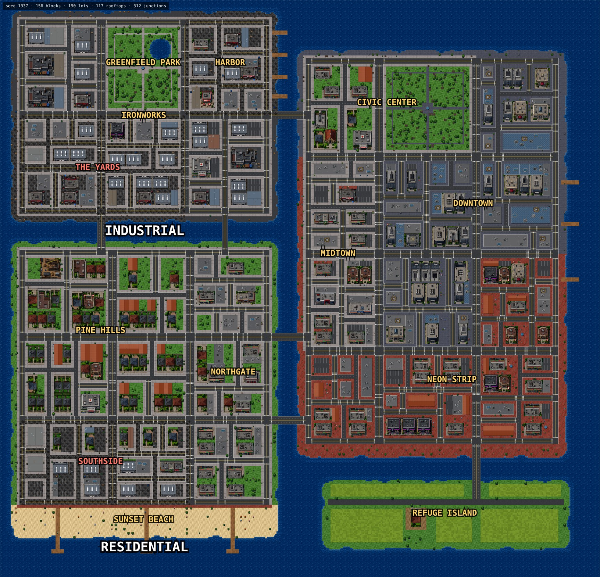

## 2026-10-03 · Art pass: blended blocks, reference hospital, night + rain

**Blocks blend together.** There are no more asphalt or odd-coloured patches between buildings. Every lot now sits on its district's own paving or lawn: Midtown is continuous concrete like its sidewalks, Downtown slate, the Neon Strip brick, and Pine Hills lawns. Each concept lot has feathered edges, so it fades into the surrounding paving instead of reading as a pasted rectangle.

**New hospital (all three hospitals),** built from the rainy-night street reference:
- the reference's lobby facade: lit glass, red-cross sign, entrance canopy and planter beds
- a parapet roof with a helipad, AC units, tanks, a skylight and a rooftop red cross
- a paved forecourt with tree planters, lamps and benches either side of the doors

**Night.** Every building lot has a generated emissive layer: facade glass turns warm yellow, lit windows and neon signs keep their colour, with a soft halo. It is drawn additively after dark. Street-lamp pools are bigger and warmer.

**Rain.**
- Wet asphalt reflects headlights (warm), tail and brake lights (red), sirens, street lamps and lit shopfronts as broken vertical streaks.
- Cars throw tyre spray.
- Drops splash on the ground.
- Most pedestrians now open umbrellas, drawn as pixel-art canopies in six colours.

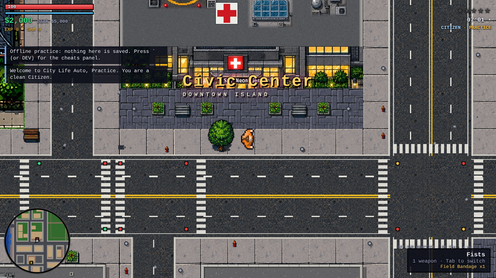
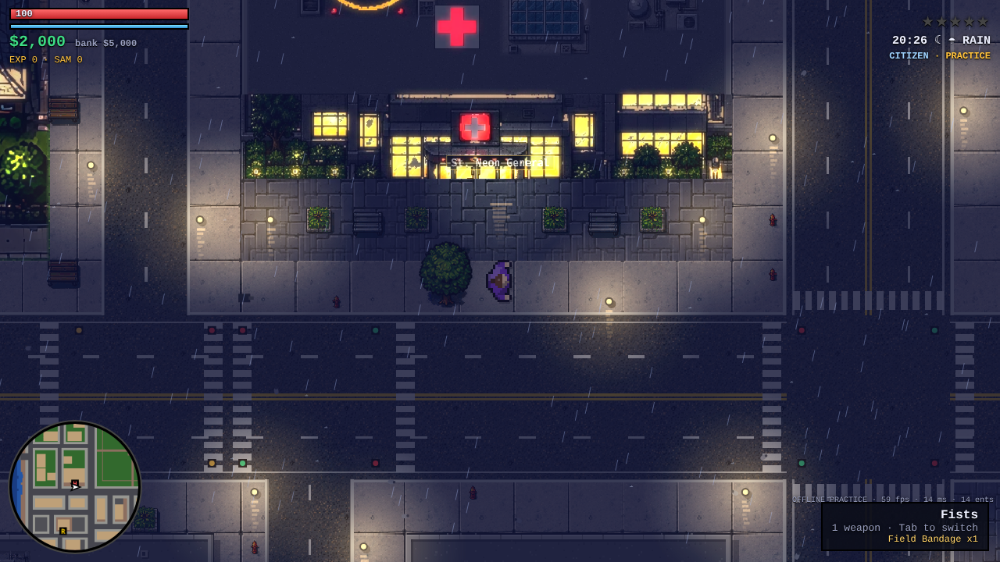

## 2026-10-03 · Twin-stick controls, smooth movement, mobile UX, GTA-style HUD

**Animation fix.** The 8-frame gait jumped from the full stride on one side straight to the other side, so walk and run never looped cleanly. Stride now follows a sine over the 8 frames. Each ped also has a walk phase driven by how far it actually moved on screen. Stride length and leg amplitude blend across four speed levels (stroll, walk, jog, run), so walking eases into running without the loop resetting.

**Movement feel.** How far you push now sets your speed:
- a light push walks, full push runs, and sprint adds a stamina burst on top
- speeding up eases in; letting go glides a short way before stopping
- the character turns smoothly instead of snapping

On keyboard, C or Ctrl walks.

**Driving.** The stick, keys or thumb point where you want to go:
- the car steers toward that direction, and push depth sets cruising speed
- pull back hard to brake, then reverse with the rear swinging round
- Settings has "Classic tank" driving for keyboard players who prefer W = gas, A/D = steer

**Twin-stick aiming.**
- Keyboard + mouse: WASD moves and the cursor aims. With a gun out you always face the cursor. Unarmed, you face where you walk and turn to the cursor to punch.
- Gamepad: the left stick moves or drives and the right stick aims. RT fires, LT sprints on foot or works as the handbrake in a car. A rolls, B interacts, X gets in or out, Y throws, LB/RB switch weapons, R3 reloads, Menu opens the map.
- Touch:
  - the left thumb-stick appears wherever you touch the left side
  - the right stick aims, shown with an aim line
  - firing is deliberate: tap the big FIRE button (it uses your last aim for about a second), or push the aim stick into its red outer ring, which buzzes when it engages
  - the ring can be turned off in Settings

**Device-aware hints.** The game detects touch devices and shows touch controls and help from the title screen onward. Prompts are GTA-style help boxes showing the right button for your device: a key cap, an Xbox-colour face button, or the on-screen button name. On touch, the matching button pulses. Contextual buttons:
- THROW appears only when carrying
- RELOAD only when armed
- HORN and BRAKE only in a car

Tap the weapon box to switch weapons and the radar to open the map.

**Fullscreen and landscape.**
- Mobile goes fullscreen when you press play, and there are ⛶ buttons on the title screen and in the HUD.
- Android also locks to landscape.
- iPhone gets an Add-to-Home-Screen hint.
- In portrait, a "landscape shows more" tip appears once and fades out.

**GTA-style HUD.**
- Fonts: Anton and Barlow Condensed, self-hosted.
- Top-right: weapon pixel icon and ammo, big outlined green money, white wanted stars.
- Bottom-left: circular radar with health and stamina bars.
- Help box and notifications top-left.
- Interaction-style shop menus.
- WASTED card over a desaturated screen.
- Skewed title buttons.

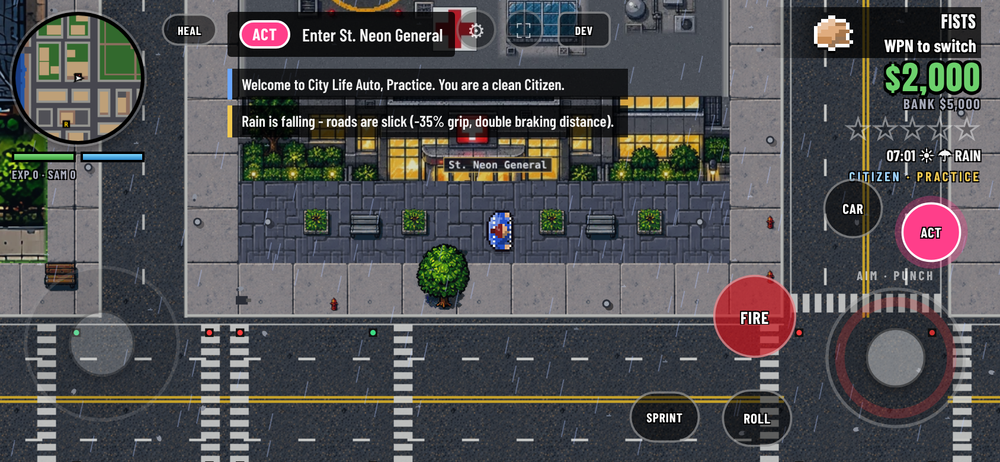

## 2026-10-03 · NPC toughness + fist fights, gamepad pause menu

**Why punched NPCs didn't die.** Fists did 8 damage against about 100 HP. Every punch shoved the target out of reach, and anyone who fled sprinted faster than you could chase. So a fist fight in practice never ended.

**Builds.** Every NPC now rolls a build, weighted by type: seniors are mostly frail, construction workers often tough, Syndicate heavies often brutes. Brutes are drawn bigger and frail people smaller, so you can size up a fight before you start it.

| Build | Health | Hits back with | Notes |
|---|---|---|---|
| Frail | 0.55x | 0.65x | flees more |
| Average | 1x | 1x | |
| Tough | 1.45x | 1.4x | more likely to fight back |
| Brute | 1.8x | 1.6x | needs 4-hit combos to floor |

**Fist fighting.**
- Fists hit for 10, with a shorter shove scaled by your strength against their poise, so you can keep a combo going.
- Three hits in quick succession is a KNOCKDOWN (four against brutes, and four against players). Hits on someone who's down do 1.5x.
- NPC brawlers swing a little slower than players.
- A health bar appears over whoever you're fighting, tagged TOUGH or BRUTE.

Simulated standing slugfests (480 fights, no dodging): you beat frail NPCs 100% of the time in about 4 punches, average 99% in about 8, tough about 88% in about 13, and brutes about 32%. Rolling and footwork improve those odds.

**Gamepad pause menu.** Start/Menu (or Esc) opens a GTA-style pause menu: Resume, Map, Settings, Controls, Toggle fullscreen, the Debug / cheats menu (dev and practice), and Back to title. The D-pad or left stick moves, A selects, left/right changes a setting, B goes back. The settings and debug panels are fully navigable with the pad.

## 2026-10-03 · Gamepad title screen + GTA-style trigger driving

- **Title screen:** the pad now works from the start. The D-pad or left stick moves between PLAY, PRACTICE, SETTINGS and FULLSCREEN, A or Start presses, and settings opened from the title are navigable too (B closes).
- **Driving with a pad is back to triggers, GTA1/2-style:**
  - RT gas and LT brake, then reverse (both analog, so a light squeeze cruises)
  - left stick steers, A handbrake
  - right stick aims drive-by fire, and pushing it all the way out shoots
  - a "point the stick where to go" option remains under Settings → Gamepad driving
- On foot nothing changes: left stick moves, right stick aims, RT fires.

## 2026-10-03 · Updates go live instantly + controller trigger fix

- **Why the RT driving fix seemed missing:** GitHub Pages lets browsers cache the game's JavaScript for 10 minutes, so right after a push you could still be running the previous controls code. `client/boot.js` now checks `version.json` uncached on every launch. When the build changed, it re-downloads every game file fresh before starting. The title screen shows the build id and time, so you can see which version you're on.
- **Release step:** run `node tools/stamp-version.mjs` before committing (it rewrites `version.json`).
- **Controllers that report triggers as axes:** some browser/OS combinations expose an Xbox pad without the standard mapping, with triggers on axes 2 and 5 resting at -1 and the right stick on axes 3/4. These are now detected, so RT/LT work there too. Tested with both layouts in the automated browser: RT accelerates, LT brakes and then reverses.
- Hard steering no longer scales the gas down in trigger-driving mode.

## 2026-10-03 · Destructible streets, signal poles, traffic loop fix, cash drops, smoother driving

**Destructible props.** About 60 kinds of street furniture now break:
- trees and palms
- lamp posts and hydrants
- bins, benches, planters and bushes
- newsstands, vending machines and mailboxes
- cones, barriers, pallets, drums, spools, carts and umbrellas

How it works:
- A car above roughly 85 px/s ploughs through instead of bouncing off, and loses some speed doing it. Trees, lamp posts and hydrants dent the car.
- Explosions also smash props in their radius.
- Breaks are server-authoritative and broadcast to everyone, and late joiners get the list in their welcome message. The ground is re-drawn with debris. Trees topple over beside a stump, lamp posts lie in the street, and smashed hydrants spout a geyser that drags passing cars.
- A tidy-up crew restores props after 4 minutes, but only when no player is within view.
- Fountains, dumpsters, ATMs and market stalls stay solid.

**Poles.**
- Traffic signals hang from mast arms: a pole on each corner with an arm over the approaching lanes and a 3-lamp head. The signal lamps glow at night.
- Street lights are poles with an arm over the road. The lamp head is lit at night, the light pool comes from the head, and they can be knocked down.
- Traffic cameras sit on yellow-banded poles with a white housing pointing at the junction.

**Traffic stuck in circles.** A waypoint inside a car's turning circle made drivers orbit forever. Drivers now drop that waypoint after about one lap, and re-join the road network at the nearest junction after about two. In a 4-minute simulation with 3 players, 10 of 154 traffic cars were caught orbiting before the fix and 0 of 230 after.

**Backwards vehicles.** The bus and the armored truck were cut from the sheet facing the wrong way. Fixed.

**Cash drops.**
- Not every NPC carries money: about 90% of executives do, but only about 30% of drunks.
- When the only loot is cash, it drops as a little pile of bills you scoop up by walking over it, with a floating "+$N".
- Bags are kept for item loot.

**Smoother driving.**
- When the server catches up on a backed-up input queue, it now gives the car the extra physics step the client already predicted. This removes a steady source of corrections.
- Heading corrections are eased instead of snapped.
- In a car, position corrections ease over about 150 ms.
- The camera's look-ahead follows smoothed velocity instead of the raw heading.

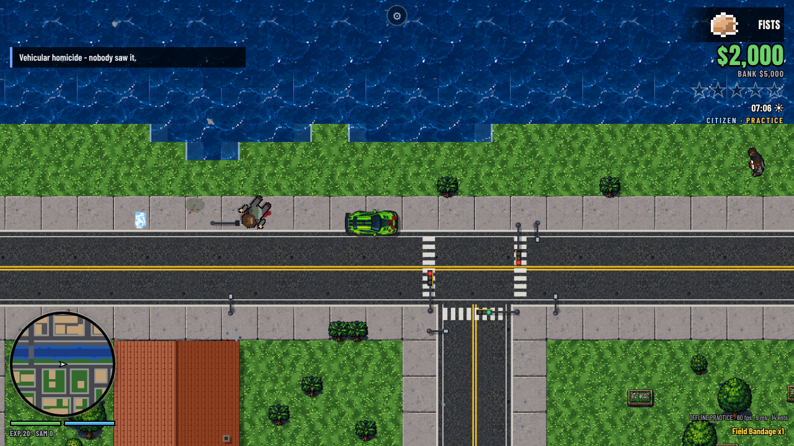
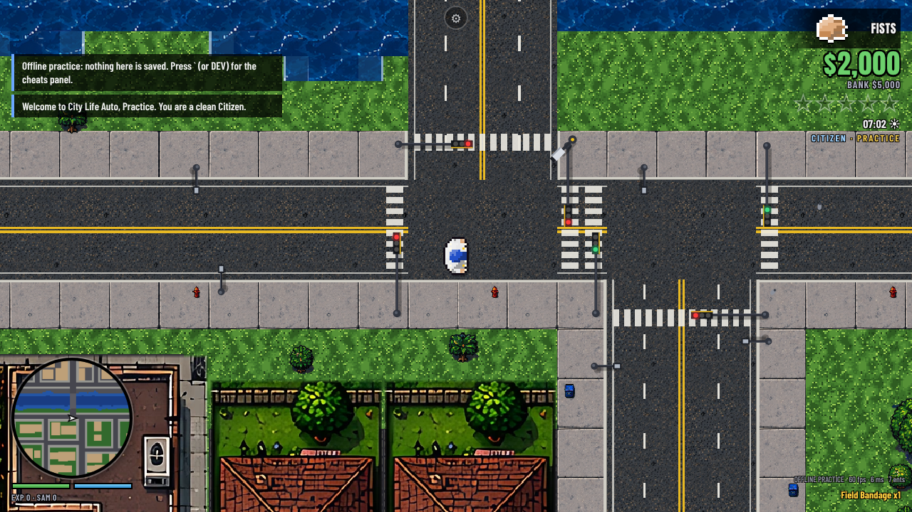

## 2026-10-03 · Installable app (separate from the other deadbaron.com games)

City Life Auto now installs as its own app from Chrome (Android "Install app", or the ⬇ INSTALL APP button on the title screen when Chrome offers it):
- **No overlap with the other games.** `manifest.webmanifest` has `id` and `scope` `/city-life-auto/` and start URL `/city-life-auto/?source=app`, so it installs next to Neon Asteroids (`/neon-asteroids/`) and Gear Bugs (`/gear-bugs/`) without clashing.
- **Display:** fullscreen, landscape.
- **Icons:** made from the logo, including maskable versions for Android's icon shapes, plus an iOS home-screen icon.
- **Service worker (`sw.js`):** scoped to `/city-life-auto/` and only ever clears its own `city-life-auto-` caches. It's network-first, so updates still land immediately, and keeps the cached copy as an offline fallback.
- **Offline practice:** after one online visit, Practice works with no connection, because the boot loader's version check pre-loads every game file.
- **Verified in Chromium:** no manifest errors, no installability errors, the service worker controls only `/city-life-auto/`, and offline practice runs after a reload with the network cut.

## 2026-10-03 · Cop-car theft, world map, police ranks + dispatch map, debug tools, portrait fullscreen

- **Stealing police cars works.** When you jacked a crewed cruiser, the officer you threw out was immediately able to drag you back out (NPCs pull drivers from slow cars). Now:
  - A jacked driver is knocked to the ground for about 1.6 s.
  - NPC passengers bail out too.
  - Officers from a hijacked unit chase and shoot instead of dragging you out.
  - Civilians only try to drag you out once every 6 s.
- **World map.** `assets/worldmap.webp` is baked from the game's own renderer (`python3 tools/build-worldmap.py`). It opens with M, the new ▦ HUD button, a tap on the radar, or Start → Map, and shows:
  - district names
  - shops and services
  - your homes, job and drop rumors
  - you
- **Police ranks.** Officer → Senior Officer → Sergeant → Lieutenant → Captain → Chief of Police. Ranks come from service points: arrests (10 × stars), NPC custody (4) and bounties (15). Promotions are announced, and the HUD shows "POLICE · RANK".
- **Police dispatch map.** On duty, the world map becomes dispatch:
  - **Crime reports:** only crimes a witness, camera or officer actually reported, plus purse-snatching calls. Each shows its age, and higher ranks keep reports longer.
  - **Live suspect markers:** only while someone can currently see them.
  - **Last-known search areas:** once a suspect slips out of sight. Nothing shows once they're gone.
  - **Fleeing NPC muggers:** while you have line of sight.
- **Debug menu:**
  - "Wipe criminal record (felonies)": clears wanted level, felonies, peak-wanted memory and any firing.
  - "Join the police (badge + rank)"
  - "Promote police rank"
- **Fullscreen in portrait:** the landscape lock is gone, and the installed app's manifest orientation is now "any".

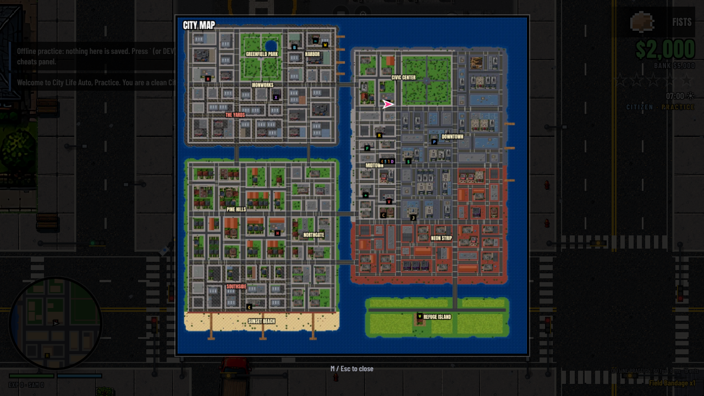
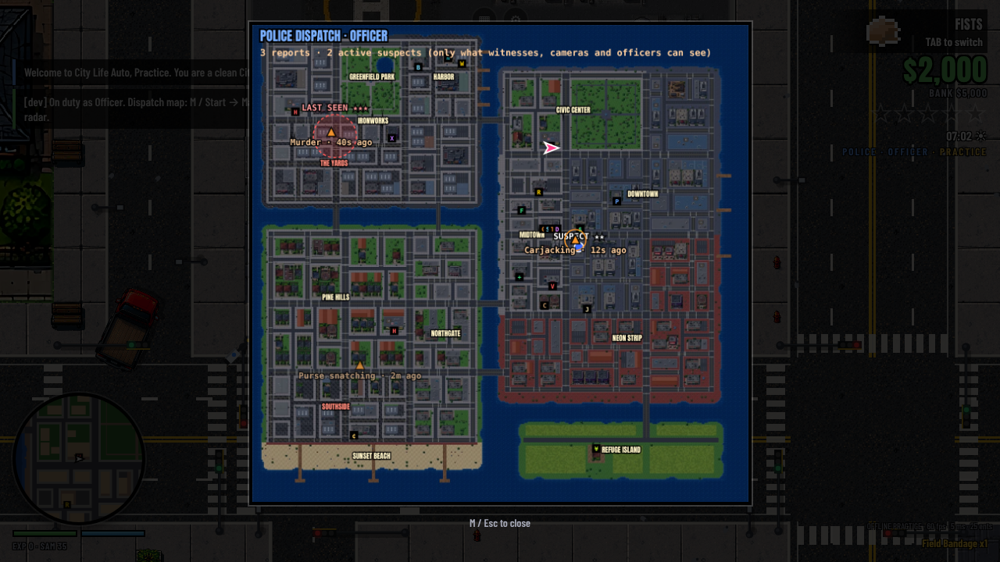

## 2026-10-03 · Rotation in fullscreen and in the installed app

- The game now asks the phone to follow its rotation sensor (`screen.orientation.lock('any')`) whenever it is fullscreen, and at launch when running as the installed app. This overrides an install made while the manifest still said landscape-only; Android only refreshes an installed app's manifest after about a day.
- Rotation re-fits the canvas and switches between the landscape and portrait HUD and touch layouts. The game listens for `resize`, `orientationchange`, `screen.orientation` change and `visualViewport` resize, because a rotation in fullscreen doesn't always fire `resize`. Canvas sizes are only reset when they actually change.
- Tested in headless Chromium by rotating mid-game from landscape (844×390) to portrait (390×844) and back: the canvas and portrait layout switched each time.

## Reinstall after uninstall
- Manifest `id` bumped to `/city-life-auto/app` (start_url `?source=pwa`) so phones holding a stale install record see a brand-new app; `related_applications` lets the page detect an existing install.
- Install button is always shown outside the app. It uses Chrome's native prompt when offered; otherwise it opens an install sheet with per-browser steps plus "already installed?" fixes.
- Settings → "Repair install": unregisters only the `/city-life-auto/` service worker, deletes `city-life-auto-*` caches, clears the build stamp and reloads. Other deadbaron.com games and saves are untouched. SW cache bumped to v2.

## Personal police cruisers
- Going on duty (HQ badge desk or dev "Join the police") puts you behind the wheel of your own Interceptor immediately.
- Cruiser wrecked or stolen → a 15 s cooldown, then **Call cruiser** (V / D-pad down / COP CAR touch button / pause menu). An NPC officer drives a new one to you, parks within ~150 px, gets out and walks off. If it's stuck in traffic for 45 s it's placed right next to you instead.
- A delivered (or HQ-requisitioned) cruiser stays locked to its officer until they first get in; after that it's an ordinary police car that can be stolen.
- Blue chevron orbits the player pointing at the cruiser, a red/blue marker bobs over it, and it shows as a blue square on the radar and world map.
- Leave it more than 900 px behind for 25 s (or cross town) and it's towed back to HQ: no cooldown, call another any time. Going off duty or logging out returns it to the pool.
- New system `server/systems/cruiser.js` runs after police in SYSTEMS. `me.cruiser = { s: none|coming|parked|in, cd, id, x, y }`. Client→server message `{ t: 'cruiser' }`.

## Police kit, misconduct grace, knock-out arrests, bail-outs and blasts
- **Service pistol:** going on duty issues the Police Service Pistol (15-round mag, 75 rounds) and equips it. The Police HQ menu gains a free "Armory: restock service pistol ammo". Your own weapons stay usable on duty. Department gear (taser, baton, service pistol) is handed back off duty or lost on death.
- **Misconduct grace:** officers get 3 strikes. Murder and vehicular homicide count 2, killing an officer counts 3, and shots fired don't count. Each strike expires after 10 real minutes. Graced crimes carry no heat; you get a warning toast, and the HUD faction line shows `MISCONDUCT n/3` (flashing at the last strike). One more strike: fired (10-minute lockout), and that crime counts normally.
- **Cruiser arrow removed:** the cruiser now only appears as a blue square on the radar and world map.
- **Crime blips:** dispatch reports within radar range pulse on the minimap for 2 minutes.
- **Suspect markers:** officers see a small red/blue chevron over visible criminals (wanted players, flagged NPCs). It becomes a pulsing ring once the suspect is down, meaning you can cuff them.
- **Arrests need a knockout:** the suspect must be floored, tased, tackled (dive into them) or run down. Officers and hunters who floor a suspect keep them down for 6 s. Being badly hurt is no longer enough. Walk up and interact: "Cuff X". Dead suspects (NPC or player) leave a body to "Book" for a smaller reward. Fixed: player-made arrests never paid out (the player object was passed instead of the ped).
- **Blown up in a car:** you're thrown clear. 50% dead; otherwise down at 6–16% HP, bleeding, for 3.5 s.
- **Bailing out above 140 px/s:** you roll out and slide (new `tumble` ped mod, shared with prediction, friction 2.2/s), down for up to 2.6 s. Damage scales with speed. Hitting a wall or car mid-tumble hurts more and can kill. The client draws the roll pose while a downed ped is still moving fast.

## City tour (tutorial cut scene)
- **Script:** `shared/tutorial.js` holds 30 stops in 6 chapters: The City, Survival Basics, Citizen Path, Criminal Path, Police Path, Your Move.
  - Stops point at POI kinds, districts, islands, traffic cameras, drop sites, gang turf and home clusters, resolved against `generateCity()` at play time.
  - Text tokens: `{{kind}}` / `{{kind:where}}` give live names and districts, and `[[action]]` gives the device-specific key or button.
  - Numbers come from the new `shared/rules.js`. Police, arrest, respawn and hospital constants moved there, and the server imports them.
  - Island stops list the places that are actually on that island.
- **Player:** `client/tutorial.js` flies a camera over the real city: the world-map image when zoomed out, live-baked chunks when zoomed in.
  - Pulsing rings and labels mark places; demo vehicles drive real road routes (courier van, harvest pickup, getaway car with a cruiser in pursuit, police call with siren).
  - Steps auto-advance with a progress bar, with Back / Pause / Next / Skip and chapter tabs. Keyboard: ←/→, Space, P, Esc. Gamepad: d-pad/stick ←/→, A, B. Touch: tap.
- **When it plays:** it plays before a first-timer's first Play or Practice (Skip always available). A title-screen card offers it too, along with a "📖 VIEW TUTORIAL" button and a pause-menu entry.
  - Seen state is stored as `cla.tutorial` = `TUTORIAL_VERSION`; bumping the version re-offers the updated tour.
- **Controls:** the key/button tables moved to `shared/controls.js`, read by both the HUD glyphs and the tour.
- **Guard rails:** `test/tutorial.test.js` checks that every stop and route resolves on the map and that all place tokens resolve. It also requires every POI kind, island, turf, camera/drop-site stop, control action and rule constant to be covered. This caught the missing gas/brake/pause explanations. The upkeep rule is in `CLAUDE.md`.

## Fix: title screen jumping on mobile
- While the online server was unreachable, every reconnect attempt rewrote the status line between a one-line "Connecting to …" and the two-line "isn't reachable" message. On narrow screens that changed its height, and the centred title column (buttons, tutorial card) jumped ~19 px every few seconds.
- Now only the first attempt says "Connecting…"; retries keep the current message. `#t-status` also always reserves two lines, so status changes can't shift the layout.

## Fix: driving jitter, dark circles, grey box on wrecks
- **Car vibrating / blurry while driving:** when a tick's input hadn't arrived yet (phone timer jitter, network hiccup), the server still stepped the player's car with the last input. The server ended up a step ahead of the client's prediction, and every snapshot corrected the car back and forth (up to 15 px in a jitter simulation).
  - Player-driven cars are now stepped exactly once per received input (`vehicles.stepVehicle` from `players.processInputs`); the vehicles system skips them.
  - A late input holds the character/car for up to 250 ms (`HOLD_TICKS`) instead of guessing.
  - The car's reverse-gear state is now sent to the driver (self flag 32), so point-to-drive prediction matches when reversing too.
  - New test: uneven input arrival, prediction must match the server exactly (it does: 0.0 px).
- **Random dark circles:** explosion scorch marks were flat 66 px solid discs. They're now a soft, ragged soot blotch texture (built once, cached).
- **Grey box around burning / wrecked cars:** the wreck tint was a filled rectangle over the whole sprite box, transparent corners included. Wrecks now draw a cached, charred copy of the car sprite (tint applied to the car's pixels only).
- Playtest hook: add `?debug` to the URL to expose the client state as `window.__S`.

## Water, bridges, world events, fling landings, gamepad respawn
- **Gamepad on the death screen:** D-pad / stick picks where to wake up, A confirms, and the label shows the buttons.
- **Docks and water:** `CAR_BLOCK` no longer includes docks or water.
  - A land vehicle whose centre enters water starts sinking: occupants spill into the water, and after `SINK_S` (3.2 s) it blows up underwater (`sinkboom`: splash, muffled boom, no blast damage) and is removed with its cargo. Sinking cars fade and bubble on the client.
  - Spawns use `CAR_SPAWN_BLOCK`; boats spawn on water (`BOAT_BLOCK`).
- **Swimming:**
  - Players can enter water (`SWIM_BLOCK`). `pedStep` swims at 42% speed with no sprint or roll; you can't attack while swimming, and you climb out anywhere.
  - NPCs in the water head for the nearest land (`nearestLand`).
  - Leaving a boat in open water drops you over the side.
  - Swimmers draw half-submerged with ripples.
- **Bridges:**
  - Bridge tiles are two layers: `s.under` is set when you enter from water and cleared on land, so swimmers and boats are *under* the deck while walkers and cars are on top. The swimming bit rides in the ped's `extra` byte (bit 7).
  - The renderer draws swimmers and boats, then re-draws the baked deck tiles over them, then land vehicles and peds. Your own boat or swimmer gets a faint dashed outline while underneath.
  - New bridge look: walkways, railings with posts, lamps, a side face and a cast shadow on the water, plus pier stubs.
- **World events (`server/systems/events.js`, `shared/worldevents.js`):**
  - Snatch-and-grab (orange, follows the thief), contraband drop (purple), and "return the purse" (green, shown to whoever holds a purse, pointing at the robbed victim).
  - Colour-coded pulsing radar and world-map blips.
  - A labelled arrow with distance around the player plus a ring on the spot. The arrow shows for 10 s from first sight, then fades, and doesn't come back for that event.
- **Flung from vehicles:**
  - `vehicles.fling()` covers bail-outs, high-speed carjacks and passenger ejections, bike crashes and explosions.
  - Airborne arc (`airUntil`, low friction; self flag 32 for prediction), then a random landing: roll, faceplant or slide on the back. Damage scales with speed.
  - The client animates the arc from a `fling` event: lift, scale, spin, ground shadow, dust puff and a thud on landing.
  - NPCs now fly and slide too (wall and car impacts hurt them).
  - Slow carjacks are just a short stumble.
- **Dev:** the debug menu sits at the top of the pause menu, and Give Weapons is first in it. New commands: `snatch` (trigger one nearby) and `die` (respawn test).
- **Tutorial v2:** new "Into the water" stop, and the event colours are explained. The tutorial tests now also require every world event type to be covered.

## Phone, job board, patrol calls, banking
- **Phone** (`client/phone.js`, overlay; P / D-pad ← / 📱 HUD button / pause menu; B or Esc steps back):
  - **Places:** nearest-first lists from the shared map: hospitals & police, banks & ATMs, shops, places to sell, cars & boats, work & law, gang HQs. Each entry shows what it's for, its district and distance; picking one sets a waypoint.
  - **Jobs:** the server board (`server/systems/phone.js`) keeps ~7 deliveries between storefronts, tiered by distance via `JOB_TIERS` in `shared/rules.js`: $ nearby / $$ across town / $$$ island to island, with pay and time limits scaling. It also lists the farm harvest and, for on-duty officers, 3 patrol calls. One job at a time; cancel from the phone. You can still start jobs in person at the warehouse and farm.
- **Waypoints:** job target (yellow) and phone waypoint (cyan) show as a minimap blip in range or an arrow on the radar rim when not, plus a marker on the world map and a small diamond on the spot. Phone waypoints clear on arrival.
  - Jobs guide you to the pickup first (crate not yet touched), then the drop-off (`phone.jobTarget`).
- **Patrol calls (police):** drive to the district → look around for `PATROL_SEARCH_S` (6–14 s) → a purse snatching is staged nearby, and the waypoint follows the suspect. Cuff the suspect or book the body for `PATROL_PAY` ($250–450) paid to the bank (`phone.onCriminalStopped` hooked into arrests and body booking). Escape or going off duty ends the patrol.
- **Banking:** a First Pixel Bank branch on each island that lacked one (converted storefront + ATM) and up to two street ATMs per district (3 banks, 15 ATMs on the default seed). Shop sales (items, weapons) and black-market sales now go straight to the bank.
- **Gang HQs:** a Syndicate HQ in each gang-turf district (`kind: 'gang'`).
- **Tutorial v3:** new "Your phone" and "Patrol calls" stops; gang HQs and bank-paid sales covered. The coverage tests flagged all of these until they were taught.

## Smoother driving and walking (round 2)
Measured with 4x CPU throttling (phone-like frame times). Before: driving speed wobbled 8–15% frame to frame and the car shifted up to 14 px on screen per frame; walking wobbled ~10%. After: driving 1–2%, car steady on screen; walking 0.4%.
- **Reconcile kept the render interpolation:** each snapshot used to reset `prev = current`, so the character drew a partial step ahead until the next fixed step, then snapped back. Replay now keeps `prev` = state before the last pending input, and the correction is measured on the *drawn* (interpolated) position.
- **Camera locked to the smoothed character:** the old chase lerp (`min(1, dt*8)`) made the lag depend on frame time, so the car slid around on screen on uneven frames. The look-ahead and zoom easing are now frame-rate independent (`1 - exp(-k dt)`).
- **World transform snapped to whole device pixels:** pixel-art ground and sprites no longer shimmer against each other.
- **Street-furniture smashes are predicted:** `shared/smash.js` (`smashProps`, `geyserDrag`) is used by both the server and the driver's client. The client applies the same momentum loss, marks the prop broken at once (instant debris), and predicts hydrant geysers. Replays treat a break or geyser from a later input as not-yet-happened, and unconfirmed predicted breaks are put back after 2 s. On the server, player-driven cars run the smash and spray checks once per input step. In a smash-heavy test drive (10 props incl. hydrants) the server/prediction divergence went from 173 px to 0.
- Remaining corrections only come from real contact with other moving vehicles or people.

## Menu fixes, resume, tutorial prompt, combat balance
- **Death screen:** no control hint text. A wake-up spot is pre-selected (your home, else a random hospital away from where you died; `homes.defaultChoice`). Left/right on the pad, ←/→/A/D/W/S on the keyboard, tap or click changes it. Picking no longer cuts the wake-up timer short.
- **Menus by keyboard:** every overlay (pause, phone, settings, controls, dev, tutorial prompt) and the shop/POI menus navigate with W/S or ↑/↓, select with Enter / Space / E, A/D or ←/→ change settings, and Esc steps back. The phone home screen is now a vertical list like the rest of the phone.
- **B no longer reopens a shop/HQ menu:** after any menu or overlay closes, interact/roll/enter-car/fire/throw/heal are ignored until released (B is also interact on a pad).
- **Resume game:** "Back to title screen" now leaves a ▶ RESUME GAME button on the title.
- **Tutorial prompt:** the title-screen card is gone (it shifted the menu). On a first-time Play / Practice, a popup asks "Watch the tutorial / Skip" (or "The city tour has been updated").
- **Combat balance (in `shared/rules.js`):**
  - `NPC_GUN_MULT` = 6: a pistol drops most people in 1–2 shots, cops in 2–3, SWAT in 3+. Players keep their old staying power.
  - Bazooka: a rocket landing on or right next to a vehicle wrecks it; the armored van and SWAT truck take `ARMORED_ROCKETS` = 2.
  - `VEHICLE_TOUGHNESS` = 1.35: cars and boats take ~26% less damage from crashes, rams, props and gunfire. Motorcycles take full damage and still throw you on a hard crash.
- Tutorial v4 explains the new combat numbers; tests cover shots-to-kill, rockets and vehicle toughness.

## Gangs vs police, map waypoints, estates and hiding, Spray & Go, fines, bait shops
- **Gangs vs police** (`server/systems/gangwar.js`):
  - The syndicate ignores cops until provoked: a cop vehicle passing them faster than `GANG_PROVOKE_SPEED`, or a cop shooting nearby. Gang members within 450 px then fight that cop, and NPC cops nearby join in (`npc.war`).
  - Every `SHOOTOUT_EVERY_S` (3–5 min) a shootout starts near the turf of a player who is around: a police car, 3 cops using it as cover, and 3–4 syndicate members. It shows as a red `shootout` world event and is tidied up once nobody is watching. Dev command: `shootout`.
  - NPC gun multiplier only applies to player shooters. Cops no longer shoot their own car.
- **Map waypoints** (`client/mapwaypoints.js`): the big map has a side panel with the phone's place categories plus Fishing and Homes for sale (and My homes). Picking a category numbers every match on the map, nearest first; picking one sets the waypoint. Clicking anywhere on the map drops a marker. B / Esc steps back out of a category.
- **Estates** (`shared/map.js` `ESTATE_TYPES`, `buildEstates`): 3 farmhouses ($18k), 2 Bayview cottages ($30k), 3 beach houses on Sunset Beach ($45k) and the Hilltop Mansion ($150k), with a 26×24 yard, pool, fountain and a 5-wide garage. Each has a garage building with a roll-up door that opens as you pull up, or when a car is parked or taken out (`garagedoor` event). Earlier passes no longer dress estate lots.
- **Homes:**
  - No cap on how many you own. Every owned car can be taken out at any of your homes. Death screen still lists all hospitals.
  - Home menu: deposit cash to the bank, rest, set respawn, take out cars, and **Go inside**. You blink slowly, then fast, for `HIDE_TIME_S` (2.5 s); moving or being spotted by police cancels it.
  - Inside, your ped is out of the spatial grid: invisible to others, can't be hurt, and police can't see you, so heat fades. The inside menu adds a stash for items and guns (with ammo) in `profile.stash`, plus Step outside.
- **Spawn protection and spread:** every spawn and every step-out blinks for `SPAWN_PROTECT_S` (2 s). You can move, but can't shoot or take damage. Spawns pick one of several spots around the hospital or home (centre, sides, behind, side street), preferring spots with no other player nearby.
  - Wire: ped `extra` bits 4–5 hold the blink state (1 slow, 2 fast, 3 hidden).
- **Spray & Go** (`server/systems/paint.js`): 3 drive-in bays (one per island where possible). Stop inside and, if no witness, cop or camera sees you while you're wanted, the shutter drops for `PAINT_TIME_S`. The car comes out a new colour for `PAINT_PRICE` with no repair, and your wanted level is cleared. One coat per visit; cargo has to come off first.
- **Clean record:** pay `FELONY_FINE` per felony at Police HQ or the courthouse (not while wanted).
- **Hook & Line bait shops:** 3 shops near the water. They sell rods, worms (bass), shrimp (salmon), squid (tuna), glow lures (catfish, night) and shiny lures, and buy fish. Choose your bait at the counter; one is used per catch.
- **Smaller characters:** `PED_SCALE` 1.35 → 1.18. Prediction and the camera are untouched.
- **Tutorial v5:** map waypoints, spawn protection, estates and garages, hiding and stashing, Spray & Go, gangs vs police and shootouts, felony fines, bait. New `{ estates: 1 }` camera target.
- **Tests:** `test/homes.test.js` covers estates and garages, unlimited homes, hiding/stash/step-out protection, police losing you indoors, spawn spread and protection, the paint shop (refused when watched, unseen respray clears wanted), felony fines and bait. Also a gang-vs-police test in core. 57/57.

## Police HQ interior, armory and motor pool; sirens clear traffic; police motorcycles
- **Police HQ is a real place:**
  - Pressing E at the door walks you inside. A top-down lobby is drawn behind the menu (`client/interiors.js`). You're hidden and safe while inside, but you can't go in while wanted or within 6 s of a fight.
  - The front desk handles sign-up (Samaritan points, no felonies), felony fines and going off duty.
  - Signing up locks you in the **armory**. It holds the service pistol plus one long gun at a time: Patrol Rifle, Marksman Rifle, Semi-Auto Assault Rifle or Police Shotgun (`POLICE_ARMORY`, new weapons 15–18). Department weapons are handed back off duty.
  - The armory's back door leads into the **motor pool** (`server/systems/station.js`).
- **Motor pool** (`shared/map.js` `buildMotorPools`): the plain building beside HQ becomes a fenced lot with painted bays.
  - It holds 3 cruisers and 2 police motorcycles. Officers take any of them, and the vehicle becomes their duty vehicle (`cruiser.adopt`); a previous duty vehicle parked in the lot goes back into the pool.
  - The sliding gate (solid gate posts, `gate` event, synced in the welcome) opens for officers on foot or driving, and for anyone inside who wants out. It never closes on someone. Anyone else who takes a pool vehicle commits police-vehicle theft.
  - Empty bays restock for each new recruit, and every 20 s when nobody is watching.
  - The dev `cop` command still drops you straight into a cruiser.
- **Police motorcycles:** new `policebike` (the sport bike in police livery with a rear light bar). About 30% of 1–3 star NPC units are single motorcycle cops.
- **Sirens:** NPC traffic with a siren coming up behind slows to a crawl and eases toward the kerb. It overhangs the kerb by up to ~20 px, and only where that strip is clear of people, lamp posts, hydrants and walls. Without a siren, nothing changes.
- **Company flatbeds:** courier contracts park a company flatbed by the pickup unless a free cargo truck is already there, and the farm co-op now leaves a flatbed. Taking one isn't theft (`jobs.workTruck`).
- **Pedestrians:**
  - Idle people glance around in different directions, then walk off somewhere else. Nobody idles in the road; anyone on it heads for the pavement first.
  - Drivers left on foot become pedestrians, and cops whose unit is gone walk a beat instead of freezing.
- **Camera:** big screens show up to 30% more of the city (desktop full screen no longer zooms in tight); phones are unchanged.
- **City tour:** title screen only. It's gone from the pause menu, so it can't be used to dodge a fight.
- **Fixes:**
  - A stray "Practice" name lying in the street: the client now drops any entity the server hasn't mentioned for 4 s, and the server sends your own ped id.
  - The previous build broke the extra byte for non-ped entities, so loaded crates all drew in slot 0; restored. The ped weapon index is now 5 bits.
- Tutorial v6 (sign-up, armory, motor pool, sirens, motorcycles, company flatbeds). New `test/police.test.js` (7 tests).

## Walk-in buildings, dealership lots, home garage drive-out
- **Walk-in buildings** (`shared/map.js` `buildInteriors`): every shop, bank, hospital, the courthouse and police stations now have a real interior.
  - New tiles `FLOOR` (people walk on it, cars can't) and `COUNTER` (blocks people, not line of sight).
  - Interior layout: a wall ring, partitions between the units of a strip mall, a 2-tile doorway per unit, and a counter.
  - Each unit's interaction point moves in front of its counter. The hospital ER mat moved inside, by the desk.
- **Rendering:** each interior's floor plan is painted once per building into a cached canvas.
  - Inside: the plan shows under the roof art, which fades to ~12%.
  - Outside: the roof is redrawn over anyone in there.
  - Glass doors slide open when someone is within ~56 px.
- **Staff** (`server/systems/interiors.js`): a clerk, teller, nurse or desk sergeant behind every counter while a player is near. Staff who are attacked run (a desk cop fights back) and are replaced after 60 s. Pedestrians now browse shop floors too.
- **Police station:** the lobby is now a walk-in room. The front desk handles sign-up, fines and going off duty. Signing up (or "Armory & motor pool" on duty) is the only overlay left: the locked armory, then out to the motor pool.
- **Dealership lots** (`buildDealerLots`, `server/systems/dealer.js`): up to 6 display spaces on the lot. Each holds a random car from a weighted stock list at ±15% of list price, with a price tag on the windscreen.
  - Interact next to one to buy it: it's yours on the spot and added to your garage list. It can't be entered before it's bought.
  - Sold spaces restock after 60 s when nobody is close.
- **Homes:** inside, you can change your outfit (free, and nobody sees you change), see what you're carrying, and pick a car from your garage. A "Ready?" confirmation follows, then the garage door rolls up and the car eases out on its own over 2.2 s while you blink, untouchable. The client just watches (no prediction) during the drive-out.
- Tutorial v7. New `test/world.test.js`, plus a walk-in test in police tests.

## Out on the water: Pelican Key, Smuggler's Rock, the Syndicate, boats, poaching, deep-sea charters, races
- **Bigger sea:** the map is now 512 tiles wide (was 432), adding open water east of the city. `assets/worldmap.webp` was rebuilt, and the client ignores a stale world-map image whose shape doesn't match.
- **Pelican Key** (boat only): beaches, palms, a beach bar (delivery stop), the **Pelican Key Charters** dock (`charter`) with jet skis and a speedboat tied up, and the race start buoys off its shore.
- **Smuggler's Rock** (boat only, Syndicate turf): a walled compound with a members-only sliding gate, and the **Smuggler's Den** (`smuggler`) behind it, with a dock outside.
  - Guards hold posts, keep watch and give outsiders one 3-second warning, then open fire. If they're all killed, reinforcements arrive 4 minutes later.
- **Gates** generalised (`server/systems/gates.js`, `map.gates`): `police` gates (motor pools) and `gang` gates (compound). The rule decides who opens them; anyone inside can always get out.
- **Joining the Syndicate** (`server/systems/gang.js`): join at any gang HQ for `GANG_JOIN_FEE` ($500); cops can't join, and members can't join the force. Members are left alone on the turf and can use the Den.
- **The Den** sells an SMG, bazooka and shotgun, and gives **poaching jobs**: net sea turtles ($900) or hunt dolphins ($1,300) at a marked offshore spot.
  - Hold a cargo boat still over the spot for `NET_TIME_S` and the haul is loaded as contraband.
  - Doing it in front of a witness is a felony (`poaching`).
  - Carry the haul to the Den door for cash. Any contraband can be sold at the Den too.
- **Deep-sea fishing:** sit still in a boat far from land (no land within ~12 tiles) and "Fish offshore" for grouper, swordfish or marlin (squid doubles marlin odds).
  - **Charter jobs** at Pelican Key Charters: land `DEEPSEA_CATCH` (3) fish for a `DEEPSEA_PAY` ($500) bonus.
  - The fish market, tackle shops and charter dock buy the new fish.
- **New craft:** `jetski` (sold at the marina, found at docks) and `policeboat` (speedboat art in police livery).
- **Boats on the bay** (`server/systems/boats.js`): around a player near open water there are ~4 NPC boaters cruising between open-sea waypoints (`map.seaPoints`) and a harbor police patrol boat.
  - The patrol chases wanted players who are on the water, with the siren on; at 3+ stars the crew shoots from the boat.
  - Boats steer around land by probing ahead. A player who takes the helm takes over the boat.
- **Races** (`server/systems/races.js`, `map.races`): the Pelican Key Jetski Sprint (jet skis) and the Bay Boat Classic (boats).
  - Stop at the start buoy and you're entered; a 15-second countdown lets others join. Checkpoints show up as your HUD target.
  - The top three split the prize pot (a solo run pays half the base prize). Arriving mid-race puts you in the next round; leaving your craft forfeits.
- Test fixes: removed parked cars from the line of fire in the weapons test, and protected the officer from the blast in the cruiser test (both caused occasional failures).
- Tutorial: Pelican Key, Smuggler's Rock, the water, races and joining the Syndicate. New `test/water.test.js` (6 tests).

## Mini-games: soccer and beach volleyball
- **Venues** (`map.venues`):
  - A full pitch across Greenfield Park's south half, with stripes, lines, centre circle, boxes and netted goals. No trees or lamps on it.
  - Two sand courts with a net: Sunset Beach (waterfront dressing keeps clear of it) and Pelican Key.
- **The ball** is a new networked entity (`K.BALL`; height sent in the extra byte). It's always there while someone is nearby, so anyone can play with it.
  - Soccer ball: rolls with friction, gets pushed by people and cars, bounces off the touchlines, and a goal counts through either goal mouth. Fire / punch within reach kicks it where you aim.
  - Volleyball: an arc under gravity. People it drops onto bump it over the net automatically, fire next to it spikes it, a low ball is stopped by the net, and outside a match it just lies in the sand.
- **Matches** (`server/systems/minigames.js`): two or more players on the pitch / court start a `MATCH_COUNTDOWN_S` countdown. Teams are RED / BLUE by which side you stand on, then evened out, and team rings are drawn under the players.
  - Soccer: first to `SOCCER_GOALS` or the lead after `SOCCER_MATCH_S` (a draw is possible).
  - Volleyball: first to `VOLLEY_POINTS`. A ball landing in court is a point against that side; landing out is a point against whoever hit it last.
  - Walking off for 3 s forfeits you; dying knocks you out. If one side has nobody left, the other wins ("last team standing"); if both are empty, nobody does.
  - Late arrivals are told they're in the next round. Winners get `MATCH_PRIZE`.
  - Your HUD tracker shows the score, your team and time left.
- Tutorial v8 (soccer and volleyball, plus the water features). New `test/minigames.test.js`. World map rebuilt.

## Crime: store hold-ups, silenced pistol, knife backstabs
- **Corner stores and gas stations** (`buildCornerStores`): the convenience-store storefronts are now walk-in **corner stores** (energy drinks, coffee, bandages; they also take courier deliveries). Four of them are **Gas 'n Go** stations, with two pumps out front (solid, drawn in the ground bake).
- **Robbery** (`server/systems/robbery.js`): aim a gun at any counter clerk (not the police desk) within ~300 px with line of sight.
  - The clerk's hands go up (the carry pose doubles as hands-up), and the HUD bar fills for `ROB_WARMUP_S`.
  - Then a wad of cash flies over every `ROB_TOSS_S`, starting from `ROB_TAKE` and growing ~12% each time.
  - A silent alarm trips at a random one of `ROB_ALARM_S` (10/15/20 s): you go to `ROB_ALARM_STARS`, a yellow "Store robbery" world event appears, the robbery goes on your record, and 3 squad cars are dispatched from close by (`police.respondTo`) after `ROB_RESPONSE_S`.
  - Lower the gun for 1.6 s, walk out, or have the clerk go down, and it's over. The clerk can't be robbed again for 2 minutes.
  - The clerk is never a witness, but anyone else (or a camera) reports the robbery straight away.
- **Silenced pistol** (`spistol`, black market / Smuggler's Den): no gunfire report and no muzzle flash, and only people within ~70 px react.
  - Kills and assaults with quiet weapons are only reported by people actually facing them; the "heard it" radius doesn't apply.
- **Knife backstab:** one stab kills anyone hit from behind, or any unaware NPC (not cops or gang).
- **Record keeping:** felonies only go on your record when someone saw the crime (or when the robbery alarm trips), matching the "crime needs a witness" rule. A lethal hit is reported as the killing, not also as an assault.
- Tutorial v9 ("Silent and deadly", "Holding up a store"). New `test/crime.test.js`.

## Trains: the rail loop, the subway, level crossings, the mail-train job
- **The railway** (`buildRailway` in `shared/map.js`, `map.rail`): one ~48,500 px loop of track. It runs on a timber trestle off the west coast, along the channel, through Industrial, under Downtown in a subway tunnel and across Refuge Island, back over the bay.
  - Arc-length points (`pts`, with `under` for the tunnel) and `railAt(rail, s)`. Corners have a 7-tile radius.
  - Seven stations (POI kind `station`, with a timetable menu). Midtown Underground is a subway stop whose stairway entrance is on the pavement above.
  - Four level crossings (`crossings`, with road half-width `hw`); one is on a new farm lane down to Refuge Halt.
  - `rural`: the long Eastport → Refuge Halt run across the fields.
- **Trains** (`server/systems/trains.js`, entity `K.TRAIN`, one per car): two trains run the loop.
  - The mail train is a loco, two coaches and a mail car; the commuter is a loco and three coaches.
  - They run at `TRAIN_SPEED`, brake to stop with their middle at each platform and wait `TRAIN_DWELL_S`. Cars bend around curves (each car is posed on a chord).
- **Nothing stops a train:**
  - Vehicles that touch it are shoved aside. A vehicle on the engine's nose is pinned and dragged: it explodes after `TRAIN_DRAG_EXPLODE_S` unless someone steers it off. Wrecks are shoved off the line.
  - Pedestrians are thrown and badly hurt. NPCs on the line ahead jump clear.
- **Riding:**
  - Board at a door on the platform while a train waits (or down the stairs at the subway), or hop on from alongside when your speed is close, on foot or from a vehicle.
  - Riders (`ped.onTrain = {t, c, ox, oy}`) walk around inside, pass through the gangways into the next car (never the cab), and shoot.
  - F gets you off at a station, or jumps you off a moving train with a tumble. The doors stay shut in the tunnel.
  - New control kind `CTRL.RIDER`: no prediction, and the camera follows your ped. The client draws your train with its interior (seats, aisle, door vestibules, the mail car's sacks and strongbox) and everyone else's with roofs.
- **The subway is its own level** (`e.sub`):
  - Net culling hides underground entities from the street, and the street from riders underground.
  - Bullets, melee, witnesses, traffic cameras and police sight only work within the same level.
  - Riding through the tunnel, the client blacks out the city and draws the tunnel walls with passing lamps.
  - Portal regions redraw the ground over cars that have already entered.
- **Passengers:**
  - NPC commuters sit (seat-facing) or stand and glance around. They get off at their stop, and new ones walk from the platform to the doors and board.
  - Trains are populated only while a player is near. The dead are carried off at the next stop.
- **Police on board:** a wanted rider gets 2-4 officers boarding at the next station. They work through the cars and shoot. Sight on a train is limited to the same car.
- **Level crossings:**
  - Gates drop when a train is within `CROSSING_WARN_PX` or on the crossing; the arms animate, lights flash and a bell rings. State is broadcast as `xing` events and sent in `welcome`.
  - Driving through a lowered arm breaks it (repaired 40 s after the gates lift).
  - Every AI driver uses `crossingLimit` (in the shared `driveToward`): most stop at the arm, a few gamble. Chasing police / EMS with sirens judge whether they can beat the train, and sometimes get it wrong.
- **Mail-train job:**
  - Offered at the fence. Guards (role `railguard`) hold the mail car and shoot anyone who comes in.
  - Stand by the strongbox for `STRONGBOX_CRACK_S` and it's heaved out beside the line. It's worth `TRAIN_JOB_PAY` fenced (half without the job).
  - Do it on the rural run: in town the alarm bell puts you on `TRAIN_ALARM_STARS` stars.
  - New crime `trainRobbery`. The job tracker leads you to the mail car, then the box, then a fence.
- **Client:**
  - Track, ties, trestle decks, crossing panels, tunnel portals, platforms (safety line, shelter, name board) and the subway entrance are baked into the ground.
  - Train sprites are procedural (lit windows at night, doors open at stations), and the locomotive's headlight beam is drawn at night.
  - The rail line appears on the radar and map, with stations marked ≡.
  - HUD train bar shows the next stop, ETA, the subway and strongbox progress. New sounds: horn, crossing bell, rumble.
  - Dev command `train` boards the nearest train.
- Tutorial v10 ("The railway", "Level crossings", "The mail train"). New `test/trains.test.js` (9 tests). World map rebuilt. The idle-pedestrian test now places its NPC on open pavement (it was flaky).

## Railway moved onto dry land
- **The line no longer runs out in the water.** It now:
  - follows Downtown's waterfronts on a ballast embankment, with a grass shoulder on the water side;
  - dives under Downtown in the subway;
  - crosses the channel to Refuge Island on two short bridges (17 and 20 tiles) with steel girders;
  - takes the long rural straight along Refuge Island's south fields.
  - It no longer goes round Industrial and Residential.
- **Bed laying (`buildRailway`):** a long run of water under the centre line becomes a bridge deck (`RAIL_MAX_BRIDGE_TILES` caps it). Short ragged waterfront edges are filled in as embankment.
  - Lamps, trees and benches on the bed are removed (props are re-indexed).
  - A place where the line only clips the dead end of a lane becomes ballast instead of a crossing.
- **Level crossings** are now where the three road bridges come ashore on Downtown's west side, plus the Refuge Halt farm lane.
- **Stations:** Northshore, Midtown Underground, Eastport, Refuge Halt, Refuge West, Southbank and Harbor Street.
  - Each platform picks the side with room, so on a waterfront it can be a pier.
  - The timetable lists the stations from the map.
- Tutorial v11 (railway text). The railway test now checks that no track is laid in water, the longest bridge, and the bridge share of the line. The drag test moved to the rural straight. World map rebuilt.

## Server cost and abuse guards
- **All of the guards below are switched OFF by default.** The monthly data meter always runs, so `/stats` → `traffic` shows usage either way. Switch them on with the commented lines in `deploy/city-life-auto.service`.
- **Monthly outbound-data cap** (`server/limits.js`, `CLA_MONTHLY_GB`, default 9,000 GB, just under Oracle's 10 TB free allowance):
  - Everything the server sends (WebSocket frames, metered in `ws.js`, plus HTTP files) is counted per calendar month (UTC), with 12% added for TCP/TLS overhead.
  - The count is saved to `traffic.json` in the data dir, so restarts don't reset it.
  - At 95% of the cap new players are turned away. At 100% everyone is disconnected with a message and connections are refused (503) until the 1st.
  - Progress shows under `traffic` in `/stats`. The result is a hard stop on data charges, which Oracle budgets (alerts only) can't give.
- **Per-IP limits** (`CLA_MAX_PER_IP` 6 simultaneous, `CLA_CONN_PER_MIN` 20 new connections a minute, `CLA_HTTP_PER_MIN` 300 HTTP requests a minute):
  - Refused before the WebSocket handshake (429), so one script can't fill the city or pull files on repeat.
  - `X-Forwarded-For` is only trusted when the server listens on localhost behind Caddy.
- **Deploy script fixes:**
  - The 80/443 firewall rule now goes above the Ubuntu-on-Oracle catch-all REJECT; before, it was added after it and never matched.
  - The backup cron step no longer stops the script on a fresh server with no crontab.
  - The service file sets the new limits.
- New `test/limits.test.js` (4 tests).

## Auto-deploy to the live server
- **`deploy/auto-update.sh`** runs every 2 minutes from a systemd timer (`cla-update.timer` + `cla-update.service`, installed by `setup-oracle.sh`):
  - fetches `main` and fast-forwards;
  - restarts the game only when `server/`, `shared/` or `package.json` changed (players are saved first; client-only changes come from GitHub Pages);
  - waits up to 15 s for `/health`;
  - if the new version doesn't come up, resets to the previous commit, restarts that, and remembers the bad commit so it isn't retried every 2 minutes (the next push is).
  - Log: `journalctl -u cla-update`.
- **`setup-oracle.sh` re-runs now restart the game service**, so changed service settings take effect.
- **60-second warning:** when players are online, `auto-update.sh` writes the restart time to `<data>/update-at` and waits a minute. The server shows everyone a countdown ("Server updating in 60 seconds - your progress is saved, you'll reconnect automatically", then 30, 10, 5, 3, 2, 1). With nobody online it restarts straight away.


## Gameplay notes pass: spawning, cargo, trains, bailing, blood, drifting, players list, Dev Debug Mode
- **Nothing pops in on screen any more.**
  - The client tells the server how much world its screen shows (`{t:'view'}`). `server/view.js` mirrors the camera: speed zoom-out plus look-ahead.
  - Net culling sends the camera rectangle plus a 360 px margin, stretched ~0.9 s ahead of a moving vehicle. It replaces the fixed 3×3 chunk window, so things are on the client before they scroll into view. Already-known entities stay until 200 px further out.
  - Every spawner skips points inside anyone's view: traffic, pedestrians, parked cars, marina boats, police units, ambulances, boaters, motor-pool restocks and replacement shop clerks. Things only despawn off screen.
- **Crates on every vehicle.**
  - Bikes, jet skis, cars and police cars: 1 (rear mount, trunk or roof).
  - Vans: 2. Pickups: 4. Flatbeds: 8. SWAT trucks: 8. City buses: 8 (roof rack). Armored trucks: 10.
  - Slot widths now scale correctly with the art.
- **Trains.**
  - **Route:** one loop around the whole world. It runs along the outer shores of Industrial and Residential and the length of Sunset Beach, then crosses the channels on short bridges, goes through the Downtown subway and across Refuge Island.
  - **Stations (12):** Ironworks, Harbor, Northshore, Midtown Underground, Eastport, Refuge Halt, Refuge West, Northgate, Sunset Beach, Southside, Pine Hills and The Yards.
  - **Service:** 6 trains (every third hauls the mail car) at 560 px/s, about car speed.
  - **Easing:** a jerk-limited drive model gives a smooth pull-away and an exact, gentle stop at the platform (it arrives below 10 px/s).
  - **Spacing:** block signalling keeps 520 px behind the train ahead.
  - **Platform clocks:** an LED countdown on every platform. Run times come from the same drive model, and `{e:'tt'}` is broadcast every second. Accurate to within 3 s in the test.
  - A car caught on the engine's nose is now carried straight ahead, so a fast train can't knock it aside. Crossing gates drop earlier (2,600 px) for the faster trains.
- **Riding.**
  - **The "riding kills you" bug:** most likely the mail-car guards. They opened fire 2 s after anyone stepped into the mail car, unseen under the roof. Now they draw on you and give you 4 s (`MAIL_WARN_S`) to leave, and let you go if you do. They stay hostile only if you crack the box or shoot them.
  - The roof-off interior is confirmed working. Commuters no longer appear inside a car you're riding.
  - Leaping off uses the bail rules below.
- **Bailing out by speed.**
  - **Slow:** below `BAIL_HURT_SPEED` (330 px/s landing speed, about 410 px/s vehicle speed) you always tuck and roll, with no damage, even if you roll into something.
  - **Fast:** damage grows with speed (`BAIL_HURT_PER_PX`), and a faceplant gets likelier and hurts more.
  - The vehicle you just left (your own motorcycle) no longer counts as something you crash into. That was the slow-bike death.
- **Blood and hurt NPCs.**
  - Bullet hits throw a cone of droplets out of the far side, plus back-spatter, a red puff and splats on the ground. Droplets leave spots where they land.
  - Bleeding people leave a drip trail on any ground.
  - **Grit (`NPC_GRIT`):** about 30% of people drop at the first shot, a few take 3-4. Not rolled for police.
  - Below `NPC_CRITICAL` (30%), NPCs stop fighting and limp away bleeding, in a halting gait at `LIMP_SPEED`. The client draws the limp.
- **Driving.**
  - **Brake:** hard; braking while steering at speed breaks the tail loose into a drift.
  - **Handbrake (Space / A / BRAKE):** a hard e-brake that kicks the tail out for skid turns. Held with the gas floored, it spins donuts.
  - **Point-to-drive:** pulling back to one side at speed is a brake-skid, and asking for a far sharper turn than the wheels allow slides the car round.
  - **Smoke:** burnouts and slides smoke.
  - AI drivers never trigger the skids.
- **Police armory / shops:** weapon offers show a picture, and the armory adds power/range/accuracy bars. The pictures are placeholder pixel art until the final weapon art is in.
- **Players online:**
  - In the pause menu and on the map: name, role and district.
  - Only devs see exact positions (map markers) and get Go to / Bring / Give dev buttons.
  - The world map shows the railway loop.
- **Dev Debug Mode online:**
  - Pause → Dev Debug Mode → password (`GODMODE`, or `CLA_DEV_PASSWORD` on the server; 5 tries a minute).
  - The debug menu then sits at the top of Options and has a player list (go to, bring, give dev).
  - Entering snapshots the player (profile, rank and wanted level, health, ammo and position), and the game runs on a throwaway copy of the profile. The save file never sees it.
  - Leaving, or disconnecting, restores everything. Granted players get a notice that their progress won't be saved.
- Tutorial v12. The world map was re-baked.
- **Tests:** `test/view.test.js` (no in-view spawns, nothing unsent on screen, prefetch ahead) and `test/gameplay.test.js` (bailing, crate capacity, drifting, blood/grit/limp, players list, dev mode save isolation). New train tests cover easing, clocks, headway and speed, guard warnings, and jumping off.

## Art overhaul, phase 1: the 3/4 view (placeholders)
- **Checkpoint:** the build from before the overhaul is on GitHub as the branch `checkpoint-pre-art-overhaul`.
- **Characters** (`client/render/chars.js`):
  - Everyone standing now faces one of 8 directions, upright on screen. You see faces from the front, backs of heads from behind, and profiles from the side.
  - Five directions are painted procedurally on a 32×44 grid from the existing appearance record; the other three are mirrors.
  - Parts animate per frame: walk/run strides, arm swing and body bob, punch, melee swing, aiming in the facing direction, carrying, fishing and swimming (head and shoulders only).
  - Lying, tumbling, flying and bike riders still use the old top-down painter.
  - This is placeholder art until the drawn rig replaces it.
- **Buildings** (`client/render/buildings.js`):
  - Procedural-roof buildings lift their roof by a wall height that depends on style (houses ~34 px up to towers ~84 px). Below it they get a painted south facade by style and district: shopfronts with awnings and the business name on a sign, apartment and office windows, glass curtain walls, corrugated warehouses with roller doors, civic stone with columns, houses with shutters, shacks. Rough districts add graffiti and boarded windows.
  - Concept-art lots already show their fronts, so they stay as drawn.
  - All buildings go into a depth-sorted pass with vehicles, people, crates, trees and lamp posts, so anything behind a building is hidden. A building that hides you turns see-through.
  - Walk-in buildings fade while you're inside.
  - Night windows, shopfronts and neon glow come from a per-facade light layer.
  - Shop names moved from baked ground labels onto the facades.
- **Vehicles:**
  - **2.5D lift:** the vehicle's outline, darkened, is stacked under the top view as side walls. Height depends on the vehicle (bus 12 px, bikes 3).
  - Bodies lean out in corners and nose down under hard braking.
  - Riders and loaded crates rise with the body.
  - Works at any angle with the existing top-view art.

## World rebuild, round 1: Metro City on the new map
- **New world** (`shared/worldmask.js`, built by `tools/build-worldmask.py` from the world map concept): 1312×1200 tiles, one concept pixel per tile. Metro City sits on the central island, Southbank across the river, Dry Creek's farm country to the east, Pelican Key and Smuggler's Rock offshore. Bridges already reach the wild islands (Westward Isle, Pike Island, Cedar Isle, Gull Isles); they're empty for now.
- **Roads are a network of curves now** (`shared/roads.js`, layout in `shared/citylayout.js`):
  - Streets are 50% wider. Avenues have two lanes each way and a median.
  - **Broadway** cuts diagonally through downtown. Coast and river drives follow the shore, Bayside Heights has crescents round a green, and Southbank has winding streets with cul-de-sacs.
  - NPC drivers follow lane curves and turn paths through junctions. Signals run per approach (2- or 3-phase).
- **The ring highway** is elevated on pillars round the downtown core, three lanes each way, with slip ramps to one-way frontage roads either side (inner clockwise, outer anticlockwise).
  - Everything has a level height (`lz`, `shared/levels.js`). Up on the deck you're held between the barriers. Only things on the same level collide, fight or shoot each other.
  - On screen the deck is lifted slabs sorted with everything else: cars under it disappear beneath it (your own shows as an outline), cars on it ride on top. The deck has girder faces, parapets, a median barrier and lamps, and casts a shadow.
  - Traffic cruises at `HIGHWAY_SPEED`.
- **Wealth tiers blend:** new district styles (luxury Bayside Heights, the Pink Mile, Old Town, beach, park), and each row of houses sometimes takes its neighbour's style, so edges mix.
- **Shores:** coastlines are traced smooth instead of tile steps. Town shores get a coping-stone seawall over the water, beaches get wet sand and shallows, wild banks get a muddy lip. Surf rolls up the beaches and water laps the seawalls (`client/render/shore.js`).
- **The metro** runs through the middle of the districts: underground under Midtown, Downtown and Civic Center, then across the river through Southside, Pine Hills, Riverside and The Yards. The one long open run is through the Dry Creek fields (the mail-car job).
- **No kids anywhere.** Animals stay.
- **Maps:** the minimap and city map draw the highway. The city map frames the main islands, and the world map image was re-baked with the deck on it.
- Tutorial v13: city chapter rewritten (Metro City, the ring highway, Southbank, Dry Creek, Pelican Key, Smuggler's Rock, the metro).
- Dev: `tp` takes `lz: 1` to land on the deck, and `car` spawns beside you up there.

Playtest:
1. Drive onto a frontage road beside the highway and take an on-ramp. You should climb, merge from the right and cruise with traffic. Take an exit back down.
2. Drive under the deck: your car shows as a dashed outline until you come out the other side.
3. Walk up a ramp and try to punch someone on the street below. Nothing connects.
4. Drive Broadway and the Bayside crescents. AI cars should follow the curves and stop at the lights.
5. Walk the Sunset Beach shore (surf) and the river promenade (seawall).
6. Ride the metro the whole way round.

## World rebuild, round 2: every island, roads that connect, breakable barriers, concept-art characters and trucks
- **Every ramp works.** A new test drives every ramp from the lane that feeds it to where it lands.
  - The ramp corridors run on a little way along the deck where they peel off or merge, so cars no longer wedge on the end of a ramp. That wedge is what stopped people getting off.
  - Where a ramp leaves the deck, the deck's parapet is open.
- **Breakable highway barriers** (`shared/levels.js`, `server/systems/barriers.js`):
  - The barriers hold at normal speeds.
  - Ram one head-on faster than `BARRIER_BREAK_SPEED` and a stretch of it gives way. You go over the edge and drop to the street (people dropping off take a hard landing).
  - The gap stays open for everyone, drawn as smashed stubs, until the road crew puts it back after `BARRIER_REPAIR_S` when nobody's near. The driver's client predicts the break, and late joiners get the open gaps in the welcome message.
- **A road hierarchy** (`ROAD_RANK` in `shared/roads.js`): highway, major arterial (avenue / boulevard), minor arterial (`art`: ring roads, harbor and airport roads, bridges to small towns), street, county road, local road / cul-de-sac, dirt track (`dirt`: unpaved, no kerbs, slow).
  - **Joining:** a repair pass joins any road that just stops to the nearest road ahead of it of about its own rank. Only arterials and county roads meet a highway, and streets stop short of highways instead of crossing them. Dirt tracks branch off county roads.
  - **No traps:** a one-way you could drive into but not out of becomes two-way, and the leftover dead ends get turning circles.
  - **Tested:** `test/roads.test.js` checks that you can drive from any junction to any other and back (boat-only islands apart).
- **All the islands, built after the world map** (`shared/islands.js`):
  - **Westport** (west island): Westport Center's towers, Lakeview's villas round Lakeview Park's lake, the stadium (a second soccer pitch), the Old Quarter and West Hills inside the Westport Beltway. Down the coast are the piers of Port Westport (gang turf) and Westport International airport, with a runway, terminal, hangars and aircraft. The Highland Woods to the north have cabins for sale.
  - **Northshore** (north island): a grid town reached by two bridges from Old Town, The Bluffs' big houses, and the Granite Peaks with trails to a mountain lodge.
  - **Cedar Isle** (south): Cedar Falls, the Lake District's winding drives and lakes, Cedar Farms (a second harvest stand), South Port and the Cedar Hills.
  - **Dry Creek's desert:** mesas, cactus, Mirage Lake, a ranch and the Dry Creek Airstrip, looped by the Desert Highway. The Eastern Parkway now runs where the city ends and the country starts.
  - **Pelican Key** has a little town and a bridge from Westport; its beach end with the bar, the charter dock and the court is kept.
  - **The Gull Isles:** two boat-only villages (Gull Harbor, Coral Cay).
  - **Getting between them:** highways over long bridges (Bay Bridge, Northern Causeway, Strait Bridge, Cedar Bridge). The terrain classes from the map concept were being misread (everything decoded as plain land), so mountains, forest and desert now show.
  - **New districts and places:** 22 new districts, 3 more hospitals and police stations, airports as delivery destinations, a "Stations & airports" map category, and the city map now shows the whole world.
- **Characters from the concept art** (`tools/build_chars.py`, `client/render/body.js`):
  - Players and NPCs now use the 8-direction body from the "PLAYER CHARACTER (8 DIRECTION)" sheet, cut down to its native pixel size, with every pixel labelled as skin, shirt, trousers, shoes or outline.
  - Each person's outfit recolours it. Hair, faces, hats, ties, hoods, hi-vis stripes, badges and dresses go on top.
  - The drawn legs and arms are animated: stride, bob, arm swing, and a reaching arm for aiming, punching, swinging, fishing and carrying. All eight directions are drawn (no mirroring).
  - Lying down, tumbling and riding still use the old sprites. `tools/body-preview.html` shows the lineup.
- **Vehicles from the concept art:** box trucks, dump trucks, cement mixers, tankers, a garbage truck, a tow truck and fire engines cut from the work-truck and emergency sheets. The flatbed now has real art, there are 10 more pickups, and city police, sheriff and highway patrol cruisers. Trucks show up mostly on the highways and in the docks and industrial districts.
- **Highway deck** in the colours of the concept's highway scene.
- **Asset check:** 195 unique images were uploaded (about 160 concept art). The art build now uses the character, truck, emergency, pickup and highway sheets as well as the earlier vehicle, building, prop and tile sheets.
- Tutorial v14: new stops for Westport, Northshore, Cedar Isle, the Gull Isles and the road hierarchy, plus breakable barriers.

Playtest:
1. Take every exit off the ring highway; each one should drop you onto a frontage road.
2. Floor it straight into a highway barrier. It breaks and you drop to the street; a gentle bump doesn't break it.
3. Drive over the Bay Bridge to Westport, round the beltway to the airport, then the Northern Causeway to Northshore.
4. Follow a dirt track into the Highland Woods or the desert.
5. Look at people from all sides. Every outfit should have a matching back and side view.

## World rebuild, round 3: drawn walk cycles, lying bodies, concept-art buildings across the islands
- **Walk cycles from the concept art** (`tools/build_chars.py`): the "BASE FEMALE CHARACTER" sheet's 4-frame walk in all 8 directions is cut to native pixel size and labelled (skin, top, trousers, shoes, hair).
  - People with long hair, a bun or a dress use that body and its drawn walk.
  - Everyone else walks on the same drawn legs under the male body from the 8-direction sheet, with arms swinging.
  - Outfits recolour both bodies, and hats, sunglasses, ties and the rest are added on top. Aiming, punching, swinging, fishing and carrying still reach out with a separately drawn arm.
- **Lying down:** knocked-down and dead people lie as the drawn bodies from the animation sheet's "knocked down" and "passed out" frames, in their own colours.
- **22 new building lots cut from the scene paintings** (`SCENE_PREFABS` in `tools/build_art.py`): FuelMax gas station, Club Nova, Club Eclipse, two police stations, Riverside Motors, Trail & Field, a boutique, Quick Stop, Pinecrest Apartments, a second apartment block, three suburban houses with gardens and driveways, a villa, First City Bank, J&R Salvage, a lakeside Bait & Tackle, a desert homestead, a farmstead, a construction site, a beach shack and a community pool.
  - They mix into every district style: villas in the luxury districts, clubs on the Neon Strip, houses with pools in the suburbs, the salvage yard and building sites in the industrial districts.
  - **On the new islands:**
    - Westport: the police station, the boutique, Westport Motors, Trail & Field and the Lakeview pool.
    - Northshore: Club Nova.
    - Cedar Isle: FuelMax and the lakeside tackle shop.
    - Cedar Farms: the farmstead as its harvest stand.
- **Outposts:** every dirt track now leads somewhere. There are 11 cabins for sale in the woods and hills, homestead shacks in the desert, and a lighthouse with a jetty on Lighthouse Rock.
- **Terrain:** desert, rock and forest patches have ragged natural edges instead of square blocks; the desert has more cactus and boulders; sand dunes are shaped.
- **Fixes:**
  - County roads use clean asphalt.
  - The highway deck is lifted to daylight brightness.
  - Every police station gets a motor pool, clearing a plain building next door if it has to.
  - The dealership gets a lot.
- World map re-baked.

## 2026-10-04 · Round 4: debug menu on mobile, the world railway, driving feel, painted interiors

- **Debug menu, reachable from mobile:**
  - A 🛠 button sits on the HUD next to ☰ while dev mode is on.
  - No password: Pause → Dev Debug Mode turns it on and opens the menu straight away.
  - The commands run from "Give weapons" at the top to "Leave dev mode" at the bottom.
  - Players online are listed to the right, each with Go to, Bring, Weapons, Heal, Invincible and Give dev buttons.
  - Every button visibly presses in, plays a small click and pops a note saying what it did.
  - New commands: **Invincible**, for yourself or any player (they can't be killed or bleed), and **Call a train to this station**.
- **The railway, rebuilt as one huge loop round the whole map, all of it above ground.** The subway is gone.
  - The route: through the middle of Westport (West Hills, Lakeview, Westport Center), then over a long bay bridge to Granite Peaks. From there it runs through Northshore and over the channel into Old Town, then east and down through the Dry Creek fields (the mail train's robbery run).
  - It comes back west through Southside and Pine Hills, then up through the core (Civic Center, Downtown, Midtown) under the elevated Metro Ring. It runs down through The Yards, over the river mouth to Cedar Isle (Cedar Farms, Lake District, Cedar Falls), and across the strait home to Westport.
  - 16 open-air stations, with a few stops on every road-connected island.
  - Each station sits on the stretch between two streets that fits a whole train, so a waiting train never blocks a road. The gates ahead stay up until the train is about to leave.
  - **Every** road the line meets is a level crossing with gates and lights: 68 of them, including the island ring roads. Short narrow streets are no longer closed off.
  - Platforms are as long as a train and follow the track round bends. They have a white coping, a yellow safety line, tactile strip, shelters, benches, lamps, name boards and stairs at each end.
  - **Boarding:**
    - While a train is in, the platform edge glows green and arrows point at the doors.
    - Standing anywhere on the platform gives "E: Board the train - next stop …". On touch, the ACT button pulses.
    - Between trains the station shows when the next train is due.
  - The fleet is now 8 trains of 3 cars.
- **Driving:**
  - A new handling model with grip limits (understeer if you ask too much, more in the rain) and weight transfer (the nose bites under braking and goes light under power).
  - Real drifts: kick the tail out with the handbrake, by braking into a turn, or by flooring it through a tight turn (power oversteer). Hold the drift on the gas and counter-steer, and lift off to grip again; sliding scrubs speed.
  - **Burnouts:** handbrake + gas at a standstill makes the tyres smoke; let go for a launch.
  - **Donuts:** handbrake + gas + wheel pivots the car round its front wheels.
  - AI drivers get two physics sub-steps per tick with their wheel and pedals re-trimmed in between. They also aim at a look-ahead point on their path and damp their steering. In a downtown sample, weaving fell by about 20%.
- **Painted interiors:** walk into a shop and the roof lifts off onto the concept painting of that kind of business, mirrored for shops that face north. There are paintings for the liquor store, the corner store, FuelMart, FreshMart, the pawn shop, the boutique, Trail & Field, the bank hall, the hospital lobby and the police station (`tools/build_interiors.py`).
- **Cedar Hills Golf Club:** the whole golf-course concept painting is laid over open countryside on Cedar Isle, and its clubhouse is solid.
- **Art lists:** `docs/ART_INVENTORY.md` lists everything in the game and where it came from. `docs/ART_NEEDS.md` lists the art still needed.

**Playtest checklist**
1. On a phone: ☰ → Dev Debug Mode. Check that the 🛠 button appears, presses, clicks and pops notes. Make a friend invincible from the players column.
2. Ride the whole loop once, getting off at a station on each island. Watch a crossing's gates come down and go back up.
3. At a platform with no train, use 🚉 Call a train. Board from the far end of the platform.
4. In the Street Racer:
   - Flick the handbrake into a turn, then hold the drift on the gas.
   - Do a burnout and a launch.
   - Spin donuts in a car park.
5. Walk into a FreshMart, a bank and a pawn shop.

## 2026-10-04 · Round 5: five-car trains on a one-minute timetable, safer crossings, more concept art in the world

- **Trains:**
  - Every train now has five cars, and every third one hauls the mail car.
  - The fleet size follows the loop's run time (`TRAIN_HEADWAY_S` = 60): 7 trains, spread evenly round the timetable at start-up. A simulation of 15 minutes saw 62 s between trains at every station, every time.
  - Platforms are as long as the longer trains. In the downtown grids a waiting train stands across one street, and that street's gates stay down while it waits, as at a real street-running station.
  - The platform clock stands where the platform isn't a street.
- **Level crossings:**
  - All 68 crossings were checked: every road under the track is inside a crossing, and the gates were down every time a train was over one (20,000 checks in the simulation).
  - Drivers now look along their actual route, including turns at junctions, for crossings ahead. They stop at the line and stay stopped (holding the brake, with no creeping) until the gates lift.
  - Drivers never roll onto the rails without room on the far side.
  - Cars hit by trains near three busy crossings over 5 minutes: 4-6 before, 1-2 after.
- **New art from the concepts:**
  - Two painted storefront rows:
    - Joe's Burgers / Riverside Books / Pixel Tech / Thread & Co. / Brew Haven, in Westport Center and Northshore.
    - Pizza / 24/7 Mart / Bean There / Urban Wear / Pharmacy, in Falls Center and the Old Quarter.
    - Each door is a real business you can walk into.
  - A liquor store lot, with a garage and flats above. It is a walk-in convenience store with the matching painted liquor-store interior, found in Old Town, Southside, the Neon Strip and commercial districts.
  - **Paradise Cay:** the palm-island painting raised out of the bay between Westport and Metro City. Its land, beaches and jetty follow the painting's shape, the cabin is solid, and it has its own district name.
  - **Red Rock Canyon:** the desert canyon painting in the Dry Creek desert. The mesas and cliffs you see are the ones you can't drive through.
  - The passenger-coach painting is now the riding view inside every coach.
  - Landmarks are labelled on the world map, and the world map was re-baked.
- `tools/build_interiors.py` now also samples paintings into tile masks (water / sand / grass / jetty / solid), so a whole scene can reshape the ground under it.

## 2026-10-04 · Round 6: a subway again, smarter crowds round the trains, boats for hire, cleaner intersections

- **Railway:**
  - Back to three-car trains (locomotive and two coaches; every third train swaps a coach for the mail car), so a train fits its platform again. The coach interior is the drawn one again, not the concept painting with painted passengers.
  - **Subway:** the line dives underground through the city core between Civic Center and The Yards. Its three stations (Civic Center, Downtown, Midtown) are stairways on the sidewalk, with a tunnel view once you're down there.
  - The line goes **under** the ground-level highways where it can: cuttings with retaining walls lead into short tunnels.
  - **Fewer stops:** 12 stations instead of one in every district.
  - **Country stations** get a road connecting them to the network and a small car park. Sometimes a car is left there, so getting off out in the sticks doesn't always mean walking.
- **People and trains:**
  - Pedestrians step back from the track when a train is coming. Drivers look along their whole route for crossings and wait for the gates.
  - Now and then somebody misjudges it (about one in sixteen), so accidents still happen. They are rare.
  - **Commuters:** people gather on the platform ahead of a train, board when it pulls in, and get off at later stops. A near-empty train fills up a bit when you board it.
- **Smooth bridges:** road and rail bridges are drawn as smooth decks following the road's curve over the water, instead of tile squares.
- **Boat hire:**
  - Rental docks at Sunset Beach, the Harbor, Pelican Key, Lakeview Lake and Cedar Lake. Each has a kiosk, a pier and boats tied up.
  - Hire a jet ski, dock motorboat or speedboat (lakes: no speedboats) for 5 minutes (`BOAT_RENTAL_S`). It waits at the end of the pier.
  - Hand it back at any rental dock. Leave it lying about and it's towed home. Stay out 45 s past your time and the company reports it stolen.
- **Waterfront homes:**
  - 14 homes near the water now have a private pier and a boathouse (a covered slip, with a roof that turns see-through while a boat is inside). They cost 30% more and hold one more vehicle.
  - Pull a boat you own into the slip to moor it. From the house, "Take out your ..." puts you at the helm in the slip.
  - Fix: parking a vehicle you already own no longer adds a second copy to your garage list.
- **Intersections:**
  - Zebra crossings are now chosen once per map, busiest junctions first. A crossing that would overlap another one, or lie across another street's asphalt, is dropped. No more stacked stripes at tight junction pairs and skewed corners.
  - Downtown, nightlife, old town, civic and apartment districts get **span-wire signals**: cables from building walls (or slim posts) meet over the middle of the junction, with a head hanging off the hub for each approach.
  - Everywhere else each approach has a **mast-arm pole** on the kerb. Poles are street furniture: hit one hard enough and it goes over and lies in the road until the crew puts it back.
  - **Bridge toll cameras:** a gantry at each end of every long road bridge. Cross with a wanted level and it pings the police.
- **Things from earlier rounds brought back or finished:**
  - Bike and jet-ski riders are drawn with the new character art, sitting on the saddle facing the way they ride. The passenger now sits behind the driver (the in-vehicle sprint bit marks the passenger seat). Jet-ski riders were invisible before.
  - Dive rolls, tumbles and being flung from a car use the drawn body (curled up for a roll) instead of the old small sprite.
  - Executives carry their briefcase again. Women's caps, bandanas, sunglasses and purse straps show again.
  - Up on the elevated highway, headlights, name tags and health bars follow the car or person up onto the deck.
  - **Account transfer code** (Settings): copy it on one device and paste it on another to play the same character. The character it replaces is remembered, so a wrong paste can be undone.
  - **Pepper spray** (sports and gun shops): a short cone that blinds anyone in front of you for 3 seconds. Non-lethal and legal.
  - **Spike strips** (issued to on-duty police): thrown across the road ahead. Anything driven over it gets shredded tyres, about half speed with slithery grip, until a garage repair fits new ones. A strip lasts `SPIKE_STRIP_S` = 45 s, one per officer.
  - **City bicycle** at the dealership: slow, nimble, quiet. It buckles instead of exploding.
- The city tour covers all of the above (`TUTORIAL_VERSION` 17).

**Still to do from the audit:** walk-in nightclubs that open at night, the stray-pets event, respray on painted vehicles sometimes looking unchanged, a drawn police front desk/armory, the medic's kneeling pose, blood footprints through splats, and crate slots on the mixer and tanker.

## 2026-10-04 · Round 7: sharper buildings from the concepts, ATMs everywhere, nightclubs, lost pets, a proper subway mouth

- **Blurry buildings replaced.** These lots used to come from the building concept sheet, which had to be upscaled to world size and looked soft. They are now cut from the scene paintings at their own resolution (`tools/build_art.py` SCENE_PREFABS):
  - the three ordinary houses, plus three new ones from the suburb painting (pool and patio, fenced side yard, pergola)
  - the corner store, the awning restaurant, the coffee shop, the hotel (Grand Palace) and the bank (First National)
  - the warehouse, the office blocks and the police station (flags, steps, blue sign)
  - the supermarket (FreshMart)

  New lots:
  - City Diner
  - the Neon Strip's bars and clubs: Club Neon, Neon Tap, The Midnight, Luna Lounge, the arcade, Late Bite, the tattoo parlour
  - the boulevard shopfronts: Royale, Vellori, Monarch, Crown, Diamond & Co., the Grand Theatre, two bistros, Cafe Rouge
  - shacks in the rough districts (cheap $6,000 homes with a one-car yard)

  Still from the old sheet: the apartment blocks, fire station, gas station, strip mall, dealership, repair shop, factory, building site, church, school and park.
- **Hospitals and police:**
  - The hospital's roof is now the concept painting's own roofing, with a wider lit facade.
  - The police station exterior is the station painting.
  - The front-desk and armory screens are now the painted station interior instead of drawn shapes.
- **Nightclubs** (clubs, Club Nova, Club Eclipse and the neon clubs) are walk-ins. A roller shutter ("OPENS AT DUSK") is down all day and rolls up at dusk.
  - Inside: the painted club (bar, dance floor, VIP booths), a bartender and people dancing.
  - The bar sells a Neon Cocktail, which tops your stamina up past full for a minute.
- **ATMs:**
  - Every district with streets has cash machines, three to five in the busy ones (117 on the map, up from 44).
  - Each has a subtle green $ over it, brighter when you're close with cash on you.
  - Walk up to one (`ATM_DEPOSIT_PX`) and everything you carry is banked automatically.
  - The phone's **Nearest ATM** button sets a waypoint with a big bouncing $ and a light beam over the machine.
- **Events:**
  - Popups, arrows and rumors now only reach players within `EVENT_RANGE` (about 40 m).
  - The phone's **City feed** lists everything going on anywhere, newest first: snatches, robberies, drops, shootouts, arrests, bounties, manhunts at 3+ stars and returned pets. Tap one for a waypoint.
- **Lost pets:**
  - Every few minutes a dog or cat (sprites cut from the character sheets: `tools/build_animals.py`) runs off near a player.
  - Take its collar and it trots at your heel. A green arrow leads you to the owner.
  - Hand it back for $150 and 8 Samaritan points. Pets can't be hurt and aren't witnesses.
- **Subway:**
  - The tunnel mouth that was hidden under the elevated highway was moved out into the open.
  - Each subway entrance and exit is a cutting with retaining walls and a railing, a concrete headwall with a green METRO plate and lamps, and the first metres of tunnel lit.
  - Riding underground, bands of warm light sweep back along the carriage as the train passes each tunnel lamp. They are faster at speed and dimmer at a platform, with a flicker now and then.
- **From the audit:**
  - **Resprays** now always change colour. The painted variant changes and the new paint is laid over the bodywork, which also covers models with only one or two painted variants. Owned cars keep their colour in the garage.
  - Medics kneel beside the person they're reviving.
  - Walking through a pool of blood or past a body leaves a few bloody footprints that fade as the soles dry.
  - Lit windows and neon no longer wash over people and cars standing in front of them at night.
- `TUTORIAL_VERSION` 18: nightlife, lost pets, ATMs, the city feed.

## 2026-10-04 · Round 7b: upright hospitals, no more getting stuck after an update

- **Upright buildings:** hospitals, police stations, shops and every other lot drawn with its front at the bottom are only placed on the north side of a street, facing south. You walk in and out at the south entrance, and none are upside-down anymore (0 on the map, down from 8 plus one hospital).
  - The HQ's motor pool can now use a wide, shallow lot (cars parked side by side).
  - A showroom with no lot next door paves its lawns over for one.
- **Stuck after an update - the cause:** a browser still running the previous build kept playing against a server that had already moved to the new map. Walls only the server knew about stopped you dead.
  - The server now sends a fingerprint of its world (`mapSignature`). A page built for a different world reloads into the new build by itself.
  - If GitHub Pages hasn't caught up yet, it says so and retries every 30 s.
- **Logging back in onto a spot that's solid now** (a building or a lamp post moved there in an update): you're stepped out onto the nearest open ground.
- **Stuck? Get unstuck** (pause menu): stand still for `UNSTUCK_S` (5 s) and you're nudged to the nearest open ground, within about 15 m.
  - Not while wanted, and not within `UNSTUCK_CALM_S` (20 s) of fighting, shooting or being hurt. It can't be used to dodge a fight or the police.
  - Moving or getting hit cancels it.
- **Surrender (respawn)** (pause menu, tap twice):
  - A wanted player turns themself in: busted, fined, contraband taken, and out at the police station.
  - Anyone else collapses and wakes up exactly as after any death.
  - Nothing is gained over playing it out.

## 2026-10-04 · Round 7c: painted lots the right size and the right way up, real cars on driveways, one road surface

- **Scale:** the painted lots were drawn too small. Doors were narrower than a character. The new lots are 25-60% bigger (a house is now 13-16 tiles wide instead of 9-12), so a front door is roughly a character's width.
  - Lots that would be deeper than a city block are squeezed to fit (`MAX_LOT_TH`).
  - With bigger houses there are fewer homes: about 110 instead of 265 (that count included the shacks).
- **Never upside-down:** a painted lot is a 3/4 view with its front at the bottom, so it is never turned round anymore.
  - City streets only get them on rows that face south.
  - Out in the country, an estate always faces south.
  - Beach houses go in before the specials take the few beach blocks.
  - Corner stores and gas stations count the Quick Stop too.
- **Cars painted into lots are gone:**
  - Cars on house driveways (houses 1-5, 8, 9, the mansion), customers at the FuelMax pumps and the pickup at the beach shack are painted out, the hole filled from the driveway or forecourt next to it (`SCENE_PATCHES` in `tools/build_art.py`).
  - Each becomes a parking spot where a real, drivable car stands about half the time (`SCENE_CARS`).
  - A house you own brings your car out onto that driveway.
  - Junkyard wrecks and other set dressing stay painted.
- **One road surface:**
  - Every road at street level, the ground highways and the elevated deck now use the same asphalt. Before, the highway's concept asphalt sat next to the district asphalt, and worn districts swapped in a whole different texture.
  - **Wear** is now scattered: soft-edged blotches cut from the worn-asphalt art, each turned, scaled and faded differently, laid at hashed spots along every road. Rough districts get a lot, smart ones a light scattering, which also breaks up the clean asphalt's own repeat.
  - Car parks follow the district (a faint warm tint where it's run-down).

## 2026-10-04 · Round 8: every front faces south, doors on the painted doors, no painted people, proper signal arms, pets that walk

- **Every building faces south.** All the art is drawn from one viewpoint, with the front at the bottom, so nothing is turned round any more. The old building-sheet lots (apartments, industrial, construction, park) were the last that could be flipped.
  - A block with a street along its south side is one row of fronts as deep as the block. Yards, parking and back lots fill in behind shorter buildings.
  - A block reached only from the north shows the backs of buildings (yards, parking, a roof set back from the kerb) and has no doors.
  - Where two blocks meet with no street between them, a plain roofed building in front of someone's door gives up its front rows to paving (`clearDoorways`).
- **Doors sit on the painted doors** (`SCENE_DOORS` in `tools/build_art.py`).
  - Each painted lot is cut so its painted door sill lands exactly on a tile edge. That edge is the bottom of the building's footprint, which is where the walk-in doorway, the sliding doors and the door point go.
  - The cut also keeps the art's own proportions; before, the lot height was rounded and stretched.
  - The hospital facade now ends at its door sill, so the ER doors open under the canopy, not on the pavement below it.
  - `tools/preview_lots.py` draws each lot's crop, door line and door ticks over the source art, for checking.
- **No painted people.** Only real NPCs walk the streets.
  - Most painted lots now end at the facade, so the painted sidewalk and everyone on it is gone; the real city sidewalk takes its place.
  - People left above the cut are painted out (`NPC_PAINT`): the cops on the police station steps and beside the doors of the other two stations, bank guards and the statues beside its doors, the Royale and Grand Palace doormen and the people in their doorways, the Club Nova and Club Eclipse bouncers, diners in the Joe's Burgers, Brew Haven and Bean There windows, the figure in the tattoo parlour's doorway and the hospital's umbrella-walkers. Each box is refilled column by column from the pixels above and below it, so door frames, glass and steps carry straight through. Plain paving is tiled from the floor next to it.
  - Retired: the Neon Tap, Luna Lounge, The Midnight, Club Neon, Late Bite and Le Petit Bistro lots. Their crowds fill the facades (rooftop parties, packed doorways, a full patio) and can't be painted out cleanly. The Neon Strip's clubs now use the Club Nova / Club Eclipse / club fronts under their own names. A clean repaint is on the art-needs list.
  - Shop mannequins stay.
- **Traffic signals.**
  - Span wires are only used at a small crossing of side streets downtown, and only when at least two of its corners have a building wall to tie them to.
  - Everywhere else, avenues, boulevards and highway junctions included, each approach gets a mast-arm pole on its kerb. The arm reaches right across the incoming lanes, with a head over every lane (up to five). On a highway approach that's three heads spanning the whole carriageway.
  - With no open kerb the pole stands at the road edge.
- **Pets animate** (`tools/build_animals.py`). Placeholder frames are made from the concept sprites: idle, a 4-frame walk, a 4-frame run and a sit.
  - Seen from above, the dogs' paws swing in diagonal pairs at a walk and front-then-back at a gallop, and the body stretches as it runs.
  - The 3/4 views (sitting in the concept art) stand up onto longer legs and step left and right, leaning forward when they run.
  - The client picks the frame by speed. A pet that has stood still for over a second sits down, and lost pets now sometimes stop and sit a while between sniffs.
  - New dev command: 🐶 Lost pet nearby.
- **Tutorial:** the traffic-light and lost-pet stops are updated (`TUTORIAL_VERSION` 19). `assets/worldmap.webp` was rebaked for the new layout.

## 2026-10-04 · Round 8b: cash machines in the walls

- **ATMs stand against buildings now**, not out on the pavement.
  - Each one is set against a building front: a shop, bank, bar or office, beside the door, with its base on the pavement under the wall (`wallAtm` / `atmSpot` in `shared/map.js`).
  - A spot is used only where the paving is clear: away from doors, other machines, street furniture and gas pumps. Homes, chapels, schools, parks and yards don't get one.
  - A bank's machine goes beside its door. First City Bank (`bank2`) already has one painted into its front, so that painted machine is the real ATM there.
  - Every nightclub has one inside (a neon unit by the dance floor). So does every other corner store (an "ATM inside" 24/7 unit).
  - In farm country and the desert, where the stores front onto dirt or grass, the machine may stand on that.
  - A freestanding kiosk is used only where a farming or desert district has no building front at all. It stands at the back edge of the verge. The woods, peaks and islets have none.
  - Counts: about 97 machines, 21 of them indoors, and 3 kiosks.
- **New art:** 16 machines from the ATM concept sheet: blue, red, green, gold, grey, a BANK unit, 24/7, a blue canopy, the green leaf, neon, a hooded unit, a recessed one, CASH, wood-panelled, a framed unit and the freestanding kiosk.
  - Each is cut tight to its housing, so it fits any wall, and drawn 40 px wide.
  - Machines with real-world branding (the slashed logos, the bullseye) and the drive-through are left out.
  - Nightlife districts get the neon and CASH units, banks the BANK unit, everywhere else a mix.
  - The screens glow after dark.
- The machines are drawn in the depth-sorted pass, so they stand in front of the facade and you can walk in front of them. They're solid.
- The green $ marker now floats above the machine instead of covering it.
- Tutorial text updated (`TUTORIAL_VERSION` 20).

## 2026-10-04 · Round 8c: no painted people anywhere

Went through every painting the game uses: each building lot, the hospital front, every walk-in interior and the three outdoor scene paintings. Any person still painted in was removed. Only real NPCs show now.

- **Building lots** (`NPC_PAINT` in `tools/build_art.py`):
  - **Doorways:** the person at the FuelMax mart door; the cops beside Police Station 3's doors; the bank guard by the door frame; the Royale shoppers in its window bays; the Grand Palace doorman by the door; the Club Nova bouncers' edges; the Club Eclipse dancers in its windows; the arcade and tattoo-parlour doorways.
  - **Windows:** diners in the Garden Bistro, Cafe Rouge and the awning restaurant.
  - **Outdoors:** the six loiterers on the shanty street; the ten anglers around Bait & Tackle; the swimmers, sunbathers and lifeguard at the community pool.
  - `paint_people` gains a horizontal refill (`'h'`, for a figure standing against a wall or window) and a blended one (`'b'`, for open ground). The vertical refill stays.
- **Retired lots:** the FreshMart front had shoppers filling its whole cutaway shop floor, and the construction site had workers all over it.
  - FreshHub Grocery and the Stadium Megastore use the strip-mall front. The Old Quarter Redevelopment and the industrial districts use the building-sheet construction site.
- **Interiors** (`NPC_PAINT` in `tools/build_interiors.py`, which now cuts every piece through `piece()`):
  - **Hospital lobby:** receptionists, patients and visitors.
  - **Police front desk:** the officers, the man at the desk, the records clerk and the cops on the steps.
  - **Police station floor:** about two dozen officers, the prisoners and the chief.
  - **Bank hall:** tellers, customers and guards.
  - **Shops:** the corner, liquor and FuelMart clerks and the customer at the FuelMart counter; the pawnbroker; the boutique shopper; FreshMart's 14 shoppers.
  - **Armory:** the officer.
  - The game puts its own clerk behind each counter, so nothing is lost.
- Already clean: the nightclub, the outfitter, the golf course, the palm cay and the canyon (golf carts and parked cars only). Shop-window mannequins stay.

## 2026-10-04 · Round 8d: subway entrances on the street

- **Each subway stop has a real street entrance**, cut from the subway concept: the green kiosk with its railings, stairs going down, the SUBWAY sign and two globe lamps. Odd-numbered stops get the mirrored kiosk with the other sign.
  - Before the city blocks are laid out, each underground stop claims a paved plaza, 8 x 4 tiles, on the street nearest its platform (`reserveSubwayPlazas`). The plaza fronts the street on its south side, so the kiosk reads the right way up like the rest of the art.
  - Street furniture, ATMs and signal poles stay off the plaza.
  - The railings are solid; the stairwell inside them is walkable.
- **Queue lane and countdown.**
  - Beside the kiosk's mouth there's a yellow dashed WAIT HERE lane, with footprints where people stand and chevrons pointing into the stairs.
  - Behind the lane, the LED board counts down to the next train and flips to BOARDING when one is in. Then the lane glows green and an arrow bobs at the mouth.
  - Standing in the lane, the prompt reads "next train in m:ss - wait in line"; once the train is in, the action key (F) takes you down.
- **Commuters.**
  - People who come to catch a train stand in line in the lane, up to five.
  - When the train is in, they walk in at the mouth and down the steps, and board it underground. If they miss it, they're simply gone below to wait for the next.
  - Every arriving train sends one to three people up the stairs. They walk out onto the street and wander off. Riders who get off here come up the same way.
  - On the stairs, a person sinks into the stairwell: clipped to it, drawn lower and fainter the deeper they go (`drawOnStairs`, client only).
- Tutorial updated (`TUTORIAL_VERSION` 21). New test: `subway entrances` in `test/trains.test.js`.

- **Our own line on the signs.** The route bullets painted on the concept kiosks (they looked like New York's lines) are blanked out in the art build (`SUBWAY_BULLETS`). In their place each sign shows the game's one line, the **City Loop**: an orange L bullet and LOOP (`SUBWAY_LINE` in `client/render/trains.js`). The tutorial names it.

## 2026-10-04 · Round 9: zoomable city map, dev teleport picker

- **The city map zooms and pans** (1x to 8x).
  - **Phone:** pinch zooms about your fingers and dragging pans. A tap still drops a waypoint; a drag or pinch doesn't.
  - **Keyboard:** the mouse wheel zooms about the cursor, + / − zoom about the middle, drag pans, and C centres on you.
  - **Pad:** RT zooms in, LT zooms out, the right stick looks around. The left stick and D-pad still work the waypoint list.
  - **On-screen buttons:** +, − and ⌖ in the map's corner. ⌖ zooms in to at least 3x on you.
  - The map opens at full view, centred on you. The header shows the zoom level, and the hint line explains the controls for your device.
  - Places, waypoints, events and pins all follow the zoom, and clicking still drops a marker at the right spot (`zoomMap` / `panMap` / `centerMap` in `client/hud.js`). The elevated highway's line stays thin when zoomed in.
- **Dev teleport** (`client/devtp.js`): a 📍 Teleport button at the top of the debug panel opens a small city map with a dot for every place, labelled, with the hovered one highlighted.
  - Below the map, the same places are listed as buttons grouped by island (Metro City, Southbank, Dry Creek, Westport, Northshore, Cedar Isle...), then Stations and Landmarks (golf club, palm cay, canyon).
  - Every district is there; districts that share a name are merged.
  - Tap a dot or a name to teleport there and close the panel.
  - Each place lands on standable ground: the pavement or plaza nearest the middle of the district (open ground where it has no streets), the street in front of a subway kiosk, or the edge of a landmark.
- README controls table and the tutorial's map stop updated (`TUTORIAL_VERSION` 22).

## 2026-10-04 · Round 10: the bag, the quick wheel, going down and getting revived

- **The bag** (`client/inventory.js`): I / D-pad → / 🎒 opens it and the same button closes it, as does a tap off the panel. The city doesn't pause.
  - Weapons: tap to equip.
  - Items: use now, or pin to one of four quick-wheel slots with the 1-4 buttons. Pinning an item that's already in another slot swaps the two.
  - Loot, fish and bait are listed with what they sell for.
  - Cash and bank are shown at the top.
  - Coffee, energy drinks and cocktails now go into the bag instead of being drunk at the counter. A usable item you buy fills the first free slot by itself (`economy.useItem` / `setQuick` / `quickSlots`; `profile.quick`).
- **The quick wheel:** hold X / View and the four slots fan out round you. Point with the mouse or right stick and let go to use one. A quick tap uses the slot you used last. On touch, ITEMS (was HEAL) opens it, a tap on a slot uses it, and a tap elsewhere puts it away.
- **Menus close with a tap off them:** shop counters, hospital and police front desks and every other NPC menu, plus all pop-up panels (bag, players, settings...).
- **Going down instead of dying straight away** (`server/systems/revive.js`). Your cash, items and weapons drop in a bag beside you, and anyone can grab it.
  - **The death screen** now says DOWN. You have `RESPAWN_SECONDS` (15 s) to pick a spawn, and the camera slowly pulls back from your body (the server sends the wider view, `DOWN_ZOOM_OUT`).
  - **Call for Help** (red medic cross; H / X):
    - You stay down for `HELP_S` (2 minutes).
    - Every player within `HELP_PING_PX` gets an alert and a red "Player down" blip on their map.
    - Pressing it again re-alerts them at most every `HELP_PING_S` seconds.
    - Cancel request & wake up (C / B) gives up and wakes you at your chosen spawn now.
  - **The paid ambulance** (J / Y), once help is called, if you have `AMBULANCE_FEE` ($200) banked:
    - It starts out of everyone's sight on your island and drives over, shown on your map, and the clock restarts.
    - The paramedics revive you on half health, and only then is the fee taken from the bank.
    - It can be cancelled at no charge. One per time you go down, unless it's wrecked or hijacked on the way.
  - **Reviving someone:** hold the action button over them (E / B / ACT).
    - Bare-handed it takes `REVIVE_HAND_S` (6 s). They come round on 15% health, limping at 55% speed and leaving a blood trail for `REVIVE_LIMP_S` (10 s) while they heal to half.
    - With a **Revive Kit** it takes `REVIVE_KIT_S` (3 s) and gives full health. The kit costs `REVIVE_KIT_PRICE` ($50) at hospitals and pharmacies, is never used up, and doesn't work on yourself.
    - Letting go, walking off or getting hit stops it. The reviver gets +5 Samaritan.
    - For `GIVE_AFTER_REVIVE_S` the reviver can hand over a med kit (full) or bandage (to half). It's used on the revived player at once, not put in their bag.
  - **Finishing a downed player:**
    - Hold the vehicle button over them for `FINISH_S` (F / X / CAR), or hit or shoot them (melee and gunfire now reach a downed player).
    - A cop booking a downed wanted player is a bust.
    - Either way there's no revive.
  - **Going down is no escape:** a wanted player who's revived is wanted again.
  - The paramedic crew now treats from where they are if a prop blocks the last few steps to the patient.
- New test file `test/revive.test.js`. `RESPAWN_SECONDS` 7 → 15. README controls, tutorial ("Your bag", "Down, not out"; `TUTORIAL_VERSION` 23).

## 2026-10-04 · Round 11: spectator free camera (debug menu)

- **🎥 Spectator (free camera)** is at the top of the debug menu's commands (`client/spectator.js`).
  - Your character stays where it is. The server makes it invincible while you're away and restores your old setting when you come back (`dev` command `spectate`). A reconnect always starts out of the free camera.
  - The camera flies anywhere, from 2× in to the whole world on screen.
  - The world is drawn only from what the browser already generates from the seed, so the server never sends, loads or spawns anything extra. People and vehicles appear only where the server is already sending them (round your character).
- **Levels of detail:** close in, the art is drawn from composite chunk tiles (ground, lots, rooftops, highway deck, trees) baked at full size, 1/3, 1/8 or 1/16.
  - Each level has its own capped cache (40 / 220 / 1300 / 2900 tiles, the two finer ones halved on phones), so memory stays bounded however far you fly. The test run peaked at about 90 MB of JS heap.
  - Missing tiles bake about 10 ms per frame, nearest the middle of the screen first, with the baked world map underneath until they arrive. All-sea chunks are skipped.
  - Far out, where the world-map image is already as sharp as the screen, it's drawn on its own.
  - Leaving spectator frees every cache.
- **Layers:**
  - Art layers: lots & painted buildings, rooftops, the elevated highway, props & trees. Switch off lots, roofs and props to see just the streets and the plots.
  - Overlays: people & vehicles, names (districts, stations, landmarks, streets, and businesses when close), a tile grid with tile numbers along the edges.
  - **Schematic:** flat colour-coded shapes, one cell per tile. Buildings are coloured by use (homes, shops & food, nightlife, civic, industrial). Buildings are outlined in black and painted lots dashed in white. A key is shown in the panel.
- **Screenshots:**
  - **📸 Save PNG** (P / X) saves the screen as it is.
  - **🖼 Hi-res PNG** renders the same view again at up to 4× the detail, painting each chunk straight into the picture so memory doesn't grow. It's capped at 8192 px (4096 px on phones) and full detail.
  - File names carry the district, the mode and the tile rectangle on screen, e.g. `cla_downtown_schematic_tiles-x756-832_y497-533.png`, so a drawing over it can be matched back to the map.
- **Controls:**
  - Keyboard: WASD / arrows fly (Shift faster), E / Q, + / - or the wheel zoom (about the pointer), drag to pan. C finds you, P saves a PNG, H hides the panel, Esc exits.
  - Gamepad: left stick flies, RT / LT zoom, X saves a PNG, Y hides the panel, B exits.
  - Touch: drag, pinch.
  - The HUD and touch controls hide while spectating; toasts move to the bottom right.
- Dev-only, so there's no tutorial stop. README controls updated.

## 2026-10-04 · Round 12: hand-designed downtown (painted blocks)

- **The workflow:** spectator screenshot + schematic → the designer paints over them → the paintings rebuild the area.
  - `shared/handblocks.js` lists each hand-designed block's area (curb to curb), the buildings in it with their doors and businesses, and the generator shops it hosts (`claims`).
  - `tools/build_blocks.py` cuts every block out of the paintings and fits it to its block:
    - Uniform scale plus seam carving (rows and columns of plain paving or roof are added or removed, so nothing is squashed).
    - The Broadway corner gardens: two warped triangles each.
    - Road tiles cut out.
    - Paint-outs where the game draws something itself.
    - Signs repainted to the game's names.
    - A night layer, and the painted lamp posts found for real lights.
  - Output: `assets/blocks*.webp` + `shared/block-data.js`.
  - `tools/hand-mask.mjs` gives it the block areas and road tiles.
- **The map** (`shared/map.js`):
  - A block inside a hand area gets no generated rows, lots, roofs or furniture.
  - `buildHandBlocks` lays the buildings, doors and POIs. Painted shops are walk-in like the lot-built ones; the hospitals, police HQ, grocery, pharmacy and coffee shop have their counters.
  - `finishHandBlocks` clears generated props off the painted blocks (traffic signals stay) and adds the painted lamps as solid, lit posts (`plamp`).
  - A block's subway plaza can move (`subway`: Midtown Station's entrance is now in front of Fitness).
  - The police HQ's motor pool is the painted gated lot out front (`pool`; drawn by the painting, cars side by side, bikes one behind the other).
  - Generator specials a hand block hosts are skipped with the same random draws, so the rest of the city doesn't reshuffle.
- **The neighbourhood:** 18 blocks around Broadway between Midtown, Northgate and Downtown.
  - The junkyard is now **The Daily Fork** (patio restaurant).
  - The hospital is **City General**.
  - The bottom row is **Fitness**, **Books**, **Electronics** and **City Hall**.
  - The gun shop and dealership moved to the next Midtown row south. The boat shop (Harbor Marina) prefers a south-facing city lot by the sea now, so it's on The Yards waterfront, with its rental dock nearby.
- **Client:**
  - Painted blocks are drawn in the ground chunks after the streets (their road tiles are transparent), and the buildings in them hide whoever walks behind them like the other painted lots.
  - Their night glow is drawn per building, and painted lamps throw light.
  - Painted motor pools aren't drawn over.
  - Motor-pool lots no longer get redrawn over the cruisers parked in them.
- World map rebaked. New test file `test/handblocks.test.js`. Tutorial: the Metro City island stop mentions the redrawn Broadway blocks, and the motor pool stop no longer says "out the back" (`TUTORIAL_VERSION` 24).

## 2026-10-04 · Fix: characters stuck after an update

- **The cause:** you come back where you logged out, and a new build can change the city round that spot. Login only stepped you out of a building or solid prop *on* the spot. A spot that is open ground but closed in left you boxed in, and Unstuck's "nearest open ground" search kept finding ground inside the same pocket. Closed in means a new building, wall or fence round it, or the police motor pool after logging out there as an officer: you come back a citizen and the gate won't open.
- **Login** (`players.spawnPlayerPed`): the saved spot must also pass `unstuck.canWalkOut`, a flood fill over walkable tiles that must reach a street or more than 2,500 tiles of open ground, with shut gates counting as walls. Otherwise you're put on the nearest ground you can walk away from (`unstuck.safeSpot` / `escapeSpot`).
- **Saved spot** (`players.savePos`): it remembers whether you were up on the highway deck, and you come back up there if the deck still is. It's not taken mid train ride.
- **Unstuck:** if the nearest open ground is itself closed in, it takes you out to the nearest street.
- **Surrender** (not wanted): no more lying downed waiting for help; you wake at your spawn about 3 seconds later.
- Test in `test/core.test.js`: motor pool, walled-in pocket, Unstuck out of a pocket, surrender wake-up, deck. Tutorial line on Stuck?/Surrender updated.

## 2026-10-04 · Round 13: breaking up the street grid

- **`breakGrid`** (`shared/citylayout.js`) reshapes the plain-street grid of Metro City and the Westport, Northshore and Cedar Falls grids. Downtown, Northgate and the hand-painted Broadway blocks are left alone (`keepGrid` in `map.js`).
  - Each stretch of a plain street between two crossings is decided on its own, by a hash of where it is, so the city is the same every time.
  - North-south stretches are often left out, so the blocks either side join into one long block for a run of storefronts along the avenue. This is done checkerboard-wise, so long blocks never sit side by side and grow into giant squares.
  - Some stretches become **back alleys**. The long blocks usually get one of their own: a dead-end **service alley** in behind the buildings, or a narrow lane right through between two groups.
  - The end stretch out to wherever a street stops can also go, which leaves no stub.
  - Avenues are never touched, and an alley always joins streets at both ends (service alleys at one, on purpose).
- **The `alley` road kind** (`shared/roads.js`):
  - 3 tiles wide, no sidewalk, rank 1.
  - Drawn with a dark gutter and grime along the walls, no lane lines.
  - Never gets traffic lights or zebra crossings.
  - Traffic mostly keeps to the streets: an alley is taken 8% of the time, at a 120 px/s crawl, and traffic never spawns in one.
  - Road repair never turns a connector into an alley.
- **Brick frontage** in town styles (commercial, old town, nightlife, red-light, Southside, industrial, harbor, towers, apartments):
  - On a long block (30+ tiles) the gaps between buildings are fewer, and a gap is a narrow passage with a dumpster or a yard behind a **brick wall** with a gateway, never an open lot.
  - Yards and car parks behind the buildings are walled off from the back street.
  - Walls are `T.WALL` tiles (solid) listed in `m.brickWalls`, and drawn as capped red-brick walls with piers in the 3/4 view (`drawBrickWall`).
  - The multi-storefront rows (`shops1`, `shops2`) can now appear in commercial, old town, nightlife and red-light blocks.
- **Fixes found on the way:**
  - A swimming NPC no longer heads for a pier it can't climb, and if it makes no headway it tries another bit of shore.
  - The soccer test re-indexes the ball after moving it.
- World map rebaked. Tutorial: the Metro City island stop mentions the long blocks and alleys (`TUTORIAL_VERSION` 25).

## 2026-10-04 · Round 14 (part 1): light, weather and things that smash

- **Time of day** (`client/render/atmos.js`): the sky is a set of keyframes over the clock, giving blue hour, sunrise, golden hour, noon, sunset and night. Each keyframe sets an ambient level and a colour grade.
  - The sun has a direction, so buildings, highway decks and props cast **shadows** that swing and stretch through the day (`client/render/shadows.js`).
  - In golden hour a warm wash and soft god rays come in from the sun's side.
- **Lighting** (`client/render/lighting.js`): a half-resolution light map multiplies over the scene, with the vignette and grade folded into the same pass.
  - Light sources: streetlights and wall lamps, traffic lights, headlight cones, tail and brake lights, siren bars, the player's flashlight, lit windows, neon, billboards and bus shelters, muzzle flashes and explosions.
  - An additive glow pass and a cheap down-scaled bloom put halos on the bright bits. Lit signs keep their colours at night.
- **Lamps with character:**
  - At dusk the streetlights come on staggered: most just switch on, some warm up slowly, a few flicker into life.
  - A rare lamp flickers all night, or is dead.
  - Neon buzzes and flickers now and then, more often in the rough districts.
- **Rain** looks different by day and by night.
  - Streaks catch the light near lamps, and the ground darkens and turns glossy.
  - Lightning flashes are followed by thunder.
  - **Puddles** fill over about two minutes of rain and dry over five. They hold the sky's colour, take a streak of reflection from every light near them at night, ripple as rain lands, and splash when people or cars go through them.
  - Rain rings the sea and rivers too.
- **Fog:** some mornings fog rolls in off the water and sometimes reaches the waterfront streets. Some nights have a thin haze. It's the same morning for everyone (hashed by the day). Steam drifts out of a few manholes, only some of the time.
- **Tilt-shift:** a subtle blur on the top and bottom of the screen (Settings, on by default).
- **Graphics setting** (High / Medium / Low): light-map resolution, bloom, puddle reflections and rain density. Phones default to Medium.
- **Things that smash** (pooled particles, plus pieces of the prop's own sprite thrown in an arc):
  - Hydrants pop off and gush. Most leave a big pool that ripples and reflects.
  - Mailboxes burst into fluttering letters.
  - Bins and dumpsters spray rubbish that settles as litter.
  - Benches splinter, bus shelters and phone boxes shatter into glass, news boxes spill papers, and billboards come apart.
- **New street furniture** (drawn in code in the concept art's 3/4 style, `client/render/newprops.js`, sizes in `shared/props2.js`):
  - Bus shelters along the avenues, phone boxes, bollards.
  - Crates, AC units and bin bags dressing the back alleys (all smashable).
  - Billboards with six made-up adverts on the grass strips of the ring highway, which are now planted like an interchange.
- **Highways read as raised:**
  - A soft shade on the ground under the deck, plus a sun shadow.
  - The girder edge has a lit lip and a dark underside.
  - Pillars are new.
  - Where a slip ramp runs beside its frontage road, the strip between them is a painted gore instead of a sliver of pavement.
- **Long blocks:** long building footprints are split into several buildings of different widths and heights, so no block is one long box.
- Dev: the `time` dev command jumps the clock to `m` minutes after midnight.
- Tutorial: the HUD stop covers dawn and dusk, puddles, fog and the Graphics setting. The driving stop covers smashing street furniture (`TUTORIAL_VERSION` 26).

## 2026-10-04 · Round 14 (part 2): filling out the country, cleaner street paint

- **Country set pieces** (`shared/countryside.js`): 17 places in the wild ground that used to be empty. Each one finds open ground near its spot while the roads are laid out, clear of every road, the railway, the airfields, farm fields and the shore, and gets its own access road from the nearest road it may join.
  - Dirt tracks never meet a highway, and a track that would have to cross one isn't used.
  - The site is reserved (`reserve` bit 32), so scene paintings, cabins and woods keep off it.
  - It's built later by `buildCountryside`.
  - Everything is hashed, so the rest of the city doesn't move.
  - The places:
    - Campgrounds: Pine Ridge, Granite Cove and Cedar Hills. Tents round a dirt loop, fire pits that burn and smoke and light the night, picnic tables, a ranger station (courier stop) and restrooms.
    - Roadside stops: Highland and Route 9. A Quick Stop (a real shop), a diner and a filling station on one forecourt, with parking, lamps and a billboard.
    - Radio masts: Highland, North Ridge and Mesa. Red-and-white lattice masts with blinking aircraft beacons.
    - Wind farms: Windy Point, Dry Creek and Cedar Point. Turbines with turning blades and red night beacons, on pads along service tracks.
    - Granite Quarry: a terraced pit with a haul road and standing water, spoil heaps and the site office.
    - Granite Peak Observatory: a domed observatory on the summit, its slit glowing at night, with coin binoculars, benches and a car park.
    - Dry Creek Oil Field: nodding pump jacks, a tank farm, a flare stack that burns day and night, and the oil company office.
    - Sunfield Solar Farm: rows of panels and inverters.
    - Starlite Drive-In: a big screen that shows a film after dark, curved rows of speaker posts with cars parked at them, a snack bar and a chaser-bulb marquee.
    - Westport Raceway: an asphalt oval (drivable) with kerbs and a chequered start line, plus a grandstand and pit garages.
  - Every place is labelled on the full map and listed in the dev teleport (`m.landmarks`).
- **Power lines:** wooden utility poles along the county roads and country highways, each wired to the one before (the wires sag between the cross-arms and drop when a pole is knocked down).
- **Runway lights** at both airfields: white edges, green and red ends, blue taxiway. They come on at dusk.
- **Art** (`client/render/country.js`): all of it is code-drawn pixel art registered in the atlas. Tall props stand on their base and stay drawn while any part is on screen. They cast sun shadows. Their emissive parts are redrawn over the night light map.
- Buildings made with `simpleBuilding` (ranger stations, offices, snack bar, grandstand, the airport terminal and hangars, the lighthouse) now get proper walls and facades instead of a flat dark slab.
- **Street paint:**
  - A road's markings no longer run on over the asphalt of the roads it meets.
  - Very short links between two close junctions get no lane lines and no stop lines.
  - Stop lines need a proper approach and never go on alleys, lanes or dirt.
  - The asphalt grime decals are lighter and fewer.
- New test `test/country.test.js`. Tutorial: new "Out in the country" stop framing all the landmarks (`TUTORIAL_VERSION` 27), and `test/tutorial.test.js` checks that it exists.

## 2026-10-05 · Fix: the live server didn't come back after round 14

- **The cause:** the bigger world made the server take longer to start. It missed the deploy's 15-second health check, so the update rolled the server back to the old version. GitHub Pages was already serving the new page, so the page and the server built different cities. The page kept reloading every 30 seconds and showed only "Connecting to play.deadbaron.com...".
- **Deploy:** `deploy/auto-update.sh` now gives a restarted server up to 90 seconds to answer `/health` before rolling back.
- **Startup:** the country site search (`shared/countryside.js`) finds the nearest road through a bucketed lookup and tracks claimed ground in a list instead of rebuilding its table after every site. It went from about 0.9 s to 0.17 s, and every site lands in the same place as before.
- **Client:** when the page and the server are on different versions, the title screen now says so instead of sitting on "Connecting...".

## 2026-10-05 · Xbox / Edge: blinking menu buttons, blank screen, choppiness

- **Blinking top buttons:** Edge on Xbox moves a mouse cursor with the controller (and repeats the pad as `Gamepad*` key presses) at the same time the page reads the pad. The game flipped between "gamepad" and "mouse" every frame. The fullscreen button is hidden in mouse mode, so it blinked, and every flip re-laid out the HUD.
  - The page now asks Edge for the raw pad (`navigator.gamepadInputEmulation = 'gamepad'`).
  - `Gamepad*` key events are ignored.
  - Mouse events no longer switch away from the pad while it's in use (1.5 s, 4 s on a console).
- **Graphics vanishing, then choppy:** a 4K TV reports a pixel ratio of 2, so the game drew every pass (scene, light map, bloom) at 3840x2160 until the console's graphics memory ran out and the browser dropped the canvases.
  - The render resolution is now capped: 1x on consoles, 1.5x on Medium, 1x on Low, and never more than about 2.5 megapixels.
  - Consoles default to Medium graphics and a smaller ground cache (16 chunks).
  - If graphics memory is lost anyway (`contextlost`, or a 2-second watchdog), the game steps Graphics down one notch, turns tilt-shift off and reloads. The server keeps your place, and a toast says what changed.
- **Diagnostics overlay:** add `?diag` to the address (or Settings → Performance overlay). It shows:
  - fps and frame times, and where the frame goes
  - render size and pixel ratio
  - ground cache size, JS heap, and how many times graphics were lost
  - the input device and how often it flips, the controller's id and mapping
  - the user agent
  
  It's made to be read off a screenshot from a TV.
- Tested in headless Chromium emulating Xbox Edge: Xbox user agent, 1920x1080 at pixel ratio 2, a controller with emulated cursor movement, and a forced `contextlost`.

## 2026-10-05 · Xbox: graphics memory, part 2 (low-memory mode)

- **The cause:** Edge on Xbox Series X still ran out of graphics memory after a while, even at 1x resolution. Measuring a city tour in an emulated Xbox session showed two things.
  - **Canvas memory kept climbing** (79 → 110 MB in a minute, more over time). Character sprites are cached per outfit, direction, pose and frame, up to 5,000 + 4,000 + 3,000 small canvases. Building roofs and facades were cached up to 60 + 160. Evicted canvases only gave their pixels back whenever the garbage collector got round to it.
  - **Images held about 270 MB once decoded,** about 100 MB of it the night-glow sheets.
- **Low-memory mode** (`client/platform.js`, on for consoles, or `?lowmem` anywhere):
  - Character sprite caches are capped at 1,200 / 1,200 / 200.
  - Roofs are capped at 24, facades at 60, the ground chunk cache at 12, the tour's chunk cache at 14 and shop interiors at 4.
  - The night-glow sheets aren't loaded below High graphics.
- **Everywhere:** evicted canvases are emptied straight away (`freeCanvas`), so their pixels go back at once. This covers ground chunks, roofs, facades, interiors, sprite and tint caches.
- **Result** in the same emulated tour: canvas memory levels off around 80–90 MB instead of climbing, and about 100 MB less image memory on a console.
- **Diagnostics:** the overlay now also shows live canvases and their memory, and whether low-memory mode is on.

## 2026-10-05 · Tilt-shift off by default

- The tilt-shift blur doesn't suit this near-overhead camera: the top and bottom of the screen just look out of focus. It's now off unless you turn it on (Settings → Tilt-shift blur, High graphics only). Players who never touched the switch get it off; anyone who turned it on keeps it.

## 2026-10-05 · More depth: light, shadows, steadier lamps

- **Depth through light** (replaces the tilt-shift blur), on Medium and High:
  - The light map leaves the street level about 10% in shade and gives the roofs of standing buildings their light back. Blocks read as standing up off the ground, and their walls sit a touch darker than their roofs.
  - A soft oval falloff toward the screen edges and corners keeps the eye in the middle.
- **Stronger shadows:**
  - The sun now swings through the top of the sky, so through the day shadows fall down and to the right, the same way as the shading painted into the art.
  - It never stands straight overhead, so even at noon everything throws a short shadow.
  - Building shadows are darker (0.34 → 0.46), and so are tree, lamp and prop shadows (0.26 → 0.34).
  - Vehicles cast their shadow away from the sun in world space (it used to turn with the car), longer when the sun is low.
  - New contact shading: the ground darkens in soft rings round the foot of every standing building, day and night (`drawContactShade`).
- **Flicker that settles** (`client/render/atmos.js`): flicker is always a short burst now. Nothing flickers on and on.
  - A lamp that strikes with a flicker settles after 0.6–2 s. Now and then it doesn't catch and stays dark for 12–40 s before it comes on.
  - Faulty lamps get a 1–2 s burst every half minute or so, then they're back on or dark until the next spell.
  - Rough-district neon does the same on a 25 s cycle.
  - A lamp first seen well after dusk (a street you drive into) is simply on; it doesn't put on its striking show.

## 2026-10-05 · Full world lighting: painted shadows out, live shadows everywhere

- **`tools/deshadow.py`:** cuts the painted ground shadow out of the street-prop sprites (trees, palms, shrubs, benches, bins, umbrellas, food carts, planters...).
  - In each sprite cell, the object is everything that isn't a cool, dark shadow colour. Its silhouette is closed, its holes are filled, and it keeps a few px for the outline ring. Any cool-dark pixel outside it becomes transparent, through the palette's transparent index, so colours are untouched.
  - Dark objects that would be eaten by this are left alone: bin bags, tyres, carts, grey dumpsters, trash cans, news boxes, cable spools.
  - `--review out.png` writes a before/after sheet. It ran on 45 props.
  - Run it after `tools/build_art.py`; running it twice is harmless.
- The code-drawn props (bus shelters, phone boxes, country props) lost their painted shadow blobs too.
- **Live cast shadows for every prop** (`drawSpriteShadows`): each prop's own sprite, filled dark at half resolution (cached), is laid along the ground away from the sun. Its "up" runs along the sun's direction and its width stays across it, so a tree's crown throws a round shadow, not a streak.
  - Long early and late, short at noon, gone at night.
  - About 100–200 small draws a frame.
- **People** throw a shadow away from the sun, plus a smaller contact blob.
- **Pushed further:** shadows get deeper (+20–25%) and cooler, shifting toward blue, as the sun gets low (sunrise, golden hour).
- **Still painted:** the building lots, the hand-designed downtown blocks and the scene paintings keep their painted shadows. They're blended into the ground texture and a script can't lift them out cleanly. ART_NEEDS asks for shadowless re-renders of those sheets.

## 2026-10-05 · Procedural vegetation, universal wind, graphics presets

All the grass, crops, trees, palms, bushes and flower beds are now drawn by code in a 16-bit style (6-step colour ramps, 4x4 Bayer dither, light from the top left, dark outlines, 2 canvas px per world px). The art is generated in the browser when it's first needed; there are no new image files. The look is modelled on Octopath Traveler and Eastward.

- **`client/render/flora/art.js`: the generators.**
  - Grass tufts for seven kinds of ground: lawn (mowing stripes), lush, park, meadow (tall, with wildflowers), forest floor, dry grass and dune grass.
  - Crops: wheat (some fields ripe, some still green-gold), barley, corn, cabbage and sunflowers, in two rows per tile with soil between them.
  - Undergrowth: fern fans, wildflower drifts (daisies, poppies, lupins, buttercups), low leafy shrubs (some with berries), dry scrub, and reeds with cattails.
  - Trees: oak, maple, pine, birch and blossom. Each crown is lit domes and sub-clumps with leaf glints, drawn apart from the trunk so it can sway. Palms have fronds. Bushes come in five kinds, plus flower beds.
  - Every tuft, crop and plant sheet holds 11 lean frames × 3 states (standing, trodden, flattened) × variants, plus a matching "glow" sheet.
  - The ground uses seamless 512 px textures per kind, built from periodic noise and blade strokes. Where kinds meet, they blend along a noisy edge in 4 px blocks instead of tile squares. Dirt tiles become earth with pebbles; field tiles become tilled soil.
- **`client/render/flora/wind.js`: the universal wind.** It is worked out from the shared world clock, so every player sees the same weather.
  - The clock is split into 75 s spells: calm 66% of the time (just a faint idle stir), breezy 20%, windy 11%, a gale 3%. Spells blend into each other over 15 s, and rain stirs the wind up.
  - Gusts are travelling waves, so you see bands of wind sweep across a wheat field.
  - Everything reads it: grass, crops, plants, bushes, tree crowns (sheared about the trunk), palms, rain slant and blown leaves and petals.
  - `CLA.wind(0..1)` forces a strength for testing; `CLA.wind(null)` releases it.
- **`client/render/flora/index.js`: placement and interaction.**
  - Placement is hashed from world position (the same for everyone, every visit), with clump noise for patchy tall grass and flower drifts.
  - People push grass aside and leave a path that stands back up over about 7 s. Wheels flatten grass and crops into a track that lies flat for 45 s and recovers by 75 s.
  - Tall grass, wheat and ferns are drawn again over a person's legs, so you wade through them.
  - A car that clips a tree shakes it and knocks leaves loose.
  - **Golden hour:** each sheet has a pre-lit copy with the warm light shining through the blade tips, petals and leaf rims. It is rebuilt whenever the light strength moves a 0.1 step. Tree crowns get a rim glow on the side facing the sun. Leaving out a second additive pass cut the cost in dense forest about 4x.
- **Replaced:** the old tree, palm, shrub, bush and flower-bed sprites are gone from the world, including the knocked-down and debris versions, and so are the flat grass tiles.
  - Painted building lots, hand-designed blocks, scene paintings, mansion grounds and market stalls keep their own painted gardens; the procedural layer skips them. ART_NEEDS asks for vegetation-free versions of those.
- **Graphics presets (`client/gfx.js`).** On first play the game detects the device (console, phone, tablet, laptop or desktop) from the browser, touch, screen size, memory, cores and GPU name. It recommends a preset and asks before you jump in: "We detected an Xbox ... and picked Medium". You can play with that, pick another, or customise each effect.
  - Low: flat ground, still bushes, no tufts.
  - Medium: tufts and crops baked into the ground chunks and still, which costs nothing per frame.
  - High: live vegetation with sway, trampling and glow.
  - Ultra: denser vegetation and native sharpness.
  - Settings has the preset plus a switch for every effect: lighting, vegetation mode, vegetation density, wind, trampling, glow, shadows, reflections, rain and fog detail, particles, render sharpness and tilt-shift. Changing any switch makes the preset Custom.
  - Running out of graphics memory steps down one preset.
  - Older saved settings carry over.
- **Cost:** live vegetation has a budget of 4200 tufts a frame (7000 on Ultra). In software rendering, a full screen of forest or meadow costs about 6–9 ms. Medium costs nothing per frame after a chunk is baked.
- `tools/flora-preview.html` shows every generator on one sheet; add `?glow` to see the golden-hour light. `shared/map.js` now exports `terrainAt`.

## 2026-10-05 · Art v2, phase 1: art rules and the first style frame

The full art overhaul (see the art v2 plan) has started. The live game is unchanged; everything new lives in `client/art2/` and on the test pages in `tools/art2/`.

- **Targets:** the four approved Round 1 images are in `docs/art-v2/targets`: the hero corner (a four-way crossing with a diner, a corner mart and a brick walk-up) at golden hour, noon and rainy night, plus the palette and materials sheet. They were regenerated at a higher ChatGPT thinking setting and replace a first set, which is kept in `targets/v1`.
  - `tools/art2/extract_palette.py` measures a first master palette from them (`docs/art-v2/palette-v0.*`).
- **Art rules (`docs/art-v2/SPEC.md`):**
  - The projection is A Link to the Past style: screen x = X, screen y = Y − Z, with the ground at 1:1, walls at full height, and only south faces and roofs visible.
  - 1 art pixel = 1 world pixel (4.5 cm). People are about 42 px tall, a storey 66 px, a sedan 100 px.
  - Light comes from the upper left.
  - Ramps are hue-shifted and outlines are dark, tinted, never black.
  - Variants come from seeds.
- **Core:**
  - **`gbuf.js`:** every sprite is four maps: colour, normal, height and glow.
    - Includes a selective outline pass and normals generated from a 2D silhouette.
  - **`voxel.js`:** vehicles and props are small voxel models, ray-marched into sprites at any heading. Surface normals and ambient occlusion are baked in, with outlines along depth breaks.
  - **`light.js`:** a WebGL2 renderer.
    - Ambient from sky and ground, plus the sun with cast shadows marched through the height map (three soft rays).
    - Direct light is quantised into bands with an ordered dither, so lighting looks hand-shaded.
    - Leaves glow when the sun is low, and up to 64 point lights are supported.
    - Bloom, streaky wet-ground reflections in the rain, haze, grading and a vignette.
    - Three presets: golden, noon and night with rain.
- **Generators:**
  - **Ground (`ground.js`):**
    - Asphalt with cracks, patches and potholes; paving slabs; kerbs with a visible face.
    - Zebra crossings, lane lines, manholes and drains.
    - Sand, surf, water, dock planks and grass.
  - **Buildings (`buildings.js`):**
    - Stucco, brick, painted block and tiled-roof houses.
    - Windows that light at night, storefronts with awnings, interiors, an open door and a clerk behind the counter.
    - Balconies, fire escapes, murals and neon icons.
  - **Props (`props.js`):**
    - Street furniture: lamps, hydrants, bins, news boxes, benches, bollards, planters, flower beds, hedges, umbrellas, cafe tables, chalkboards and dumpsters.
    - Roof kit: AC units and a water tank.
    - Beach and yard kit: a lifeguard tower, surfboards, a volleyball net, a yacht, pilings, a couch, a burn barrel and a laundry line.
    - Vehicles: a sedan, taxi, pickup (with crates in the bed) and convertible, with working head and tail lights.
  - **People (`people.js`):** characters built from parts (skin, hair styles, tops, bottoms, shoes, hats, glasses, carried items, build and height), with 8 facings and a 4-frame walk. Archetypes include business, cop, beach, clerk and thug. Preview: `tools/art2/people-preview.html`.
  - **Trees (`trees.js`):** palms with layered fronds, broadleaf street trees and bushes, with normals from frond direction or leaf-clump spheres.
- **Style frame (`tools/art2/style-frame.html?p=golden|noon|night`):** the hero corner rebuilt entirely from the generators, with rounded kerbs, traffic signals on mast arms, cast-iron lamps, a hot-dog cart, rooftop kit and greenery, shown above its target. It builds in about 1 s in software rendering. Vehicles at 8 headings: `tools/art2/vehicle-preview.html`. Comparison sheet: `docs/art-v2/style-frame-v1.png`.
- **Gaps against the targets:** they are denser and more finely detailed.
  - The next passes add more detail per character and vehicle, richer facades, lusher trees, and stronger wet-street reflections at night.

### Art v2: character pass and wet-street reflections
- **Character targets:** C1 to C7 (body turnaround, citizens, factions and jobs, customisation parts, and three animation sheets) are saved in `docs/art-v2/targets`.
- **People (`client/art2/people.js`) rebuilt to match C1 to C3:**
  - Chunky and big-headed, about three heads tall, seen from the high camera.
  - Every part is shaded as a solid: heads and fists as lit spheres, limbs and torso as lit columns, with rim lines where arms cross the body. The outline is warm and dark.
  - Four builds (slim, average, heavy, tall).
  - 14 hair styles, beards, glasses and sunglasses, and many tops, bottoms and hats, plus check, floral and stripe patterns.
  - Carried items: briefcase, shopping bags, coffee, phone, cane and board. Also backpacks, chains, bandanas and balaclavas.
- **`ARCHETYPES`:** 33 ready-made looks, from the C2 citizens (banker, socialite, nurse, punk, surfer, farmer, granny...) to the C3 factions and jobs (cop, SWAT, medic, firefighter, Syndicate, enforcer, robber, bounty hunter, clerk, guard, courier, dock worker, lifeguard). Preview: `tools/art2/people-preview.html?view=turn|line|walk`.
- **Lighting:** wet ground now mirrors every light as a long, wobbling, dashed streak running down from its base, as in the rainy-night target. Night ambient is darker.

### Art v2: vehicles and the dry night
- **Targets:** V1 to V6 (cars and vans, trucks and the bus, the sedan rotation, bikes and boats, cargo, damage and lights) and R1-E (the corner on a dry night) are saved in `docs/art-v2/targets`.
- **`client/art2/vehicles.js`:** all 26 vehicles in the game are voxel models built to their server footprints.
  - Civilian cars: hatchback, sedan, checker taxi, street racer, pickup.
  - Vans and service vehicles: delivery van, police interceptor, ambulance, IronVault armoured van, SWAT truck.
  - Heavy vehicles: city bus, flatbed, box truck, dump truck, cement mixer, tanker, garbage truck, fire engine, tow truck.
  - Two wheelers: sport and police motorcycles, the bicycle.
  - Boats: jet ski, speedboat, dock motorboat, harbour patrol boat.
- **Built from shared parts:** body shells with raked windscreens and rounded corners, glass bands with pillars, wheel arches, bumpers, head and tail lights, light bars, liveries, roof gear and crates on beds and decks.
- **States:** clean, dented (scuffs, cracked glass), wrecked (crumpled front) and burnt out. Head and tail lights and sirens glow.
  - Preview: `tools/art2/vehicle-preview.html?view=line|rot|state`.
- **Lighting presets:** night is now dry (matching R1-E), and the rainy night is its own `rain` preset. The style frame takes `?p=golden|noon|night|rain`, and both nights are darker.

### Art v2: building targets and a first building-kit pass
- **Targets:** B1 to B6 (shopfronts and doors, business and life interiors, the facade kit, and two building-type lineups) are saved in `docs/art-v2/targets`.
- **`client/art2/buildings.js`:**
  - New wall styles: painted wood siding, corrugated metal, stone block and glass curtain wall, with any wall colour.
  - Hip and gable roofs in shingle or terracotta. Each roof face is shaded by the way it slopes, with courses, ridges and eave shadows. Gables can face the street with a gable-end wall and vent, and chimneys are supported.
  - Garage doors and roller shutters, open (lit inside) or shut.
  - Balconies with railings and plants, and custom door and window layouts.
  - Glass towers.
- **Preview:** `tools/art2/building-preview.html` (the B5 lineup rebuilt). Comparison: `docs/art-v2/buildings-v1.png`.

### Art v2: animals
- **Targets:** A1 to A3 (dogs and cats, pet animation, city, farm and wild animals) are saved in `docs/art-v2/targets`.
- **`client/art2/animals.js`:** one adjustable four-legged voxel rig makes 24 animals.
  - Dogs (10 breeds): golden, lab, spaniel, shepherd, husky, pit bull, bulldog, chihuahua, terrier, dalmatian.
  - Cats (5 coats): black, tabby, ginger, calico, white long-hair.
  - Farm animals: cow, horse, sheep, pig, goat.
  - Wild animals: deer, rabbit, raccoon, coyote.
- **Rig settings:** size, legs, snout, ears, tail style, coat pattern (spots, saddle, tabby, calico), collars, horns, antlers, mane, udder and beard.
- **Animation:** walk and run cycles through `phase`, plus sit and graze poses.
- **Preview:** `tools/art2/animal-preview.html?view=line|walk`.
- **Still missing:** birds (pigeons, gulls, crows, pelican), rats, squirrels, ducks and fish.
- **Prompt pack:** gained an Extras section (E1 terrain by biome, E2 rocks and water edges, E3 plants by biome, I6 streets by wealth, I7 highways, ramps and parking, P5 more street furniture).

### Art v2: district targets and the first district kits
- **Targets:** D1 to D17 (with two D15 forest versions) are saved in `docs/art-v2/targets`.
- **`client/art2/scene.js`, the scene composer:**
  - `Streets` lays out roads, cul-de-sac bulbs and raised medians. Every block corner gets a rounded kerb (a morphological opening of the pavement), and lot ground (lawns, driveways, plazas, pools, courts) is laid on top as zones.
  - `Scene` sorts buildings, props, cars, people and trees back to front, places rooftop kit, strings overhead wires and collects the point lights (the strongest 64 are kept).
- **New ground:** bus lane, driveway, cobbles, herringbone brick, gravel, dirt, rubble, mulch, mown lawn, dry grass, tennis courts, pools (with caustics and the near pool wall), limestone tile, plaza paving and coastal rock.
  - Ground decorators: court lines, litter, pavement cracks, oil stains, painted road words (BUS ONLY), lawn edges and shore foam.
- **Buildings:**
  - Graffiti (bubble letters or scribbled tags, with drips), boarded windows, ivy, grime streaks, shutters and porch lights.
  - Plain walls of any height, and a dim open garage with a car parked inside.
  - Sign boards with lettering (a small 3x5 font in `client/art2/font.js`, used only for generic words), security grilles, a neon OPEN sign, and pawn, liquor and hotel-lobby shop interiors.
  - Office-tower windows light up at night.
- **`client/art2/props-district.js`:**
  - Fences: picket, wood, chain-link with barbed wire, wrought iron and low stone walls. Gate pillars with lanterns and an iron gate.
  - Yards: mailboxes, wheelie bins, a mower, a trampoline, a basketball hoop, loungers, patio chairs and a grill.
  - Street: power poles with wires, bus shelters, banner lamps, advert kiosks and a hotel canopy.
  - Round and plaza fountains, pallets, boxes, bin bags, tyres, a mattress, oil drums, boulders, topiary, planter boxes, a tennis net, a coin viewer and railings.
- **Trees and vehicles:**
  - New trees: cypress and pine.
  - New scenery vehicles: SUV, limo and food truck (it serves from the kerb side).
  - Burnt-out cars are now sooty black with rust instead of brown.
- **`client/art2/districts.js`:** four district blocks built to their targets:
  - suburbs (D9)
  - Southside (D6)
  - luxury boulevard and estate (D2)
  - downtown hotel plaza (D1)
- **Preview:** `tools/art2/district-preview.html?d=suburbs|southside|luxury|downtown&p=golden|noon|night|rain`. Comparison: `docs/art-v2/districts-v1.png`.

### Art v2: transit and waterfront districts
- **Targets:** T1 to T4 (metro station, tunnel, ferry terminal, buses, taxis and trams) are saved in `docs/art-v2/targets`.
- **Scene composer:** zones can now be winding paths, ponds (wobbly blobs) or polygons. People can stand on raised decks, and swimmers show head and shoulders in a ring of ripples.
- **New ground:** turquoise shallows, rail ballast and a concrete industrial yard.
  - Ground decorators: rail and tram tracks (embedded in the road or on sleepers), quay edges (hazard stripes, the wall face and tyre fenders), football pitch markings, parking bays, a painted bus symbol, lily pads, towels and picnic blankets.
  - Shore foam no longer runs round the edge of the frame.
- **New vehicles:** a two-section tram with a pantograph, a harbour tug with tyre fenders, and a car and passenger ferry (car deck, two-storey cabin, top deck, twin funnels).
- **`client/art2/props-transit.js`:** catenary masts, 20 ft and 40 ft containers, a boxcar, a tank car, a gantry crane, forklifts, cones, mooring bollards, gangways, pipe runs, storage tanks, floodlight masts, stop poles, bike racks, ticket machines and lifebuoys.
- **`client/art2/props-park.js`:** a gazebo, an arched footbridge, a statue on a plinth, football goals, ducks, reeds, a cooler, a sandcastle, a rubber ring, a beach chair, boardwalk and rope rails, steps, park signs and string lights.
- **New trees:** weeping willow and cherry blossom.
- **`client/art2/districts2.js`:** five more blocks:
  - the transit avenue (T4)
  - the ferry terminal (T3)
  - the industrial docks (D7)
  - the beach boardwalk (D10)
  - the park (D11)
- The preview covers all nine blocks. Comparison: `docs/art-v2/districts-v2.png`.

### Art v2: country and civic districts
- **New ground:** dirt roads with tyre ruts, ripe wheat, ploughed furrows and desert sand.
- **New vehicles:** a tractor, a combine harvester, a light plane and an excavator.
- **`client/art2/props-rural.js`:**
  - Farm: corn rows, hay bales, a trough, a wheelbarrow, a scarecrow, a windmill, a ranch gate arch, a porch, sunflowers, a woodpile and a plough.
  - Desert: saguaro and barrel cactus, banded mesas, pump jacks, fuel pumps under a lit canopy, a wooden water tower, a windsock, road signs, a propane tank and a flare stack.
  - Forest: tents, a campfire, camp chairs, a picnic table, a trail map board, a finger post, quarry terraces and wind turbines.
  - Civic: lion statues, flagpoles, a barrier arm and a helipad.
- **Buildings:** classical porticos (columns, an inscribed entablature, a pediment), lettered plaques and panels, a lit red cross and a badge sign icon.
- **Pines:** rebuilt as tiers of drooping, needled boughs.
- **`client/art2/districts3.js`:** four more blocks:
  - the farm (D13)
  - the desert crossroads (D14)
  - the forest lake, campsite, lookout, bridge and quarry, combining D15-A and D15-B
  - the civic centre (D12)
- **Preview:** all thirteen blocks are in the district preview. Comparison: `docs/art-v2/districts-v3.png`.

### Art v2: the rest of the districts
- **Buildings:**
  - Arched doors and stained-glass lancet windows, and a rose window.
  - New shop interiors: an arcade (glowing cabinets) and a bar (pool table and bottles).
- **`client/art2/props-town.js`:** market stalls with produce, a glass barrel-vault entrance, a guard tower, compound walls with wire, a billboard frame, velvet-rope queue lines, chained bollards, a solar panel, a hammock, pigeons and a canvas tent.
- **`client/art2/districts4.js`:** six more blocks:
  - the Old Town market square and church (D5)
  - the apartment courtyard with the corner mart (D4)
  - the neon strip, shown in the rain by default (D8)
  - the commercial strip, mall and stadium (D3)
  - the gang compound and beach-cabin islands (D16)
  - a block where luxury, mid-income and rough streets meet (D17)
- **Signs:** neon words, billboards and painted walls are thin sign sprites that can stand on roofs or poles.
- **Status:** all 17 district concepts now have a block in the preview (19 blocks with T3 and T4). Comparison: `docs/art-v2/districts-v4.png`.

### Art v2: wider roads and sidewalks
- **Why:** in the first district previews some streets were barely one car wide, which would make them hard to drive.
- **New standard:**
  - Lanes are 80 px (1.7 car widths), so cars can weave and pass.
  - Alleys and one-lane roads are 96 px, two-lane streets 192 px (280 px with parking) and avenues 344 px.
  - Sidewalks are 64 px in residential areas, 96 px for shops and 112 px downtown.
  - The table is in `client/art2/road-spec.js` and `docs/art-v2/SPEC.md`. It moves to `shared/` with the world rebuild, so driving and art use the same numbers.
- **`client/art2/warp.js`:** a layout warp widens each district along its roads and sidewalks without resizing buildings, cars or people. `scene.js` and `ground-warped.js` route every placement and ground mark through it.
- **Preview:** all 19 blocks are re-laid at the new widths. The preview page now sizes itself to each block.
- **Live game:** unchanged; its streets are already 192 px. Its avenues (288 px) get widened in the world rebuild.
- **Comparison:** `docs/art-v2/districts-wide.png`.
- **Islands split:** the D16 block is now two separate island scenes, the gang compound (`?d=compound`) and the palm cove with the beach cabin (`?d=cove`). Each is ringed by open water, because in World v2 they sit in different parts of the sea.

### Art v2: cut-away interiors, the metro, gym and prison
- **Targets:** J1 (the prison island), J2 and J3 (prison interiors) and G1 (the gym) are saved in `docs/art-v2/targets`.
- **`client/art2/interior.js`, the cut-away room:**
  - The back wall stands full height and carries the room's look: tile, brick, cinder block or concrete, with a colour band.
  - Wall decorations: posters, a line map, a monitor wall, lit signs, windows, notice boards, fans, a clock, wall lamps, pipes, mirrors and athlete posters.
  - Doors in the back wall can be shut, open, steel, glass, barred, or open onto lit stairs, with exit signs.
  - Side and front walls are cut down low so the room and the people in it stay in view. The front wall is sorted with the people, so it covers anyone standing behind it.
  - Inner rooms can have cut-down back walls.
- **New floors:** white and green tile, station platform, checkerboard, gym rubber, wood planks, and dark bedrock round underground rooms.
- **`indoor` lighting preset:** no sun, a warm fill light, and the room's own lamps.
- **`client/art2/props-interior.js`:**
  - Metro: turnstiles, tiled pillars with lights, a busker's amp and guitar case, tunnel mouths with signals, and a stainless metro car with open doors.
  - Gym: a dumbbell rack, benches, squat racks, punching bags, a boxing ring, treadmills, kettlebells, lockers, a reception desk, a drinks fridge and medicine balls.
  - Prison: cells with bunks and toilets, canteen tables, a serving counter, a control desk with screens, filing cabinets, a gun locker, an office chair and desk, and watchtowers.
- **New people:** inmate, warden, cook, janitor, lifter, boxer, yoga, busker and commuter.
- **`client/art2/cutaways.js`:** five scenes in the preview (`?d=metro|tunnel|gym|prison|prisonisland`):
  - the metro station (T1)
  - the tunnel with service rooms and the line rising to the surface (T2)
  - the gym (G1)
  - the four prison interiors, including the breakout at the gate (J2/J3)
  - the prison island (J1)
- **Entrances on hidden fronts:** a building whose front faces north, away from the camera, hides its door and the strip of pavement in front of it. `sc.building({ northDoors: [...] })` now marks those entrances with a lit sign on the roof edge, and an A-board (shops) or mailbox (homes) out on the pavement with light spilling onto it. The doorstep and mat are painted at the face for when the roof is cut away near the player.
- **Comparison:** `docs/art-v2/cutaways-v1.png`.

### Road kit: highways, overpasses, crossings, a toll bridge, the airport and alleys (I1–I5, H1/H2, S1, AL1)
- **`client/art2/deck.js`:** raised roads.
  - A deck follows a path with a width and a height profile: flat, a smooth climb from one height to another, or any function along its length.
  - The top is road with lane lines, edge lines, a centre line or a concrete median, and parapets at each edge.
  - The south sides drop to the ground as a concrete wall, a grass embankment, or just the edge girder over a road or water, so you can see underneath.
  - Cars, lamps and signs can stand on a deck at its height.
- **`client/art2/props-road.js`:**
  - Roads and rail: sign gantries, deck pillars, crossing signals with barriers, platform canopies, a station clock, a metro entrance, toll gantries and booths, and sound walls.
  - Harbour: sailboats and a kayak rack.
  - Airport: an airliner, a jet bridge, baggage carts, a belt loader, a tug, the control tower, and runway and approach lights.
  - Alleys: paper lanterns, hanging blade signs, a steaming wall vent, a hand truck, a shopping trolley, yellow guard posts, a produce stand and wall lamps.
- **`client/art2/roadscenes.js`:** eight scenes in the preview (`?d=roadkit|interchange|overpass|crossing|tollbridge|airport|alleysNS|alleysEW`):
  - **roadkit:** the street kit at the new road widths (I1/S1).
  - **interchange:** the highway on embankments over an avenue, with ramps to signal-controlled ends (H1/H2).
  - **overpass:** an elevated deck on pillars over a street, with a ramp up to it (I2).
  - **crossing:** a level crossing and station platform (I3).
  - **tollbridge:** the toll bridge over the marina (I4).
  - **airport:** the terminal, gate and runway end (I5).
  - **alleysNS:** three north–south alleys: service, night market and rough (AL1).
  - **alleysEW:** three east–west alleys: Old Town, industrial and residential back lane (AL1).
- **Alley layout:** both alley sheets are laid out as strips like their concepts.
  - North–south alleys show the building tops either side, with life along the walls.
  - East–west alleys show the north side's back walls full on (doors, pipes, window boxes, roller doors), with the south side kept low (sheds, hedges, fences) so it doesn't cover the lane.
- **Metro and train cars:** darker, ribbed roofs with air-conditioning pods, so they don't read as flat slabs from above.
- **Comparison:** `docs/art-v2/roads-v1.png`.

### Props, weapons and effects (P1–P4, FX1)
- **`client/art2/props-kit.js`:** the props the districts didn't have yet.
  - Town (P1): a vending machine, a phone booth, jersey barriers (striped or bare), a sawhorse barricade with amber lamps, a cable reel, an ATM in a brick wall, a parking meter, a twin-arm lamp, three bollard styles, a drum on its side and a knocked-over cone.
  - Country and leisure (P2): dome tents, a cell tower, a pole with a transformer, an outdoor movie screen, a rural mailbox, split-rail and barbed-wire fences, a log pile and a mossy fallen log, a lifeguard chair, a rowboat, and a tackle box with a rod.
  - Planting (P3): meadow grass with wildflowers, a wheat patch, cabbage rows and a prickly pear.
- **New trees (`trees.js`):** autumn maple, birch (white bark with black marks), olive (gnarled trunk, silvery crown), fan palm and fern.
- **Weapons and items (`client/art2/items.js`, P4):**
  - Inventory icons for 22 items: bat, knife, crowbar, sledgehammer, chainsaw, sword, katana, energy blade, nightstick, taser, pistol, revolver, shotgun, rifle, SMG, rocket launcher, fishing rod, first-aid kit, bandage, phone, cash and keys.
  - The energy blade is a generic glowing sci-fi blade, named "Energy blade" in game.
  - People can now hold any of them (`app.held` in `people.js`), posed per item and per facing: bat on the shoulder, guns aimed, chainsaw held in front with both hands, launcher on the shoulder.
  - Preview: `tools/art2/people-preview.html?view=items`.
- **Effects (`client/art2/fx.js`, FX1):** 28 animated effects:
  - muzzle flashes in three sizes, and tracers
  - metal, glass and dirt impacts
  - the explosion, whose smoke rises off the ground as in FX1-B
  - fire in three sizes, light and heavy smoke, exhaust and dust trails
  - skid marks, water splashes, rain ripples, dust puffs and breaking glass
  - falling leaves and petals, gold and blue sparkles
  - blood decals and spray, and bloody footprints

  Flashes, fire, sparks and glints glow under the lighting, and no effect casts a shadow. Effects that light their surroundings carry a light hint for the game.
- **Effect pool:** each effect's frames are built once and cached. `FxPool` pre-allocates its slots and reuses the oldest when full, so playing effects allocates nothing per frame.
- **Previews:** the prop sheets are in the district preview (`?d=propsTown|propsCountry|propsNature`), and the effects in `tools/art2/fx-preview.html`.
- **Comparisons:** `docs/art-v2/props-v1.png`, `items-v1.png` and `fx-v1.png`.

### Smooth highway ramps (H1/H2 rework)
- **The problem:** the first interchange had ramps that were too narrow, bent at sharp angles and ended in the middle of the avenue.
- **The rework:** ramps now follow real road design.
  - **Off-ramps:** leave the outer lane along a long taper. The lane starts as a sliver at the highway's edge and widens to full width.
  - **The descent:** the ramp bends away in a smooth curve while it eases down the embankment, levels out on flat ground, and meets the avenue square-on at a signal and stop line, well clear of the bridge.
  - **On-ramps:** the mirror image, ending in an acceleration lane alongside the highway.
  - **Width:** ramps are a full 80 px lane plus shoulders (140 px).
- **`deck.js` additions:**
  - Paths are smoothed through control points (Catmull-Rom).
  - Height profiles are eased.
  - `open` leaves the parapet out where a ramp runs alongside the highway or is at grade.
  - `clip` cuts the taper wedge and paints its edge line.
  - `mark` paints stop lines.
- **New `highwayFlat` scene:** the same tapers and curves on flat ground. A divided rural highway with one-way frontage roads, exits and entrances with deceleration and acceleration lanes, and a farm road meeting the frontage road at a stop line.
- **World v2 plan:** now has the road rules for ramps and junctions. It also has a procedural water system: rivers traced downhill with flow accumulation, creeks, lakes, rapids and waterfalls, bridges and culverts planned with the road generator, and river current and boating gameplay. The concept prompts W1 (river country) and W2 (water kit) are added to the pack.

### Nature, water and biomes (E3a–f, W1/W2, N1–N10)
- **Plants (`client/art2/flora.js`, E3a–E3f):**
  - 142 seeded plants across city, forest, desert, tropical coast, farm and wetland, and mountain.
  - A new crown painter builds foliage from lit leaf clumps with deep shaded pockets, replacing the old soft blobs. Conifers are drooping needle fans on whorled branches, with optional snow.
  - Crops come in three growth stages each.
  - Six plant sheets: `plantsheets.js`.
- **Procedural water (`client/art2/rivergen.js`, `water.js`, W1/W2):**
  - `generateRivers(seed, w, h)` is pure data and dependency-free, ready to move to `shared/`. Over a seeded height map it fills depressions, works out flow directions and flow accumulation, then extracts rivers and creeks with width and depth from flow.
  - Rivers meander on flat stretches, with gravel bars on the inside of bends. Lakes form in basins.
  - It detects rapids, waterfalls, river mouths and where tributaries join, and finds road crossings, classed as bridge, culvert or ford.
  - The water painters draw depth-tinted water with clear shallows, banks (grass, mud, gravel, rock, sand, cut) and current lines that loop for animation.
  - Sprites: ledge, two-tier and cliff waterfalls with mist, a weir, culvert, stone arch bridge, road bridge, footbridge, stepping stones and a canoe.
  - Scenes (`waterscenes.js`): `riverCountry`, `waterKit`, and `riverMap`, a whole generated map.
- **Terrain (`client/art2/terrain.js`):**
  - A height-field renderer for this camera: raised tops with south-facing cliff faces.
  - Rock styles: sandstone strata, jointed granite, basalt columns, and cave walls with stalactite fringes. Plus snowfields, scree, a natural arch, sea stacks, boulders, outcrops, stalagmites and glowing crystals.
  - Plants grow on ledges and hang down faces.
  - New props for these scenes are in `props-wild.js`.
  - Scenes (`rockscenes.js`): `cave`, `canyon`, `mountains` and `tidepools` (N3, N4, N5, N8).
- **Biomes (`biomescenes.js`):**
  - `redwood`, `rainforest`, `gardens` and `wetlands` (N1, N2, N6, N7), with faked god rays, dust motes and fog.
  - New garden and wetland props are in `props-garden.js`: greenhouse, beehives, stone lanterns, a red arched bridge, koi, a raked-gravel painter, a fishing pier, a boardwalk, a beaver dam and lodge, and a swan.
- **Wildlife (`client/art2/critters.js`, N10):**
  - 19 animated kinds: butterflies, dragonflies, bees, fireflies, sparrow flocks, pigeons, gulls, herons, falling leaves and petals, motes, ripples, fish, frogs, squirrels and rabbits.
  - `CritterPool` runs them with no per-frame allocation. Flocks burst out of trees and pigeons and herons take off when `startle()` is called near them.
- **Forage (`client/art2/forage.js`, N9):**
  - 22 fictional finds, each with an inventory icon and an in-world ground sprite.
  - The only black-market finds are two fictional glowing caps.
- **Preview:** `district-preview.html?m=<module>&d=<scene>` loads any scene module. A module can also set its own default lighting (`PRESET`).
- **Comparisons:** `docs/art-v2/plants-v1.png`, `water-v1.png`, `rock-v1.png`, `biomes-v1.png` and `nature-v1.png`.

## 2026-10-06 · Art v2 in the live game (opt-in): the v2 world renderer
Turn it on with **Settings → World art: New**, or add `?art=2` to the URL. `?art=1` forces the classic renderer.

Everything here is client-side. Server, shared code and the network are unchanged, so players who don't opt in see the same game as before.

- **Frame split:** `render()` in `client/main.js` is now four steps:
  - `prepFrame`: camera, interpolation, sky and entity buckets.
  - `tickVisuals`: every side effect that used to hide inside draw functions (particles, decals, sounds, door and gate easing, signal heads, birds).
  - `drawWorldV1` (the classic renderer, unchanged) or the new `World2.frame`.
  - `drawOverlays`: aim line, labels, markers and rain.

  The classic renderer was checked against before-and-after screenshots on desktop, phone landscape and portrait, day and night.
- **New WebGL2 world under the HUD** (`client/art2/game/`). Spec: `docs/art-v2/GAME-RENDERER.md`.
  - **`engine.js` and `lightgame.js`:**
    - Static chunks and moving sprites are composited with a per-pixel depth test on height, so people behind buildings and cars under the highway are hidden correctly. The local player shows as an x-ray outline.
    - Game-mode lighting:
      - sun shadows ray-marched through the height map;
      - point and cone lights (headlights, flashlights) and sirens;
      - wet reflections, bloom, fog, lightning and light shafts;
      - day-part presets blended from the time of day.
    - Quality tiers set the shadow cost, the light count and the cache sizes.
  - **`host.js`, `pool.js`, `worker.js`, `chunkbake.js`:**
    - Web Workers bake 768 px chunks, prefetching ahead of the camera. The classic ground shows until each chunk is ready.
    - Walk-in shops are rebaked as cut-aways when you're inside, and broken props are rebaked.
    - Every moving thing is drawn, with converted classic art standing in until its new sprite is generated.
    - The renderer falls back to classic without WebGL2, or after the graphics context is lost twice.
  - **`groundbake.js`:** ground from the live map:
    - about 50 materials by tile, district, wealth and biome;
    - roads from the road graph, with lane markings, zebras, stop lines, medians, kerbs, wear by wealth, driveways and rail track;
    - water with depth tint, shallows, foam and quays;
    - procedural ground cover by biome.

    It takes about 230 ms of CPU per chunk.
  - **`statics.js`:** every building (741), prefab and prop kind (84) on the map drawn in art v2. Also:
    - plants by biome, district and coast;
    - highway decks and ramps, rail stations and set pieces;
    - lights for lamps, windows, neon, signs and fires.
  - **`actors.js`:**
    - all 26 vehicle models, with damage, wreck and burn states, lights and sirens;
    - 30 animal kinds;
    - crates, bags, balls and rockets;
    - train cars;
    - 45 effects mapped from the classic particles and decals;
    - ambient critters.
  - **`peds.js`** with a rewritten `people.js`:
    - server appearances adapted to art v2 people;
    - every game pose in 8 directions: idle; walk, jog, run and sprint; punch, swing, aim, carry, hands up; fish, kneel, roll, down, dead; swim, ride, pedal, sit, drive;
    - held weapons;
    - swimwear, towels and a small censor mosaic for the leisure areas.
- **Test pages:** `tools/art2/engine-test.html`, `ground-chunk.html`, `statics-chunk.html`, `actors-preview.html`, and new views in `people-preview.html`.
- **Comparisons:** `docs/art-v2/engine-v1.png`, `ground-chunks-v1.png`, `statics-chunks-v1.png`, `actors-v1.png` and `characters-v2.png`.
- **Known gaps before it can be the default:**
  - Buildings stand at art v2 height (about 60 px a storey), so dense blocks read as mostly rooftops. **Done:** a soft cut-away hole round the player through any building in front of them, showing the street underneath (chunks keep an "under" layer without buildings). Still to do: a scale decision (the concept art is framed about twice as close as the game camera) and a street density pass.
  - Performance is untested on real phones and consoles; all measurements so far are on a software GPU.
  - Not drawn yet: paint-shop and garage doors, boathouse roof fade and club shutters.

## 2026-10-06 · Art v2 is the live default
- **Every player now gets the art v2 world renderer.** The "World art" option is gone from Settings.
- **Classic is only a safety net:** it is used without WebGL2, after the graphics context is lost twice (for the rest of the session), or with `?art=1` in the address for troubleshooting.
- **Roll back** by pushing branch `checkpoint-live-before-art-v2` (the live game before the art v2 work) to `main`.
- **Still classic:** the city tour, spectator mode, the radar and the big map image. The subway ride keeps the classic tunnel view.

## 2026-10-06 · Updates that always take, dev mode keeps progress, the flashlight, a dev Give menu

### Updates that always take
- **The server knows its build.** It reads `version.json` at boot (`server/build.js`) and looks at it again every 20 s, because `deploy/auto-update.sh` pulls client-only changes without a restart. The build goes out in the welcome; a new one is broadcast to every page as `{t: 'build', v, at}`. `/stats` shows it too.
- **Every page follows it** (`client/update.js`). `client/boot.js` now exposes the page's own build (`window.CLA_BUILD` / `CLA_BUILT`) and the page reports it in hello. When the server's build is newer (or, with no server build to go by, version.json on the web shows a newer one: checked every minute), a small "Updating to the latest version..." notice appears and the page waits until GitHub Pages actually serves that build (every 5 s, at most 3 minutes). Then it hard-refreshes: this game's service-worker caches are deleted, `cla.build` is forgotten, the page and its loader are re-fetched with `cache: 'reload'`, and it reloads with `?fresh=`. A device that keeps coming back on the old build retries at most every 30 s, and after 5 tries just says a new version is out.
- **boot.js:** version.json is fetched with a throwaway query as well as `no-store` (Edge on Xbox cached it anyway). On an update it waits for every file to be re-fetched (up to a minute, progress shown on the title screen; code first, then the art), clears the service worker's offline copies, and reloads once so the page itself is the new one too. A first visit still only waits a few seconds.
- **Fresh start on update** (`players.join`): every profile is stamped with the build it was last played on. Coming back to a newer build starts you fresh at a spawn point (your home if you picked one, else a hospital): on foot, not wanted (peak-wanted memory cleared), nothing carried, full health, no police gear left over. Setting `CLA_FRESH_ON_UPDATE` (`server/config.js`, `docs/DEPLOY.md`): `spawn` (default; progress kept), `all` (progress wiped too: money, bank, items, weapons, EXP, record, cars, homes - name and look kept), `off`.
- **No penalty for the reload:** a page that disconnects to update (its session or page is on an older build than the server) leaves no ghost body and drops nothing. A ghost from before an update is closed the same way when you come back.
- **Notes that arrive on the title screen** (you sign in there, before PLAY) are shown when you start playing, so the welcome / fresh-start note isn't missed.

### Dev Debug Mode keeps your progress
- Entering it no longer snapshots you, and leaving it (or quitting) no longer puts you back. You keep everything you have, wherever you are. Leaving ends the dev powers: the debug menu, invincibility and the free camera.

### The flashlight
- Players no longer have a flashlight by default. A **Flashlight** (`FLASHLIGHT_PRICE`, $35) is sold at Nail & Gear Hardware, corner stores and gas stations. It goes in the bag, is never used up (one is enough; the shop won't charge for a second), and takes no hand: your weapon stays in hand. Unarmed, you hold it up.
- **Switch it on and off:** L, D-pad up on foot (still the horn / siren in a vehicle), the 🔦 touch button (shown once you own one, lit while on), the bag's Turn on / Turn off, or pin it to the quick wheel. Input bit `IN.LIGHT`; the server keeps the switch in the profile and turns it off when you lose the flashlight (going down drops it with everything else).
- **Everyone sees it:** the ped spawn descriptor carries `fl: 1` (switching bumps `appVer`, so it's sent again). The beam shows whenever it's on, brightest at night. Police on foot still carry theirs after dark.
- **Art:** a `flashlight` item in `client/art2/items.js` (icon + held), held like a pistol (`people.js`); the classic body / character painters accept `'flashlight'` as the weapon too.
- Tour: a new basics stop at the hardware store teaches it and its control (`TUTORIAL_VERSION` 29). README controls tables updated.

### Dev give menu
- **🎁 Give** in the debug menu: pick a category (weapons with ammo, tools & equipment, medical, drinks, bait, fish, loot), the thing, how many (magazines for guns), and who gets it (you or anyone online), then Give, or **Give all**: every weapon and item at once. Gamepad, keyboard and touch all work (plain selects). Server: dev command `give` (`server/dev.js`) checks the ids, caps the quantity at 999 and tells the receiver.
- **Give weapons** (for yourself or another player) now also gives every tool (the flashlight and the revive kit).

### Tests
- New `test/updates.test.js`: fresh start (spawn / all / off / home spawn / brand-new characters), the build announced to pages, no ghost or drop when reloading for an update, a stale ghost closed out cleanly, version.json watching.
- `test/gameplay.test.js`: dev mode keeps progress (replaces the old restore test), flashlight (buying, one is enough, switching, no hand slot, seen by others, dropped when you go down), dev give.

### Playtest
1. Online, buy a flashlight at a corner store at night, press L (D-pad up / 🔦): a beam in front of you, the flashlight in your hand when unarmed, and a second player sees it.
2. Dev Debug Mode → +$25k → leave dev mode: the money is still there.
3. Debug menu → 🎁 Give → Weapons → Pump Shotgun, 3 → Give; pick another player under "Give to" and give them something: they get a note.
4. Push a client-only change while playing: within about 20 s a notice appears, the page reloads once Pages has the new build, and after PLAY you start fresh at a hospital (or your home) with your things.

## 2026-10-06 · Only the new art, steadier on phones and Xbox, see-through buildings

### No more old art popping in
- **The renderer never falls back to classic art.** People, walk cycles, vehicles, riders, pets, trains, crates, bags, balls, rockets, birds, particles and decals used to show their classic sprite whenever the new one wasn't made yet (or had been pushed out of the sprite atlas), which is the new ↔ old flicker you saw. Now:
  - people are made on the main thread at once (about 2 ms each, a small budget a frame: 2.5 ms on Low up to 6 ms on Ultra; your own figure always);
  - everything else comes from the bake workers, and until it lands a thing keeps showing the last sprite it had; a vehicle or train seen for the first time takes the nearest heading already made;
  - things are asked for **before** they come on screen: everything the server sent within ~520 px of the view, a person's whole stride as soon as they start walking or turn, the headings either side of a turning vehicle, and (when the workers start) the particles, decals, muzzle flashes, birds and balls everyone sees;
  - a chunk not baked yet shows a quick placeholder in the new ground's colours instead of the classic ground.
- **The chunks on screen can't push each other out any more.** A 1080p screen zoomed out while driving needs up to 15 chunks, more than the Low / Xbox cache held, so chunks kept being dropped and re-baked (flicker). The cache now always grows to fit what the view needs.
- **A full sprite atlas no longer bans a sprite for the session** (it is simply asked for again), and freshly made sprites count as used so they aren't the first thing pushed out.
- **The classic art isn't loaded at all** unless something still uses it (the subway tunnel view, the city tour, the spectator map, or the classic renderer itself). That is ~250 MB of decoded pictures phones and consoles no longer hold. The update loader doesn't re-download those sheets either.
- **Phones:** a page that loses its graphics while in the background (switching apps) is no longer counted against the renderer. Before, two of those switched you to the classic renderer for the rest of the session. Now only three losses within three minutes while you're actually playing do.

### Xbox
- **Detected as a console even when Edge doesn't say "Xbox"** (Edge can ask for desktop pages): a Windows browser whose only pointer is the pad-driven cursor counts as one. Consoles get pad controls (never the touch buttons, and the cursor no longer flips the game to mouse mode), Low graphics with the memory-light caches, and no classic art.
- **Settings → Graphics → This device:** Detect automatically / Xbox or games console / Computer / Phone or tablet, in case the guess is wrong (the page restarts to apply it). Settings also says which world renderer is running, at what detail, and why if it's the basic one.
- Fixed a crash smashing a billboard when the classic art isn't loaded.

### See-through buildings
- **Whole buildings ease to see-through** instead of the round cut-away hole. A building standing in front of you whose picture covers the space round you (±100 px across and 128 px up on foot, wider when driving) fades smoothly to a faint ghost of itself and back when you move on. It shows the street under it, stops hiding people and cars, and stops casting its shadow while faded. A building already fading keeps a slightly bigger box, so walking along its edge doesn't flicker.

### Playtest
1. Walk and drive around downtown on PC: people, walk cycles and cars stay in the new art the whole time, never flashing back to the old sprites.
2. Walk behind a tall building (north of it): the whole building fades to a ghost, and fades back when you step out from behind it.
3. On a phone, switch to another app and back a few times, then keep playing: still the new art.
4. On Xbox (Edge): Settings shows "Detected an Xbox" (or set it under "This device"), the pad controls work, no touch buttons, and it keeps running.

## 2026-10-06 · World v2, stage 0: a world version, pavements by district

### A world version on every profile
- **`WORLD_VERSION`** (`shared/constants.js`, still 1: nothing has moved yet) says which layout of the world a profile's homes and saved spot belong to. Homes are stored by their index in the map, so once the streets and lots move, the same index is somebody else's house on another street. Profiles carry `wv`; one saved in an older world is brought over when the server starts (`homes.init`) or when the player joins (`homes.checkWorld`):
  - every home is **bought back at what was paid for it**, into the bank: buying a home now records a deed (`profile.deeds`, home id -> price); homes bought in the original world before deeds existed are priced from that world's list (`server/systems/legacy-homes.js`, generated by `tools/world2/legacy-homes.mjs`);
  - the homes go back on the market, the respawn home and the saved position are cleared (you wake at a hospital, not inside whatever now stands on your old spot);
  - cars, the stash, money, weapons, the record and everything else are kept (a new home opens the garage and the stash again);
  - a toast says what happened, once.
- Bump `WORLD_VERSION` with every change that moves homes or the streets (each World v2 stage).

### Pavements by district class
- `ROAD_KINDS` (`shared/roads.js`) now gives each road class its pavement: `walk: 'district'` for avenues, boulevards, streets, drives, frontage roads and arterials, 64 px for residential locals, none for alleys, highways, ramps, county roads (gravel shoulder) and dirt tracks. `SIDEWALK` / `sidewalkPx()`: **112 px downtown, 96 px in commercial districts** (shopping streets, nightlife, the civic quarter, the beachfront), **64 px everywhere else**.
- The map gives every ground edge its `walk` (the commonest district class along both sides of it, so a block face keeps one width) and rasterises the pavement tiles from it; the art v2 ground bake draws the same width (a 112 px pavement fills its fourth tile row). The district classes switch on with the new Metro City core (stage 1, `PAVEMENT_CLASSES` in `shared/map.js`): until then every city road keeps its 64 px pavement and the world is unchanged.

### Tools
- `tools/world2/preview.mjs`: top-down PNG previews of the generated map (tiles by type, roads by class, building outlines, points of interest) for the whole world and Metro City, or any crop at any scale. Before / after images live in `docs/world-v2/`.

### Tests
- `test/homes.test.js`: a profile from an older world gets its homes bought back (deed or old price list), wakes at a hospital, keeps its cars and stash, is told once; a server starting with it in the store doesn't register its old homes; deeds are recorded on buying and cleared on selling.

## 2026-10-06 · World v2, stage 1: Metro City's core re-laid at real size

### Streets (`shared/metro.js`, new)
- **The uniform grid is gone.** The island keeps its skeleton - the elevated ring and its frontage roads, the avenues crossing under it and on over the bridges (Shore, Cedar, Central, Bridge and Northbridge Avenues north-south; High Street, North, Bay, Southside and Dock Avenues east-west), Broadway on the diagonal, Bayside Heights' crescents, Pine Hills' winding drives - and between the avenues every district lays its own streets (`PATTERNS`):
  - block depths (the spacing of the east-west streets) and lengths (the north-south ones) by district: downtown 36-46 x 46-72 tiles, commercial 38-48 x 44-80, nightlife 34-44 x 40-70, apartments 36-46 x 42-72, Old Town 24-32 x 22-40, the rough south 32-40 x 34-60, industry 44-64 x 56-96 (a tile is 1.33 m: blocks of 50-130 m, the low end of the spec's range because the island is only ~650 m across);
  - every row of blocks picks its own north-south streets: some carry straight on, some jog 14-20 tiles, most stop at a T, so no two blocks match;
  - junctions along any street are either one crossroads or at least 14 tiles apart (`MINSEP`; 20 from Broadway's wide diagonal crossings): streets reaching an avenue line up with the ones across it (and keep their name) or keep clear of them, a street from the row above carries on or starts well away. A first version left jogs of a few tiles - two sets of lights whose queues locked each other, and downtown traffic stood still;
  - deep blocks get a service alley along the middle (the south row fronts the street below, facing the camera; the north row backs onto the alley), long ones now and then a passage; downtown and the civic quarter leave the odd block open as a plaza;
  - Old Town's lanes are narrow (`minor`, no signals) and wander;
  - odd-width roads (avenues, alleys) run on tile centres, even ones on tile edges, so the tile raster is exactly as wide as the road drawn over it.
- **North Boulevard** sweeps gently south through the core (7 tiles at its middle) and **High Street** follows the Old Town shore: the blocks along them, their side streets and the service alleys behind them follow the curve, so the avenues don't make a lattice.
- **Broadway** bends at the avenue crossings it meets and goes straight through them - the park corner (Park Lane and Park Street), Central Avenue at Bay Avenue, Bridge Avenue at North Boulevard - so each is one big square with three-phase lights instead of a tiny triangle of three junctions. North Boulevard starts where Cedar Avenue meets the inner frontage road, Central Avenue at the frontage road north of the ring (not a few metres on at Coast Drive). The old grid constants (`GRID_X`, `GRID_Y`, `AVE_X`, `AVE_Y`, `RIVER_BRIDGES`, the old `BROADWAY`) are gone from `shared/citylayout.js`.
- The ring's ramps are found from the new avenues; the Bay, North, Harbor and Cedar bridges join the new avenue ends. Greenfield Park is ringed by Park Street and Park Lane.
- Along Broadway and the curving streets, small buildings step along the street's edge (axis-aligned boxes, `fillScraps`) instead of leaving a sawtooth of empty paving.

### Pavements by district class (switched on)
- Downtown 112 px, commercial 96 px (Midtown, the Civic Center, Neon Strip, Pink Mile, the beachfronts), everywhere else 64 px - on every island, so the other cities' blocks shrink a little too. Span-wire signals look for the corner walls across the wider pavements.

### Lots (`shared/map.js`: `v2Block`, `fillRowV2`, `roofRowV2`, `backLots`, `plazaFill`, `LOT`)
- Metro City (the central island and Southside) is filled with **real-sized buildings**: towers 16-28 tiles wide (21-37 m), shopfronts 5-10 (7-13 m), walk-ups 10-14, houses on 11-14-tile lots, hospitals 26-32, the police HQ 28-34 with its motor pool yard beside it. Each kind keeps the layout of its prefab (where the building stands in its lot, doors, parking) scaled into the lot; some lots get open ground of their own (`V2_SOLID`: the dealer's display lot, the strip mall's car park with marked bays, the school yard, the warehouse's loading yard, the police yard).
- A block's south side on a street is the front: a row of lots facing the camera where the businesses and homes go. Behind it (or in a block that only reaches a street to the north) a row of plain buildings backs onto that street - their fronts face away from the camera (`b.back`: the art v2 renderer draws a plain back wall instead of a shop front). Whatever is left inside is built over in the dense districts, yards and warehouses in industry, car parks and gardens elsewhere.
- Businesses look for a lot in their own district first, before any big one from elsewhere can take it; then in a district named as their second home (`alt`), elsewhere in the same part of the world, then on a smaller lot there, and only then anywhere. Sunset Beach's strip and the harbor's quays are too narrow for a hospital or a warehouse: the Westside Clinic goes to Midtown (as in the original world), Portside Logistics to The Yards or else Southside (it had ended up on Cedar Isle, and the courier jobs with it).

### No old art
- The hand-painted downtown blocks are gone (`shared/handblocks.js`, `handPrepare` / `buildHandBlocks` / `finishHandBlocks`, `tools/hand-mask.mjs`, `tools/build_blocks.py`, `test/handblocks.test.js`). The businesses they hosted are back in their own districts (Westport General, Cedar Falls Clinic and Falls Hardware go home; Metro City PD HQ, Fresh Coat Garage, Bean Machine Coffee, FreshHub Grocery, MediMart Pharmacy and Vellori get real-sized lots). (The classic renderer's block sheets stay on disk for the fallback renderer; nothing places them.)

### Fixes found on the way
- A police motor pool could be carved right in front of the station's doors, sealing it (and its spawn point) in; it now goes beside or behind, deep enough for the cruisers parked nose to tail (or wide enough for them side by side), with its apron reaching the road across a wide pavement.
- Subway arrivals coming up the stairs could step back and forth over a waypoint forever; they now stop on it, and walk on away from the entrance.
- Subway entrance plazas front a street to their south wherever there is one.
- **Signals** (`shared/roads.js`): an alley mouth no longer turns a junction that needs no lights (a slip road peeling off a frontage road) into a signalled one; and of two signalled junctions with less than a car length (`SIGNAL_GAP`, 3.5 tiles) between their stop lines, the smaller gives way instead - a car waiting at one would stand in the other. That takes the lights off 72 junctions round the world, mostly old spots (Bayside Heights' crescents against the ring road, a few in Westport, Northshore and Cedar Falls). In a 60-second traffic run downtown, cars now move 72% of the time (was 24%, with 15 of 16 standing still for 30 seconds or more).
- The car dealer's own forecourt is paved as its display lot (a v2 lot's open ground is the district's paving).
- Paramedics sliding along the wall beside a doorway now count as blocked once they get no nearer, and treat the patient from there (they used to wait for a minute and drive off).

### World version
- `WORLD_VERSION` is 2: homes from the old world are bought back when their owners next play (stage 0).

### Tour
- The Metro City stop describes the rebuilt core (real blocks, T-junctions and jogs, Broadway's squares, service alleys, shop doors on the north side of the street); Southbank's stop and the Homes stop point at Southside's row houses and walk-ups; the roads stop explains the pavement classes. `TUTORIAL_VERSION` 30.

### Previews
- `docs/world-v2/core-before.png` / `core-after.png` (Metro City and Southbank, 1 px per tile), `world-before.png` / `world-after.png`, `downtown-before.png` / `downtown-after.png` (3 px per tile).

## 2026-10-06 · Vehicles visible again, no old-renderer fallback, spectator in the new art

- **Vehicles, pets, crates, trains and most effects were invisible** since the morning's renderer update: the sprite atlas cropped each sprite with unpack offsets on a 3D texture, which browsers refuse, so every sprite with empty top rows stayed blank (people, cropped tight already, were fine). Sprites are now cropped on the CPU before upload.
- **No fallback to the old renderer.** If the new renderer can't start or stops (no WebGL2, the graphics memory lost again and again, its workers failing), it restarts itself a few times, then shows a panel with the reason and a Try again button. The per-tab "use the old renderer" flag that failures used to set (and that kept an Xbox tab on the old art across reloads and updates) is cleared on load. Only `?art=1` still asks for the old renderer, for troubleshooting.
- **The renderer says why it can't start**: the missing WebGL2 feature or the setup error, in that panel and in Settings → Graphics.
- **Spectator mode uses the new art.** Close in, the new renderer draws the spectator's camera (names, grid and players on top); further out than it can hold in memory (about 28 chunks, 16 on a console), and in the schematic view, a flat colour-coded map of the new world. Save PNG captures the art view as you see it; hi-res pictures come from the schematic view. The old art paths (baked tiles, painted lots, the old world image) are gone from it.
- **The old world's painted map image is no longer used** (the big map, the teleport map, the tour and the spectator drew it): World v2 maps are drawn from the map data until a new image is baked.
- Properties: the user approved the private-inside, shared-yard model, with plenty of properties, rows of houses for sale side by side, and selling a property to move elsewhere (`docs/DESIGN-NOTES.md`).

## 2026-10-06 · Phones keep up with a fast car; big rock outcrops instead of scattered small rocks

- **The road ahead loads first** (`client/art2/game/host.js` `planBake`). On a phone, a fast car reached places before their streets, buildings and cars were drawn: the bake queue spent its time on a ring all round the view (behind you included) before the road ahead, and only looked 1.6 s ahead.
  - **New order:** what is on screen; then every chunk the view will sweep over in the next 1-3.5 s, ordered by when each comes into view (the faster, the further; the camera's motion counts on trains, buses and taxis too, at the wider zoom it is easing out to); then a ring round the view, never behind you when moving and not at all at speed.
  - **The scene's margins** are baked on the sun's side only (where the shadows come from).
  - **Simulated test:** a 790 px/s car with phone-like 1.4 s bakes. Before, unbaked chunks were on screen in 80 % of frames; now in none. Diagonal top speed on a slow phone can still outrun it, and the stand-ins cover that.
- **Stand-ins instead of coloured tiles** (`standin.js`). A chunk whose bake hasn't landed shows the map drawn simply in a millisecond or two:
  - roads with pavements and centre lines;
  - building blocks with raised roofs and a band per floor;
  - tree canopies, bushes and boulders.
  
  Chunks coming into view within 1.5 s get theirs ready ahead. `?art2nobake` shows only stand-ins; `tools/art2/standin-preview.html` draws them on their own.
- **Cars no longer wait for a bake.** A bake now pauses every ~10 ms (`chunkbake.bakeSteps`, `groundbake.groundSteps`), and the worker answers sprite jobs in between. Before, a car's sprite asked for while a worker was baking waited for the whole bake (a second or more on a phone).
- **Four bake workers on 8-core devices** (phones; up to three elsewhere). Each worker's art cache shrinks a little to make room.
- **Wilderness rocks** (user feedback: small rocks were hard to see and easy to crash into).
  - **Removed:** the scattered small solid boulders in the desert and the mountains.
  - **Added:** fewer, much bigger rock outcrops, at most one per 12-tile cell and likeliest in the mountains and the desert. Each is 52-82 px (car-sized and up), with shrubs, flowers or desert plants round its foot and sometimes a pine beside it, and at least four tiles clear of roads, tracks, fields and buildings.
  - **Cacti and pebbles** are plants and ground detail you drive through.
  - **Quarry rim rocks** are bigger too.
  - **No snow on plants** (user: no snow biome for now): the snowy spruces and snowy shrubs are out of the mountain mix (regular pines, firs, juniper and berry shrubs instead), and the mountain firs lost their snow dusting. The snowy species stay in the art library, unused.
  - **Next:** the full plan (roads and trails first, destinations, composed set pieces) is World v2's country stage (`docs/WORLD-V2.md`, "Nature is designed, not scattered").
- **Docs:**
  - `docs/DESIGN-NOTES.md` has the afternoon's play-test feedback: vehicle toughness, wind effects by biome, building fades without interiors, birds in rain, ripples on the ground, hit reactions, wilderness NPCs, subway stations, train seats, the security train's warning.
  - The prompt pack has fill-in templates for screenshot concepts (SC1-SC4) and a "Nature areas" section (NA1 layouts, NS1 set pieces, NR1 big rocks, NT1 trails).
- **Tests:** `test/art2.test.js` covers the bake order and the stepped bake (same result as the one-shot bake).

## 2026-10-06 · The living world: swaying plants, rarer wind, waves and surf, boat wakes, rain on the world

- **Wind is rarer** (user: wind as an occasional event, with a subtle idle sway the rest of the time).
  - Spells last 90 s: calm 80 %, breezy 13 %, windy 5.5 %, gale 1.5 % (was 66 / 20 / 11 / 3 % over 75 s spells).
  - Rain still brings wind with it.
- **Plants move in the new renderer.** It had no moving vegetation: the old renderer's live grass layer was never drawn by it.
  - **How:** every leaf texel of the baked world (tree crowns, bushes, grass tufts, crops) leans with the wind by whole pixels, more the higher it stands above its ground, so crowns sway over their trunks and grass tips nod. Gusts roll across as travelling waves and brighten the leaves they bend.
  - **Calm air:** a slow idle sway on the trees.
  - **Tiers:** Low gets the gust shading only, Medium leans up to 2 px, High and Ultra up to 3 px. Settings' "Wind sway" switch turns it off.
  - **Cost:** done per pixel on the graphics chip while the chunks are copied in, a handful of extra texture reads per pixel.
- **Standing wheat:** wheat fields are rows of straw stalks with golden ears that sway and ripple in gusts.
- **Water:**
  - **Open sea and lakes:** gently brighten on two wave trains along the wind, and the sun glints off the crests in crisp pixels.
  - **Beaches:** a wave runs in every ~7 seconds, each stretch of shore in its own time, and breaks into a line of foam. Its swash runs up the sand as a thin sheet of clear water with a foam edge, slides back and leaves the sand wet.
  - **How:** the ground bake stores each texel's distance from the shoreline in the albedo's alpha channel (`groundbake.surf`), so it costs no extra memory.
- **Boat wakes:**
  - **Under the hull:** foam (a bow collar, the churned stern, the V right behind).
  - **Behind it:** a trail of foam streaks that spreads out and fades over 3.6 s.
- **Rain marks the world, not the screen.** Rings spread on water and puddles; small splashes land on wet ground and on car roofs. The screen-space bursts that travelled with you in a car or on a train are gone from the new renderer, and the random rain speckles are thinner.
- **Birds** fly higher and leave no mirror image in wet streets or water (`F_AIR`).
- **Wind-blown things suit the place** and come only in windy spells and gales: leaves where things grow, the odd sheet of paper or plastic bag in town, nothing over water, sand or desert. Before, leaves blew in any breeze, city included. Manhole steam bends with the wind.
- **No snow on plants** (no snow biome for now; earlier today).
- **Phone stand-ins:** water now matches the baked sea's colour.
- **Tour:** the countryside stop describes the swaying plants, the waves, the surf and the wakes, and no longer promises trampled grass, which the new renderer doesn't do yet.
- **Tool:** `tools/art2/live-test.html` renders the real map through the engine at a fixed camera with a controlled clock, wind and rain, for checking moving things frame by frame.

## 2026-10-06 · Tougher vehicles that die slowly; building fades keep interiors hidden

- **Vehicles are tougher, tiered by type** (user: cars exploded far too easily). Damage from crashes, gunfire and blasts is divided by `VEHICLE_TOUGH` (`shared/rules.js`):
  - cars 1.8 (was 1.35);
  - heavy trucks, vans and buses (mass 2.4 and up) 2.1;
  - boats 1.6;
  - motorcycles 1.25 (they took it all before).
  
  Each model's own health still tiers them further (a bus 600, the armored van 850, a hatchback 180).
- **Running out of health no longer means an instant explosion.**
  - **Sequence:** the engine dies and the vehicle rolls to a stop pouring black smoke (it still steers). It catches fire after 3 s (`DEAD_FIRE_S`) and explodes after 9 s (`DEAD_BOOM_S`): time to get out and run.
  - **Who gets out:** you're told to; NPC drivers bail.
  - **What speeds it up:** gunfire brings the end sooner; a blast close by or a rocket sets it off at once.
  - **The old rule is gone:** cars below 15 % used to start burning and blow up by themselves.
- **Explosions on impact are for really hard crashes only:** a closing speed over 600 px/s (67 km/h on the tour's scale, close to a car's top speed; `CRASH_BOOM_IMPACT`).
  - **Motorcycles:** blow up every time.
  - **Cars, trucks and boats:** only if they were already below 35 % health (`CRASH_BOOM_HP`) or the crash takes the last of it.
- **Client:** a dying vehicle is flagged (`VF.DEAD`), so the driver's predicted car stops answering the gas the same moment the server's does.
- **Building fades keep the inside hidden** (user: walking behind a building showed its whole interior). A fading building now only goes see-through where its picture covers ground outside its own footprint: the street and pavement behind it. Over its footprint it stays, so the interior isn't shown until you walk in through the door. (`chunkbake` adds each building's footprint to `blds`; the engine passes it to the fade.)
- **Tour:** the combat stop explains the toughness tiers, the dying engine and what blows a vehicle up on the spot. `TUTORIAL_VERSION` 31.
- **Tests:** toughness by type; a car out of health smokes, burns after 3 s and explodes after 9 s; a blast sets a dying car off.

## 2026-10-06 · Guards warn you at the mail car's door; seats in the front car; the countryside belongs to the animals

- **The mail car's guards warn you before you walk in** (user: you walked in and got shot with no warning).
  - **At the door:** come within 70 px of the gangway into the mail car and a guard shouts "STAFF ONLY - STAY OUT!" (a speech bubble over them), you get a toast, and both guards draw on you. They never shoot you there.
  - **Inside:** "OUT! NOW, OR WE SHOOT!", and the train bar at the top turns red and counts down the `MAIL_WARN_S` (4) seconds. "OPEN FIRE!" when it runs out. Walk back out in time and they let you go.
  - **A moment to draw:** a guard who turns on you without already covering you (you shot at them, or cracked the box) takes `GUARD_DRAW_S` (1 s, new in `shared/rules.js`) to draw before the first shot.
  - **No lasting grudge:** guards are hostile to the one person who shot at them or cracked the box, and only while that person is aboard. Before, a guard stayed hostile for good, so a later visit got no warning.
  - **Climbing on from a car** alongside the mail car says "armed guards!" in the prompt.
  - **Speech bubbles** are a new event (`say`) any system can use: the line hangs over the speaker and follows them, even aboard a moving train.
- **The front car has seats** (user: the whole front car was given to the engine).
  - **Layout:** it's now a cab car. The driver's cab is in the nose behind a bulkhead (`CAB_OX`), and a passenger saloon with 8 seats, a door mid-car and windows fills the rest.
  - **Riding it:** you can walk up through the train into it (the cab stays shut). Commuters sit there, and you can board it at a station or hop on from alongside.
  - **Art:** it shows the seats with the roof off when it's your train, and it has passenger windows outside. The tail lamps that faced the next car are gone.
- **Out in the wilds it's quiet, and it belongs to the animals** (user: too many random people and cars in the middle of nowhere; more animals instead).
  - **Wildlife** (`server/systems/wildlife.js`) round a player out in the open country:
    - woods and hills: deer, rabbits, coyotes, raccoons (more at night);
    - desert: coyotes and jackrabbits;
    - round the farms: cows, sheep, horses, goats and pigs, in small herds.
  - **How they behave:** they graze and amble about their patch, and bolt from people, cars and gunfire, the herd together. A deer is gone in a flash; a cow lumbers off.
  - **Hunting and roadkill:** they can be shot or run over with no crime, and they're no witnesses. A carcass stays until nobody's looking.
  - **Coming and going:** they arrive from out of sight and are cleared away when nobody's near, about 9 round you.
  - **People:** out in the open country there are at most 4 round you (30 in town), and only where they belong:
    - campers and hikers at the campgrounds;
    - farmers round the farms and farmhouses;
    - workers at the quarry, the oil field and the wind and solar farms;
    - locals at the filling stations, the drive-in and the country airstrip.
    
    In the middle of nowhere there's at most one hiker, farmer or desert nomad about. New country archetypes: hiker (backpack, boots), camper (flannel, beanie), farmer (overalls or flannel, cowboy hat), nomad (long coat, bandana, shades). Country folk don't drift towards the player the way town walkers do.
  - **Roads:** at most 2 cars round you out there (16 in town), drawn from a country mix: pickups, flatbeds, camper vans, dirt bikes, the odd tanker or dump truck. No taxis, buses or bin lorries.
  - **Art:** standing animals graze (heads down, looking up now and then), and a dead or downed one lies on its side.
- **Tour:** the train stops cover the warning at the door and the countdown, the draw delay and the front car's seats; the countryside stop covers the country folk and the wildlife. `TUTORIAL_VERSION` 32.
- **Tests:**
  - the door warning, the countdown, being let go;
  - the guards' draw delay and that they calm down once you're gone;
  - walking into the front car up to the cab;
  - wildlife in three wild districts and round the farm, with few people and cars, and none of it in town;
  - animals bolting as a herd, and from gunfire;
  - no crime for hunting or roadkill.

## 2026-10-06 · Hits move people: staggers, knockdowns, trips, faceplants, death slides, limping and crawling

User: NPCs and players should react to hits, with knockback, slides, trips and rolls, limping, crawling, shotgun knockback, explosions throwing people, bat hits and death slides. The reactions live in `server/systems/reactions.js`.

- **Bullets.** A hit person:
  - **Staggers:** thrown back on their heels, or shoved forward if hit from behind.
  - **Goes down:** knocked off their feet and slides back along the ground on their back, or now and then is spun round and down.
  - **Running away:** trips into a roll, or goes down on their face and slides.
  - **Charging at you:** the bullet may only check them for a moment. Or they hit the ground face first, scramble up and keep coming.
  - **Who goes over:** police, rail guards, gang members and big builds keep their feet more often.
  - **Getting up:** anyone knocked down by a bullet gets up limping for `HIT_LIMP_S` (25 s).
  - **Players** keep control: a stagger and a shove only.
- **Shotguns at close range.** A blast with 3 or more pellets in, closer than `SHOTGUN_CLOSE_PX` (130 px), hits harder the closer it is: up to `SHOTGUN_CLOSE_MULT` (2.6x) point blank, which nearly always kills, players included. It throws the person (or the body) back off their feet. The pellets of a blast now land as one hit per person.
- **Explosions** throw people through the air, further the closer they were, and the bodies of the dead too.
- **Melee.**
  - **Heavy weapons** (bats, crowbars, sledgehammers, batons) now and then knock someone flat on their back. Hit a runner and they go over onto their face or into a roll.
  - **Every blow** staggers.
  - **Combo knockdowns** work as before.
- **Deaths.**
  - **Cut down on the run:** the body slides on (face first, or on the back if they were going backwards) or rolls to a stop.
  - **Standing:** the body is knocked back onto its back, or crumples face down or on its side.
  - **Thrown bodies** (a blast, a shotgun) land as they were thrown.
  - **On the wire:** the death event says how the body lies, and dead bodies now slide (`combat.update`).
- **Crawling.** Badly hurt people below `CRAWL_HP` (15 %) may drag themselves away on their stomachs instead of limping (slowly, away from whoever hurt them), then lie still. It's sent as down + rolling.
- **Limping.** Anyone bleeding or limping walks with a limp: a stiff right leg, a lurch, a hand clutching the thigh.
- **Art.** New people poses (`client/art2/people.js`):
  - `stagger` (back on the heels and the catch; shoved forward and the catch);
  - `limp`, a 6-frame gait;
  - `crawl`, 4 frames;
  - `downF`, face down then pushing up to get up;
  - `downB`, flat on the back then up on the elbows;
  - `deadF` (face down) and `deadS` (on the side), next to `dead` on the back.
  
  The client picks them from the new `react` event (staggers), the `fling` landings and the death event (`main.js pedLook`).
- **NPCs.** A staggered NPC is slowed right down and can't swing or shoot for the moment, then carries on: fighting, or running.
- **Paramedics** work from as near as they can get (up to 140 px, was 90) when a body has slid behind a counter or a wall.
- **Tour:** the combat stop explains it all. `TUTORIAL_VERSION` 33.
- **Tests** (`test/reactions.test.js`):
  - the mix of staggers, knockdowns, trips and faceplants;
  - limping after a knockdown;
  - chargers coming on after a stagger;
  - point-blank shotgun kills and throws, and ordinary hits at range;
  - explosions throwing the living and the dead;
  - death slides and how bodies lie;
  - bat trips;
  - crawling.

## 2026-10-06 · 16-bit pixels under modern light: the art pixel is now 2 world pixels

The live renderer draws every texture at **1 art pixel = 2 x 2 world pixels**: ground, buildings, props, vehicles, people, animals, effects and decals. The scene, the depth test and the lighting stay per world pixel, so sun and shadows, lamp light, bloom, god rays, fog and wet reflections stay smooth over chunky SNES-style pixels (the Octopath Traveler / Eastward blend). The camera framing is unchanged. `?artpx=1` shows the old full-size art for comparison.
- **One pixel grid.**
  - Chunks start on it.
  - Statics are placed on even world px.
  - Sprites snap to whole art pixels of the world.
  - The camera's anchor (the player) rounds to the same grid, so the player stays steady while the look-ahead scrolls smoothly.
- **Turning painted art into art pixels** (`gbuf.js downsample2`): every art pixel takes its height, normal, flags and glow from one real texel.
  - **Glow first:** a small lamp or a lit window survives.
  - **Edges and lines** keep the texel that stands out most from its surroundings, dark or light, so outlines, kerb lines, window frames and lane lines come through at full strength.
  - **Texture and flat paint** take the average colour, which calms the noise down.
  - **Chunks** also drop lone flecks of texture (a grass blade, a flower, a pebble) instead of blowing them up to four times their size.
  - **Sprites** keep their one-pixel details (eyes, buttons) and need 2 of 4 texels to draw a pixel.
  - It runs in the bake workers (about 50 ms a chunk against about 900 ms of baking).
- **Crisp by construction.**
  - Road paint (lane lines, double yellows, zebras, stop lines, arrows, parking stalls, court lines, wear) is decided once per art pixel in the ground bake.
  - Letters drawn 2 px a pixel start on even px and drop their shadow a whole pixel, so every sign stays readable (THE GRAND THEATRE, CINEMA, BANK).
- **Voxel things are drawn straight at the art pixel:** vehicles, trains, animals, crates, bags and rockets get one ray per art pixel, with their shading, dither and outline on the art grid. That is crisper than shrinking a full-size render.
- **Engine** (`engine.js`):
  - chunk textures are 384 x 384;
  - sprites carry their world px per texel (`r.ap`);
  - decals are sampled once per art pixel of the world, so they turn in whole pixels;
  - fades, sway and the x-ray outline work in art pixels;
  - the lighting's pixel effects (water glints, foam, rain rings, shadow-edge dither, wet streaks) are worked out per art pixel.
- **Memory:** chunk textures take a quarter of the memory (a slot 1.7 MiB instead of 6.75), and an atlas page holds four times the sprites.
- **Docs:** `docs/art-v2/SPEC.md` "Scale" (design new detail for the 2 px art pixel: lines at least 2 px, letters with `sx: 2`) and `GAME-RENDERER.md`.
- **Tests** (`test/art2.test.js`):
  - outlines, lines and lamps survive while flecks are dropped;
  - coverage and the anchor;
  - the voxel renders at the art pixel;
  - letters on even px.

## 2026-10-06 · The hero corner: the art targets' crossroads, built for real

The crossroads the R1 / AT1 / AT2 art targets show is now a real place: **Holly Street x Madison Street in Midtown**.
- **The corner** (`shared/map.js` `buildHeroCorner`, `shared/metro.js` `HERO` lays the crossroads):
  - north-west: the **Starlite Diner** under its coffee-cup neon, a walk-in that sells coffee;
  - north-east: the **Corner Mart** with its striped awning and red band, a walk-in convenience store (the clerk, the till, a robbery), then the brick **Madison Walk-up** with its fire escape and water tank;
  - south: low flat roofs with their AC units, dishes and skylights;
  - a signalled crossroads on mast arms, black iron lamps, street trees, the big oak, the palm, the hedge, the hot-dog cart, benches, hydrants and bins where the targets have them.
  - Whatever the general fill put there is cleared first and the rest of each row filled back with plain buildings. The buildings carry their look (`b.art`: wall, trim, neon, awning, roof kit), so they are the targets' buildings rather than the district's dice.
- **World version 3** (`shared/constants.js`): the corner moved Midtown's streets, so homes bought before this are bought back into the bank and players wake at a hospital (`homes.checkWorld`).
- **Comparison page:** `tools/art2/hero-corner.html?s=golden|noon|rain|night|blue|storm|fog|incident` stages the targets' cars, people, dog and incident on the real map, under the game's own sky at that clock, its lights and its rain streaks, framed like each concept.
- **Lighting fixes from the comparison:**
  - **Golden hour stays golden.** A sun lower than its preset's no longer dims the ground into dusk an hour early; the long shadows stay (`lightgame.js` `sunKeep`, up to 1.5x).
  - **Fog is a veil, not blotches.** The drifting banks thicken a haze that is everywhere, instead of leaving dark holes. After dark the fog is a dim haze lit by the sky, so a misty night stays a night instead of turning grey.
  - **Shopfronts light the pavement** along their whole front, not just at the door.
  - **Black iron lamps** (`lampPost('iron')`) throw deep amber, crisp-edged pools.
- **Tests:** the corner's crossroads, district, walk-in diner and mart, lamps and cart (`test/world.test.js`). The tour mentions the corner in Metro City.

## 2026-10-06 · World v2 stage 1b: a two-lane highway with diamond interchanges; the deck raised

The ring highway now runs **two lanes each way**, and you get on and off it at **diamond interchanges** where it crosses the avenues, instead of slip ramps that ended in the middle of the frontage roads. Details in `docs/WORLD-V2.md`, stage 1b.
- **Lanes** (`shared/roads.js` `ROAD_KINDS.hwy`): 11 tiles wide, two 81 px lanes each way and a 28 px median. The island highways narrow the same way.
- **Off-ramps** (`shared/citylayout.js` `diamondRamp`):
  - a taper peels off the outer lane;
  - a deceleration lane runs alongside the deck (the third lane at a merge);
  - an eased descent (`zr`: the climb only between those points);
  - a level run-out;
  - then the avenue, square-on (at least 45 degrees on a slanted crossing), at the ramps' own junction beside the bridge: signalled, or a stop line when the frontage road's lights are too close.
  - On-ramps are the mirror image.
- **Where:** 4 avenues: Bay Avenue and Central Avenue (south) with ramps both sides; Central Avenue (north) and Northbridge Avenue on the inner side only, where the sea or the river leaves no room outside. A ramp never stands in the water or crosses another street.
- **Traffic:**
  - a car heading for an off-ramp drifts into the outer lane along the way;
  - at a ramp's foot you can turn either way or go straight across onto the other ramp;
  - queued cars stop with a gap that varies per driver, instead of bumper to bumper.
- **The deck stands 88 px up** (was 44). Trucks, buses and trains pass under it instead of poking through, which fixes the train sticking out of the deck on the curve.
- **Art:**
  - ramps no longer show rings or stripes on their slopes (a segment's height runs on past its ends, and the rows a slope spreads over are filled);
  - the aux lanes merge into the deck with no parapet between.
- **Also tonight:**
  - the tutorial is switched off;
  - no see-through outline on a motorcycle rider;
  - checkpoint branch `checkpoint-art-16bit`.
- **`WORLD_VERSION` 4:** homes from before are bought back.

## 2026-10-06 · Phones: the art keeps arriving after a long trip round the world

On a phone (Pixel 7 Pro, Medium) the art stopped arriving after a lot of travel. Measured in node:
- A bake worker settles at about 230 MB: its own copy of the world (~65 MB), 90 MB of static sprites, 32 MB of moving-thing sprites, up to 48 MB of vehicle models, and scratch.
- With four workers that is close to a gigabyte, more than a phone tab holds.
- Once memory ran short, bakes failed. A chunk that failed three times was never tried again, and a worker that died was never replaced.

**Fixes:**
- **Smaller caches on phones** (`pool.js` `cacheBudget`). Phones and devices with 4 GB or less now keep 40 MB of static sprites, 10 MB of sprites and 20 MB of vehicle models per worker (was 90/32/48). Devices with 2 GB or less, and `?lowmem`, keep 24/6/12. Desktops are unchanged. The smaller cache costs a bake about 15% more time.
- **Running out of memory** in a worker (an allocation that fails) empties all its caches and tries the job once more.
- **Workers are replaced.** A worker that dies or hangs is replaced after 1 s, then 2, 4 and 8 s. The new worker gets the world plus every prop broken so far (kept compacted in the pool). Jobs wait in the queue meanwhile.
  - The pool gives up only after 8 failed replacements in two minutes. The renderer then starts a fresh pool, up to three times in five minutes, before restarting itself.
- **Failed chunks are tried again** after 1 s, 2, 4 ... up to every 30 s, never given up on. A bake that hung its worker waits 2 minutes before the next try.
- **Also:**
  - the clothing-colour cache is bounded;
  - `?diag` shows workers alive, restarts, new pools and failing chunks.
- **Tests:** `test/pool.test.js` uses a fake Worker to check that a dead worker is replaced and gets the world and the broken props, that jobs wait for a replacement, that a hung worker is replaced, that the pool gives up after too many failures, and the phone and desktop budgets.

## 2026-10-06 · The wilds blocked in: groves, stands, fern beds and flower drifts

The first pass of the environment work (`docs/WORLD-V2.md` "Nature is designed, not scattered").
- **Trees grow in groves** (`shared/map.js` `buildWilds`):
  - forests are groves with sunlit clearings between them, a tree at most every 64 px in the thick of a grove;
  - meadows get copses and the odd lone tree;
  - mountains get stands of pine;
  - the desert gets joshua trees and mesquite;
  - palms grow behind the beaches.
- **Each grove is one kind of tree** (`p.g`): conifers, mixed woods, broadleaf (oak and maple), or birch and aspen. Highland Woods is redwood country, with maples and birches between. Willows stand near the rivers. The art picks the species (`statics.js` `plantFor`).
- **Layout rules:**
  - fallen logs lie at the edges of the groves, solid along their length;
  - trees keep two tiles clear of every road, track, field and building, and stay off the rock outcrops.
  - Trees went from 3.2k to 10.6k; homes are unchanged.
- **Ground cover** (`statics.js` `coverItems`), made for each chunk when it is baked and never kept:
  - fern and salal beds under the woods;
  - drifts of one flower at a time (lupines, poppies) with tall grass in the meadows;
  - scrub, dry grass, cactus clumps and the odd desert bloom;
  - heather, juniper and alpine flowers on the mountains;
  - dune grass behind the beaches;
  - reeds and cattails along lakes and rivers.
  - It is walk-through decoration placed anywhere in its tile, in clumps of one plant, so it never forms rows.
- **The forest floor is mossier** (greener under the trees).
- **Lighter on memory:**
  - the static index keeps only which props show in each chunk and makes their items when the chunk is baked (index 19.8 MB down to 10.3 MB per worker);
  - the old undergrowth pass that indexed every wild plant is gone.
- **Cost:** a wild chunk bakes in about 274 ms instead of 218 ms (node, warm cache).

## 2026-10-06 · Redwood Creek: the first designed nature place (concepts N1-C, N1-D, N1-E)

Highland Road crosses a creek in the redwoods (`shared/naturesites.js`, laid out by hand relative to the road, so
nothing else in the world moves).
- **The creek** comes out of the woods to the north and drops over a mossy basalt ledge into a pool. It runs south-west under the road and on into the woods, with mossy boulders in it and a log fallen across it above the falls.
  - It is river water: you can swim in it.
  - The road runs on over it; stone kerbs with timber rails along both edges keep cars on the bridge.
- **The falls** are the water kit's ledge fall (`water.js` `waterfall`), solid along the ledge.
- **A footbridge** of planks crosses the creek below the pool.
- **A campsite** sits in the clearing by the pool: a lit fire, log benches, two tents, a picnic table, a map board and a lantern.
- **A picnic pull-off** is by the road, with a gravel lot, a picnic table, a bin and a map board. A dirt trail runs from it up the creek to the footbridge and the camp.
- **Giant redwoods** stand round the bridge and the falls. The redwood art now has a trunk two strides across, flared at the foot, with dense sprays of foliage up its top two thirds.
- **On the map** as "Redwood Creek Falls" (and in the debug teleport's Landmarks).
- **Reserve bit 32** keeps the wilds' random trees off the creek's banks, the clearing and the trails.
- **Tests:** `test/nature.test.js` covers the bridge, the rails, the pool, the solid ledge, the footbridge, the camp, the pull-off, the redwoods and the landmark. It also checks the wild grows in groves of one kind of tree, clear of the roads.

## 2026-10-06 · Red Rock Canyon raised: sandstone mesas, a natural arch, and the oasis (concepts N4, N4-B, N4-C)

- **The mesas.** Red Rock Canyon's solid tiles (the scene painting's mask) were flat ground with rocks scattered on it. They now stand as stepped red sandstone mesas and buttes (`statics.js` `makeMesas`, terrain.js).
  - Each solid region has its own ledges and height, up to about 180 px.
  - There is scrub on the ledges and tops.
  - A natural arch spans from the big north mesa to the low block east of it, and you can walk under it.
  - It is one sprite drawn at the art pixel (half size) and composited at 2x (`chunkbake.js` `compositeDepth2`, `s.ap2`).
  - `terrain.js` shapes now accept a ready distance field (`{ sdf }`).
- **The oasis** (`shared/naturesites.js` `canyonOasis`):
  - a spring falls down the north mesa's cliff into a pool you can swim in;
  - date and fan palms stand to either side (solid trunks), with a banana palm;
  - reeds and cattails line the water, with ferns and elephant ears at the foot of the cliff;
  - sandstone boulders sit round it;
  - on the map as "Canyon Oasis".
- **Tests:** the pool, the solid cliff behind the spring, the palms, the solid mesas, the landmark (`test/nature.test.js`).

## 2026-10-06 · Lighthouse Rock: the keeper's cottage and the tidepools (concepts N8, N8-B, N8-C)

- **The lighthouse** now stands on grass, with a stone apron round the tower instead of a paved square. A dirt path runs down to the jetty, and the keeper's cottage (whitewashed, red roof, lit windows, solid) stands beside it with a bench.
- **The tidepool shelf** (`shared/naturesites.js` `lighthouseTidepools`) is the island's east shore, its beach widened two tiles into the grass behind:
  - shallow pools among barnacled basalt rocks with kelp down their sides (solid);
  - starfish, urchins and anemones in the pools, crabs beside them, driftwood up the beach;
  - pool water is still water on land (the pond look), not the sea.
- **Offshore:**
  - three basalt sea stacks with kelp and grass tufts (solid);
  - a low seal rock with grey seals hauled out on it and a gull.
- **Sea islands are never desert:** Lighthouse Rock and the Islets grow grassland and coastal plants where the terrain map said dry (no cactus on a sea rock), and their rocks are basalt (`SEA_ISLES`).
- On the map as "Lighthouse Tidepools". Tests in `test/nature.test.js`.

## 2026-10-06 · Camps from the N11 concepts: lived-in campgrounds, a beach bonfire, a desert camp

- **The campgrounds** (Pine Ridge, Granite Cove, Cedar Hills) now look lived in. Round every fire there are camp chairs or a log bench, and often a cooler, a lantern on a post and a woodpile. Every third pitch has festoon lights strung from the tent past the fire.
- **Bonfire Beach** (Gull Harbor): a big driftwood fire on the open sand, ringed with driftwood logs. Two surfboards stand in the sand, with towels, a cooler and two lit tiki torches.
- **Mirage Camp** is at the end of the Mirage Track in the Dry Creek desert, on the open ground beside the lake:
  - a fire pit with camp chairs and a cooler;
  - festoon lights strung between three posts;
  - a windmill over a water trough;
  - saguaros round it;
  - parking for two pickups.
- **New art:**
  - camp chairs in four colours;
  - coolers, surfboards, towels, tiki torches and timber posts;
  - festoon lights: a sagging wire with warm bulbs that glow and light the ground.
- Tests in `test/nature.test.js`.

## 2026-10-06 · Granite Peaks: Summit Tarn, the cabin meadow, the fire lookout (concept N5)

- **Summit Tarn** (`shared/naturesites.js` `summitTarn`):
  - the tarn spills over a two-tier granite ledge on its south shore (solid) into a creek that runs down into the woods, with mossy boulders in it;
  - granite outcrops ring the shore (solid);
  - on the map as "Summit Tarn Falls".
- **The cabin meadow** east of the water:
  - a log cabin with a green roof and lit windows (solid);
  - a woodpile and a chair on the porch, a parking spot for a jeep;
  - a rail fence round a meadow of alpine lupines and paintbrush.
- **The Ridge Fire Lookout** stands up the Ridge Trail on its own granite knob, with a solar panel and a footpath from the trail. Its cab glows at night. On the map.
- **Granite Peaks is mountain everywhere:** where the terrain map said dry, it now grows pines, heather and alpine flowers with granite rocks, instead of cactus and red sandstone (`wildBiome` in `shared/map.js`, shared with the ground and the art).
- **The alpine ground cover is lighter:** fewer juniper mats, more daisies and lupines.
- **Test fix:** the driving-prediction test clears other cars off its road; a parked or passing car could bump the test car and make it flaky.

## 2026-10-06 · Heron Marsh (Lake District; concepts N7, NK1-O)

Heron Lake's east side opens into a marsh (`shared/naturesites.js` `heronMarsh`).
- **The marsh** is channels of still water between reed islands, thick with cattails, reeds and tall grass, and lily pads float in the quiet water.
- **A boardwalk with rails** runs north to south across it. It is planks the whole way, so you can walk it.
- **The beaver dam** sits where the lake spills out into a creek to the south (solid), with the lodge in the lake beside it.
- **On the west shore:** a fishing pier with its lantern, and a canoe on the bank.
- **Round the edges and on the water:** willows; swans, ducks and a heron.
- **Meadow grass:** a designed nature place in town (reserve bit 32) grows meadow grass instead of the district's lawn (`groundbake.js`).
- On the map as "Heron Marsh". Tests in `test/nature.test.js`.

## 2026-10-06 · Northshore Botanical Gardens (concept N6)

Northshore Commons is laid out as the gardens (`shared/naturesites.js` `northshoreGardens`). The park's random trees, shrubs, flowers and mosaics give way; their solid footprints go with them (`dropProp`). Lamps, benches and the fountain stay.
- **North-west:** the glasshouse (it glows at night) and an orchard of apple and orange trees in rows, with a ladder and fruit crates.
- **North-east, the Japanese garden:**
  - a red bridge across the pond (planks underneath, so you can walk it);
  - stone lanterns, a little waterfall, red maples and a cherry;
  - koi and lilies in the water;
  - a raked gravel garden round three stones.
- **The centre:** roses round the fountain, a statue north of it.
- **South-west, the kitchen garden:** raised beds in rows, sunflowers, a scarecrow, the potting shed, a wheelbarrow.
- **South-east:** lavender in rows and five beehives.
- On the map as "Northshore Botanical Gardens".
- **Test fixes:** the dying-car test rolls its car down a long straight road with the player beside it. From a random spot it could roll into water, or be too far from anyone to be simulated.

## 2026-10-06 · The Old Granite Mine (Granite Peaks; concept N3, the mine's mouth)

Beside the road below the quarry (`shared/naturesites.js` `oldMine`), a granite cliff band stands up out of the hillside: ragged ledges, moss down its face, solid.
- **The adit:** a timbered portal in its south face (dark inside), with lanterns on posts either side.
- **By the mouth:** rails run out of the mouth to an ore cart, with crates, barrels, a chest, a pickaxe and lumber about the place.
- **Around it:** blue crystals glow at the foot of the rock, tailings heaps lie nearby, and outcrops stand at each end.
- **Access:** a dirt track runs down to the road.
- **Art:** the cliff is a terrain-kit plateau with a superellipse outline, its face kept straight round the adit (`statics.js` recipe `cliff`); the rails are a flat sprite.
- On the map as "Old Granite Mine". The cave interior (N3's lake and walkway) waits for an interiors pass.

## 2026-10-06 · Farms: the crops are the ground's; a pasture by every farm (concept D13)

- **No more crop grid:** the farm fields were covered in a grid of identical crop sprites laid over whatever the ground had drawn. The ground's own crops show now (`groundbake.js`): golden wheat that sways in the wind, corn, ploughed furrows, vegetable rows and hay, one per field. The fields keep their rail fences, scarecrow and hay bales.
- **A pasture by each farm** (Cedar Farms Market, the Dry Creek co-op) (`shared/naturesites.js` `farmDressing`):
  - a fenced paddock of grazed grass, the fence solid with a gap for the gate;
  - a windmill, a water trough and hay bales;
  - sunflowers along the fence.
  - The farm animals already graze round the farms (`wildlife.js`), so they have somewhere that looks like theirs.

## 2026-10-06 · Something by every country road

Following the rule in `docs/WORLD-V2.md` ("no stretch of a route goes much more than about 100 m without a feature"), the country roads and dirt tracks (5.2 km of them) now have about 50 small roadside scenes, one every 70-110 m, on alternating sides (`shared/naturesites.js` `roadside`), chosen by biome:
- road signs (curve warnings, direction boards);
- in farmland: a mailbox at a farm gate with fence runs either way, a fruit stand with sunflowers, or stacked hay bales;
- a gravel lay-by with a bench and a bin;
- a picnic table under a tree;
- in the woods, a trailhead: a finger post, a map board and a log pile;
- in the hills and the desert, a stone cairn; in the hills, coin binoculars too.

Nothing solid stands within two tiles of the road.

## 2026-10-06 · Coral Cay's rainforest (concepts N2-A, N2-B, D16)

The island's open middle, which was plain grass, is now tropical rainforest (`shared/naturesites.js` `coralRainforest`).
- **Trees:** groves of coconut, royal, fan and leaning palms and banana plants, with clearings, two tiles clear of every road and building and four clear of the beach.
- **The jungle floor** (reserve bit 64): dark forest-floor ground under dense ferns, monstera, elephant ears, birds of paradise and hibiscus (`statics.js` jungle cover).
- **Coral Cay Falls** sits in the middle: water drops off a mossy basalt ledge into a pool, with mossy boulders round it and a mossy log by the pool. A dirt trail leads in from the nearest road. On the map.

## 2026-10-06 · Town greenery: the open grass in the suburbs, the hills and the beach towns

The biggest bare areas left were the town districts' open grass: West Hills, the Lake District, Cedar Falls, The Bluffs, Gull Harbor, Pine Hills, Lakeview, North Point, the Old Quarter and Pelican Key (up to 16,000 open tiles each).
- **Groves of mature trees with lawns between** (`shared/map.js` `buildTownGreen`): on a 3-tile jittered grid by grove noise, three tiles clear of every road, building, pavement and lot.
  - The species come from the district's own planting (`plantFor`): oaks, maples and blossom in the suburbs; royal palms, cypress, olives and magnolias in the luxury hills; palms in the beach towns.
- **Light drifts under them** (`statics.js` `TOWN_COVER`):
  - wildflowers, daisies and tall grass in the suburbs;
  - lavender, hydrangea and roses in the luxury hills;
  - beach grass, ice plant, hibiscus and bougainvillea in the beach towns.
- Homes and businesses are unchanged. World v2 stage 2 (the residential belts) will lay real lots over much of this later.

## 2026-10-07 · Backlog: run with the stick, train fades, the Cedar Falls clinic, lying low in the wilds

From the 20:33 feedback list (`docs/DESIGN-NOTES.md`).
- **Run without a button on pad and touch:** pushing the move stick (or the touch thumb) all the way out runs; only the keyboard keeps a run key (Shift).
  - `client/input.js` `FULL_STICK` (0.9 of full travel). The touch SPRINT button is gone; the README controls tables and `shared/controls.js` say "full stick" / "full thumb".
- **Riding a train, buildings no longer fade beside you:** on a train only what is really in front of your car fades (a narrow window above the car), so rolling between two buildings doesn't wash both out (`host.js` `_fades`).
- **The Cedar Falls clinic is in the open:** filler blocks (no business, home or walk-in) standing in the 8 tiles in front of a hospital or clinic are cleared to plaza, so the doors and the respawn point can be seen. This took two blocks in front of the Cedar Falls Clinic and one in front of the Westside Clinic (`shared/map.js` `clearHospitalFronts`; homes unchanged).
- **The police don't pop up on you any more:** a new unit always rolls in from a road off every player's screen, at least 650 px from anyone, and not on the road straight ahead of a suspect fleeing at speed - they come up from behind or the side. If no road fits, the search ring widens; if still nothing, no unit is sent this second (`police.js` `spawnPoint`).
- **Lying low in the wilds** (woods, farmland, desert), with the numbers in `shared/rules.js`:
  - the police spot you at 70% of their town range;
  - on foot in thick trees, logs or rocks, down to about 40% (`law.js` `sightFactor` counts the solid things within two tiles);
  - out of their sight, heat cools 1.8x faster and the search circle spreads wider;
  - once they've lost you, the car already out keeps searching but no more are sent;
  - units sent out there come from a long way off (1.3-2.6 km).

## 2026-10-07 · Thin things cast their own shadows (lamp posts, signals, signs, people)

A street light cast a big triangle from the top of its post down to its foot. The sun shadow is a march through the screen's height map, and it treats every pixel as the front of something solid running well back behind it (up to 140 px). That suits buildings, cars and trees, but a thin upright post then shades the whole wedge between its picture and its real shadow.
- **A "thin" flag (`F_THIN`, the old character bit, `gbuf.js`):** a thin pixel only blocks the sun for rays that pass within 10 px behind its face (`lightgame.js` `THIN_D`). A post now casts its own shape along the ground from its base: a line, with the lamp head or sign at the far end.
- **Marked thin:**
  - every street-light model (arm, lantern, banner, twin, cast-iron and wall lamps);
  - traffic and crossing signals;
  - sign posts, road signs and finger posts, bus-stop poles and the clock post;
  - power poles, the cell tower, wind turbines and the flare stack;
  - flagpoles, tiki torches, timber posts, lantern posts, the drive-in speakers, parking meters and the coin binoculars.
- People were already flagged (`F_CHAR`), so their shadows are now short silhouettes from their feet instead of wedges.
- On Medium the far end of a long post shadow breaks into a dither (the march takes longer steps out there); it reads as the softening of a real shadow's tip.

## 2026-10-07 · Umbrellas are held in one hand

Under an open umbrella, people (NPCs and players, standing or walking) now hold it up in their right hand, and the other arm swings free. Before, the canopy floated over their head while both arms swung.
- **The hold:** the hand sits in front of the right shoulder at a set height whatever the build, and the shaft runs straight up beside the head (`people.js` `UMBRELLA_HAND`, `UMBRELLA_LEN`). The shaft and crook handle are a new `items.js` model.
- **The canopy:** the renderer draws it on the shaft's top for the sprite's heading (`game/peds.js` `umbrellaTop`), so it sits over the right side of the head.
- **A better canopy:** eight panels with darker ribs and a scalloped rim. It is sampled finely enough that the near slope no longer shows gaps (stripes of the person through it).
- **Fallbacks:** anyone holding something else (a weapon, the flashlight), or in another pose, keeps the old centred canopy.

## 2026-10-07 · Nobody walks through a train

People walked straight through a train standing at a platform. Only a moving train pushed people aside, so commuters stepping off, waiting at the edge or wandering across the line went through the cars.
- **A standing train is solid** (`trains.js` `collide`): it holds everyone out of its cars, players and NPCs. Only a moving train hurts. The client predicts the same push for your own character (`main.js` `pushOutOfTrains`), so walking into a coach holds you at its side instead of jittering.
- **Stepping off:** a commuter stepping off at a platform comes out of the door, then walks a few steps away from the train onto the platform before going about their day.
- **Waiting:** commuters waiting for a train stand back from the edge, out of the band a train sweeps.
- **Picking where to walk:** wanderers never pick a spot that takes them into a train or across the line in front of one (`trains.js` `railBlocked`, used by `npc.js` `pickWaypoint`), so they go along the platform instead.

## 2026-10-07 · The debug menu, reorganised

From the feedback on the debug menu (`docs/DESIGN-NOTES.md`).
- **One tap to get in:** the pink 🐞 bug button sits in the HUD row on every device. It is grey and see-through until Dev Debug Mode is on. Tapping it, the top option of the pause menu (on a pad), or ` on a keyboard opens the menu straight away, switching dev mode on first if it's off.
- **Order:**
  1. 🔫 give weapons and tools;
  2. 🎁 give anything;
  3. 📍 teleport anywhere;
  4. 🎥 spectate;
  5. a section per feature (`client/devcats.js`), one open at a time so the list stays short on a pad.
  - Everyone online is in the right-hand column; left and right on a pad jump across.
- **The feature sections:** weather and time, me, wanted and police, vehicles, trains, jobs, crime, events and sport, shops and services, homes, and nature and landmarks. Each button spawns the thing or takes you to the nearest place it happens: a new `near` dev command (`server/dev.js`) puts you on open ground beside the nearest place of that kind (at the desk for walk-in shops). For the water races it puts you on the nearest shore with the race's craft waiting in the water.
- **Weather and time controls:**
  - rain for 10 minutes, clear skies, and hold the weather (no change until you let it go);
  - a lightning strike, thick fog, light mist, or fog back to the clock (these change only your own screen);
  - jumps to eight times of day;
  - freeze the clock.
- **Buttons no longer stay lit:** a pressed button kept its yellow highlight for good. It now lights only while it presses in.

## 2026-10-07 · Willow River (Dry Creek; concepts W1, W2, NK1-E)

The river through the country: north of the oil field in Dry Creek (`shared/naturesites.js` `willowRiver`).
- **The falls:**
  - a creek runs off the wooded headland on the north coast and drops over a basalt escarpment (columns with mossy tops, solid rock) in a broad two-tier fall, split into strands with basalt between (`water.js` fall `upper` / `streams`);
  - pines on the escarpment's shoulders;
  - a plunge pool, then a run of rapids among mossy boulders.
- **The old stone bridge:** the river runs under the Dry Creek Oil Field Road. From downstream you see a two-arch stone face with the river flowing out of the dark arches, and stone parapets along both edges of the road.
  - The water kit's `stoneBridge` is drawn with its deck taken off (the road's own surface shows) and its heights brought down to the road, so cars draw over it (`statics.js` `makeStoneBridge`).
  - The arches' openings are filled with the dark under the bridge and a line of water (`o.under`).
- **Below the bridge:** gentle bends with gravel bars on the inside (shingle), dense reed beds and cattails at the water's edge, meadow flowers on the lush banks, and willows.
  - An angler's chair and cooler sit on the first bar; a canoe is drawn up on the next.
- **Willow Lake:** the river ends here, with a jetty and a rowboat, a canoe out on the water, ducks, a swan and a heron.
- **The farm:** a red barn with its doors open and hay bales outside, north-west of the bridge; a fenced paddock with a trough south-east of it, where the livestock now graze (`wildlife.js` takes the nature sites' paddocks as farm places); a corn patch beyond.
- **Lush banks in dry country:** a new reserve bit, 128, marks a river's banks.
  - The ground bake draws them as green pasture (gravel bars as shingle).
  - The ground cover grows reeds right to the water and meadow plants further up (`coverAt`, `coverClearWet`).
  - The freshwater shore distance (`distRiver`) is updated for the new water.
- On the map: Willow River Falls and Willow Lake. Fresh water: fishable, swimmable, and boats float on it. Homes unchanged.

## 2026-10-07 · Granite Cove (Granite Peaks; concept L9)

A little sandy cove bitten into the rocky south-west coast of Granite Peaks, below the campground it was named after (`shared/naturesites.js` `graniteCove`).
- **The cove:**
  - granite cliffs round the back and down both sides to the water (solid rock, drawn as granite bands with their faces to the beach);
  - open sea water in the bay, with surf on the sand;
  - boulders at the headlands' feet.
- **The way down:** wooden steps with rope rails go down the cliff through a gap in the rock (`props-wild.js` `cliffStairs`). A trail runs from the campground road to the top of the steps, with a map board and a finger post.
- **On the sand:**
  - a beach bar shack against the cliff: weathered planks, a tin roof, a counter under a green-and-white striped awning on two posts, shelves of bright bottles, a chalkboard and a life ring (`beachBar`);
  - an outdoor shower on a plank deck (`beachShower`);
  - a driftwood shade with a towel under it (`driftShade`);
  - towels, three umbrellas, folding chairs, a cooler, a surfboard by the bar, and driftwood at the tide line.
- **The cliff top:** agaves, ice plant, hibiscus, bougainvillea and yuccas along the edge.
- **The ground:** a designed beach (reserve bits 32 + 4) is drawn as sand even on a rock coast, and a designed place's rock tiles as natural rubble round their sprites instead of the dark wall material (`groundbake.js`).
- On the map. Homes unchanged.

## 2026-10-07 · Lakeview Park, made over (concept D11)

The city park on Lakeview's south shore was a lawn with a square ring path and some random trees. It is now laid out like the D11 concept (`shared/naturesites.js` `lakeviewPark`).
- **The paths:** warm gravel paths, about two tiles wide, that wander in from the west, north and south gates to the fountain plaza. One loop goes round the pond and two loops go through the east lawns. The fountain plaza stays paved.
  - A new map list, `parkGrounds`, tells the ground bake to draw the park as lawn and gravel paths in any district, with its plaza left paved (`groundbake.js`).
  - The courier's pick-up counter is still on a path.
- **The duck pond:** two lobes with a narrow neck between them.
  - An arched wooden footbridge crosses the neck. You walk on the planks underneath, and it joins the paths at both ends (`props-park.js` `archBridge`).
  - Weeping willows stand round the edge, with reed beds and cattails, set stones, hydrangeas and berry shrubs on the banks.
  - Lily pads, ducks and a swan are on the water.
- **The east lawns:** a green-roofed gazebo on its own round, and a statue in a ring of roses and hydrangeas. There is a food cart with a striped umbrella by the plaza.
  - Picnic blankets (red or blue check) with coolers are out on the grass (`statics.js` `makeBlanket`).
  - A cherry grove stands in the middle.
- **Trees:** groves of oaks, maples, magnolia, cherry and flowering trees on the lawns. A ring of big trees inside the railings screens the streets, with gaps where the paths come in.
- **Along the paths:**
  - flower beds (roses, hydrangeas, lavender, daisies, lupines) and shrubs;
  - lamps and bins;
  - benches facing the path, placed only beside the east-west runs, since seen side-on a bench reads as a post (benches now honour a set facing, `p.a`);
  - park signs at the gates.
- The east side backs onto the railway, so there is no east gate.
- On the map as Lakeview Park. Homes unchanged.

## 2026-10-07 · Route 9, the desert stop (concept D14)

The roadside stop in the Dry Creek Desert was three boxes on a gravel strip. It is now dressed like the D14 desert diner (`shared/naturesites.js` `route9`). Its buildings and businesses stay where they were: the quick stop, the bank in the diner, and the fuel counter.
- **The fuel forecourt:** paved in front of the filling station. Four pumps stand on one island under a long canopy with a lit red band.
  - The map now lets a designed place add its own pumps (`m.sitePumps`). `buildCornerStores` starts from them, and the client draws the canopy over them as for any Gas 'n Go.
  - A propane tank, tyres and oil drums sit by the station.
- **At the diner and the quick stop:**
  - planters, a bench and a bin beside the bank's door, kept clear of its cash machine;
  - newspaper boxes;
  - a cola machine and a phone booth at the quick stop.
- **Behind the lot:** a rail fence along the back, with a wooden water tower at its east end.
  - Past the fence is the oil lease: three nodding pump jacks, a flare stack, a tank and a propane tank with drums at their feet.
- **The airstrip:** a paved strip east of the lot with white edge lights and green/red threshold lights.
  - A light plane is parked on the apron. It is a new voxel model: a high-wing single engine with a coloured cheat line, cabin windows, struts, a striped fin and a prop blur (`props-rural.js` `lightPlane`).
  - Also a windsock (now hooked up as a prop) and fuel drums.
- **The desert round it:** saguaros, prickly pear, barrel cactus, cholla, ocotillo, agave, yucca, creosote and sage; red sandstone boulders; tumbleweeds. The paving and the strip are kept clear.
- **Signs:** a curve warning on the way in and the message board at the lot's west end.
- **Late paving:** the forecourt and the strip are repaved at the very end of the map build (`map.js` `lateTiles`). Otherwise the bank would choose the newly paved forecourt and move, and the paint shop and cash machines with it. POIs, buildings and homes are identical to before.
- **Debug menu:** new buttons under Nature & landmarks: ⛽ Roadside stop, 🛩 Desert airstrip, 🌳 Lakeview Park.

## 2026-10-07 · Pine Lake (Highland Woods; concept D15)

A lake in the pines between the Highland stop and the Pine Ridge Campground (`shared/naturesites.js` `pineLake`).
- **The lake:** a wobbly oval, deep blue in the middle, with lily pads and ducks.
  - Its outlet creek runs west over mossy rocks to the bay.
  - The freshwater shore distance is updated, so reed beds and cattails grow at the water.
- **The boathouse:** a red plank boathouse on the north shore, a new voxel model (`props-wild.js` `boathouse`).
  - It has board-and-batten walls, white corner boards, a steep dark shingle roof, the open boat door over the water with the slip inside, a window and a life ring.
  - Beside it a wide timber dock runs out into the lake, with a canoe tied up at it and another drawn up on the bank. You can walk the dock's planks.
- **The lakeside camp:** on the east shore, at the end of a dirt track from the Highland stop's lot.
  - Two tents, a lit fire with a log seat, a picnic table, camp chairs, a cooler and a woodpile.
  - A trail map board and a parking spot.
  - A timber guard rail where the track runs along the water.
- **The trail:** a footpath from the Pine Ridge Campground crosses the creek on a timber footbridge (planks underneath) and runs round to the boathouse. A finger post marks it at the campground.
- **The woods:**
  - firs, ponderosa pines, spruces and western red cedars, thick on the north and west sides;
  - ferns, huckleberry and salal under them;
  - mossy boulders and reeds on the shore.
  - The shore band is kept as designed, so the wild woods (`buildWilds`) don't plant a redwood at the water's edge.
- **Canoes render again everywhere.** The world statics drew the water kit's finished canoe sprite as if it were a voxel model, so canoes never appeared, including at Willow River and the marsh. `water.js` `canoe` now hands over the model itself (`{ vox: true }`).
- Piers can turn (`p.a`) and take a width (`p.w`). New props: `boathouse`, `fbridge` (a footbridge at any angle) and `creekrail` (a timber guard rail at any angle).
- On the map as Pine Lake, and in the debug menu (🛶 Pine Lake camp). Homes, POIs and buildings unchanged.

## 2026-10-07 · The Stadium Lido, a public pool (concept L1)

An outdoor public pool in Westport Stadium park's north-east lawn (`shared/naturesites.js` `stadiumLido`).
- **The pool:** four lanes, with a deep diving end. You can swim in it (water tiles), but you can't fish in it (`jobs.js` `fishingSpot` skips pools).
  - A new ground material, `POOL`, draws pool water: clear turquoise over a tiled floor with grout lines, a dark band of waterline tiles, dark-blue lane lines with T-ends, the deep end darker and a fine bright ripple lattice (`groundbake.js` `poolPx`; the map's new `m.pools` list).
  - Lane ropes float on it: red near the ends, white and blue between, and one across the deep end's line. A springboard on its pedestal sits at the deep end.
- **The changing block:** solid, along the north side, a new voxel model (`props-park.js` `poolHouse`).
  - Cream tiles over a brick plinth, with a flat roof, parapet and AC units.
  - Glass entrance doors and the kiosk window under a teal striped awning.
  - Two blue changing-room doors with plaques, a clock, a window and a life ring.
  - A blue sign with a white wave on the parapet, and potted palms.
- **The deck:** pale concrete slabs (pool decks are drawn as plaza slabs in a park).
  - Loungers in four colours with red, blue and green striped umbrellas along both sides.
  - A round hot tub with bubbling water and a handrail in the north-east corner (`hotTub`), and a lifeguard tower at the shallow end.
  - Café tables under a green umbrella by the kiosk, a chalkboard, potted palms.
- **The fence:** chain-link all round, solid, with the gate in the south side toward the park's cross path.
  - Hedges outside it east and west, trees at the corners.
  - A bike rack, a bench and a bin by the gate.
- On the map as the Stadium Lido. In the debug menu: 🏊 Stadium Lido (pool). Homes, POIs and buildings unchanged.
- New props: `poolhouse`, `hottub`, `diveboard`, `lanerope`, `lounger`, `lguard` (the lifeguard tower), `cafetable`, `chainfence` and `hedgerun` (runs of chain-link and hedge at any length).

## 2026-10-07 · Cedar Creek (Lake District, Cedar Falls; concepts NK1-K, NK1-L, NK1-H)

The two ponds east of Cedar Falls are now joined by a creek (`shared/naturesites.js` `cedarCreek`).
- **Cedar Creek Falls:** the creek spills out of the north pond over a mossy ledge, the little falls the town is named for.
- **The creek:** it winds south between rocky banks.
  - The banks are lush, with reeds and cattails in the shallows and meadow flowers further up (reserve bit 128).
  - Mossy rocks, stepping stones, fallen logs, ferns, hydrangeas and berry shrubs line it.
  - Willows stand by the ponds, with birches, cherry, magnolia, a flowering tree and a maple along the creek.
- **The culvert:** it runs under Falls Road through a stone culvert (`props-park.js` `culvert`).
  - Each edge of the road has a headwall of squared stone with a cap course, moss in the joints and wing walls.
  - Downstream, the arch faces you with the creek spilling out of the dark; upstream, its plain back is to the road. The parapets are solid.
- **The trail:** a dirt trail follows the creek from shore to shore.
  - A timber footbridge carries it across where it changes banks above the road.
  - Below the road, an arched footbridge crosses to the west lawn.
  - Benches face the water, with lamps and park signs.
- On the map as Cedar Creek Falls, and in the debug menu (🏞 Cedar Creek). Homes, POIs and buildings unchanged.

## 2026-10-07 · Wreck Island (the Islets)

The biggest of the Islets, west of the city, has an old wooden ship run aground on its west beach (`shared/naturesites.js` `wreckIsland`).
- **The wreck:** a new voxel model, solid along its length (`props-wild.js` `shipwreck`).
  - A clinker-built hull heeled over, its bow up the sand and its stern in the shallows.
  - The starboard side is stove in amidships to show the ribs, the deck's planks are sprung, and the mast is snapped off at a stump.
  - Weed and barnacles grow along the waterline, and a rusty windlass sits at the bow.
- **The beach:**
  - the mast and a spar washed up along the tide line;
  - barrels and crates spilled up the beach;
  - a castaway's tent by a dead campfire;
  - gulls and crabs.
- On the map as Wreck Island, and in the debug menu (⚓ Wreck Island). Reach it by boat.

## 2026-10-07 · The Bluffs Maze Garden (The Bluffs)

The open lawn in the middle of The Bluffs held a random scatter of trees and flowers. It is now a formal garden round a hedge maze (`shared/naturesites.js` `bluffsMaze`).
- **The maze:** 11 x 11 cells, with paths and walls each a tile wide, carved by a depth-first walk from a fixed seed, so it is the same for everyone.
  - It is a perfect maze, so there is exactly one way to the middle, and a gate in the middle of each side.
  - The hedges are solid (wall tiles) and shoulder high, so you see heads over them. They are clipped yew drawn as runs of a new hedge-box sprite (the gardens kit's `hedgeBox`; new prop `hedgebox` takes any footprint and height). The outer walls flower white.
  - The paths are gravel, and the ground under the hedges is lawn (`m.mazes`; `groundbake.js`).
  - NPCs can wander in. They never walk through a hedge.
- **The heart:** a white gazebo in a clearing, with two benches.
- **Round it:**
  - a paved walk with lamps at its corners, flower urns at the gates and benches facing the maze;
  - avenues from the gates out to the streets, lined with cypress, cherry and magnolia;
  - rose, lavender and hydrangea parterres with topiary balls in the four corners;
  - big oaks and red maples out on the lawns.
- On the map as the Bluffs Maze Garden, and in the debug menu (🌿 Bluffs Maze Garden). Homes, POIs and buildings unchanged.

## 2026-10-07 · Red Rock Canyon: the wash and the track (concepts N4-B, N4-C)

The flat red floor of Red Rock Canyon now has the concepts' dry wash and dirt road (`shared/naturesites.js` `canyonWash`).
- **The wash:** a dry wash of pale gravel and cobbles winds from the oasis pool south-east across the canyon floor and out to the beach.
  - It is sand tiles, which the ground bake draws as river gravel inside the canyon.
  - Mesquite and palo verde follow it (they find the water under the sand), with red sandstone boulders in its bends, cobbles in the bed and brittlebush on the banks.
- **The track:** a dirt track comes in from the desert road on the west, between the mesas, to a turnaround by the oasis.
  - It has a parking spot, a map board at the end and a road sign where it leaves the road.
  - Tracks are a new map list, `m.tracks` (polylines with a half-width), drawn as dirt over the desert or the canyon's red rock (`groundbake.js`).
- On the map as Red Rock Wash. Homes, POIs and buildings unchanged.

## 2026-10-07 · Granite Hot Springs (Granite Peaks; concept L7)

Three hot pools stepping down a hillside in the Granite Peaks, north of the coast highway (`shared/naturesites.js` `hotSprings`).
- **The pools:**
  - The spring wells up in the top pool under a granite rock face (solid) and spills in little cascades to the big middle pool and the lower one.
  - You can get in: they are water tiles.
  - The water is a new ground material, `SPRING`: milky blue-green mineral water with slow swirls of lighter water, a white mineral crust at the rim and a few rising bubbles (`groundbake.js` `springPx`; the map's `m.springs`).
- **Round the water:**
  - close-packed dark rocks ring every rim;
  - steam rises over each pool (a new `steam` sprite of soft, partly see-through white wisps that cast no shadow);
  - stone lanterns by the pools;
  - red autumn maples and mountain pines, with ferns, salal and heather.
- **The bath pavilion:** a new voxel model (`props-garden.js` `bathPavilion`) on the lower pool's west side.
  - A timber shelter on a plank deck with a dark tile roof and turned-up eaves.
  - A bench, wooden buckets and a bamboo spout pouring into a stone basin, with a paper lantern lit at night.
- **The garden:** a bamboo fence runs round the baths (`bambooFence`; solid). A flagstone path comes up from the road through the gate, with paper lanterns on posts either side.
- `fallsmall` (a small cascade) now takes a width and height.
- On the map as Granite Hot Springs, and in the debug menu (♨ Granite Hot Springs). Homes, POIs and buildings unchanged.

## 2026-10-07 · Splash Bay Water Park (Gull Harbor; concept L3)

The open lawn behind Bonfire Beach is now a water park inside a chain-link fence (`shared/naturesites.js` `splashBay`).
- **The lazy river:** a ring channel round a palm island, with a rock waterfall, hibiscus, bird of paradise and monstera, and rubber rings floating on it.
  - Pools can now be rings as well as rects (`m.pools` entries with `ring: {cx, cy, rx, ry, hw}`). The river draws as clear pool water over a tiled channel.
- **The slides:** a slide tower with a striped canopy, three landings with rails and a stair up its side (`props-park.js` `slideTower`). It is solid.
  - Three slides swing down from it in S-curves into their own deep splash pools: a blue enclosed tube, and red and yellow open flumes with water running down them (`waterSlide`).
  - Each landing pool has a lifeguard chair.
- **The deck:**
  - the changing block along the north side;
  - a snack cart with café tables;
  - loungers and striped umbrellas along the east side and the south fence;
  - royal palms and potted palms.
- **The way in:** the gate is in the west side, with a path from the sidewalk and the park's lit sign (SPLASH BAY) beside it. A bike rack and a bin stand outside.
  - New prop: `textsign`, any short text on a lit board on posts.
- You can swim anywhere in it. There's no fishing in the river or the pools (`jobs.js`).
- On the map as Splash Bay Water Park, and in the debug menu (🌊 Splash Bay Water Park). Homes, POIs and buildings unchanged.

## 2026-10-07 · Driftwood Point (Cedar Hills; concept N8-D)

The beach below the Cedar Point Wind Farm road, dressed like the coast-road tidepools concept (`shared/naturesites.js` `driftwoodPoint`).
- **The cliffs:** a band of columnar basalt with mossy tops under the road. It is solid, and from the beach it reads as the road running along the cliff top.
  - A timber guard rail runs along the cliff top. Props can now be raised (`creekrail` takes a height `z`).
  - Wooden steps go down to the sand through a gap in the rock.
- **The falls:** a creek from the hills east of the wind farm runs round the road's end (never through the farm), drops over the cliff in a tall fall with mist, and crosses the beach to the sea, with mossy boulders at its foot.
  - New props: `coastfall` (a cliff waterfall anywhere) and `cliffwall` (a length of basalt cliff anywhere).
- **The beach:**
  - sand from the cliff's foot to the waterline (a designed beach);
  - driftwood logs, beach grass and ice plant;
  - tidepools among barnacled basalt rocks, with starfish, urchins, anemones and crabs;
  - more barnacled rocks half in the shallows all along the waterline;
  - four sea stacks out in the surf, with a gull on one.
- **The cliff top:** firs and pines, and a pull-off with a bench and a trail map board looking over the falls.
- On the map as Driftwood Point, and in the debug menu (🪵 Driftwood Point). Homes, POIs and buildings unchanged.

## 2026-10-07 · North Point Courts (North Point; concept G2-B), and glowing stars in the tidepools (N8-C)

**North Point Courts.** The open lawn block in North Point is now a streetball park (`shared/naturesites.js` `northPointCourts`).
- **The courts:** two painted half courts side by side, on asphalt inside a chain-link fence.
  - One is blue with a red key, the other green with an ochre key. Both have white lines (sidelines, baseline, key, free-throw circle, three-point arc, the half-court circle), worn patches and cracks.
  - The courts are a new ground sprite (`statics.js` `makeCourt`; prop `court`).
- **The hoops:** one at the back of each court, facing it: a padded post, a cantilever arm, a white backboard with an orange square, the rim and a chain net (`props-park.js` `basketHoop`).
- **Behind them:** aluminium bleachers with four rows (`bleachers`; solid), a bin and a boombox (`boombox`).
- **Round it:**
  - the fence is solid, with a gate in the middle of the south side and a path out to the sidewalk;
  - benches, a bin and a bike rack outside the gate;
  - lamps at the fence's corners;
  - plane trees down both sides of the block, hedges and flower beds.
- On the map as North Point Courts, and in the debug menu (🏀 North Point Courts).

**Glowing stars.** One starfish in five in the tidepools (Lighthouse Tidepools, Driftwood Point) is now a glowing star. It is golden, lit from within, and casts a soft pool of light at dusk and at night. Homes, POIs and buildings unchanged.

## 2026-10-07 · Fix: elevated highways on the big map

The big map drew the raised highway decks and ramps in whatever colour was last used, not in their gold, because the colour line had slipped into a comment (`client/hud.js`). They are gold again, with their dark outline.

## 2026-10-07 · Westport Pier (the Westport coast; original, with the NK1-C dock kit), and a soak in the hot springs

**Westport Pier.** The side road that runs west to the sea below the airport now goes on as a long timber fishing pier out over the bay (`shared/naturesites.js` `westportPier`). It faces west, so the sun sets over its end.
- **The pier:** 26 tiles of planks out from the road's end, with a T-head and a float off the head's south side.
  - Timber rails along both sides and round the head (`pierrail`; solid). The only ways off are the shore and the gap down to the float.
  - Black iron lamps in pairs all the way out, which light the deck at night. Benches face the water, with life rings (`lifering`) and rods in holders on the rails (`rods`).
- **On the head:** a bait and tackle shack (`baitshack`) with a lit hatch and its sign, a fish-cleaning table (`fishtable`), a cooler, crates, benches facing the sunset, a coin telescope and gulls on the rail posts.
  - Two little boats are tied up at the float.
- **Ashore:** sand either side of the pier, with a lifeguard tower, umbrellas, towels and a surfboard. A lawn behind has fan palms, picnic tables and benches facing the sea. There is a snack cart by the pier and the pier's lit sign on the corner.
- You can fish from anywhere along the rails. On the map as Westport Pier, and in the debug menu (🎣 Westport Pier). Homes, POIs and buildings unchanged.

**A soak in the hot springs.** Swimming in one of Granite Hot Springs' pools now stops bleeding and brings health back quickly (`SOAK_HEAL` health a second, from `SOAK_AFTER_HIT_S` after the last hit), even below the critical line where health otherwise doesn't come back on its own. The first soak in a while says so (`server/systems/combat.js`, `shared/map.js` `inHotSpring`).

**Tools:** `tools/art2/live-test.html` takes `&lights=1` to add the baked static lights (lamps, windows, signs) the way the game does at night, so night renders show the lamp pools.

## 2026-10-07 · Willow River Vineyard (Dry Creek Desert, east of Willow River; original)

The open ground south of the oil field road, east of Willow River, is now a vineyard with a winery (`shared/naturesites.js` `vineyard`).
- **The vines:** 16 rows in each of two blocks either side of a pale gravel track. Reds are on the west, whites on the east, with green grass alleys between the rows.
  - Each row is a trellis: weathered posts and wires, gnarled trunks, a lumpy leafy canopy that sways in the wind, and bunches of grapes hanging under it on both sides (`props-rural.js` `vineRow`; prop `vinerow`).
  - The rows are solid, so you walk the alleys.
- **The winery** (`winery`) stands at the top by the road. It is a honey-stone hall laid in courses, with paler quoins and a terracotta tile roof. The front has a big arched oak door, arched windows (lit at night) and shuttered windows above, with a vine climbing it. A bell tower with an open arch and a tiled pyramid roof rises at the east end.
- **The courtyard:** pale gravel, with an old olive tree in lavender, a lit fountain and oak barrels by the door (`wineBarrels`; prop `barrels`).
  - The tasting terrace has tables under umbrellas and string lights on posts.
- **The drive:** in from the road under a ranch gate (`gatearch`, the rural gate arch now in the game), lined with Italian cypresses. The vineyard's lit sign stands at the road.
- **Round it:** olive trees down the west side, lavender along the courtyard and cypresses at the corners.
- On the map as Willow River Vineyard, and in the debug menu (🍇 Willow River Vineyard). Homes, POIs and buildings unchanged.

## 2026-10-07 · The Hilltop Mansion's track (Dry Creek Desert)

The Hilltop Mansion's drive used to run north into the open desert and stop, and the Farm Road stopped short in the sand nearby. A dirt track now joins them (`shared/naturesites.js` `hilltopTrack`): it leaves the road's end with a mailbox and a name board, and runs across the desert to the gate posts at the top of the drive. The track is drawn as dirt (`m.tracks`), and the scrub and rocks are kept off it. Homes, POIs and buildings unchanged.

## 2026-10-07 · Cedar Hills Golf Club, laid out (Cedar Hills; original)

The golf club was a bare green, left from the old concept painting. It had random trees, five flags and a blank grey block where the painted clubhouse used to be. It is now a real three-hole course (`shared/naturesites.js` `golfClub`; `m.golf`):
- **The holes:**
  - striped fairways through longer rough;
  - bright putting greens mown in a checker (a new `grassGreen` ground), each with a pin and a small red flag (`golfPin`);
  - tees with a bench, sand bunkers round the greens and one on the first fairway;
  - a pond beside the second fairway.
- **The cart path:** a concrete ribbon from the clubhouse round all three holes, with golf carts on it (`golfCart`).
- **The clubhouse** at the north-east corner (`clubhouse`): white boarded walls on a stone base, a dark green hip roof with dormers, tall windows lit at night, and a veranda on white columns with steps down to the lawn. It has tables and umbrellas in front, a practice green with three flags, the club's sign, and a gravel car park out to the road.
- **The trees:** oaks, pines, maples and cypresses between the holes. They are never on a fairway, green, tee, bunker, the pond or the path.
- The ground bake draws the greens, tees and fairways from `m.golf`. In the debug menu as ⛳ Cedar Hills Golf Club. The big map labels a place once even when it is both a painting and a landmark. Homes, POIs and buildings unchanged.

## 2026-10-07 · Tracks to the cottages in the wilds

Four more homes out in the wilds had drives that ran off into the trees and stopped short of any road: Creekside Cottages #2 (Dry Creek), #4 (Highland Woods), #8 (Granite Peaks) and #10 (Cedar Hills).
- Each now gets a dirt track from the end of its drive to the nearest road, with a gentle bend, and a mailbox where it meets the road (`shared/naturesites.js` `driveTracks`).
- A track is only laid where it can get there over open ground.
- The same check skips the Hilltop Mansion, which already has its own track.
- A test fails if a home's drive in the wilds is left without a way to a road. Homes, POIs and buildings unchanged.

## 2026-10-07 · Willow River Orchard, and the Seal Islets off Westport Pier

**Willow River Orchard** (Dry Creek; original). An apple orchard now fills the watered ground between the vineyard and the head of the Farm Road (`shared/naturesites.js` `orchard`):
- rows of apple trees on lush green grass, with a row of oranges along the bottom;
- ladders against the trees and crates of picked fruit in the alleys, a wheelbarrow, and beehives along the top;
- a fruit stand at the head of the Farm Road, with crates of apples, its "FRESH APPLES" sign and a place to pull in.

On the map, and in the debug menu (🍎 Willow River Orchard).

**Seal Islets.** The two little islets in the bay west of Westport Pier are where the seals haul out now. There are a dozen on the sand along their shores, facing the water, and two more with a gull on a barnacled rock between the islets. The coin telescope at the end of the pier looks straight at them. On the map, and in the debug menu (🦭 Seal Islets). Homes, POIs and buildings unchanged.

## 2026-10-07 · Dry Creek Balloon Field (original)

A launch field of dry grass on the flat ground east of the Farm Road, below the Hilltop Mansion's track (`shared/naturesites.js` `balloonField`):
- **Two hot-air balloons** stand on their wicker baskets with their burners lit. The models are new (`props-rural.js` `hotAirBalloon`; prop `balloon`): a teardrop envelope of coloured gores with a band round its widest part, the dark skirt at the throat, ropes down to the basket, and the burner frame with its flame.
- **A third balloon** is already aloft over the field (`up`: drawn raised).
- **A fourth** is laid out on the grass in front of its inflation fan (`balloonLaid`, `inflationFan`).
- **Round the field:** a windsock and a "BALLOON RIDES" sign by the track.

At golden hour the balloons throw long shadows across the field. On the map, and in the debug menu (🎈 Dry Creek Balloon Field). Homes, POIs and buildings unchanged.

## 2026-10-07 · The Old Mission Ruins (Dry Creek Desert, east of the vineyard; original)

The roofless ruin of an old adobe mission church now stands on the open desert beside Willow River Vineyard (`shared/naturesites.js` `missionRuins`; `props-rural.js` `missionRuins`).
- **The walls:** sun-faded plaster over adobe, fallen away in patches to show brick, crumbled to broken tops that run lower toward the back.
- **The front:** the great arched doorway, and the bell gable rising over it with three arched openings and two bells still hanging. The front's west corner has fallen.
- **Getting in:** the walls are solid. You get in through the doorway or a breach in the west wall.
- **Round it:** what's left of the cloister's arcade along the east side, with two of its arches down, rubble inside and out, saguaros, prickly pear, sage and boulders.
- On the map, and in the debug menu (⛪ Old Mission Ruins). Homes, POIs and buildings unchanged.

## 2026-10-07 · Fern Gorge (Highland Woods, off the Ridge Track; concepts NK1-B, NK1-N, NK1-A)

A trailhead and a little gorge in the woods east of the Ridge Track (`shared/naturesites.js` `fernGorge`):
- **The trailhead:** a gravel pull-off beside the track with a timber rail, the trail map board, a finger post, a bench and a bin.
- **The trail** runs east through the ferns to the pools, with a bench by the falls.
- **The gorge:**
  - a spring pool spills over a mossy granite ledge in a falls facing you, with mist, into a lower pool of lily pads;
  - the outlet creek runs on over stepping stones (you can cross dry-footed) to a reedy pond with cattails and more lilies;
  - mossy boulders, a fallen log, firs, maples and one red maple round it, and ferns thick on the banks.
- On the map as Fern Gorge, and in the debug menu (🌿 Fern Gorge). Homes, POIs and buildings unchanged.

## 2026-10-07 · A Ferris wheel on Westport Pier

A Ferris wheel now stands on the south side of Westport Pier's head (`props-park.js` `ferrisWheel`; prop `ferris`).
- **The wheel:** a white double rim on sixteen spokes round a hub, with two A-frame legs down to a boarding deck.
- **The gondolas:** sixteen of them, hanging under the rim in red, blue, yellow and green.
- **At night:** bulbs along the rim and every other spoke light up, and the wheel throws a warm glow over the deck and the water.
- **Getting round it:** the legs are solid, and you walk under the wheel to the deck.

At golden hour its shadow stretches across the bay.

## 2026-10-07 · The Sentinel Stones (Granite Peaks, the headland north of the observatory; original)

A ring of standing stones on the grassy headland over the north sea (`shared/naturesites.js` `sentinelStones`):
- **The ring:** ten weathered megaliths round a flat altar stone, one of them fallen. Two taller stones stand out on the point.
- **The stones** are a new model (`props-rural.js` `standingStone`; prop `mstone`). Each is a rough grey slab that tapers and leans, with pitted faces, lichen on the weather side and moss at the foot. No two are alike, and they are solid.
- **Round it:** heather and paintbrush, and a worn path up from the observatory road.
- **Off the point:** a sea arch stands in the surf (`props-wild.js` `seaArch`; prop `seaarch`). It has rough legs of dark layered rock, barnacles and wet rock at the waterline, and a cap of grass and thrift with a gull on top. Only its legs are solid, so you can take a boat through it.
- On the map, and in the debug menu (🗿 The Sentinel Stones). Homes, POIs and buildings unchanged.

## 2026-10-07 · Old Town Market (Old Town's cobbled square; original)

The big empty cobbled square in Old Town is now a market (`shared/naturesites.js` `marketSquare`):
- **The stalls:** two rows of them across the square, facing south, with the fountain between the rows. Each has a striped canvas awning on four poles, a counter heaped with fruit, greens, flowers or bread, a chalk price board and crates in front (`props-park.js` `marketStall`; prop `mstall`).
- **String lights** hang over each row on posts at the square's edges.
- **Round the fountain:** cafe tables under umbrellas at the south end, and benches.
- **Kept as it was:** the square's paving, lamps, fountain and trees. The loose benches and bins make way where a stall stands, and no stall stands within two tiles of anything you use.
- On the map, and in the debug menu (🧺 Old Town Market). Homes, POIs and buildings unchanged.

## 2026-10-07 · Picking fruit at the orchard and the vineyard

Fruit can now be picked, eaten and sold (`server/systems/picking.js`; the map's `m.pickables`, laid out by the orchard and the vineyard).
- **Picking:** stand by an apple or orange tree in Willow River Orchard, or by a vine in the vineyard, and press the action button (E, B, ACT) to pick 1-3 apples, oranges or bunches of grapes (`PICK_MAX`).
  - The tree or vine is then picked clean for 4 minutes (`PICK_REGROW_S`). The prompt says so and points you to another.
- **New items** (a new Food section in the bag and the dev Give menu):

  | Item | Health | Sells for |
  |---|---|---|
  | Crisp Apple | +6 | $3 |
  | Sweet Orange | +6 | $4 |
  | Bunch of Grapes | +8 | $6 |

  - Eating fruit doesn't stop bleeding, unlike med kits and bandages.
  - Fruit can go on the quick wheel.
- **Selling:** corner stores and gas stations buy fruit, paid into your bank like other sales.
- The README's controls table mentions picking under Interact.

**Test fix:** the gunshot test sometimes failed because a bullet from its first shots was still in the air and hit the victim again, dropping them below the crawl line. It now clears bullets in flight first. It also accepts a crawl, which is still the badly hurt getting away, in case something passing hurts them more.

## 2026-10-07 · The Dry Creek Boneyard (east of the airstrip's runway; original)

Old airliners parked for good on the desert east of the Dry Creek Airstrip's runway, behind a chain-link fence (`shared/naturesites.js` `boneyard`):
- **The planes:** twelve of them in two herringbone rows, noses out at a slant. The airliner model takes a `stored` seed (`props-road.js` `airliner`; prop `storedplane`): the livery is sun-faded, the cockpit windows have white covers and the engine intakes red ones, and on some an engine is gone from its pylon.
- **Getting round them:** the fuselages are solid, and you walk under the wings.
- **The yard:** a gate on the runway side with the yard's sign, and oil drums about.
- On the map, and in the debug menu (✈ Dry Creek Boneyard). Homes, POIs and buildings unchanged.

## 2026-10-07 · Cedar Point Lavender (Cedar Farms, on the coast below the Cedar Isle Loop; original)

The open coastal ground south of the Cedar Isle Loop, east of the hotel, is now a lavender farm (`shared/naturesites.js` `lavenderFields`):
- **The rows:** about 340 lavender plants in thirteen rows. They make purple stripes on strips of pale soil, with green grass between, and catch the light at golden hour.
- **Round the rows:** olive trees and a bench at the top looking down the rows, beehives along the east side, and crates of cut bunches with a wheelbarrow and the farm's sign at the bottom.
- On the map, and in the debug menu (💜 Cedar Point Lavender). Homes, POIs and buildings unchanged.

## 2026-10-07 · Wayside finds: little scenes in the country between places

The empty ground between the designed places now has about forty small scenes to come across off the roads (`shared/naturesites.js` `waysideFinds`; listed in `m.wayside`). Each district's finds suit it:

| Find | What's there | Where |
|---|---|---|
| A camp someone left | a tent, a dead fire, a log seat, a cooler and a camp chair | the woods and hills |
| A picnic spot | a table, a blanket, a cooler and a bin | |
| A lookout | a bench, the trail map and a finger post | |
| A cairn of stacked stones | | the peaks and the desert |
| A lone standing stone | | the woods and the peaks |
| A woodcutter's clearing | a woodpile and logs | |
| A row of beehives | with a bench | the farmland |
| An old prospector's spot | a chest, a pickaxe and red rocks by a saguaro | the desert |

- There are at most eight in a district, at least 26 tiles apart, well clear of roads, buildings, water and every other place.
- Trees are kept off the ground just south of each one, so it isn't hidden behind them in this view.
- Homes, POIs and buildings unchanged.

## 2026-10-07 · Ring the old mission's bells

Stand at the Old Mission Ruins' great doorway and press the action button to haul on the old rope (`server/systems/places.js`, a home for small things to do at the designed places).
- **The sound:** three slow strikes ring out over the desert for everyone nearby. It is a new deep bell with its hum and overtones (`client/audio.js` `churchbell`), and it carries about twice as far as other sounds.
- **While they ring:** you can't ring them again until they stop.
- The README's controls table mentions the bells under Interact.

## 2026-10-07 · The coin telescope on Westport Pier

The telescope at the end of Westport Pier works now (`server/systems/places.js` `lookOut`).
- **Using it:** it costs a dollar. Your view swings out over the bay to the seals on the Seal Islets for seven seconds, then eases back.
- **What moves:** only the camera. You stay where you are, and walking off cuts the view short.
- The server sends a `look` message, and the client's camera eases out to it and back (`client/main.js`).
- The README's controls table mentions the telescope under Interact.

**Test fix:** the weapons test sometimes failed when the SWAT officer rolled the rare toughest grit (five shots against the four it allows). It now shoots a typical SWAT officer; the grit spread is still tested on civilians.

## 2026-10-07 · A tidier big map

There are many more named places on the big map now, so a place's name is only drawn where it doesn't cover a district name or another place's name (`client/hud.js`). Zoom in and the crowded ones appear as there's room. Names off the edge of the view aren't drawn at all.

## 2026-10-07 · The new places open for business

The countryside places now have counters you can buy from and sell to. Walk up and press the action button; each counter has its own prompt, menu title and a line about the place (`shared/naturesites.js` `addCounter`, `server/systems/economy.js` `COUNTER`, the shops in `shared/items.js`).

| Counter | Where | Sells | Buys |
|---|---|---|---|
| Tasting room | Willow River Winery | a red and a white ($30 each), fresh bread | grapes at $10 (town pays $6) |
| Orchard stand | Willow River Orchard, at the road | apple cider, bags of apples and oranges | apples and oranges, a little over town |
| The stalls | Old Town Market (in front of each row) | bread, fruit, grapes, lavender honey | fruit and honey |
| Snack carts | Lakeview Park, Splash Bay, Westport Pier | hot dogs, lemonade, energy drinks | |
| The Nineteenth (bar) | Cedar Hills Golf Club | cocktails, coffee, a fine red, hot dogs | |
| Farm stand | Cedar Point Lavender | lavender honey, lemonade | honey |
| Yard office | Dry Creek Boneyard | | component scrap at $45 (the pawn shop pays $30) |
| Bait & tackle | Westport Pier | rods and bait | your catch |

- **New items:** hot dog, fresh bread and lavender honey heal a little, like fruit (they don't stop bleeding). Lemonade and apple cider refill stamina like coffee. A bottle of wine makes health come back 2.5 times faster for two minutes (`WINE_S`, `WINE_REGEN` in `shared/rules.js`).
- **Selling:** a counter can pay its own price for an item (`sellPrice` on the shop). Sales go straight into the bank, as in town.
- **Finding them:** the phone's Places app has a new group, *Food, drink & days out*, and the Sell group lists the places that buy. The minimap and the big map show an icon for each kind. A place with more than one counter (the market) is listed and drawn once.
- **Map changes for the counters:** the Lakeview Park snack cart got a paved pad so its counter stands on the path. The market's counters are placed after its stalls, so no stall is skipped for them.

**Test fix:** the weapons test was still flaky. A target that dive-rolls dodges a bullet, so the test now resets the roll before each shot.

## 2026-10-07 · Rides: the Ferris wheel and balloon flights

Two rides at the new places (`shared/rides.js` has the wheel and the routes, `server/systems/rides.js` runs them).

- **The Ferris wheel (Westport Pier, $5):** the wheel turns all the time now, once every 40 seconds. Its sixteen gondolas are drawn going round (`client/art2/props-park.js` `ferrisCab`, `client/art2/game/host.js` `_rides`); the baked wheel no longer includes them. Stand on the boarding deck in front of it and press the action button: you step into the cab at the bottom and ride once round. Your camera pulls back and rises with your cab, out over the bay, and your cab glows a little.
- **Balloon flights (Dry Creek Balloon Field, $40):** book at the table under the umbrella. A balloon fills and lifts off from the spot beside it, drifts for 100 seconds over one of three routes, and lands where it took off:
  - the orchard, the vineyard and the old mission;
  - the old town market, Willow Lake and the falls;
  - the pastures and the wind farm.
  Your camera follows the balloon across the country, and the burner roars now and then. Up to three flights can be in the air at once (the field has three balloons); the fourth flyer is told when the next one is down.
- **Everyone sees the balloons.** A flight is broadcast when it starts and ends, and a player who joins mid-flight gets the flights already up. Each client draws the balloon from the shared route and clock, with its burner lighting up the night.
- **While you ride:** you're out of the street like someone indoors. Nobody can see or hurt you, you can't act, and the prompt shows the seconds left. You can't board while wanted, carrying a crate or driving. If you log off mid-ride you come back at the boarding point. The server sends you a wider area while you ride, to match the wider camera.
- **Smaller changes:** the field's standing red balloon moved south-east so it doesn't stand in front of the booking table. Both rides' boarding points are places on the phone and the maps.
- **Tests:** `test/business.test.js` covers the counters' prompts and menus, the better prices at the winery and the salvage yard, wine's faster healing, a hot dog, both rides from boarding to stepping off, the three-balloon limit, the routes, and a ride ending cleanly when something else takes you off it.

## 2026-10-07 · More to do at the places: the boneyard, the lavender rows and the maze

- **Strip the boneyard's planes for parts (Dry Creek Boneyard).** Stand beside a stored airliner's fuselage (under the wing) and press the action button, then stand still for four seconds while you work at it with a wrench. You get a piece of component scrap, sometimes two, and the yard office by the gate buys it at $45. That plane is then stripped bare for 15 minutes. Moving, taking a hit or getting into a car stops the work. (`server/systems/places.js`; the planes are listed on the boneyard's site record; `SALVAGE_*` in `shared/rules.js`.)
- **Cut lavender (Cedar Point Lavender).** Every other plant along the rows is a stretch you can cut from the path between them: one to three bunches, then it's cut for a while, like the orchard and the vineyard. A Lavender Bunch sells at the farm stand ($6, its best price) and at the market in Old Town ($4). The picking notes now say where each crop sells best; for example, grapes go to the winery.
- **The Bluffs Maze against the clock.** Step in through any of the four gates and the clock starts. The HUD's tracker shows the time so far and marks the gazebo in the middle. Reach the gazebo and you get your time, your best (kept in your profile) and the day's five fastest. The first time you make it, the gardeners pay you $50 (`MAZE_PRIZE`). Leaving through a gate stops the clock, and walking back out after finishing doesn't restart it.
- Tests in `test/business.test.js` cover all three.

## 2026-10-07 · Golf at Cedar Hills Golf Club

The golf course can be played now: three holes (par 4, 4 and 3), with the course's bunkers, pond and trees in play (`server/systems/golf.js`; the clubs, the lies and the meter are in `shared/golf.js`, so the client draws from the same numbers).

- **Teeing off:** step onto a hole's tee and press the action button. The green fee is $5 a hole, and your ball is put down on the tee.
- **The swing:** stand by your ball, aim with the mouse, the right stick or the aim stick, and hold the attack button. A meter beside you rises over a second and falls back while you hold. Let go at the top for a full swing.
  - A dashed line from the ball shows your aim and how far the swing would carry.
  - Each shot starts aimed at the flag, so on a pad or touch you can just hold and let go.
  - The attack button never punches while you're at your ball.
- **The club suits the lie:**

  | Club | When |
  |---|---|
  | Driver | off the tee and down the fairway |
  | Iron | from the rough |
  | Wedge | within about 9 m of the pin |
  | Sand wedge | out of a greenside bunker (from a fairway bunker far from the green, an iron, which the sand slows) |
  | Putter | on the green |

- **The ball:** it flies and casts its shadow, and bounces and rolls by what it lands on. It's quick on the green, steady on the fairway, slow in the rough and dead in the sand. It glances off trees, golf carts, benches and the clubhouse. It drops into the cup only when it rolls over the hole slowly; too fast and it runs past.
- **Penalties:** the pond or out of bounds costs a stroke, and the ball goes back where you hit it from. After ten strokes you pick up.
- **Scoring:** holing out names your score against par (birdie, eagle, bogey...), and your best on each hole is kept. A hole in one pays the club's $500 prize, once per hole for each player.
- **On screen:** the HUD's tracker shows the hole, par, stroke and club, and marks your ball when you're away from it (the flag when you're at it). Your ball has a ring round it. There are new sounds for a club, a putt and the cup.
- **Giving up a hole:** walk away from your ball for 25 seconds, drive off or go down, and the hole is given up and the ball taken away. A ball whose golfer has logged off is cleared.
- **Tests:** `test/golf.test.js` covers the course, teeing off and a drive, putting (a putt that's too hard runs over, one that dies at the hole drops, the hole-in-one prize, the best score kept), and the water and out-of-bounds penalties. A simulated golfer playing to the meter makes par or better on all three holes.

## 2026-10-07 · Prospecting at the old mine, the shipwreck, laps at the lido

- **Work spots** (`server/systems/places.js`). The boneyard's stripping is now one of several spots you work at by standing still. Each spot is shared by everyone and rests a while after someone works it. Moving, a hit or a car stops the work.

  | Spot | Where | Time | Finds | Rests for |
  |---|---|---|---|---|
  | Boneyard airliners (as before) | beside a fuselage | 4 s | component scrap | 15 min |
  | Old Granite Mine seams | the mine's mouth and each crystal vein | 6 s | quartz crystals ($12) about half the time, a gold nugget ($90) about one time in six | 10 min |
  | Wreck on Wreck Island | the bow, amidships and the stern | 5 s | an old doubloon ($70) about 40% of the time, sometimes two | 15 min |

  The spots are listed on the sites (`seams` on the mine, `search` on the wreck), the numbers are in `shared/rules.js` (`PROSPECT_*`, `WRECK_*`), and any pawn shop buys the finds.
- **A lap of the Stadium Lido.**
  - Get in the water at the shallow end's wall and you're ready. Push off and the clock starts.
  - Swim to the rope across the deep end and back to the wall.
  - The HUD's tracker shows the time and marks the rope, then the wall.
  - At the end you get your time, your best (kept in your profile) and the day's five fastest. The first lap pays $25 (`LAP_PRIZE`).
  - Climbing out or leaving the lanes calls the lap off.
- Tests in `test/business.test.js`.

## 2026-10-07 · Shooting hoops at North Point Courts

Walk onto either half court and press the action button to pick up a ball (`server/systems/hoops.js`; the rims and the power are in `shared/hoops.js`).

- **Shooting:** hold the attack button and let go. It's golf's meter, with a green band beside you that drops the ball in from where you stand. Further out, the band sits higher and is narrower: a long shot needs a harder, more exact release.
- **The ball:** it arcs up to the hoop and goes in (a clean swish near the band's middle), comes up short off the front of the rim, or goes long off the backboard. Then it bounces back to you.
- **Scoring:** makes in a row are your streak, and your best streak is kept. Every fifth in a row shows the day's best streaks. The HUD's tracker shows the streak and your makes and shots, and marks the rim.
- **Where you can shoot from:** shots are taken from 1¼ to 9 m out. Too close or too far, and the prompt says so.
- **Stopping:** walk off the court and you put the ball down, with a note of your makes.
- **On screen:** there's a new basketball sprite, and new sounds for a swish, a make and a clank off the rim.
- **Test:** in `test/golf.test.js`, alongside golf.

## 2026-10-07 · iPhones and iPads get in: the same world in every browser

- **The bug:** on an iPhone or iPad, the game went back to the title screen right after signing in ("The server and this page are on different versions..."), then reloaded every 30 seconds and never got in.
  - Every browser on iOS (Chrome too) runs Apple's JavaScript engine. Its `Math.sin`, `cos`, `tan`, `atan2` and `hypot` differ from Chrome's and Node's in the last bit: for a few percent of arguments, and a third of the `hypot` calls.
  - The page builds the world from the seed and checks its signature against the server's. Those last-bit differences moved tiles and props, so the signatures never matched, and the page took itself for an outdated build and reloaded.
  - Safari on a Mac had the same problem.
- **The fix** (`shared/dmath.js`): world generation runs with deterministic versions of those functions.
  - They're line-for-line ports of fdlibm as V8 has it, plus V8's `hypot`, in plain double arithmetic, which every engine computes the same way.
  - They give exactly V8's results, so the world on the server and in Chrome hasn't changed (same signature). Safari now builds it bit for bit too.
  - One of Broadway's points in `shared/metro.js` was worked out with `Math.sin` while the module loads, outside generation. It now uses the deterministic `dsin`.
- **How it was checked:**
  - All 31 million maths calls a world build makes are bit-exact against V8.
  - The whole generated map (every field, every number's bits) is identical in V8 and in JavaScriptCore (Bun).
  - An emulated iPhone 14 with Safari-like maths reproduced the reload loop on the old build, and gets straight in on the new one.
- **No reload loop from this again:** if the page and the server are on the same build and the world still comes out different, the page plays on and tells the server (a `[diag]` line in its log) instead of reloading.
- **iPhone fixes:**
  - Short landscape screens: the top-right HUD packs into three short rows. In Safari's 340-px-tall view the CAR and ACT buttons used to sit on the stars and the clock.
  - Portrait: the round buttons move under the cash. They used to run under the radar and the cash.
  - PLAY no longer shows the "can't go fullscreen" tip on an iPhone every time. It only appears when you tap the fullscreen button.
  - The sound comes back after iOS suspends it (a call, or switching apps).
- **Tests** (`test/dmath.test.js`):
  - The ports are bit-exact against V8 on random arguments of every size.
  - A world built with the engine's maths nudged by a bit (as Safari's is) comes out identical.
  - Building it calls no engine-approximated function and no `Math.random`.
  - Shared code uses `**` only to square.

## 2026-10-07 · A race at the Westport Raceway, and the Splash Bay water slides

- **Three laps of the Westport Raceway** (`server/systems/races.js`; the course: `shared/map.js`, after the water races).
  - Anything with wheels can enter. Pull up behind the chequered start line, which the oval now has (`shared/countryside.js` `track.start`, drawn by `groundbake.js`).
  - The countdown gives others time to join, then it's three laps of eight checkpoints round the oval. Each lap's time comes up as you finish it.
  - The prize is $300. Races keep their rules from before: forfeit if you leave your vehicle, die or wander off.
  - The start is a place on the maps and the phone (a 🏁 icon).
- **The water slides at Splash Bay** (a ride: `server/systems/rides.js`; the slides and the stair: `shared/rides.js`). They're free.
  - At the foot of the slide tower's east side, the action button takes the next slide in turn: the blue tube, the red flume, the yellow flume.
  - You walk up the tower's three flights of stairs and along the top deck to the slide's bay. Then you go down on your back, feet first, slow off the top and faster all the way to the bottom. In the tube you're out of sight, though you see yourself through it.
  - It ends with a splash in the slide's pool, and you're swimming.
  - Everyone sees the sliders: the ride is broadcast and drawn from the shared path, like the balloons.
  - Like the other rides: nobody can hurt you on it, and not while wanted, carrying a crate or driving.
  - The tower's canopy is higher now, so people on the top deck stand under it.
  - `tools/art2/live-test.html` takes `&slide=k,t` to look at sliders at any moment.
- **Tests:**
  - `test/water.test.js`: the raceway race's course, laps and finish.
  - `test/business.test.js`: the slides' paths, the climb, a ride down each slide in turn, and logging off on the slide.

## 2026-10-07 · No more "Updating..." loops when GitHub Pages lags or skips a push

- **What happened:** GitHub Pages silently skipped publishing a push (the raceway and water slides). The game server pulled that push anyway (it checks GitHub every 2 minutes) and told every page there was a new build. Each page waited 3 minutes for Pages to serve it, reloaded into the same old page, and went round again: "Updating to the latest version..." on every device. Re-publishing the page (an empty commit) ended it.
- **The server waits for the page** (`deploy/auto-update.sh`). It moves to a new commit only once GitHub Pages serves that commit's build in `version.json`, which usually takes 1-3 minutes after a push.
  - The log says what it's waiting for: `journalctl -u cla-update`.
  - If the published page can't be reached at all, it goes ahead as before.
  - If Pages still shows an older build after an hour, it goes ahead and says so; pushing again republishes the page.
- **Pages never refresh early** (`client/update.js`). A page told about a new build refreshes only once the web serves it, however long that takes. It checks every 5 s, then every 30 s after 3 minutes, and says the new version is on its way. Refreshing sooner only ever reloaded the old page.
- Checked in a sandbox (a local repo and a fake Pages site): the script waits while the page is behind, moves when it's published, goes ahead when Pages is unreachable, and goes ahead after the hour.

## 2026-10-07 · Highland Woods: old-growth redwoods, light through the canopy, god rays (concepts N1-A, N1-B, N1-E)

- **Giant redwoods** (`client/art2/redwoods.js`) now fill Highland Woods in groves with clearings between (`shared/map.js` `redwoodGroves`, on a jittered 7-tile grid).
  - Three sizes of old giant, up to 720 px tall, with trunks three to five strides across (solid 36-62 px). Each has fluted cinnamon bark, a flared foot with roots and moss, and burls.
  - Some have a fire-scarred hollow ("goosepen") at the foot. Now and then a dead silver spike top stands out of the crown.
  - The crown is a ragged column of drooping boughs hung with feathery sprays: fishbone sprigs over a dark mass of foliage.
  - Second-growth redwoods are slender cones. They stand in fairy rings round an old stump, or between the giants.
  - Fallen giants (nurse logs) lie across the floor with ferns and seedlings on them.
  - Douglas firs and tanoaks fill the gaps, with big-leaf maples by the water.
  - The giants are drawn at the art pixel (half size, composited at 2x) so the dither stays crisp. That gives twice the tree for the same memory.
  - The hand-placed trees round Redwood Creek Falls are giants too.
- **The floor**: beds of big sword ferns, carpets of redwood sorrel and the duff showing between them.
  - The new fern (`swordFernArt`) is a rosette of arching fronds. Each frond has a rachis and paired leaflets.
  - A little salal, huckleberry, bracken and foxglove grow in among them.
- **Light through the canopy** (`client/art2/game/canopy.js`, `lightgame.js` `canopyVis`). The crowns stand far above the shadow march's reach, so the light treats them as a layer 400 px up.
  - A grid of how thick the crowns are (built once from the map) and world-anchored leaf-clump noise that stirs with the wind take the sun. Only the gaps let it through.
  - The result is sunflecks on the floor and dappled light on the trunks, moving with the sun through the day. It works on every quality tier.
- **God rays through the gaps** (`SHAFT_FS`), on every tier, Low included.
  - Over each pixel, the air in front of what's drawn there is lit where its way to the sun goes out through a gap in the crowns. The sum makes beams slanting down from the canopy, with dust drifting and glinting in them.
  - They're brightest with a low strong sun. Golden hour in the redwoods is the money shot.
- **Seeing past them**: a giant fades like a building when its trunk (or the sprays round it) covers you, not every crown nearby.
  - A new `fbox` on a statics item gives a fade box narrower than the picture.
  - Only an ellipse at its foot stays. `uFoot` with x0 > x1 is an ellipse in `STATIC_FS`.
- **Tests:** the falls' giants (`test/nature.test.js`); the rest unchanged.

## 2026-10-07 · Mushroom hunting in the redwoods, and the tidepools' golden stars

- **Foraging** (`shared/foraging.js`, `server/systems/foraging.js`). Highland Woods' floor has mushrooms to find. Stand by one and press the action button: a few go in your bag, and that spot is bare until it grows back (`rules.js` `FORAGE_REGROW_S`).
  - **Golden trumpets and bun caps** grow at the feet of one giant in three, on the side toward you. They're good eating (a little health) and the Old Town market pays best for them.
  - **Shelf oysters** grow on the nurse logs.
  - **Redcaps** are pretty and poisonous: not food, but a pawn shop takes them as curiosities.
  - **Ghostglass caps** (illegal, fictional) glow blue in the dark. They grow round the old stumps of the fairy rings and by the root plates of fallen giants, and they're rare.
    - Only the Back-Alley Exchange buys them.
    - An arrest, or having your body booked, confiscates them, along with the illegal weapons.
- **The golden stars**: two of the Lighthouse Tidepools' pools hold a rare glowing sea star you can lift.
  - One takes 40 minutes to come back.
  - The pawn shop buys them, and the Back-Alley Exchange pays more.
- **Everyone sees the same forest.**
  - Picks and regrowth are broadcast (`{ e: 'forage', i, up }`), and the welcome carries the bare spots.
  - The art v2 host draws each find where it grows, while it's there (`client/art2/forage.js` ground sprites; `actors.js` `forageSprite`).
  - The glowing ones cast a soft pool of light at night.
- The bag has icons for the new finds.
- **Tests:** `test/foraging.test.js` covers where they grow, picking, bare for everyone, growing back, selling, contraband confiscated on arrest, and the golden star.

## 2026-10-07 · Redwood Cove: the giants come down to the sea (concepts N8, N8-B, N8-C, N8-D)

On Highland Woods' west shore, below the Pine Ridge Campground (`shared/naturesites.js` `redwoodCove`):
- **The beach** is widened a few tiles into the woods, with a ragged edge. The giant redwoods stand right behind it.
- **The tidepool shelf** fills the cove's north end: about sixteen shallow pools ringed with barnacled basalt.
  - Anemones, urchins, sea stars and crabs live in them.
  - Two pools hold a **golden star** you can take (foraging), the same as at Lighthouse Rock.
- **The rocky beach** at the south end is basalt and cobbles down to the water.
- **Offshore**, sea stacks with gulls on them and a seal rock with seals stand off the point. They're solid, so boats steer round them.
- **Driftwood** lies up the sand.
- **A fire ring** with driftwood seats faces west over the water, for the sunset and the stars.
- **A trail** runs down from the Pine Ridge Campground through the giants to the sand.
- On the map as "Redwood Cove".
- **Tests:** `test/nature.test.js` covers the pools, the basalt, the life, the stacks, the fire on the sand, no redwood on the sand, the trail, and the landmark. `test/foraging.test.js`: two stars at each tidepool shelf.

## 2026-10-07 · The Giants Loop: a walk through the old growth (concepts N1-A, N1-B)

- **A pull-off on Highland Road** where it passes the thickest grove (`shared/naturesites.js` `giantsLoop`). It has gravel, a lit "GIANTS LOOP" sign facing the road, a map board and a bench.
- **A dirt footpath** loops from it out through the giants and back, about 160 m round.
  - The giants stand right along the path, a stride off it (`m.noTree`, which `map.js` `redwoodGroves` reads), never on it.
  - There are fingerposts at the turns and two benches on the way.
- **Trails and clearings that designed places cut through the woods** are packed earth now, paler than the duff round them (`groundbake.js`). That covers this loop, Redwood Creek Falls' trail and camp, and the trail down to Redwood Cove.
- On the map as "Giants Loop".
- **Tests:** `test/nature.test.js` covers the pull-off, the sign, the fingerposts, the giants along it, and no giant by the path.

## 2026-10-07 · Walking while aiming; an open view of Redwood Creek Falls

- **Walking while aiming has a walk** (backlog bug). Moving with a gun up used to freeze the legs in the aiming stance.
  - Now the legs keep the walk's stride while the arms and torso hold the aim. This is the new `aimw` pose (6 frames: `client/art2/people.js`, `peds.js` `pedFrame`; `client/main.js` `pedLook` picks it when aiming and moving).
  - The old renderer shows the aiming stance as before.
- **Redwood Creek Falls is in view.**
  - The two hand-placed giants that stood between the road and the pool have moved up and down the road, and one by the pool has moved to its west side.
  - No grove giant stands in front of the pool (`m.noTree`). Ferns still grow there.
  - From the south you see the creek coming down, the falls, the pool and the footbridge, framed by giants on both sides.

## 2026-10-07 · Inside a hospital, the whole building opens up

- **Walk-in buildings are cut away whole** (backlog: "hospitals and large interiors should be one transparent building when you're inside").
  - Before, only the sections with a room you could walk into were cut away when you stepped inside. A hospital showed one open room next to a roofed block with its helipad.
  - Now every section of a walk-in building has a cut-away version (`statics.js` `addBuildings`, `cutRecipe`), so the whole building opens as one.
  - A section with no room of its own (a wing) shows its floor all across, with the walls cut low round it.

## 2026-10-07 · The police go after NPC crooks too

- **A mugger who gets away with a purse gets called in** (backlog: "NPC cops go after NPC criminals").
  - Three times in four, someone calls it in (`npc.js` `mugRun` → `world.npcCalls`). A few seconds later, one squad car is sent after the mugger from out of sight, sirens on (`police.js` `npcCalls`, `spawnNpcUnit`, `runNpcUnit`).
  - The car drives up and the crew jumps out. They run the mugger down, tase them and cuff them, and the mugger is taken into custody (`law.js` `arrest`).
  - The purse falls where the mugger was caught, for the victim or a passer-by to pick up.
  - The unit gives up and drives off if the mugger gets clean away (out of the crew's sight for 25 s) or after two minutes.
  - A player officer's patrol call stays theirs: no squad car is sent after that mugger.
- **Tests:** `test/police.test.js`: a mugger called in, the squad car sent, custody, the purse dropped.

## 2026-10-07 · Power lines over the street

- **Across the road** (backlog: "power lines can go across the street"). Every few poles, the country lines along the rural roads swing across to the other side, so a span crosses over the road (`shared/countryside.js` `buildPowerLines`).
- **In the older streets of town** (the houses, Southside, the docks, the industrial blocks), about half the streets now have wooden poles on the pavement by the kerb.
  - Each pole is wired to the one before.
  - The line crosses over the street now and then.
  - They stay clear of the street lamps. Downtown has none.
- **Tests:** `test/country.test.js` covers no pole on a road or a building, poles in the older streets only, and spans over the road.

## 2026-10-07 · Water that runs downstream; a basalt gorge round Redwood Creek Falls

- **Rivers and creeks flow** (backlog: "water in rivers and waterfalls should run downstream").
  - Every river tile now knows which way its water runs (`m.flow`, in sixteenths of a turn: `naturesites.js` `setFlow`).
    - A creek carved along a path takes the path's direction.
    - The city river runs west to the sea.
    - A falls' plunge pool lies still.
  - The ground bake writes that direction into the river water (`groundbake.js` `surf`, as the shore code 239-254).
  - The light pass (`lightgame.js` `waterSurf`) draws it moving: ripples whose crests cross the current and travel down it, a fine chop, glints sliding over them, and flecks of foam riding the current.
- **Waterfalls pour.** Water standing upright (a falls' sheets) gets streaks and white water running down its face (`fallingWater`), on every quality tier.
- **The gorge at Redwood Creek Falls** (concept N1-E):
  - Columnar basalt walls stand either side of the falls, mossy on top and solid along their faces.
  - Mossy boulders lie tumbled below them.

## 2026-10-07 · Hunting: the rifle, field dressing, the campfire and the lodge

- **Game** (backlog: "hunting with rifles and bows; meat and materials to cook and sell"). The deer, rabbits, coyotes and raccoons of the wilds (`wildlife.js`) are game; a farmer's livestock is not ("Somebody's livestock - not game").
- **The hunting rifle** (`shared/items.js` `huntrifle`): bolt-action and scoped, long range, slow to work. One clean shot drops a deer.
  - It sells for $900 at the new Highland Hunting Lodge, and $1,100 at the bait and tackle shop. Rounds come in tens.
- **Field dressing** (`server/systems/hunting.js`): stand over what you shot and press the action button. You kneel and work for a few seconds; moving or getting hit stops you.
  - A deer gives 3-5 raw venison and a hide, and now and then its antlers. A rabbit gives meat and a pelt; a coyote or a raccoon, a pelt.
  - The carcass is gone after.
- **Cooking**: stand by any lit campfire (the campgrounds, the camps, the beach fires) with raw meat in your bag and press the action button. A few seconds later it all comes off the fire cooked: venison steaks and roast rabbit, real food that heals.
- **The Highland Hunting Lodge**: a log cabin with a green tin roof across the lot from the Giants Loop trailhead, its counter on the porch (`naturesites.js` `giantsLoop`, `economy.js` `COUNTER.lodge`).
  - It sells the rifle, rounds, a flashlight and steaks.
  - It pays best for meat, hides and antlers. The pawn shop and the fence take them for less.
- **The bag** has a new section, "Game & hides".
- **Tests:** `test/hunting.test.js` covers the one-shot deer, field dressing, livestock that isn't game, cooking at a campfire and selling at the lodge. The roadkill check in `test/wildlife.test.js` now clears the car's lane first, because the lodge moved the test's open-country spot next to a tree.
- **Next:** bows and arrows.

## 2026-10-07 · Roads that go somewhere: the Arts District, the Gull Isles villages, Splash Canyon

The roads laid out by rule rather than for a place are being reworked (playtest: "this massive traffic circle is strange ... there shouldn't be these types of streets and roundabouts unless they logically make sense").

- **The Arts District** (new district, id 46, style `arts`) stands where Bayside Heights' crescents wheeled round a green. That was two rings of road with eight spokes and nothing built on it.
  - The crescents are gone (`map.js` layoutRoads). The district is a rectangle between North Boulevard, the Civic Center, Madison Street and the highway's frontage road (`metro.js` ARTS).
  - Its streets come from the city planner like everyone else's (`PATTERNS.arts`: walkable blocks, passages, small squares). Bayside Heights got a pattern of its own too (`PATTERNS.luxury`).
  - East of Northbridge Avenue is the **Metro Museum of Art**. Its front opens onto **Museum Square**: the paved triangle down to where the frontage road bends away, with a fountain, four statues, plane trees, benches and cafe tables (`paveMuseumSquare`, `dressMuseumSquare`).
  - West of the avenue are **The Playhouse**, **Gallery Nine**, Second Spin Records, Easel Cafe, and lofts and studios.
    - A special can now ask for a spot (`at`), and those go first.
    - A row that runs across the district's edge is split between the two districts (`artsSplit`).
  - Its look (`statics.js`): painted brick (oxblood, teal, mustard, terracotta, sage, chalk), shuttered rows mixed with loft walk-ups, street art on side walls, ginkgos, cast-iron lamps, brick pavements.
- **The Gull Isles** lost their traffic circles: a round green with six spoke roads on each island, reachable only by boat (`islands.js`).
  - **Gull Harbor** is now a fishing village round the sheltered bay on its south side:
    - Quay Street along the harbour, with timber quay decking below it and three jetties out into the bay, fishing boats tied up along them (`map.js` buildGullIsles).
    - High Street up the hill, with Chapel, Mill and Net Lanes off it.
    - The Fish Shack, The Anchor and the general store.
    - Beach Road on over the island to Bonfire Beach.
    - Dirt tracks out to the west point and to **Gull Point Light** on the south-west point.
  - **Coral Cay** is a beach bar and three cabins along a sandy lane round the cove on its south shore, palms and loungers on the sand. A track runs up through the rainforest to the falls, and another out to the west beach.
  - Each island has a boat hire, so there's always a way back to the mainland.
- **The water park moved to the mainland** (backlog: "out of the way, not replacing developed hand crafted areas"). It is now **Splash Canyon Water Park**, on open desert where the Eastern Parkway leaves Southside, its gate on the parkway's pavement.
  - Same park: the lazy river, the slide tower and the three slides.
  - The layout is drawn from the park's corner (`naturesites.js` `WP_AT`), so it can move again.
- **Tests:** `test/nature.test.js` and `test/business.test.js` follow the water park's new name.

## 2026-10-07 · A cleaner title screen on phones

- **No more "turn your phone sideways" message.** The game plays in portrait or landscape. A note about that will come back later in the tutorial and the guide.
- **No controls text on the title screen.** The controls live on the pause menu's Controls page (the same text, now kept in a `<template>`).

## 2026-10-07 · The wilds come alive: 23 species, stalking, bows, beaver ponds, camps, furs and legends

- **Who lives out there** (`shared/fauna.js`; playtest: "make the new wildlife live and react in the wilderness the way they would in real life"):
  - Deer, elk, moose, mountain goats, wild boar, black bears, grizzlies, mountain lions, bobcats, coyotes, red and grey foxes, raccoons, beavers, river and sea otters, rabbits, squirrels, quail, pheasants, wild turkeys, mallards and Canada geese.
  - Each has its size, speeds, senses, temper, group, hours, habitat, diet and what it gives.
- **Where and when** (`wildlife.js` `habitatAt`, `populate`): every spawn point is read for its habitat (redwoods, forest, meadow, scrub, desert, mountain, cliff, farmland, creek, river, lake, pond, marsh, kelp, beaver pond).
  - Animals come in from out of sight, weighted by how much they like the place and whether it's their hour: deer and elk at dawn and dusk, raccoons and coyotes at night, the birds by day.
  - They come as they live: herds with a lead animal, a mother with fawns, calves, cubs, kits or ducklings, a covey of quail with a string of chicks, a pair, alone.
- **How they live a day**: grazing, browsing, rooting and pecking, wandering off to drink, bedding down out of their hours.
  - Beavers work their pond: off to the gnawed trees on the bank, back to the dam, into the lodge.
  - Otters swim and dive; ducks and geese paddle and take off; pheasants flush; squirrels run up a tree.
  - Quail scatter when startled and the hen calls the chicks back.
- **They sense you**: sight (wide-eyed prey see almost all round; movement catches the eye; less at night; a flashlight gives you away), hearing (running, a car, a gunshot - not a bow) and smell from downwind (`world.wind`).
  - Stalking works: a creep (the walk key, a gentle push of the stick) is near silent.
  - A grazing animal's head is down between its looks round, so it sees far less then.
  - Trunks and rocks between you and it hide you; standing in cover helps.
  - Creeping up from behind and downwind gets you within ~80 px; walking up gets noticed at ~400 px.
- **What they do about it** is their temper:
  - Skittish ones stare, then bolt with the herd.
  - Wary ones trot off.
  - Curious ones watch and follow.
  - Elusive predators slip away.
  - A sow with cubs, a moose or a boar warns, bluff-charges and attacks if you don't back off; a grizzly charges.
  - Rarely, at dusk or night with you alone and on foot, a mountain lion or a bear decides you're prey: it stalks you from behind, freezes when you look round, and rushes you. "Mauled by a grizzly bear" is no one's crime.
- **Hit**: they flinch and stagger like people. Badly hurt, they limp and bleed out over a minute or two, bed down when weak, and leave a blood trail to follow.
- **The hunt** (`hunting.js`):
  - Every species can be field dressed, longer for the big ones.
  - How it was taken sets the grade of the hide (`gradeOf`). One clean shot from the right weapon gives a perfect hide; too little gun, a shotgun into a deer, several shots or a blade give a poorer one.
  - Run over or blown up, the hide is ruined and much of the meat with it; roadkill's meat has spoiled.
  - Without a Hunting Knife the hide tears a grade and meat is wasted.
  - The young aren't worth dressing. Sea otters are protected: a $750 wardens' fine.
- **Legends**: now and then one is born pure white and glowing (the White Hart, the Ghost Elk, the Pale Bear, the Moonlit Lion and more). It is warier and tougher, and the city feed reports a sighting.
  - It gives a legendary pelt worth hundreds.
  - Bringing one down makes the feed.
- **New weapons** (`shared/items.js`, `combat.js`):
  - The Hunting Bow: a real arrow in flight, silent (no gunshot alarm), 12 arrows to start. The next arrow nocks itself; arrows come back from the carcass, and a miss lies where it fell until you walk over it.
  - The Hunting Knife.
  - The Varmint Rifle for small game and birds.
  - Hunting guns get extra stopping power on game (the hunting rifle drops an elk), and other guns now do their own damage to animals rather than the people-tuned multiplier.
  - A hunter's shot out in the open country is no crime.
- **Gear**: the Ghillie Camo Cloak (the animals see you far less) and Cover Scent (no animal smells you for five minutes).
- **Meals**: everything cooks over a campfire. The big game makes a hearty meal: +25 health for ten minutes (HEARTY on the HUD).
- **The hunting country** (`naturesites.js` `huntingCamps`, `beaverPonds`):
  - Hunting camps at Ridge Trail (Granite Peaks) and Canyon Track (Dry Creek Desert): canvas wall tents, hide racks, a fire and an outfitter.
  - Trapper's cabins by Heron Marsh and Redwood Creek.
  - A game butcher in Cedar Farms.
  - Beaver ponds on Redwood Creek, Tarn Creek and the Willow River, plus Heron Marsh's dam. Each has a stick dam, the pond backed up behind it, a lodge, and pencil-point stumps, hourglass trunks and felled trees round the banks.
- **Buyers and crafting**:
  - The lodge sells the whole kit and pays best for everything.
  - The camps pay a little less, the trapper most for pelts and parts, the butcher most for meat.
  - The trapper's bench and the lodge make leather gloves, moccasins, fur hats, buckskin jackets, bearskin coats, grizzly rugs, the camo cloak, and arrows fletched from feathers. The city clothing shops pay best for the clothing.
- **The art** (`client/art2/animals.js`, `birds.js`):
  - Every new species on the four-legged rig: antlers (deer, an elk's rack, a moose's palms), humps, tusks, tails (a lion's, a fox's brush, a beaver's paddle, a squirrel's plume).
  - The young: smaller, a fawn's spots, a piglet's stripes.
  - The legends: white with a faint glow, and a pale light about them at night.
  - New poses: alert, stalking, reared on the hind legs, swimming, a sea otter floating on its back, a squirrel on a trunk, dead on its side.
  - A voxel bird rig for the game birds (walk, run, peck, swim, fly with a wingbeat, dead).
  - The server says what each animal is doing (`APOSE` in the snapshot's extra byte).
  - Also new: arrows in flight and lying in the grass, the bow, knife and varmint rifle in hand, gnawed stumps and logs, hide racks, a canvas tent.
  - Sounds: a bowstring, an arrow striking home, a bear's roar, a lion's scream, wings bursting up, a goose's honk.
- **Debug menu**:
  - Give Weapons now gives every weapon in the game.
  - A new "Hunting & wildlife" section: the hunting kit, every animal (calm ones to look at, a legend, a lion stalking you), wind in your face, and the lodge, camps, trappers, butcher and beaver ponds.
- **Concept prompts**: AN4-AN7 and HU3-HU7 in the prompt pack (the new species, the water's edge, the young and the legends, hit and wounded, the bow in use, a beaver pond, the camps, the furs, the hunter hunted).
- **Tests**:
  - `test/wildlife.test.js`: bolting, stalking from downwind, habitats and coveys.
  - `test/hunting.test.js`: grades, the knife, roadkill, the young, otters, legends, the bow, bleeding out, hearty meals, the camps, crafting, beaver ponds and the dev commands.

## 2026-10-07 · Blades: finishers, how the cut down fall, the plasma blade and the hooded stranger

- **Blades** (`shared/items.js`, `combat.js` `melee`; playtest: "knives slash, with a chance of a finishing stab on the killing blow and a variety of death animations; swords and katanas the same"):
  - The knife and the Hunting Knife are joined by the Sword (pawn shops, $650) and the Katana (the fence, $1,500): longer reach, a wider swing, and the katana is quick and quiet.
  - A blade's killing blow is now and then a finisher: a deep stab with a knife (as a backstab always is), a long slash with a sword or katana. It hits harder on screen: more blood, the camera's kick, its own sound, and the slash's white streak.
  - **How the cut down fall** (`reactions.js` `died`, the client's `pedLook`): sinking to the knees then forward onto the face, spun round onto the side, or rocked back and slumping onto the back. A finishing stab doubles them over and they go down face first; a finishing slash turns them as they drop.
- **The plasma blade** (playtest: "a rare, overpowered lightsaber-like weapon... the final blow cuts humans and animals in half"):
  - It does 160 a stroke, enough for most people, and the stroke sears rather than bleeds: sparks and a hiss, no blood.
  - The kill cuts the body in two. People and animals lie in two halves a little apart, the cut edges glowing, smoking for a few seconds over a scorch mark (`client/art2/gbuf.js` `cutGBuf` splits the dead sprite across its long axis).
  - Held ready, it turns a bullet from the front aside now and then (a spark and a whine).
  - It hums as it swings, leaves a blue arc and throws its own blue light round you at night.
- **The hooded stranger** (`server/systems/wanderer.js`): on a rare night he stands somewhere quiet in the wilds (the mission ruins, the Sentinel Stones, Fern Gorge, the summit tarn, the oasis, Wreck Island, the hot springs, the Giants Loop, Redwood Cove, the desert camp). He has no blip on the map and is easy to walk past in the dark.
  - Campers tell the feed someone saw him. He speaks when you come near and sells the plasma blade for $45,000 (cash, then bank) to anyone who can pay. He never uses it himself.
  - Strike at him and he's gone in a flash of blue light, not to be seen again for a long while. He leaves at dawn, but never while someone's watching.
- **Debug menu**: a new "Blades & practice" section with practice dummies (people who stand still in front of you; the one-hit kind shows how they fall), the hooded stranger, the pawn shop and the fence. "Give every weapon" includes the blades.
- **Tests**: `test/blades.test.js` (finishers and the variety of deaths, the plasma blade's stroke, halving, sear and deflection, the stranger's sale and vanishing, the practice dummies).

## 2026-10-07 · Design notes: the subway underground, skating, witnesses and bounties

The user's notes from 16:47 are filed in `docs/DESIGN-NOTES.md`.
- **Next:** witnesses by NPC type and district (and player witnesses who can call a crime in), the bounty rework, and more kinds of bicycle.
- **With the transit stage:** the subway going under the world layer.
- **Later, as one feature:** skating (skateboards, longboards, skates and BMX; tricks, parks, shops, the riding skill, contests).

Concept prompts SU1-SU4, SK1-SK8, CR1-CR2 and BO1 are in the prompt pack.

## 2026-10-07 · A softer edge of the world

- **The sea runs on past the map's edge** (`shared/border.js`; playtest: "make the border of the world go off map a bit... you don't just ram into a wall, it slows you down and points an arrow the shortest way back... It will eventually stop you entirely... This shouldn't become a thing players can exploit"):
  - The map itself is unchanged (its tiles and signature). Past its edge, where there was an invisible wall, there are now 1,280 px of open sea (`map.js` `tileAt` with `softEdge`, set once the world is built), then the old wall as a backstop.
  - Cross the edge and a banner says you're leaving the city's waters. An arrow at your feet points the shortest way back.
  - After 480 px the sea starts holding you back: anything heading further out slows more and more, and anything going along the edge slows too. Heading back toward the city is never slowed. At 1,280 px nothing goes further, and the banner turns red: "Turn back".
  - It works the same for boats, swimmers and anything else that moves (`edgeBrake` in `shared/physics.js` `pedStep` and `vehStep`). Your own client predicts it with the same code.
- **No exploits**:
  - A wanted player out past the edge stays on the police radar (the harbour patrol), so the heat never cools out there.
  - Logging out out there brings you back on land.
  - The ambient boats keep to the city's waters.
- **The look**: the art v2 renderer bakes the sea past the edge with the same water as the real thing, so there's no seam. A flat stand-in shows for the split second before each bake lands. The minimap shows open sea past the edge, and the camera follows you out instead of stopping at the map's edge.
- **Tests**: `test/border.test.js` (the band of sea and the wall beyond it, a speedboat slowed and stopped then back at full speed, a swimmer crawling along the outer line, the radar, logging back in on land).

## 2026-10-07 · Houses along the winding drives; Cedar Isle's ring road only along the town

The second stage of reworking roads laid out by rule rather than for a place (playtest: "major streets in area without development around it we should rework those areas of the world").

- **Houses along the drives** (`map.js` driveHouses): Pine Hills, the Lake District and The Bluffs are laid out on curving drives and courts. The block fill (rows of lots facing south along straight streets) had left them almost empty: one house in Pine Hills, five in the Lake District, none in The Bluffs.
  - Now every drive and court gets houses along it. Where the road runs east-west a house stands on its north side, its walk straight down to it; where it runs north-south the house stands beside it and its walk turns out along the front. A house without a painted drive gets a garage with its own drive.
  - There are now 24 houses in Pine Hills, 49 in the Lake District and 8 in The Bluffs (169 homes in the city, from 114).
  - In those three districts the scraps and strips that used to get a plain block of a building are lawn for the houses, and the ground behind a house is its garden.
- **Cedar Isle's ring road** ran nine tiles inside the ring highway all the way round the island. On three sides that made one band of asphalt eighteen tiles wide beside fields, lawns and hills. It now runs only along Cedar Falls (`islands.js` RINGS.isle `road`).
  - The farm's section roads run out to junctions on the highway at both ends.
  - Cedar Bridge lands at a crossroads on the highway, and **Bridge Road** carries on from it into the Lake District.
  - **Lake Road** runs down the middle of the Lake District from Lake Drive to the highway in the south. The two Lake Drives cross the district from Cedar Falls (the first carries straight on from Street 905) to the farm road.
  - Mirror Pond moved north: one of the drives used to run into it from both sides.
  - The Lake Courts are a little longer, and each stops short of every other road and of the railway.
- **The Bluffs**: the courts off the loop only ran into the Bluffs Maze Garden, so they're gone. The houses stand along the inside of the loop round the garden, kept off the garden and its avenues.
- **No front doors on a highway**: a block that only meets a highway is no longer treated as facing a street (`facesStreet`, `frontage`: road rank 3 for a highway at grade), so it stays green instead of getting a row of building backs.
- **Businesses keep their places**: each special business now draws from its own random numbers (`placeSpecials`). Before, one business that picked a different lot changed the numbers every later one got, so reworking one district's streets moved businesses all over the city. This version moves them once more; from now on a rework only moves the businesses of the district it touches. The Lake District's courts draw from their own numbers too.
- **The ambulance crew gets out on the patient's side** (`vehicles.js` ejectPed `toward`): an ambulance parked across the pavement could leave both paramedics stuck behind it.
- **World version 5** (`shared/constants.js`): homes bought before it are bought back at what was paid, and you start from a hospital, as with every rebuild.

## 2026-10-07 · Campfires to sit by, and stargazing at the observatory

- **Campfires** (`server/systems/campfires.js`; design notes: "light them or put them out. Sitting by one slowly heals you"):
  - Every campfire on the map can be lit with the action button: at the campgrounds, the camps, the beach fires and the hunting camps.
  - At a lit one, the action button sits you down on the ground facing it, knees up. Now and then you lean in with your hands out to the warmth (the new `sitlow` pose, `client/art2/people.js`).
  - Sitting there heals 2 health a second, once you've been out of the fight for 5 seconds (`rules.js` `FIRE_HEAL`). Any step, a hit or getting into a car gets you up.
  - Sitting there, the action button kicks dirt over it and the fire goes out.
  - Everyone sees the same fires. A change goes out to all players as the `fire` event, and a joining player gets the list in the welcome. The art v2 workers rebake the chunk, and the fire's light follows.
  - A fire someone lit burns down after 15 minutes, and a camp's fire that was put out is lit again by the campers after the same time.
  - The meat cooks over any fire that is lit now, including one you lit yourself.
  - Sounds: a match struck and the kindling catching, a hiss and the scuff of kicked dirt.
- **Stargazing at the Granite Peak Observatory** (`places.js` `stargaze`, `client/stargaze.js`):
  - After dark, $2 at either telescope on the terrace shows the night sky through the eyepiece for 9 seconds, in the game's pixel style: a field of twinkling stars, a band of the Milky Way, and tonight's sight in the middle.
  - Tonight's sight is the same for everyone each night: Saturn, Jupiter with its Great Red Spot and four moons, the Moon, the Orion Nebula, the Andromeda galaxy, or now and then a comet.
  - By day the telescopes are capped. Walking off ends the view.
- **Tests**: `test/campfires.test.js` (lighting, sitting and healing, getting up, putting it out, everyone told, the fire coming back, cooking over a fire you lit, a hit getting you up, the observatory by day and by night).

## 2026-10-07 · Witnesses by who and where; calling in a crime you saw

From the design notes (playtest: "a high income NPC in a high-income part of the city is way more likely to witness and report a crime than a low-income NPC in a low-income part of the city... the bad parts of town have less cops... the high-income part of the city has a few clearly visible security cameras").

- **Not everyone who sees a crime calls it in** (`law.js` `witnesses`, `reports`). The police always do. Anyone else calls it in by:
  - **who they are** (`rules.js` `WITNESS_REPORT`): seniors, executives and socialites nearly always pick up the phone; a casual passer-by about half the time; construction workers and sweepers less; the hustler almost never; drunks and gang members never;
  - **where it happens** (`WITNESS_TIER`, by the district's wealth): in the rich districts people are watchful (and see further: `WITNESS_SIGHT`); in the rough ones most look away and see less;
  - **how bad it was** (`CRIMES` `sev`): a murder, a robbery or a carjacking gets called in more than a stolen car or a ram;
  - **their own disposition** (a little different person to person), and the victim calls more often than a bystander.
  - The same person makes the same choice about the same crime, whatever else is going on.
  - When people saw it but nobody calls, you're told so: "people saw, but nobody is calling it in".
- **The police follow the money** (`police.js` `dispatch`, `spawnPoint`): fewer squad cars set out from further off in the rough parts of town (half as many in the roughest), more and closer in the rich ones (`POLICE_UNITS`, `POLICE_FAR`).
- **Security cameras in the rich districts** (`map.js` `buildCameras`): a few camera poles on the pavement outside banks, shops and cash machines in Downtown, Bayside Heights, Westport Center, Lakeview, The Bluffs and the Lake District (20 in all). They report what they see like the junction cameras ("reported by a security camera").
- **Players who see a crime call it in themselves** (`law.js` `sawCrime`, `reportSaw`; `police.js` `reportUnit`):
  - A player who sees a crime isn't an automatic report any more. They're told what they saw, who did it and what they look like ("red top, blue trousers - in a white sedan").
  - For a minute the phone's home screen offers to call it in.
  - The call sends one squad car, no siren, to where the caller is, about 15-20 seconds later. It cruises round looking for that suspect only.
  - If the suspect is in sight and close, in the same clothes (or the same car they were seen in), the officer knows them: they get the stars for what they did, and the usual chase starts. The caller earns 2 Samaritan points.
  - A change of clothes throws the officer off. After 45 seconds of looking the car drives off, and the caller is told.
  - No abuse: only crimes you saw, one call every 90 seconds, and a car that looks for nobody else.
- **Tests**: `test/witnesses.test.js` (rich and rough streets, the executive and the hustler, the police always reporting, fewer cars in the rough parts, security cameras only in the rich districts, calling it in and the match by clothes, a change of clothes, one call at a time, too late after a minute).

## 2026-10-07 · Faster loading on phones, and checks that keep it fast

The user's report: art loading slowly on a Pixel 7 Pro (and on an iPhone 14). I measured the whole way into the game on a 2-core test machine, with phone-sized screens. The loading timeline is now in the performance overlay, so real phones can be measured too.
- **What it was:**
  - Building the city from the seed took 8.5-10 s on the page's own thread. The title screen froze meanwhile, and nothing could be drawn until it finished.
  - Every update re-downloaded all 216 files (6.6 MB) before the game started, then reloaded the page.
  - Each chunk of art took 0.5-1.8 s to bake, and every one had to be baked again on every visit.
- **The city is built twice as fast** (8.5-10 s → 4.5 s in node), and the world is the same bit for bit (every field hashed against the old build):
  - V8's `hypot` (in `shared/dmath.js`) has a two-argument path with no array per call. There are millions of these calls.
  - The "clear the props round here" passes look in a grid of props (`shared/propgrid.js`) instead of at all 30,000, for every point along a trail.
  - The ATM spots and the street props do the same, with number keys instead of strings.
  - The countryside lots file their claimed ground by cell.
  - `findBlocks` makes no array per tile.
  - The districts' wobble works out its sines once per row, column and diagonal.
  - Road ends only measure lines whose box is within reach, and `project` makes no object per segment.
  - The test suite is faster too: 443 s → 270 s.
- **Off the page's thread, and kept** (`client/worldgen.js`, `client/worldcache.js`):
  - `boot.js` starts building the city in a worker as the page loads, alongside the code loading and the connection. The title screen says "Building the city..." and the server's welcome waits for it.
  - The browser keeps the city it built (IndexedDB) under a hash of the world itself (version.json `world`). The next visit reads it back in about 0.2 s, until a build changes the world. A kept city is checked against the server's fingerprint and rebuilt if it differs.
  - The bake workers read the kept city themselves, in parallel, so the page no longer copies 37 MB to each one.
  - The bake workers are started while the city is built, so their code is loaded by the time it's ready.
- **Baked chunks are kept** (`client/art2/game/chunkstore.js`):
  - Each chunk is gzipped (0.2-0.7 MB). Phones keep 90 and other devices 180; the oldest go first.
  - They're keyed by a hash of everything a bake reads (version.json `art`), so a build that changes the art or the world bakes afresh.
  - Props a player broke or campfires lit nearby are part of a chunk's key. A kept copy with other props broken stands in until the chunk's own bake lands.
  - Chunks cut away round the building you stand in are kept as such.
  - On the test machine, the second load had the whole screen drawn 3.0 s after opening the page, against 20.7 s the first time.
- **Updates download only what changed:**
  - version.json has every file's hash, and the browser remembers the last build's.
  - The page reloads only when the page itself changed (index.html, the loader, the stylesheet).
  - A first visit doesn't wait at all. The offline copy for practice mode is fetched 20 s later.
  - When the server announces a new build, the offline copies and the build stamp are now kept.
- **Less on the page's thread:** the classic renderer's coast tracing and highway deck are only made when the classic renderer draws (~0.5 s on the test machine).
- **Keep it smooth (adaptive sharpness):**
  - When a device can't hold about 45 fps at the chosen sharpness (Ultra on a phone, mostly), the render size steps down 15% at a time, a few seconds apart.
  - It never goes below 60% of the setting (or 0.75 pixel ratio), and comes back up when there's room.
  - A step that doesn't help (the CPU holding it back, or a phone capping power at 30 fps) is undone, and it waits a minute, then longer, before trying again.
  - On by default: Settings → "Keep it smooth".
- **Seeing how real devices do:**
  - The performance overlay (Settings, or `?diag`) shows the load timeline: code, welcome, city (built or read back), renderer, workers, first art and the whole screen drawn, plus frame times and the sharpness.
  - Each page sends one report 20 s after its screen is first drawn. The server keeps the latest 60 (no names) and lists them at **`/perf`** (play.deadbaron.com/perf). It also logs a `[perf]` line.
- **Checks for every build** (`test/perf.test.js`; `node tools/perf.mjs` prints the report). Budgets:
  - **Code each part loads (gzipped):** the page 620 KB in 76 files (budget 720), the city worker 277 KB, the renderer 302 KB, a bake worker 823 KB.
  - **Title screen assets:** 247 KB.
  - **Building the city:** 20-25 yardsticks (budget 40); the yardstick is a fixed CPU workload, so a slow machine doesn't fail.
  - **Baking a sample of chunks** on Medium and Ultra: 45-57 yardsticks (budget 90).
  - **The city's weight:** 37 MB (budget 46).
  - **A kept chunk:** 722 KB at most (budget 1000).
  - **Also checked:**
    - the renderer stays out of the page's first load;
    - a kept city is the city, value for value;
    - version.json's `world` and `art` hashes are current (stamping now generates the city to hash it, about 5 s).
- **Not measured here:** real phone GPUs (the test machine has none). The `/perf` page and the overlay are how we'll see the Pixel and the iPhone. Safari reports 4 cores on an iPhone, so it gets 3 bake workers.

## 2026-10-07 · Bounties: a revenge measure, with escrow, contracts and a golden skull

From the design notes ("Bounties rework"): a bounty is a revenge measure for being killed again and again by the same player. It's paid with your own money and only goes to a hunter who earns it (`server/systems/bounties.js`; the numbers are in `shared/rules.js`).
- **When you can place one:**
  - The same player kills you 3 times within an hour. You're told, and for the next hour you can put a price on their head from the new **Bounties** app on the phone, or at the courthouse desk.
  - Kills that are the law's business don't count: a wanted (or already marked) victim, an officer on duty, or someone defending themselves. Self-defence means the victim hit them lately and they didn't throw the first blow.
  - One chance per three kills, and one bounty from you on someone at a time.
- **The money:**
  - $250, $500, $1,000 or $2,500, out of your bank and held in escrow.
  - It's paid only to a hunter who took the contract and kills, arrests or detains the target.
  - It comes back to your bank if nobody does (online or not).
  - Criminals can't place one.
- **How long:**
  - 45 minutes, counted only while the target is out in the city: online, alive and not inside a home. Logging off or hiding stops the clock, so they can't run it out.
  - It sticks through deaths from anything else, and through logging off: the bounties are stored on the target's profile, so a server restart keeps them too.
  - A target who never comes back: refunded after 3 days.
- **Everyone knows:**
  - A message to everyone online when it's placed and when it's collected. The target is told when a hunter takes the contract.
  - A **golden skull** floats over the target for as long as it lasts, seen by everyone (the target too). It's a little pixel skull with a slow gold glow (the `bt` flag on their descriptor; `client/main.js` `drawSkull`).
  - The HUD shows "💀 BOUNTY $1,000 · 32m", and "(paused)" while the clock is stopped.
- **Hunters** (licensed bounty hunters, and officers on duty):
  - The Bounties app lists every contract out, with loose information: the name, what they're wearing, the district they were last seen in and when (updated every 30 s while they're out), the time left and how many hunters are on it. Targets out in the city are listed first.
  - Take a contract and its target shows as a rough ping on your radar while they're out in the city (not inside a home). There's a waypoint to round where they were last seen.
  - **Collecting:**
    - A **kill**, or an **arrest** by an officer who took it.
    - Or **detaining them alive**: knock them down or stun them, then walk up and "Detain". They're taken in to the courthouse and let go, and you earn 5 more Samaritan points.
    - A target who's wanted as well is handed to the police: that's an arrest.
  - Only the hunters who took a contract are paid. Anyone else can drop a marked target without it being murder, but gets nothing, and the bounty stays.
- **Also fixed:**
  - Collecting a bounty on a target who wasn't wanted counted as murder: the bounty was cleared before the crime was looked at.
  - The city's bounty (4+ stars) stayed after the wanted level ended with a death, so the player stayed "fair game". It now goes with the stars, and comes back if you're revived.
- **Kept chunks survive rule tweaks:** the art hash (version.json `art`) no longer covers `shared/rules.js`. That file holds gameplay numbers, which nothing a bake draws depends on. A rules change like this one would otherwise have thrown away every browser's baked chunks (`tools/stamp-version.mjs` `ART_SKIP`; `test/perf.test.js` checks that no art module reads the rules). This build still bakes afresh once, because the hash changed.
- **Dev:** debug menu → Wanted & police: a test bounty on yourself, a hunter licence, and the chance to put a bounty on the nearest player.
- **Later:** split between the members of a party (when there are parties); bounty boards across servers (when there's a second server).
- **Tests:** `test/bounties.test.js`:
  - the three kills, and what doesn't count;
  - placing one (escrow, the amounts, the announcement, the skull on the wire);
  - taking contracts and collecting on a kill, an arrest and a detention;
  - nothing for a non-taker;
  - the clock through hiding, deaths, logging off and coming back;
  - refunds, and the lapse after days away;
  - the courthouse desk.

## 2026-10-07 · More bicycles: six kinds, cyclists in traffic, bikes at the racks

From the design notes ("More bicycles"). The numbers are in `shared/vehicles.js`; each bike's `rough` says how much rough ground slows it.
- **Six kinds**, all faster than running on a road; each feels different:
  - **Beach Cruiser** ($220): steady, the slowest, fat tyres that take sand and grass well, a basket on some.
  - **Commuter Bike** ($250; the old City Bicycle, so players who own one keep it): a step-through with mudguards and a rack, quick in town.
  - **BMX** ($300): small, quick off the mark, the tightest turn, pegs.
  - **Mountain Bike** ($480): knobby tyres and a suspension fork. On grass, dirt and sand it hardly slows.
  - **Road Bike** ($650): the fastest on tarmac (as quick as town traffic), but poor off it: on grass it's down to a jog.
  - **Cargo Bike** ($900): slow, with a wooden box up front. It carries two crates (the box and the rack).
- **The physics** (`shared/physics.js` `vehStep`): a bike's `rough` scales how much the ground's drag and lost grip apply. In the water every bike is as stuck as a car.
- **Where you get them:** all six at the dealership's menu, and now and then one on the lot.
- **In the world:**
  - **Cyclists in traffic:** NPC riders on road bikes, commuters, cruisers, cargo bikes, mountain bikes and BMXs, and road and mountain bikers on the country roads.
  - They ride at their own pace, a little slower than the cars, keep to the kerb lane, and never take the highway or a ramp up to it.
  - Road bikes and cargo bikes keep off the dirt tracks when there's another way. A road bike's rider is out training (sportswear).
  - **Bikes at the racks:** the 51 street bike racks have a bike or two locked up at about half of them, on the pavement side, front wheel to the rack.
- **Stealing one:** riding off on someone's bike is **Bike theft**: half the heat of a car theft, called in less often, and noticed from only 60% as far away. Pulling someone off their bike is a lesser crime than a carjacking, and not a felony.
- **A bell:** the horn button rings a bicycle's bell (ding-ding).
- **The art:**
  - All six are built by one voxel builder (`client/art2/vehicles.js` `pedalBike`): spoked wheels, frames drawn as tubes, forks, bars (upright, swept, flat, drop and BMX risers) and saddles, plus each kind's own kit.
  - Every bike rider pedals, and sits where that bike's saddle is (`seat`, so the cargo bike's rider sits behind the box).
  - The classic renderer draws them too.
  - Preview them in `tools/art2/actors-preview.html?view=bikes&riders=0`.
- **Kept chunks survive new actor art:** the art hash no longer covers the live actor sprites (vehicles, people on the move, animals, effects). The same workers draw those, but they never go into a kept chunk. A new bike or a new animal no longer throws away every browser's baked chunks; `test/perf.test.js` checks that the chunk baker doesn't read them. This build still bakes afresh once.
- **Dev:** debug menu → Bicycles: each kind, and the nearest bike rack.
- **Later:** BMX tricks come with the skating feature (its trick system covers the BMX).
- **Tests:** `test/bikes.test.js`:
  - top speeds on road, grass, sand and water;
  - the dealer's six, and bikes at the racks;
  - an NPC cyclist riding a minute of traffic at the kerb, never up on the highway;
  - bike theft seen from less far than a car theft, and booked as one.
  - The wilds test now counts an ambulance crew as belonging out there. With the new traffic a grizzly got a hiker in Granite Peaks during the test, and the crew came for the body.

## 2026-10-08 · The death drop: one backpack by rarity, the cash beside it
- **When you die,** everything you were carrying goes into one backpack where you fell. The cash falls out on its own, a step away, as a pile of notes.
- **The look goes by what the gear is worth** (cash not counted; `shared/items.js` `PACK_TIERS`):

  | Rarity | Pack | Gear worth | Look |
  | --- | --- | --- | --- |
  | Common | Backpack | under $200 | faded khaki canvas |
  | Uncommon | Trail Pack | $200+ | green, a bedroll and a bottle, green piping |
  | Rare | Tactical Pack | $800+ | black, webbing, blue piping that glows faintly |
  | Epic | Elite Pack | $2,500+ | armour plates, glowing purple seams, an antenna |
  | Legendary | Legendary Pack | $8,000+ | black and gold, gold plates, glowing seams and core, a pulsing gold light |
- **Anyone can take them.** The interact prompt names the pack, its owner, rarity and value ("Open Sam's Elite Pack (Epic, ~$3,100)"). The notes are scooped up by walking over them.
- **They stay 10 minutes** (`PACK_LIFE_S`), blink for the last 30 seconds, then they're gone.
- **You see your own pack** on the radar and the big map in its rarity's colour, with the time left, until someone takes it or it runs out. Dying tells you what you dropped and how long you have.
- **Renderer:** the new packs' voxel models are `client/art2/game/actors.js` `packModel` (bag tiers 5-9 on the wire). The rare ones glow (emissive trim plus a light in `host.js`); the classic renderer draws them too. Preview them in `tools/art2/actors-preview.html?view=packs`.
- **Dev:** debug menu → Me → "Dropped backpacks, Common to Legendary" puts all five and a pile of notes in front of you.
- **Tests:** `test/deathpack.test.js` (the tiers, the split, looting, the radar ping, blinking and despawning); the ghost-state test now expects the pack and the cash pile.

## 2026-10-08 · The art ahead of you: baking further ahead, the visible road first, and baking into the store while idle
The user's report (Pixel 7 Pro, Medium): travelling round, new places show their stand-in for a while before the art comes in. A chunk takes a phone a second or more to bake, and at a sports car's top speed heading north or south the view needs about 3.5 new chunks a second; four workers deliver about 3. Whatever the order, a queue that falls behind keeps falling behind, so this works on both ends: less to bake for what you see, bakes that start earlier, and bakes that cost less.
- **What you see first:** on the move, the chunks only in the scene's margins (they lend shadows at the screen's edge) wait until the next 1.2 s of the road ahead is under way. Within a row of chunks coming into view, the middle goes first: the screen's edges matter least.
- **Further ahead:** the sweep ahead looks up to 6 s ahead (was 3.5), from 1.5 s plus 1 s per 250 px/s.
- **Room for it:** more chunk slots on every setting (Low 16, Medium 20, High 24, Ultra 32; were 12/14/18/26), and up to 6-12 finished bakes may wait for a slot (was 5). The road ahead uploads into the slots of chunks left behind, and is kept like what is drawn.
- **Baking ahead into the store** (`host.js` `_prebake`, worker op `prebakeChunk`): when nothing on screen or on the road ahead waits, the workers bake the chunks round you into the browser's store of baked chunks without drawing them. They go in this order: further along the way you're heading (up to 12 s), along the roads from where you are (by the distance along them), then a ring round you. Up to 64 chunks on a phone and 120 elsewhere. Coming to one later is a read from the store, tens of ms instead of a second or more. One worker is always left for the screen, and nothing is baked ahead while the page is hidden.
- **Cheaper bakes (the same chunks, bit for bit):** each worker keeps its full-size working buffers instead of making about 20 MB afresh per chunk (the G-buffer, the under layer, the building numbers, the planes on their way to art pixels). The art-pixel pass skips the neighbour sort for blocks that can't be an edge. Steady state on the test machine: 574 → 505 ms a chunk (−12%), with less garbage collection.
- **When it still can't keep up** (a slow phone at top speed): the camera's pull-back at speed eases off, from 1.5x down to 1.25x. It only happens while a chunk on screen is still a stand-in at speed, and comes back slowly once the art keeps up. A smaller view needs fewer chunks a second. Fast devices never see it.
- **Measured on real devices:**
  - The renderer counts the frames with a stand-in on screen once the game is under way: overall, on the move, and the longest stretch.
  - Four minutes into play, each page sends a second performance report with those counts, the bake time and how many chunks were baked ahead. Both reports are listed at `/perf`.
  - The diagnostics overlay shows "ahead" (chunks baked into the store) and "late" (frames with a stand-in on screen).
- **Ultra is untouched:** nothing here lowers the quality of any tier; it changes when and in what order chunks are baked.
- **The simulation** (scratchpad policy sim, 4 workers at 1.4 s a bake, 790 px/s): east and west keep up; north and south still fall behind at a sports car's top speed until the pull-back eases off. A further bake-speed pass will follow the real devices' reports.
- **Tests:** `test/art2.test.js` (the planner); the full suite. version.json's art hash changes with the bake code, so every browser bakes its chunks afresh once.

## 2026-10-08 · Gun shops round the world
- **Eleven gun shops** instead of one (`shared/map.js` `buildGunShops`). Each is picked as far as it can be from every gun shop already there, one per district at most, none on a gang's turf.
  - **Where:** Stadium District, The Pink Mile (Iron Sights Arms), North Point, Northshore, Westport Center, Old Town, Old Quarter, Midtown, Falls Center on Cedar Isle, Highland Woods and the Dry Creek Desert.
  - **What they are:** retail fronts only (no diners, bars or arcades). Each is a walk-in with a counter and a clerk, its own name on the sign and over the counter, and the full gun shop stock.
- **On the map and the phone** like the first one (the G icon; Phone → Shops).
- **Tests:** `test/business.test.js`: spread apart (over 2,000 px between any two), each a walk-in, each menu titled with its own name.

## 2026-10-08 · Highway ramps join the street; bridges with depth, and boats pass under them
- **Ramps join the street they meet** (the user: "it goes over the existing streets instead of connecting to it"). The deck drawing (`statics.js` `makeDeck`) drew each ramp from its foot: asphalt and 8 px walls on both sides, so the walls ran right across the avenue at the ramp's foot like a road passing over it. A ramp still on the ground is now the street's own road (the ground bake draws it into the junction, crossings and all). The deck starts where the ramp leaves the ground, and its walls only once it is up past a kerb's height (10 px).
- **Boats pass under bridges** (they were drawn over them): a boat with any of its length under a bridge deck (its bow, middle or stern over bridge tiles) is held below the deck in the depth test. The deck hides what is under it; the water round it never does, so the rest of the boat still shows. Its own heights still light it. The same goes for a jet ski's rider and someone swimming under a bridge (`engine.js` sprite option `under`, `host.js` `_underDeck`).
- **Bridges have depth:** over the water a bridge shows the thickness of its deck, a concrete slab with a girder band under it (13 px), and the water in its lee is shaded.
- **Dev:** the debug `car` command takes `x`, `y`, `a` to put a vehicle exactly somewhere (testing).

## 2026-10-08 · Buses: four lines round the town, stops at the shelters, a Transit app
The user's ask: "bus systems". The first of the public transport (taxis and the island ferries next).
- **The lines are worked out from the map** (`server/systems/transit.js` `busLines`, once per map, ~30 ms):
  - Every bus shelter (map prop `busstop`) by a through street gets a stop on the kerb lane beside it. A shelter right by a corner has its stop a bus length on, so the bus pulls up straight and clear of the junction.
  - Each town zone's shelters are put in a loop (the nearest next, then 2-opt), at most 9 to a line, and the way between them is found on the street network: ground level, through streets only, one-way streets one way. A stop that can't be reached is left out.
  - On the current map: the **Metro Loop** (7 stops, red), the **Southside Line** (4, orange), the **Westport Line** (9, blue) and the **Cedar Isle Line** (4, cyan). Each stop is named after its district.
- **The buses:** one to three on a line, by its length (11 in all), spread round it and brought into service out of sight. The NPC traffic driver takes its turns from the line and keeps to the kerb lane. A bus eases up to each stop, waits 7 s with the doors open (`BUS_DWELL_S`) and goes on. Lost (a wreck in the way, a detour) it rejoins its line where it can; taken or wrecked, it leaves the line and a new bus comes into service a minute later. Buses no longer turn up in random traffic.
- **Riding:** stand at a stop and the prompt says the line and when the next bus comes. While a bus waits there, interact boards it for $2 (`BUS_FARE`, cash then the bank) in a passenger seat. The HUD bar shows the line and the next stop; at each stop it says you can get off (the vehicle key), out of the doors on the kerb side. On the move it's a bail-out like any vehicle.
- **The look:** each line's buses wear its colour, a band down the sides and round the roof's edge (`client/art2/vehicles.js` `o.band`).
- **Transit app** (Phone → 🚌 Transit): every line, its stops in order with when the next bus comes to each (the nearest stop starred) and how far; tap one for a waypoint. Also the railway's three nearest stations.
- **The big map** shows the bus lines in their colours, their stops (named when zoomed in) and where the buses are, refreshed while it's open.
- **Tests:** `test/transit.test.js`: the lines (loops joined end to end, every stop on its line), buses calling at every stop in turn, boarding at a stop for the fare and getting off at the next, no fare no ride. `test/trains.test.js`: the mail-train job's "nobody heard it" check now clears bystanders in the fields too (a farmer walking by could call it in, depending on what spawned before).

## 2026-10-08 · Taxis: hail one or call one, ride to your waypoint, skip the ride
- **Getting one:** any taxi in traffic can be hailed as it goes by (interact within ~8 m), or called from the phone (Transit → Call a taxi): the nearest free one, or one sent from out of sight nearby. It drives to the kerb nearest you (a cab length clear of a bus stop) and waits a minute. It's the yellow square on the radar and the map, and the HUD bar says how far off it is.
- **Riding:** interact by the cab gets you in the back. Where to: your waypoint (set one on the map or the phone, before or during the ride; a new one on the way re-routes the cab). The driver takes the quickest way by road (directed: one-way streets, the highway and its ramps) and pulls up at the kerb by it.
- **Paying:** the meter starts at $5 and runs $30 a kilometre driven with you aboard (`TAXI_FLAG`, `TAXI_PER_KM`). Getting out (the vehicle key, anywhere) pays it: cash, then the bank, as far as it goes.
- **Skipping the ride:** interact on the way: you're there at once, for what the whole way would have cost.
- **Not for the wanted:** with 2 stars or more no taxi stops for you (`TAXI_REFUSE_STARS`).
- **When things go wrong:** a cab held up on its way to you (a jam, a tangle at a junction) takes a short cut along its route out of everyone's sight; one that loses its way finds a new one; one rammed or panicked far off its spot is gone ("Your taxi took off"). It gives up if it can't reach you within two and a half minutes. It asks you out after a minute and a half with no destination, or sitting at it.
- **How:** taxis and buses share the route-following in `traffic.js` (a route: the steps it follows instead of picking turns, and halts it pulls up at). `transit.js` plans it, caps the speed into a halt and handles the arrival. A waiting cab stays put even when its driver is shaken (a bump used to send it off in a panic).
- **Tests:** `test/transit.test.js`: call → pick-up → destination → ride → pay; skip the ride for the full fare; hail one going by; none for the wanted.

## 2026-10-08 · The art from the server: phones download the world's chunks instead of baking them
The user's Pixel 7 Pro on Medium still showed stand-ins on the move: a little walking, a lot driving and boating, most on the train. A phone bakes a chunk in about 1.5 s. At a train's speed the view needs about three new chunks a second, more than four workers can bake, so it falls behind whatever the order.
- **The server bakes them** (`server/artcdn.js`, `server/artbake.js`): the page's own chunk bake (`client/art2/game/chunkbake.js`) runs in a background thread on the server at the lowest CPU priority, so the game's tick comes first. Each chunk is kept as a file under the data directory, keyed by version.json's art hash (the same key the browsers keep theirs under). It works through the whole map for the phones' setting (Medium; `CLA_ART_PREWARM` adds others), the busiest chunks first. A chunk a page asks for that isn't baked yet goes to the front of the queue. A new build of the art (even a client-only push, which doesn't restart the server) starts the bake again on the new code; the old files are deleted.
- **The page downloads them** (`worker.js` `fromCdn`, `/art/<art>/<quality>/<art px>/<cx>/<cy>`): a compressed chunk is about 250 KB (110-480), tens to a few hundred ms to fetch against 1.5 s to bake. Downloads keep to chunks as the map laid them out: nothing a player broke nearby, not cut away round a building you're in (those are baked as before). On screen, the server's copy stands in at once even near a broken prop, until the exact bake lands. Each download goes into the browser's store like a bake, and baking ahead into the store downloads first too (not with the phone's data saver on).
- **Falls back by itself:** a chunk the server hasn't baked yet (a 404) is baked here meanwhile and not asked for again for 30 s, and a run of them pauses the asking. A failing network pauses it, and stops it after a few failures. Downloads slower than this device's own bakes (a weak connection) stop for the session. Offline practice and `?artcdn=0` don't use it.
- **Checked:** a served chunk is byte for byte the planes the page's bake worker makes of the same chunk (`test/artcdn.test.js`). Locally a download took ~66 ms against ~2 s to bake under the headless browser.
- **Watch it:** `/stats` → `art` (chunks baked, how many of the map, served, asked for); the four-minute perf report at `/perf` now counts the chunks downloaded and their average time.
- **Cost:** about 0.6 GB of disk a quality; a phone moving fast downloads ~0.5-1 MB/s while it's in new places (counted in the monthly data meter).
- **Settings:** `CLA_ART_THREADS` (default 1 on a 2-core server; 0 = off), `CLA_ART_PREWARM` (default `1`). See docs/DEPLOY.md.

## 2026-10-08 · The bounty skull floats above the head
The golden skull over a player with a bounty sat on top of their head at the usual zoom: it was a fixed 48 screen px above their feet, while a person is about 46 world px tall. Now it hangs above the top of the head at any zoom, with a small gap (`main.js` `SKULL_HEAD`).

## 2026-10-08 · Ferries to the islands: a car ferry to Gull Harbor, water buses to the small islands
The user's ask: "a ferry system that goes to the islands - some walk on, some you can drive on for the bigger islands".
- **The routes are worked out from the map** (`server/systems/ferries.js` `ferryRoutes`, once per map, ~0.4 s at server start):
  - For each island, every pier on its shore and on the mainland where a boat can lie stern to the dock with open water ahead of it. A car ferry can also put in at a street or a lot at the water's edge (a slipway), and needs a landing for the cars behind it by a street.
  - The whole track out of the pier must be water with room either side. The turning point is the first place out that way with room to turn round, so out of a narrow inlet the boat backs in the whole way.
  - Of those piers, the pair with the shortest way between them by water. The way is found with A* over the water, kept a hull's width clear of every shore, then straightened.
  - On the current map:
    - **Gull Harbor Ferry**: a car ferry from the end of a street in Westport International, 270 m.
    - **Coral Cay Water Bus**: from Cedar Hills, 260 m.
    - **Lighthouse Rock Water Bus**: from Highland Woods, 340 m.
    - **Paradise Cay Water Bus**: from The Yards, 90 m.
- **The boats keep a timetable:** 20 s in at the pier (`FERRY_DWELL_S`), out bow first, swing round onto the way, across at a steady speed (easing up and down), turn round off the far pier and back in. A round trip is 1.5 to 2.5 minutes. They can't be taken, hurt or pushed about, and other boats are shoved out of their way.
- **Walk-on** (any ferry): interact by the boat while it's in: $5 (`FERRY_FARE`), a seat aboard. The HUD bar shows the route, how long until it's in, then when it leaves and that the vehicle key gets you off onto the pier.
- **Drive-on** (the car ferry): drive up to its stern and interact: $15 a car (`FERRY_CAR_FARE`; its passengers ride free). The car rides on the deck with you in it, two lanes of two. At the far side the cars come off onto the landing behind the pier, in the first clear spots, facing inland. Interact again before it leaves to drive off. Getting out of the car on the way puts you up on the passenger deck; the car comes off at the far side by itself. A bus, a truck or anything longer than a van won't fit.
- **The look:** the car ferry is the harbour scenery's ferry (white hull, car deck aft, two-deck cabin with funnels). The water bus is new (`client/art2/vehicles.js` `waterbus`): a white hull with a teal band, a glazed cabin, an open top deck with benches and the wheelhouse forward.
- **Drawn light on a phone:** the car ferry is a big model (470 x 150 x 123 voxels). At full size it packs to 52 MB, while a phone's bake worker keeps 20 MB of vehicle models, and takes ~150 MB while built. The live game draws vehicles at 2 world px an art pixel anyway, so both ferries are kept at half resolution, 2 px a voxel (`actors.js` `halveVox`: each 2 x 2 x 2 block takes the material most of its surface voxels have). That makes the car ferry 6.6 MB and the water bus 1.1 MB, builds them in about half the time and draws a heading 3-4x faster. Up close they look the same.
  - The ferries swing through every heading on each trip, so once one is near, all its headings are asked for, a few a frame (`host.js`). A turn doesn't show an old heading while the new one is drawn.
  - Their lamp anchors come without building the model. The page asks for them on its own thread while lighting the scene, and for the car ferry that was a second's hitch on a phone.
- **Transit app** (Phone → Transit → ⛴ Ferries): each route, its two piers, when its boat next leaves each ("in now · leaves in 12s"), how far; tap a pier for a waypoint. **The big map** shows the routes dashed in sea blue, an anchor at each pier (named when zoomed in) and where each boat is.
- **Tests:** `test/ferries.test.js`:
  - The routes: a car ferry to Gull Harbor and water buses; every way across on open water a hull's width from shore; room to turn; no shared piers.
  - The timetable in order, with no jumps or sudden swings.
  - Walk aboard, ride, get off at the far pier; no fare, no ferry.
  - Drive aboard, ride the deck dry, drive off at the far landing; change your mind and drive off; out of the car on the deck, up into a seat; a bus won't fit.
  - The Transit app's departure times.

## 2026-10-08 · Your phone in your hand
While a player's phone menu is open their character holds the phone, head down, and everyone sees it (descriptor flag `ph`, `server/systems/phone.js` `phoneOut`). It's put away on closing the phone, getting in a vehicle, going down or after five minutes.

## 2026-10-08 · Small fixes
- **Quiet country roads stay quiet:** out in the country, the traffic count round a player now takes in every car within the despawn range. A car that drove off a way turns back toward the nearest player, so counting only the nearer ones kept adding new cars until four or five were about instead of two.
- **Test:** the roadkill check in `test/wildlife.test.js` puts the rabbit right at the bumper; one a car's length off could dodge it, so the test failed now and then.
- **The art from the server, switched off, no longer crashes the server:** with no bake threads (`CLA_ART_THREADS=0`, or a one-core machine) a request for a chunk of the current art took the server down. It's a 404 now (`test/artcdn.test.js`).

## 2026-10-08 · Stuck after an update: fixed; transit is free; traffic lights with yellows, and traffic that stops behind the line
- **Stuck on the spot after an update (or a reload):** a page that came back while its character was still standing in the world (within the 30 s ghost window) had every input thrown away. The server only takes an input numbered past the last one it took (`players.queueInput`), and kept the old page's count. A reloaded page numbers its inputs from 1 again, so it couldn't move or interact until it caught up with the old count, which after a long session was minutes away. That happened after an update's reload, when a phone dropped the tab and reloaded it, or on any quick reload. A rejoin now starts the count afresh (`players.join`). Covered by `test/updates.test.js`, and checked end to end: a page playing through a server restart onto a new build, its reload into the new build, and a reload straight back into its ghost all move at once.
- **Free transit** (the user: no fees on buses, ferries, trains and subways): the bus and ferry fares are gone, with or without a car. The trains and subway were already free. There were never any bridge tolls: the gantries at the long bridges only tell the police when someone wanted crosses.
- **Traffic lights** (`shared/signals.js`, the timing kept apart from `shared/roads.js` so the baked art stays as it is):
  - A 24 s cycle with a 2.5 s yellow before every red and half a second of red all round before the cross street goes.
  - The main road through a junction gets the longer green (10 s to the cross street's 8). A three-way junction gives each road 5 s green and 2.5 s yellow.
- **Cars stop behind the line:**
  - Drivers judged a red by the car's middle, 14 px from where the lane meets the junction, so a stopped car's nose stood over the crossing and into the junction. Worse, at that distance the junction's waypoint counted as reached, and the car crept on through the red.
  - Now the nose stops behind the painted stop line at a signal (`traffic.js` `STOP_LINE`), or just short of the junction elsewhere.
  - On a yellow a driver stops if they comfortably can (`BRAKE_EASY`), otherwise goes on through.
- **Fewer jams:**
  - **New rules at a junction** (`junctionClear`), with a car kept waiting long enough going anyway, so a turn is never shut out for good. A car doesn't go in:
    - while the road it's taking is backed up just past the junction (it would stop in the middle and lock the cross traffic);
    - while something crosses the junction on another heading;
    - turning left, while traffic comes the other way.
  - **Narrow streets:** through traffic no longer goes down alleys, where two cars meeting head-on were stuck for good. Oncoming cars in the other lane of a narrow street squeeze past each other instead of both stopping.
  - **Clearing what doesn't move:** a traffic car that hasn't moved in 50 s (in a jam that won't clear), or a car left empty in the road for 90 s, is cleared away once nobody can see it, near a player or not. A car a player left somewhere stays.
  - **Measured** (a simulation of 8 minutes with players in four town centres): cars standing still 30 s or more went from about 11% of the traffic to about 4-6%. Traffic moves slower on average, because it now actually waits at red lights.


## 2026-10-08 · One-way waterfalls, barriers that break open, tougher players, people filming on their phones
- **Down a waterfall, never up it** (the user: swim down a falls but not up it; drop off the cliff it goes over but don't climb back):
  - `shared/ledges.js` works out a drop at every waterfall from the map's nature sites, server and client alike. It isn't stored in the map, so the world and art hashes stay as they are.
  - At a falls over rock (Fern Gorge's granite ledge, the Willow River escarpment and its notch, the Driftwood Point basalt cliff), the rock band becomes a drop.
  - Where the water just pours over a lip (Redwood Creek, Cedar Creek, Summit Tarn, Coral Cay), the drop spans the water and the ledge either side of it as it's drawn, out to the gorge walls.
  - A drop is open from above and the sides and solid from below (`shared/physics.js` `collideCircle`). Once you're on it, you're carried down fast whatever you press (`pedStep`), with a splash at the foot or a thud on dry ground.
  - The wooden steps beside the Driftwood Point cliff still go both ways.
- **Highway barriers break open:**
  - Smash through a parapet and that stretch of barrier is drawn gone, with broken stubs and grit where it stood, until the road crew puts it back. The deck is rebaked with the broken pieces (`statics.js` `deckBroken` / `makeDeck`), the bake workers learning them like broken props (`worker.js` patch, `host.js` `barrierChanged`).
  - Chunks of concrete fly out over the edge and tumble down into the street below (a new `pRubble` particle), with smoke and a heavier crash.
- **Tougher players** (`shared/rules.js`):
  - Every hit a player takes is divided by `PLAYER_GRIT` 1.4 (a police service pistol takes seven hits, not five), and a car's by a further 1.25 (city-speed hits leave you hurt, not dead).
  - A train still kills mostly, but 30% of the time it throws you clear instead: alive on 7% health, bleeding and knocked down.
  - NPCs are as tough as before.
- **People film it on their phones** (the user: NPCs pull out their phones and record something crazy instead of running):
  - A crash, a blast, a body in the street, a fight, a car off the highway, or gunfire further off: some of the civilians round about stop, turn to it and hold their phones up in both hands, filming or taking photos.
  - Photos flash with a shutter sound (the `pflash` event). The descriptor's `ph: 2` draws the raised phone (`people.js` `phoneup`, the `phoneUp` item: the lens and a red light).
  - Who films is by temperament: socialites and casual types often, seniors seldom. Nobody films from right on top of it, and nobody films again for a while. They stop when it's over, or run like anyone else if trouble comes their way.
  - Blasts now also send the people close by running (`npc.panic`).
- **The art hash is rooted at what a kept chunk is made by** (`tools/stamp-version.mjs` `ART_ROOTS`: `chunkbake.js`, the new `chunkpack.js` with the packing the page and the server share, `chunkstore.js`). The bake worker round them is left out, so tuning how chunks are fetched and downloaded no longer throws away every kept chunk.
  - This one change rebakes the art once: the server prewarms it again, and phones bake locally meanwhile.
- **Tests:** `test/ledges.test.js` (every falls, down and not back up, the steps both ways), `test/phones.test.js` (filming, running instead, the descriptor, tougher players, trains), `test/barriers.test.js` (the deck drawn open at a smashed piece and only there).

## 2026-10-08 · Art from the server, faster: downloads ahead, stand-ins after a new build, baking round the players
The user, on mobile: teleporting and driving still reached places where the art was loading.
- **Downloads ahead, in their own lane:**
  - While the server has the art, the chunks round you and on the roads ahead are downloaded into the browser's store in parallel: up to 4 at a time on a phone, 6 elsewhere (`host.js` `_fetchAhead`, `worker.js` `fetchChunk`).
  - Coming to one later is then a read from the store, tens of ms instead of a bake.
  - The worker pool sends downloads out in a lane of their own, two per worker (`pool.js` `LIGHT_PER_WORKER`). In the queue with the sprites and bakes they never went out: on a phone moving through town those keep every slot busy.
- **Waiting for the server when that's quicker:**
  - A 404 now says when the chunk should be ready (`x-art-eta`).
  - A page that is about to bake a chunk itself waits for the server's instead when it's due sooner than its own bake (about 1.6 s on a phone), so the same chunk isn't baked twice.
- **After a new build: the previous art stands in:**
  - The server keeps the build before's chunks.
  - Pages still on that build get their own chunks from them.
  - Everyone else gets them as stand-ins (`x-art-stale`): shown, never kept, replaced the moment this build's chunk arrives. That beats the plain placeholder, and art changes are pushed often.
- **The server bakes round the players first:**
  - After the chunks pages ask for, the server bakes a 9 x 9 square of chunks round each player online, nearest first (`artcdn.js` `focus`, fed every 4 s by `server/index.js`).
  - This covers the background qualities, plus any quality a page asked for in the last ten minutes, so a High-preset player's chunks get baked too.
  - After a new build, the art where people are comes back first.
- **Look-aheads aren't queued on the server** (`?pre=1`): only what pages are about to show is asked for, so many players' look-ahead can't crowd it out.
- **A weak connection no longer switches the server's art off for the session:**
  - A run of failures pauses downloads for two minutes; they switch off only after three such runs with no download in between.
  - Downloads slower than local bakes pause for three minutes, then get another chance.
- **Device reports** (`/perf`) now show the chunks fetched ahead, the misses, and whether the server's art was switched off.
- **Tests:**
  - `test/pool.test.js`: downloads go out while the main lane is full.
  - `test/artcdn.test.js`: the ready time, look-aheads never queued, the previous build kept and used as stand-ins, player-centred baking.

## 2026-10-08 · Switching weapons on a phone
The user: there was no way to switch weapons on mobile. There was one (a tap on the weapon box, top right), but nothing showed it, and a phone held upright hides that box.
- **WPN button** by the FIRE button, showing the weapon in your hands (`index.html` `#b-wpn`, `client/style.css`). It shows once you carry more than your fists; upright, it sits just above FIRE.
  - A tap takes out the next weapon.
  - Holding it opens the **weapon picker**: every weapon you carry in a tray at the bottom of the screen, with its ammo and the one in your hands marked. Tap one to take it out; tap off the tray to close it (`client/inventory.js` `createWeaponPicker`).
  - The tray fits all 28 weapons on a phone held sideways. A pick needs a tap that starts on that weapon, so the hold that opened the tray can't pick one by accident when it lifts.
- **The weapon box** works the same way (tap: next, hold: the picker) and now shows ⇄. Its hint reads "tap: next · hold: pick".
- `input.js` `tapHold`: one touch button with a tap and a hold.
- Checked on an emulated iPhone, sideways and upright: tap, tap, hold, release (the tray stays), pick (the weapon changes and the tray closes), tap off the tray.

## 2026-10-08 · Darker nights, smooth sunrises and sunsets, god rays only when the sun is low
The user: make the night darker and longer, lit only by the city's own lights; the changes from day to golden hour to sunset to night, and sunrise to day, pop (most of all the redwoods' god rays); god rays only when the sun hits the trees just right; dust in the air in nature areas.
- **What popped:** the sun's place came from the clock only while v1's sun was above 0.05, and from the preset's own direction below that. Crossing that line swung the light up to 340° in one step and changed its strength by half (`sunKeep`). The god rays switched on and off at a sun height of 0.05. Rain switched from rain to storm at half dark, and the lamps' and police flashlights at fixed points.
- **Now nothing switches at a threshold** (`client/art2/game/host.js` `_preset`):
  - The light comes from the sun's own place from first light to blue hour, and from the night preset's moon at night. The change-over is eased (`sunUp`) over 32 game minutes before sunrise and after blue hour, while the direct light is faint, and `sunKeep` eases in with it.
  - Rain blends toward a storm by how dark the hour is (`darkAt`). Fog blends toward a new dark night mist (`fogNight`), so a misty night stays dark.
  - The cel-shading bands no longer slide as the light changes (the band count stays 5; only how much it shows fades).
  - The police flashlights and your own pool of moonlight fade in with the dark.
- **New day keys** (game minutes; v1's `render/atmos.js` keeps to the same times): night until 05:05; a new **predawn** (sky paling, lamps still on) at 05:38; **dawn** (the sun at the horizon) at 06:12; morning, noon and afternoon as before; golden hour 18:05–19:00; a new **sunset** (a deep orange-red sun on the horizon, the longest shadows) at 19:32; blue hour at 19:58; night from 20:26.
- **A dark night:** the night's ambient and moonlight are about a third of what they were. In the open it's near-black blue; the lamps' pools, lit windows, neon and headlights light the streets, and a faint pool round your own figure lets you see where you are. The night storm is darker too.
- **God rays only with a low, strong sun** (`lightgame.js` `godRays`): the canopy's beams, the low sun's rays and the new dust all ease in and out with the sun's height (a low sun only: from just after sunrise to mid-morning, and from late afternoon through golden hour) and its strength. Before, the redwoods' beams shone all day. Rain and fog thin them.
- **Dust in the light:** where the view is mostly grass, fields or the woods' floor (parks in town count for less), a few one-pixel specks drift on the breeze over the sunlit ground in the low sun and glint now and then (`host.js` `_nature`, `lightgame.js` FINAL_FS). The beams' own dust no longer dims.
- **Tests:** `test/daylight.test.js` runs a whole loop of the clock in clear weather, rain, storm and fog:
  - Nothing changes faster than a third of its range in a second (before: six times in a step), and the light turns at most 15° a second.
  - The night is dark from 21:00 to 04:30, for at least 85% of the night part.
  - No god rays, beams or dust at noon or at night; all three at golden hour; beams after sunrise; no dust in the rain.
- Checked in the redwoods and in town at a dozen times of day, against the old build.

## 2026-10-08 · Longer nights; redwoods fade only in front of you; wildlife that bolts, breaks out and can be crept up on; rarer lost pets; street happenings; manhole steam only from covers in town
The rest of the user's morning list.
- **Longer nights** (`shared/constants.js` `DAY_PART_S` 900 → 840): the 20-minute loop is now 14 minutes of day and 6 of night (was 15 and 5). With the darker night from the lighting update, it's dark for about 5½ minutes of every loop. Police at night, the clubs, the observatory and night fishing all go by the clock and get the extra minute.
- **Redwoods fade only when they're in front of you** (`client/art2/game/host.js` `_treeCovers`):
  - Before, a giant redwood faded whenever you were anywhere in a box 200 px either side of its trunk, all the way up its height, so walking through the grove faded every tree round you.
  - Now a redwood fades only when its outline covers your figure on screen: behind the trunk low down, or under the crown higher up (a bit wider in a car).
  - The outline (`RW_OUTLINE`) is measured from the art: the half width a tree covers in each 40 px of its height, by species (the flared foot, the trunk, the crown from about halfway up).
  - Buildings fade as before.
- **Wildlife** (`server/systems/wildlife.js`):
  - **The bolt builds up.** A startled animal starts first (head up, a look, 0.1–0.3 s; not for a gunshot, a car or a hit), then spins round and gathers speed. Every animal now moves this way (`moveLike`): it turns at its own rate (quick for the small, slow for the big), speeds up and slows down instead of going flat out in a step, and slows into sharp turns. Livestock too.
  - **Flight:** a flushed bird beats up to speed, and glides in to land.
  - **Not stuck in corners** (`fleeAngle`, `unstick`):
    - A fleeing animal picks its way four times a second: open ground (tiles, and the trunks and rocks along the way) mostly away from you, holding its line.
    - Cornered (a pocket of rocks, a fence corner, the shore), it takes the way out, past you at an angle if it must, keeps to it until it's out, and doesn't run back in.
    - An animal going nowhere for half a second (pressed against a trunk) gives that way up and takes another; a walk somewhere is given up for somewhere else.
  - **Sneaking up works** (`eyeCatch`): how far away an animal picks you out depends on how you move. Standing still or creeping, you're very hard to see; walking, a fair way; running, as far as it can see. Creep while its head is down, freeze when it comes up, and you can get within bow range.
  - **Farms keep their livestock:** a herd or two always comes in round a farm near you, before the wild animals fill the count.
- **Lost pets** (`server/systems/pets.js`, `shared/rules.js`): about every 8 minutes instead of every 2½, and the owner is 1,600–2,800 px away (was 650–1,100), a real walk home. The thank-you is $220 (was $150).
- **Street happenings** (new: `server/systems/happenings.js`): every few minutes something small happens near a player on foot in town, never the same thing twice running. Each shows on the radar and the phone's city feed.
  - **A street fight:** two passers-by come to blows, and a crowd stops to watch and film it. Press ACT near them to break it up (+4 Samaritan). Otherwise it ends when one of them goes down. They pull their punches (`combat.js`), so nobody dies.
  - **Someone collapses** on the pavement. Help them up (ACT: +$40, +6 Samaritan), or after a minute they come round and limp off.
  - **A dropped wallet:** someone walking along drops it, then stops a few strides on, patting their pockets. Pick it up and hand it back for a tip (+8 Samaritan; the guide arrow shows you the owner), or keep it and sell it at a pawn shop.
  - Debug menu → crime: start any of them near you.
- **Manhole steam** (`client/render/covers.js`, `client/render/weather.js`):
  - The steam used to rise from any road tile anywhere, out of nothing. Now it comes only out of a manhole cover you can see, and only in town.
  - The covers come from one list, shared by the ground bake (`groundbake.js` draws them from it) and the steam. Covers are now only on the town's streets: none on country roads.
  - The wisps are fewer, smaller and see-through (`veil`).
- **Tests:**
  - `test/redwood-fade.test.js`: behind the trunk or under the crown it fades; beside the trunk, or in front of it, it doesn't.
  - `test/wildmoves.test.js`: the bolt builds up, a bird climbs to speed, a deer breaks out of a pocket of boulders (it pressed into the back of it before), a creeping hunter gets within 140 px.
  - `test/happenings.test.js`: break up a fight; a fight left alone ends with nobody dead; help someone up; someone who collapsed comes round; hand a wallet back; variety, never the same twice running; lost pets rarer, owners far off.
  - `test/covers.test.js`: covers only in town; the ground draws a cover at every spot on the list and nowhere else.
- Concept targets: the user's chosen character creator, wardrobe, NPC and shop sheets filed as `docs/art-v2/targets/` CC1–CC6, NP1–NP4 and ST1–ST4. The first set is kept in `targets/alt/` for variety.

## 2026-10-08 · The minimap top-left everywhere; the menu buttons back at the top on phones; give one weapon from the debug menu
From the user's UI notes (the rest waits for the UI overhaul) and a debug-menu note.
- **The minimap is top-left on every device** (`client/style.css`). On a computer it was bottom-left: it now sits top-left with the health and stamina bars under it, and the help box and the toasts sit beside it.
- **The round menu buttons are back at the top on a phone held upright:** a row across the top of the screen. The minimap, the cash column, ITEMS, the flashlight and the help lines move down under them. Held sideways, they were already at the top.
- **The DEV pill is gone.** On phones it sat on top of the menu buttons. The 🐞 among the menu buttons opens the debug menu on every device.
- **Debug menu: give one weapon or tool** (`client/devgive.js` `buildQuickGive`): a row right under "Give every weapon + tools". Pick any weapon (with two magazines) or tool, choose who gets it (you, or anyone online), then Give. The full Give panel (any item, any amount) is still under it.
- Checked in a page on a computer, a phone held sideways and a phone held upright: giving a katana and a revive kit works.

## 2026-10-08 · The world map and the menus in the concepts' look; nothing stands on a road
The user: on to the world map and UI update (the UI concepts U1, U2, U7, U12); and a whole house in the street round Dry Creek and the farms.
- **The world map (U7)** is now the city as the game draws it, from above: `tools/build-worldmap2.mjs` bakes every art chunk of the map's frame with the game's own chunk bake (`client/art2/game/chunkbake.js`), lights it with a fixed afternoon sun (normals) and soft shadows (heights), shrinks it 16 times and writes `assets/map/` (an overview at 1/32, shown at once, and 512 px tiles at 1/16 fetched as you zoom in; about 1.9 MB in all). It knows the world it shows (`meta.json` holds the map signature): after a world change it's the old tile map until the bake is run again (`node tools/build-worldmap2.mjs`, about eight minutes on two cores).
- **On it:** district names on dark plates (gang turf in red); every place as a little pixel icon on a plate (`client/pixicons.js`), the important ones (hospitals, police, banks, gun shops, stations...) first and the corner shops, ATMs and homes for sale once zoomed in, nothing drawn over anything drawn before it; the railway, the bus lines and their stops, the ferries; you as a yellow arrow; your waypoint as a pin with its name; a compass and a scale in metres.
- **GPS route:** setting a waypoint draws a yellow line along the roads to it, on the map and on the radar (`client/route.js`: A* over the road graph - one-way streets the right way round and the highway when you drive, any street either way on foot). It's worked out again when you stray from it or the waypoint changes.
- **The panel (left, or under the map on a phone held upright):** MAP; the categories (Shops, Jobs, Services, Transit, Safehouses, Activities, Gangs), each with a box that shows or hides its icons (kept in the browser) and a name that lists its places nearest first; the transit legend (each bus line in its colour, the railway, ferry routes, stops, piers); zoom − / + and find me; Set Waypoint (a pad's Y: at the cross in the middle); your homes; who's online. Clicking a place's icon sets the waypoint there by name.
- **The hub:** round tabs along the top of the map and the pause menu - MAP, JOBS (straight to the phone's job board), PEOPLE, GEAR (the bag), SYS (the pause menu) - with the clock, health and stamina and your weapon in the map's top bar, money, bank and stars in its corner, and the controls for your device along the bottom.
- **The look (U1, U2):** navy panels with a gold rim and **CLA Pixel**, the game's own pixel face (`tools/build-pixelfont.py` draws it from little bitmaps into `assets/fonts/CLAPixel-*.woff`, 3.5 KB each; an original face, no third-party glyphs). The pause menu has the logo over PAUSED and an icon by every line; every menu's highlighted line gets a gold frame; the HUD's minimap sits in a gold ring with an N, the weapon, the prompt, the notes and the job line are plates, the money, clock and stars are in the pixel face, and the round buttons have pixel icons. Down and wasted screens match. A pad's focus starts on a screen's first line, not on the tabs.
- **Nothing stands on a road (the user's 13:53 report):** ten buildings had a road through them - the Desert Highway through the Dry Creek Farm Co-op, rural roads and dirt tracks through farmhouses, cottages, the mansion on the hill, three desert and woodland outposts and a Westport hangar. They were laid out at fixed spots for the first world, and World v2's roads ran under them: the house painted over the road's tiles, but the road itself (what the art draws and the traffic drives) went on through. Now each piece placed at a fixed spot is checked against every ground-level road's pavement (`shared/map.js` `roadCrosses`, a grid of road segments) and a crossed one moves to the nearest open spot round it (`offTheRoad`: open land, clear of the roads and four tiles from any other building, with a road ahead of its front or beside it; Dry Creek's houses keep clear of each other's lots). A moved house's drive turns to the road beside it when none is ahead (`driveTo`). An outpost at the end of a track keeps off the track's own approach and off Route 9's oil lease and airstrip (a country site's `keep` box). The hangar the airport's access road runs through is left out. **WORLD_VERSION 6** (players start fresh in the rebuilt streets: homes bought back as before).
- **Tests:** `test/roads.test.js` "no building stands on a road" (every building's footprint against every ground road's centreline; the co-op and the mansion still there). The wild-homes drive-track test checks two dangling drives now (moved houses join their road).
- **Performance:** the map's code (`client/worldmap.js`) loads the first time the map opens; the page gains `route.js` and `pixicons.js` (81 files, 649 KB of the 720 KB budget); the title screen's assets 258 KB (budget 290) with the two font files.

## 2026-10-08 · Arrests: cuffed, walked to a police car, driven in, a cell and bail; the police come harder with every star
From the user's notes (13:33 and 16:02: #298 arrests, #299 escalation) and the 18:20 note (no skipping taxi or rideshare rides).
- **Arrests** (new: `server/systems/custody.js`). Nobody is busted on the spot any more.
  - **Cuffed:** an officer who brings you down cuffs you. You're held face down for 4 s (`HOLD_S`), the officer kneeling on you.
  - **The car:** one comes for you. It's the officer's own unit if it has a free seat, else the nearest free unit within 650 px. Otherwise a car is sent, with no siren.
  - **The walk:** an officer walks you to its back door, hands behind your back. You go in the back and it drives to the nearest police station.
  - **Booked:** only at the station are you fined (the old bust fine). Illegal weapons and contraband are taken, and the stars and the peak-wanted memory are cleared.
  - **The cell:** wait 60 s (`JAIL_S`) or pay $100 a star in bail (`BAIL_PER_STAR`), from the bank first, then cash: B or Enter on a keyboard, Y on a pad, or the button.
  - **Ways out:**
    - the officer holding or walking you is killed or knocked down;
    - the car is blown open, wrecked, sinks, has its engine shot dead, or is carjacked;
    - a hard crash (impact 380 and up, `BREAKOUT_IMPACT`) can throw you clear;
    - a player officer walks more than 420 px away from you;
    - there's nobody left to drive.
    Escaping is a felony (+25 heat).
  - **Logging out and surrendering:** logging out in custody books you on the spot. Surrendering while wanted goes straight to a cell.
  - **Killed by the police:** you wake at the nearest hospital; home isn't offered (`homes.js`).
  - **Player officers:** "Put X in the back" of their own police car, then drive to any station's kerb to book them. On delivery they're paid the arrest reward plus 50% (`DELIVER_BONUS`).
  - **Walk-ins:** hiding in a shop is no escape.
    - The police pull up at its door, go in after you, and walk you out through it.
    - New in `server/systems/npc.js`: `footWay` (there's no path finding on foot; walkers square up to a walk-in's door, then go through) and `sidestep` (someone pressing into a parked bike or a corner steps aside).
    - An officer thrown off a bike far from the suspect gets back on instead of walking at a wall.
- **Escalation by stars** (`server/systems/police.js`):
  - **1-2 stars:** batons. They run you down and dive at you; a tackle puts you down for 2.5 s, and a roll dodges it. Motorcycle cops come too.
  - **3 stars:** tasers. A quarter of them draw pistols, and all of them do if you've hit one in the last 15 s.
  - **4 stars:** SWAT trucks join in; SMGs and pistols, and they shoot.
  - **5 stars:**
    - the FBI's black SUVs: agents in suits and shades, with SMGs or rifles;
    - SWAT;
    - one army truck at a time: four soldiers in camo with rifles, no siren.
  - **In a stopped car:** up to 4 stars they walk up to the door and drag you out.
  - Cops sprint longer, and their cars brake before the crew jumps out.
- **No skipping a taxi or rideshare ride** (`server/systems/transit.js`): the Skip is gone. The ride reads "On the way to X (~$fare)".
- **Client:**
  - **Art:** the cuffed walk (`client/art2/people.js`, six frames) and officers kneeling on a suspect. The agents' and soldiers' looks, with a camo pattern on tops, sleeves and trousers. The FBI SUV, with strobes in the grille and tailgate, and the army truck (olive, a white star, no siren).
  - **Screens:** an IN CUSTODY banner at the bottom (clear of the toasts) and the cell screen: a holding cell from above, with the time left and the bail button. A walk-in's roof opens while you're cuffed inside it.
  - **Preview pages:** `tools/art2/people-preview.html?view=custody` (the cuffed walk, the crews) and the FBI / army rows in `tools/art2/actors-preview.html`.
- **The sea far out** (`client/art2/game/host.js`, for the user's report of ocean chunks "not loading" near the islands): a chunk of open sea waits as the rolling sea stand-in, not a flat patch, while the bakes get to it.
- **Concept targets:** SF1-SF23 (women's styles) and MC1-MC5 (motorcycles and the biker bar), filed in `docs/art-v2/targets/`.
- **Tests:** `test/arrests.test.js` (9 tests):
  - the whole arrest, fined only in the cell, and bail;
  - the cell;
  - the ways out (the officer killed, a blast, a carjack, left alone);
  - a player officer's delivery;
  - logging out;
  - killed by the police: a hospital;
  - escalation by stars;
  - dragged out of a stopped car;
  - in through a shop's door and out to the car.

  `test/core.test.js` and `test/transit.test.js` are updated for custody and no skipping.

## 2026-10-08 · The death screen: the scene first, then the choices; no waking up early
From the user's 18:38 note.
- **No waking up early** (`server/systems/revive.js`, `players.js`):
  - Calling for help and then cancelling used to wake you at once, sooner than the countdown.
  - Now cancelling goes back to the countdown you went down with (`p.downMinAt`), never sooner.
  - The countdown is 18 s (`RESPAWN_SECONDS`, was 15), so the choices are on screen about as long as before.
- **The scene first** (`client/hud.js`, `client/style.css`):
  - For the first 3 s down (`DEATH_REVEAL_S`), you see where it happened under the DOWN / WASTED title while the camera slowly pulls back.
  - Then the band darkens and the choices fade in: Call for help, Call an ambulance, and where to wake up.
  - Keys and pad buttons for them only work once they're showing.
- **The ambulance straight away:** no need to call for help first. Calling it sends the call for help too, so a player nearby can still get to you first.
- **Where you last woke up is the default** (`server/systems/homes.js`, the profile's `lastSpawn`):
  - The death screen pre-selects the spot you last woke at. Pick another and that one is remembered instead.
  - Making a home your respawn point (buying your first home, or its menu) sets it.
  - Killed by the police, it's still the nearest hospital.
- **Tests** (`test/revive.test.js`):
  - Cancelling a call for help no longer wakes you before the countdown.
  - The ambulance can be called straight away.
  - The spot you picked is next time's default.
  - The Revive Kit test now lets go of the button between two revives: it had been passing only because the player woke up on their own.

## 2026-10-08 · Arrests, part 2: make a break for it, the cell survives a logout, police cars that get there
From the user's 19:52 and 20:00 notes (#362, the first two parts; the cells inside the station come next).
- **Make a break for it** (`server/systems/custody.js`):
  - "Make a break for it!" comes up in three cases:
    - the car coming for you makes no progress for 12 s (`CUSTODY_STUCK_S`);
    - it still hasn't reached you after 20 s (`CUSTODY_WAIT_BREAK_S`);
    - the car taking you in stops getting closer to the station for 12 s.
  - Press E / B / ACT and you jump out (or shake loose) and run. Escaping makes you wanted again.
  - The IN CUSTODY banner says so and pulses.
  - If the ride gets no closer for 30 s (`CUSTODY_SKIP_S`), you're booked anyway. Nobody is stuck in a police car for good.
- **The cell survives a logout:**
  - Logging out while cuffed, on the way in or in a cell books you into the cell, and you stay there.
  - Come back and you're in the cell with the time you had left; time offline doesn't count. It's kept on the profile (`profile.jail`).
  - A fresh start clears it.
- **Police cars that get there** (the custody car's route):
  - It keeps one route. It used to re-plan from the nearest road node every 3 s, and that sent it round in circles. Now it re-plans only when:
    - it has somewhere new to go;
    - it's lost (300 px off the route);
    - or every 25 s.
  - It skips waypoints behind it. It moves on to the next waypoint only when it reaches or passes the current one along the line, so it no longer cuts a corner off a bridge into the water.
  - It slows for sharp turns.
- **Cars and bikes going round in circles when braked** (`server/systems/vehicles.js`, `traffic.js`):
  - Between physics sub-steps, the traffic steering trim was turning cars back towards their last target.
  - So a police car pulling up, or a bike braking, kept circling. The trim now only runs on the tick the car was steered.
- **The police in shops and other walk-ins:**
  - Their cars park at the kerb nearest the door (`doorKerb`), not on it.
  - If you were last seen inside a walk-in, they go in after you even without seeing you.
  - An officer right on top of you grabs you.
  - Officers no longer hop back on their bike and straight off again. That can't happen for 8 s after getting off, nor while you're in a walk-in.
- **A crash fixed** (on the live server): `runNpcUnit` reassigned a constant when an NPC unit chased someone into a walk-in.
- **Protection:** players with spawn protection, indoors or invincible can't be:
  - tackled, tased or pepper-sprayed;
  - floored, stunned or made to bleed by fists and melee.
- **Tests:**
  - `test/arrests.test.js` (now 10 tests):
    - logging out in custody books you into a cell you're still in when you come back;
    - a stuck car offers the break, and gets you there in the end.
  - `test/homes.test.js`: the Spray & Go test clears the police while it resprays.

## 2026-10-08 · A phone held upright: the minimap and the clock top-left, the money top-right, nothing under the camera
From the user's 18:41 note (#356).
- **The minimap top-left** (`client/style.css`, `client/hud.js`, `index.html`):
  - It sits right at the top.
  - A small plate on the bottom of its ring shows the time, with a sun or moon, and a rain cloud when it rains.
  - The sun, moon and rain are new pixel icons (`client/pixicons.js`).
  - The clock is no longer in the top-right column on a phone held upright.
  - The clock is now written only when the minute or the weather changes, not every frame.
- **Top-right:** cash, bank, the stars and the faction badge, anchored at the top.
- **The round buttons** (menu, phone, bag, map, settings, full screen, debug) run down the right edge, under the stars.
- **Nothing at the top centre,** where phones like the Pixel 7 Pro have the camera in the screen:
  - The pause screen's tab buttons and the big map's top bar move down by the screen's top safe area (`--cam-top`, from `env(safe-area-inset-top)`). The update note does too.
  - The corners stay at the top. The exception is an installed app on an iPhone (`display-mode: standalone`), where the clock and battery show over the page; there the corners move down by the safe area too (`--corner-top`).
- **The banners** (a ride, custody, a robbery) sit just under the HUD, narrow enough to clear the left-hand buttons and the column on the right. The prompt and the notes stay below them.
- Landscape and desktop are unchanged.

## 2026-10-08 · Robberies: hot money in a bag, limited tills, heat that grows with the job, and a police standoff out front
From the owner's notes (task #323, robberies v2).
- **Hot money** (`server/systems/hotmoney.js`):
  - A robbery's takings go into a bag you carry, not your cash: `profile.hot`, with where it was stolen (`profile.hotAt`). You can't spend it in shops.
  - The HUD shows HOT $X under the cash (`client/hud.js`, `index.html`, `client/style.css`).
  - Your character carries a canvas sack on the back while you have it. It's a flag in the ped's descriptor (`mb`); `client/art2/game/host.js` puts `back: 'moneybag'` on the look and `client/art2/people.js` draws the sack.
  - Three ways to clean it:
    - Bank it at an ATM (walk up, or its menu) or a bank teller once you're 2,400 px from where you stole it (`HOT_FAR_PX`). It goes in like any deposit. Nearer, they say "Too hot - get it well away from the robbery first"; while you're wanted, "Lose the police first".
    - Stash it at any home you own, at any distance: "Stash the hot money" on the home's menu, and it's clean cash.
    - Sell it to the fence (the Back-Alley Exchange) for cash less a 25% cut (`HOT_FENCE_CUT`), or a pawn shop less 40% (`HOT_PAWN_CUT`).
  - Die and the bag drops where you fell (`cargo.js` `dropEverything`): a duffel anyone can pick up, still hot, still remembering where it was stolen.
  - Booked into a cell, it's confiscated (`custody.js`).
  - It's kept in the profile, so it survives a logout like your cash.
  - A second robbery adds to the bag and moves its "stolen at" spot to the new one.
- **Limited tills** (`server/systems/robbery.js`):
  - Each business holds only so much (`ROB_TILL`): a corner store $400, a gas station $450, a pharmacy, hardware or clothing shop $800-900, a bank $5,000.
  - Times the district's wealth (`ROB_TILL_TIER`): 0.6 in the rough parts, 1.6 in the rich ones. Each wad the clerk throws scales the same way.
  - Empty, the clerk says so and the money stops. The till fills back up over 15 minutes (`ROB_REFILL_S`).
  - The robbery bar shows the hands going up, then the till draining: "$take · till $left".
- **Heat that grows:**
  - The police are called when a witness or a camera sees it, or when the silent alarm trips. Either way you're on 1 star (`ROB_CALLED_HEAT`; `law.js` `CRIMES.robbery` was 2 stars, the alarm 3).
  - From then on the heat rises for as long as the robbery goes on: 2 a second and 1.5 for every $100 taken (`ROB_HEAT_S`, `ROB_HEAT_PER_100`), counting what was taken before the call.
  - Times the kind of place (`ROB_HEAT_KIND`: a corner store 0.6, a bank 2) and the district (`ROB_HEAT_TIER`: rough 0.6, rich 1.5).
  - A corner store in a rough part of town stays at 1-2 stars if you're quick. A bank in a rich one reaches 4-5 stars in about 8 seconds.
  - `law.crime` now returns true when a crime is called in.
- **The police standoff** (`server/systems/standoff.js`, hooked into `police.js` `runUnit`):
  - A wanted suspect inside the walk-in they robbed is no longer driven at.
  - Each car drives to its own spot round the building: the first to the street by the door, the next to the nearest free spot along the street out front, then the sides and the back where there's road.
  - It stops there at an angle and the crew gets out. A car that can't reach its spot parks where it got to; none drives into the building.
  - One officer a car takes cover behind it, on the side away from the door, weapon drawn (a pistol at least) and aimed at the door.
  - The others take posts round the building's walls (only where they can stand: no posts inside the shop next door).
  - After 20 s (`STANDOFF_S`), or once 3 officers are in position (`STANDOFF_READY`), the ones at the walls go in through the door after you (the walk-in pursuit). They first walk back round the outside to the front. One a car stays in cover.
  - Nobody in cover or at a post fires unless you've been shooting at the police or you're on 4+ stars.
  - It ends when you're cuffed, dead, no longer wanted, come out (the usual chase from there) or slip away unseen for 25 s (`STANDOFF_LOST_S`).
  - While the police are out there they know you're still inside, so the heat doesn't fade.
- **Staff and customers:**
  - Customers in the shop put their hands up, then slip out of the door and run once the robber isn't pointing their way (`npc.js` `holdup`).
  - The clerk ducks down behind the counter once the police are outside, and the money stops.
- **Dev menu:** Crime → "+$1,000 hot money (stolen here)" (`hot`).
- **Tests:**
  - `test/robbery.test.js` (new, 8 tests):
    - the till runs dry and refills;
    - 1 star when called (alarm or witness), and a rich bank heats up far faster than a rough corner store;
    - no deposit near the robbery or while wanted, and a deposit far away;
    - the home stash, the fence and the pawn shop;
    - the bag dropped on death, picked up by someone else and confiscated at booking;
    - customers' hands up and out of the door;
    - the standoff: parked at spots, nobody in the building, cover behind the cars, the clerk ducking, then in after the suspect.
  - `test/crime.test.js`: the robbery's cash now lands in the bag, not the wallet.

## 2026-10-08 · Sound: SNES-style synthesised sound for everything, music only from places, and volume options
From the owner's notes on sound design (#351): no soundtrack over the game, music that lives in the world, a bell over the old shops' doors, every action and vehicle heard, quiet peaceful moments, footsteps by surface, and options.
- **All synthesised** (`client/sound/`): oscillators, filtered noise, FM bells and a few wavetables made once at start. No audio files, no libraries.
  - SNES flavour: soft pulse waves, a darkened echo, gentle filtering.
  - Nothing repeats exactly: every sound varies its pitch, timing and partials, and has a rate limit.
- **Loaded later:** `client/audio.js` stays a small front. The sound modules load on the first tap, click or key (when the browser lets audio start). The page's first load is unchanged.
- **Mixer and options:**
  - Buses for effects, ambience and music, into a master with a gentle compressor.
  - Settings → Sound: sound on/off, music on/off, and sliders for master, effects, ambience and music. Saved with the other settings (`cla.settings`, under `sound`).
  - Sound off puts the audio to sleep (no work for a phone).
  - On a pad or the keyboard, left / right moves a slider (`menuKey`). README updated.
- **Placed in the world:** every world sound is panned and faded by its distance and direction from the camera's centre. Far sounds lose their highs. Indoors, the outside is heard through the walls.
- **A voice pool:** 14 voices on a phone, 26 on a computer. A sound asks with a priority. When all are busy it takes the weakest one's voice, never a stronger one's: a footstep never cuts off an explosion.
- **Vehicles** (`client/sound/vehicles.js`):
  - A running engine for the nearest vehicles (3 on a phone, 6 on a computer; yours first and loudest).
  - Pitch and tone follow speed and throttle, through the gears. Each vehicle is tuned a little its own.
  - Each class its own: small car, sedan, sports car, a V8 pickup, police, van, truck, bus, motorbike, outboard boats, the jet ski, the ferries, and bicycles (a chain ticking).
  - Horns by class. Bicycles ring a bell.
  - Sirens: the police wail and yelp, the ambulance's hi-lo, the fire engine's slow wail. They bend in pitch as they pass (Doppler).
  - Tyre squeal when drifting. Crashes by how hard: a scrape, a crunch, a smash with glass.
  - An engine starting when someone gets in. Air brakes as a truck or bus stops.
  - Trains rumble and clack over the joints; the subway roars. Level crossings ring.
- **People and combat:**
  - Footsteps by surface: asphalt, pavement, grass, dirt, sand, wood, metal, shallow water, indoor floors. Faster and harder running, soft sneaking. Swimming strokes.
  - Moving fast through the woods (anyone: players, people, animals), leaves crunch and twigs snap.
  - Every gun its own (pistol, revolver, silenced, SMG, rifle, shotgun with its pump, sniper with its bolt, the rocket's launch), the taser's crackle, the bow's twang. Bullets strike by what they hit.
  - Punches, the baton, blades, clubs. Knockdowns, bodies falling, the dive-roll.
  - Big layered explosions with a long tail and debris.
- **Your own:** money in and out, the stars going up and down, a reload, the phone, the death screen's low chord.
- **Ambience by place and time** (`client/sound/ambience.js`): crossfading slowly as you move.
  - The city's hum, and now and then a far siren, a dog or a horn.
  - Nature: wind in the trees, birds by day, crickets at night, now and then an owl.
  - The sea's swell, the surf breaking at the waterline, gulls.
  - Rain by intensity, with drops. Wind out in the wilds.
  - A campfire's crackle (and a burning car's).
  - The subway's rumble.
- **Music only from places** (`client/sound/music.js`, `places.js`), all original:
  - The title screen: a short SNES-ish tune, a soft lead over bass, arpeggio and light drums.
  - Nightclubs, open after dark: four on the floor, muffled to the bass outside, clear inside.
  - Some shops play light bossa; the bank, the hospital and the courthouse an elevator tune.
  - The ma-and-pa shops (bait and tackle, hardware, pawn, fish market) play nothing, but a little bell over the door rings when anyone goes in or out (once in a while at most: a busy shop doesn't jangle). Other shops' doors sigh open.
- **Hooks in main.js:** `soundEvent` at the top of the events switch, `soundFrame` at the end of the visuals, the Sound section in Settings. The sirens and horns moved out of `vehVisual`.
  - A sound fault is reported once and never stops the game.
- **Every server event has its sound** (`client/sound/events.js`). A few are data only and silent (team lists, the station clocks).
- **Tests** (`test/sound.test.js`, 7 tests):
  - the settings' defaults, bad values, and how they're saved;
  - the footstep surface from map tiles, and the woods;
  - the voice pool's limits and priorities; where a sound sits; rate limits;
  - every event kind the server emits has its sound, and every sound it plays exists;
  - main.js's own sound names all still sound;
  - every vehicle has an engine class, every song is whole, and `client/sound/` isn't in the page's first load.

## 2026-10-08 · The character creator: bodies, faces, hair, outfits by slot with colours and patterns, starting looks and saved looks
From the user's concept sheets CC1 and CC7-CC10 (the creator, its tabs, the starting looks, saved looks and the quick change), with the option sets CB1-CB5, CC2, CP1-CP4 and SF/SM1-23. Part 1 of the look system; part 2 brings the shops and dresses the NPCs.
- **A look** (`shared/look.js`, version 1): what a person looks like, as data.
  - Body: men's or women's base, five builds, five heights, 16 skin tones, ages from the 20s to the 70s.
  - Face: shape, eyes, eye colour, brows, nose, lips; freckles, a beauty mark, dimples.
  - Hair: 36 styles (each marked for the men's list, the women's or both), 19 colours; 12 kinds of facial hair.
  - Extras: makeup and its colour, tattoos (arms, legs, neck, chest and back, face), piercings, scars.
  - The outfit: nine slots - top, jacket, bottoms, a dress or set (worn instead of a top and bottoms), shoes, hat, glasses or mask, jewellery, bag. Each holds a piece, a main colour, a trim colour (40 cloth colours) and a pattern: plain, stripes, check, camo, floral, tie-dye.
- **The catalogue:** 156 pieces from the concept sheets.
  - Each piece has its slot, the bases it's listed for, its style tags (the 22 chips of CC7, from High fashion to Disguise), a price and the kind of shop that will sell it (for part 2), and what the renderer needs to draw it.
  - Anyone can wear anything. The bases only sort the lists and dress random looks.
  - The catalogue only grows: a piece's number is its id in saves and on the wire.
- **The code:** a look packs into 66 characters (one per field, two per piece). It is how a look is saved and sent.
  - `decodeLook` refuses anything that isn't a look, and `validLook` clamps every field into range.
  - `randomLook(seed, base, style)` gives a whole look from a seed (Randomise; the NPCs in part 2). It uses the seeded generator, never `Math.random`.
  - The twelve starting looks of CC9 are presets.
- **The server** (`server/systems/looks.js`):
  - The profile keeps the look's code; it replaces the old random outfit.
  - Existing players get a look built from their old outfit (its colours, hat, bag and build).
  - A new player wears a starting look until they pick one.
  - `{ t: 'look', a: 'set' | 'save' | 'ren' | 'del' }` sets your look (checked; free for now), and saves up to 12 named looks, renames them or deletes them. The server answers with `{ t: 'looks', cur, picked, saved }`, which is also sent when you join.
  - No free change while you're wanted (it would be a free disguise). The clothes shop's new outfit still works, and now keeps your body, face and hair.
  - One change a second at most: each one goes out to everyone near.
  - A progress wipe (`CLA_FRESH_ON_UPDATE=all`) keeps your look and your saved looks.
  - At home, two new lines: **Quick change** and **The mirror**. A change made inside your home is unseen, so it is allowed while wanted and drops your public wanted level, like the home's "Change outfit".
- **On the wire:** a player's descriptor carries the look as `{ lk: code }` alone. It is sent when the player is first seen or when the look changes, as before.
  - The page turns the code into the old-style appearance (`lookToApp`), so the classic renderer, the interiors and the police descriptions keep working.
  - The art v2 renderer draws straight from the code (`lookArt`).
  - `shared/look.js` loads lazily, off the page's first load.
  - NPCs keep their looks for now. Dressing one from the catalogue is one line: `ped.app = lookToApp(look)`.
- **The people renderer** (`client/art2/people.js`) draws every option at the game's scale:
  - builds and heights; 16 skin tones; older people stoop a little, and their hair greys (dyed colours stay);
  - new hair: undercut, fade, mullet, top knot, pixie, space buns, pigtails, a single braid, long curls, shag, cornrows, curtains, half up;
  - beards: long, goatee, moustache, handlebar, chin strap, mutton chops, soul patch, Van Dyke;
  - face shapes and noses change the head; eye colour, brows, lips, freckles, a beauty mark, dimples, makeup, piercings, scars and a face tattoo are drawn as pixels;
  - new tops (long sleeves, blouse, sweater, turtleneck, crop, tube, corset, gown and more); a jacket worn open over the top shows the top down the front, and a waistcoat shows its sleeves;
  - mini and maxi skirts and dresses, a full-length gown;
  - the five patterns on any top, jacket, bottoms or dress, in the main and trim colours;
  - tall and knee boots, high-tops, coloured soles;
  - a beret, a top hat, a visor;
  - aviators, cat-eye and sport shades, ski goggles, a party mask, a medical mask;
  - the eye patch has one strap round the head;
  - a balaclava or a ski mask hides the hair completely;
  - chains in their own colour, a choker or spiked collar, earrings, a watch, bangles; bags in their own colour, a clutch, a belt bag.
  - Sprites are cached per look in the renderer's sprite atlas, which drops the least used when it fills, so a street of different people stays bounded. Each figure takes about 1.3 ms to make.
- **The creator** (`client/creator.js`, loaded the first time it opens; its CSS is one block at the end of `client/style.css`):
  - Tabs: Body (base, build silhouettes, a height slider, skin tones, age), Face (Random face), Hair (with a length filter and facial hair), Outfit, Extras, Saved looks.
  - The Outfit tab: style chips, a Women's / Men's / All filter, the nine slot tabs, a grid of pieces drawn on you, main and trim colours, patterns, and a strip of complete looks for the style.
  - Buttons: Randomise (on the Outfit tab, the outfit only), Undo, Save look, Done.
  - A large preview, four times the game's scale, turns through the eight directions with the idle animation.
  - A new player sees the twelve starting looks and Random first, then "Play as they are" or "Make it yours".
  - It also opens from the pause menu (**Appearance**) and from the home's mirror.
  - The quick-change wheel puts your saved looks round a ring: left and right pick one, A applies it.
  - It works with the mouse, touch (a phone held upright puts the preview on top) and the pad: the d-pad moves to the nearest control in that direction, A presses it, left and right move the slider, and B is Done.
- **Tests:** `test/look.test.js` (12 tests):
  - the code round trip, for random looks and for every piece;
  - the catalogue is complete;
  - validation clamps or refuses bad data;
  - random looks are deterministic and varied;
  - the starting looks are valid;
  - an old outfit migrates;
  - the art app;
  - on the server: a new player's starter and an old profile's migration, the compact descriptor, setting a look (refused while wanted), saved looks, the shop's new outfit, and changing at home.

## 2026-10-08 · Fewer, smaller notes on phones; "you saw a crime" once in a while
From the user's 21:18 note: the notes that pop up cover too much of the screen, on phones above all, and seeing someone commit crime after crime brought a note for every one.
- **On a phone held upright** (`client/style.css`): one note at a time, tucked in at the top beside the minimap and clear of the buttons on the right. Notes were in the middle of the screen before.
- **On every phone:** smaller notes, at most three lines each.
- **Everywhere** (`client/hud.js`):
  - A note stays up only as long as it takes to read: short ones go sooner, and none lasts more than 6.5 s.
  - The same note again while it's still up isn't stacked: it moves to the front with a count (×2, ×3).
  - At most four are kept.
- **Seeing a crime** (`server/systems/law.js`):
  - One note, "You saw a crime. You can call it in from your phone for a minute", then nothing for 10 minutes (`SAW_NOTE_S`), however many crimes you see.
  - Each crime still waits on the phone's home screen to be called in, as before.

## 2026-10-08 · The city's people: everyone dressed from the new wardrobe, and twenty street personalities with their own walks
From the owner's notes (task #365): "create a ton more NPC characters out in the world with all the customization assets I've provided ... find even more NPC character styles or personality types". The concepts: NP1 (twenty street personalities), NP2 (their walk cycles), NP3 (street life on a Midtown block), CC6 (phones out and small gestures).
- **Everyone dressed from the wardrobe** (`server/systems/npclooks.js`):
  - Every civilian NPC wears a whole look from the catalogue (`shared/look.js`): body, face, hair and outfit. It travels as its code (`app.lk`), once, like a player's, and its sprites are cached the same way.
  - Each kind of person is a recipe: likely styles, the share of women, an age spread, and pieces they always wear. Executives wear Business and Formal; socialites High fashion and Nightclub; construction workers Work, with a hard hat and hi-vis; seniors are in their sixties and seventies, in cardigans, coats and flat caps; athletes Athletic; hustlers Street and Streetwear; hikers Outdoors with a pack; farmers Western and work, in overalls and cowboy hats.
  - The district shades it: the rich districts lean Preppy, High fashion and Business; the beach Beach; the Neon Strip at night Nightclub; the rough districts Street, Punk and Alt; downtown by day Business; the suburbs Casual. Work clothes don't change with the district.
  - The Syndicate wear their colours from the catalogue: black with red, vests and track pants, bandanas and gold chains. Muggers wear dark hoodies.
  - The police, SWAT, agents, soldiers, medics and train guards keep their uniforms: the catalogue has no uniforms yet.
  - The variety is bounded: each kind of person in each district (and at night, where that matters) draws from a pool of 20 looks. Nobody within 420 px of a new person wears their look, so a crowd of sixteen is sixteen different people, and a street reuses its sprites.
  - The combat build comes with the body: a big man is drawn big and fights like it.
- **Twenty street personalities** (`server/systems/personas.js`), each with a look recipe, a walk, props and a way of going about. About three in ten of the people who come walking along are one (fewer at night), at most two of a kind round one place (one dog walker, one dancer, one busker):
  - seniors with a cane, in a slow hunched walk; seniors pulling a tartan shopping trolley;
  - the tracksuit couple, in the same tracksuit, walking side by side;
  - tough guys in vests and gold chains: they don't back off from gunfire, and always fight back;
  - the gym regular with a duffel bag; the glamorous walker and the confident streetwear woman, both strutting;
  - joggers running laps of a park or along the beach;
  - skaters pushing along on a board, rollerbladers gliding;
  - the punk with a mohawk;
  - the homeless man pushing a cart with a blanket in it, round his camp in the park or an underpass, sitting by it a while. He carries no cash and drops no loot;
  - the office worker staring at his phone: he walks slower and bumps into people;
  - the dog walker with three dogs on leads (the game's dogs; they can't be hurt);
  - the wild dancer, and the middle-aged man dancing at the beach in a tiny purple swimsuit, flip-flops, a sweatband and a bum bag.
- **Street life** (NP3, CC6): people texting as they walk, on a call, leaning on a wall with a foot up behind them, sitting on park benches (on the seat, facing the way the bench faces), asleep in the park, and, rarely, a selfie at a fountain or a statue (the owner asked for fewer phones out).
  - **The busker** plays his guitar on a corner. Stand by him and press ACT to drop a coin: $2 and +1 Samaritan, once every 90 s (`BUSKER_*` in `shared/rules.js`).
- **More characters:** a tourist couple (a map in his hands, a phone for photos in hers), a hot-dog seller at a food cart, a fisherman at a pier's rail.
- **The walks and props** (`client/art2/people.js`, one marked block at the end): the hunch, the strut (hips swaying, the feet on one line), skating, rollerblading, four frames of dancing, pushing a cart, leaning on a wall; the cane, the trolley, the cart, three dog leads, the guitar, a phone at the ear, a tourist's map.
  - The ped descriptor carries the walk (`gt`), the prop (`pp`) and a seat on a bench (`sb`) (`server/net.js`). `client/art2/game/peds.js` picks the pose; anyone running for their life runs plainly.
  - A prop is a sprite set of its own: the look's key carries it. It now carries a robbery's money bag too, which had shared the plain sprites.
- **Dev:** `{t:'dev', c:'persona', k:'swim'}` spawns a personality a few steps ahead.
- **Performance:** the renderer's code went from 340 to 343 KB (budget 350): the new walks and props. The server keeps the recipes and pools, so they cost the page nothing.
- **Not yet:** cyclists on the game's bicycles (the motorcycle work is changing the vehicles tonight), an old man feeding pigeons (no pigeons on the server yet), a street preacher, a delivery rider.
- **Tests:** `test/npcpeople.test.js` (7 tests):
  - every recipe gives valid looks that travel as their code;
  - district shading: beach clothes at the beach, business downtown, club clothes on the Strip at night;
  - people side by side differ, and the pool bounds the looks;
  - an NPC's look data is its code alone;
  - the personalities turn up where they belong, with their walks, props and ways (the dogs at heel, the matching tracksuits, laps, a tough guy standing his ground, nothing to rob from the homeless man, the seller at the cart, the fisherman's line in the water);
  - the busker's coin, a bench, a sleeper, a selfie (its descriptor sent once), someone leaning on a wall;
  - every walk and prop renders.

## 2026-10-08 · Motorcycles from MC1, three biker clubs riding two by two, and the Rusty Spur
From the user's concept sheets MC1-MC5 and NP4 (task #366): new vehicle types from the concepts, and the world built out for them.
- **The MC1 bikes** (`shared/vehicles.js`, `client/art2/vehicles.js` motoBike): ten new motorcycles, each its own voxel model, colours and feel. The sport bike and the police tourer were already in the game; the police motorcycle now has the MC1 tourer's shape.
  - The Dustwing 1200 cruiser and the Saddlebag King bagger: heavy and steady, a lower top speed. The bagger has a batwing fairing and hard bags.
  - The Longhaul GT tourer: a fairing and screen, panniers, a top box and a seat for two.
  - The Hellfork Chopper: a long raked fork, ape hangers, a sissy bar and flames on the tank. It turns wide.
  - The Stubtail Bobber and the Ton-Up Racer (a café racer with clip-ons and a hump seat).
  - The Clodhopper 250 dirt bike: knobbly tyres, high fenders, number boards. It keeps its grip on dirt and grass (`rough`, as on the bicycles) and tops out lower on tarmac.
  - The Zuzu 50 scooter: slow, nimble and cheap. It keeps off the highway.
  - The Tribuck Trike: three wheels, so a crash never throws its rider (`stable`).
  - The Rustbucket rat bike: rust, leather satchels and a bedroll. It copes with rough ground.
  - The sport bike is now the fastest bike off the line, and it hates the dirt.
- **Riders:** leaned back on the chopper, tucked down on the sport bike and the racer (`client/art2/people.js`, the motorcycle riders block; `def.ride`).
- **Engine sounds** (`client/sound/vehicles.js`): a V-twin's slow lumpy burble, the sport bike's scream, the scooter's buzz, the dirt bike's two-stroke ring, the racer's single-cylinder thump.
- **Where they appear** (`MOTO_MIX`, `server/systems/traffic.js`):
  - Sport bikes downtown and on the highways. Bikes ride the highways now.
  - Scooters by the beach and in the busy centre.
  - Cruisers and baggers on the rural and desert roads, dirt bikes on the country tracks.
  - Parked bikes follow the same mix. The dealership sells all ten. Each carries one crate on its rack.
- **The Rusty Spur** (MC3/MC4; `shared/countryside.js` roadhouse): a biker roadhouse on the Desert Highway, well out of town. `WORLD_VERSION` is now 7.
  - Outside: the neon bull skull on a pole by the road and over the door, lit at night (`client/art2/props-biker.js`). A porch with posts and benches, a burn barrel always alight, picnic tables, and a gravel lot where the club bikes stand backed in along the porch.
  - Inside, a walk-in: the bartender sells Cold Beer and a Shot of Rye. The room has booths, a jukebox, a pool table, an arm-wrestling table and a card room behind a partition (`client/art2/game/statics.js` roadhouseRoom).
- **The clubs** (NP4; `shared/clubs.js`, `server/systems/bikers.js`): three original clubs of five, with their colours, their bikes and a patch on the back of their vests (`client/art2/people.js`, the club patch block).
  - The Ashcrow MC: red and black, a crow on the patch, choppers and bobbers.
  - The Dust Drifters MC: denim, a winged wheel, baggers, a tourer and a trike.
  - The Velvet Jackals MC: purple and gold, a jackal's head.
  - They are there while a player is near the Spur: round the bikes, at the barrel, on the porch and inside at the bar.
- **Riding two by two** (MC2): now and then a club mounts up and rides to a filling station or a store in town and back.
  - The leader follows the traffic system's route (`planRoute`, `driveToward`). The rest ride in pairs on the leader's line, a bike's length apart, and pull out one after another.
  - Back at the Spur each bike rolls to its own place and the riders go back to hanging out.
- **Tough** (the gang role, as in `gang.js` / `gangwar.js`): hurt one member and every member near fights you together (`npc.onAttacked` hands it to `bikers.clubAttacked`).
  - The club holds a grudge for 3 minutes. Get away on wheels and they mount up and ride you down.
  - They drag you off a bike when you stop.
- **The bike thief** (MC5): now and then someone walks up to a club bike and rides off on it. It shows on the radar as a "Bike thief" happening, and the club pours out and chases him.
  - Riding a club bike off yourself gets you the same.
  - Knock the thief off it and the club pays you $150 and 6 Samaritan points.
  - The numbers are in `shared/rules.js` (`CLUB_*`, `BIKE_THIEF_*`).
- **Tests:** `test/motorbikes.test.js` (9 tests). `test/bikes.test.js` was already the bicycles' file.
  - Every new bike is a valid vehicle, and each drives: it accelerates, turns and brakes.
  - The sport bike is the fastest and the scooter the slowest; the dirt bike beats the sport bike off road; the trike never throws its rider.
  - The dealer sells the bikes, and the mix picks the right bikes for each place.
  - The Spur: its walk-in, its bartender and drinks, and its props.
  - The clubs: their colours, and riding two by two there and back.
  - A club fights back together, the thief is chased, and a player who takes a club bike is chased.
- **Dev menu:** a Motorcycles page spawns each bike. `tools/art2/vehicle-preview.html?view=moto` shows the line-up, and `tools/art2/people-preview.html?view=bikers` shows the clubs and the riders' poses.

## 2026-10-08 · Clothes to buy: stores by style and district, the fitting room, the barber and the salon
From the user's concept sheets ST1-ST4 (the clothing stores, the stores of the trades, the barbershop and the salon, the fitting room), CC1's Owned / All, CC7's padlocks and the prompt pack's table of where each style sells. Part 2 of the look system (task #364).
- **Owning clothes** (`server/systems/looks.js`, `shared/wardrobe.js`):
  - The profile has a wardrobe: the pieces you own.
  - A new player owns a plain tee, jeans and trainers (`STARTER_BASICS` in `shared/rules.js`).
  - Their first creator session (the starting look, "Make it yours") is free. Whatever they leave it wearing is theirs.
  - Players from before the shops own what they're wearing and every piece in their saved looks (those were free).
  - Pieces that cost nothing (bare chest, barefoot, hood up) are anyone's.
  - After that, you wear only what you own: the server refuses anything else and says which store sells it. Saving a look with something you don't own is refused too.
  - The body, face and extras change at the mirror at home; the hair and facial hair at a barber or a salon. Clothes you own change anywhere, as before.
  - The home's "Change outfit" now picks from your own wardrobe.
  - A progress wipe keeps the wardrobe, like the look.
- **The creator's Outfit tab:** Owned / All.
  - Owned: your wardrobe.
  - All: the whole catalogue. What isn't yours has a padlock and the icon and name of a store that sells it. You can try it on, not keep it.
  - Done with something you can't wear says why; Done again leaves as you were.
  - The Body, Face, Extras and Hair tabs say where those changes are made (the preview still works).
- **The stores** (`shared/wardrobe.js` STORES): each sells the catalogue pieces of its store kinds and styles, at the catalogue's prices times its markup (`CLOTHES_PRICE_K`).
  - Threads Outfitters, Thread & Co. and Urban Wear: everyday clothes. The old "new outfit" service stays (the pieces are now yours).
  - Velvet & Vine, the luxury boutique (Westport Center, Lakeview): high fashion, business, formal. 20% dearer.
  - Marlow & Finch, the department store (Downtown, Westport Center): smart casual, everyday, lounge, winter.
  - Afterglow, by the Neon Strip: nightclub.
  - Corner Kicks (Midtown, the Stadium District): sneakers and streetwear.
  - Kickflip Skate Co. (Arts District): skater.
  - Salt & Swell Surf Shop (Sunset Beach): beach.
  - Second Skin Vintage (Old Town, Old Quarter): punk, alt and retro. 20% cheaper.
  - Cedar Feed & Western Wear (Cedar Isle): western.
  - Trail & Field Outfitters (the old Trail & Field lots): outdoors.
  - Hardline Workwear (The Yards): work.
  - Ironside Army Surplus (Southside): disguises, balaclavas, combat boots.
  - Home Run Sports (gym), Second Chance Pawn (jewellery, 10% off), the Back-Alley Exchange (disguises, 50% dearer) and the hunting lodge and camps (outdoor clothes) sell clothes too.
  - Every piece is sold somewhere, and every store kind at a walk-in.
- **In the world** (`shared/map.js` buildClothesShops, `WORLD_VERSION` 7):
  - Storefronts become the stores, in the first of their districts with a free walk-in front, and get the store's sign.
  - Where no front was free (the Neon Strip, Sunset Beach, Downtown, the industrial districts), the store is placed like the other businesses.
  - Barbershops: Cut & Fade (Southside), Old Town Barbers, Northshore Barber Co. Salons: Silk & Shears (Downtown), Golden Locks (Westport Center).
  - They're walk-ins with a counter. Their icons are on the map and in the phone's Shops.
- **The fitting room** (ST4; `client/creator.js` mode 'shop', on the creator's preview and grids):
  - The counter's menu has "The fitting room".
  - Tabs: Outfits (complete outfits in the store's styles, of its own pieces), Tops, Jackets, Bottoms, Dresses & sets, Shoes, Hats, Accessories.
  - Each piece shows its price, or ✓ yours. Pick one to try it on; then its colours and pattern.
  - Try on, Start over, Buy (it goes to your wardrobe), Buy and wear. The total and your cash and bank are shown. You pay from cash, then the bank.
  - Buy and wear while wanted works like the clothes shop's new outfit: not with a cop watching; out of sight, it drops your public wanted level (the peak stays on file).
- **The barbershop and the salon** (ST3; mode 'barber'):
  - Cut, Colour, Beard, Moustache, each priced (`BARBER_PRICES`), seen on you first (the hat comes off). The salon does cuts and colour, at twice the price (`SALON_K`).
  - Confirm pays. The chair changes only the hair.
- **On the wire:** `{ t: 'look', a: 'buy', poi, ids, wear }` and `{ a: 'cut', poi, c }`. The looks message adds `own` (the wardrobe) and `free` (the first session), and `home`, `cash`, `bank` and `shop` from a store.
- **Tests:** `test/wardrobe.test.js` (7 tests): every piece sold and every store kind at a walk-in; owning (the starting look, the first session, refusals, the mirror at home, saved looks); a player from before the shops; Buy and Buy and wear, priced, cash then bank; the fitting room while wanted; the barber's cut, colour and moustache and the salon; the old new-outfit service. `test/look.test.js` follows the new rules (the looks message's new fields; a change of clothes made of owned pieces). `test/water.test.js`'s patrol boat now starts where there's open water (the new world moved the offshore point it used next to the shore).
- **The world map picture** (`assets/map`) is baked again for the new world.
- **Not yet:** staff behind the counters dressed in the store's style; a motorcycle shop (the biker branch has the bikes); the golf club's pro shop and the market stalls for preppy and festival.

## 2026-10-09 · Real cells: walked into the station, a cell block you can walk round, sit, use the toilet and hold the bars, no fighting
From the owner's note (task #362 part 3, 19:52): "let you walk around the jail cell ... part of the internal part of the police station so you can see other people in the jail cells and multiple people can be placed in the same jail cell ... sit or sit on the toilet or hold onto the bars. The police car should actually pull up to the police station and walk you into the station." Cellmates can't hurt each other (confirmed later).
- **A cell block in every police station** (new: `shared/cells.js`, built after `buildInteriors`).
  - Two to four cells along the back of the walk-in, four or five tiles wide: a barred front with a locked barred door, partitions of bars between them, a steel bench along the back wall and a steel toilet in the corner.
  - A corridor in front of them for the officers. The front desk's counter moved forward to make room; its gap at the east end is the way round it.
  - The bars are rows of small solid props: nobody walks through them, and a bullet stops on them (`CityMap.rayTiles`). Sight goes through them (`los`).
  - All five stations have cells: the HQ four, the others three. Southbank Precinct is the smallest (a one-row corridor and a one-row lobby).
  - **WORLD_VERSION 8**, and the world map's picture is baked again.
- **Walked in** (`server/systems/custody.js`, stage `walkin`).
  - The police car pulls up at the kerb outside. You're booked there (fined, the contraband taken, the stars wiped), still cuffed.
  - Two officers from the station take you out of the back. One walks a step ahead, one a step behind, with the cuffed walk: through the front door, round the counter, down the corridor to the cell with the fewest in it (up to 4 a cell, `CELL_CAP`).
  - The door opens as you get there, the cuffs come off, the door locks behind you. The officers go back to the front office.
  - Stuck on the way for 6 s, or 45 s in all (`CELL_WALK_S`), or an officer down: you're put in the cell anyway.
  - A player officer delivering a prisoner to the kerb gets the same walk-in by NPC officers.
  - Turning yourself in, logging out in custody, or a car that never got there: straight into a cell, as before.
- **In the cell you're a real person in the world** (new: `server/systems/cells.js`).
  - Not hidden: other players and visitors see you, and you see the other cells through the bars. Several prisoners share a cell.
  - Walk round the cell. The action button: sit on the bench, sit on the toilet, hold the bars (standing at the bars facing out, hands on them), or get up. Moving gets you up too.
  - A prisoner found outside their cell is put back in it (nobody leaves but through the door).
  - **Nobody in a cell can hurt anyone or be hurt** (`ped.cellSafe`, read by `combat.js`): no damage, knockdowns, stuns or tackles, by or to them. The same for a prisoner being walked in and the officers walking them.
  - **Weapons are put away** in the cell block (cells and corridor), and back in your hand when you walk out. The corridor is no sanctuary for someone on the run.
  - **NPC crooks the police arrest** do 4 minutes (`INMATE_S`) in the nearest station's cells, sitting, at the bars or standing about. They're only made flesh while a player is near.
- **Out:** time served or bail paid, the cell door clanks open and you're outside the station's front door, free. Logging out and back in still puts you back in your cell with the time you had left. A fresh start clears it.
- **Client:**
  - The cell screen is now a small panel at the top (IN A CELL, the time left, Pay bail, the note) that leaves the cell in view. The same keys: B or Enter, Y on a pad, the button on touch.
  - Holding the bars is the hands-up pose facing out (`hb` on the wire); the bench and the toilet use the sitting pose (`sb`).
  - The station's roof fades while you're inside, as for any walk-in.
  - Drawn in the art v2 cut-away (`statics.js` `cellRoom`: concrete floors, bars with rails, door frames and lock boxes, benches, toilets) and simply in the older renderer (`render/tiles.js` `cellsArt`).
  - A new sound event, `celldoor` (the gate clank).
- **Tests:** `test/cells.test.js` (6 tests): every station has cells you can't walk or shoot out of but can see into; booked at the kerb, two officers walk you in through the station and the corridor into a cell; walking round the cell but not out, the bench, the toilet and the bars; cellmates share a cell and can't hurt each other, weapons away; out by bail and by time at the front door, NPC crooks in the cells; logging out and back in. `test/arrests.test.js` follows the new cells (in plain sight, out of the front door).
- **Not yet:** the cell door doesn't swing open on screen (it's drawn shut; the clank is heard); the old renderer has no sitting pose.

## 2026-10-09 · Explosions that make you go whoa, run over or onto the hood, and campfire embers
From the owner's notes (tasks #363, #361, #360): "the explosions should be awesome and epic and make people go whoooooaaaaaa and be beautiful"; "sometimes you just get run over entirely ... sometimes you're thrown onto the car itself and you ride on the hood for a bit"; "when it crackles, embers rise into the air and the fire flares; a soft volumetric glow round it".
- **One seed per explosion** (`shared/explosions.js`): the server's `explode` event carries a seed (`s`), the vehicle (`id`, `m`, its heading `a`) and what it does (`k`, the pieces `pc`). `boomPlan(seed, def)` turns the seed into the plan, the same on the server and every client.
  - `k: 'pieces'`: it blows apart. Doors, the hood, wheels, panels, the boot lid and a bumper fly off.
  - `k: 'launch'`: the wreck is blown up into the air. It rises, spins or rolls over, and slams down.
  - `k: ''`: it burns where it stands.
  - A car: about a third each. A truck or a bus: rarely up in the air. A motorbike: blown apart or not. A fuel tanker: always blown apart.
- **Bigger vehicles, bigger blasts** (`blastSize`): a motorbike 72 px, a car 120, a truck or a bus 165, the fuel tanker 270. People near are thrown as before (`reactions.blasted`), further out from the big ones.
- **Up in the air** (`server/systems/explosions.js`): the server carries the wreck along the ground to where it lands (never through a wall: the path is checked for `CAR_BLOCK`). Nothing hits it in the air. The event says where it lands (`lx`, `ly`); the clients lift and spin it over that path from the seed. It comes down with a small blast of its own (`wreckland`): people close by are thrown, and a car it lands on goes up too - a chain reaction.
- **The layered explosion** (`client/render/boom.js`), from the seed, so everyone sees the same:
  - a white-hot flash that lights everything round it (the renderer's lights, strongest at night; a flash over the screen when it's close);
  - the fireball: a white-yellow core swells, then lobes roll out and up, cooling to orange and red, and break up into flames;
  - a shockwave ring racing over the ground, with a skirt of dust;
  - sparks that arc and fall, and embers that float up and drift;
  - a thick smoke column that rises and drifts on the wind for 12-30 s;
  - debris, and the pieces it blew apart into, in its own paint, scorched. They tumble, bounce and burn out;
  - a scorch on the ground (blotches round it from the big ones);
  - a shake that falls off with distance, more from the big ones.
  - Everything is pooled (the particles of `render/fx.js`, fixed arrays of glow blobs, rings, smoke columns and flights). On Low ("Fewer particles") about half as much.
- **Hit by a car** (`server/systems/carhits.js`): besides being knocked flying, two new outcomes. The speed, where the car caught you, its shape and a roll of the dice decide.
  - **Run over:** a truck or a bus often goes right over you, any car sometimes at low speed, and always if you're already lying in the road. The car jolts. You're left critically hurt (about 14% health, `RUNOVER_LEFT`) and bleeding, face down or on your back for about 3.5 s (`RUNOVER_LIE_S`). Fast, or under something heavy, it can kill.
  - **Onto the hood:** a low car (hatchback, sedan, taxi, sports car, police car) hitting you with its nose below `HOOD_MAX_SPEED`, about half the time. You ride the hood for 0.5-2 s (`HOOD_RIDE_S`). You're thrown off forwards when it brakes, to the outside when it turns hard, or when the time is up. Move (any direction) to roll off sooner.
  - Pinned rolling against a car's front: move another way and you roll off to that side.
  - NPCs get all of it too.
  - The poses (`client/art2/people.js`, a marked block): `hood`, clinging face down on the hood with the arms spread up to the windscreen. Run over, you lie in `downF` or `downB`.
- **The campfire** (`client/render/campfx.js`): every lit fire in view sends embers up on its heat (a pooled ember particle, type 10 in `render/fx.js`). A loud crackle of the fire you hear (`client/sound/ambience.js` calls `S.onCrackle`) makes it flare: a burst of embers and flame, its light jumping up. The other fires flare now and then on their own. After dark a soft warm haze hangs round each fire, breathing with it.
- **Sounds** (`client/sound/events.js`): a truck's blast adds a second boom and the rubble; a car blown apart, its metal and glass; `wreckland` a slam; `runover` a body under a car; `hood` a thud on the hood; `hoodoff` a fall.
- **Dev:** `{ t: 'dev', c: 'boom', m: 'tanker', k: 'launch' | 'pieces' | 'plain' }` blows a vehicle up beside you. `tools/art2/boom-preview.html` plays the explosions and a campfire on a plain street, day or night (serve the repo root with any static server: the game server doesn't serve `tools/`).
- **On the wire:** `explode` adds `s`, `id`, `m`, `a`, `k`, `pc` (and `lx`, `ly` when launched); rockets add `s`. New: `wreckland { id, x, y, big }`, `runover { id, v, x, y, k: 'F' | 'B', d }`, `hood { id, v, x, y }`, `hoodoff { id, x, y, k }`. A player on a hood is sent as a rider (no prediction).
- **The renderer's code budget** (`tools/perf.mjs`): 350 -> 352 KB. It sat at its budget to the byte, and the hood pose in `people.js` needs a few hundred bytes. The rest of this is in the page's code, loaded with it (two small modules).
- **Blood:** the run-over's pool of blood follows a `settings.gore` switch when there is one (none yet: the planned "Blood and gore" toggle).
- **Tests:** `test/explosions.test.js` (6 tests): the plan from the seed (the same seed, the same plan; launched, blown apart and plain all happen; bigger vehicles, bigger blasts); the event carries the seed and the pieces; a launched wreck lands where the server says; the chain reaction; the car-hit outcomes; a slow run-over leaves you critically hurt, not dead; the hood ride ends with a throw, braking throws you off at once, moving rolls you off.

## 2026-10-09 · The back alleys, neon and lit windows at night, and lightning you can see
From the user's notes ("all the concepts ... new environment assets, new district layouts ... keep building the world out and making it amazing") and the comparison of the game with the R1 hero-corner concepts: building fronts, street grit, night colour, lightning. Concepts: AL1-A..H (alleys), R1-C/E, AT1-A, D8, B7 (night and neon), AT1-B (the storm), E1 and S1 (street grit).
- **The back alleys** (new: `shared/alleys.js` says what goes where, `client/art2/alleyart.js` draws it):
  - Along the walls: wheelie bins, bin bags, cardboard boxes, pallets, crates, tyres, oil drums, a mattress against the wall, an abandoned shopping cart, a burn barrel now and then in Southside. Uptown: flower pots and a bike against the wall. A stray cat (its eyes catch the light), a rat in the rough end of town.
  - On the asphalt: puddles (open water: they mirror the lights at night, in any weather), oil stains, leaves, litter, cracks, weeds along the wall foot, a drain grate, a manhole cover.
  - The back walls an alley runs past (the south faces of the buildings behind it, the walls the camera sees): a back door with a bare bulb over it (a little hood, a caged bulb, a warm halo on the wall and an amber pool on the asphalt at night), a drainpipe, a vent box with steam coming out of it (the weather layer's steam, as from the manholes), AC boxes with a drip stain, a meter box, grime, tags sprayed on the wall (original tags: RUST, KROW, OMEN, NOVA...), a fire escape up the tall ones.
  - A chain-link fence along the alley where it passes an open back lot.
  - By district: Southside and the Pink Mile are messier and tagged; Westport Center and Lakeview are tidy and planted. About 2,500 things in 116 alleys; 52 back doors on 65 walls (none on the suburbs' and the luxury hills' homes, whose pitched roofs have no back wall drawn).
  - **Decoration only:** none of it is solid and none of it is in the map's props, so the world, its signature and the server are unchanged (no `WORLD_VERSION` bump, no new world map picture). It keeps to the strip along the walls (the middle lane stays clear for cars), away from the alley's ends and from every door, walk-in doorway and back door, and off the solid alley props (the dumpsters and crates `map.js dressAlleys` already places). A back door never opens behind a dumpster.
- **Neon at night** (new: `client/art2/neonsigns.js`):
  - The nightlife strips' fronts (the Neon Strip, the Pink Mile) and every club, bar and arcade in town get a big neon sign over the shopfront: an invented name or the club's own (NITE OWL, LAST CALL, MOONDOG, STARDUST, CLUB ULTRAVIOLET...), in tubes with a white-hot core, an icon beside it (a cocktail glass, a beer mug, a note, a star, a heart, a moon), a tube round the panel and a glow on the wall round it.
  - A neon tube along the cornice on the nightlife strips.
  - Each sign lights the pavement in its colour (a big coloured pool, 250 px).
- **The night's colour** (R1-C/E, AT1-A):
  - The dark is a deeper blue (the moonlight and the sky's fill bluer, the blacks lifted toward blue, more saturation), just as dark as before (`test/daylight.test.js`).
  - The street lamps' light is a more saturated amber (`statics.js` `LAMP_LIGHT`).
  - **Shop windows:** the glass is lit from inside with the room's own colours (shelves, the counter, the booths), and the street's lamps light the glass less (`lightgame.js`: point light on glass x 0.35), so the interior reads through it instead of one flat bright pane. The light a shop throws out lands on the pavement in front.
- **Lightning you can see** (new: `client/render/lightning.js`; AT1-B):
  - A storm's strike draws a forked bolt over the screen with the existing flash: a jagged main channel from the top of the screen, branches that fork again, a glow, a halo and a white core. It flickers with the flash and is gone in a few frames.
  - One strike in four is near: the bolt comes down into the street in view, lights the ground where it hits, the flash lasts longer and the thunder follows at once.
  - The debug menu's strike is near half the time. `tools/art2/hero-corner.html?s=storm&bolt=near` shows one.
- **Street grit** (new: `client/art2/streetgrit.js`; E1, S1): drain grates at the kerb, leaves and litter in the gutters, oil where cars wait at the lights, cracks and patched asphalt, weeds where the pavement meets the kerb. By the district's grit: Southside's streets are cracked, patched and littered, uptown's swept. About 7,600 decals in town.
- **Tests:** `test/worldbuild.test.js` (6 tests):
  - The alleys' dressing: counts by district (Southside's alleys at least 1.4 times as cluttered per metre as Westport Center's), the rough kinds in the rough districts and flower pots only uptown, the map's signature unchanged.
  - Nothing on anything but an alley's own asphalt, away from its ends, in the strip along the walls, clear of every door, doorway, back door and solid prop; the map's own solid alley props leave the middle lane open and never block a door.
  - The back walls: a back door on the alley in each wide wall, nothing solid in front of it, original tags, more tags in the rough end of town, steam only from the vents the walls have.
  - The art: the wall kit only on walls that front an alley, a back door under every bulb; neon only on shopfronts, on the nightlife strips and on clubs, bars and arcades, never on homes or backs, every club with its sign, every sign inside its facade; a pool of colour under every sign, of amber under every bulb, light from the shop windows.
  - Street grit: twice as much per metre in Southside as in Westport Center, all of it on the street.
  - Lightning: the same bolt for the same seed, forked, inside the screen at three screen sizes, one unbroken channel from the top; near strikes end low in the street, far ones high.
- **Performance:** the bake worker's code 906 KB of 950; the renderer's 350 of 350 (two comments taken out of `lightgame.js` to stay under). The new art is in its own modules.

## 2026-10-09 · Ambulances that get there, with a stretcher; tow trucks; drivers who find another way round
From the user's notes (13:33, tasks #313, #314, #315): ambulances that get there and paramedics with stretchers; "Tow trucks clear broken-down vehicles and break up jams. Never tow a vehicle a player was driving unless it's left in the street, untouched by a player for 5 minutes and blocking traffic."; "NPC drivers find another way round a backup, especially police, taxis, buses, rideshare and ambulances, so they don't get stuck in traffic."
- **The ambulance bugs** (`server/systems/ems.js`, new `server/systems/kerbdrive.js`):
  - It drove the last stretch in a straight line from the junction nearest the patient. A wall, a fence or a bench in the way stopped it 160-280 px short, and it had to be within 150 px to start. Inside a bank it never got there at all.
  - On the coast that straight line ran off the beach into the sea: it sank and was gone ("The ambulance didn't make it").
  - Now it drives to the kerb: the nearest point of a street to the patient, over on their side of the road. For someone in a shop it's the street outside its door. Never a street across the water from them or on another island while there's one on theirs (a lodge in Northshore had only the highway bridge within 1,200 px), never a bridge unless they're on one.
  - The route runs along the roads to the nearer end of that street, then along the street to the spot.
  - It pulls up there, or as near as it can get (no nearer for 5 s within 300 px of it; after two new plans from further out, where it is). The paramedics walk the rest.
  - It never drives into the water: when the road ahead (or behind, reversing) is water, it brakes (`waterGuard`).
  - It leaves for a junction on the same island, away from everyone, and is only cleared away out of everyone's view.
  - A body isn't dissolved after 45 s while an ambulance is coming for it or the crew are at work.
  - Ambulances and fire engines now really sound their sirens (`siren: true`, `shared/vehicles.js`). Only police cars did, so traffic never pulled over for an ambulance.
- **The scene:**
  - The ambulance pulls up with its lights flashing and the siren off (new `VF.BEACON`: the light bar without the siren, in both renderers).
  - Two paramedics get out. One runs to the patient and kneels to treat them; the other wheels the stretcher out of the back and up beside them.
  - A player who called them is revived on the spot as before (half health, $200 from the bank). The stretcher goes back empty.
  - Anyone else is lifted onto the stretcher, wheeled round to the back doors, loaded and driven off. (They used to stand up and walk away.)
  - The crew get back in and drive off. In a shop they go in and out through the door (`footWay`) and step round what's in the way (`sidestep`).
  - **The stretcher** (`client/art2/people.js`, a marked block at the end): a wheeled trolley stretcher with an orange pad, a sheet and a pillow, pushed in front like the shopping cart (the descriptor's `pp: 'stretcher'`, with the push walk). With the patient on it (`stretcherPt`): on their back under a blue blanket, the head on the pillow.
- **Tow trucks** (new `server/systems/tow.js`; the `towtruck` model, with its boom, hook and wheel lift, was already in the game):
  - The city's tow service, near players, spots:
    - burnt-out wrecks after 25 s (`TOW_WRECK_S`);
    - NPC cars broken down or jammed in a lane for a minute (`TOW_STUCK_S`);
    - a car a player drove, only when all of the rule holds: left in a lane of the street (not on the pavement, a lot or a parking bay), nobody in it, untouched by any player for 5 minutes (`TOW_IDLE_S`). Getting in it or standing beside it counts as touching it.
  - A truck comes from a junction out of sight and pulls up just ahead of the vehicle, facing the same way (coming up behind it, it goes round it on the other side of the road when that's clear). It works the winch for 3 s, the vehicle is pulled round onto the hook over a second, and then it hangs behind the boom, the same way round (kept there after the physics every tick).
  - It tows it off to a junction away from everyone. Out of sight, both are gone.
  - Two trucks at a time at most. A wreck isn't cleared at 45 s while a truck is coming for it.
  - A player's own car (out of their garage) goes back to their garage for $150 from the bank (`TOW_FEE`), with a phone message saying where it was towed from. A car they took is just gone, and they're told.
  - A tow truck can be stolen like any vehicle: take the driver's seat and the hook lets go.
  - Sound: the tow truck is a diesel (`truck`, as before); the winch whines and the hook clanks (the `tow` event). The older renderer draws it with its boom and hook when the vehicle atlas isn't there (`client/render/sprites.js`).
- **Drivers who find another way round** (new `server/systems/reroute.js`, hooks in `traffic.js`):
  - A driver stopped behind a backup looks for another way after 5 s (in a bus or a taxi, 3 s). A backup is a wreck, a car nobody's driving, one broken down, a police car or an ambulance at a scene, a player's car standing in the road for 8 s, or a queue behind one of those - never a queue at the lights.
    - A free lane alongside, going the same way (on an avenue): it backs off a little and pulls over into it.
    - Otherwise the road is remembered as blocked for 45 s, and the driver turns round and goes another way. Traffic (`chooseExit`), the police and ambulance planner (`planRoute`) and the taxis' routes keep off it.
    - A bus goes round on the other side of the road when that's clear. On a one-way street everyone waits.
  - Emergency vehicles with the siren on (police, ambulances, fire engines) go round anything stopped in their way after 1 s, on the other side of the road or up on the pavement, whichever is clear of cars, people, posts and walls.
  - Kept cheap: a driver re-plans at most once in 6 s, no more than 3 drivers in one tick, and the memory keeps the 24 latest roads.
- **Tests:**
  - `test/ems.test.js`: a paid ambulance reaches a downed player outside a cafe, inside a bank, in the middle of Greenfield Park, on a beach by the water, at a home on Cedar Isle and off the road in the wilds, and never vanishes or drives into the water. The stretcher scene for someone in the street runs in order (out, treat, lift, back, load, board, leave), with the stretcher, the patient on it, a paramedic kneeling and the lights on.
  - `test/tow.test.js`: a wreck towed after a while (the truck from out of sight, drive, hook, leave, both gone). A player's car is towed only when left in a lane untouched for 5 minutes; never one on the pavement, one with someone in it or one its driver comes back to. The owner's garage, the fee and the message. A stolen tow truck lets go.
  - `test/reroute.test.js`: a driver behind a wreck on an avenue changes lane and gets past; on a street it turns round and the street is remembered as blocked; an ambulance gets round a jam; re-plans are rate-limited and the memory stays small.
- **Performance:** the renderer's code budget 352 -> 354 KB (`tools/perf.mjs`): the stretcher is drawn with the person who pushes it (`people.js`, which the renderer loads before drawing anyone), and it took the renderer from 351 to 352 KB, right at the limit. The server's new work is cheap: the kerb for a body or a stopped car is worked out once, the tow service looks round each player once a second, and re-plans are rate-limited.

## 2026-10-09 · Lights to carry, and felling trees: axes, chainsaws, trees that fall away from you, logs to haul, regrowth
From the user's notes (2026-10-08, tasks #358 and #359): "A headlamp, a hard hat with a lamp, a lantern, a heavy flashlight you can hit with, and any other light worth carrying (flares, glow sticks)"; "small trees are quick and give little wood; big ones are slow and give more; a giant redwood takes a long time and gives a lot. Axes come in tiers, and a chainsaw is best ... the tree falls away from the side you cut it from ... trees grow back fairly quickly when nobody is around." No concept images yet (WD1-WD3 are coming): the art is placeholder, kept in a few marked blocks so it's easy to swap.
- **Lights are a kind of item** (new: `shared/lights.js` says what each one is, `server/systems/lights.js` runs them):
  - Each light has a beam (a cone where you face, or a round glow), a reach, a colour, whether it takes a hand, and batteries that run down slowly (about half an hour on, more or less by the light). When they're flat a fresh set from the bag goes in by itself; without one the light dies until you buy batteries.
  - **The headlamp** and **the hard hat with a lamp**: a cone where you face, hands free (an axe, a rifle, a pickaxe in your hands and the light still on). The hard hat is also a hat: it takes 40% off a falling tree (and anything else that calls `lights.headGuard`: falling rocks underground).
  - **The flashlight** (as before) and **the lantern** take a hand: they go dark while both hands are busy (a two-handed weapon, felling a tree, a crate) and come back after. A pistol in one hand and the flashlight in the other still works. The lantern is a warm round glow; use it again from the bag while it's lit and you set it down - it stays lit there on its batteries, and anyone can pick it up (E).
  - **The heavy flashlight** is a weapon: a solid club (21 damage, a 30% chance to stun) with the strongest beam, on while it's in your hand and the light is switched on. It's weapon index 31 (the top of the five bits on the wire).
  - **Flares**: struck and thrown a few steps ahead, a red sputtering light for a minute, with sparks and smoke. **Glow sticks**: snapped and dropped at your feet, green, blue and pink in turn, a little circle of light for four minutes. A player has at most ten lights on the ground (the oldest goes out).
  - The light button (L / D-pad up / 🔦) switches the light you chose in the bag (or the first you own: headlamp, hard hat, flashlight, lantern).
  - Sold at the hardware store (all of them, and batteries), gas stations (flares, glow sticks, batteries), the hunting lodge and the hunting camps (headlamps, lanterns, flares).
  - **Everyone sees them:** a ped's descriptor carries the light's code (`fl`: 1 flashlight .. 5 heavy flashlight; the old flashlight stays 1) and `hh` for a hard hat. The lights on the ground go out as `glight` events and in the welcome's list. The renderer (`art2/game/host.js`) draws each light through the one lighting path - cones and glows with their own reach and colour - so they light the caves like anywhere else. The lights on the ground flicker (flares) or glow steady.
  - **On the character** (`client/art2/people.js`, marked block): a small lamp on the forehead (on a strap, or on the front of a yellow hard hat), the lantern carried by its bail (`client/art2/items.js`). The heavy flashlight is drawn as the flashlight for now. On the ground (`client/render/carryfx.js`): a flare stick with a white-hot tip, a glow stick, a lantern.
- **Felling trees** (new: `shared/felling.js` for the sizes, tools and the fall, `server/systems/felling.js`):
  - Every tree on the map has a size: small (the street and park trees, the orchard trees, the small palms), a tree (the woods' oaks, firs, maples, the big palms), a big redwood (second growth) and a giant redwood.
  - **The tools** (in the bag; the best one you carry cuts): the hatchet (small trees only), the axe (anything but the giant redwoods), the felling axe (anything) and the chainsaw (anything, and fastest; loud; it runs on fuel cans: four minutes a tank). A small tree takes 4 s with the hatchet; a giant redwood about 29 s with the felling axe, 10 s with the chainsaw.
  - **Use:** stand at a tree and hold E (B, ACT). The prompt says how long; while you cut it shows how far along you are, with the chopping pose (the axe swung, the chainsaw held out) and the sound of each stroke or the saw. Let go and the cut stays in the tree for two minutes.
  - **The fall:** the tree tips over away from where you stand, over 1.2 s (a crack, then the crash, dust and leaves where it lands). Anyone it lands on is knocked down and hurt by its size and how squarely it hits them: a small tree 30, a tree 60, a big redwood 110, a giant redwood 400 (dead). A hard hat takes 40% of it.
  - **The wood:** it breaks into log bundles - 1 from a small tree, 2 from a tree, 4 from a big redwood, 9 from a giant - lying along the fallen trunk. A bundle is a crate (`cargo.js`): carry it (the carry pose), load it onto a pickup's bed or a flatbed, and sell it at the hardware store ($45 a bundle). Bundles nobody touches are cleared after 30 minutes. Home upgrades, civilian missions and gang-hideout upgrades don't take materials yet: the bundles are ordinary crates with `.logs`, and `felling.LOG_USES` is the hook for them.
  - **Vandalism:** felling a tree in town or a park is a crime (6 heat, if someone sees); out in the wilds it's free.
  - **Regrowth:** a felled tree grows back after 25 minutes, once nobody is within 900 px of it (no sapling stage yet).
  - **For everyone:** the server keeps only the felled trees (prop index, angle, size). A fall goes out as `treefall` and `treecrash`, the regrowth as `treeup`, and a player joining gets them as a flat list `[index, angle code, ...]`. On the client a felled tree is a broken prop with `.f`: its trunk stops blocking, and the bake draws a sawn stump with chips towards the fall (`art2/game/statics.js` `stump`). The toppling itself is drawn over the world (`client/render/carryfx.js`: the trunk and the crown tipping from upright to flat).
- **Sounds** (`client/sound/instruments.js`): a light's click, a flare struck, the axe's chop, the chainsaw, a tree cracking and crashing down.
- **Tests:** `test/lights.test.js` (4 tests: hands free or not, batteries, the shops; the heavy flashlight as a club; flares, glow sticks and the lantern on the ground for their time; other players get your light and the ground lights) and `test/felling.test.js` (4 tests: the tools by size and speed; the fall away from the cutter and the hurt by size, the hard hat; logs by size, carried, loaded and sold; vandalism in town, regrowth only when nobody's near, the short list for the client).
- **Performance:** the page's code takes one more file (`shared/lights.js`, 88 -> 89 files); the renderer's code grew by 1 KB (the per-light beams, the lamps on the head, the axe and the lantern: 352 -> 353 KB). The overlay drawing loads after the page is up.
- **Not yet:** a felled tree re-bakes the chunk it stands in, as a car knocking a tree down does (the old bake stays up until the new one lands); the redwoods' canopy shade (`canopy.js`) doesn't open up over a felled giant; no sapling stage; the heavy flashlight has no model of its own; logs aren't a material for homes, missions or hideouts yet.

## 2026-10-09 · Underground: sewers under the city, a dark cave with glowing mushrooms and a river, mining with pickaxes
From the user's notes (2026-10-08, 19:28; tasks #357 and #279): "a few manholes you can drop into, tunnels under the city that give a few ways round and meet the subway here and there"; caves deep in the wilds, mining with pickaxe tiers, bats and bears and falling rocks, an underground river with a boat, "beautiful and very dark". Concepts: N3 (a cave), T1, T2 (the metro). The sewer and mining sheets (SW1-SW2, MI1-MI7) are still to come: the art here is placeholder made in code, in one module, easy to swap.
- **One underground, under the same map** (`shared/underground.js`): the sewers and the cave lie under the very x, y of the world above them, on the subway's level (`ped.sub`, plus `ped.ug`: 1 the sewers, 2 the cave). That is the mechanism the subway already had: net culling (`server/net.js`: underground you see only who else is down there), sight (`law.js canSee`, now along the tunnels' own walls), shots, melee and witnesses all keep the levels apart. So a tunnel under a street runs where the street does, and the ladder up comes out on the cover you'd expect.
  - **Why not a separate little map off the edge:** positions would need translating everywhere, and the police, the radar and the sounds would all be told the wrong place. Under the same x, y nothing needs translating.
  - **Its own map for the physics:** the layout is a few small grids of cells (rock, walkway, stream, cave floor, river, pools), worked out once per map from the map itself, the same on the server and in every browser (integer hashes, no trigonometry). `ugMapOf(map)` is a stand-in map: `shared/physics.js` steps anyone with `ug` set (people, the boat, the den bear, officers who followed you) through it, so prediction and the server agree. Rock is a wall, the river is deep water (you swim it), the rest walkable.
- **The sewers (#357):**
  - Three routes, each under a city street from junction to junction and on along the street that carries straight on past it (a few blocks), found next to the three subway stations (Civic Center, Downtown, Midtown).
  - **Manholes:** you go down through the manhole covers already on those streets (the ground bake's covers: `shared/covers.js`, moved out of `client/render/` so the server reads the same list). Stand on one, press the action button: down the ladder. Every cover of the route has a ladder up under it.
  - **The subway:** each route has a passage to its station: a service door with a METRO plate beside the platform, the track behind a grille. Through the door you come up the station's stairs.
  - **Inside:** brick walls, a concrete walkway each side of the dirty stream, pipes dribbling into it, grates letting the street's light down (bright by day, faint at night), ladders under the manholes, rats running along the walkway's edge (off they go when you come near).
  - **The police lose you down there:** a wanted player who goes down a manhole is out of sight of every street unit, and the heat cools as it does anywhere you're unseen. Officers on foot who saw you go (close, a clear view) climb down after you a moment later (up to three), hunt you through the tunnels and shoot, and climb back out if they lose you for 40 s.
- **The cave (#279), under the Granite Peaks:** in through the Old Granite Mine's adit (its "dark inside" was waiting for this).
  - Seven chambers joined by passages, with a loop at the back: the entrance hall, the glow grotto, the long river hall, the glow-worm cave, the still pool, the crystal deep and the bear's den.
  - **Dark:** the screen is black but round carried lights (the flashlight's cone: `main.js carriedLights`, the same function the city's lights use, so every carried light item that goes through it lights the cave too) and glowing things: patches of blue-green mushrooms, glow worms hanging from the roof, violet crystals in the crystal deep. Just enough light round you to make yourself out.
  - **The river:** through the long hall, forking north into the still pool. A small motorboat (the Dock Motorboat) is moored at its west end while anyone is down there; take it along the river (the rock holds it to the water) or swim.
  - **Bats** roost in three chambers and burst out, away from you, when someone with a light comes near (or walks right under them); they settle again after 45 s.
  - **The den bear:** asleep in the den. Come within 260 px and it wakes with a roar, comes at you and mauls you until you've gone; then back to sleep. (A wildlife black bear, driven by `server/systems/underground.js` while it's down there.)
  - **Falling rocks:** where the roof is cracked (three spots), now and then a trickle of grit, and 1.6 s later the rock: it hurts anyone under it and knocks them down. Rubble stays where it fell.
  - Stalagmites, little pools, a bed of old leaves and bones in the den.
- **Mining (#279):**
  - **Pickaxes** in tiers (tools, never used up; you swing the best you carry): stone $30, iron $95, steel $280 at the hardware stores; all four, with the diamond-tipped one at $1,250, at the hunting outfitters and the assay office.
  - **Ores:** coal, copper, iron, silver, gold, rough gems and now and then a rough diamond. Coal and copper take any pickaxe, iron and silver an iron one, gold and gems steel, a diamond only the diamond-tipped one.
  - **Veins** at seeded spots: round the Granite Quarry's pit and the outcrops by the mine above ground, and along the cave's walls. The ore is better further out in the wilds and deeper in (`oreFor`: the quarry gives coal to silver, the crystal deep gems and diamonds).
  - **Working one:** face a vein and press the action button: stand still while the ring fills (5 s with a stone pick, 2.5 s with a diamond-tipped one), the pickaxe swinging, sparks and chips flying with every blow. One or two lumps of ore; the vein is used up and grows back after 5 minutes at another of its seeded spots nearby.
  - **Selling:** any pawn shop buys ore; the assay office at the Granite Quarry pays 30% more.
  - **The quarry** (`shared/countryside.js quarryOre`): a small assay office beside the site office, and the loading track along the pit's east rim with an ore cart and heaps of crushed rock (the crusher itself waits for the MI sheets). `WORLD_VERSION` 9.
  - **The world map picture:** only the quarry's nine chunks were baked again (`tools/build-worldmap2.mjs --area 20,2,23,5`) and pasted into its two tiles and the overview, with the new signature: the full rebake ran at a tenth of its speed on the shared machine. A full `node tools/build-worldmap2.mjs` after merging (the other branches change the world too) redoes the whole picture exactly.
- **The view** (new: `client/underground/view.js`): while you're underground it draws the frame on the overlay canvas instead of the city renderer, the same way the subway's tunnel view takes over (`main.js drawUnderground`). It loads the first time you go down (or come near the quarry, for its veins), so the page's startup code and the renderer's are unchanged. The rock, walkways and water are baked into 512 px tiles as they come into view (60 kept); the dark is one canvas with the lights cut out of it. People, the bear and the boat are drawn simply in the same module.
- **Sounds:** a manhole cover dragged aside and the ladder's rungs, the pickaxe on rock (brighter with a better pick), ore coming free, grit trickling, a rock coming down, bats bursting out (all with the echo); down the sewers the stream running past, drips and a rat now and then; in the cave a hollow hush, drips ringing off the rock and a flap of wings now and then (`client/sound/ambience.js`).
- **Dev:** `{ t: 'dev', c: 'ug' }` goes down the nearest manhole; `{ c: 'ug', k: 'cave', at: 'grotto' }` into the cave (at a chamber: grotto, river, worms, pool, crystal, den). `near` takes `manhole`, `cave` and `vein`.
- **On the wire:** `ug { ug, veins: [[i, alt, s]] }` (your level, and the veins that moved or are growing back), `mine { dur, x, y }` (the progress ring); `me.ug`. Events: `manhole`, `pick { id, x, y, t, done }`, `bats`, `dust`, `rockfall` (the bear's waking is the wildlife's `roar`).
- **Tests:** `test/underground.test.js` (5): the routes and their manholes joined underground, down one manhole, the physics in the tunnels, up another, the station door; a suspect who goes down unseen is lost (an officer right over the cover can't see them, the stars go), one who saw it climbs down after them and sees them along the tunnel; the cave's chambers joined from the way in, dark but for lights and glowing things; bats at a light, the den bear, dust then the rock; the boat on the river. `test/mining.test.js` (5): the tiers gate the ores, a vein yields and is used up and grows back elsewhere near, better ore deeper and further out, selling (the assayer pays more), the quarry's veins.
- **Performance:** the page's code 88 of 88 files (the covers' list is read straight from `shared/`: one module fewer), 695 KB; the renderer's 351 of 352 KB, untouched; the bake worker's 912 of 950 KB (the physics now carries `shared/underground.js`). The underground's layout is worked out lazily, the first time anyone goes near it (about 30 ms), not while the city is built.
- **Not yet:** sinkholes, snakes and spiders, more caves and rivers joining them, and the mining pose of its own (the swing uses the melee swing for now).

## 2026-10-09 · Quick fixes from the owner's tries: the rain, the muzzle flash, the creator for everyone
From the owner's notes at 03:55, 04:38 and 04:39.
- **The rain was overpowering** (`client/sound/ambience.js`, `instruments.js`):
  - The rain's bed was white noise, about 20 dB louder than the city round it (measured A-weighted, against the other beds). It's now soft pink noise at a level just over the city's hum, swelling a little with the gusts. Indoors you hear it through the roof.
  - The raindrops were sine chirps, up to 25 a second. Now there are a few soft ticks a second close by.
  - The wind in the rain and out in the wilds is quieter.
- **The muzzle flash trailed behind a running shooter** (`client/main.js`, `server/systems/combat.js`):
  - The flash was drawn where the server had the shooter. Your own character runs ahead of that and everyone else a little behind.
  - The shot now carries the shooter's id. The flash and the tracer start at the gun as it's drawn, and the flash stays on the gun for its few frames.
- **The character creator for everyone** (`server/systems/looks.js`): players from before the creator never saw it, because their old outfit had simply become a look. Everyone now gets the starting-look screen once, as a free session, keeping what they own. A progress wipe keeps the flag, so it's only once. It's also always on the pause menu: Appearance.
- **Lights underground** (`client/main.js` carriedLights): each carried light now has its own beam in the shared light path that the sewers and the cave use: a headlamp's narrower cone, the heavy flashlight's long one, a lantern's warm round glow.

## 2026-10-09 · Sound that works: it always starts, it doesn't stutter, and nothing is blown out (measured)
From the user's notes at 03:55 and 04:38: "the rain sounds seemed really overpowered and broken"; "Sound design in general seems broken it is really choppy and sounds blown out for some things like rain, and doesn't seem to load all the time for different sound effects."
- **Measured first** (new: `tools/sound/bench.html`, `bench.js`, `bench.py`, `levels.py`): the real `client/sound/` modules rendered on an OfflineAudioContext in headless Chromium.
  - A busy 30 s scene: five cars and a police car with its siren passing, ten people walking round you, heavy rain at night in a park (then easing off: crickets), a gunfight (pistol, SMG, your shotgun), a car blown up, a crash, a nightclub over the road.
  - Also each ambience bed alone, each song as heard in the game, and every instrument alone.
  - Loudness is A-weighted RMS in dB below full scale (dBA). CPU is the render's time against its 30 s, and in "yardsticks": a fixed graph of 16 oscillators and 16 filters rendered just before. The machine is shared by three agents, so raw timings swing by 2x from minute to minute; the yardstick evens that out.
  - `python3 tools/sound/bench.py` prints the report; `--levels` measures every instrument and writes the trims.
- **What was wrong:**
  - **The audio thread was overloaded.** On phone settings the scene took 12-21% of real time on this machine (6.2 yardsticks; 11 on computer settings). A phone is several times slower, so this alone explains crackling and dropouts. Switching parts off showed where it went:
    - the engines: over half (2.4 of 4 s), with only three voices. Each voice ran eight oscillators all the time (siren, horn, tyres included) and changed their detune every frame, which costs a power function per sample;
    - footsteps: about 1 s; the ambience: about 0.9 s; the 14 always-connected voice strips, the echo and the compressor: about 0.5 s.
    - Every filter with a sweep or an eased setting ran at a-rate, so the browser recomputed its coefficients 48,000 times a second.
  - **The compressor added about 4 dB to everything.** A WebAudio compressor adds its own make-up gain by the spec (threshold -16, ratio 4 gave about +4 dB). It hardly compressed this scene (about 2 dB at most), but it lifted the quiet beds and the hiss with everything else.
  - **Levels all over the place:** alone at full volume, the instruments ran from -18 dBA (the explosion) to -68 (a raindrop). Peaks went up to +3 dBFS (the explosion, the sniper rifle).
  - **The rain, checked in a real render:** the old rain bed (white noise, 900-6500 Hz) was -8.1 dBA at gain 1, so -14.1 at its level in heavy rain (0.5): 23 dB over the city's hum at night (-37.3). (The lead's numpy estimate: -16.6 and -37.4.) This morning's pink rain is -15.1 at gain 1, -28.3 at its level (0.22): 9 dB over the city's hum. It stays as it is.
  - **Clicks at the loop seams:** the pink (rain, wind, leaves) and brown (city, sea) noise loops jumped at the seam, once every 2 to 3 seconds.
  - **Sounds cut off hard:** 71 cuts in 30 s on phone settings (two of them your own footsteps), each faded over only 12 ms.
  - **Sounds going missing:** the likeliest causes, in order:
    - the overloaded audio thread above (a phone that can't keep up drops whole blocks of sound);
    - any event sound dropped for want of a voice (a small sound while bigger ones filled the pool) also silenced the old sfx for that event, so nothing played. (None was dropped in the bench scene; the rule is fixed anyway.);
    - a failed load of the sound modules (a flaky connection on the first tap) was never tried again: no sound for the rest of the visit;
    - the audio was woken by later touches and keys, but not by a click, and older iPhones never got the silent sound in a tap that unlocks them.
- **Light enough for a phone** (`engine.js`, `vehicles.js`, `ambience.js`):
  - A voice's few nodes are made when its sound starts and let go when it ends. An idle voice costs nothing.
  - Every filter and oscillator parameter runs at k-rate: worked out once per 128 samples, which is still smooth to the ear.
  - An engine voice is built when it takes a vehicle. The siren, the horn and the tyre squeal are added only while they sound. Doppler goes straight into the frequencies (no detune automation). Two engine voices on a phone, four on a computer (were three and six).
  - A bed's noise source runs only while the bed is heard.
  - Cheaper recipes: debris, crackle, rattles and wings play one stretch of a pre-made crackle buffer instead of a dozen bursts. The alarm bell is one bell struck forty times (was forty bells). Fewer pings in glass and coins. Footsteps hold their voice only as long as they sound.
  - **The busiest little sounds become samples:** footsteps (by surface), raindrops, crickets, crackle, leaves, twigs, strokes, hits and bullets striking (by surface). The first one plays live while six variants render in the background (an OfflineAudioContext); from then on each is one buffer source, a little faster or slower each time. No filters, no oscillators.
- **No choppiness** (`pool.js`):
  - Your own sounds (your steps, shots, car) are never cut off.
  - The background (footsteps, critters, drops) only takes a free voice, and only up to half the voices. When the pool is full it's dropped rather than cutting anything off.
  - A sound that must make room fades over about 40 ms.
  - Per-second budgets for the background: others' footsteps 12, drops 6, crickets 5, crackle 6 (a token bucket: a short burst, then the rate).
  - Seamless noise loops: the samples past the end are crossfaded over the start.
  - The rate limits apply per place: two shooters across the street are both heard.
- **Balanced, never blown out** (`levels.js`, `mixer.js`):
  - Every instrument has a level trim from its measured loudness. Each category has a target: explosions loudest (-20 dBA), then guns (-25), the usual effects (-32), the menus (-35), footsteps (-38), the world around (-40). The targets sit near where most of each category already was, so the trims even out the stragglers rather than turn everything up. No trim lifts a peak past +3 dBFS before the buses (about -7 at the master).
  - The compressor is gentle: threshold -10 dB, knee 8, ratio 2.5, attack 10 ms, release 250 ms. A fixed gain after it takes its own make-up gain (+2.2 dB, measured) back off.
  - The default master volume is 0.8 (was 0.7), to make up for the make-up gain that's gone.
  - Softer recipes: every square wave plays a band-limited table (9 harmonics); a high band of noise is pink rather than white; gunshots' cracks have a 3 ms front and half the snap; the bats' squeaks and the glass pings an octave lower.
- **It always starts** (`client/audio.js`):
  - Every touch, click and key (touchstart, touchend, pointerdown, keydown, click) wakes the audio until it's running, so suspended and iOS's "interrupted" both come back on the next tap. Coming back to the tab tries too.
  - A one-sample silent sound is played in the tap, which older iPhones need to unlock the audio.
  - If the sound modules fail to load, they're fetched again on a later tap, under a new address (a failed module stays failed for the page's life).
  - An event's old sfx stays quiet only if its new sound started, or was simply out of earshot. If it was dropped, the old sound plays instead (`index.js eventHeard`).
  - The debug menu has a line: "Sound: on · voices · engines · beds · played, dropped, cut off", or off, loading, asleep ("tap to wake it"), or unavailable and why.
- **Before and after** (the busy scene; the best of three runs by yardstick; phone settings unless said):
  - **Render CPU:** before, 6.2 yardsticks on phone settings (3.6 s per 30 s, 12% of real time here) and 11.1 on computer settings. After, 1.2 on phone settings (runs of 1.2-2.4) and 2.0 on computer settings (2.0-2.8): 1.5 s per 30 s, 4.9%, with the machine twice as busy - about 2% on a quiet one. About five times less work.
  - **Nodes made in the 30 s:** 8,922 before; 5,977 after (oscillators 1,149 -> 402, filters 2,284 -> 1,278). And none of them idle: before, the 14 voice strips and the engines' 24 oscillators ran all the time.
  - **Peak (the whole mix):** -5.0 dBFS before, -5.1 after.
  - **Loudness (rms over the scene / loudest 400 ms, dBA):**
    - the whole: -36.0 / -25.7 before; -36.2 / -30.1 after;
    - effects bus: -36.6 / -23.2 before; -35.5 / -26.9 after;
    - ambience bus: -37.1 / -34.1 before; -35.4 / -33.3 after (the rain's gusts vary from run to run);
    - music bus (the club over the road): -49.8 before; -49.0 after.
  - **The compressor:** before, +4 dB of make-up on everything and at most 2 dB of reduction. After, no net make-up and at most 3.8 dB of reduction, more than 3 dB in 0.1% of the time.
  - **Cut off:** 71 before (2 of yours); 21 after (none of yours), mostly others' footsteps and raindrops, faded.
  - **Dropped:** before, 8 for want of a voice and 5 by a rate limit. After, 8 for want of a voice (others' footsteps and bullet strikes), 2 by a rate limit, and 243 others' footsteps over the crowd's budget of 12 a second (ten walkers make about 20).
  - **Events heard:** 70 of 70 before and after.
  - **The instruments alone:** -18 to -68 dBA before; -20 to -46 after, each within its category's range.
  - **Each part of the scene alone, after** (loudest 400 ms at the speakers): the gunfight and the explosion -30.9 dBA; the ambience in heavy rain -37.4; the traffic and the siren -43.8; ten people's footsteps -50.1; the club over the road, through its walls, -50.0.
  - **The live path** (`bench.py --live`: `client/audio.js` on a real AudioContext): before a tap the debug line says "waiting for a tap or a key"; after one click, "on". After four seconds of play: 7 of 22 voices, 1 engine, four beds, 92 sounds played, none dropped or cut off, the footsteps, raindrops and bullet strikes already rendered as samples. No errors.
- **Tests** (`test/sound.test.js`, 6 new):
  - the pool's rules: yours is never cut off, the background never cuts anything off and keeps to its share, and the voice counts;
  - the per-second budgets and the per-place rate limit;
  - the measured loudness table (`test/fixtures/sound-levels.json`, written by the bench): every instrument measured, its trim in `levels.js`, inside its category's range, its peak capped. **A new recipe needs `python3 tools/sound/bench.py --levels`** (the test says so when one is missing);
  - the buses' headroom and the compressor's bounds;
  - the event fallback;
  - the seamless loop.
- **Not yet:**
  - Not listened to on a real phone: everything here is measured, not heard.
  - The bench's CPU numbers are from a busy shared machine; a quiet run would give cleaner ones.
  - Before the samples, footsteps were the biggest part of what was left (about a third of the scene's work), then the engines (about a fifth). The samples cut the nodes the scene makes by 38% (9,624 -> 5,977; filters 2,360 -> 1,278, oscillators 907 -> 402); the timings moved from 1.3-2.7 yardsticks to 1.2-2.4, too noisy here to say more. A cheaper engine (one oscillator for the note and its sub-octave) is the next step for phones.
  - The traffic sits well under heavy rain (-44 against -37 dBA). That's natural in a downpour, but worth a listen in the dry.
  - The level targets are by category and measurement. They may want tuning by ear.

## 2026-10-09 · Characters closer to the concepts: faces, hair and clothes redrawn; the creator on a phone
From the owner's note at 05:01 after trying the live game: "The character creator doesn't seem to load everything or display well on mobile in portrait. The customizations are a little underwhelming too, the face and hair aren't very good looking and it all seems unfinished and unpolished." Compared against CC1, CC2, CC8, CB1-CB4 and C2.
- **The creator on a phone held upright** (`client/style.css`):
  - The options never scrolled: the page was as tall as its content and the buttons covered the rest. On the Outfit tab you couldn't reach the pieces at all. Fixed (the right-hand column could not shrink).
  - It takes the whole screen, clear of the camera (`--cam-top`) and the home bar. The preview sits on top, the tabs in one row that scrolls sideways, the options below, the buttons along the bottom.
  - On a phone held sideways the preview and its turn buttons both fit.
- **People drawn close up** (`client/art2/people.js`): the creator now casts a person at the size it shows them (`opt.res`: R pixels per world px, the same shapes, light and materials, finer), instead of blowing up the game's sprite 4 times.
  - **The face** (`faceHi`), drawn on the head's own surface, so it turns and foreshortens with it:
    - eyes with a lid line, the white, a coloured iris, a pupil and a catchlight; the six eye shapes, lashes for women;
    - the six brow shapes; nostrils, the shadow under the nose and the light down its bridge;
    - lips parted by a dark line, the six lip shapes, lipstick and the other makeup;
    - from the 40s the folds by the mouth, from the 50s crow's feet and bags, from the 60s forehead lines and greying brows;
    - freckles, the beauty mark, dimples, blush, scars, the face tattoo and piercings; sunglasses, round glasses, goggles, the patch and the party mask.
  - **Skin and hair** close up: the ramps get a step between each two of their own, dithered, so the light turns round a face. The head and the jaw are one smooth surface. Hair gets locks with a dark line between them and a sheen where the light catches it.
  - At the game's scale nothing changes but the new hairstyles, the hands and the builds below. A figure still costs the same to make.
- **Eight hairstyles of their own** (`shared/look.js` HAIR_STYLES, `people.js` hairPrims): eight of the 36 were drawn exactly like another. Now short back and sides is a faded crew cut, the side part has its parting and sweep, the quiff a raised front, the man bun its bun, shoulder length reaches the shoulders, box braids are thinner with gold cuffs, big curls are big, and the shaved side sweeps over. A test checks no two are alike.
- **Bodies** (CB1, C2): the builds and heights are further apart (slim slimmer, athletic broader, big bigger; heights from 0.88 to 1.12), and hands are smaller (they read as mittens).
- **The creator** (`client/creator.js`):
  - The big preview at 4 px per world px. On the Face and Hair tabs it shows the head and shoulders at 8, hat off, as CC8 does.
  - Thumbnails at 2 (a figure), 3 (a head) and 4 (a face). Eyes, brows, nose, lips and the marks are close-ups of your own face, as in CC8.
  - Thumbnails draw a few at a time, the ones in view first, between frames as well as in them; a soft glow holds each place until it's drawn.
  - The selected option has a gold ring. A tab fades in. A Random button for each tab (body, face, hair, outfit, extras). While you leave it alone, the preview breathes and now and then looks round.
- **Tests:** `test/peoplelook.test.js` (4 tests): every hairstyle, face option, eye colour, age, mark, makeup, scar, facial hair, build and catalogue piece draws at the game's scale and at the creator's scales; the close renders are the game's figure R times the size, with the feet as the anchor; no two hairstyles alike; the time per look (the game's figure, a thumbnail, the preview's close-up) in CPU yardsticks.
- **Budget:** the renderer's code 355 -> 363 KB (`tools/perf.mjs`). The close renders (the face, the finer ramps, the new hairstyles) are in `people.js`, which the game loads with the renderer. Splitting the close-up code into its own module would need the renderer's internals exported; it is a few KB, so it stays.
- **Not yet:** the hair is still a cap with pieces on it (CB3's jagged silhouettes would need new shapes); the bodies keep their chunky proportions (C2 draws smaller heads); the clothes' folds are as before.

## 2026-10-09 · Fight back: a struggle when the police take you down, and a real chance to break free at low stars
From the owner's note at 05:01: "when you get tackled or pinned by an officer you can fight back with punches ... and might be able to break free ... I just want to make it a little easier to get away or break free especially at lower 1-3 stars wanted level."
- **The struggle** (new: `server/systems/struggle.js`):
  - An officer who reaches you while you're down no longer cuffs you on the spot. That's after a tackle, a grab, a taser, or being dragged out of a car. They get on top of you, kneeling, and go for the cuffs.
  - Mash the attack button to fill the struggle meter: left click, RT on a pad, or FIRE on a phone. Swinging the move stick from side to side (a wriggle) fills it a little.
  - The officer pushes the meter back down all the time, harder the longer they've held you. After 4 s (`STRUGGLE_CUFF_S`) the cuffs go on, whatever the meter says.
  - **Fill it:** you throw the officer off. They're down for a moment: 3.2 s at 1 star, 2.8 s at 2, less higher up (`STRUGGLE_KNOCK_S`), so at low stars running really works. You're on your feet, and no tackle or grab lands for 2.5 s (`STRUGGLE_GRACE_S`). Run, or keep fighting: punching the officer is assaulting an officer, as before (+40 heat).
  - **Let it run out:** you're cuffed, as before, and custody.js takes it from there.
  - **Once cuffed, there's no struggle.** Only the old ways out.
  - **The other officers** hold their fire while one is wrestling you, and come to help. A second one joins in; a third stands by.
  - Only NPC officers start a struggle. A player officer still cuffs a downed suspect with E.
- **The odds** (all in `shared/rules.js`, `STRUGGLE_*`):
  - **Stars:** fair at 1-3, much harder at 4, very hard at 5.
  - **Health is your strength:** there's no strength stat. At half health it's much harder. A hearty meal's extra health helps, and so does an energy drink. A taser's twitch makes you weaker.
  - **Who's on you:** SWAT and soldiers hold hardest, then the FBI's agents, then a cop. Their build matters (a brute holds harder), and so does how well they got hold of you this time (a roll).
  - **A second officer** adds 30% of their own hold (`STRUGGLE_SECOND`). Counted in full ("double"), it made a 1-star chase nearly hopeless: both of a car's officers usually reach you together, and only about 1 in 5 struggles were won. Now a second officer about halves your odds.
  - **Simulated** (mashing about 7 times a second, full health, one cop): free 78% of the time at 1 star, 58% at 2, 49% at 3, 8% at 4, never at 5. At 1 star: half health 25%, a third of it 5%, two cops 39%. At 3 stars: an agent 19%, SWAT 4%. Not mashing: always cuffed.
  - **In full chases** at 1 star (standing still, then mashing): free about 2 times in 5, since a car's two officers usually both get to you. Before tonight it was never.
- **NPC crooks:** a mugger the police tase and reach shakes them off 30% of the time (more if they're strong), and runs. It's a dice roll, once per takedown.
- **What you see and hear** (client):
  - **A FIGHT BACK! bar** where the IN CUSTODY banner goes. It shows what to mash and wriggle with on your device. It adds "two of them on you!" or "the cuffs are coming out!" when that matters. The touch FIRE button pulses.
  - **You thrash under the officer:** face down, arms and knees going (the crawl pose, fast), heaving up on your hands at each press (the downF pose). There's no new pose: the renderer's code is at its budget. The officer kneels on you, as they do once you're cuffed.
  - **Sounds** (`client/sound/events.js`): grunts and a scuffle as you heave (`struggle`), a shove and a whoosh as you throw them off (`breakfree`), the cuffs clicking shut (`cuffs`). Your own punch's whoosh isn't played meanwhile.
  - **On the wire:** `me.fight { m, n, left }` (the meter, how many officers are on you, seconds to the cuffs) and the ped descriptor's `sg`.
- **The view test's flake** (`test/view.test.js`, "nothing spawned on screen", 1 !== 0):
  - A passer-by with a character of their own (`server/systems/personas.js`) is spawned just off screen. But one who sits on a bench, sleeps by one or leans on a wall was moved there, up to 520 px away, and now and then that was on screen: 64 of 1,667 spawned by the benches.
  - Now, if that spot is in someone's view, an ordinary passer-by comes instead (`spawnPersona`'s `offView`). A new test checks it, and fails without the fix.
  - Noticed, not changed: a street happening's newcomer (`happenings.js`) is spawned 260-820 px from you with no view check. It can't have caused this flake (the test ends before the first happening).
- **Tests:** `test/struggle.test.js` (9):
  - a tackle starts a struggle, not an instant pin;
  - mashing breaks free: the officer down, you up, the grace;
  - not fighting back gets you cuffed;
  - the odds by stars, health and officer kind (simulated struggles; `DBG=1` prints the shares);
  - two officers are harder: a second joins, a third stands by;
  - once cuffed there's no struggle;
  - punching the officer after breaking free adds heat;
  - the HUD state and the descriptor reach the client;
  - NPC crooks' dice roll.

## 2026-10-09 · Characters, second pass: proportions, hair silhouettes and clothes closer to C2, CB3 and the style sheets
From the owner's note at 05:01, after trying the creator: "the face and hair aren't very good looking and it all seems unfinished and unpolished. It would be great to spend more time getting the characters to look better closer to the concepts." The first pass did the faces close up. This one starts at the game's scale, which is what everyone sees all the time, then the creator. Compared side by side with C1, C2, CB3, CP1, CP4 and the SF/SM sheets, on a line-up of 24: the twelve starting looks, eight NPC personalities and four styles.
- **Proportions** (C1, C2; `client/art2/people.js` dims):
  - About 3.7 heads, hair included. The first pass drew 2.6: the head was a third of the figure.
  - The head is a quarter smaller. The torso, legs and arms are longer, so an adult is as tall as before (38-42 px) and the hands hang at mid-thigh.
  - Shoulders, waist and hips by base: a man's taper from the shoulders, a woman's narrower waist and wider hips. The builds and the stoop with age stay.
- **Hair silhouettes** (CB3; `hairPrims`): each style its own outline from the front, behind and above (the camera mostly sees the top and back of a head):
  - spiky: a dozen long spikes standing out of the outline;
  - curly crop, afro and big curls: a bumpy mass of curls, not a smooth dome;
  - the mohawk: a crest of spikes from the forehead to the nape, over shaved sides;
  - the fade: short sides under a block of curls on top;
  - long hair: a sheet down the back to the shoulder blades, wider than the neck, and locks in front of the shoulders. Waves and curls break its edges and hem;
  - dreadlocks, braids and box braids: strands hanging all round the back, the braids with gold cuffs. A single braid is beads down the back. Cornrows end in short braids at the nape;
  - the ponytail, pigtails, braids and long hair swing with the stride: side to side, lifted back on a run;
  - the high bun, top knot, man bun and space buns sit on top, with a tie;
  - the shag has jagged layers; the pixie, curtains, undercut and shaved side each have their own sweep.
- **The face at the game's scale** (`face`): drawn on the art grid, each feature one whole art pixel: an eye (tinted by its colour), the mouth a row below, glasses a bar across. One-pixel stamps were merged by the bake: the eyes, brows and lashes into a dark smear, the mouth into the cheek.
- **Clothes** (SF/SM, CP1, CP4):
  - **Patterns** on the art grid: stripes, checks, flowers, camo and tie-dye are whole pixels after the bake (they were a blur), and so are the flannel's check and the Hawaiian flowers. Close up they still follow the body.
  - **Folds:** a crease behind the knee and a lit fold over it, the hip crease, the stack at the ankle; the fold under the arm, the shirt bunched over the belt, the elbow's crease.
  - **Layers:** a jacket, blazer, leather jacket or coat worn open has a collar standing round the neck.
  - **Hems:** a skirt's or a dress's hem swings with the stride and flares as the legs part.
  - **Shoes** a size bigger, so trainers, boots and heels read.
  - **Hats** (CP1): the crown sits on top of the head and a brim's front turns up. The high camera now sees the eyes under a cowboy hat, a fedora, a sun hat or a bucket hat; they were hidden.
- **The look at the game's scale** (`render`):
  - The dither is on the art grid (it was a blur after the bake).
  - A line between overlapping parts is a step darker, as SPEC asks, not the outline's near-black: each one is a whole art pixel after the bake, and every overlap made the figure busy.
  - The light catches the top of the hair.
- **The creator** (`client/creator.js`): a face feature's thumbnail is cast at 5 over a smaller box, so the smaller face still fills it.
- **Cost:** a figure costs about the same to make (before and after side by side in one process: within 5%). The renderer's code went from 359 to 362 KB, inside its 363 KB budget.
- **Tests** (`test/peoplelook.test.js`):
  - New: a held item beside the face never breaks it. Aiming a rifle or a shotgun, fishing, or swinging a bat close to the face threw in this pass's first version (the face's art pixel took the item's pixels for a part of the body). The test fails without the fix.
  - The size check allows for the game figure's 1 px outline (10 px at 4, was 8).
  - Everything else passes as before: every hairstyle, face option and piece draws, the time per look, no two hairstyles alike.
- **Not yet:** police uniforms by rank and the K9 handler from catalogue pieces (cops keep their old outfits); a texture per fabric (denim, knit, leather).

## 2026-10-09 · Morning playtest: what worked, what broke, what's fixed
From the lead's brief for the morning: play everything built last night in a real browser, as a player would, and fix what's broken before the owner finds it.
- **How:** headless Chromium (SwiftShader, graphics on low) against a dev server, as a computer (1280x720) and a phone held upright (412x892, touch). A new player each time, through the starting-look screen. The console, the page's errors and failed loads watched throughout; screenshots read by eye. The machine was shared and busy: the game ran at about 10 frames a second, so timing-sensitive things (mashing, a running shot) could only be checked roughly.
- **No errors from the game anywhere:** not one page error or exception in about two hours of play, on either device, and nothing in the server's log but its stats. The only console errors were the dev server's: it refuses `manifest.webmanifest`, `server/auth.js` and `server/config.js`, which the update check fetches from version.json's file list. GitHub Pages serves them, so players never see this.
- **Works:**
  - **The character creator:** the starting-look screen (it comes up a few seconds after you're in the city, once its code has loaded), Make it yours, every tab, Owned / All with the padlocks and the stores, saving a look, Done, Appearance in the pause menu. On a phone held upright it fills the screen and scrolls. At home: Go inside, then Quick change (the wheel) and The mirror (a body change was saved: "Looking sharp.").
  - **Clothing stores:** the fitting room on both devices (Try on, Buy, Wear / Buy and wear, the total), the salon's chair (cut, priced, paid).
  - **The city's people:** the personalities spawn and walk (cane, trolley, dog walker, jogger, skater, busker). The busker came up out of reach (the prompt offered the pickup beside me), so E took the pickup, and its driver dragged me out and beat me down: the carjacking temperament at work. The tip wasn't tried again (`test/npcpeople.test.js`).
  - **Motorcycles and the Rusty Spur:** a trike and the bikes at a rack ridden at night with the headlight; the Spur's bar, pool table, drinks menu and the bikes lined up out front.
  - **Robberies:** a pistol on the Quick Mart's clerk: the hands go up, the bar shows "HOT $231 · till $11", the bag on the HUD. Deposited at a bank far away ("Banked $1231").
  - **Arrests:** 2 stars outside a police station: held, walked in, a cell at the Northshore Sheriff with the bail button; bail paid from the bank, out of the front door.
  - **Explosions:** dev boom launch, pieces, plain and a tanker: the shockwave rings, the fireball, debris.
  - **Night:** neon (Club Nova, Neon Nights, Ink Tattoo), lit windows, rain.
  - **Lights:** a headlamp and a lantern in the sewers and at night; a flare (red) and a glow stick (green) dropped and glowing.
  - **Underground:** down a manhole into the sewers (the headlamp's cone), the cave (dark, glowing mushrooms), mining copper at a vein with a pickaxe.
  - **The phone's HUD:** the minimap with the clock, money top right, the round buttons down the right edge, the touch controls.
  - **Sound:** the debug menu says "Sound: on · voices 0/22 · engines 3/4 · beds city wind sea rain · 2635 played, 1584 dropped, 126 cut off". No errors from `client/sound`.
- **Fixed:**
  - **The district's title card covered the notes** (`client/style.css`): its big letters ran through the notes beside the minimap. Stepping into the cave you couldn't read "You don't have a light - a flashlight ($35) at..." under GRANITE PEAKS. The notes now sit over the title card (z 7 over its 6), and under the robbery and train bars (now 8) and every panel. The notes never take a tap.
  - **A shop's wallet line went stale** (`client/hud.js`): after buying in the fitting room or the barber's chair you're back at the store's menu, which still showed the money from before ("Wallet $5,168" with $5,138 left). It now follows your money while a menu is open.
- **Not fixed, noted:**
  - **Cuffed, then killed:** once, cuffed in the road outside a station, the death screen said "Taken out by a local" before the escort started. Not seen again in the browser, nor in six simulated arrests in busy roads with traffic. Worth watching.
  - **Dev "wanted"** gives the stars just over their threshold. Unseen by the police, they cool at once: 1 star is gone in about 4 seconds, 2 stars drop to 1 in about 4. To test an arrest, do it where the police can see you.
  - **The fight-back meter** never showed in the browser: the page's timers ran too slowly here to catch it or to mash (three clicks got through in six seconds). A simulated arrest in a busy road shows it working: a struggle of 1.5 s without mashing, then the cuffs. In one of those runs the officer walking the suspect to the car was lost on the way (the suspect was free again) and they were tackled again. `test/struggle.test.js` covers the meter.
  - **Not checked in a browser:** watching a club ride, the bike thief, the ambulance's stretcher and the tow truck, lightning (none struck while I watched), felling a tree, "make a break for it", the muzzle flash while running (the frame rate was too low to see it). Their tests pass.
  - **For the characters' art:** in the fitting room, a skate shop's ten complete outfits all show the same grey hoodie (only the legs and shoes change), which reads as a fault. The rain falls inside the Rusty Spur's bar when the roof is off.
- **The busy server:** 8 bots spread round the city for 4 minutes, plus two browser players: no errors, no disconnects. The tick averaged 50-150 ms with spikes to 1.2 s, but the bots, two SwiftShader browsers and another agent shared two cores and the server ran at nice 10, so this says nothing about the live server. With two players and nothing else it was 22-26 ms.
- **Tests:** `test/hudlayers.test.js` (2): the notes over the district title and under the bars and panels, from `client/style.css`; the wallet line in `setMe`. The first fails without the fix.

## 2026-10-09 · A real chance to get away at 1-2 stars: trips, shorter knockdowns, scrambling up, officers who walk up
The owner, 07:06: "Give the player more of a chance to evade the cops at 1 and 2 stars ... sometimes a tackle doesn't knock you down it just trips you ... the cop approaches you cautiously but you can still get up and attack or run away ... moving your character does more ... and fighting does more ... 1 or 2 stars should give you a good chance of getting away."
- **The tackle** (`server/systems/police.js` tackleHit; `shared/rules.js` TACKLE_*): by your stars, a share of tackles only trip you (40% at 1 star, 30% at 2, 12% at 3): half a second's tumble and you're up ("Tripped up - keep going!"). A real one puts a player down for 1.5 s at 1 star, 1.8 at 2, 2.3 at 3 (2.5 as before at 4-5 and for NPCs), on the face when taken from behind, on the back head on (the knockdown event's `k`/`d`: the client lies them that way, pushing up at the end - the run-over poses; a trip tumbles).
- **Scrambling up:** moving while you're down from a tackle runs the time 2.2x as fast (`TACKLE_SCRAMBLE`): at 1 star you're up in about 0.7 s instead of 1.5. Not once an officer has you - that's the struggle.
- **The officer who dove** is down a moment too (1 s at 1 star, 0.8 at 2, 0.4 at 3), and can't pin you until they're up; at 1-2 stars the others walk up to someone on the ground at half walking pace (`TACKLE_APPROACH`). Only an officer who reaches you while you're still down pins you.
- **The struggle** (`server/systems/struggle.js`, `STRUGGLE_*`): working the stick counts for more - each swing round to a new direction (0.045, was 0.035) and pushing against them while it's held (0.08 a second, new), in full at 1-2 stars, half at 3, little at 4-5 (`STRUGGLE_MOVE_K`); a lighter hold at 1-2 stars, a heavier one at 4-5; health counts for more (`STRUGGLE_HP_FLOOR` 0.45, was 0.55); a second officer pushes harder (0.6 of their hold, was 0.3: a patrol car brings two). Simulated (punching ~7 times a second and working the stick, one cop, full health): free 100% at 1 star, 100% at 2, 40% at 3, 6% at 4, 0% at 5; at 1 star punching half as fast 79%, half health 75%, a third 44%, two cops 82%; at 3 stars two cops rarely, an agent 27%, SWAT 9%. The stick alone never frees you.
- **Tests:** `test/struggle.test.js` (12, three new): the odds' new expectations (1-2 stars a good chance, two officers at 1 star harder but still a good chance, at 3 rarely; punching half as fast; the stick alone never), a tackle's trips, knockdown times, face or back and the diver's recovery by stars (none of it at 4 or for NPCs), scrambling up before the diver and not once held, the partner walking up and the diver pinning you only once up.

## 2026-10-09 · Characters as the game draws them: the creator in game pixels, C1/CC9 proportions, CC9's starting looks, uniforms by rank
The owner, 06:52 and 07:10: the creator was "zoomed in too much and doesn't look like the SNES graphics in the game ... let's have you editing the player with what you look like in the actual game", "zoomed out to about that size you would see in game maybe a little closer", and "make it match ... all the concepts provided for player character and player customizations and outfits and NPCs".
- **The creator draws the game's own sprite** (`client/creator.js`): every figure - the preview, the outfit, build, starter and saved-look tiles, the hair and hat close-ups - is the figure the game draws (people.js at 1 px per world px, turned into art pixels by the bake's `downsample2`), at a whole number of screen pixels per art pixel. The preview is two and a half times its size in the game (the game's zoom comes in as a hook), on a stone plinth under a spotlight in the same pixels (CC1); the magnifier between the turn arrows doubles it (the Face and Hair tabs and the barber's chair open on it). Tiles are 3 CSS px per art pixel (a figure is never shrunk to fit its tile: all of them the same size), heads up to 6. The old close-ups at 4 and 8 px per world px are gone from the creator - they were the "vinyl toy" look.
- **Proportions, third pass** (`client/art2/people.js dims`): C1 and CC9 shrunk to the game's size (about 24 art pixels) read as about 3 heads with the hair - big head and hair, sturdy body, short legs, thick arms. The second pass's 3.7 heads left a face and a haircut a few pixels. Now the head is 1.36x, the legs 0.88x (arms 0.94x), the limbs 1.2x as thick, the body 1.08x as wide; every pose still works (walk to sprint, punch, aim, carry, sit, drive, ride, pedal, down, swim, roll, kneel, hands up). The cloth dither is lighter (C1 at that size has two or three clean tones a cloth, not a checker).
- **CC9's twelve starting looks** (`shared/look.js STARTERS`): the skater, the beachgoer, the rancher, the club-goer, the executive, the barista, the punk, the jogger, the outdoorsy, the local, the blue-collar and the trendsetter, each with CC9's line under the name ("Street kid", "Sun chaser"...) - five women and seven men, as drawn. New pieces for them (appended): a sarong; an apron and bib overalls worn over a top like a jacket (the top's colour, sleeves and a flannel's check show round them; the apron hangs to the knees); a coffee to go; a tool bag.
- **Hats** (CP1): a brim reads as a ring round the crown from the high camera (thicker, less tilted), and a cowboy hat's or a fedora's dent is a darker crease - cut out, it read as two ears.
- **Hair** (CB3): a buzz cut is a dark cap, shaved sides (a fade, an undercut, a mohawk's) are close to skin, a parting is a line of scalp a whole art pixel wide, cornrows run two pixels wide; a ponytail is tied high so it shows over the head from the front; long hair and a bob frame the face from the front, as CB3-F draws them.
- **The fitting room** (the owner, 09:17): take your jacket off to see the top under it and walk out without it ("Take off the ..." / "Put the ... back on", also on the Outfit tab). The store's complete outfits are whole (a top and bottoms, or a dress or a set, of the store's own pieces) and each in its own colours, and putting one on no longer keeps the jacket you came in with - the morning playtest's skate shop with ten outfits in the same grey hoodie.
- **The police by rank** (CC5): issued uniforms in the catalogue (never sold, owned or picked at random): the patrol shirt and the police cap, a sergeant's chevrons, from lieutenant the dress uniform (gold buttons, shoulder boards and cuffs) with the braided cap, the chief's white gloves, a tactical vest over the shirt. The city's officers wear them as looks (`server/systems/npclooks.js` RECIPES.cop: mostly patrol officers, now and then a sergeant or a rookie in light blue under a ball cap, a third in sunglasses), and going on duty puts a player's rank's uniform over their own body, face and hair (`law.js goOnDuty`; off duty, their own clothes again).
- **Tests:** `test/look.test.js` (CC9's twelve in order with their lines; the police uniform by rank, issued and never owned, sold or random, on duty and off), `test/wardrobe.test.js` (the store outfits whole and in their own colours, none keeping your jacket; the Executive is starter 4 now), `test/npcpeople.test.js` (the police in the issued uniform).

- **Faces at the game's size** (CC2, the Face tab): each eye shape shows on you in the game - a squint (narrow), half-lidded (sleepy), the white showing beside big eyes, lashes over round ones, the lid's shadow over hooded ones; thick and bushy brows in the hair's colour; thin, full, wide and small lips; freckles and a beauty mark - a pixel each.
- **CP1's hats, seventeen more** (appended): a cap worn backwards, a pom-pom beanie and a slouchy one, a flat cap, a bowler, a chef's hat, a sailor cap, a durag, a head wrap, a hijab, a turban, a flower crown, a tiara, earmuffs, cat ears, a moto helmet and a skate helmet. Each is its own shape from the high camera; a hijab, turban, durag, wrap or helmet hides the hair, a flower crown, tiara, earmuffs or cat ears sit on it; patterns show on a wrap. Sold where they belong (the outdoor store's beanies and earmuffs, the boutique's flat cap, bowler, hijab and turban, the jeweller's tiara...).
- **Room in the renderer's budget** (363 KB, `tools/perf.mjs`; the hats, the issued uniforms and the faces at game size came to +5 KB and took it to 367): with the creator drawing the game's own sprite, nothing a player runs draws people bigger than the game does, so the close-up face (eyes with irises and catchlights, lips, age lines...) moved to `client/art2/peopleclose.js`, loaded only by what asks for it - tools, the tests, a portrait some day: `person(..., { res: 4, closeFace })` (-4 KB). And the look system is split: `shared/lookcore.js` is what a look is, the catalogue, the code and the art - all the game's renderer loads - and `shared/look.js` re-exports it with what only the creator and the server use: random looks, CC9's starters, the police uniform, the old outfit's migration (-3 KB). The renderer is at 360 KB, the budget unchanged.
- **Three tests that passed on luck** (they broke when the police started wearing looks, which moved the NPCs' shared random sequence): `phones.test.js` waited 10 s for filming that lasts up to 10.4 s; `robbery.test.js`'s customer, set to face the till, glanced away at once half the time (an idle NPC looks about straight away) - now they keep looking; `npcpeople.test.js` compared districts on one pool of 20 looks each - now on 300 looks, the shading itself (the beach dresses for the beach 0.71 of the time there, 0.20 downtown).

## 2026-10-09 · The rest of CP2-CP4: glasses and masks, shoes, jewellery and bags, as the game draws them
The owner (07:10): "make it match to all the concepts provided for player character and player customizations". The catalogue had 13 of CP2's 30 glasses and masks, 24 of CP4's 30 shoes and 21 of CP3's jewellery and bags; 44 pieces are appended (ids unchanged), each drawn to read at the game's size - a few art pixels of colour where that's all there is room for, a new shape where the concept has one.
- **Glasses** (`client/art2/people.js face()`): square frames are a dark band with the eyes behind it (big frames over the brows too), browlines a line over the eyes, rimless only a glint; round shades and tinted rounds show their mirrored or coloured lenses, a shield mirrors a rainbow across, oversized shades are a pixel wider each side, cat-eyes get their wings; swim and safety goggles have a strap round the head; a monocle sits in one eye with its chain, and reading glasses can hang on a chain from the temples.
- **Masks** (`A.fmask`): a pig's head (pink, ears, a snout) and an alien's (green, big black eyes) hide the hair; a clown's face is white with a red nose, a wide red mouth and painted diamonds over the eyes, a skull's is bone with dark sockets, a nose hole and teeth; a gas mask covers the face in rubber with round lenses and two filters; a welding mask is a dark shield with its window, standing off the face; a masquerade mask is the party mask in gold with three feathers; a neck gaiter covers the face from the nose down and the neck. Nobody walks about in a costume head, goggles or a gas mask (`d.nostreet`, server `npclooks.js`); everyday glasses on the city's people now include square frames, browlines, rimless and round shades.
- **Shoes** (CP4): dad sneakers on a chunky grey sole, check slip-ons, brogues, pumps, Mary Janes on a platform, espadrilles on a jute sole, fur slippers, fur-cuffed winter boots, wellies, buckled biker boots, clogs, slides with socks. A sandal's straps are now in its own colour (they were always brown), a flip-flop has a thong and a slide one wide band.
- **Jewellery and bags** (CP3): a chain lies in a V round the neck over a closed top too (it showed only on a bare chest or an open front), a Cuban chain twice as thick, a pendant hanging from one; pearl drops, ear cuffs, a smartwatch, a beaded bracelet, a leather cuff; a tote and a messenger bag bigger at the hip on a strap of their own colour, shopping bags in the look's colours, a chest rig with its straps, a guitar case slung across the back.
- **The renderer's budget held** (363 KB): the scene presets (`ARCHETYPES`, `randomPerson`, used by the art scenes and tools, never by the game) moved to `client/art2/peoplepresets.js` (-2 KB), paying for the new pieces' drawing; the renderer is at 362 KB.

## 2026-10-09 · The redwood canopy's light drifts slowly, however long you play (task #388)
The owner: "The shadows from the canopy layer in the redwood forest will sometimes go crazy like it's speeding up time ... it starts moving really really fast like it's glitching out so there's just a crazy layer of shadow and light on the floor of the forest."
- **The cause** (`client/art2/game/lightgame.js` canopyCover, the sunflecks on the floor and the beams through the gaps): the canopy's leaf clumps were placed at the wind's direction × the clock × the wind's speed now (3 + strength × 12 px/s), the clock being the seconds since you joined. So whenever the wind changed - its mood can change every 90 s (blending over 18 s), rain brings wind with it, the wind turns slowly through the loop and jumps when the 20-minute loop wraps - the whole pattern moved by the session's age times the change. Ten minutes in, a breeze picking up swept it at about 70 px/s (meant: 4); two hours in, at over 2000 px/s. That was the "speeding up time". The clock's wrap (every 68 minutes) jumped it as well.
- **The fix:** how far the air has carried the clumps is summed frame by frame from the wind's velocity (`client/render/flora/wind.js`: `air`, `carry`). The velocity eases toward the wind's over a few seconds, so a turn or a gust swings it round instead of jumping it. A frame counts at most a tenth of a second (a tab back from the background, a hitch, any frame rate). The sum wraps at 8192 px, and the canopy's noise now repeats over exactly that (180 cells; the finer octave, drifting back at half speed, 246 cells over 4096 px), so the wrap never shows and the numbers stay precise however long the session. The clumps drift at 3 px/s in calm air and 15 in a gale, always. (The god rays' pass no longer takes the clock or the wind at all.)
- **Not changed:** the water's waves and the rain marks still run on the clock wrapped at 4096 s: once every 68 minutes they jump, for one frame.
- **Tests:** `test/wind.test.js` (new). Three hours of play at 20, 60 and 144 fps through the loop, with rain coming and going and the tab away every few minutes: the clumps never move faster than 15 px/s, while the old formula, measured the same way between its clock's jumps, raced at hundreds. A long gap or a jumping clock moves them a tenth of a second at most. The noise repeats over the air's ring.

## 2026-10-09 · The page's renderer loads 40 KB less: the rides' and the tidepools' art only where it's drawn
Room for today's effects (the fog, the bioluminescence, the wind, the lightning) under the renderer's budget, without raising it.
- **What it was:** `client/art2/game/actors.js`, which the page loads for the sprite keys, imported `props-park.js`, `props-rural.js` and `props-wild.js` for three sprites only the bake workers ever draw: the Ferris wheel's gondolas, a balloon in flight and the tidepools' golden star. That is 42 KB (gzipped) the page fetched and parsed before its first frame and never used.
- **Now:** the workers hand that art in (`useArt`), and they have those modules loaded for the statics anyway. The renderer went from 363 KB to 322 KB of its 363 KB budget (`tools/perf.mjs`), and a phone has 40 KB less to parse before it can draw. The bake workers load the same as before.
- **Checked in the browser:** the Ferris wheel's gondolas and the golden star at the tidepools draw as before, with no errors.
- **Tests:** `test/art2.test.js` (new): the gondola and the star draw with the art handed in, the page's renderer doesn't reach those three modules, and the worker hands them in.

## 2026-10-09 · No see-through outline behind plants (task #400)
The owner: "going behind bushes will show your character outline, specifically when you're walking through the ferns and bushes in the redwood forest ... Let's not do that for vegetation or grass or plants when you walk behind them, I think it takes away from the immersion."
- **What it was:** the outline (`client/art2/game/engine.js` XRAY_FS) drew every part of your figure hidden by anything taller than it - a fern's fronds and a bush's leaves too, so walking through the redwood floor showed a pale silhouette of your legs.
- **Now:** vegetation hides you with no outline: leaves, grass, crops, ferns and flowers (the art's foliage flag, F_LEAF), and a twig, a stem or a berry among them (a pixel with leaves taller than you two pixels out on two of its four sides). Buildings, walls, cars, trunks, rocks and posts still show you behind them, as before. A tree's crown counts as vegetation; its trunk, below the crown, stays solid like a post.
- **Checked in the browser:** walking north into a bed of sword ferns in the redwoods: before, the legs behind the fronds showed as a pale silhouette; now the fronds simply cover them.
- **Tests:** `test/xray.test.js` (new). The rule (`vegHides`, the shader's twin) is run over the plants as the game draws them, with someone standing just behind each pixel: ferns (the redwood floor's too), bushes, flowers, grass tufts, wheat, corn, reeds and a sapling show the outline through at most 0.2% of their pixels (a berry or a bare stem at the foot of a bush). A hedge shows it only through its stone kerb, a tree's crown hardly ever (its trunk does, like a post), and a wall still shows it everywhere, also above a bush at its foot.

## 2026-10-09 · Redwoods without the grey triangle at the foot or the grey cone on top (task #399)
The owner: "Redwood trees have a big triangle at the bottom of the trunk but I don't think it looks very good ... let's not have the grey triangle at the bottom of all the redwood trees" and "Some of the tops of redwood trees are a small grey cone, let's not have that look, let's just make the top of it reach the canopy and have it connect at the top".
- **What they were** (`client/art2/redwoods.js` giantRedwood): the triangle was a fire-scarred hollow ("goosepen") in the face of the foot, charcoal grey. A tree had one on a hash of its seed, and with three looks per size in the game, a third of the giants in Highland Woods carried it. The cone was a dead top, a silver spike standing out of the crown, on two of the three looks of the middle size. On some of the others the trunk's tip poked a few pixels out of the top of the crown.
- **Now:** neither by default (`o.scar`, `o.snag` still make them if asked). Every giant stands on its flared, rooted, mossy foot, and its trunk rises into the crown and ends a little under its top, so the sprays close over it. The young cone-shaped redwoods too. The host's outline of the middle-size giants (`host.js RW_OUTLINE`, which decides when one fades in front of you) has its top band widened from the spike's 16 px to the crown's 64.
- **Not done yet: a drive-through redwood.** It isn't a small change. The camera looks north, so a tunnel has to run north-south to be seen, and no dirt road does that through the redwoods: the dirt tracks there run east-west or on the diagonal. The only north-south ones are the paved county road (from about 7477,8321 north to 7026,6567) and a short stretch of the radio mast's dirt track (x about 5955, y 3232-3390). The roads are four tiles wide, wider than a giant's trunk. And the tree needs: its tunnel art (an arch through the foot facing south, the road showing through), two solid pieces either side of the lane instead of one trunk, an exemption from felling, the fade while you're in the tunnel, and traffic that doesn't clip its walls. Noted for later.
- **Checked in the browser:** the morning in the redwoods, before and after: the dark grey triangles at the trunks' feet are gone, the feet are bark and moss.
- **Tests:** `test/redwood-art.test.js` (new), over nine trees of each size: the face of the foot has no dark grey hollow (the old art: half of a scarred giant's foot), and the top 8 rows are foliage with no grey spike (the old art: a third of them weren't). The art changed (the world didn't): stamped, so browsers and the server bake their chunks again.

## 2026-10-09 · God rays ease in and out, and follow the sun (task #393)
The owner: "Let's make sure when God rays happen they don't just pop on the screen they gradually ease in and move with the sun and look really good and beautiful."
- **What popped:** the rays' strengths (`client/art2/game/lightgame.js` godRays: the low sun's rays over sunlit ground on High and Ultra, the beams down through the redwood canopy, the dust in the low sun) already followed the sun's height and strength smoothly through the day, but they switched on and off with the places that enable them. The canopy's light was only drawn within a fixed 900 px of the redwoods' box, while a low sun throws its shade, its flecks and its beams far further away from it (1500 px at sunset). So walking near the edge of the forest, they popped in and out at that line. Thresholds cut the beams below 1% and the rays below 0.2%, and arriving somewhere (a teleport, a respawn, the page loading) put them up at full at once.
- **Now:** what's drawn eases toward those strengths with a time constant of 2.5 s (`easeRays`: about two thirds in 2.5 s, all of it in 8). Whatever changes - the canopy coming into view, the sun clearing the trees, rain or fog rolling in, arriving in the woods - they fade in and out, at any frame rate. A hitch or a tab back from the background counts a quarter of a second at most. The canopy is lit as far as its light falls (`client/art2/game/canopy.js` canopyReach): its box swept back along the sun's rays to the ground, and up the screen by the layer's height for the beams in the air. Only what is too faint to see (under 1/255) is skipped. The rays come from where the sun is at that moment: the beams are traced toward it, and the smear over sunlit ground runs from it, so they swing round slowly with the clock, as before.
- **Checked in the browser:** arriving in the redwoods at 07:00: no beams at once, faint ones 3 s later, full beams by 12 s (the strength drawn 0.23, 0.51, 0.76 of its 1.2 target as the frames went by at about 10 a second).
- **Tests:** `test/daylight.test.js` (2 new): at 20, 60 and 144 fps, the rays are next to nothing on the first frame, about two thirds in after 2.5 s and all of it within 8. They never move more than dt / 2.5 of the range in a frame, still show most of their strength a second after their reason goes, and a 30 s gap moves them a quarter of a second's worth. And the canopy's light reaches 1400 px and more past the trees away from a sunset sun (it was cut at 900), not toward it, and stays close at noon.

## 2026-10-09 · Fog in layers: drifting banks with clear ground between them, wisps aloft (task #387)
The owner: "The fog effect just looks like a layer of grey over the ground instead of wisps and puffs of foggy clouds ... we want it to not take over the entire area so much but have layers of procedurally generated fog."
- **What it was:** one veil over everything (`client/art2/game/lightgame.js` FINAL_FS): at least half its strength everywhere, a little thicker in drifting banks, 0.4 to 0.86 of the picture at a thick fog. And a misty night came every night: the sky's fog (`client/render/atmos.js` fogAt) was hashed from the day, but it was given the clock as it wraps every 20-minute loop, so every day was the same day. That meant no foggy morning ever and a misty night every night. The night mist also switched off at 05:00 in one frame.
- **The fog now** is two layers worked out at a quarter of the size, in the god rays' pass, and softened by its blur (SHAFT_FS, its blue and alpha):
  - **The low fog,** about 24 px up: banks a few hundred px across drifting with the wind (`wind.js` air, as the canopy does), clear ground between them, their edges pushed about by smaller puffs that move at half the speed, so the banks billow and change shape as they go. Thicker over water (x1.4) and in the woods (x1.2).
  - **Wisps aloft,** about 72 px up: thin streaks along the ridges of a stretched noise, bent by a slow one, only in patches, drifting twice as fast.
  - **The final pass** lays them over what stands under each pixel: the low fog hugs the ground and thins up to the preset's fogH, the wisps hide what is under 50 px and leave roofs and treetops above 110 px clear, over the faintest veil (a tenth). A thick fog (0.9) now covers 0.1 to 0.8 of the picture, mostly in its banks, and lamps still glow in it.
  - **Cost:** the noise is worked out for a sixteenth of the pixels instead of every pixel. On Low the puffs have one octave instead of two. It repeats over 8192 px, as the scene's origin and the air do, so nothing ever jumps. In headless Chromium (SwiftShader, Medium, 1280x720, a thick fog over the sea) the frame took about 1.25-1.35 s with or without fog, before and after: the fog's cost is in the noise.
- **Some mornings, some nights:** the server counts the days (`server/world.js` day: one on at each turn of the loop, 06:00, and when the dev clock is set back past it; it starts from the wall clock, not day 0) and sends it in the welcome. The client counts the turns of the clock on from there (`client/main.js`) and gives the sky the clock counting the days. A foggy morning now comes about one day in three (38%), as designed. A misty night comes about one in five (22%), hashed per night so it can't switch on or off in the middle of one, and it fades out over 04:00-05:00.
- **Checked in the browser** (a thick fog forced on, High and Low): in the redwoods the mist lies in patches on the forest floor with clearer ground between them and the trunks standing out of it (before: a pink veil over everything). Over the sea, billowing banks drift with clear lanes between them. A misty night is a dim blue haze in patches.
- **Tests:** `test/fog.test.js` (new): the server's day counts the turns of the loop and the dev clock set back, and starts from the wall clock. Over 400 days, foggy mornings come 28-48% of days and misty nights 14-30% (it was every night). Through two days at a time, across the turn of the loop, the fog never moves more than 0.03 in half a second (the old cut-off at 05:00 jumped 0.45).

## 2026-10-09 · The sea sparkles some nights, along some shores, with the waves (task #392)
The owner: "the bioluminescent effect in the water is pretty cool at night but might be too much since it's everywhere and during every night. When it does show up the glowing effects should move a bit in the water."
- **What it was:** the sea's and the lakes' ripple crests had a glint baked into the map (`client/art2/water.js` seaPx, stillPx: one crest pixel in 40 in the sea, in 70 in lakes and the river, emissive). Being light of their own, they shone on all the water every night, sat still, and grew with the night's bloom, so the dark sea was covered in white dots. They are gone (the art changed: browsers and the server bake the water's chunks again). The sun still glints off the waves, in the light itself as before; the swimming pools' glints and the hot springs' bubbles stay.
- **The sparkle now** (`client/art2/game/lightgame.js` waterSurf) is drawn in the light and moves with the water: plankton lit blue by the churn. The breaking wave glows as it runs in (each stretch of shore in its own time, every 7 s or so), the swash's front glows as it runs up the sand and back, the lapping edge glows fainter, and the odd speck twinkles as it drifts and bobs near the shore. It's added after the light, so the bloom picks it up.
- **Only some nights, along some shores** (`client/render/atmos.js` bioAt): one night in four, hashed from the night - the server's day (from the fog's work today) - so everyone gets the same nights. It comes in from 20:30, eased, and is gone by 05:30. Its strength varies by night, and the stretches of shore that glow come from a noise over the world (a few hundred px a patch) shifted by the night's seed, so a quarter or so of the coast glows, a different quarter each time.
- **For testing:** the debug menu's Weather section has "The sea sparkling tonight" and "back to the nights" (your screen only).
- **Checked in the browser** at 23:00 on a beach: an ordinary night, the sea is dark (before: covered in white dots). With the sparkle forced on, a glowing blue line runs along the surf and the swash, moving with the waves from one shot to the next. With another night's seed, only one stretch of that shore glows and the rest of it stays dark.
- **Tests:** `test/biolum.test.js` (new): over 400 nights, 17-33% sparkle (25% meant; it was every night), each with its own seed, none by day, the same answer for the same night. It fades in and out without a jump bigger than 0.02 in a quarter second. The sea and the lakes have no glowing pixels of their own (40,000 sampled).

## 2026-10-09 · Leaves move in groups, not in one wave over the screen (task #385)
The owner: "all the trees kind of move in a big wave ... Can we make it so leaves move in smaller groups and bundles and by themselves on branches".
- **What it was** (art v2, `client/art2/game/engine.js` STATIC_FS): every leaf leaned with two plane waves of gusts sweeping across the screen, plus an idle sway whose fields ran 1400 px and more, so it was nearly the same over a whole screen. Every tree did what its neighbour had done a moment earlier, by the same amount. Over a screen of trees 160-420 px apart, each tree matched its neighbour shifted in time at 0.87-0.90, and their swings were within 3-4% of each other's size. The waves also ran on the clock times the wind's speed at that moment, so they raced whenever the wind changed (as the canopy's light did, task #388).
- **Gusts come in patches:** two layers of noise (512 and 256 px cells) travel with the wind at different speeds, 26 degrees apart (`client/render/flora/wind.js` gd: summed frame by frame like the air, 140 px/s in calm air and 400 in a gale, wrapped at 8192 px where the noise repeats). The gust is where both layers are high, so a patch gathers, sweeps over a field or a stand of trees and fades. It pushes what it crosses and brightens the leaves it bends. On average a gust covers about a sixth of a screen at a time (from none of it to half).
- **Each stand of trees sways in its own time and by its own amount:** its phase, its rhythm (a slower or a quicker one) and how far it swings (0.4-1.6x) come from 230 px cells. Over that, each cluster of leaves (26 px) moves a little in its own time, with a small quick flutter. They run on a flutter clock (`wind.js` ft: 0.6 s a second in calm air, 2 in a gale; the frequencies are whole turns over its 256 s wrap, so the wrap never shows).
- **The wind itself** now eases toward what the clock says (2 s for the strength, 8 for the direction), so a new spell or the turn of the day never jumps the trees. It is worked out from the clock counting the days (the server's day, from the fog's work), so the day's wind direction changes from day to day as designed. Before, every day was day 0.
- **Cost:** the noise comes from a 128 x 128 texture, one fetch per field with the smoothstep folded into where it samples, instead of hashing lattice points per pixel. The wind is only worked out where there's a leaf (most of a town has none). In headless Chromium (SwiftShader, High, 1280x720), a dense forest frame took 1289 ms against 1241 before (+4%), and a town frame 1471 against 1481.
- The classic renderer's plants (`wind.sway`) ride the same gust patches.
- **Checked in the browser** (the wind forced to 0.35, a dense wood): the change from one frame to the next, before, was broad diagonal bands sweeping across the whole screen. Now it is scattered crowns and clusters, a few here and a few there.
- **Tests:** `test/wind.test.js` (3 new). Over a screen of trees, a tree's best time-shifted match with its neighbour is 0.59-0.64 (it was 0.87-0.90), plain correlation is under 0.1, and the size of their swings varies by 0.3-0.36 (it was 0.03). Clusters a branch apart move more alike than stands apart. A gust passes over a spot, and gusts cover 4-50% of a screen on average. The gusts travel at most 400 px/s and the flutter clock runs at most twice real time, whatever the clock does. The gust fields, in art v2 and in the classic renderer, repeat over the ring gd wraps at.

## 2026-10-09 · Lightning of three kinds, storms of their own, thunder when its sound gets to you (task #389)
The owner asked for lightning that varies: sometimes a flash in the sky only, sometimes a bolt in the sky, sometimes a strike on a spot on the screen with the ground lit. Bolts should branch differently and come in different places. Storms should vary in strength: rare bursts, usually one or two flashes, sometimes only distant ones. The thunder should come later the further off the lightning is.
- **What it was** (client only, `Math.random`): once the streets were wet, a flash and a bolt every 25-85 s of rain, a near strike one time in four. It was different on every screen. The thunder came 0.15-2.5 s later whatever the distance, and it was the same sound every time.
- **The storm now comes from the shared clock** (`client/render/lightning.js` stormSpell: spells of 150 s on the clock counting the days, from the fog's work). Each spell is hashed to a mood:
  - 45%: no lightning.
  - 24%: only distant flashes, one to three, 5-14 km off.
  - 21%: a burst, one flash or two within 11 s, 0.8-5 km off.
  - 10%: a storm, two or three bursts of one to three, 0.3-3 km off, with strikes among them.
  Everyone sees the same flashes at the same moment, but only while it rains (the server still decides that). That is about 30 an hour of rain, half what it was, and in bursts.
- **Three kinds:**
  - **A flash in the clouds:** no bolt, a dim glow over the scene.
  - **A bolt off in the distance:** down out of the clouds on the storm's side of the screen (each spell has a bearing), thinner the further off. A third of them run across the clouds instead, sideways and branching in the top of the sky.
  - **A strike near you:** down to a spot on the ground. That spot is the nearest to you of the points it hits in the cells round you, so whoever is near you sees it land in the same place. It lands on your screen two times in three. In art v2 the ground round it is lit blue-white (`host.js`, a light that flickers with the flash), over the overlay's glow.
  Every bolt branches its own way from its seed (`boltPath` takes where a strike lands, where across the screen a far bolt is, its width, or across the clouds).
- **The flash flickers** (`flashAt`, from its seed): two to four strokes 60-160 ms apart for a strike, the channel going nearly dark between them, the last one lingering. It is as bright as its kind and distance make it.
- **Thunder comes when its sound gets to you:** distance / 340 m/s, at 32 px = 1 m (1 tile = 1 m, as the tutorial counts km/h). A strike beside you cracks at once, a bolt 2 km off rumbles 6 s later, and a distant flash's rumble comes half a minute later.
  - Its loudness falls with distance (`thunderVol`): full within about 300 m, 0.45 at 3 km, 0.2 at 9 km.
  - Its sound changes too (`client/sound/instruments.js` thunder, from p.d and p.k). Close by: the crack and a hard boom. Further off, the crack dulls and goes, the boom is lower, and the rumble rolls on longer in one or two waves. Far off: a low rumble swelling slowly.
  - Measured again for its level at 900 m (`tools/sound/bench.js` PARAMS): the trim went from 7.2 to 8.7 dB, and its category's target is unchanged. A strike beside you peaks about as an explosion does.
  - `sfx()` now passes on the recipe's parameters (`client/audio.js`, `sound/index.js` legacy).
- **Debug menu** (Weather), your screen only: a strike near you, a bolt in the distance, a flash in the clouds, a thunderstorm while it rains, and storms back to the clock.
- **Checked in the browser** (rain at 23:00 and at 10:00 in Westport, each flash held at its brightest for the shot):
  - A strike coming down onto the street, the ground lit round where it hits.
  - A bolt in the top corner on the storm's side, and a thinner one 5 km off on the other side.
  - A branching bolt across the clouds.
  - A flash in the clouds lighting the street a little.
  - By day the same, fainter.
- **Tests:** `test/lightning.test.js` (new, 6):
  - Over 6000 spells: the moods 45/24/21/10%, each kind at its distances, bursts of one or two within 11 s, 20-40 flashes an hour of rain, and a spell worked out again comes out the same.
  - Two players, at 60 and 23 fps, one joining 100 s later, see the same flashes at the same moments, each once. There are none while it's dry, and no backlog after a jump.
  - Strikes land within 30 m of you, on your screen more than 55% of the time, and on the same spot for someone a few steps away more than 65% of the time.
  - A strike re-strikes, every flash is gone within 1.6 s, and a near one is the brightest.
  - Thunder is heard distance / 340 s after its flash (within a frame), under 0.1 s for a strike beside you, and quieter the further off.
  - A bolt across the clouds stays in the top half, a far bolt is on the storm's side and ends high, and a strike lands where it is told.
- **Page code:** `lightning.js` and `weather.js` add 4.6 KB gzipped (706 -> 711 KB of 720).

## 2026-10-09 · Police cars come to take you in again (task #378)
The owner: "Police cars don't seem to be coming to take you in when you are in custody on the ground - that might not be working right now."
- **Why they didn't come:** cuffed, you're taken in by the arresting unit's own car if it has a seat to spare (`server/systems/custody.js` pickCar). But at 1-2 stars the officers get out and chase you on foot, so their car is usually left empty some way back. The car only drove over with someone at the wheel (`runCar`), and nobody went back for it. It sat there: after 20 s "The car isn't coming - make a break for it?", and after 45 s you were put straight into a cell without the ride. A car within 260 px got you walked over to it, which is why the old test passed (standing still on a corner, the car pulled up right by you).
- **Reproduced headless** in traffic (300 NPCs, running from the police at 1 star, not fighting back): cuffed again after a crash 279 px from the unit's empty car, nothing came for 27 s.
- **Now:** one of the car's crew who isn't holding you runs back to it (out of a shop by its door, round whatever's in the way), gets in behind the wheel and drives it over, and the officer walks you to it as before. A car nobody can bring (the officer holding you is the only one of its crew left) isn't picked: another car is sent straight away. One that loses its last free officer on the way is given up for another.
- **Tests:** `test/arrests.test.js` (1 new): cuffed 600 px from the empty car of the unit that chased you on foot, the car is driven over and you're in its back seat within half a minute, an officer at the wheel, and no "isn't coming". With only the officer holding you left, another car is sent and takes you in. It fails without the fix (the car stays 600 px off).
- **Seen while testing in traffic, not changed:** a police car with you in the back can get stuck in traffic on the way to the station (after 30 s you're booked anyway, as designed), and lying cuffed in the road you can be run over (the world happening, as the owner allows).

## 2026-10-09 · The officer who cuffs you walks you to their car (task #376)
The owner: "Being arrested, if you're on the ground and the police officer has a vehicle they will take you back to their vehicle if they can."
- **Now** (`server/systems/custody.js` walkToCar): when the 4 s face down are over, the officer who cuffed you came in a car close by (`ESCORT_WALK_PX`, 700 px, in `shared/rules.js`) and there's a clear way to it on foot (no wall, building, counter or water on the line; from a shop, out by its door), they get you up and walk you to it themselves and put you in the back. The car waits where they left it; their partner walks back and gets in, and off you go to the station. "The officer gets you up and walks you to their car."
- **Beside them:** you walk cuffed at the officer's side, a little behind their shoulder (in their wake where that side is a wall or a post), at their pace. They wait for you if you fall behind. Before, you trailed a step behind.
- **Their hand on your arm:** the officer walking you holds your arm, the arm on your side steady instead of swinging (`client/art2/people.js` escortR / escortL, the descriptor's `es`: which side you're on). Their weapon is put away meanwhile. Checked at game scale in all eight directions, alone and beside the cuffed walk.
- **Otherwise, as before:** a motorcycle cop has no back seat, a car further off or across a building is brought over by the partner (task #378), and with nobody to bring it, a car is sent. The walk takes at most 25 s; after that you're put in anyway.
- **Tests:** `test/arrests.test.js` (1 new): cuffed 420 px from the empty car, it's the walk straight away, to their own car, by the officer who cuffed you, you on your feet and cuffed at their side (beside them in more than 70% of the steps, never more than a step away), everyone seeing the hand on your arm, in the back within 20 s, and the car never moved. With the car 1000 px off, it's brought over. With a building in the way, it's brought round.

## 2026-10-09 · Nobody beats you up while the police have you (task #428)
The owner: "If you are apprehended by the police and pinned on the ground, NPCs that were fighting you should not come and beat you up while you're held on the ground by police; the NPC should not attack anymore if you're in cuffs. You can still get hit by random cars or other happenings in the world, I just mean lose aggression from an NPC that was chasing after you aggressively if you are being arrested."
- **Held by the police** (`server/systems/npc.js` heldByPolice): an officer on you going for the cuffs (the struggle), or cuffed and being taken in, all the way to the cell.
- **Whoever was fighting you lets it go:** someone you'd started a fight with, a gang member or a Syndicate guard with a gun, a carjacked driver, the crew of a police car you took. They stop where they are, stand back and watch it a few seconds, then go on their way (a new `watch` state). Nobody starts a fight with you meanwhile either (`startFight` won't).
- **A biker club** after you gives up the chase when the police take you, and its grudge doesn't send it after the police car taking you in (`bikers.js`).
- **Still happens:** cars, a stray bullet, the world. Break free (or get away later) and you're fair game again.
- **Tests:** `test/arrests.test.js` (1 new): a brawler and a gang member with a pistol after you; an officer gets on you and they let it go at once. Through the struggle and 3 s in cuffs nobody lays a finger on you, and the brawler stands back. No new fight starts on you in cuffs, and once you're free one can. It fails without the change (both still fighting).

## 2026-10-09 · Make a break for it from the ground in cuffs: no fighting, the officer stumbles, the chasers trip (task #377)
The owner: "Making a break for it while on the ground in cuffs should let you escape without having to fight, and the police officer stumbles back a bit; sometimes the officer falls backwards or rolls, or when they chase you they might fall on their face or roll on the ground and be dazed for a second. This way it's easier to escape."
- **When:** cuffed and held on the ground, or being walked to the police car by an NPC officer (`server/systems/custody.js` breakOut): the action button (E, B on a pad, ACT) makes a break for it. "Make a break for it!" is on the action prompt and the IN CUSTODY bar. Not in the back of the car (unless it's stuck, as before), not on the walk into the station, and not from a player officer, who's watching you.
- **A try, no fighting:** it works by your stars (`BREAK_CHANCE`: 0.6 a try at 1 star, 0.45 at 2, 0.18 at 3, 0.04 at 4, 0.015 at 5), times your strength (health, as in the struggle), less against SWAT, agents and soldiers (`STRUGGLE_KIND`). Each try that fails makes the next 30% less likely (they're ready for it) - "The officer holds on to you - not this time." - and you can try again after 2.5 s (`BREAK_RETRY_S`). Simulated with four tries, full health and a cop: away 85% of the time at 1 star, 78% at 2, 45% at 3, 9% at 4, 5% at 5. With the struggle before it, 4-5 stars stay nearly hopeless, as tuned this morning. The car stuck or not coming, the break still always works.
- **Away:** you're up and off out of the cuffs, wanted more for escaping (as for any escape), and no tackle lands for 2.5 s (the struggle's grace). The officer who had you stumbles back on their feet half the time (the stagger), or goes over backwards, or rolls (the knockdown's B and R): down 1.8 s at 1 star, less higher up (`BREAK_KNOCK_S`).
- **The chasers trip:** each officer within 360 px coming after you may trip once in the next few seconds while running (`BREAK_TRIP_SHARE`: half of them at 1 star, 1 in 20 at 5): on their face or in a roll, down and dazed a second (`BREAK_DAZE_S`, the stun's sparks round the head; `server/systems/police.js` trips).
- **HUD:** the bar's hint shows when a try is possible, and only a stuck or missing car makes it pulse (me.custody's new `stuck`).
- **Tests:** `test/arrests.test.js` (2 new): the odds by stars (simulated), less when hurt or held by SWAT; a failed try holds you and the next comes only after a moment. Breaking away: out of the cuffs, up, the grace, the heat; the officer stumbling, falling backwards or rolling (all three seen over twelve tries); the partner chasing you trips on the face or in a roll and is down and dazed about a second; you aren't taken down again meanwhile. The stuck-car test now looks at the offer itself.

## 2026-10-09 · Several to a cell, each on a spot of their own (task #380)
The owner: "Multiple people can be in the same jail cell."
- **What it was:** a cell took up to four (`CELL_CAP`), but a prisoner went to the cell with the fewest in it, and NPCs only did time there when the police had just arrested an NPC mugger, so you were nearly always alone. When people did share, nothing kept them apart. NPCs were put on the bench or at the bars at a random place, so two could sit in the same place or stand in each other. A player walked in stopped at the cell's middle, on top of anyone standing there.
- **A spot of their own** (`server/systems/cells.js` spots): each cell has three places on the bench, the toilet, three at the bars and four standing about. An NPC doing time is made flesh on a free one of their kind (on the bench, at the bars, or standing), or on whichever is free. A player walked in from the car goes through the door to a free spot, kept for them on the way. Put straight in (turning yourself in, logging back in), you're put on a free spot if someone's where you'd be.
- **Moving about:** sitting down takes the free place on the bench nearest you ("No room on the bench" when all three are taken). Holding the bars takes the nearest free place along them. Walking into a cellmate, you're held off them.
- **Sharing:** booked where an NPC is doing time, in a cell with room and no other player, you're put in with them six times in ten (`CELL_SHARE`); otherwise it's the cell with the fewest in it, as before. Players still spread over the cells before doubling up. A block you're booked into has at least two NPCs doing time (`CELL_REGULARS`: the drunk sleeping it off, a hustler, a petty crook), made flesh while someone's near and gone after 4 minutes, as the arrested ones are. NPC crooks the police bring in are often put together.
- **Also:** a prisoner caught a couple of px into the bars at a corner is put back at 2 px (it was 3), as the cell test expects. On the walk in, the officer behind you waits on the other side of the cell door while you go to your spot.
- **Tests:** `test/cells.test.js` (3 new). Every cell holds two NPCs, four prisoners are put in and one is walked in from the kerb: everyone is in their cell, three or more to a cell, nobody nearer anyone than 14 px, and the NPCs on the bench, at the bars or standing on their spots. Beside a cellmate: the next place on the bench, the next free place at the bars, held off when walking into them. Booked 60 times: two others there at least, and in with one of them about 60% of the time. The sharing test notes that an NPC may be in with you.

## 2026-10-09 · In the cells: hands out on the bars, rattling them, a fist on the wall, and sitting there naturally (task #379)
The owner (09:17): "In jail there's an option to hold onto the bars but it just puts your player's hands up in the air, let's have your hands go straight out. But if you tap fight you will bang on the bars or hit the wall. When you are sitting on the bench or the toilet your animation ... goes a little fast and repetitive, you kind of look up then down then up then down, let's just have you idling a little more, you can have your head in your hands or slouched or hunched over or looking up or looking bored or just casually sitting".
- **At the bars** (`client/art2/people.js` 'bars'): both hands on two bars a little wider than the shoulders, the arms straight out at the top of the chest (it was the hands-up pose). Four ways of standing there - looking out, leaning in with the head down, looking along the corridor one way and the other - each held six seconds or so on the person's own clock (`client/main.js heldWay`).
- **The fight button in a cell** (`server/systems/cells.js bang`): at the bars (holding them or standing right at them) they're rattled - the body thrown back and slammed in, a clang; by a wall (the back or a side, within 24 px) a fist on it, turned to face it - a thud ('bang' event, the client's 'bang' and 'thump' poses, `client/sound/events.js`). One a press, at most every 0.3 s; sitting, or out in the middle of the floor, nothing. Nobody is hurt in a cell, as before.
- **Sitting a while** (`client/art2/people.js` 'sitx', `client/art2/game/peds.js sitFrame`): six ways - casually with the hands on the thighs, slouched back against the wall, hunched over with the elbows on the knees, the head in the hands, leaning back on the hands looking up, bored with the chin on a fist - one held 9 to 16 seconds, then another, with a breath or a glance now and then at irregular moments (the old two-frame sit flicked between them every two-thirds of a second). A seat in a cell (the descriptor's `sb` is 2 for the bench or the toilet there) uses all six; a park bench leaves out the hunched-over and the head-in-the-hands ways.
- **Tests:** `test/cells.test.js` (1 new): holding the bars and pressing fight rattles them once a press (held down, once); by the side wall it's a fist on the wall, facing west; nothing in the middle of the floor or sitting; nobody hurt. A seat in a cell travels as `sb` 2.

## 2026-10-09 · Traffic at road ends: cars keep out of dead ends, turn round properly at the end, and get each other unstuck (task #384)
The owner, three times today: "There are a lot of road ends and cul-de-sacs where cars will all get jammed together and go in a big loop and get stuck", "Vehicles still getting in traffic jams where roads end so we should figure out how to get some vehicles to back up and make room for other vehicles to get through".
- **Measured first** (`tools/trafficjams.mjs`): a headless run of the real server's world with players stood by every kind of road end (cul-de-sacs, the ends of county roads, tracks and service alleys) and in town, counting the cars stuck for more than 8 s or going round in circles, where and why. Through traffic drove into cul-de-sacs as readily as onto any road; at a junction where three arms were dead ends, out of one and straight into the next; and turning round at the end was a hairpin of waypoints just past the end of the lane - a hatchback got round it, a truck swung onto the pavement into a fence, and two at once locked together and circled.
- **Keeping out of them** (`server/systems/roadends.js deadWays`): the roads that lead only to road ends are found once per network (the dead ends peeled off one by one, so a court that forks counts as one) and through traffic doesn't take them unless there's no other way on. New traffic put on one is put on its way out.
- **Turning round** (`startTurn` / `stepTurn`): a car at a road's end turns by a manoeuvre - forward on full lock while there's room, back on the other lock while there's room behind, and so on - looking along the arc it's about to drive for the kerb (in town; the verge out in the country), anything solid, other cars and people, and waiting for one on the move. Too narrow to turn in at all (a service alley): it backs out to the street and turns into it there. One car turns at a time at a road's end; the next waits short of the turning circle. A driver who turns round in the street because the road ahead is blocked (`reroute.js`) uses the same manoeuvre (it used to back off a second and swing for the far lane - round and round in a narrow street).
- **Giving up** (`traffic.js parkIt`): a car that can't find its way pulls up and is cleared away as soon as nobody can see it (it used to drop out of traffic with its pedals as they were and drive in circles while a player was near). The cars behind it now count it as something in the way and go round or turn back.
- **Rings of cars** (`traffic.js breakRing`): two cars nose to nose, or three or four each stopped for the next, used to wait for ever. After 5 s the one with the most room behind it backs off a car's length, and the others get by.
- **The numbers** (three runs of 3 in-game minutes over the five kinds of place, before -> after): cars that went up a road's end and never got out 194 / 262 / 156 -> 17 / 54 / 17; cars circling at road ends 27 / 27 / 50 -> 5 / 9 / 17; time stuck at road ends 2771 / 1928 / 2214 -> 2039 / 1774 / 1545 vehicle-seconds. Time stuck elsewhere per car is about the same (2.9 / 3.5 -> 3.0 / 3.4 vehicle-seconds a car, all places together): the cars that used to vanish up dead ends now stay in the network, and most of the rest is waiting to get into busy junctions - the next thing to look at.
- **Tests:** `test/roadends.test.js` (4): the roads that lead only to road ends on a small network (a fork counts, the way out doesn't); through traffic never picks one where another way is open, at every such junction on the map; a car up a cul-de-sac turns round by the manoeuvre and drives out, never onto a building; two cars stopped for each other - after a few seconds the one with room behind it backs up and the other waits.

## 2026-10-09 · The biker clubs don't climb back on a dying bike, and riding in formation isn't crashing
Found by the club ride-out test after the traffic change shifted who was on the road. A club's trike was worn down on the ride home by bumps with its own club's bikes and scrapes on the scenery. Its engine died. The rider got off, and the club put him straight back on. He sat on it, smoking, until it blew up with him aboard, outside the Spur.
- **A dying bike** (`server/systems/bikers.js`): nobody mounts a bike whose engine is dead, whether mounting up, getting back on after a spill, riding home or giving chase. It doesn't count as one of the riders either, so the club parks without it and the member walks home.
- **Riding together** (`server/systems/vehicles.js resolveVehicleHit`): when two of a club's bikes bump while the club is riding them, they still push each other apart, but neither takes damage. A wheel's width apart in formation, a nudge isn't a crash. A club bike someone has taken, or a car that hits one, is damaged as before.
- **Tests:** `test/motorbikes.test.js` passes again in full. `test/npcpeople.test.js` now expects a park bench to use the held ways of sitting ('sitx', task #379) instead of the old quick 'sit'.

## 2026-10-09 · The music studio: an SNES-style music engine and the first three drafts (task #442)
The owner wants the game's music designed together. They write notes and send reference tracks; I write original songs, render them, and log each round in the Sound & Music Design doc (a claude.ai doc in the project). The 14 reference MP3s were only measured: tempo, key, groove, mix, loudness and structure, by a script in a scratch folder. They were deleted afterwards. Nothing of theirs is in the repo, and no melody, riff or hook is borrowed.
- **The engine** (`client/sound/studio/`) works in plain JS on Float32Arrays, with no Web Audio. That way the same code renders a song in Node and, later, in a browser worker into one buffer.
  - `dsp.js` holds the building blocks. It runs at the SNES's 32 kHz and has a seeded random source (every render is identical), PolyBLEP oscillators, a state-variable filter, biquads, SNES-style ADSR and a soft clipper.
  - `voices.js` has seven voices and their presets:
    - subtractive synth: leads, brass with a bright attack and a scoop, reedy sax, strings, pads, rubbery and fuzz basses;
    - two-operator FM: electric piano, clav;
    - bells with their own partials: glockenspiel, vibes, marimba, toy piano;
    - Karplus-Strong strings: nylon and steel guitar, muted skank, crunch guitar, harp, upright bass;
    - flute and whistle;
    - drawbar organ;
    - a formant vocal for the vocoder-like voice.
  - `drums.js` has 30 synthesized hits: a full kit, Latin percussion and timpani. Each hit is normalised and placed by the kit's pan and level, and an open hat is choked by the next closed one.
- **Writing music** (`score.js`): parts are written as text. Bar lines are checked, so a wrong length fails where it was written. A section's chords can be turned into a pad, comp, strum, arpeggio, picked pattern or bass line. A tune can be harmonized a third below, and drums are written on a grid.
- **The mix** (`render.js`):
  - Each part has its own channel: EQ, drive and chorus or pan.
  - All parts share one filtered ping-pong echo, the SNES's signature space.
  - There's an optional tape lo-fi stage, plus a glue compressor and the SNES's soft top end.
  - Every song is matched for loudness, with a soft ceiling.
  - It reports each part's level so a mix can be balanced without ears in the room.
- **The drafts** (`songs/`):
  - *Wide Awake City*, a menu theme (D major, 112 BPM, built from the Ping Island brief);
  - *Getaway Job*, for the heist station (G minor, 144 BPM, light swing, from the Tank! brief);
  - *Tomatoes in the Morning*, for the garden (F major, 100 BPM, from the Boat and Spring briefs).
  Measured with the same analysis as the references, each lands on its target's tempo, key and balance.
- **Rendering** (`tools/render-music.mjs <song>`): writes a WAV in about 5-12 s.
- **Not in the game yet.** The studio isn't loaded anywhere, so startup code and budgets are unchanged. Next: render songs in a worker the first time they're needed, play them as one source per speaker, and run radio stations synced by the server (station, song, start time).

## 2026-10-09 · Out of a boat under a bridge you're in the water, not up on the deck (task #381)
The owner: "Getting out of a boat under a bridge puts you on the bridge deck above."
- **What it was:** a bridge is two layers on one tile (`T.BRIDGE`): the deck, reached from the road, and the water under it, reached by swimming in (`ped.under`, `shared/physics.js`). Getting out of a vehicle looks for a spot beside it that people can walk on (`server/systems/vehicles.js findExitSpot`). A bridge tile counts, because it's the deck. So out of a boat under a bridge you were put on the deck beside you, with nothing saying you were down in the water. Within 150 px of a bridge it was the same: the nearest "dry" spot was its deck.
- **Now:** from a boat, a bridge tile is no place to step out onto; only dry ground or a pier is. A boat at the bank under a bridge's end still puts you ashore. With none in reach, it's over the side ("Over the side - swim for it!"). Anyone out of a boat is at the water's level (`ejectPed` sets `under`), so under a bridge you're swimming beneath the deck and swim out from under it. Out of a car or a bike on a bridge you're on its deck, as before, even if you'd swum under it earlier.
- **Tests:** `test/water.test.js` (1 new): a boat stopped every 120 px along every road bridge (213 places), and you get out. You're never up on a deck and always at the water's level: in the water under the deck at 162, ashore near a bridge's end at the rest. Mid-span with open water all round, it's over the side, and you're still swimming under the bridge a second later. Out of a car on that bridge, you're on the deck, not in the water. It fails without the change (onto the deck at the first bridge).

## 2026-10-09 · Ambulances never drive over anyone lying on the ground, and pull up short of the patient and to one side (task #435)
The owner: "Ambulances will still drive over an NPC or player that is hurt on the ground. They should park a bit away (not too far), just far enough away that they don't keep parking on top of downed NPCs or downed players."
- **What it was** (`server/systems/ems.js`):
  - The crew got out the moment the ambulance was near enough (its middle within 150 px of the patient), while it was still doing about 145 px/s. A vehicle nobody's driving coasts (`vehicles.js`), so it rolled on another 120 px or so with the doors open, towards the patient it had been driving at, and onto them.
  - It drove for the kerb nearest the patient. For someone lying in the road, that's where they lie.
  - Nothing it drove past counted anyone on the ground: the AI drivers' look-ahead skips bodies (`traffic.js obstacleSpeed`). It drove over anyone in its way, and waited in a queue behind another ambulance on top of a casualty.
- **It stops, then the doors open:** it pulls up on the brakes with the driver at the wheel, and the paramedics get out once it's standing.
- **Where it pulls up** (`parkSpot`): on the patient's street, facing the way it came.
  - Alongside them with the nose level with them where the road's wide enough; otherwise in line and short of them.
  - Always 34 px (`CLEAR`, half a body and a bit) off them and anyone else lying there, and off parked cars, posts, walls and water.
  - Never off the end of the street, never behind where it is (no turning back), and at most 300 px further back.
  - Looked at again every second on the way in: someone else going down there moves it.
- **On the way in and out** (`lyingInWay`): it looks along its route, and the way it's moving (the start of a turn, backing up), for anyone lying on the ground it would come within 34 px of, and slows to stop short of them.
  - Someone at the patient's scene (within 220 px of them): it pulls up short of them, and the paramedics walk.
  - Anyone else: it goes round them on the side that's clear, if there's room (`skirt`). Otherwise it stops, and after a while pulls up where it is and they walk, as before.
- **Going round something stopped** (`reroute.js stripClear`, any siren or bus): a strip with someone lying in it isn't clear. An ambulance went round a stopped car and over the casualty beside it.
- **Tests:** `test/ems.test.js` (1 new): on a wide avenue, the patient lies in a lane, someone else is down just past them, and someone lies right on the ambulance's route on its way in.
  - Every tick it stays more than 10 px from anyone lying there; the nearest it came was 38 px.
  - It goes round the one on its way, and has stopped (0 px/s) when the doors open: 46 px from the patient, short of them and 76 px to one side.
  - The paramedics treat them and load them, and it drives off past the other one.
  - It fails without the change (it drove over the one on its way in). The paid-ambulance and stretcher tests pass as before.

## 2026-10-09 · Animals go round walls and fences, or give up and go another way - they don't push into them (task #422)
The owner: "Animals still get stuck trying to run through walls so we should add some better intelligence to them so they don't just infinitely try to break through a wall or fence or something."
- **What it was** (`server/systems/wildlife.js`): an animal headed straight for wherever it was going, and only noticed it was stuck once it had gone nowhere for half a second (`unstick`). That gave up a walk, and kept a running animal off that way for a moment. But:
  - nothing else was given up: a fawn or a herd animal whose leader was over a fence, a bear charging someone across a wall, a predator stalking them, leaned on it for as long as that lasted (a fawn by a wall from its mother: 10 s and counting);
  - the farm animals amble at under 30 px/s, too slow for it to notice: a cow that walked into its pasture's fence leaned on it until the walk timed out (8 s), then often picked another spot past the fence;
  - the spots it picked to walk to could be on the far side of a fence or a wall, and a walk down to drink made for a spot out in the water;
  - a squirrel bolting up a tree could never get close enough to the trunk to climb it (its body stops a trunk's width plus its own off the middle), so it ran at the bark for good.
  Measured with every animal round four pastures, and in the Granite Peaks, Highland Woods, Cedar Farms and Dry Creek Desert, for a minute each: 256 s of running on the spot in all (cows at the pasture fences, squirrels at the trees, a fawn at a fence).
- **It looks where it's going** (`wayRound`): before each step it checks the way ahead for its body: the tiles it can't cross (walls, cliffs, buildings, water for those that don't swim, highway embankments), fences, trunks and rocks, and vehicles standing still. Blocked, it turns along the obstacle, the first time toward the side nearer where it's going, then keeping to that side until it's round (no dithering at a flat wall).
- **It gives up instead of pushing** (`giveUp`): boxed in, or going round for 3 s without getting any nearer (a fence too long to go round), it stops.
  - A walk is given up for somewhere it can get to.
  - A fawn or a herd animal waits a few seconds before trying for its leader again.
  - A charge, an attack or a stalk on someone it can't get at is given up, and it doesn't come at them again for 8 s: it stares across at them instead.
- **Where it walks to** is somewhere it can walk to in a straight line (`openTo`). A walk down to drink ends at the water's edge, where it drinks (`arrive`).
- **Running away**, it counts the cars standing about and the embankments when it picks its way (`fleeAngle`), and goes round them.
- A slow amble that goes nowhere is noticed too (`unstick`: from 12 px/s, was 30). A squirrel climbs once it's at the trunk, and stays on it while it's up there.
- Measured the same way after: 1.2 s of running on the spot in all, 0.2 s at most at a time.
- **Tests:** `test/wildmoves.test.js` (1 new): a stone wall and a pasture fence in the woods, and up against them a deer walking somewhere on the far side, a fawn whose mother is on the far side, a grizzly charging someone on the far side, a deer bolting with the wall right behind it, and a cow ambling at the fence; also a squirrel bolting up a tree and a deer going down to drink at a pond. None of them pushes for more than half a second at a time or gets through. The walk and the charge are given up, the bolting deer gets away along the wall, the squirrel gets up the tree and stays on it, and the deer drinks at the water's edge. It fails without the change (the fawn leaned on the wall for 9.9 s).

## 2026-10-09 · No train runs through a police station's motor pool: nothing built stands across the line (task #419)
The owner: "I think there is a police station that has a train running through their parking lot (unless it's going under it) but just want to make sure trains go underground instead of into buildings or buildings are moved out of the way."
- **What it was** (`shared/map.js buildMotorPools`): the Southbank Precinct in Pine Hills stands right below the railway, with no plain building next door to turn into its motor pool. The fallback carves a lot out of the yard beside the station (`carvePoolLot`), and that didn't look at the railway's ground (`reserveRail`): it took a 12 x 12 lot straight across the line. The trains ran through its walls and over its lot, where the cruisers park. The track bed doesn't overwrite walls or buildings, and the railway's layout test only checked the tile under the centre line for a building.
- **Now:** a motor pool never takes any of the railway's ground: not its lot, and not the apron out to its road (`railwayIn`, `apronClear`). With no room beside the station, a plain building across the street becomes the motor pool (`poolBuilding`). The Southbank Precinct's is now the building across the street east of the station, gated onto the road south of it. The other four stations' motor pools are as they were.
- Checked the whole line for anything else in a train's way: no other building, wall, lot, motor pool, garage, car park, country site, venue, farm field or parking spot anywhere along it. Homes and places keep their ids and spots, so it's not a new world version; the world's hash changes (browsers build the city again), and the world map's picture is baked again for it (`tools/build-worldmap2.mjs`).
- **Tests:** `test/trains.test.js` (1 new): every tile a train's body passes over at grade (76 px wide) is clear of buildings, walls and lot paving, and of every lot on the map (the buildings' footprints and painted lots, the motor pools and gated yards, garages, the stations' car parks, the country sites, the venues, the farm fields); no parking spot is within a car's length of it; and every police station has its motor pool. It fails without the change (the motor pool's wall at 932,766 in Pine Hills).

## 2026-10-09 · The rocks hold still in the wind; the plants on them sway as on their own patch of ground (task #425, the rocks)
The owner: "The rock cliffs (the columns one) will also sway in the wind like vegetation but the rocks shouldn't sway, the vegetation that is on them can still sway or react though, so vegetation on top of rocks should behave independently."
- **What it was:** what sways is decided texel by texel (`client/art2/game/engine.js` STATIC_FS). Foliage (`F_LEAF`) leans with the wind, further the higher it stands, so a tree's crown sways over its trunk.
  - The columnar basalt cliffs (the gorge by the Willow River falls, the cliffs under the coast road above the beach: `water.js cliffWall`) have moss on every column's top, scattered pixel by pixel - a fifth of the cliff - and it was flagged as foliage 70-90 px up. It leaned like the top of a tree that tall, over the rock round it, with the rock's pixels filling in behind it, so the whole face of the columns shimmered in the wind: in a strong wind 166 of a cliff's pixels moved every frame.
  - The plants on the other rocks (grass and flowers on a cliff top or a ledge, vines and kelp hanging off a lip, the grass on the sea arch) leaned by the rock's height too: a tuft on top of a 150 px sea stack swung like the top of a 150 px tree.
- **Moss and lichen on rock and stone are its crust:** not foliage, so they hold still with it (the basalt cliffs and the falls over them, the stone bridges, a culvert, boulders, a stone lantern).
- **The plants growing on rock** are flagged as such (`gbuf.js F_ROCKLEAF`) and sway as ground cover does: by the grass tips' amount, whatever the height of the rock under them (`engine.js leanAmp`, `leanOf`, the shader's own numbers). In a breeze they stand still; in a gust they lean as the grass round the rock's foot does. Trees and the plants on the ground sway as before.
- **Tests:** `test/wind.test.js` (1 new):
  - rock, stone and the ground never lean, at any height; a crown leans more the higher it stands;
  - a plant on a rock leans the same on a 20, 70 or 150 px rock, never more than the grass tips, and less than half as far as a crown that high in a breeze, a strong wind and a gale (in a breeze not at all);
  - on the rocks the world puts down (the basalt cliff wall, a falls over basalt, a mossy boulder, the quarry's granite cliff, a sea stack, a sea arch, an outcrop), nothing sways but the plants on the rock, and on the cliff wall, the falls and the boulder nothing at all.
  - It fails without the change (the cliff wall's moss).

## 2026-10-09 · The gamepad: RT fires, a bumper tapped is the next weapon and held is a weapon wheel, and LB from your fists is the plasma blade (tasks #301, #411)
The owner: "Right now on gamepad you auto fire when you pull the right joystick in a direction all the way, let's disable that by default for gamepad and controllers, let's make you manually fire with the right trigger." And: "Holding right bumper down on a gamepad should load up your full weapon inventory so you can select that way. Same with left bumper. But pressing left or right bumper cycles through them." And: "Let's make the lightsaber (plasma sword) be the first weapon that comes up if you have it when you have fists equipped but press left bumper once. It should be easy to get to."
- **Firing** (`shared/input.js padFires`, `client/input.js`): the right stick only aims. RT fires on foot and from a passenger seat. At the wheel RT is the gas, so a drive-by is R3: click the stick you aim with (on foot R3 still reloads). Before, pushing the stick all the way out always fired at the wheel, and on foot too with the Settings option on. A pad moving down Settings could tick that box unseen (left or right on a checkbox row sets it).
- **The option** stays in Settings as "pushing the right stick all the way also fires", now covering drive-bys too. Everyone starts this build with it off, once (`padFireV`); switched on again, it stays on.
- **The bumpers** (`shared/input.js createTapHold`): a tap of RB takes out the next weapon, LB the previous one (on letting go). Hold either 0.3 s (`WHEEL_HOLD_MS`) and the weapon wheel opens; letting go of that bumper takes out the weapon picked. While one bumper is down the other is ignored.
- **The weapon wheel** (`client/inventory.js createWeaponWheel`, `#wwheel`):
  - Everything you carry round a circle, the first at the top and on clockwise, in the order the bumpers step through. The weapon in your hands is picked to start with; the one picked is named in the middle with its ammo.
  - The right stick points straight away. The left stick points once it has been back in the middle since the wheel opened, so the stick you were walking with doesn't pick by accident. With both out, the one pushed further wins. The pick stays when the sticks go back to the middle (`wheelPicker`).
  - The ring grows with what you carry and the slots shrink to fit round it (the debug menu's every weapon is 30), each icon trimmed to its pixels to fill its slot. While it's open you stand still, as with the quick-item wheel (hold View).
- **The plasma blade one press away** (`shared/items.js weaponOrder / stepWeapon`, `server/systems/combat.js cycleWeapon`): weapons step in the table's order with the plasma blade last. One step back from your fists (a tap of LB, or the mouse wheel back) is the blade, if you have it. Every weapon is still reached both ways. The touch picker (hold WPN) and the wheel list them in that order.
- **Hints:** on a pad the HUD's weapon box says "RB / LB: tap or hold". The Controls page, `shared/controls.js` (`prevw`, `wpnwheel`, `drivefire`) and the README's controls tables say how.
- **Tests:** `test/gamepad.test.js` (6): padFires (RT fires; the full stick only aims unless the option's on; RT at the wheel is the gas and R3 fires the drive-by); the tap / hold timing; the wheel's slots and how each stick picks; the order, and LB from fists; through the server (PREVW from fists is the blade, NEXTW steps on, no blade: round to the last); the controls tables and the README.
- **Checked end to end** in headless Chromium with a simulated Xbox pad against a local server:
  - taps of both bumpers;
  - both bumpers' wheels, picking with either stick;
  - the full stick not firing, and RT firing.

## 2026-10-09 · The plasma blade in a colour of your own (task #411)
The owner: "Let's have it come in a lot of different colors, you can have the blue color pop up for now but there should be an option to change its color."
- **The colours** (`shared/items.js BLADE_COLORS`): blue (its own, the default), red, green, purple, yellow, orange, cyan, pink and white. Each has a blade colour and a white-hot core.
- **Picking one:** Settings → Plasma blade colour, or the swatches under the blade in the bag. It's the server's to keep (`{ t: 'look', a: 'blade', c }`, `server/systems/looks.js setBlade`): it checks the colour and keeps it with the character (`profile.blade`, `me.blade`), whether you have the blade yet or not.
- **Everyone sees it:** the ped's descriptor carries it (`bc`, left out for blue: `server/net.js`) and goes out again when it changes.
  - The classic renderer draws the blade in it (`client/render/peds.js`, `sprites.js`).
  - Art v2 recolours the blade's glowing pixels in the sprite, under a sprite key of its own (`client/art2/game/peds.js recolorBlade`). That's done there rather than in `client/art2/items.js` so no browser's baked chunks are thrown away.
  - In both renderers the light in the hand is in it too, and so are the arc of a swing, the sear where it cuts (the 'sizzle' event now says whose blade it was) and the flash of a bullet turned aside.
  - Your weapon box, the touch WPN button, the bag, the picker and the wheel show the blade in your colour.
- **Tests:** `test/bladecolor.test.js` (5): the colours, blue first; the server keeps it, ignores anything off the list, sends it to everyone, and it lasts through a respawn; through a session it's only ever the sender's own; the sear says whose blade it was; both renderers, the light and the arcs follow it.
- **Checked end to end** with two browsers: Settings and the bag set it, the other player sees it, and back to blue clears it. In art v2 outdoors the blade is drawn red and green with its white core. Art v2's recolour also checked in Node: every glowing pixel of the blade takes the colour, and the blue sprite is untouched.

## 2026-10-09 · Start fresh: erase your character and begin again as a new player (task #413)
The owner: "Let's have an option in debug that lets you clear your character entirely and start from scratch from the main menu, lets you go through the first time user flow from the very beginning. Should have to press this option twice so people don't accidentally hit it but it will clear you entirely. Maybe make this an option under the repair install mode, or if you hit repair install it will ask if you want to start fresh."
- **Where:** "⟲ Start fresh (erase my character)" in Settings, right under Repair install (in the game and on the title screen), and in the debug menu.
- **Pressed twice:** the first press arms it for 5 seconds. The button turns red and pulses, and a warning says what goes (money and bank, homes, cars, clothes, weapons, record) and that it can't be undone. A second press within the 5 seconds erases; otherwise it disarms. It isn't offered in offline practice (nothing there is saved) or while not connected.
- **On the server** (`server/session.js` 'wipe', `server/systems/players.js wipeAccount`): only ever the sender's own character; the message carries no pid.
  - The body leaves the world at once (no ghost, nothing dropped), and the homes go back on the market.
  - Your car out in the street goes. With someone else in it, it's nobody's car now and theirs to drive off in.
  - The bounties on your head are called off. The money held for them lived on your profile, so each placer gets theirs back in the bank and the hunters on the contract are told (`bounties.js onWipe`).
  - The profile is deleted from the store (`remove`, in both stores), so the next save leaves it out. The server answers `wiped` and closes the connection.
- **In the browser** (`client/main.js freshPress / freshDone`): the page forgets everything it kept for the game and reloads. That's every `cla.*` key (the token, the settings, the tour) and nothing of another game on the same site; the kept city and art stay, as they're only caches. You come back as a new guest: the title, the graphics choice on Play, then the character creator. A tab that still had the old token gets a brand-new character too.
- **Settings over the pause menu:** Settings opened from the pause menu was drawn under it (the same z-index, earlier in the page), so a mouse or a finger couldn't use it, only a pad's focus. It's drawn over it now (`#settings` z-index 41).
- **Tests:** `test/startfresh.test.js` (5): the body, homes, car and profile are gone and nobody else is touched (a message naming someone else is ignored); the bounties are called off, with the placer paid back and the hunter told, and an owned car someone is driving is left to them; a login afterwards is a brand-new account, even with the old token; both stores forget the profile; two presses, the warning, only the `cla.*` keys.
- **Checked end to end** in headless Chromium:
  - armed, then disarmed after 5 s;
  - erased through pause → Options → Start fresh;
  - back on the title as a new guest, then the graphics choice and the creator;
  - the old profile gone from profiles.json.

## 2026-10-09 · Music round 2, batch 1: thicker, edgier, matched to the references (task #443)
The owner, after round 1: "a little more edgy and with a good beat to it, something thick and makes you nod your head to it, catchy and drives, less nasally instrumental stuff". They want each reference track recreated as an original, as close to its tone, beat and pacing as we can get. The three round-1 songs stay as fallbacks. "As close as we can" here means the same tempo, key, groove, weight, sound, structure and energy, with tunes, riffs and hooks of our own.
- **The engine:**
  - **Drums:** a heavier kick (a sub thump from a knock, with a click, saturated) in fat, boom, tight and dusty versions; a fat snare (two drum-head tones, a crack and the wires), also in tight and dusty versions; dusty hats.
  - **Kit channels:** a small room (early reflections) and a compressor.
  - **Basses:** thick (detuned saws plus sub), buzzing (Tobacco-style, driven hard) and picked-and-overdriven.
  - **Leads and keys:** a warm detuned lead, a warbly haze lead, a plucked synth for arpeggios, stabs, a dusty electric piano and a gritty organ.
  - **Brass and sax:** a fat brass section and trombones with less honk (saws through a low-resonance filter, a little drive), and a tenor sax with body instead of a nasal formant.
  - **Mixing:** parts can pump under the kick (`duck`), and every part can have a compressor (`comp`).
  - **Master:** low-end weight (`low`) and tape warmth (`tape`).
  - **Tempo:** sections can change tempo and swing (`bpm`, `swing` per section), which Rescue Run's two parts need.
- **The songs** (`client/sound/studio/songs/`):
  - *Grease Fire* (TV All Greasy style: 88 BPM, F minor, a triplet lilt, a buzzing bass riff, warped tape);
  - *Double Scoop* (2 Thick Scoops style: 63 BPM felt at 126, B minor, a shuffled half-time crunch, vocoder-like voices);
  - *Rescue Run* (Ping Island style: 96 then 123 BPM, A major then A minor, a pulsing bass, arpeggios, congas on a machine beat);
  - *Smash and Grab* (Tank! style: 142 BPM, C blues, Latin swing, a wall of brass, a tenor sax solo).
  The same analysis as for the references puts each on its target's tempo and key, its brightness within about 10%, and the same shuffle or straightness. Rescue Run even reads with the same two tempos.

## 2026-10-09 · Music round 2, batch 2: cop radio, skate, hospital lobby, two hazy synth-pop songs (task #443)
Five more originals, each matched to its reference's tempo, key, groove and weight (`client/sound/studio/songs/`):
- *Badge and Brass* (Brooklyn Nine-Nine style): 108 BPM, E bluesy minor-major, a brass blast, a riff, a rock beat, an overdriven bass, a big final hit. It loops for the Precinct station.
- *Kickflip* (Superman style): ska-punk in D at 196 BPM, clean off-beat chops into power chords, the bass on every beat, a brass tune. For the Skate station and skate shops.
- *Waiting Room Disco* (Rollerdisco style): 112 BPM in C, a punchy electronic beat, warm low mids, detuned synths, squashed and nearly mono. For hospital lobbies.
- *Sugar Haze* (Drippy Eye style): 87 BPM in A-flat with a slight shuffle, dripping synths, a sung vocoder-like lead.
- *Sunburnt Tape* (When the Sun Grows style): 97 BPM in G, a floating keyboard intro, then a lo-fi turntable beat and distorted swells.
The engine gained power chords for the distorted guitars (`comp` with `power: true`).

## 2026-10-09 · Music round 2, batch 3: the brass-band march, the clockwork shop tune, two garden songs (task #443)
Four more originals, each matched to its reference's tempo, key, groove and weight (`client/sound/studio/songs/`):
- *Jester's Parade* (Disenchantment style): 121 BPM, F-sharp minor leaning on A major. Tuba oom-pah, syncopated trumpets, trombone slides, a marching beat and a stop-time break. An alternative main-menu theme.
- *Clockwork Kitty* (Cats on Mars style): 136 BPM in G, straight eighths. Mostly percussion and clockwork ticks, with a rubbery bass and a toy-piano tune. For the quirkier shops.
- *Porch Light* (Boat style): C major. A slow sway over picked nylon guitar, a glockenspiel tune, warm pads and no harsh highs. For gardening.
- *First Sprouts* (Spring style): 119 BPM in A. A quiet start that builds, a whistled tune, strummed guitar, chimes, a bouncy bass and a breakdown. For farming and the garden shops.
Ride of the Valkyries (the helicopter radio) waits on the score. It's public domain, so it will use Wagner's real theme, but the scores online are images; the owner was asked for a MIDI file or a photo of the sheet music.

## 2026-10-09 · Traffic lights hang from wires strung between poles, not in the middle of the junction (task #431)
The owner: "The hanging traffic lights don't look very good, let's remove the ones that hang in the middle of the intersection ... Maybe just straight across the street they hang from a wire but still attach to poles, not just a traffic light hanging in the middle of the intersection not attached to anything."
- **What it was** (`shared/map.js buildSignals`): at twelve small crossings of side streets with buildings close round the corners (Midtown, the Neon Strip, the Civic Center, Old Town, the Old Quarter, Westport, the Stadium District, Northshore, Falls Center), the lights were span wires: a wire from a bracket on the wall behind each corner to a hub over the middle of the crossing, and a head for each way in hanging off the hub, 20 px from the middle. From the camera the wall brackets didn't show and the thin wires hardly did (1 px, broken up by the bake's 2 x 2 art pixels), so it looked like a cluster of lights floating in the middle of the junction.
- **Now** (`spanSignal`): a pole on the pavement at each corner, just behind the middle of the kerb's quarter round (where the ground bake rounds it), and on the straight side of a T one at each street's mouth. A wire runs straight across each street that has traffic coming in, from the pole on its right to the pole on its left, over the stop line. A head hangs from the wire over each incoming lane (a one-way street's two lanes: two heads), its lenses to the traffic it stops. The same twelve crossings; every other junction keeps its mast arms.
- **Art v2** (`client/art2/game/statics.js`):
  - The poles are street furniture (`sigpole` props with `span`: a dark steel post with a flange and a cap), solid and breakable like the mast arms' poles.
  - The wires are a whole art pixel thick and on the art grid, so they come through the bake solid.
  - The heads are the mast arms' heads (housing, yellow backplate, red over amber over green) on a short hanger from the wire.
  - A pole knocked over takes its wires and their heads down (`spanBroken`); the host doesn't light a head whose wire has lost a pole (the head's `pi2`), and rebakes as far as the wire reaches (`host.js propChanged`).
  - The lit lens shows the junction's phase for the lanes under it (`signalFor`, the call the traffic makes), on the face toward that traffic.
- **The classic renderer** (`client/main.js drawSpanWire`) draws the same poles, wires and heads from above. The old `signalFor` in `shared/roads.js`, which nothing used, is gone: it pays for the new code in the page's budget (720 KB; the page is at 719.8).
- **The world changed** (new props, the signals' data): browsers build the city again, and the world map's picture is baked again for it (`tools/build-worldmap2.mjs`). It's not a new world version (homes and places are as they were).
- **Checked in the browser** (the game at 23:42 and 12:14 on the Neon Strip's crossing at 26352,19152; tools/art2/live-test.html at noon and golden hour): before, four heads clustered in the middle of the crossing with the wires hard to see. Now a pole stands at each corner, a wire runs across each street, the heads hang over the stop lines, and the one facing the camera shows its lit lens.
- **Tests:** `test/signals.test.js` (new):
  - every head in the city is on its pole's arm, or on a wire whose two poles stand beyond the kerbs either side of its street (on the pavement, solid and breakable); out at the stop line, over an incoming lane, facing the traffic coming in;
  - every way into a signalled junction has a head over each of its lanes;
  - art v2 draws each wire all the way across, pole top to pole top, the heads hanging from it with nothing between; the lit lenses face their traffic, red over amber over green; a two-phase junction never shows green both ways;
  - a pole knocked over takes its wires and their heads down, and they're back with it.
  - `test/roads.test.js`: span wires hang between poles. Both fail without the change (the heads 20 px from the middle, no poles).

## 2026-10-09 · Flags fly in the wind: limp and swaying in calm air, out in a breeze, flapping in a gale (task #426)
The owner: "There are some flags in the game like outside the police stations, let's add a slight animation to those flags that reacts to the wind. If it's not windy it kind of just droops down and sways gently. If there's a little wind it will react accordingly and blow in the wind. If it's really windy it will react to it. It should be subtle and not over the top."
- **What it was:** the flags were baked into the chunks: the police stations' stars and stripes streaming east whatever the weather (`props-rural.js flagpole`), and the golf pins' red pennants (`props-park.js golfPin`).
- **Now** their poles are baked bare and the cloth is drawn live over them (`client/art2/game/liveart.js`, new; `host.js _flag`; the bakes list them in `chunkbake.js live.flags`):
  - **How far it stands out** follows the wind the trees and grass sway in (`render/flora/wind.js`). In calm air (the usual spell, 0.1) it hangs limp down the pole. A breeze (0.3) lifts it part way, drooping; the wind the rain brings lifts it most of the way; a windy spell or a gale holds it straight out. A gust patch passing over it (the gust layers the plants sway in) lifts it a little more, so the city's flags don't all stand out alike.
  - **Which way:** downwind, turning as the wind turns.
  - **The motion:** limp, it sways round the pole once every four seconds or so, a couple of px at its foot. In a wind a wave runs out along it, its folds shaded, and it flaps faster the harder it blows, up to about twice a second in a gale. The cloth moves about 1.6 px a second in calm air, 3-6 in a breeze or a windy spell, 12 in a gale, and never more than a tenth of its length from one frame to the next. Each flag runs a little out of step with the others.
  - The flap's phase is summed frame by frame, so a change in the wind never makes it race (the lesson of task #388). With Settings' wind sway off the cloth holds still (it still stands out and points downwind).
  - **The frames:** 6 steps of how far out x 16 directions x 8 of the flap, made only as needed, drawn straight in art pixels so the stripes stay crisp whichever way the cloth turns. The police flag: a blue canton dotted with stars, red and white stripes a pixel of art each. The golf pins: a small red pennant.
- **Checked in the browser:** `tools/art2/live-test.html` now draws the live parts with `&live=1` (the lit signal lenses and the flags, in the wind given by `&wind`). The police station at 25054,16402 at noon in calm air, a breeze and a gale, and at golden hour in a windy spell; the golf course's practice green in a breeze; and the game at that station with the wind forced to 0.62 and to 0.08. Limp, it hangs down beside the pole; in a breeze it stands out drooping; windy, it streams out with a fold running along it, its shadow moving with it on the pavement.
- **Tests:** `test/flags.test.js` (new):
  - how far it stands out, how fast it flaps and how much it ripples all grow with the wind (calm: limp; a breeze: part way; windy and a gale: straight out); gust patches change it by a sixth at most;
  - the cloth is tied to the top of the pole in every pose; limp, it hangs down by the pole; in a gale it stands straight out and level; from half out, it streams downwind in every direction;
  - no point of the cloth moves more than a tenth of its length between frames (the loop's last frame to its first too), and it moves faster in each stronger mood of the wind, a gale over four times calm air;
  - every frame is a cloth tied to the top of the pole, the police flag red, white and blue; every police station's flag and every golf pin's is baked bare, with its live flag.

## 2026-10-09 · Umbrellas: bigger, held low over the head and shoulders, in eighteen looks (task #433)
The owner: "Umbrellas are a little small right now we should make them a bit bigger and held lower down over the NPC a bit more so it looks like it's covering them from the rain. We should add more variety in the umbrellas."
- **What it was** (`client/art2/game/host.js _genUmbrella`): a shallow dome 27 px across, its rim at the top of the shaft held up beside the right shoulder, so it sat on the head off to one side; six plain colours by the entity's id.
- **Bigger and lower** (`client/art2/game/liveart.js`; `peds.js umbrellaTop`): 34 px across, a deeper dome flatter on top, its crown a few px over the shaft's top and every head and its rim down at the shoulders (37.7 px up; it was 42.2). Its middle sits a little in from the shaft, over the head, as people hold one. Over a crowd of figures at all eight headings, standing and walking, it hides 99.9% of the head and shoulders where the old one hid 64%, and nothing shows through its top.
- **Eighteen looks**, each person's own: black (the most common), navy, red, bottle green, yellow, purple, pink, tan; red and white, blue and white (a golf umbrella), black and yellow panels; a rainbow; black or pink with white polka dots; navy with a yellow border, green with a white one; and two clear bubbles, one with a white rim and one with a pink one. You see the person through a bubble: only its rim, the light caught on it and a glint of the plastic here and there are drawn (21% of the figure under it is behind the plastic). Which look is a hash of the person's id from the server (`umbrellaStyle`), so it's the same for everyone watching and never changes while they're about; a clear bubble about one person in twelve.
- Drawn straight in art pixels (crisp ribs, panels and dots), each look made once and kept. The classic renderer is as it was.
- **Previews:** `tools/art2/live-test.html` `&umbrellas=1` puts a crowd under every look round the camera, as the host draws them; `tools/art2/hero-corner.html`'s rain and storm scenes draw the game's umbrellas now (they had their own copy of the old one).
- **Checked in the browser** (live-test at noon and in the rain at night, the hero corner in the rain): the canopies cover the people down to their shoulders, their legs and feet below; the patterns read cleanly; under a clear bubble you see the person's hair and clothes.
- **Tests:** `test/umbrellas.test.js` (new): the same id always gets the same umbrella; over 4000 people every look turns up, none more than a fifth, black the most, clear bubbles 3-15%, neighbouring ids mostly differ; six kinds of pattern, eight colours or more. The canopies are wider than before and their rims lower, the crown over the shaft. Composed with figures at every heading, standing and walking, by the engine's depth rule: nothing of the person shows through a canopy or a bubble, the canopy hides over 90% of the head and shoulders (the old one: 64%), a bubble under 60%. Each look is drawn in its colours and pattern; the clear ones are see-through.

## 2026-10-09 · Fountains: a jet that rises and falls, drops, ripples and glints (task #417)
The owner: "Fountains that are in the city should be animated and have procedural water effects to them."
- **What it was:** the city's thirteen fountains (in its squares and parks, and on the mansion's lawn) were baked into the chunks whole (`props-district.js fountain(30, 2)`): a stone basin, a pedestal with a bowl, a column with a dish, and a frozen spray, a white plume and a ring of specks. Nothing moved but the waterfall streaks the light pass ran across the basin.
- **Now** the stone and the still water are baked (`fountain(30, 2, false)`) and the water moving on them is drawn live (`client/art2/game/liveart.js fountainSprite`; `host.js _fountain`; the bakes list them in `chunkbake.js live.fnt`):
  - the jet climbs out of the dish in pulses, white at its heart, rising and falling 8 px (48 to 56 px up) once a loop; its crown breaks into twelve arcs of drops falling into the bowl;
  - the bowl brims over: a ring of drops falls from its lip into the basin and splashes where they land;
  - rings of ripples spread from there across the basin, two at a time, breaking up and fading as they go; smaller ones spread in the bowl;
  - the light glints on the basin, a spot here and there for a few frames (bright in the sun, faint at night); after dark the spray glows a little, as the baked one did.
- **The basin's water** is a deeper blue: the old water's lit top was a near-white cyan the drops and ripples couldn't show on. It lies flat like a pond's (`F_GROUND | F_WATER`), so the light rolls little waves over it with the wind, glints on them and mirrors the column in it, instead of the waterfall streaks.
- **Cheap:** a loop of 24 frames over 3 seconds (eight a second), drawn straight in art pixels as needed (under half a millisecond and under 200 pixels each), the same frames for every fountain; each fountain is at its own moment of the loop (a hash of where it stands), so neighbours don't pulse together. One sprite a fountain a frame, casting no shadow. No randomness: the frames come from hashes of the frame number, the same every time.
- The art previews' fountains (`districts.js`, `biomescenes.js`) keep their spray.
- **Checked in the browser:** `tools/art2/live-test.html` `&live=1` draws the fountains' water at the clock. The square at 27200,14880 at noon, frame by frame through the loop close up and at the game's zoom, at golden hour (the column's shadow across the water), at night with the lamps and in the rain; and the game there at 12:22 and at night, three frames 0.4-0.7 s apart (the jet and the ripples move), no errors.
- **Tests:** `test/fountains.test.js` (new):
  - every fountain in the city is baked as its stone and still water with its live water where it stands; nothing over the dish and no spray in the bake; flat water in the basin and the bowl; the previews' fountain keeps its spray;
  - every frame: the jet stands as high as the loop says, rising and falling 8 px over the loop; drops falling into the bowl and over its lip; ripples on the basin and nothing outside it; a few glints at most, coming and going; the outer ring of ripples grows from frame to frame;
  - the loop comes round without a jump; a frame made again is the same; under 400 pixels a frame, casting no shadow.

## 2026-10-09 · Nightclubs wind down after sunrise; a line outside and bouncers at the door (task #432)
The owner: "NPCs dancing at a night club won't leave the club when morning comes. At some point after sunrise the dance club should wind down and all the NPCs should walk out." And: "Nightclubs should have bouncers outside when the club is open that will attack you or any NPC that you or an NPC attacks anyone in the night club while it's active. That also includes anyone standing in line for the night club. Any nightclub patron is protected by the bouncer who fights with their fists but is strong like a brute."
- **Why they stayed:** the dancers (`interiors.js clubbers`) were only cleared by day when nobody could see them, so with you in the club or across the street they danced on into the morning. The shutter followed the clock, and so did the music.
- **The clubs now have a state** (`server/systems/nightclubs.js`, which replaces `clubbers`):
  - **Closed** all day.
  - **Open** from dusk: the shutter goes up and the music comes on.
  - **Closing** from the end of the night (half an hour after sunrise): the music stops and the dancers stop dancing and walk out of the door and off along the street. The line breaks up and goes, and so does anyone who wandered in off the street. The shutter comes down once the floor is empty (`CLUB_CLOSE_MAX_S` at the latest; anyone still inside out of sight goes), and the bouncers go home.
  - The music follows the club, not the shutter: a `club` event and the welcome's `clubs` list (`client/sound/places.js`).
  - Nobody wanders into a club that's shut or shutting (`npc.js pickWaypoint`).
- **Open, with a player near:**
  - People dance on the floor, in the dance pose (`gt 'dance'`).
  - A line of up to five waits along the front, on the side with room (the velvet rope's side on the `club` lots). People walk up to it from out of sight.
  - Now and then the bouncer lets the next one in: they walk in at the door and dance, and the rest step up. Once the floor is full (`CLUB_DANCERS`), now and then someone heads home.
  - People leaving go out through the door and on along the pavement (`npc.js leaveBuilding`, the new `leave` state). Someone walking to a spot inside (a dancer from the line) goes in by the door (the desk walk uses `footWay`).
- **The bouncers** (role `bouncer`): one or two either side of the door (the big clubs two). They step out of the door to their posts, dressed big and all in black (`npclooks.js RECIPES.bouncer`).
  - Built like brutes with fists only: `BOUNCER_HP` 280, punches `BOUNCER_STR` 1.7. Drilled, so they keep their feet like the police and the gangs do (`reactions.js`).
  - Hurt a patron and both come for you, player or NPC (`combat.js damage` → `nightclubs.onHurt`). A patron is anyone dancing, anyone in the line or standing in it, and anyone inside the club, players too. Hurting a bouncer does the same (`npc.js onAttacked` → `bouncerHurt`).
  - They chase out to `BOUNCER_CHASE_PX` from the door, then walk back to their posts (stepping round what's in the way). They fight for up to `BOUNCER_FIGHT_S`.
  - They don't react to the police at work, to someone hitting back at whoever hit them first, or to a traffic accident.
  - A bouncer only ever hits whoever he's after (`combat.js melee`): two of them on one person used to land punches on each other and on the people in the line, which started brawls.
- **Tests:** `test/nightclubs.test.js` (7):
  - at night, the dancers, the line and the bouncers;
  - after sunrise the music stops, the dancers walk out through the door (none vanish), the line goes, the shutter comes down and they all move off;
  - punch someone in the line and the bouncers come for you with heavy fists, hit nobody else, and let you go past their reach;
  - an NPC attacker, a player inside, hitting back, the police;
  - hit a bouncer and both come;
  - the line moves;
  - all of them gone once nobody's near, and back after.
  A run over every club on the map showed each shut 3-6 s after the end of the night, nobody left inside or vanished.

## 2026-10-09 · A lost pet handed back runs to its owner, celebrates and goes home with them (task #427)
The owner: "When you find a lost pet and return it to its owner the pet shouldn't disappear as soon as you do that, the pet should run up to the owner and be excited, wag its tail, or run around the owner, and then the pet should follow the owner until they despawn off screen later or walk off."
- **Why it vanished:** handing it back removed it on the spot (`pets.js giveBack` → `remove`).
- **Now** (`server/systems/pets.js` `reunite` / `homeStep`): you get the same reward. The pet comes off your collar and off the radar (it's no longer a lost pet), and:
  - it dashes over to its owner;
  - it races round them (one and a half laps), then hops up at them in front, its tail going, while the owner stands and turns to watch it;
  - then the owner heads off, away from you, as an ordinary passer-by. The pet trots at their heel, and if a corner holds it up out of sight, it catches up.
  - **Gone the usual way:** the owner is cleared once nobody's near (`npc.js manageDensity`), and the pet goes with them as soon as nobody can see it. A pet out of sight with its owner for a couple of minutes has gone home too. If the owner is gone before it reaches them, it goes once out of sight.
- **On the wire:** a pet's extra byte carries its mood. `APOSE.happy` (`shared/fauna.js`, beside the wild animals' poses) is set while it greets them (`server/net.js`).
- **Drawn** in both renderers:
  - **Art v2** (`client/art2/game/host.js _pet`): it never sits while happy. Standing, the idle pose's wag runs four times as fast and it hops (a quick bounce with a beat between, its shadow left on the ground). Racing round them, there's a bounce in its stride.
  - **Classic** (`client/main.js drawAnimal`): a quick wiggle and the same hops.
- **Tests:** `test/pets.test.js` (3):
  - handed back, it stays, isn't lost and goes off the radar, and is happy on the wire; it reaches the owner, goes round them more than once and bounces in front while they stand; then it's calm, the owner walks off and it keeps within a few steps of them;
  - nobody near: the owner is cleared and the pet with them;
  - an owner gone first: the pet goes once out of sight.
  `test/world.test.js`'s lost-pet test now expects it home with its owner rather than gone.

## 2026-10-09 · Tow trucks back up to the car, touch it with their tail and tow it away tilted (task #414)
The owner: "Tow trucks should back up to a vehicle that needs towing if possible so it touches the vehicle with the back of its truck and then pulls it up and tows it away from there."
- **Before:** the truck drove to a kerb point just ahead of the car and the car was winched round onto the hook from wherever it stood. Coming up behind it, the truck often waited there until the stall timer let it hook from where it was.
- **Now** (`server/systems/tow.js`):
  - **The plan** (`backPlan`, worked out when the truck is sent):
    - It finds the car's lane and the end of the car that's ahead in it: its nose, or its tail if the wreck has spun round.
    - It picks where the truck stops: 160 px ahead of that end, or 120 or 90 if the street ends sooner. That strip has to be road all the way, with nothing solid, no vehicle and nobody in it.
    - It picks a side to pass on, the road's middle first. That side also has to be clear.
  - **Getting there:**
    - The truck comes from the end of the street the lane comes from (`send`), so it arrives along the lane behind the car.
    - It swings out and passes the car with a gap. It doesn't brake for the car it came for (`kerbdrive.js follow`, `ignore`).
    - It cuts back onto the car's line well before the stop, so it pulls in straight.
  - **Reversing** (`backStep`, a new `back` mode):
    - The reversing lights come on.
    - The truck steers its tail onto the line out from the car's end. It works like a Stanley controller run backwards.
    - It slows as the gap closes and stops when its tail touches the car (3 px).
    - In a run over eight placements and headings, it stopped lined up within 0.06 rad and 2 px every time.
  - **Hooking up:** the truck works the winch, and the car comes up onto the wheel lift by the end the truck touched (`v.towEnd`). It rides behind the truck either nose first, the same way round, or tail first, the other way round.
  - **The old way as a fallback:** the truck pulls up ahead and winches the car round, as before, if:
    - there's no room: the street ends just ahead, or a wall or vehicle is in the way;
    - the car is in a junction or across the lane;
    - the car is moved while the truck is coming;
    - the truck is held up for 9 s getting round it.
    If there was no room when it was sent, the truck looks again now and then on the way.
  - **A truck held up for good:** the truck could stop mid-turn, nose-on to a car with someone sitting in it, and wait there until it gave up. Now, each time it replans, it first backs off a little: `traffic.js` reversing swings its nose round.
- **Tilted on the hook, in both renderers:**
  - **On the wire** (`server/net.js`): the vehicle's extra byte, 0 until now, says which end is up (1 nose, 2 tail), plus 4 while it is still being winched up.
  - **Art v2** (`client/art2/game/actors.js`): `renderCompact` takes `opt.lift`, a shear along the body. Each voxel is raised by its distance from the end left on the ground, and the faces tilt with it. The car is drawn with that end up (`TOW_TILT`, 0.11 px a px; half that while being winched), keyed in the sprite cache (`vehicleKey` `|T±1/2`). `host.js` gets the tow state from the extra byte and asks for new sprites when it changes.
  - **Classic view** (`client/main.js vehTurn`): the same shear in the canvas transform.
- **Tests:** `test/tow.test.js` (5):
  - a wreck: drive, back, hook, leave. It's seen reversing; at the hook-up its tail touches the car (≤ 4 px), with the car behind it and lined up. The car rides nose to the truck, the same way round, and the wire shows its nose up, winched first;
  - a wreck facing the wrong way: the truck backs onto its tail, and the car rides away backwards, tail up, on the wire;
  - no room (a van stopped just ahead): no plan and no backing up; it's hooked the old way.
  - The two tests from before still pass.
  - The tests now run with no traffic, buses or ferries (`quiet`): a car going by could ram a parked car off the road, which made the player's-car test flaky. A seeded run of the file over fourteen `Math.random` seeds passes.

## 2026-10-09 · Now and then a burning wheel comes off an explosion and rolls away down the street (task #412)
The owner: "Vehicle explosions are looking great, let's sometimes have a burning wheel bounce down the street and roll off occasionally (doesn't have to be every wheel that comes off a car)."
- **When** (`shared/wheelpath.js wheelPlan`):
  - It happens to roughly a third of car explosions: 42% of those that blow apart, 30% of the launches and 18% of those that burn where they stand. A motorbike's are rarer.
  - It's one of the wheels still on the vehicle. Boats and the jet ski have none (`shared/explosions.js wheelCount`).
  - A motorbike that threw both wheels as debris has none left to roll.
  - The debris itself no longer throws more wheels than the vehicle has. A car could throw five, and a speedboat could throw wheels; those are panels now.
  - It comes from its own stream of the explosion's seed, so the pieces and the flight are drawn as before.
  - Which wheel it is: front or back, left or right (a motorbike's are on its line). The plan also sets how hard it's thrown out from that side, how it slows, which way it curls and how long it burns.
- **Server-light:**
  - The server adds one flag to the `explode` event (`wh`) and does nothing else for the wheel (`server/systems/explosions.js`).
  - There's no wheel up on the highway or on a ferry's deck: it would roll along the ground underneath.
  - Every client works out the same roll from the seed and the map (`wheelPath`). It uses fixed steps and only + - * /, `sqrt` and dmath's trig, so every engine gets the same bits and everyone sees the same wheel go the same way.
- **The roll** (`wheelPath`, 30 frames a second, up to 12 s):
  - It's flung off from its corner, tumbling, and its face turns to the way it's going.
  - It bounces a few times, then rolls, slowing (2.6× faster on grass, dirt and sand).
  - It hops at a kerb and glances off walls, buildings, posts and trees, rolling back off a wall.
  - It curls round more and more as it slows, wobbling more, then falls flat on its side the way it curled.
  - Into the water, it sinks.
  - Across 3,000 seeds on the long test street: it travelled a median 600 px over about 5 s, and never entered a wall.
- **Drawn** (`client/render/wheels.js`, loaded with the first explosion and not with the page; `render/boom.js` hands it the events):
  - It's played back between frames as a short cylinder: the far face, the tread, then the near face with a charred rim, the hub and four lugs going round as it rolls. It can be upright, leaning or flat, and is lifted off its shadow in the air.
  - While it burns: flames and thick black smoke off it, a glow round it, and burning bits and embers dropping off it as it rolls. It leaves a streak of burnt rubber behind it on the road.
  - Where it bounces: a puff and a flare. Where it knocks into something: sparks. Into the water: a splash and steam.
  - Lying flat, it burns down to a wisp of smoke (at least 3 s, about 9-15 s after the blast) and leaves a burnt patch.
  - Both renderers draw it: art v2 on its overlay, the classic view in its world pass. The fire is the pooled particles and decals, and there are four wheel slots with their frame buffers kept. Low quality halves the particles.
- **Page size:** the page code was already at its budget, so the wheel lives in the lazily loaded module, and some comments added today in page-loaded files were shortened. The page is at 720.3 KB, which rounds to the 720 KB budget.
- **Dev:** `{ t: 'dev', c: 'boom', wh: 1 }` blows up a car that throws a wheel.
- **Tests:** `test/explosions.test.js` (3 more):
  - now and then, not every time. Across 600 seeds each for a car, a bus, a tanker, a motorbike and the trike: never more wheels off it than it has. A motorbike that threw both has none left, boats have none, and the same seed gives the same wheel;
  - a real explosion's `wh` matches its seed's plan, and never up on the highway. Its path is the same every time; it's flung up, bounces, rolls away (over 150 px), slows and stops a while later, lying flat; it never enters a wall;
  - on a made-up street: it glances off a wall and rolls back, never through it; into the water it sinks; on grass it doesn't get as far.

## 2026-10-09 · The observatory's star view loads when you look through the telescope
Merging the world-visuals and gameplay batches put the page's first load at 721 KB, 1 KB over its 720 KB budget. The night sky through the Granite Peak Observatory's eyepiece (`client/stargaze.js`, 4 KB gzipped) now loads the first time the server says you're looking, instead of with every page. The page is back at 717 KB and the budget is unchanged.

## 2026-10-09 · Crackle in a busy club: late notes skipped, the club's kick turned down, a soft ceiling before the speakers (task #434)
The report: crackling and popping after a while in a nightclub, with rain starting and traffic outside. The bench (`python3 tools/sound/bench.py`) found two causes and no broken sound:
- **The mix ran over full scale.** The busy street scene peaks around -5 dBFS, but the club's own song inside peaked at +1.4 dBFS with the sliders at full, mostly its kick. Rain and traffic on top pushed it further over, and the master compressor is too slow for the first few milliseconds of a kick. The speaker clips hard, and that is the crackle.
- **Late notes clicked.** When the page stalls for longer than the music's 0.3 s look-ahead, the sequencer used to start the notes it had missed in the past. Their envelopes jumped instead of ramping, and each jump is a click.

The fixes:
- **A soft ceiling** is now the last stage (`client/sound/mixer.js`, a wave shaper after the master compressor's make-up). Sound up to 0.72 of full scale passes untouched. Above that, peaks are rounded off towards a ceiling of 0.95 and never pass it, so a pile-up of loud sounds saturates gently instead of clipping. The ceiling sits a little under full scale because the shaper's 2x oversampling filter can ring a touch past the curve.
- **Late notes are skipped** (`client/sound/music.js`): a note due less than 12 ms ahead is left out rather than started late. The tune carries on in time.
- **The club's drums are turned down** from 1 to 0.62. Inside, the club song now peaks at -2.7 dBFS (was +1.4); its feel is unchanged.

**Tests:** `test/sound.test.js` checks the ceiling's curve:
- untouched below the knee, smooth at it, rising all the way and never past the ceiling;
- a peak twice full scale comes out just under the ceiling;
- the wiring puts the ceiling last, and the club's drums stay down.

## 2026-10-10 · Music: round 2's songs re-mastered clean (they came out distorted and too loud)
The owner heard round 2's thirteen songs as "blown out, over-distorted". Measured, they were: 3-5 dB over streaming loudness (-9 to -11 LUFS), and the loudest had only 5-6 dB between their average level and their peaks. The references sit at 9-20 dB.

The causes, all in the studio's finishing stages (`client/sound/studio/`):
- **Saturation on the whole mix.** The lo-fi and tape stages ran the full mix through `soft()`, an instrument fuzz that pushes everything under full scale up towards it. Quiet sound came up as much as 4 times, on a mix whose level was never set, so everything was ground flat.
- **A heavy drum squeeze.** Drum buses were compressed by 10 dB and more.
- **Buzzy basses.** Bass and organ presets had fuzz drives close to a square wave.
- **Too much deep sub.** 40-60% of the energy sat under 60 Hz (the references have 2-10%). That fed the distortion and makes small speakers crackle.

The fixes:
- **`warm()`** replaces `soft()` for parts and the mix. Quiet sound passes untouched; only the tops of peaks are rounded off (2.4 dB at most). It works on a signal first set to peak at full scale, so a drive amount means the same at any level. `soft()` stays as the instruments' own fuzz, with its comment corrected.
- **Matched loudness, clean limiting.** A real loudness meter (`lufs()`: BS.1770 K-weighting and gating, as the streaming services measure) brings every song to -14 LUFS, or the song's own `master.lufs` (-16 for the two garden songs). A look-ahead limiter (`limit()`) then holds peaks, including those between samples, at -1.5 dBFS. It never limits more than 3 dB: a song that would need more comes out a little quieter instead. The old fixed 0.82 soft ceiling is gone.
- **Less sub, more bass.** A 4th-order low cut under the music (34 Hz, or the song's `master.hp`). The master's "weight" is now a broad lift round 100 Hz instead of a shelf that boosted the sub. Shorter kick tails, quieter sub-octaves in the bass presets, and the hazy songs' bass lines moved up into the bass register. Kit tracks now honour `hp`.
- **Gentler settings per song.** Glue compression of ratio 2-2.4 over a threshold 4.5-6 dB above the mix (was up to 4 at 2 dB). Drum buses at -10 dB, ratio 2.5-3, attacks of 5-8 ms so the hits punch through. Bass and organ drives roughly halved.

**Result:** the thirteen songs measure -13.4 to -16 LUFS, true peaks at -1 dBTP or lower, and 12-13.5 dB between loudness and peak. No clipping, before or after MP3 encoding. The round-1 songs were clean before; they now go through the same mastering at the same loudness. `tools/render-music.mjs` prints each song's LUFS, peak and limiting.

**Tests:** `test/studio.test.js`:
- the meter reads a 1 kHz tone within half a dB of the standard, and weighs a 30 Hz tone well under it;
- the limiter holds every peak, including those between samples, under the ceiling; it leaves the quiet stretch before untouched, recovers after, and its gain never jumps;
- `warm()` leaves quiet sound alone, only rounds off peaks, never folds back, and does the same at any level.

## 2026-10-10 · Tyres screech only when you slide or burn out; the surf sits in the mix (tasks #373, #397)
**The tyres (#373).** The owner heard the tyre sound as "a wind whoosh, not burning rubber", and heard it far too often. Both were true:
- **The sound.** It was a band of white noise, which is a whoosh. It's now a screech (`client/sound/vehicles.js` `tyres()`): two pitched tones a little apart and out of tune, around 760-1140 Hz (rising with how fast it slides sideways; 640 in a burnout). Their pitch judders by about ±40 Hz with the rubber's stick-slip and their level chatters, both from slow noise. They pass through a band at 1.4 kHz that gives them their bite, over a hiss of tyre smoke (more of it in a burnout). Boats' spray and bikes' skids keep their band of noise.
- **When it plays.** The server flags `VF.DRIFT` for slides and burnouts, but also for every full-throttle start from below 140 px/s, and with a keyboard every start is full throttle. Each voice now tracks the vehicle's velocity and how much of it is sideways to the way it faces, and `screech()` decides. Sliding sideways (over 60 px/s) screeches, up to full at 260. Spinning on the spot with the engine on screeches once it has lasted half a second (a burnout). A hard start in a straight line is silent, and so is anything without the server's flag.
- **The level.** `TYRE_LEVEL` puts a full slide about 8 dB over your own cruising engine; a burnout is about 4 dB over. Measured by a new bench mode, `python3 tools/sound/bench.py --only tyres` (your car cruising, launching, sliding, then a burnout). The busy-scene bench's drift now slides sideways.
- Its nodes (2 oscillators, 4 filters, 5 gains) exist only while it screeches. `letGo()` now unplugs every node fed from the shared noise, not just one.

**The surf (#397).** On the waterline a wave's crash peaked around -14.5 dBA. That's 15 dB over the town's and the rain's beds, so it was the loudest thing there.
- The surf is now 0.32 of what it was at 0.8 (`SURF_LEVEL`), and a crash rises to 0.55-0.85 of its envelope instead of 0.7-1.
- A low-pass at 2.2 kHz takes the hiss off the wash.
- A crash now peaks around -25.7 dBA, in with the city (-33) and heavy rain (-28). The sea's swell under it is unchanged.

**Tests:** `test/sound.test.js`:
- a straight hard start, and passing through the low speeds, are silent; a burnout, a slide (some, then full) screech; never without the server's flag; a boat has no burnout; the level stays a few dB over the engine;
- the surf's level stays in the mix.

## 2026-10-10 · Music paused; the studio moves out of the game's files
The owner, after hearing the re-mastered round 2: "I don't think the music is right yet that we've created. Let's pause on creating music right now and let's keep the old music that was in the build before for now and I will work on coming up with the right music for the game and we'll revisit it."

- **The game's music doesn't change.** The studio's drafts (rounds 1 and 2, sixteen songs) were never played in the game. The game keeps its own step-sequenced music (`client/sound/music.js`: the title, the club, the shops, the lobbies). The one change to it tonight was the crackle fix (task #434): the club's kick turned down, the same song.
- **The studio moves to `tools/music/`** (the engine: `dsp.js`, `voices.js`, `drums.js`, `score.js`, `render.js`; the drafts in `songs/`). Under `client/` it was in the build's file list, so every new player's browser fetched its ~200 KB in the background for the offline copy, and fetched it again whenever a draft changed. `tools/render-music.mjs` still renders any draft (`node tools/render-music.mjs porch-light`, the same samples as before the move), and `test/studio.test.js` still checks its mastering.
- **On hold until the owner comes back to the music:**
  - radio stations (#443);
  - hospital and home music (#404);
  - the menus' music (#372);
  - Ride of the Valkyries (the owner's MIDI is kept outside the repo).

## 2026-10-10 · Tankers and explosives go up huge, set off the vehicles round them and throw people (task #398)
The owner: "Vehicles carrying oil or explosives make HUGE explosions; vehicles nearby likely blow up too; NPCs in range are sent flying."

**For the player.**
- **A fuel tanker** goes up much bigger: its blast reaches 330 px (a car's 120, a truck's 165) and does 160 damage at its heart (a car's 72).
- **Explosives.** A flatbed out of the yards, the docks, off the highway or on the country roads now and then (one in four) carries 2-4 red, hazard-striped crates of explosives. Anything carrying them goes up huge: one crate's blast reaches 200 px, each more adds 30, up to 410 for a full flatbed (bigger than a tanker's: the biggest of all). Anyone can take the crates off; nobody buys them. A crate lying in the road, or in someone's arms, goes up when a blast reaches it.
- **Chain reactions.** Most of the vehicles round a huge blast go up too: one after another, the nearest first, a beat apart (0.3-0.8 s after the blast, never two within 0.2 s), each its own explosion with its own pieces, wheels, fire and blast. What they set off goes up in turn, so a row of parked cars goes off down the street. A tanker beside any explosion goes up huge itself. Armored vans and trucks only take the damage.
- **People thrown.** Everyone in a huge blast is thrown 1.5 times as hard as by an ordinary one: further, higher and longer in the air the closer they stood, and hurt by how close. Players too.
- **On screen** the huge ones add, on top of the ordinary explosion: more fireballs bursting round the first, a column of fire into a dark cap of smoke, a second shockwave with a wall of dust, burning debris flung far, pools of burning fuel that burn on and light the street, a wider scorch with soot thrown round it, a longer glow, and near you a rumble that keeps the screen shaking.

**How it works.**
- **Sizes.** `shared/explosions.js` `blastSize(def, n)`, where n is the crates of explosives aboard; the numbers are in `shared/rules.js` (`TANKER_BLAST`, `EXPLOSIVES_BLAST`, `BLAST_FLING`, `CHAIN_*`). The `explode` event now says how big (`b`: 3 huge, 4 bigger than a tanker), and every client makes the same plan from the seed and `b`. The explosives go up with their vehicle; the rest of its load is thrown off as before.
- **Chains** (`server/systems/explosions.js`). Every blast carries a link of its chain; what it sets off joins as the next link, its engine dead and on fire at once, and explodes when its turn comes through the ordinary `vehicles.explode`. A vehicle goes when it was dying already or the blast finishes it, when it's a tanker or carries explosives in the near half of any blast, or, in a huge blast (or a chain one has heated), by chance: closeness x 2, certain in the near half. Closeness is measured to the vehicle's nearest end, so a car parked nose to tail with one going up is right beside it (damage and shove still fall off from its middle, as before; the blast now finds long vehicles whose centre is just outside it).
- **Caps.** At most 4 links deep and 10 set off per chain. Past them a blast only does damage, and never finishes a vehicle off: it's left on a fifth of its health, so the next bump can't start a chain of its own. A vehicle waiting its turn isn't hurried by bumps or gunfire, so the beat between explosions holds. A wreck landing on a car now sets it off as the chain's next link, a beat later, instead of at once.
- **Cheap on the tick.** Each explosion is one query of the area round it; a chain's explosions are spread over a few seconds and nothing runs while they wait. A tanker going up in a packed car park took about 1 ms of server CPU, and a tick with a chain explosion about 1.4 ms against 1.2 for a quiet one.
- **The clients.** `render/boom.js` sizes the explosion by `b`; the huge layers are `render/bigboom.js`, which loads with `render/wheels.js` on the first explosion, not with the page. Booms' pools grew a little for chains (128 glow blobs, 12 rings and smoke columns). On Low it draws every other glow blob, piece of debris and soot mark, from the same seeded draws, so the pools and scorch land where everyone else sees them. The page's own code grew by 0.55 KB.

**Tests:** `test/explosions.test.js`:
- a tanker's blast is far bigger than a car's and bigger than a truck's; explosives get bigger with each crate, to the most for a full load; the event says how big; the crates go up with the truck and its other load is thrown off;
- people in a huge blast are thrown faster, longer in the air, further, and hurt more, the closer they stood; 1.5 times as hard as by an ordinary blast; a player in it is thrown too;
- the vehicles round a tanker are set off at once, go up the nearest first, a beat apart and never in the same tick, each its own explosion from its own seed;
- a tanker beside an ordinary car going up makes its own huge blast; a crate of explosives in the road goes up a beat after a blast reaches it;
- a packed car park stops at 10 set off; a line of cars nose to tail stops 4 links deep with its far end standing; past the caps nothing is finished off;
- a wreck landing on a car sets it off as the chain's next link (the earlier test, now a beat later).

## 2026-10-10 · The debug menu's Explosions tests (task #382)
The owner: "A debug test that spawns vehicles or other things that explode. Either one explosion type at a time, or a small / medium / big / ultra test."

A new **Explosions** section in the debug menu (`client/devcats.js`; `server/dev.js` `blastTest`, the `blast` dev command). Like every dev command, it works only in dev mode.
- **Small, medium, big, ultra:** a blast that size a little ahead of you, at the game's own sizes (`shared/explosions.js` `blastSize`): a car's, a truck's, a fuel tanker's, and a flatbed loaded full of explosives. It's placed so its edge reaches back about to you.
- **A car, a tanker, an explosives truck:** one a few steps away, its engine dead and on fire. It goes up 4 s later (`BLAST_FUSE_S`), with its own pieces, wheels and fires.
- **A tanker by a row of cars:** a burning tanker in the middle of a row of parked cars, to watch the chain reaction run along the row.
- **A crowd round a tanker:** a burning tanker with people standing in rings round it, near and far, watching it burn. They don't run, so you can see who's thrown how far.
- Vehicles are only placed where they fit: clear of buildings, walls, water, other vehicles and you. Above ground only, never up on the highway.
- Nobody's crime: there's no attacker.

**Tests:** `test/explosions.test.js`:
- only in dev mode; small, medium, big and ultra go off ahead of you at the game's own sizes;
- the car, the tanker and the explosives truck burn a few steps away and then go up; the row of cars and the crowd are placed round the tanker.

## 2026-10-10 · The death screen never covers the scene; hide its choices to watch (task #403)
The owner (a reminder): "The death menu shouldn't cover the screen, and you can back out of its buttons (call for help, call an ambulance, select spawn) to see the scene without them."
- **The scene first.** For the first few seconds (`DEATH_REVEAL_S`) there is only the title (DOWN or WASTED) over where it happened, the camera pulling back, red at the edges round it (U11). The dark band across the middle of the screen is gone.
- **Then a compact panel docked at the bottom** (U11): how you went down, the countdown, Call for help, the ambulance, cancel the request, and where to wake up. That last is one spot at a time with arrows beside it, instead of a row of buttons. Everything else stays in view.
- **Hide it to watch.** Esc, B on a pad, or the panel's ▾ hide button folds it to a slim bar with the countdown and how to bring the choices back; the same control, or a tap on the bar, opens it again. While it's down, the touch controls and the job line are hidden. LB now cancels a help request on a pad, since B hides the panel.
- **Out of the page's first load:** the death screen is `client/deathscreen.js`, fetched a few seconds into the game (not with the page), so it's there the first time you go down. The page's code is 0.4 KB smaller.
- **Tests:** `test/campfire-ui.test.js`: the scene first, then the choices; back folds them and opens them again, and does nothing before they're up; it all resets when you're alive again; the countdown runs on between the server's updates.

## 2026-10-10 · By a campfire: the prompt fades, then the HUD, for the scene (task #375)
The owner: "the ACT popup (put out the fire / get up) stays up too long. Fade it after a few seconds. Sit long enough and the UI fades for a nice scene."
- Sitting by a fire, the prompt fades after 4 s of not touching anything (`CALM_PROMPT_S`), and after 20 s the whole HUD fades too (`CALM_HUD_S`, `shared/rules.js`): the radar, the money, the buttons, the touch controls.
- Anything you press, move or touch brings it all back at once (`input.activeAt`, `hud.js` `calm`). On a phone the first touch only wakes the screen, so it can't press a button you couldn't see (putting the fire out, say).
- **Tests:** `test/campfire-ui.test.js`: nothing fades when you're not sitting; the prompt first, then the HUD; anything you do brings them back.

## 2026-10-10 · Fewer campfire embers; a crackle sends a few more now and then (task #390)
The owner: "embers too intense. A few embers floating up; now and then a bigger crackle sends more - subtle, not constant; cozy and natural."
- The cause: every loud crackle the ambience played (two or three a second) flared the fire with about 13 embers, a burst of flame and a flash: over 20 embers a second, all the time.
- **Now** (`client/render/campfx.js` `EMBERS`): each fire lets about one ember a second drift slowly up (0.6 on Low). A loud crackle flares it only now and then: never sooner than 4-9 s after the last flare. A flare sends 3-6 embers, one lick of flame and a smaller, shorter flash. A fire you can't hear flares on its own about once every 15 s.
- **Tests:** `test/campfire-ui.test.js`: about one ember a second at rest; crackling all the time it still flares only every few seconds, under 3.5 embers a second (it was over 20); fewer on Low.

## 2026-10-10 · The eye colour shows on the character (task #429)
The owner: "choosing an eye colour in the creator doesn't visibly change the character. Deliver it in the SNES style or remove the option."
- At the game's size an eye is one art pixel. It was 42% the chosen colour and 58% a dark base, so every colour came out as nearly the same dark dot, in the game and in the creator (which shows the game's own sprite).
- Now the eye's pixel takes the colour (80% of it), darkened only as far as it needs to stand out from the skin round it (`client/art2/people.js` `face`). Blue, green, grey, light blue and amber eyes read as their colours; dark brown stays dark. The creator's close-up renders already drew a coloured iris.
- **Tests:** `test/peoplelook.test.js`: blue eyes give a blue pixel in the face and dark brown none; green a green one; light blue too; all eight colours give eight different eye pixels.

## 2026-10-10 · Small crimes add up to a star, and at 1 star an officer comes for a word (task #405)
The owner: "One punch with witnesses shouldn't bring a cop; it should take a fair number of small crimes before 1 star, unless done in front of an officer. At 1 star police pull up casually, investigate where it happened, walk up and talk; stand still for a warning or talk to them; run and they may or may not chase; outrun them too long and it becomes 2 stars (then aggressive). Tackling and hard arrests start at 2 stars; some officers try to arrest right away - variety by officer personality."
- **Small crimes add up** (`server/systems/law.js` `smallCrime`). Bare-fisted punches and shoves, lifting a bike, reckless ramming and felling a tree in town are now minor (`CRIMES` `minor`). What passers-by see of them builds a hidden suspicion, not heat. Each counts 1; after 30 s without another it fades by one every 40 s (`SUSPICION_HOLD_S`, `SUSPICION_FADE_S`). Four make a star (`SUSPICION_STAR`). You're told when people saw something, and warned when one more would get them calling.
  - An officer who sees one: the star at once.
  - On that star already, another small crime is 2 stars, the usual chase.
  - Serious crimes are heat as before.
- **At 1 star, an officer comes for a word** (new: `server/systems/stops.js`).
  - **Who comes.** The officer who saw it, or one walking a beat close by; otherwise a police car is sent (`police.js` `sendStopCar`). It comes with no siren, at an easy pace, to the kerb nearest where it happened.
  - **The search.** The officer gets out, walks over and looks round. Once they see you, they walk up and call out.
  - **Stand still or talk** (the action button: "Talk to the officer"): a word, then by their temper a warning (the star cleared), a fine ($100, cash then the bank) or now and then the cuffs, where you stand with no tackle. Having run from them first makes a warning less likely.
  - **Walk off, run or drive away:** they call out, then come after you or let you go, by temper. Out of their reach for 12 s while they're after you and it's 2 stars, the usual chase. Stop and stand, and it's the word after all.
  - **Tempers** (`COP_TEMPER`, the same for the same officer, from their id): most laid back (mostly a warning), some by the book (mostly a fine), a few hotheads who go for the arrest at once even at 1 star (a tackle; you can fight back).
  - **Edge cases.** Hit the officer and it's 2 stars at once. Nobody found round the scene in 30 s and the officer leaves; the star then fades. A small crime a player calls in brings a car that wants a word, not a chase.
- **Their lines** are speech bubbles (the `say` event); the prompt and the toasts tell you what's happening.
- **Debug menu:** "★ 1 star (a word)" puts you on that kind of star.
- **Tests:** `test/stops.test.js` (11):
  - a seen punch is no star, several in a short while are, and the count fades;
  - an officer who sees one: a star at once, and they come over;
  - the car's easy approach, the walk up, the word and the warning;
  - looking round a scene with nobody there, then leaving;
  - each temper's verdicts; running: no tackle at 1 star, 2 stars when out of reach;
  - a hothead's tackle; hitting the officer; the debug star; a called-in small crime.

## 2026-10-10 · Street fights: whoever started it is fair game, and the police break it up with tackles (task #395)
The owner: "In NPC street fights, whoever started it (or both if equal) count as criminals; attacking them isn't a crime for you; police sometimes come and break it up - tackling, not shooting. Also patrolling police rarely run and tackle NPC criminals (a rare detail)."
- **Who started it** (`server/systems/happenings.js`): one of the two, or both about a third of the time (`FIGHT_MUTUAL`). The players nearby are told which ("the one in the red top started it").
  - Whoever started it is a criminal while it lasts and 20 s after (`BRAWL_AFTER_S`; `law.js` `brawling`): hitting them is no crime. Hitting the other one is, and killing either still is.
  - A passer-by who lays into someone who never hit them started it; hitting back is no crime of theirs.
- **The police break it up.** Somebody calls it in about half the time (`FIGHT_POLICE`; it's on the dispatch log). A few seconds later a squad car comes, sirens on (`police.js` `callFight`). The crew run in on foot:
  - the one who didn't start it backs off;
  - whoever did makes a run for it, and the officers run them down with a tackle, never a gun or a taser, and take them in.
- **Now and then an officer on foot runs down a crook** they see: a purse snatcher on the run, or whoever started a fight (`PATROL_PURSUE`, `police.js` `pursue`). They tackle them and take them in; most let it go. An officer whose unit is done here does it too, and the car waits for them.
- **Debug menu:** "👮 A fight the police break up".
- **Tests:** `test/brawls.test.js` (5):
  - the starter is fair game (the other isn't, and killing still is a crime);
  - the passer-by who started it;
  - the police breaking a fight up with tackles and taking the starter in;
  - an officer on foot running down a purse snatcher (the purse dropped);
  - an officer whose unit is done running one down, the car waiting.

## 2026-10-10 · No garbage heaps on the pavements; a few black bin bags, by the bins and down the rough alleys
The owner, from two screenshots: "The city has a lot of piles of I think garbage around ... They kind of look bad around the city", then: "Black bags are fine but not so many and best if they're usually near a garbage can or in alleys in the rough districts."
- **The greenish heaps** were trash piles: loose garbage heaped on the pavement. **The reddish ones** were rubble: broken brick and stone. Both are out of the city.
  - Before, they were scattered on the inner pavements of Southside, the industrial streets and the red-light blocks, and down the back alleys (`shared/map.js` street dressing and `dressAlleys`).
  - The junkyard's heaps are oil drums now.
- **Black bin bags** stand only:
  - beside a street bin now and then (a third of the bins in the rough districts, one in twenty elsewhere);
  - beside a dumpster down an alley (half of them in the rough districts, a few elsewhere).
  - The alleys' wall dressing has far fewer bags, and those it has are down the rough districts' alleys (`shared/alleys.js`).
- **The count** (seed 1337):
  - before: 116 trash piles, 40 heaps of rubble and 143 bags on the map;
  - now: no heaps, and 66 bags (41 of them in the rough districts).
- The world's hash changes: browsers bake their chunks again. No `WORLD_VERSION` bump: nothing anyone owns moved.

## 2026-10-10 · The title screen plays the owner's own track, a recorded loop
The owner made the title music themselves (a YuE2 instrumental workflow in ComfyUI) and sent the FLAC master. Their verdict on the loop: "It sounds great, lets go with this for the Main Screen music and I will send much more for the game later."
- **The loop** (`tools/music/make-loop.py`): 16 bars cut from the master on its real bar lines, from 0:22.4 to 1:06.8 (44.34 s).
  - The bar lines came from the recording itself, with a beat tracker. The track's tempo creeps from about 86 to 90 BPM over its two minutes, so no fixed BPM would have found them.
  - The end's downbeat is lined up with the start's to the sample, and the 90 ms before the seam are blended into what comes before the start.
  - The file carries a quarter-second wrap-around margin each side, so it repeats itself across both seams. The player loops from margin to margin + loop, which is right even where a decoder adds or trims samples at the start.
- **The files** (`assets/music/title-*.opus` and `.mp3`, named by their contents):
  - Mono, because the track is mono: left and right are 99.4% alike. That halves the download and the memory.
  - Opus at 96 kbps is 549 KB; the MP3 fallback at 128 kbps is 702 KB.
  - The bench decodes both in Chromium (`python3 tools/sound/bench.py --only tracks`): each comes out exactly the expected length and is 8.2 MB in memory. Decoding takes 0.05-0.13 s. At the seam the jump is a smaller step than the music's own.
  - Mobile Safari couldn't be tested here; the fallback is built for it.
- **The player** (`client/sound/track.js`, `tracks.js`):
  - **One download:** Opus where the browser says it can play it, the MP3 where it can't or where the Opus won't decode. Nothing is fetched while the music is off.
  - **Decoded only while it plays:** the decoded audio is freed 4 s after the title closes. The compressed bytes are kept, so the next visit to the title decodes again without a download.
  - **Its level:** it plays on the music bus (the music slider and switch apply), brought to a set loudness. With the default sliders that's about -28 LUFS at the speakers, against the old tune's -34.
  - **The old title tune** stays as the fallback when the track can't play.
  - **The debug menu's sound line** shows the track's state.
- **Tests:** `test/track.test.js` (4):
  - the files, sizes, names and the loop's 16 bars;
  - the choice of file, the loop points and the level;
  - one Opus download, the loop, the fade and the memory let go, then decoding again with no download;
  - the MP3 fallbacks and the old tune taking over.

  In the game page (headless), the track loads as Opus and plays on the title screen.
- **What the owner sends from now on:** the FLAC master is all that's needed. The Opus, MP3 and ABC exports aren't: the game's files are cut and encoded from the master, and the ABC is the generator's planning sketch, not a transcription.
- **Parked:** the engine rebuild of the owner's earlier track (branch `title-track`).

## 2026-10-10 · Car-style keyboard driving, the touch FIRE toggle, blocking and the plasma blade's deflection, two bows
The owner's notes:
- "For playing with mouse and keyboard lets have the current keyboard keys work as version 2 of the controls and lets make the default controls for keyboard go like this: have W = GAS, S = Reverse/Brakes, A = steer left, and D = steer right."
- "For mobile lets have a Fire toggle you can press on and off so when you have the right joystick pulled all the way it will only fire if you have that fire option toggled on, otherwise it will just aim in that direction. ... It will still block if you're unarmed or holding a sword or lightsaber or something that can be used to block with even if the fire toggle is off."
- "Blocking should work with the bat and sword and katana. The plasmablade also blocks but it will deflect most bullets that come at you ... especially if you're facing the direction the bullets are coming" (tasks #302, #410).
- "For some reason the hunting bow fires a flaming arrow ... I'd like to keep the Flaming Arrow Bow weapon (call it something cool) but lets make the hunting bow [not] shoot flaming arrow."

What changed:
- **Keyboard driving** (`client/input.js`, `shared/input.js`, `index.html`):
  - At the wheel the default is now car-style: W gas, S brake and then reverse, A/D steer. It covers every vehicle driven with WASD (cars, trucks, bikes, bicycles, boats).
  - On foot WASD is unchanged. The gamepad and touch are unchanged.
  - The wire already carried this form (`IN.TANK`: throttle and steer instead of a direction, `shared/physics.js driveInput`), so older clients keep working.
  - Two fixes to the old "classic tank" option it grew from. W + D was a diagonal shrunk to 71% gas and 71% lock; gas and wheel are now separate axes. The wheel also snapped; now it eases over (full lock in 0.22 s, back to straight in 0.11 s: `easeSteer`, `KB_STEER`).
  - Reversing: S from a stop backs up, and S while rolling brakes to a stop first. Steering in reverse swings the car the other way, as in a real car (the physics' `dirSign`).
  - Settings → Keyboard driving: "Car" (the default) or "Controls 2: WASD points the way" (the old scheme). Everyone starts this build on Car, once (`kbDriveV`). Picking Controls 2 again sticks, and the old 'tank' value reads as Car.
- **The touch FIRE toggle** (`index.html`, `client/style.css`, `client/input.js`):
  - A small round FIRE ON / OFF button sits on the aim stick's top-right edge. It's on by default and remembered: it's Settings' "aim stick outer ring fires", and the two stay in step.
  - Off: the stick never fires, it only aims. The FIRE button still fires.
  - The stick's logic is `shared/input.js touchStick`.
- **Blocking** (`server/systems/players.js`, `server/systems/combat.js`, `shared/rules.js GUARD`, `shared/items.js` `guard`):
  - The guard is a new input bit, `IN.BLOCK` (16384): hold the right mouse button, hold LT on foot, or hold the touch aim stick short of its fire ring (anywhere with the FIRE toggle off).
  - It works with fists (0.7), a bat (0.85), a sword (0.9), the katana (0.9) or the plasma blade (1). The number is the share of a blow from in front (within 75 degrees) that the guard stops.
  - A blocked blow is a clash: the `block` event, sparks and an arc, with a sound by what blocked it. The attacker bounces off and their combo breaks. No stagger, bleeding or knockdown, and only the rest of the blow gets through.
  - From behind the guard is no help, and a knife in the back still kills.
  - Guarding you move at 55% and can't strike. You're shown with your weapon held up (the aim pose: every ped flag bit is taken).
  - Guns, tools and the bows ignore the guard bit, so the right button still just aims a gun.
- **The plasma blade's deflection** (`combat.js deflects` and `deflectChance`, `rules.js PLASMA_DEFLECT`):
  - Guarding with it turns aside 90% of bullets and arrows coming from within 60 degrees of where you face. That falls to 30% at 110 degrees, and none are turned from further round (behind you).
  - Not guarding, it still turns 35% of those from in front between swings, as before.
  - A deflection whirls the blade round: the swing pose and three arcs in the blade's colour, with sparks. The bullet glances off: the `deflect` event's `g` is the angle the client draws its tracer away along.
- **Two bows:**
  - The flame on the Hunting Bow's arrow came from the client: every projectile got the rocket's fire-and-smoke trail (`client/main.js`). Hunting arrows now fly plain.
  - The fire bow is the **Emberfang Bow** (`firebow`, weapon index 30). It's a black recurve with red-lacquered tips and its own models in both renderers, and its fire arrow has a burning head and a flame trail.
  - Its arrows burn: they do 18 more damage, a burst of flame where they strike, and 14 to a vehicle, which they set burning for 3 s. One that comes down by a campfire lights it (`rules.js FIRE_ARROW`).
  - They burn away: none are left lying, and none come back from a carcass.
  - The Highland Hunting Lodge keeps one ($2,600, fire arrows $70 for 6). It's in the dev give list like every weapon.
- **Tests:**
  - `test/kbdrive.test.js` (4): the default and Settings, the wheel easing, driving off, braking and reversing (cars, a pickup, a motorbike, a bicycle), steering in reverse, Controls 2, the touch stick and the toggle.
  - `test/blocking.test.js` (4): each guard weapon blocking from in front, nothing from behind, the guard from input (slower, no striking, not with a gun), and the deflection odds by angle, with 120 shots.
  - `test/firebow.test.js` (3): the two bows, the shop and the client's trail, fire arrows hurting and burning away, and a car set burning and a campfire lit.
  - The existing blade, hunting, gamepad, sound and lights tests still pass.
- **The page's code** (`test/perf.test.js`): this adds about 1.4 KB gzipped to what the page loads (the input, the touch toggle, the guard and deflection effects, the fire bow's tables). The page is at its 720 KB budget, not over it; the comments in the shared files were kept short to fit.
- **The in-game help** (Pause → Controls) and the controls tables (`shared/controls.js`: `steer`, `block`) say the same.
- **Not done yet:**
  - NPCs don't guard.
  - The guard has no pose of its own: it borrows the aim pose, as every ped flag bit is taken.
  - The block on touch is the aim stick (no separate button).
## 2026-10-10 · The streets come alive: street races at night, police chases, armored trucks (and task #242)
The owner's notes: "Occasional NPC car races happening in the streets at night ... you just want to get out of the way. If cops see it they will chase after the street racers." "Occasional NPC cop cars chasing after criminal NPC vehicles just for more world building." "Cops should chase down an NPC if they see them committing a crime the same way they would chase down a player." (task #242) And: "armored truck NPCs that sometimes show up ... if it gets blown up then it will drop the goods out the back. Or you can sneak up to the back of it and unlock it ... It has armed guards or police officers."
- **How often** (`server/systems/streetlife.js`, `shared/rules.js` STREET_EVERY_S): about every five minutes, near someone out in town (not in the wilds, inside or underground), one of these starts: never two at once, never the same kind twice running, a race only at night. Each shows on the radar and the world map in its own colour, in the phone's city feed (start and outcome), and the players near get a line about it.
- **A street race**: 3-5 sports cars and sport bikes line up on a street out of sight, two abreast, and go flat out along the real streets, through the lights, never pulling over (traffic.js: a driver with `ai.reckless` and `ai.goal`). The course runs past the player first, then on to a finish line a few blocks beyond. Over the line they scatter into ordinary traffic and are cleared away once out of sight; the feed says who won.
  - **The police**: now and then a patrol happens on it (STREET_RACE_COPS); and any police car or officer that sees a racer gives chase. The racer they're after runs for it.
- **A police chase**: a getaway car flat out with a squad car on its tail, sirens on, coming past the player. It ends:
  - in an **arrest**: once it's stopped (crashed, boxed in, slowed right in front of them) the crew get out, drag the driver out and cuff them (into the cells, like any NPC crook);
  - or an **escape**: the squad car loses it (out of sight a while) and it drives off.
- **The police after NPC drivers** (task #242; `police.js` runCarUnit): one squad car per crook, at most three after NPC drivers at once. Officers on foot already ran down muggers and brawlers they saw (task #395); now a free police car (or an officer, who calls it in) that sees a racer or a getaway car goes after it the same way.
- **An armored truck**: the IronVault van sets off from near the player for a bank (a pawn shop or the airport if there's none) 2,600-7,500 px off on the same land, at a steady pace, by the shortest way by road. Two armed guards in the cab, half the time a third in the back; sometimes (ARMORED_ESCORT) a squad car escorting it. It carries 3-5 crates of valuables: steel and iron, now and then carbon-gold.
  - **Attacked** (by a player, or a real beating from anyone): it stops, the guards get out and fight whoever did it, the escort turns on them, and it's armed robbery (the guards radio it in: police heat). Once it's quiet a while the guards get back in and it drives on.
  - **Blown up**: the crates spill out of the back onto the road.
  - **The back doors**: stand at the back of it while it's stopped (at the lights, boxed in) and hold ACT for ARMORED_UNLOCK_S (3 s). The crates tumble out of the back, the alarm goes off, the guards come for you and it's armed robbery. Let go or let it drive off and the lock holds.
  - It delivers and drives off, or it's robbed, blown up or out of time.
- **Driving with somewhere to be** (`traffic.js`): a driver with a goal takes the shortest way by road (`streetlife.js` distField: a Dijkstra over the junctions, one-ways honoured, kept for the last few goals). A reckless driver goes flat out (no faster than its vehicle can), runs the lights and doesn't pull over for sirens, but still brakes for what's in front of it. Event vehicles aren't cleared away while their event runs.
- **Debug menu** (Events & sport): Street race nearby, Police chase nearby, Armored truck nearby (dev command `street`, k: race / chase / armored; a race at any hour).
- **Tests:** `test/streetlife.test.js` (12):
  - the three kinds on the radar;
  - a race: the pack, fast and on the roads, to its finish, then ordinary traffic;
  - a patrol that happens on a race goes after a racer, who runs; any police car that sees a racer gives chase;
  - a chase stopped: the driver dragged out, cuffed and taken in; a chase lost: an escape;
  - an armored truck: its guards, its load, a far-off bank, delivered;
  - blown up: every crate out of the back; attacked: the guards out fighting and police heat; an escort that turns on the attacker;
  - the back doors: let go too soon and nothing; held, the crates fall out of the back, heat, the guards;
  - the scheduler: one at a time, not the last kind, no race by day.
- **Not done yet:** no special sounds of their own (the cars' engines and the sirens are the usual ones); the guards wear the police uniform (there's no security-guard look yet); the escort only follows - it doesn't block traffic for the truck.
## 2026-10-10 · Bus lines are full loops: no dead ends, no U-turns; every mainland ferry terminal has a stop
The owner: "Looks like southside bus route is getting jammed up because it turns into a deadend street and the buses get stuck there. Lets rethink the route so that the buses go in a full loop." And: "Lets make sure buses are hitting the ferry terminals on the mainlands too so players can take a bus and get off at a ferry terminal if they want."
- **What the Southside Line did.** Its two Dock Avenue shelters face each other across the avenue (one on each kerb). A one-way loop calling at both had to run down Dock Avenue and back again, and the old planner also ran it up and down Northbridge Avenue: out and back along the same streets, which looks just like a bus turning into a dead end. Nothing stopped a line from using a dead-end street or a U-turn either.
- **The rules now** (`server/systems/transit.js`):
  - A bus uses only through streets (`busRoad`): never a road that leads only to a road's end (`roadends.js` `deadWays`: the dead ends and the roads that lead only to them), never a cul-de-sac. Its routes take no U-turns, so a bus never has to turn round anywhere.
  - A line's stops are tried in its tour's order, the reverse, and (up to 5 stops) every order. The loop kept runs along the fewest streets twice, then is the shortest. A leg pays extra to run along a street the line already uses.
  - Two shelters facing each other across a street, a block or less apart: the line may call at just one of them if that makes its loop a loop. Standing at the other, the stop's note says "the bus stops across the street" (`L.across`).
  - The Southside Line is now one loop that runs along no street twice. Its stops are the Coral Cay ferry, Southside 1 and Southside 2. The Westport and Cedar Isle lines use no street twice either; the Metro Loop still runs along three blocks of Bay Avenue twice, but never down a dead end.
- **The ferry terminals.** Each mainland pier gets a stop named for its ferry ("Coral Cay Ferry", "Paradise Cay Ferry", "Lighthouse Rock Ferry", "Gull Harbor Ferry"), on the line of the town nearest it. The stop is at the kerb of the nearest through street, over land (not across the water to another island), on the pier's side. You wait on the pavement beside it (there's no shelter there).
  - Coral Cay's stop is 9 m from its pier and Paradise Cay's 29 m.
  - Lighthouse Rock's is 143 m away. The track down to that pier is a dead end; the stop is on the Westport Beltway.
  - Gull Harbor's is 217 m away. That pier is at the end of Harbor Road, a long dead-end road down the airport peninsula, so the stop is where the nearest through street comes closest. **For the owner:** a bus could only reach that pier if there were a turning loop at its end. That's a world change, so it isn't done here.
- **Tests:** `test/transit.test.js` (3 new):
  - every line: each step starts where the last ended and the loop closes. No step is down a dead-end road or a cul-de-sac, into a road's end, the wrong way down a one-way street, or a U-turn. Every turn is one a driver can take, and every stop is on its step. The Southside Line runs along no street twice.
  - every mainland ferry terminal has a stop on a line, named for its ferry. Coral Cay's and Paradise Cay's stops are right by their piers.
  - the shelter across the street says where the bus stops.

## 2026-10-10 · Debug homes: the nearest, the next, the previous, and every home on a map and a list
The owner: "Lets add a debug option to go to more homes, maybe a 'nearest' home option but also a 'next home' or 'previous home' or maybe a map you can open up and see all the homes available so that we can test them out."
- **The debug menu's Homes section:** Nearest home, Next home, Previous home, and "Every home (map, list)". All of them take you to the door, on open ground. The dev command is `home` (`server/dev.js` `devHome`).
  - **Next and previous** go through the homes in the map's order, on from the last home you went to (from the nearest at first), and wrap round.
  - **The toast** says which home it is: its name, its kind, its price, whether it's yours or someone's, and its number of how many.
- **Every home** (`client/devhomes.js`, loaded only when it's pressed) opens under the buttons. It has a little map of the land with a dot per home, coloured by kind; hover a dot for its name, tap it to go there. Below the map is a list by kind: mansions, houses, apartments, shacks, then the estates (beach houses, cottages, farmhouses...). Each button has the name and the price. Press it again to close it.
- **Tests:** `test/homes.test.js` (1 new): a home by its number is at its door on open ground. Next and previous step through the homes and wrap round both ways. The nearest is the nearest door. No such home: you stay put.

## 2026-10-10 · The debug wardrobe: every piece and option in the creator, saved into your wardrobe (task #336)
The owner: "While we're in testing mode we should have a debug character creator screen that lets you choose any current outfit asset and customization option in the game and let you save it there, anything you save from that will be added to your inventory. This will just be for testing, not for full release."
- **Debug menu → 👗 Debug wardrobe** opens the character creator as the **DEBUG WARDROBE** (`client/creator.js`, mode `dev`).
  - Every piece in the catalogue is on offer with nothing padlocked, the police's issued kit too (uniforms, caps, the vest, dress gloves).
  - Every body, face, hair, facial hair and extras option can be changed; the "change at the mirror / at a barber" locks are off.
  - **Done** wears the look. **Save** (the Saved tab) keeps it under a name. Applying a saved look wears it.
  - Each time, the look's pieces go into your wardrobe, free.
- **On the server** it's the dev command `wardrobe` (`server/systems/looks.js` `devWardrobe`). The session takes `dev` messages only on a dev server or from a player in Dev Debug Mode, so a normal player can't use it even with a hand-made message.
  - With a name (`n`), the look is saved (up to the usual 12); otherwise it's worn.
  - It doesn't count as a disguise (your wanted level doesn't drop): it's a debug tool.
- **Tests:** `test/wardrobe.test.js` (1 new):
  - the normal creator refuses a look with an issued cap, glasses you don't own and a new hairstyle;
  - the debug wardrobe wears it free, with the hair, and the cap and the glasses go into the wardrobe;
  - saved by name, a look with a new jacket is kept and the jacket is yours, while you still wear the first;
  - a session not in dev mode gets nothing from the same message.

## 2026-10-10 · The paused tour leaves the page

The morning's merges (car driving, the fire toggle and blocking, street life, the debug homes and wardrobe) took the
page's code to 721 KB of its 720 KB budget. The city tour is paused (TUTORIAL_ON in `client/main.js`), yet its client
(`client/tutorial.js`, 5.7 KB gzipped) was loaded by every player. `main.js` now imports it only if the tour is switched
back on (fetched at startup then, ready by the time Play is pressed); until then its calls do nothing and the tour
counts as seen. The page is 715 KB again, with room for the next merges. `shared/tutorial.js` stays in the page: the
phone and the map waypoints use its `districtAt`. Tests: the full suite.

## 2026-10-10 · The hospital, the police station and the subway entrance, built to the B takes (IN1-B, IN2-B, SU5-B)
The owner: "Here is SU5-B, IN2-B, and IN1-B - I think all three of these look way better for the interior for the subway, the police station, and the hospital so lets use these as the reference you use. You can still pull inspiration from the older versions on these though."
Art only: the server's layouts (the doorways, the counter rows, the cells, the walkable floor) are as they were.
- **Walking into a hospital** (art v2, `client/art2/game/statics.js` `makeCut` + `lobbyRoom`): white floor tile with a soft sheen;
  the back wall in white tile with a blue band, and on it the vending machine and the water cooler, the red double doors to
  the back under a green exit sign, the pharmacy window with its shelves under a green cross, and the lifts; a long white
  desk over a wood front with a blue stripe, curving out in the middle, with its screens and papers; rows of blue waiting
  chairs either side of the aisle from the doors; potted plants; a mat inside the doors and one at the desk.
- **The police station** (`lobbyRoom`): pale stone tile in the lobby and grey block walls round the cells; the notice board,
  the clock and the shield on the wall above the cells; a wood front desk with the officer's computer and a flag beside it;
  blue chairs either side of the doors, the water cooler and plants; and in the officers' corner east of the cells, the
  armory cage - a mesh front with its door, rifles racked on the back wall, vests, green ammo cases.
- **A big walk-in drawn in sections** (the art splits a long building) used to show a wall down the middle and a break in
  its counter at each seam: each section now knows which of the building's walls it has (`ew`, `ee`) and the full extent of
  its unit (`fx0`, `fx1`), so the room is one open space with one counter (every walk-in kind, not just these two).
- **The hospital's ambulance bay** (`client/art2/props-road.js` `erCanopy`, in place of a fuel-station canopy over the
  middle of the front): a white canopy on four posts with hazard-striped feet, a red fascia with the red cross on a white
  panel, a red cross on its roof, lights under it, hazard-striped kerbs and yellow bollards - beside the glass doors, at the
  end of the front away from them. Walked in, the hospital's front wall (cut low) is glass between steel mullions.
- **The subway's street entrance** (`subwayKiosk`, on the kiosk's real footprint from `shared/map.js` SUBWAY_ART, mirrored for
  the mirrored kiosks; it replaces a 70 x 44 box that didn't cover the stairwell): dark green iron railings round the
  stairwell with ball-topped newels at the mouth, the steps going down into the dark with a lit nosing on each, the white
  tiled wall with its green band, the warm-lit landing at the foot (the platform below), and along the back a green frame
  with two globe lamps and the lit sign with the train symbol. Lights at the globes, the sign and the stair foot.
- **The fronts**: a hospital's or police station's glass doors are drawn where its walk-in doorway really is (they were
  always in the middle of the section, often yards from the way in), and a walk-in drawn in sections has doors only in the
  section with the doorway (no second EMERGENCY door); the police station gets a planter and a cast-iron lamp either side
  of its doors.
- **The platform seen from the sewers** (`client/underground/view.js`, the slot behind the service door's grille): white
  floor tile with the green band at its back, the yellow tactile edge with its studs, the track on dark ballast; the train's
  cars silver with warm-lit windows, a blue stripe and their doors.
- **The classic renderer**: the HQ armory screen's painting is now the B take's armory cage (`assets/interiors.webp`, its
  rect unchanged). The hospital's and the police lobby's floor paintings are left as they were: the B takes have people
  painted into them, who would stand about as statues under the live staff.
- Note: the two B files are named the other way round - `IN1-B_hospital.png` shows the police station and
  `IN2-B_police-station.png` the hospital.
- **Tests:** `test/art2.test.js`, `test/cells.test.js`, `test/flags.test.js`, `test/artcdn.test.js`, `test/perf.test.js`;
  every static piece round all seven hospitals, five police stations and three subway kiosks builds (cut away and not).
## 2026-10-10 · Rescue anywhere: the rescue boat on the water, the ambulance off the road; riders in open boats (tasks #409, #420)
The owner: "can ambulances reach you in the wilderness? In the water they can't - add a search-and-rescue boat when you
call for help in the water". And: "on boats with an open top you should see the player or NPC driving it, and any
passengers riding in it." The concept: `docs/art-v2/targets/RS1_rescue-wilds-water.png`.
- **The rescue boat** (`server/systems/rescue.js`, `shared/vehicles.js` `rescueboat`). Down in the water, calling for help
  (or a body in the water near a dock while someone's about) sends it.
  - It comes from the harbour, marina or hire dock nearest by water (berths close together count as one dock; the
    Syndicate's moorings don't). A lake's hire dock is soon found to be on other water. Players: up to 7200 px off;
    a body: 2600.
  - Its way is an A* through the water, round the shore, piers, pillars, rocks and boats lying still, then straightened
    with room for the hull. Lights and siren on the way out.
  - It comes in lined up and stops alongside you. The crew member on your side kneels and pulls you in (3 s). A player is
    back up aboard on half health and pays the ambulance's fee only then. Then it runs you back to the dock and sets
    you ashore. You can go over the side sooner.
  - Anyone else (an NPC drowned near a dock while someone's about) is brought in and laid ashore by the dock. An ambulance
    comes for them there as for anyone lying on land. With no back seat free, or stuck far out, they're taken away.
  - Turning back with someone aboard, by the shore (or nosed into it), it backs round toward the way home. Stuck, it
    plans a new way to its berth (twice) before it gives up and puts them over the side.
  - Then it goes back to its berth, lights off, and is gone once nobody's watching.
  - It holds your respawn clock while it's nearly there or pulling you in.
  - If a player takes it, the crew go over the side, and whoever called it can call another.
  - The death screen's button says "🚤 Call a rescue boat" in the water (`downState` `wet`).
  - The toast says where it's coming from. "No rescue boat can reach you out here" if no dock's water joins yours; in a pool by the edge, the ambulance as before.
- **The ambulance off the road** (`ems.js`, `server/systems/offroad.js`). When the street it can get to is far from the
  patient, it leaves the road there. It drives on over fields, grass, tracks and sand, round trees, rocks and water (a
  ground A* with room for the van, at most 3200 px of it). It pulls up 100 px short of them, or as near as it gets.
  - The crew walk the rest along a way round what's in between, running when it's far.
  - Their time limits (getting there, the scene, back to the van, boarding) grow with the walk, up to 45 s of walking.
  - Your respawn clock is held while they're on their way in or at work on you.
  - A hijacked ambulance frees you to call another (as a wrecked one did).
  - **The off-road ambulance** (RS1) goes to anyone more than 400 px from the street: `shared/vehicles.js` `rescue4x4`.
    - It's a white and orange 4x4 with the light bar, a roof rack with kit boxes, a push bar and a spare wheel.
    - It's in both renderers: art v2's is the SUV body in the livery; the classic sprite matches from above.
    - It takes rough ground better than the van (`rough` 0.55), with the ambulance's siren and stretcher.
    - Like the ambulance, it can't be garaged.
- **Its look:**
  - Art v2 voxel RIB (`client/art2/vehicles.js` `rescueBoat`): fat orange tubes with a grey rubbing strake and white
    reflective patches, a dark deep-V hull, a grey non-slip deck, the centre console with its windscreen, two jockey
    seats, an A-frame over the stern with the light bar and a life ring, and twin outboards.
  - The classic renderer's procedural sprite (`client/render/sprites.js`) is the same boat from above.
  - The siren is the ambulance's (`client/sound/vehicles.js`), and the engine is an outboard.
  - The crew (`server/entities.js` `rescue`) wear orange life jackets with reflective tape, dark dry-suit trousers, and
    red helmets with visors. They kneel at the side to pull someone in.
- **Riders in open boats** (task #420): the speedboat, the dock motorboat, the jet ski and the rescue boat have a place per
  seat (`crew` in `shared/vehicles.js`: the driver's, the one beside it, then the back seats). Both renderers draw who's
  aboard there, as they draw bike riders. The police boat's wheelhouse hides who's in it.
  - The snapshot says who's in a back seat. In a vehicle, bit 7 of a ped's extra byte (in the water otherwise) is set
    for seat 2 and on (`server/net.js`).
  - The client keeps that apart from swimming (`e.back`).
- **Debug menu → 🛟 Rescue (water & wilds)** (`client/devcats.js`; dev command `rescue`, `server/dev.js` `devRescue`):
  - go down in the water off the nearest dock with help called;
  - go down out in the wilds, 400-900 px off the road;
  - boats with people aboard (a speedboat, a dinghy and the rescue boat, crewed);
  - the rescue boat to drive.
- **Tests:** `test/rescue.test.js` (5 new):
  - down in the water, the rescue boat comes. It pulls you aboard, revives you for the fee and sets you ashore on dry
    land at its dock, and it is never on land.
  - someone drowned near a dock is brought aboard, laid ashore by the dock, and an ambulance comes for them.
  - a player who takes it puts the crew over the side and frees the caller to call another.
  - 750-1100 px off the road in the wilds, the 4x4 comes, leaves the road and gets nearer than the road. The crew
    revive you, and you don't wake up at a hospital meanwhile.
  - the open boats' seats are inside their hulls; only a back seat has the wire bit.
  - The ambulance tests (`test/ems.test.js`) and the revive tests pass as before.

## 2026-10-10 · The bake budget grows with the art

The chunk bakers' code (a bake worker and everything it draws with) reached 951 KB of its 950 KB budget once the
hospital, the police station and the subway entrances were rebuilt to the owner's B takes and the rescue boat and the
off-road 4x4 joined. The budget is now 1000 KB (and 76 files): the art grows with every concept the owner sends, and
the workers fetch this code once, after the page, so it never delays getting into the city. The page itself stays at
717 of 720 KB. Tests: test/perf.test.js.

## 2026-10-10 · World v3: the inventory, the layout, the prompts and the engine plan

The owner (07:35): "Can you list out every area and district and biome and everything we need included in the world?
Can you give me some prompts to use and what references to include to make this work? ... I like how the islands
connect better than how we have our current world ... Can we take a lot of the districts and layout we have now that
looks good and keep the work we've done blending things together but rebuild the entire highway and trains and ferry
systems and subways and major arterial roads and connect them similarly to this new world map?" The decision: keep
every district, its blends and the generators; rebuild the skeleton to concept WR3 (the city's islands in a bay, the
mainland round it, the river channel, bridges to every island, the railway along the coast); about 5 x 4 km.

A planning wave, no gameplay changes. `docs/WORLD-V3.md`:
- **Part 1, the inventory**: every island, all 47 of today's districts and where each goes, the new towns, today's
  parks, lakes, nature places, country sites, POIs and venues (counted from the generator), the seven new mainland
  regions (Granite Peaks, Highland Woods, the Egret Coast, Northshore, Willow Valley, the Red Rock Desert with the casino
  city Lucky Mesa and the Copper Gulch mine, the Sandpiper Coast) and what each holds, the biomes with their plants and
  wildlife, the transport skeleton (four highways and the Bay Ring, the bridges, two railway lines, the subway, the
  ferries, the buses, the river channel) and the systems tied to places - each marked exists / moves / new / rebuilt.
- **Part 2, the layout**: `docs/world-v3-layout.png` (5040 x 4032 tiles at 1 px per 2 m, a 1 km grid), drawn by
  `tools/world-v3-layout.py`: today's islands are cut out of today's world map picture district by district (from the
  generated district grid) and moved whole into the bay; the new land, the skeleton and the labels are plain shapes. The
  offsets are listed, and five decisions for the owner.
- **Part 3**: twenty-one concept prompts in the prompt pack's style, each with the images to attach (the world redrawn from
  the plan, each new region at WR2's zoom, the bay and its bridges, four kinds of bridge, the river by boat, the casino
  city by day and its old downtown, interchanges, the railway and the mine yard, small towns, more region borders,
  Prison Island, the open sea, the big map, travel between regions).
- **Part 4, the engine plan**: what assumes the world is small and whole, today's costs (measured: `generateCity` 10.1 s,
  54.5x the CPU yardstick; 44.8 MB of heap, 31.5 MB of it typed arrays - 13x that is not possible), and the region design
  in stages (a global skeleton module, regions generated on their own, the client keeping 3 x 3 regions, the server
  running the regions near players, per-region signatures).

Files: `docs/WORLD-V3.md`, `docs/world-v3-layout.png`, `tools/world-v3-layout.py`. Tests: none touched (docs and a tool).
## 2026-10-10 · The wild animals closer to their concepts (task #391)

The owner: "improve animal art to match the wildlife concepts and give them better animations" (AN1-AN8, HU1-HU7;
AN8 the quail). Before/after sheets under each concept, in `docs/art-v2/compare/` (AN1 deer and elk, AN2 boar, bear
and turkey, AN3 small game, AN8 quail): the rows are the game's own bake (actors.js), 1 art px per world px, shown x2.
- **Jointed legs and real gaits** (`client/art2/animals.js`, the wild ones carry `jl`): deer, elk, moose, mountain
  goats, boar, both bears, the cougar and bobcat, coyote, both foxes, the raccoon and the rabbit.
  - A knee bends forward on the forelegs and a hock points back on the hind legs (a two-bone reach to the foot).
  - The feet step through a stance (planted, sliding back under the body) and a swing (lifted, carried forward).
  - The walk is a four-beat walk: hind, fore, hind, fore.
  - The run is a gallop (a rabbit's hop): the forelegs together, the hind legs together, stretched out, then
    gathered under the body, a foot on the ground in every frame.
  - The legs are the coat colour, not the pale belly, with darker shins and dark hooves.
  - Still 4 frames a cycle: the bake costs about what it did (the walk, run and idle of nine kinds at eight headings,
    864 sprites: 5.6 s before, 5.8 s after on the shared test machine).
  - The pets keep their straight-legged rig.
- **Coats and shapes:**
  - The deer: warmer brown, a white rump patch and throat, a dark nose, slender legs, and a rack that reads from the
    side (the beams sweep back, up and forward, the tines straight up). The elk: paler, with the dark neck, head and
    shins of AN1 and a heavier rack.
  - A stalking cougar (or anything crouched) bends its legs instead of shortening them.
  - The boar: darker, a bigger head, a bristle crest over the shoulders, grizzled.
  - The bears: leaner and a little taller, so the legs show under the body as in AN2 and AN4.
  - The coyote: grizzled along the back, a pale throat.
  - The rabbit: bigger haunches, and its run is a hop, up off the ground.
  - The wild ones' heads are true to life, not the pets' big-headed look (the rabbit keeps its big head).
  - The turkey is bigger, as in AN2.
  - The drake mallard has his black stern.
  - The birds' legs reach the ground and are deep enough across the line of sight that the character view's steep
    look no longer skips them (the turkey stood on floating feet).
- **The quail of AN8** (`client/art2/birds.js`):
  - The cock is plumper, blue-grey with a grey back, his dark head held high, the black face in its white border, a
    chestnut cap, the comma of a topknot (curling forward, bobbing as he walks) and the scaled belly.
  - The hen (`quail:f`, new) is plain brown and scaled with a smaller topknot. A covey's two adults spawn one after
    the other, so the client draws the odd id as the hen (`client/art2/game/host.js` `petKind`): one cock and one hen
    a covey. The mallards' pairs the same way: the drake with his green head, the hen (`duck:f`, new) mottled brown
    with an orange bill (AN5).
  - The cock stands up plump, his breast high (a tilted egg), the head high on the neck.
  - The flush (all the small birds: quail, mallards, pheasants): the wings come up over the back and down below the
    body, drawn as plates at any angle in two flat tones, so a steep wing reads as a wing.
- **Tests:** `test/wildart.test.js` (3 new):
  - every species draws walking, running, head down, alert and dead, and its walk and run cycles move;
  - the jointed legs keep a foot on the ground through the walk and the gallop, and the gallop stretches and gathers;
  - a covey's cock, hen and chicks are drawn apart (the cock bluer, the chicks small), the mallard's hen has no green
    head, and the flush raises the wings.
  - `test/art2.test.js`, `test/perf.test.js` and `test/wildlife.test.js` pass as before.
  - `node tools/perf.mjs --quick`: within budget (bake 952 of 1000 KB).
## 2026-10-10 · Rest spots in the wilds, fireflies, and no hunting camp signs (tasks #341, #342, #396)

The owner: "remove the hunting camp signs at campsites; add little campfire spots far out in the wilderness away from
all development, usually off a trail, sometimes by a view, sometimes in the middle of nowhere, beautiful ambience";
"more scenic campfire spots for players to find and relax at" (concepts CF2-A, CF2-B); and "occasional lightning-bug
FX, rare and beautiful" (FX2: at night, rare, in natural areas and parks, sometimes at campfires).

- **Rest spots** (`shared/naturesites.js` `restSpots`, the last of the nature sites; kept in that file, not a module
  of their own, so the page's code stays within its 720 KB):
  - Placed by rules, not coordinates, so they hold up when the land is rebuilt. A jittered grid of candidates over the
    wild, rocky, desert and (only far out) rural districts. A candidate needs open ground with room for a clearing. It
    must be far from anything built: paved ground, buildings, lots, fields, docks, the designed places, their camps,
    the counters and the parking.
  - Three kinds:
    - **trail**: 3-8 strides off a hiking trail, a dirt road or a track. A footpath runs in to the fire.
    - **view**: over water. Lakes and rivers count double; the sea below a bluff counts too.
    - **wild**: the middle of nowhere, 1750 px or more from anything.
  - Selection: the best of each kind (up to 7 / 12 / 5), at least 1500 px apart and 1000 px from any other campfire,
    at most 5 to a district. Today's world gets 17: 6 views, 8 off trails and 3 in the middle of nowhere.
  - Each spot is a dirt clearing with:
    - a campfire (a ring of stones). About a third are still burning, as if someone just moved on.
    - one or two seat logs.
    - rocks and flowers round the edge (desert scrub in the desert).
  - The wild trees keep off them (reserve bit 32). The fires are ordinary campfire props, so they work like every other
    one: light it, sit and heal, the calm HUD, the embers and the haze.
  - `m.restSpots` lists them.
  - Once the whole world is built (`shared/map.js` calls `pruneRestSpots`), a spot that something was built near
    afterwards (a den on a rocky islet) is taken away again: its props become painted placeholders, and `m.restSpots`
    keeps the rest.
- **No hunting camp signs:** the two hunting camps lose their "HUNTING CAMP" board. The outfitters, the tents and the
  fire stay. The trappers and the game butcher keep their signs.
- **Fireflies** (`client/render/fireflies.js`; client-only):
  - Loading: lazily, the first night (`client/main.js`), never on Low.
  - Placement:
    - Fireflies come out on about two nights in three.
    - On those nights, roughly one 12-tile cell of open grass in a hundred (wild, rural, park or rocky ground) holds a
      glade of 3-6.
    - A campfire out in the green often has some round it, a rest spot's most of all (70%).
    - It is a hash of the place and the day: the same for everyone that night, a different scatter the next.
  - Motion: each fly drifts lazily round its spot, rising and settling, and blinks every few seconds out of step with
    the rest: an eight-step glow up and down (FX2's eight frames), drawn additive as a soft yellow-green glow with a
    bright core.
  - Cost:
    - a small pool (at most 14 alive on High and Ultra, 8 on Medium), nearest glades first. A fly that goes away
      fades out and goes back to the pool.
    - each grid cell's answer is kept for the night.
    - none by day, in the rain, underground or indoors.
- **Tests:**
  - `test/restspots.test.js` (3 new): every kind of spot, each a dirt clearing with a fire, a seat log and rocks, out
    in the wilds, clear of buildings and anything paved, trail spots near a trail, view spots over water, spaced
    apart; a rest spot's fire lights, and sitting there heals; the hunting camps have no sign and are still there.
  - `test/fireflies.test.js` (3 new): fireflies round a rest spot on a night they're out, under the cap, blinking;
    gone by day and back in the pool, reused; fewer on Medium, none on Low or in the rain; rare and only in natural
    places, the same on a night and different the next; not in main.js's static imports.
  - These pass as before: `test/campfires.test.js`, `test/hunting.test.js`, `test/nature.test.js`,
    `test/dmath.test.js`.

## 2026-10-10 · The tour's data leaves the page too

After the fireflies, the rest spots and the animals came in, the page's code stood at exactly its 720 KB budget. The
paused tour's data (`shared/tutorial.js`, 20 KB gzipped) was still in the page only because the phone's place list and
the map's waypoint list used its three-line `districtAt`; both now have that line themselves, so the tour's data comes
only with the tour. The page is 700 KB with 86 files. Tests: the full suite.

## 2026-10-10 · World v3, stage 1's first spike: the region frame, and Metro City built alone

The owner likes the direction of the World v3 plan (`docs/WORLD-V3.md`) but hasn't approved the layout yet, so nothing in
the live world moves: `WORLD_VERSION` stays 9, and the world's hash is `b3725c822e36` before and after. This is the engine
work needed whatever the final layout is - stage 1's first spike, written up in `docs/WORLD-V3.md` 4.6.
- **The frame and its regions** (`shared/world3.js`, which nothing live imports yet): 5040 x 4032 tiles, 10 x 8 regions
  of 504 x 504 tiles (21 x 21 net chunks each, so a chunk is always in one region); a region's index, bounds and key, the
  region of a tile or a chunk, a tile's index inside its region, the regions a rectangle touches and the 3 x 3 window;
  a seed per region (integer mixing only, the same in every engine); part 2's island placements; and `cutRegion`, which
  cuts one region's grid out of a map built in today's frame and places it by its offset.
- **Metro City built alone** (`tools/world3-spike.mjs`; `generateCity(seed, opts)`, where `opts` is the spike's only):
  Metro City with Southbank and Pelican Key, every other island made sea and the landmass cut where Dry Creek begins,
  then placed in its v3 rectangle (regions r4-4, r5-4, r4-5, r5-5) and compared with today's world. It builds in 2-3.6 s
  against today's 4.5-5.4 s and keeps 46 MB against 68 MB (the grids are still the whole map's).
  - What came out the same: 95.3% of its land tiles, 396 of its 414 road edges and 80% of its buildings. With Dry Creek
    left joined on, 99.3% of the tiles and every one of its streets. Cedar Isle alone (`--island cedar`, an island with
    no seam): 98.8% of its tiles and 237 of its 243 road edges. Leaving out the other islands' roads laid over what is
    now sea (`--own-roads`) changes nothing on Metro City.
  - What stops an island building on its own: the planned businesses are world-wide (the build threw at Cedar Isle's
    hardware store), the other islands' roads, bridges and the railway are laid from data whether their land is there or
    not, and the seam with Dry Creek. Ids, names and the ATMs are numbered and spaced world-wide, the order-dependent
    passes share one random stream, the grids are `MAP_W x MAP_H`, the coordinates are today's, and a build leaves
    module state behind.
  - The window round downtown needs five of today's pieces built, some 15-20 s if each is built the spike's way, so
    island builds must get cheaper and be kept.
  - The next steps are listed in order: island builds, grids sized to the island, island-local ids and random streams
    (one `WORLD_VERSION` bump), the skeleton, then the client's worker and cache and the server.
- **The art hash changes** (`shared/map.js` is part of the chunk bake's code), so browsers bake their chunks again once.

Files: `shared/world3.js` (new), `shared/map.js` (the `opts` parameter), `tools/world3-spike.mjs` (new),
`docs/WORLD-V3.md` (4.6).
- **Tests:**
  - `test/world3.test.js` (8 new). The frame's sizes; region index, bounds and `regionAt` round trips; every chunk in one
    region; rectangles and the window clipped to the frame; region seeds distinct, pinned and well mixed; every
    placement inside the frame, and `cutRegion` putting each value at its tile plus the offset; what a region and the
    window round downtown need built (five of the pieces).
  - Two of the eight run the spike. Today's world is still the stamped one, two spike builds are identical, and Metro
    City lands in its four regions with at least the measured share the same as today's. With Dry Creek joined on (and
    the other islands' roads left out), its roads are exactly today's and its distance fields are the same.
  - `test/dmath.test.js` passes as before.
## 2026-10-10 · Dancing: the moves, packed club floors, the line out the door, and your own dance (task #394)

The owner: "dancing animations for NPCs and the player; nightclubs full of dancing NPCs instead of idling; lines out the
door at the most popular nightclubs." Concepts DN1 (the moves) and IN15 (a packed floor at 1 a.m., the queue at the rope,
closing at sunrise).

- **The moves** (`shared/dance.js`: the list both sides share; the descriptor carries `gt: 'dance'` and `dm`, the move):
  a loose two-step, the bounce, an arm up with a fist pump, the disco point, the spin, the robot, a slow sway with the
  eyes closed; the couples' slow dance and salsa (a lead and a partner, face to face `COUPLE_PX` apart); jumping in the
  crowd. Four frames each, on a clock (`danceFrame`: the couples and the jumping crowd on the beat together, everyone
  else a little off it); the spin turns the figure round with the frames (`danceDir`: front, side, back, side), so it
  needs no frames of its own.
- **Art v2** (`client/art2/dances.js`): the twelve moves as poses of the people builder, registered in `people.js`'s
  `POSES` through its new `MORE_POSES` export. Only the live characters import them (`game/peds.js`), so they are out of
  the chunk bake's reach: changing a dance later doesn't throw away every browser's baked chunks (this change does, once,
  for the one-line export). The sprites are made on demand and kept like every other pose (about 7 ms each); the
  dancers face the middle of the floor (or their partner), so a club needs only a few headings of each.
  `host.js` picks the frame and the spin's heading. **Classic renderer:** a dancer there bounces with the arms out on
  the beat (`client/main.js` drawUpright).
- **The clubs** (`server/systems/nightclubs.js`, on #432's floor, line and bouncers):
  - Each dancer has a move, and changes it every 8-22 s (`CLUB_MOVE_S`). Now and then (`CLUB_COUPLE_P`) two on the floor
    pair up: the lead keeps their spot, the partner comes over to face them, both dance the slow dance or the salsa
    until the lead's song is over. At the peak, every 40-80 s, the drop: everyone on their own jumps for 10 s
    (`CLUB_DROP_S`).
  - The night fills up (`busyness`: 1 from 23:00 to 02:30, `CLUB_PEAK_H`, down to 0.3 three hours either side). Each
    club has a popularity (its size and a roll); the top third are hot. The floor holds `floorCap`: from 3 early on to
    `CLUB_DANCERS` at the quietest club's peak and `CLUB_DANCERS_MAX` (16) at the busiest's, as many as the floor has
    room for. Past the peak the floor thins (one heads home each time the bouncer looks round) until closing empties it
    as before.
  - The line: a hot club's is the rope's length at the peak; a quiet club's two at most; before the crowd turns up,
    one waiting whenever there's room on the floor (the bouncer lets them in).
  - Dancers face the middle of the floor, swaying a little (no more spinning on the spot: fewer headings to draw);
    a couple face each other (`npc.js`).
- **Your dance** (`server/systems/dance.js`): G, L3 (click the left stick) or the phone's **Dance** button
  (`IN.DANCE`, the input's last free bit). Each press the next move (`DANCE_PLAYER`: the two-step, the bounce, the fist
  pump, the disco point, the spin, the robot, the sway, jumping), then you stop. Walking off, a dive, a punch, the guard,
  throwing, the action button, a car, going down: you stop. Everyone sees it (the descriptor, sent again on `appVer`).
  `shared/controls.js` has `dance` on every device; the README's controls table has the row.
- Budgets (`node tools/perf.mjs`): all within. The page 701 KB of 720; the renderer 350 of 363 KB; the bake worker
  76 files of 76 (it draws the live characters too: `dances.js` and `shared/dance.js` are its two new files).
- Tests: `test/dance.test.js` (the poses exist, each frame different, the clock and the spin; the floor and the line
  through the night and at the hot clubs; the dancers' moves, a couple face to face, the drop; the player's button over
  the wire, the descriptor, the phone's button, what stops it). `test/nightclubs.test.js` now opens its club at the
  peak, as a hot one (the full line it checks is a hot club's at the peak now).
## 2026-10-10 · Pinwheel Lanes: a bowling alley (IN14)

The owner, on the IN14 concept (a cinema and a bowling alley side by side): "I see a bowling alley concept you asked for
and I think thats a great idea." Bowling first; the cinema is still to come.

- **The alley** (`shared/bowling.js` `buildBowlingAlley`, called by `shared/map.js` right after the walk-ins are built):
  - Placed by a rule, not coordinates: the biggest plain warehouse with a single storefront and room for eight lanes
    (14 x 12 tiles or more). Today that is the old Westport Freight warehouse in Northshore, which becomes
    **Pinwheel Lanes** (its sign and its delivery door with it).
  - A walk-in (the roof fades as you go in) with one unit, the shoe counter's: a clerk behind it, by the door.
  - Inside, from the back wall: eight lanes side by side (44 px apart: capping, gutter, a 30 px maple bed, gutter,
    capping), the pin decks 42 px out from the wall over the dark pits, the foul line 7 tiles from the wall, then
    two tiles of approach, the settees and the arcade machines, the counter on the right as you come in.
  - The lanes and decks are counter tiles (they block people, not sight): nobody walks down a lane.
  - `m.bowling` holds the lanes (`alleyLanes`), the counter and the district.
- **The game** (`server/systems/bowling.js`):
  - **Rent a lane** at the shoe counter: $10 (`BOWL.FEE`) for the lane and shoes. You get the free lane nearest the
    counter; if every lane is busy, an NPC group gives theirs up.
  - **On your lane's approach**, the action button picks up a ball, then cycles a little hook (none, left, right).
  - **Aim:**
    - where you stand across the approach is where the ball sets off;
    - the way you face is the angle (up to 0.2 radians off straight);
    - hold attack and let go: the meter swings like golf's and sets the power (speed 130 to 420 px/s).
  - **The roll** (`rollBall`): straight along its angle, and the hook bites over the back 45% of the lane (more on a
    slow ball, which has longer to grip). Off the edge of the bed, it drops into the gutter and takes nothing.
  - **The pins** (`knockPins`), worked out from the line and the speed, never random:
    - The ball meets a pin when their centres come within a ball and a pin's radius. The pin flies off along the line
      from the ball's centre through its own, further the faster and the fuller the hit. The ball is pushed off that
      line and loses a little speed.
    - A flying pin takes any standing pin it passes close to (a toppling pin reaches out past its belly). It sends
      that pin on along their line and goes on itself with less. Pins bounce once off the kickbacks at the sides.
    - The result:
      - into the pocket (between the 1 and the 3) at a good speed, coming back in: a strike;
      - head-on and slow: splits and leaves;
      - a thin hit on one side: the far side stands;
      - a spare can be picked up along the right line.
  - **The score card** (`scoreCard`, `nextBall`, `totalScore`):
    - ten frames: a strike counts the next two balls, a spare the next one;
    - the tenth frame's bonus balls;
    - the marks (X, /, -) and the running totals once a frame can be counted.
  - **Taking turns:** the pinsetter clears or sets a new rack 1.6 s after each ball. When a bowler's frame is done, the
    next bowler who isn't finished is up.
  - **Others on your lane:** anyone can join on its approach ($10, up to four bowlers) and takes their turn. At the
    end, everyone's told the final scores, and your best game is kept (`profile.bowlBest`).
  - Walk out of the building, go down or leave the game, and your shoes go back. The others bowl on.
  - **NPC groups:** while a player is within 1100 px, up to three groups of two bowl on lanes nobody has rented. They
    step up, aim at the pocket more or less (a little hook most of the time), roll every 4-8 s, and go again when
    their game is done. They leave when nobody is within 1500 px, or if one of them is hurt.
  - The HUD tracker shows the lane, the frame and your score.
- **The client** (`client/bowling.js`, loaded lazily the first time you come within 1600 px of the alley; main.js only
  has the hook):
  - the pins on each lane while you're inside: standing, then knocked flying (the server's flights) and lying until
    the sweep, the new rack set; "STRIKE!" over the deck;
  - with a ball in your hands, on your turn: the line the ball would take from where you stand and the way you face
    (with the hook), and the power meter while you hold;
  - your lane's score card at the bottom of the screen, over the tracker: each bowler's ten frames, the marks and the running score, the
    frame you're on, the total.
  - The bowling ball is a ball entity (type 4): a glossy blue ball with its finger holes in art v2, a small blue ball in
    the classic renderer.
- **The art** (art v2, `client/art2/game/statics.js` `bowlingFloor` / `bowlingRoom`, drawn in the cut-away interior):
  - the maple lanes with their boards, the arrows (a chevron) and the dots, the lighter pin decks, the pits, the foul
    lines, the approaches with their dots;
  - the gutters and the capping;
  - a scoreboard screen over each lane on the back wall above the pit's mouth;
  - a ball return between each pair of lanes with balls on it in five colours;
  - red settees and little tables behind the approach;
  - the shoe counter with shoes in pairs on it;
  - two arcade cabinets by the door, their screens and marquees lit;
  - a navy carpet with coloured flecks.
  The classic renderer draws it plainly (`client/render/tiles.js` `bowlingArt`).
- **Sound:** the pins' clatter (louder the more go down), a gutter ball's thump, a strike's chime
  (`client/sound/events.js`); light music inside (`client/sound/places.js`).
- **Finding it:** 🎳 on the radar (`client/hud.js`), in the phone's place finder under days out (`client/phone.js`)
  and in the map's waypoints under activities (`client/mapwaypoints.js`).
- **Debug menu:** a new last category, 🎳 Bowling & cinema: Pinwheel Lanes (to the shoe counter, the dev `near`
  command with `bowling`).
- **README:** the controls table has a row for bowling (E, hold attack).
- **The world changed** (the warehouse's inside): `node tools/stamp-version.mjs`, and the world map's picture rebaked
  (`tools/build-worldmap2.mjs`).
- **Tests:** `test/bowling.test.js` (5 new):
  - the score card: a perfect game is 300, a gutter game 0, all spares 150, a mixed card's totals and marks, the
    tenth frame's bonus balls, a strike waiting for its two balls;
  - the pins from the line and speed: deterministic, the pocket strikes, head-on and slow leaves pins, a thin hit leaves
    the far side, a spare taken along the right line, a gutter ball, the hook bending the line, power as speed;
  - the alley on the map: a walk-in with eight lanes inside the building, the lanes off limits, the approaches and the
    counter's front on the floor;
  - renting and playing: the counter's prompt, paying, picking up a ball, rolling with the attack button, the card
    filling, the HUD tracker, a friend joining the lane and taking the next turn, walking out ending your game;
  - the NPC groups: on the lanes while someone's near, bowling, gone when nobody is.
  - These pass as before: `test/golf.test.js` (hoops and golf share the input path), `test/business.test.js`,
    `test/world.test.js`, `test/worldbuild.test.js`, `test/robbery.test.js`, `test/dmath.test.js`,
    `test/art2.test.js`, `test/sound.test.js`, `test/perf.test.js`, `test/worldmap.test.js`.

## 2026-10-10 · The bake workers may load a few more files

With the bowling alley (`shared/bowling.js`, built with the world, so the bake reads it) and the dance moves
(`shared/dance.js`) in, a bake worker loads 77 files against a budget of 76 (its code, 969 KB, is within its 1000).
The file budget is now 80: each new kind of place the world builds brings its module, and the workers fetch them once,
after the page. Tests: test/perf.test.js.

## 2026-10-10 · The Grand Theatre: a cinema (IN14)

The cinema half of the IN14 concept (the bowling alley beside it is Pinwheel Lanes): the lobby with the popcorn counter
and the poster wall, a corridor to two screens, the screen rooms with rows of red seats in the dark and a bright screen.

- **The cinema** (`shared/cinema.js` `buildCinema`, called by `shared/map.js` right after the bowling alley):
  - Found by its name, not coordinates: the building whose storefront is **The Grand Theatre** (Downtown) becomes a
    walk-in (the roof fades as you go in) with one unit, the counter's: a clerk behind it.
  - Inside, from the back wall: two screen rooms either side of a corridor up the middle, each with its screen on the
    back wall, three stepped rows of red seats facing it and a walkway behind them with the room's door off the
    corridor; then the wall across the rooms' fronts (the poster wall on its lobby side, the corridor's mouth open), and
    the lobby by the door with the ticket and popcorn counter on the right as you come in.
  - The walls are wall tiles (nobody walks through them); the seats are on the floor.
  - `m.cinema` holds the rooms (their seats, screens and doors), the counter and the district.
- **Going to the pictures** (`server/systems/cinema.js`):
  - **The counter** is a shop (`shared/items.js` `SHOPS.cinema`): a Film Ticket ($12) and Popcorn ($5; eaten like any
    food, for a little health).
  - **Sit down** by a seat in a screen with the action button (with a ticket - it's torn): the first player in the room
    gets the film from the start; a friend who sits down after joins the one that's on. You sit (the bench pose),
    facing the screen; the HUD tracker shows the screen, the film and the time left.
  - **The films** are invented (`FILMS` in `shared/cinema.js`): Neon Harbor, The Last Lighthouse, Gravity Rodeo,
    Moonlight Diner, 75 seconds each; each screen runs its own in turn.
  - **It ends** when the film does (the lights come up), when you press the action button again ("Get up"), walk off
    the seat, go down or get in a car.
  - **The audience:** while a player is within 900 px, four NPCs sit in each room; they leave when nobody is within
    1300 px, or if they're hurt.
- **The client** (`client/cinema.js`, loaded lazily the first time you come within 1600 px; main.js only has the hook):
  inside a screen room the room is dark and the film that's on plays on the screen (yours in your seat, else the one the
  audience is watching: the 'me' payload's `cine` has what's on in each screen while you're inside) - plain shapes of coloured light
  (a car racing along a neon waterfront, a lighthouse's sweeping beam over the waves, a rider with a lasso of light by a
  ringed planet, two figures leaning in at a diner booth), the title card first and THE END last, cutting every 6 s -
  and the screen's light falls over the seats in the film's colour.
- **The art** (art v2, `client/art2/game/statics.js` `cinemaFloor` / `cinemaRoom`, in the cut-away interior): the
  lobby's and corridor's red carpet with gold flecks, the screen rooms' dark carpet stepping up row by row, the screens
  between red curtains, the red seats on their risers, the walls, the poster wall (invented films as plain shapes in
  gold frames), the counter with the popcorn machine glowing gold and the till. The classic renderer draws it plainly
  (`client/render/tiles.js` `cinemaArt`).
- **The bag:** 🎟 the ticket and 🍿 the popcorn (`client/inventory.js`).
- **Finding it:** 🎬 on the radar (`client/hud.js`), in the phone's place finder under days out (`client/phone.js`) and in
  the map's waypoints under activities (`client/mapwaypoints.js`). Lobby music inside (`client/sound/places.js`).
- **Debug menu:** 🎳 Bowling & cinema has The Grand Theatre (to the ticket counter: the dev `near` command with `cinema`,
  which finds the cinema by its place kind).
- **README:** the controls table has a row for the pictures (E).
- **The world changed** (the theatre's inside): `node tools/stamp-version.mjs`, and the world map's picture rebaked
  (`tools/build-worldmap2.mjs`).
- **Budgets** (`node tools/perf.mjs`): all within. The page 711 KB of 720 (main.js only has the hook); the bake workers
  78 files of 80 (`shared/cinema.js` is built with the world).
- **Tests:** `test/cinema.test.js` (3 new):
  - the cinema on the map: a walk-in where The Grand Theatre was, two screens with their seats inside the building,
    every seat reachable from the counter through the corridor and the room's door, the walls between;
  - buying a ticket and popcorn, sitting down (the ticket torn, sitting, the film on, the HUD tracker), eating the
    popcorn, no seat without a ticket, the film running to its end;
  - getting up, walking out, the NPC audience while you're near and gone when nobody is.
  - These pass as before: `test/bowling.test.js`, `test/business.test.js`, `test/world.test.js`,
    `test/worldbuild.test.js`, `test/dmath.test.js`, `test/art2.test.js`, `test/sound.test.js`.
- **A fix on the way:** `client/art2/game/host.js` did not parse on main (a dancer's pose code had ended up inside the
  comment on its line, so the art v2 renderer couldn't load and `test/art2.test.js` failed): the comment is at the end
  of the line now.
## 2026-10-10 · People going about their lives (task #423, part 1)

The owner: "populate the world with NPCs doing things - hunting, fishing, mining, farming, playing pool or games - so it
feels deeper and alive" (concept sheet `docs/art-v2/targets/AV1_people-going-about.png`).

- **Activity spots, by rules from the map** (`server/systems/activities.js` `spotsOf`, once per map, by 1024 px cell):
  - **anglers:** two at a pier's rail (the pier rails, piers, the bait shack's table and rod racks), facing the water,
    rods out (the fishing bit, as the fisherman persona), a cooler at one's feet;
  - **chess:** two sat facing each other over a board at a table in town (the parks' picnic tables, the plazas' cafe
    tables), one or two standing by to watch, now and then glancing about;
  - **picnics:** two or three sat on a picnic blanket (out in the country, two round a picnic table);
  - **a street painter:** at an easel a little way off a fountain, a statue, the gazebo, a map board or the big wheel,
    painting it;
  - **washing the car** in a home's driveway (the driveways' parking spots), when a car's parked there (`traffic.js`
    parks them): beside it, facing it, a sponge going round, a bucket of suds at their feet;
  - **neighbours chatting** on the front yards between two houses next door (between their driveways), face to face,
    now and then a look away;
  - **pickers** down the rows of a farm's field, kneeling at the plants, a crate of tomatoes by them;
  - **miners** swinging pickaxes at a quarry's rock face (the pit's back wall; one at the old mine's adit) - the felling
    swing with a new pickaxe (`client/art2/items.js`; the descriptor's `ch` 5, `server/net.js`);
  - **a hunter** in a blaze-orange vest and cap, his rifle slung on his back (not in his hands), walking the edge of the
    woods by a hunting camp and back along a clear line (no trunks or rocks in the way), stopping to look about, his dog
    trotting out ahead (the walked dogs' trot, `personas.js`).
- **Filled near players, out of sight:** within 1100 px of someone, never closer than 380, never where anyone can see
  the people pop up (`inAnyView`), at most 4 groups round a player; each spot is on by a day/night chance when someone
  comes near (no chess, picnics, painting, car washing or picking at night; none of those in the rain either), else it
  rests a few minutes; two groups of a kind round a player at most (one car being washed, one chat over the fence -
  there are 209 driveways). On the starting map: 14 painters' spots, 37 picnics, 12 chess tables, 11 anglers' rails,
  209 driveways, 6 neighbours' yards, 12 fields, 3 rock faces, 2 hunters' woods (found in ~50 ms, once). **Emptied** when nobody's within
  1600 px and nobody can see it (and the density manager's usual far clean-up applies to them too). Cheap: they stand
  (sit) still and loop a pose; the fill/empty pass runs once a second.
- **Like anyone else:** they're townsfolk (`npc.js`): a gunfight scatters them, a fight they stop to watch; away from
  their spot the pose and the prop are put down (nobody sits in mid air); once it's over they walk back to it and take
  it up again, or, far off by then (over 420 px), go on their way.
- **Poses and props on the wire:** the descriptor's `gt` (`sit`, `sitlow`, `kneel`) and `pp` (`easel`, `cooler`,
  `chess`, `sponge`, `crate`). The art v2 renderer: `client/art2/game/peds.js` `personaPose` holds the activity's pose while they stand
  about; `client/art2/people.js` draws the easel (three legs, the ledge, a canvas with a painting of sky and grass, the
  brush dabbing it), the blue cooler with its white lid, the chess board with a few pieces still standing, the yellow
  sponge and the bucket of suds, the crate of tomatoes.
- **Already about** (personas.js): the joggers (laps of a park or the beach) and the dog walker with three dogs.
- **Debug menu:** a new last category, 🎣 People going about: each kind (anglers, chess, a picnic, a painter, washing the
  car, neighbours chatting, pickers, miners, a hunter) - the nearest spot filled, you a little way off it (the dev `act` command, msg.k;
  a car parked in the driveway first for the car wash).
- **Rained off, the car gone:** when it rains the chess players, the picnic, the painter and the car washer go on their
  way (nobody starts those in the rain); the car washer goes when the car's driven off.
- **Left for part 2:** the pickup game at the courts, pool in the bars; a fence for the neighbours to chat over; the miners' clink; the classic renderer's poses and props for these (it draws no persona
  walks or props either).
- **Fixed on the way:** `client/art2/game/host.js` didn't parse (the dance moves' comment, put mid-line, swallowed the
  rest of the line with its closing braces), so the art v2 renderer failed to load; the comment is at the line's end now.
- **Tests:** `test/activities.test.js` (7 new; the last: the debug menu's buttons, each kind filled where you land): the spots found on the map (on open ground, the anglers facing the
  water, chess in town); a spot filled, posed, props on the wire, holding its spot; the car washed only with a car in
  the driveway, beside it and facing it, the neighbours face to face, the pickers kneeling in the field with their
  crate, the miners' pickaxes on the wire, the car washer off when the car's gone; the hunter walking with his dog, the
  rifle slung, not in hand; a gunfight scattering them and them going back to it; filling round a player out of sight, a sensible number,
  gone when nobody's near. These pass as before: `test/npcpeople.test.js`, `test/view.test.js`,
  `test/reactions.test.js`, `test/art2.test.js` (which failed on main: the host.js fix).
## 2026-10-10 · Vehicle damage you can see: hits on the body, weapons that hurt, the plasma blade's cut (task #402)

The owner: "ramming or hitting a vehicle only registers at its centre - use its body. Weapons damage vehicles (strong
ones significantly); lightsabers destroy a vehicle in a few hits, maybe splitting it in half then exploding. Damage look:
dents and parts falling off as it worsens, not a repetitive grey speckle overlay." (concept: docs/art-v2/targets/V7)

- **Hits on the body** (`server/systems/combat.js`): a swing with nobody in reach now lands on the first vehicle whose
  rotated box the blow meets (along the aim and either side of it, within the weapon's reach) - `meleeVehicle`; a
  rocket landing by a vehicle is measured to its nearest part, not its middle (the tail of a bus counts). Bullets,
  arrows and crashes already met the box; now each hit also says which side it landed on (`shared/vehicles.js`
  `hitZone`: the front, the back, the left or the right side; a crash: the end it was going, or the side the other
  car came from).
- **Weapons damage vehicles** (`shared/rules.js` `VEHICLE_WEAPON`): what a weapon does to a vehicle as a multiple of
  its damage to a person, then divided by the vehicle's toughness - a pistol plinks (0.6), a rifle (1.5) or a shotgun
  blast (1.4 a pellet) tears in: a sedan's engine dies after about ten rifle rounds or five shotgun blasts; a
  sledgehammer dents, fists barely scuff. Melee weapons hurt vehicles now (they didn't at all).
- **The plasma blade cuts** (`PLASMA_CUT`): three hits on a car (five on a heavy truck or a bus, one on a motorbike) and
  it's sliced in two where the blade went in (`vehicles.js` `cutVehicle`): the engine dies, everyone tumbles out, it
  catches at once and explodes 1.8 s later; the wreck stays in two.
- **The damage on the wire**: a vehicle's record's parent field (unused for vehicles) carries one word
  (`shared/vehicles.js` `packVehDamage`): the stage (scuffed below 85%, dented below 60%, crumpled below 35% - the
  smoke -, the engine dead with a door hanging, the burnt shell), the sides it's been hit on, bullet holes (0-7), the
  parts gone or hanging, and where it was cut. As it gets worse parts come off (`shedParts`, the 'vpart' event): the
  bumper on the end that took the most, then the bonnet (when the front was hit); a door is left hanging on the side
  that took the most, a front wheel buckled.
- **The look in art v2** (`client/art2/vehicles.js` `applyDamage`, `cutHalf`): drawn into the voxel model itself where
  it was hit - scrapes (stage 1), dents caved into the hit sides and the hit end bitten in, a cracked windscreen (2),
  the end crumpled with fold lines across it, chevron folds in the bonnet, a headlight out, the bumper gone (3), the
  bonnet off showing the engine, a front door swung open on its hinge with the doorway dark behind it (the model
  widened for it, both sides alike: `hangDoors`), a buckled wheel (4), bullet holes - black pits with a ring of worn
  paint - over the roof and the sides it was shot from. The old grey primer speckle and per-voxel scuffs are no
  longer used for the game's vehicles, and the burning / burnt looks are blotchy rather than speckled (the scorch from
  the bonnet back). The cut car's halves are two sprites (`client/art2/game/host.js` `_vehCut`) of the model cut
  there - a glowing rim round a dark cross-section, cooled once it's burnt out - sliding apart from the moment it's
  cut. A few looks per model (the holes in steps, the zones only where they show), cached like the other states
  (`client/art2/game/actors.js` `vehState` reads the word).
- **The classic view and the effects** (`client/render/vehdmg.js`, loaded with the first damaged vehicle or event, not
  with the page): the damage drawn on the car in its place (scrapes, dents, a crumpled end, a cracked windscreen, the
  bumper and bonnet gone, a door hanging off the side, holes, the cut as a glowing line); the cut's molten sparks and
  drips; the parts that come off thrown and left lying, in the car's paint (`render/boom.js`'s piece strip). Art v2
  draws them too - and an explosion's pieces, which it didn't before - as small flat sprites in the car's paint
  (`client/art2/game/liveart.js` `partSprite`, from the pooled pieces tagged with what they are: `host.js` `_particles`).
- **Debug menu:** a new last section, 🚗 Vehicle damage (server/dev.js `vdmg`): a car a little way off scuffed, dented,
  crumpled (front or back), its engine dead, shot up or cut in two; a pickup and a van at their worst.
- **Body work** at the garage (`economy.js`) beats the dents out, fills the holes and fits new parts.
- **Fixed on the way:** `client/art2/game/host.js` didn't parse since the dance merge (a trailing comment had
  swallowed the persona-pose code in `_ped`), so art v2 couldn't load; `test/art2.test.js` failed at HEAD.
- **Tests:** `test/vehdamage.test.js` (9 new): the word round-trips and the stage follows health, the sides; a bat at
  a car's nose (80 px from its middle) and its tail lands and dents that end, a swing facing away misses; a rifle round
  does far more than a pistol's, holes on the side it hit, a shotgun kills a sedan's engine in 8 blasts or fewer and it
  shows on the wire; three plasma hits cut a car in two (on the wire, where the blade went in), it explodes and stays
  in two, a motorbike is cut in one; parts come off in order (the rear bumper when hit from behind, then a door
  hanging); a ram dents the rammer's front and the side it t-boned on the other car; a rocket 20 px from a bus's tail
  destroys it; art v2: a look per stage keyed and cached, the crumpled
  model, a door swung out past the body, two halves that make the car with a glowing face; the debug menu's looks. These pass as before: `test/explosions.test.js`,
  `test/core.test.js`, `test/tow.test.js`, `test/reactions.test.js`, `test/art2.test.js`.

## 2026-10-10 · The car-damage events get their sounds

The full suite caught two server events from the vehicle damage work with no sound: a part coming off a battered car
(`vpart`: a bumper or door clangs down with a scrape, a wheel thumps) and a car cut in two (`vcut`: the plasma blade's
sear and hum through the metal, the shell's clang). `client/sound/events.js`. Tests: test/sound.test.js.

## 2026-10-10 · The cinema's and the bowling alley's NPCs keep within the NPC budget

The full suite's street-fight test (test/brawls.test.js: the police take in whoever started it) failed from the
cinema's merge on. Its Downtown pavement is within 900 px of the Grand Theatre's counter, and the cinema seated its
audience even in a world with no NPCs (the tests' `npcBudget: 0`, the server's limit on NPCs), which changed the
scene and the order of the random numbers: the one who started the fight ended up waiting for help instead of being
taken in. Every other system that brings NPCs in keeps within the budget; now the cinema's audience and the bowling
alley's NPC groups do too (only while the server is under 85% of it, as the people going about their lives).
`server/systems/cinema.js`, `server/systems/bowling.js`. Tests: test/cinema.test.js and test/bowling.test.js check that
there are none without a budget and that they come with one; test/brawls.test.js passes again.

## 2026-10-10 · Paramedics find the door to someone lying in a shop, however near the kerb

The stretcher test (test/ems.test.js) failed now and then in the full suite. Run 150 times over, about one run in
twenty went wrong the same way: the patient lay inside the café by its side wall, the ambulance pulled up on the
street just outside, and with the patient under 90 px away the crew walked straight at them - into the wall - for
the 40 seconds the scene allows, then gave up and drove off. The way round on foot (offroad.js's path, out round
the corner and in at the door) was only worked out for walks longer than 90 px; now it's worked out whenever the
straight line is blocked, however short. 200 runs since: none failed. The test's worlds are seeded now as well, so
the passers-by and the traffic are the same each run. `server/systems/ems.js`; `test/ems.test.js`.

## 2026-10-10 · Tunnels: roads under the ground (one through the Granite Peaks today)

The owner, marking up World v3: "When I have a dotted line I am picturing a tunnel happening there, you'll see that a
lot in the mountains and around the map", and of the highways that run off the map: "Other than parts where the
highway goes off the map (which I guess we'll have a closed tunnel or something to stop people from driving off that
area for now)". Tunnels are now part of the engine, ready for World v3's dotted stretches (docs/WORLD-V3.md part 5),
and today's world has a real one.

- **What a tunnel is:** a stretch of a road (or the railway) at ground level with ground over it. Modelled on the
  highway deck: one byte a tile, `m.cover` (the tunnel's id + 1 over its bore), and `m.tunnels` - each with its two
  mouths (where, which way is out, closed or not), the line it carries, its length, its centre line. The bore's sides
  are rock (wall tiles a tile or so thick): you only get in and out through a mouth. `buildTunnels(m, specs)` makes
  them from road edges (or `'rail'`) and stretches along them; `underCover(m, x, y)`, `tunnelAt`, `nearestMouth`,
  `coverHides` are the small API. A **closed mouth** (`closed: 'a' | 'b'`) has a "ROAD CLOSED" barrier just inside it:
  wall tiles across the bore, so no car gets past - what the highways running off the map in v3 end in.
- **Sight:** `CityMap.los` doesn't cross a tunnel's roof, so the police, witnesses and the traffic cameras (everything
  that asks the map) can't see into a tunnel from outside, nor out of it from inside; two people in the same tunnel
  see each other. Vehicles drive through as on any road - a dry one in the rain (shared/physics.js: no wet-road grip
  or braking under cover).
- **Drawing** (both renderers: the overlay, in world space): from outside, the hill over the bore - a granite ridge
  with scrub and boulders - and the portals at both mouths (a concrete headwall, the dark opening, a lit lamp either
  side; the red-and-white barrier and its sign at a closed one). Anything under the hill is left out of the frame for
  a viewer outside (main.js, `coverHides`), so cars and people driving in disappear under it. Inside, the hill over
  your tunnel fades away in about 0.3 s, as a walk-in's roof does, and the tunnel shows: its walls, the dark rock
  beyond them, the lane markings, a row of lights along the ceiling with the dark between them, and the headlights of
  the cars in there lighting the road ahead. The art is in `client/tunnels.js`, loaded the first time a tunnel is
  near (the page's code budget is full: main.js only gains the loader and the hiding).
- **Today's tunnel:** the country road from the coast highway up into the Granite Peaks (east of the peaks' middle)
  runs through a spur of the mountain: the longest stretch of a road in the peaks with mountain on both sides becomes
  a tunnel, about 1 km long, its mouths a couple of tiles into the rock (`spurTunnels`). The world changes only
  there (rock along the bore's sides); no homes move.
- **For World v3:** `generateCity(seed, opts)` takes `opts.tunnels(m)` - the v3 build hands in its dotted stretches
  as specs (`{ edge, s0, s1, closed }`, `edge: 'rail'` for the main line); the v3 spike gets no Granite Peaks one.

`shared/tunnels.js` (new), `shared/map.js` (the build, `los`), `shared/physics.js`, `client/tunnels.js` (new),
`client/main.js`.
Tests: `test/tunnels.test.js` - the cover layer and the list for today's tunnel, rock beside the bore and road
through it; sight blocked between inside and outside (both ways, and across the hill) and not between two inside; a
car driving in at one mouth and out of the other; a closed mouth stopping a car on a small synthetic map; a rail
tunnel's cover and mouths; the same stopping distance in the tunnel rain or shine; what's hidden from a viewer
outside and inside, which tunnel's hill fades and how fast.
Played in both renderers (noon outside, noon and night inside).
## 2026-10-10 · World v3's skeleton as data, and the map picture drawn from it

The owner marked up the World v3 draft layout ("I want to make sure the highway systems loop around in a logical way
so its easy to connect throughout the world through the highways and there are long stretches of highway to travel
on"; "I want the main train system to loop around the entire world ... should be scenic the entire way") and the
rulings of WORLD-V3.md part 5 turned it into a plan. Now that plan is data: `shared/world3-skeleton.js` holds the coast
and the islands (Westport's new container port on its west shore), the biome areas with a raised North Ridge along the
north edge, the river and the lakes, the eight highways (three loops and more, the Granite Peaks, Highland, Valley and
North highways meeting at Kestrel Pass, closed tunnel mouths where they run off the map), 25 arterials (Granite Peaks
thinned to three, roadless areas kept in the forest and the eastern desert, the west sea road a causeway hopping four
new islets to Gull Harbor), the main line as a graph of double-track segments with its three services (the Grand Loop,
the Bay Loop, the Harbor Line), the two subway lines, the ferries, 33 stations, the towns and landmarks. Each line is
its control points, turned on arcs of its kind's radius (highways 250 m, the main line 300 m, subways 120 m, arterials
50 m), with tunnel and bridge stretches between control points. `skeletonCrossings()` works out every place two lines
cross and what is built there by rule (an interchange, an overpass, a bridge, a gated level crossing, an
intersection, or nothing where one is in a tunnel), and `skeletonSummary()` adds it up: 19.8 km of highway, 31.2 km of
arterials, 16.1 km of main line, 4.6 km of subway, 22 tunnels and 26 bridges, 58 crossings. The new
`docs/world-v3-layout-v2.png` is drawn from the data (`tools/world3-skeleton.mjs` writes it as JSON,
`tools/world-v3-skeleton.py` draws it in the draft's style, or over the owner's markup to check the tracing). Nothing
live imports it yet. What was decided on the way, for the owner to look at, is in WORLD-V3.md part 6.
`shared/world3-skeleton.js`, `tools/world3-skeleton.mjs`, `tools/world-v3-skeleton.py`, `docs/world-v3-layout-v2.png`,
`docs/WORLD-V3.md` part 6. Tests: test/world3.test.js (plain data, the same every time, no engine-dependent maths; no
highway dead ends, one network with at least three loops, nothing at grade; the main line connected, every station on
its line, every service joined up; every town near a road; every curve within its radius; every crossing classified;
nothing over water but on a bridge or in a tunnel).

## 2026-10-10 · World v3: the gulf

The owner, over three messages at 12:44-12:52, asked for the urban islands a little bigger and much closer together.
Westport joins the mainland, so Metro City/Southbank and Cedar Isle become islands in the gulf it encloses. The
airport is tucked away, and Northshore is "less dense". The owner also asked for "plenty of bridges ... so entry and
exit points can't just be camped" and "some walking bridges", with room for boats and the walk-on ferry. Sketch 2
went to the owner at 12:58, and the skeleton now has it (`docs/WORLD-V3.md` part 7, `docs/world-v3-layout-v2.png`).
- **The places:** today's places scaled by 1.15 (about 1.3x the area) and built new at that size.
  - Westport is on the mainland, with Port Westport's quay on the new West Channel.
  - The airport is a small island in a cove under Westport.
  - Metro City + Southbank is split by a 55 m canal with six bridges.
  - Cedar Isle is 200-260 m east of Metro City, and Toll Point's headland 250-280 m beyond it.
  - Northshore runs on along the coast as beach towns, with the Coast Highway behind them.
- **The crossings:** seven ways on and off the islands to the mainland (bridges, a lift bridge and the Harbor Tunnel),
  two to four across each channel, and five footbridges. None is longer than about 410 m. The main line and the
  subways cross beside the highways or under the channels.
- **Files:** `shared/world3-skeleton.js` (MAINLAND, ISLANDS with `picture`, PIECES, CANAL, `inCanal`, the gulf's
  highways, arterials, main line, subways, ferries, stations, towns) and `tools/world-v3-skeleton.py`.
- **Tests:** `test/world3.test.js` passes 15/15. The water check counts only the pieces still placed whole and treats
  the canal as water.
## 2026-10-10 · World v3, stage 1, step 1: island builds

The owner's answers of today (docs/WORLD-V3.md part 5: "The full 5 x 4 km now", Dry Creek "split between the valley and
the desert, rebuilt to blend") make Metro City's east edge a designed shore, so the first step of the engine plan
(4.6's "Next steps") is to build each of today's islands on its own. `generateCity(seed, { island: 'metro' })` builds
one piece of part 2's table alone - its land (Metro City cut at x = 1045, Westport, its airport and Highland Woods told
apart by their districts' seeds), its zones, its own planned businesses and its own roads; the bridges to other
islands are left out and listed for the skeleton - while the live world is today's to the bit (its hash `8217a4dcfe71`
before and after; `WORLD_VERSION` stays 9). `tools/world3-islands.mjs` builds all twelve and compares each with today's
world on its own land away from its seams: Coral Cay, Paradise Cay, Lighthouse Rock, Smuggler's Rock and the airport
island come out as today's, Cedar Isle and Granite Peaks 99.1% of their tiles, Metro City 98.3%, Westport 97.8%,
Northshore 97.1% (its two avenues, today the bridges from Metro City run on through town, now start at its own shore
when it is built alone), Highland Woods 95.2%; each build takes 1.2-2.3 s (today's whole world 4.3 s), the smallest no less
than 1.2 s - the whole map's grids are the floor. The findings, a table per island and what's next are in
docs/WORLD-V3.md 4.7. The island builder is `shared/world3-islands.js`, which registers itself with `map.js` when
imported, so none of it is in the page's code. Files: `shared/world3.js` (`ISLAND_BUILDS`, `islandMask`),
`shared/world3-islands.js`, `shared/map.js` (`setIslandBuilds`, `ISLAND_AT` exported, each build starts from the
declared island boxes, the island-only branches), `tools/world3-islands.mjs`. Tests: `test/world3.test.js` builds Coral
Cay alone and checks it against today's (every tile, road, lot and POI; 99% of the props), and twice the same.
## 2026-10-10 · World v3, part 8 item 1: CityMap as a window onto the world

The owner's 5 x 4 km world can't live whole on a phone: at 5040 x 4032 tiles every per-tile layer is 20 MB, about
400 MB for today's set (docs/WORLD-V3.md 4.1). Part 8 (the engine route) has the server build the world and the
client keep only the land round the player, a 3 x 3 window of 504-tile regions; its first need is a CityMap that is
a window. Until now every reader of the city's per-tile layers indexed them as `ty * MAP_W + tx` and bounds-checked
against `MAP_W` / `MAP_H`, so a map could only ever be the whole world.

- **CityMap's extent is its own** (`shared/map.js`): `x0`, `y0` (on the prototype: 0, so today's map carries no new
  fields - the city as data, the browser's kept city and the world hash are unchanged), `w`, `h`; `idx(tx, ty)` (the
  window's index), `row(ty)` and `col(tx)` (`idx === row + col`, so a loop along a row takes `row(ty)` once) and
  `inside(tx, ty)`. tileAt, set, fill, setDist, districtAt, zoneAt, buildingAtPx, addSolidProp and the rest use them;
  outside a window's rectangle tileAt answers a wall (nothing moves into land the window doesn't hold), past the
  world's edge the open sea as before.
- **Every runtime reader goes through the map:** map.js's queries (`isTurf(map, x, y)` takes the map now - its
  module-level `turfMap` is gone; `waterKind`, `nearestLand`), `coverAtPx(m, x, y)` takes the map (tunnels.js), and
  covers, underground (its physics map has idx / inside), cinema, bowling, levels, physics, ledges, smash, wheelpath,
  alleys; the server's systems (unstuck, offroad, rescue, wildlife, npc, ems, players, phone, the props and traffic
  lookups, ...); the client's art v2 bakes (groundbake, chunkbake, standin, statics, streetgrit), flora, shore,
  weather (its fog mask is the map's extent), tiles, fireflies, trains, roads, hud, phone, the spectator, devtp,
  devhomes, mapwaypoints, the sound. Flood fills and searches keep tiles as (tx, ty), never a decoded index.
- **What keeps the world's frame**, with a comment saying so: the generator (it builds the whole frame; map.js marks
  the boundary, naturesites.js, countryside.js and world3*.js are untouched - the frame as a parameter is a later
  step); the art's chunk grid (artcdn.js, host.js, standin.js); the camera's bounds, the border sea and the ground
  chunks' grid (main.js); the map pictures (hud, spectator, devtp, devhomes: the world's, the map paints its part);
  the router's grid over the world's road list (route.js); the underground (it lies under the whole world); the
  server's ferry routes (planned over the whole world the server holds).
- **The proof:** `shared/mapwindow.js` `windowOf(map, x0, y0, w, h)` cuts a window from a whole map: every per-tile
  layer cut to the rectangle, the tile-keyed maps (solid props, river flow) keyed by the window's index, the lists
  kept whole (splitting them is the region files' work). `test/mapwindow.test.js`: today's map is the whole window;
  a 600 x 500 window round Metro City's centre and one in the world's south-east corner answer every tile query as
  the whole map (tileAt, districtAt, zoneAt, islandAt, buildingAtPx, isWater, isWalkable, waterKind, isTurf, covers,
  tunnels, the deck and its levels), rays and sight, the way ashore, a car and a person driven and walked for 4 s
  from a dozen streets (the same to the bit), and the art v2 ground bake of two chunks gives the same bytes; and a
  guard: no `* MAP_W` index arithmetic and no `MAP_W` / `MAP_H` bounds checks left in server/, client/ and the shared
  runtime files, except the whole-frame list, each with its reason.
- **The rule for new code:** index the map through `m.idx(tx, ty)` / `m.inside(tx, ty)` (and `m.row(ty) + m.col(tx)`
  in a loop along a row), bound loops by `m.x0 .. m.x0 + m.w` and `m.y0 .. m.y0 + m.h`, never `MAP_W` / `MAP_H`.
- Today's world is the whole window, so nothing changes in play: the map signature and the world hash
  (`5a3a1b7301e7`) are the same. The art hash changes (the bake's code changed), so kept chunks are baked again once.

## 2026-10-10 · This morning's combat, finished: a wider input, dancing stops when you're hurt, car damage is a crime, deflected arrows drop, NPCs guard

The gaps this morning's combat and dancing work left (the entries above: "Blocking should work with the bat and sword and
katana. The plasmablade also blocks but it will deflect most bullets"; "dancing animations for NPCs and the player";
"Weapons damage vehicles (strong ones significantly); lightsabers destroy a vehicle in a few hits, maybe splitting it in
half then exploding"), each one done and tested in turn.
- **The input word is 32 bits** (`shared/protocol.js`, `server/session.js`): `IN.DANCE` took the 16th and last bit. The
  input message is now 13 bytes: the action bits' high word (bits 16-31) follows the old 11 bytes.
  - An old page meets a new server: its 11 bytes are read with the high word 0.
  - A new page meets an old server: the old server reads the first 11 bytes, which are the old message, and ignores the
    rest. So the minutes after a deploy, when the server has restarted and the page hasn't updated yet, work both ways.
  - A snapshot's `prevBits` stays 16 bits, since only the low word reaches the prediction.
  - Nothing else needed changing: the client's sampling, the prediction's replay, the queue trimming, the bots and the
    practice worker all carry the bits as a number. `IN` has room from 65536 up (keep below 2^31).
- **Dancing stops when you're hurt** (`server/systems/dance.js` `hurt`, from `combat.damage`). Being hit, shot, cut,
  burned, run over or falling stops your dance. So does being knocked down, stunned or sent tumbling without a scratch
  (`dance.input`).
  - A club's dancer who's hurt leaves the floor. They then react as anyone hurt does (`npc.onAttacked`): they flee or
    fight back, by temperament. Before this, a dancer always ran, still in the dance pose, and was put back on the
    floor at the next drop.
  - The floor round them reacts as a street does to a fight (`nightclubs.js` `dancerHurt`, `rules.js CLUB_FIGHT`). The
    dancers within 64 px step back out of it. Further off, a few stop and get their phones out. The rest dance on, and
    the line refills the spots.
  - Someone dancing in the street (a persona) stops for good, and if nobody did it (a fire, say) gets away from it.
- **Damaging a car is a crime when it's seen** (`law.js` `vehicleDamaged`, `rules.js VANDAL_HEAT`, `VEH_CRIME`). This
  covers a swing with a melee weapon, the plasma blade's hits and its cut, a bullet and an arrow. Shooting was already
  "Shots fired"; hitting the car is now a crime of its own as well.
  - An empty car is **vandalism**, a new small crime (heat 8): what passers-by see adds up, and an officer who sees it
    gives a star at once.
  - A car with someone in it is an **assault** on them (an officer inside: assaulting an officer).
  - It goes through the usual witnesses, so police who see it come for you. One count per car or person every 5 s.
  - Your own car (owned, rented, issued, or a police car on duty) is no crime.
  - The NPC driver reacts by temperament (`npc.js onVehicleHit`). Going slow enough, a fighter stops, gets out and comes
    for you. Anyone else drives off in a panic, and as the victim they most likely call it in.
- **A deflected arrow drops** (`combat.js` `arrowDrop`, the `arrowdrop` event). When the plasma blade turns an arrow
  aside, the arrow falls a step or two off the blade, along the way it glanced, and lies a few seconds, fading out.
  Nobody can pick it up.
  - Both renderers draw it from one pooled chunk in `client/render/vehdmg.js` (loaded with the first one, not with the
    page). The classic view uses the chunk's picture; art v2 uses the arrow's own sprite (`host.js _arrowDrop`).
  - A fire arrow does what it does coming down anywhere else: it flares where it lands, lights a campfire it falls by
    and burns away. It's drawn charred and goes sooner.
  - Only the plasma blade deflects. The other guards stop blows, not arrows: the owner's rule from this morning.
- **NPCs guard** (`combat.js npcGuard`, `rules.js NPC_GUARD`). An NPC in a fight with fists, a bat, a sword, the katana
  or the plasma blade now and then raises a guard as someone swings at them.
  - The chance goes by what they hold (fists 22% up to the plasma blade 45%) and by their temperament (×0.5 for the
    timid, ×1.3 for the bold). The guard is held 0.7 s and not raised again for 1.4 s.
  - The player's rules apply: from in front a blow is blocked (the clash, little gets through); from behind it's no
    help, and there's no striking while it's up (`tryAttack`, for players too). Someone not in a fight is taken by
    surprise.
- **The guard has a pose of its own**, for players and NPCs alike. It used to borrow the aim pose because every ped flag
  bit is taken.
  - The new `guard` event says who is guarding and for how long. A player's guard is sent again every 0.4 s while held
    and with t 0 when it drops; an NPC's once.
  - The page's `pedPose` turns the event into the pose. The server still sets the aim flag for an older page.
  - Art v2 (`client/art2/dances.js`, out of the chunk bake's reach like the dances): knees bent, the head down. Fists go
    up in front of the face; a weapon is held across in front of the face in both hands, the blade up and out.
  - Classic (`client/render/body.js`): both forearms raised, the weapon held across.
- **A car cut in two collides as two halves** (`vehicles.js bodyBoxes`). It has a box per half for cars and for
  people, each slid 14 px off the cut as the clients draw them, so you can stand in the gap. It used to keep one box.
- **Pinwheel Lanes' settees, little tables and ball returns are solid** (`shared/bowling.js alleyFurniture`). They are
  rows of solid circles in the map's `solidProps`, where art v2 draws them, so the prediction and the server agree.
  This changes the world and the art hashes: browsers rebuild the city and re-bake their chunks once.
- **The page's code** stays within its 720 KB budget: 0.65 KB gzipped more (the guard pose and its event, the input's
  second word, the new rules), 718 KB now. The comments in shared files the page loads are kept to a line; the detail
  is in the server code.

Files: `shared/protocol.js`, `shared/input.js`, `shared/rules.js` (CLUB_FIGHT, VANDAL_HEAT, VEH_CRIME, NPC_GUARD),
`shared/bowling.js`, `server/session.js`, `server/systems/{dance,combat,law,npc,nightclubs,personas,players,vehicles}.js`,
`client/main.js`, `client/render/{vehdmg,body}.js`, `client/art2/dances.js`, `client/art2/game/host.js`.
Tests:
- `test/inputword.test.js` (new, 3): every bit round-trips; an old page's message read by the new server, the new
  message read the old server's way, both through a live session; a high bit pressed, held and kept through the
  queue's trimming.
- `test/dance.test.js` (+2): a punch, a shot, a burn, being run over or knocked down stops the player's dance; a club
  dancer hurt leaves the floor and flees or fights by temperament, the nearest step back, the far side dances on; a
  street dancer burned stops and runs.
- `test/vehdamage.test.js` (+4): a bat on an empty car in front of an officer is a star; your own car is no crime; a
  bullet into an occupied one is an assault on its driver; a fighter of a driver gets out and comes for you, a timid one
  drives off in a panic; the plasma cut with a driver in is an assault; one count every few seconds; the cut car's two
  boxes, the gap you can stand in, the slid half pushing you out.
- `test/firebow.test.js` (+1): a plain and a fire arrow turned aside by a guarding plasma blade drop near it,
  unhurting, none to pick up; the client's chunk thrown from the blade to where it rests, tagged for art v2, a fire one
  flaring and going sooner.
- `test/blocking.test.js` (+2): NPCs with each guard weapon raise a guard at the odds and block, and can't strike
  meanwhile; worse odds hit; from behind no help; a gun or someone not fighting doesn't guard; a player's guard is shown
  on raising, now and then while held and dropped on release; art v2's guard pose differs from the aim and idle with
  fists and each weapon; the page and the classic body know it.
- `test/bowling.test.js` (+1): a ball return per pair of lanes, the settees, each solid; walking at a settee you stop
  short.
- Two tests adjusted for NPCs that guard:
  - `test/blades.test.js`: the finisher's victim keeps the guard down. Its roll of 0 would otherwise raise it.
  - `test/brawls.test.js`: "stopped fighting once the police were on it" now counts only the knockdowns after the
    officers got out. A knockdown during the fight before they arrived isn't the police's.
- These pass as before: `test/nightclubs.test.js`, `test/crime.test.js`, `test/witnesses.test.js`, `test/art2.test.js`,
  `test/dmath.test.js`, `test/perf.test.js`, `test/streetlife.test.js`, `test/police.test.js`, `test/arrests.test.js`,
  `test/gameplay.test.js` and the rest of the files above.
## 2026-10-10 · World v3, stage 1: today's city served as region files

The owner, on the gulf (12:50): "Please help me make sure I don't scale up the city too much". A 5 x 4 km world can't be
built on a phone (docs/WORLD-V3.md part 8: the server builds the world, the client fetches its window), so this is the
engine piece that lets it work there, and today's world is the first thing served this way. Nothing in the game
changes; a browser's first load after a world change gets its city from the server instead of building it.
- **The files** (`shared/regionpack.js`): the server cuts the city it built into world3.js's regions (504-tile
  squares: today 3 x 3, the right and bottom ones partial; v3's frame 10 x 8 - the frame is a parameter) and an index.
  A region file holds every per-tile layer cut to its rectangle and the items of the lists with a position (props,
  solidProps, POIs, buildings, prefabs, roofs, blocks, lamps, parking, signals, cameras, pillars, ...) with their
  world-wide indices; the index holds the frame, every scalar (a window's x0 / y0 would travel without code changes),
  the lists that stay whole (the road graph, homes, rail, districts' data, ...), and what JSON can't hold: objects
  reached from two places (an edge in roads, edges and net; a gate's solid entries; a lamp that is also a prop) written
  once and pointed at again, Maps and Sets, undefined / NaN / -0, typed arrays inside lists. propSolid travels as its
  keys and is rebuilt from solidProps the way the generator keeps it; terrainCls.at is hung on again by cityFromData.
  Left out: `compLab` and `ringD`, per-tile layers only the generator reads (the test fails if client code reads them).
  A file is a small container (a JSON header, then the typed arrays 8-aligned), gzipped by the server.
- **The sizes** (gzip level 9): 2.04 MB for the whole of today's world (32.8 MB raw): the index 0.68 MB (the road graph,
  the railway's 14,000 points, the levels and the leftovers - all whole), the regions 0.05-0.28 MB each. Per-tile layers
  are only 0.34 MB of it (distSea 114 KB, tiles 78 KB); the lists are the rest (props and solidProps the most).
- **The server** (`server/worldcdn.js`, wired in `server/index.js` beside the art CDN): the cut is taken as soon as the
  city is built, before the World runs (the running world changes the map: smashed props, gates and cell doors toggle
  solid entries, smash.js adds a grid) - 350 ms here; 3 s after start it gzips the files in the background (770 ms, on
  libuv's threads) and writes them to `<dataDir>/world/<world hash>-<seed>/` (older builds' folders deleted). It serves
  `GET /world/<world>/<seed>/index.bin?v=1` and `r<x>-<y>.bin?v=1` cached for good (the URL has the world's hash and
  the files' format), with CORS, the bytes counted towards the monthly limit and a 503 over it; a 404 says why in
  `x-world-miss` (hash, seed, version, packing, file). `/stats` has a `world` line.
- **The browser:** `client/boot.js` tells the city worker the game server's address (`client/config.js serverUrl`, as
  main.js connects; not offline, not with `?worldcdn=0`). `client/worldgen.js`: the kept city if there is one, else the
  index and the nine regions fetched in parallel (15 s for all of it), unzipped with DecompressionStream and assembled
  (`{ from: 'served' }`), kept in `worldcache.js` as a built one is; anything wrong (no server, a 404, a bad or missing
  file, too slow, no DecompressionStream, another seed) and it builds as before. The generator is imported only then,
  so a served city loads 5 small modules (16 KB) instead of the generator's 300 KB. `main.js` checks a served city's
  signature against the server's as it does a kept one's (a mismatch: forgotten and built again); the load report
  says "downloaded from the server" (`server/perfreports.js`). `?cityonpage`, practice mode and offline are unchanged.
- **Measured:** in the headless page (software rendering, two shared cores) the city came in 0.5-1.4 s served against
  5.7 s built, the page then played with no errors; assembling takes 270 ms in node.
- **The perf budget** `city` (tools/perf.mjs): it now measures the city worker with what it imports dynamically (the
  generator, loaded only when the server can't serve the city) - the worst case, as before. Raised from 26 files /
  320 KB to 28 / 330 KB for the region reader (`shared/regionpack.js`, `shared/world3.js`); a served city loads 16 KB.
- **Files:** `shared/regionpack.js`, `server/worldcdn.js`, `server/index.js`, `client/worldgen.js`, `client/boot.js`,
  `client/main.js`, `server/perfreports.js`, `tools/perf.mjs`; `test/samecity.js` (the comparison "the city a browser
  keeps is the city" used, now shared with `test/perf.test.js`).
- **Tests:** `test/regions.test.js` (6): the round trip on the real city (every field and value, shared objects
  included, and the signature), the split (each region's rectangle of every layer, each item in the region its position
  says, every item once by its world index), a v3-sized frame splitting 10 x 8 with a window map's origin travelling,
  the server (the files with their headers, the 404s and why, older folders deleted), the worker's choice (kept,
  served, built, and built after a 404, a bad file, a network error, another seed, a timeout, no DecompressionStream), the
  load report's "downloaded from the server".

## 2026-10-10 · World v3, part 8: the generator builds in a frame of its own

Part 8 has the server build World v3's world (5040 x 4032 tiles) once per world version, with today's generator at
the v3 frame. The code that reads a built map already went through the map's own extent (CityMap as a window, above),
but the generator itself still built the constant frame `MAP_W` x `MAP_H` and indexed `ty * MAP_W + tx`.

- **The frame is a parameter:** `new CityMap(seed, w = MAP_W, h = MAP_H)` and
  `generateCity(seed, { frame: { w, h } })` (`shared/map.js`). Without it, today's frame; the frame alone is not one of
  World v3's island builds (the rest of `opts` is what it was; `{ frame: undefined }` is today's world), and the island
  builds take a frame too (checked by hand: Metro City's and Westport's in a bigger frame are theirs to the bit).
- **Every pass builds in the map's frame** (its origin is 0, 0 while it's built, so a tile is `y * m.w + x`):
  map.js from "The generator" on (the functions that had `const W = MAP_W` take `W = m.w, H = m.h`; `chamfer`,
  `components`, `decodeLand` and the docks' `tileIdx` take the map), naturesites.js (its pixel `at(m, x, y)`,
  `stampLine`), countryside.js (the country roads, `fill`, `treesRound`, the power lines, the camp) and
  world3-islands.js (its `land` hook gets the map: `land(land, m)`, and its other hooks use that frame). The typed
  arrays are sized from the frame. The other passes (citylayout, islands, roads, alleys, metro, levels, tunnels,
  signals, the bowling alley, the cinema, the cells) already used the map's extent.
- **What keeps today's frame, by nature:** the concept picture - its land's RLE rows (`decodeLand`) and its terrain
  cells (`decodeTerrain`; `terrainAt` clamps to them), read at its own size (worldmask.js `MASK_W` x `MASK_H`, not
  `MAP_W` x `MAP_H`: it stays the picture's when the world's frame grows). Its land goes in the top-left of the build's
  frame, the open sea beyond. So the generator names no world constant at all now.
- **Today's world is the same to the bit:** every per-tile layer, every list's JSON and the map signature (`dytn7k`),
  compared with a reference taken before the change after every step; the world hash is unchanged (`6b6e16fdef9f`).
  The art hash changes (the bake's code imports the generator), so kept chunks are baked again once.
- **A bigger frame** (today's + 240 tiles each way): inside today's extent nothing differs (every layer to the bit;
  every list, those keyed by a tile's index re-keyed by x, y), and beyond it is the open sea. Near the old edges
  nothing moves because the concept picture is sea all round its edge: the sea's distance fields find their nearest
  sea inside it already, no road ran to the edge, and the sea's sampling is a fixed grid with no random draws. Only
  the sea's sample points grow (`seaPoints` 5,432 -> 12,032, `offshore` 3,524 -> 10,124), and the signature (it
  samples the whole frame).
- **The v3 frame, measured by hand** (`node tools/world-frame.mjs`, new: builds a frame and reports its time, peak
  memory, layers and sea points): 5040 x 4032 builds in 9.6-10.3 s (today's 4.4 s) at a peak RSS of 630-680 MB
  (today's 300 MB); its 17 per-tile layers are 407 MB; `seaPoints` and `offshore` are 190,000 points each, which the
  server's boats and jobs scan whole - a spatial index before the v3 world runs (docs/WORLD-V3.md 8.2).
- **The page's code:** about +120 bytes gzipped (comments trimmed): the page is at 720.41 KB of its 720 KB budget
  (the check rounds: 90 bytes to spare). The page loads the whole generator (map.js's build passes, naturesites.js,
  countryside.js) only because its queries live in the same module as the generator - moving the generator out of the
  page's static imports (the city worker already imports it only when the server can't serve the city) would free a
  lot of the page's budget.
- **Files:** `shared/map.js`, `shared/naturesites.js`, `shared/countryside.js`, `shared/world3-islands.js`,
  `shared/world3.js` (a comment), `tools/world-frame.mjs`, `test/mapwindow.test.js`, docs/WORLD-V3.md (8.2).
- **Tests:** `test/mapwindow.test.js` (11): a frame 240 tiles bigger each way builds today's world in its top-left to
  the bit, the open sea beyond; the guard now covers the generator's files (a line of its passes that names `MAP_W` /
  `MAP_H` fails unless it's on the generator's whole-frame list with its reason - empty today; the old exemption of
  the generator's files is gone, and constants.js is on the readers' whole-frame list). Ran: dmath, worldbuild, world, world3, regions, mapwindow, perf - pass.
## 2026-10-10 · World v3, stage 2, step 1: the land of the v3 frame

The owner's gulf (12:50): "a little bit bigger and get them closer and still tuck the airport away". The skeleton
(docs/WORLD-V3.md parts 6 and 7) has the gulf's land and water as polygons and lines; this turns it into the per-tile
layers a build of the 5040 x 4032 frame starts from - the first piece of stage 2, "the generator at the v3 frame,
building today's places at their gulf positions and sizes" (WORLD-V3.md 8.3). Nothing in the game changes; nothing live
imports it.
- **`shared/world3-land.js`** `buildLand3(today)` -> `{ w, h, layers: { land, water, biome, terrain, dist, zone } }`
  from a built city of today's world:
  - **land and water:** the mainland, the islands and Port Westport filled by scanline (not a point-in-polygon test per
    tile), their shapes smoothed as the skeleton's picture draws them (so the two agree); the lakes, the Long Reach (70 m), the streams and the canal (55 m) cut out as their kinds of water; the sea
    shallow within 3 m of land and deep beyond (today's rule);
  - **biome and terrain:** `BIOMES` painted in order, each with its ground (forest, rock, farm, desert, scrub, marsh,
    grass) and beaches along the sea as wide as the biome has them (Sandpiper 40 m, Northshore 30, Egret 24 - its
    dunes - and the woods 10);
  - **district and zone:** the gulf's places through their pictures (today's district at `from + (tile - at) / scale`,
    only the picture's ids, only on the place's land; on an island the gaps - Metro City's new east shore - flooded
    from the nearest), today's small islands and islets copied whole, Port Westport (26), and ten new districts (47-56:
    a district per biome, Prison Island, the Egret Rocks) in eight new zones (11-18), shaped as `DISTRICTS` entries.
  - Deterministic (integer tiles, + - * / and floor/ceil only); about a second, 122 MB of layers.
- **`tools/world3-land.mjs`** draws it to `docs/world-v3-land.png` (1 px = 2 m, the skeleton's lines over it) and prints
  the numbers (WORLD-V3.md 8.3): 11.47 km² of land in the 20.32 km² frame; Metro City + Southbank 0.28 km², Cedar Isle
  0.24, Westport 0.18 - part 7's sizes.
- **The skeleton, fixed** (`shared/world3-skeleton.js`; its picture redrawn): four arterials crossed the Long Reach with
  no bridge (Shore Road, Valley Road North, Valley Road, Lake Road - now bridged, and the Lake / Willow / Kestrel Road
  junction moved out of the river onto its east bank); three subway stations stood in the channels after the gulf
  moved the islands (Arts District, Stadium District, Civic Center - moved along their lines onto land; two now stand
  in other districts, for the owner to rename or move); Sandpiper Point Light and Lookout Hill were in the water (moved
  ashore). Arterial bridges: 22 -> 26.
- **Tests:** `test/world3land.test.js` (7, about 8 s; today's world built once): the same twice (a hash); the canal splits
  Metro City + Southbank into two landmasses joined to nothing; each gulf island's land is its polygon and its districts
  the picture's in about today's proportions; the lakes, river, streams and canal are water, the sea deep offshore; every
  station, town and landmark on land of its biome or district (Silver Thread Falls on its creek on purpose); every
  highway and arterial on land but along its bridges; the frame's edges. `test/world3.test.js` (the skeleton's) passes
  with the fixes.
## 2026-10-10 · People going about their lives (task #423, part 2): a pickup game, pool, the fence, the clink

The owner: "populate the world with NPCs doing things - hunting, fishing, mining, farming, playing pool or games - so it
feels deeper and alive" (concept sheet `docs/art-v2/targets/AV1_people-going-about.png`); part 1's "left for part 2".

- **A pickup game at the courts** (`server/systems/activities.js` `stepPickup`): a spot on each half court of North
  Point Courts (`shared/hoops.js` `courtHoops`), two to four people round the key, facing the rim. The ball is a real
  ball (`K.BALL`, ballKind `pickup`, sent as the hoops ball, `t` 3 - so both renderers draw it as they draw yours): one
  dribbles it (bouncing at his side), shoots - an arc up over the rim, in or off it (the 'hoop' event: the swish or the
  rim's clang) - and the rebound comes down and bounces on to the next one; the shooter moves to a new spot round the key
  each time (shooting around). Scared off, the ball lies where it fell; off in the rain like the picnics; the ball goes
  when the group is emptied. Day 0.75, night 0.2, one game round a player.
- **Pool at the Rusty Spur** (`poolTable`: the bar room's table where `client/art2/game/statics.js` `roadhouseRoom` draws
  it - there's no pool mini-game and no other pool table in the world, the town bars' tables are only in their window
  art): two take turns - the one shooting goes round the table to the shot (the long sides, the ends) and bends over
  his cue (the descriptor's `gt` `cue`), the other waits at the end of the table, his cue stood up (`pp` `cueup`); a miss
  passes the turn (most of the time), a watcher or two stand by. More often at night (0.9) than by day (0.5).
- **The neighbours' fence:** the first of the two chatting has `pp` `fence`: a short run of white garden fence between
  them, drawn with him (two posts, two rails, pointed pickets: waist high) - no world change.
- **The miners' clink** (`client/sound/people.js`): a miner's pickaxe (the descriptor's `ch` 5, not a player's) clinks
  on the rock (the 'pickaxe' sound) as the swing strikes - the swing's last frame, timed as art v2 draws it
  (`host.js`: `floor(now * 6 + id) % 4`), heard within ~780 px.
- **Art v2** (`client/art2/people.js`): the `cue` pose (bent low over the table, feet apart, the bridge hand on the felt,
  the cue drawn back and through: 4 frames) with the cue and its blue chalked tip; `cueup` (the cue stood beside him,
  in hand); the `fence`. `client/art2/game/peds.js`: `cue` in `ACT_POSES`, `fence` / `cueup` in `PROP_CARRY`.
- **Debug menu:** 🏀 A pickup game at the courts, 🎱 Pool at the Rusty Spur (the dev `act` command's kinds `hoops`, `pool`).
- **The classic view** (`client/render/actprops.js`, new, loaded with the first person at an activity - main.js
  `drawUpright` has only the hook): every activity's prop, part 1's and these - the easel with its painting, the cooler,
  the chess board on the table, the sponge going round and the bucket, the crate of tomatoes, the hunter's slung rifle,
  the garden fence, the cue stood up - and the pool player's cue, drawn back and through. The poses: sat at the board,
  on the blanket, kneeling in the rows and bent over the pool table are drawn low, as the classic view draws a kneel
  (and sitting by a campfire). The page's code: +~150 bytes gzipped (the hook, the debug menu's two buttons) - it's at
  737,758 of the 737,791 bytes that still round to its 720 KB.
- **Tests:** `test/activities.test.js` (2 new, 9 in all): a pickup game on each half court, two to four round the key
  facing the rim, the ball sent as the hoops ball, shots up over the rim (each in or off it, the 'hoop' event), the ball
  going round them; the Rusty Spur's table found with floor round it, the turns taken (both bent over the cue at the
  table in a minute), the waiting one's cue up, watchers; the neighbours' fence on the wire; the debug menu's 11 kinds;
  the classic view draws every prop the server sends (and the cue), lazily. `test/art2.test.js`, `test/sound.test.js`,
  `test/npcpeople.test.js` pass as before.
## 2026-10-10 · The animals' missing poses (task #391, part 2): hit, wounded and down (AN7), at the water (AN5), the strut and the swipe (AN2), the cats' pounce (AN4)

The owner: "improve animal art to match the wildlife concepts and give them better animations" (AN1-AN8); the last
animals entry did the coats, shapes and gaits - these are the poses the concepts show that the game didn't draw.
- **AN7, hit, wounded and down** (`client/art2/animals.js`, the art v2 renderer; no server change - what the client
  already knows: the hit's 'react' event, the share of health, the down flag, the resting pose):
  - **the flinch** (`hit`): as a hit lands (0.3 s from it) the animal rocks back onto its hind feet, the forehand up off
    the ground and the head up (`flinch`: the model turned nose-up round the hind feet, its whole length kept);
  - **walking wounded** (`limp`, 4 frames): under half its health it moves (the server already slows it to 0.65)
    on three legs - the right foreleg held up, dangling, the head hung low; the cycle a little slower than a walk;
  - **bedded down wounded** (`down`, 2 frames): resting under half its health (the server's `hurtRest`), it lies with
    its legs folded under and its head stretched out on the ground (lying up, the head stays up);
  - **knocked off its feet** (`fall`): the down flag (a gore, a car) now draws it on its side with the legs going (it
    was the resting lie).
  - The birds keep theirs (the turkey: the alert for the hit, the walk for the limp, the bird's down pose for down).
  - `client/art2/game/actors.js` (`ANIMAL_FRAMES`: hit 1, limp 4, down 2, fall 2), `client/art2/game/host.js` `wildPose`.
- **AN5, at the water** (the four-legged ones that don't swim for a living - not the beaver, the otters or the birds):
  - **drinking** (`drink`, 2 frames; the server's `APOSE.drink`, drawn as grazing until now): the forelegs splayed, the
    head reaching out right down to the water;
  - **wading** (`wade`, 4 frames): in the shallows - water (not the deep) with land within a stride (`host.js`
    `shallows`, from the map the client has: nothing new on the wire) - the legs under the water to the knees
    (`waterline` at 0.3 of the shoulder height; swimming stays at 0.62: only the head and the back). Until now anything
    in the water was drawn swimming, a moose in the shallows too;
  - **drinking in the shallows** (`wadedrink`): the same, the muzzle at the water.
  - **going under** (`dive`: the server's `APOSE.dive`, a beaver or an otter diving - it was drawn swimming): nose
    first, the rump and the tail up out of the water (`tipDown`, then cut at the water).
  - **an otter with its catch** (`eatfish`, 2 frames: chewing): on the bank, eating (`APOSE.eat`, a fish-eater: it
    was drawn grazing), it sits up with a silver fish crosswise in its jaws, the tail fin out to one side.
  - Swimming was already drawn (`swim`, and the sea otter's float).
- **AN2, the turkey's strut and the bear's swipe:**
  - **the strut** (`client/art2/birds.js` `strut`, 2 frames: puffing up and down): a tom puffed up, his fan raised in a
    wheel behind him with its pale rim, the wings drooped to trail their tips on the ground, the head drawn back. The
    server: a standing tom (an adult, every other one of a flock) now and then struts instead of pecking (`wildlife.js`
    `activityPose`: `APOSE.call`, an existing code - nothing new on the wire); the client draws a turkey's call as the
    strut;
  - **the swipe** (`swipe`, 2 frames): a bear at you (`APOSE.attack`, close) rocks back off its forefeet, a forepaw up,
    then raking forward (until now it reared right up); charging in, it runs.
- **AN4, the predators:** a cougar or a bobcat stalking that stops is **crouched to spring** (`crouch`: the stalk's
  low body, the legs still, the tail twitching - the stalk's legs used to keep walking on the spot); at you, it
  **pounces** (`pounce`, 2 frames: off the ground stretched out, the forepaws reaching, then gathering to land - it
  charged in the gallop). The moose in the shallows of AN4 is AN5's wading. Already drawn: the walks and runs, the
  grizzly's rear, the black bear up a trunk (`climb`).
- **The quail at game scale** (AN8): 19 x 19 px from the side, 12 x 16 from the front - about a rabbit's size, a
  little over a duck's (twice life size beside a person): left as it is.
- **Before/after sheets** `docs/art-v2/compare/AN7_hit-wounded-down.png` (deer, black bear; elk and boar after),
  `docs/art-v2/compare/AN5_waters-edge.png` (deer, moose, black bear; elk, boar, coyote, grizzly after),
  `docs/art-v2/compare/AN2_strut-swipe.png` (the AN2 sheet of the coats is `AN2_boar-bear-turkey.png`) and
  `docs/art-v2/compare/AN4_moose-goats-predators.png` (the cougar, the bobcat, the moose), the concept at half size on
  top, the game's own bake below.
- **Left:** AN4's mountain goat leaping between rocks and the fox's mouse-pounce (no server state for either); AN5's
  sea otters' clam and holding hands, the beaver carrying a branch.
- **Tests:** `test/wildart.test.js` (4 new, 7 in all): every species draws the new poses; the flinch lifts the
  forefeet (standing, they're down), the limp's right forefoot never touches the ground (walking, it does), bedded down
  the head is lower than lying up, knocked down isn't the dead pose; drinking splays the forelegs wider than grazing,
  wading stands taller than swimming and shorter than standing, drinking in the shallows keeps the head; the tom's fan
  up (from the front far wider and taller than standing), the bears' swipe up off the forefeet, the paw up then forward;
  the cats' pounce off the ground and stretched out longer than standing; a beaver or an otter going under, its tail up
  (taller than swimming), the otter with a fish in its jaws. `test/wildlife.test.js`, `test/art2.test.js`, `test/perf.test.js` pass
  as before.

## 2026-10-10 · The page's code budget: 720 -> 722 KB (until the generator leaves the page)

Merging wave 9 (the generator's frame, people going about part 2, the animals' poses) put the page's code at 721 KB
against its 720 KB budget (`node tools/perf.mjs`): each helper's own run had come in just under, each adding about
120 bytes gzipped. The budget goes to 722 KB for now. The reason it's tight, and the way back: the page still loads
the whole city generator - most of `shared/map.js` (102 KB gzipped), `shared/naturesites.js` (83 KB), the build parts
of `countryside.js`, `citylayout.js` and `islands.js` - because the map's queries (CityMap, the tile tables, the
districts) live in the same modules as the build code, and a module loads whole. Since this afternoon the page gets its
city from the server (or the browser's copy) and the city worker loads the generator only when it must build, so the
page needs none of it. Splitting the runtime part of those modules from the build part takes the generator out of the
page's code: about 150-190 KB off the 720. That split is the next wave's first job; the budget comes back down after it.

## 2026-10-10 · The generator leaves the page: the map's runtime in `shared/mapcore.js`

The ask (the entry above: "the page loads the whole city generator though it never runs it"): since this afternoon the
page gets its city from the server or the browser's copy, and the city worker loads the generator only when it must
build - but the page's own static imports still pulled the generator in, because the map's runtime (CityMap, the tile
tables, DISTRICTS, the queries, mapSignature, cityFromData) lived in the same modules as the build code, and a module
loads whole. Now the modules are split, the code moved as it was (nothing about the world changes):
- **`shared/mapcore.js` (new): the map's runtime**, from `shared/map.js`: `CityMap` and its methods (with `EDGE_T`),
  `ISLANDS`, the tile tables (`PED_BLOCK`, `CAR_BLOCK`, `BOAT_BLOCK`, `SWIM_BLOCK`, `CAR_SPAWN_BLOCK`, `WATER_T`),
  `SURFACE`, `DISTRICTS` (and `WATER_D`, now exported: the generator uses it too), `WILD_STYLES`, `WILD_DISTRICTS`, the
  queries `isSwimming`, `inHotSpring`, `nearestLand`, `isTurf`, `waterKind`, `cityData` / `cityFromData`,
  `terrainAt`, the railway's rolling stock (`RAIL_GAUGE` .. `CROSSING_ARM`: `TRAIN_CARS`, `CONSIST`, `TRAIN_LEN`, the
  seats, `MAIL_BOX`...), `railAt`, `BREAKABLE` / `HEAVY_PROPS`, `SEA_ISLES` / `wildBiome`, `mapSignature`.
  `shared/map.js` keeps the generator, imports these back and re-exports them all (`export * from './mapcore.js'`), so
  the server, the tools and the tests that import from map.js work unchanged.
- **`shared/roadcore.js` (new): the road network's runtime**, from `shared/roads.js` (which keeps the network
  builder - `buildNetwork`, the road classes, the pavements - and re-exports it): `laneOffset`, `lanePath`,
  `edgeZ`, `turnPath`, `exitsFrom`, `nearestEdge`, `bbox`, `stampEdge` / `stampLine`, `zebraCrossings` (from
  the "Lanes" heading to the end of roads.js) and `wrap` (now exported: the builder uses it too). The server's traffic
  imports from roads.js as before.
- **`shared/layoutcore.js` (new):** the zones `Z` and the contour tracer `contours` from `shared/citylayout.js` (which
  re-exports them): the shore's lines (`client/render/shore.js`) and the ground bake read them.
- **`shared/worldmask-dims.js` (new):** the concept picture's size and terrain cell (`MASK_W`, `MASK_H`,
  `TERRAIN_CELL`), which `terrainAt` reads - without the picture (`worldmask.js`, 31 KB gzipped, re-exports them;
  `tools/build-worldmask.py` writes both files).
- **The importers:** every client file that read the map (`main.js`, `devtp.js`, `hud.js`, `mapwaypoints.js`,
  `phone.js`, `worldmap.js`, `render/buildings.js`, `fireflies.js`, `flora/index.js`, `roads.js`, `shore.js`,
  `tiles.js`, `trains.js`, `art2/streetgrit.js`, `art2/game/groundbake.js`, `host.js`, `standin.js`, `statics.js`, and
  the bake worker's dynamic import in `art2/game/worker.js`) and the shared runtime modules (`alleys.js`, `covers.js`,
  `physics.js`, `smash.js`, `wheelpath.js`, `mapwindow.js`) import `mapcore.js` / `layoutcore.js` instead; the
  roads' readers (`render/highway.js`, `render/roads.js`, `art2/game/groundbake.js`, `shared/levels.js`) import
  `roadcore.js`.
- **When the page builds the city itself** (`?cityonpage`, no worker, the worker failing, a kept or downloaded city that
  isn't the server's), `client/main.js` loads the generator first (`loadGenerator`): the welcome and what follows wait
  for it (`holdForGenerator`, as they wait for the worker's city), then `setupWorld` builds with it. The paused tour's
  `openTutorial` loads it the same way when there's no city yet. The practice worker and `client/worldgen.js` import
  the generator themselves, as before.
- **The numbers** (`node tools/perf.mjs`, gzipped): the page 89 files, 721 KB -> **80 files, 460 KB** (466 with the
  map's split alone, the roads' 6 more); a bake worker 79 files, 989 KB -> **69 files, 727 KB**; the renderer 25, 361 ->
  26, 362 (`shared/foraging.js` counts with the renderer now: it was in the page through the generator - the renderer
  never loaded the generator itself, it counts only what the page hasn't); the city worker (with the generator it loads
  when it must build) 28, 328 -> 32, 331 (the same code in four more files).
- **The budgets** (`tools/perf.mjs`): the page 722 -> **485 KB**, 89 -> 84 files (about 1.05x what it measures); a bake
  worker 1000 -> **765 KB**, 80 -> 73 files; the city worker 330 -> 340 KB and 28 -> 34 files - a raise, because the
  split puts the same code in four more files (331 KB, 32 files measured: over its old budget before anyone adds
  anything; a served city still loads 5 files, 16 KB).
- **The world, bit-identical:** before and after, a hash of every per-tile layer, the JSON of every list,
  `mapSignature` (dytn7k) and the islands' boxes came out the same; version.json's `world` stays 6b6e16fdef9f. The art
  hash changes once (the bake's code imports the runtime now): browsers re-bake their kept chunks once - and from now on
  a change to the generator's code alone no longer counts as an art change (the world's hash still does).
- **Tests:** `test/perf.test.js` - a guard: no generator module (`map.js`, `naturesites.js`, `worldmask.js`,
  `countryside.js`, `islands.js`, `metro.js`, `citylayout.js`, `roads.js`, the World v3 builders) in the page's, the renderer's or a
  bake worker's code, each reads the map through `mapcore.js`, and the city worker still loads the generator; the
  budgets, the world and art hashes pass; `test/roads.test.js`, `transit`, `reroute`, `signals`, `roadends`,
  `regions`, `trains`, `water`, `covers`, `fireflies`, `world3`, `art2`, `worldmap` pass as before. `test/mapwindow.test.js`: the whole-frame list names `mapcore.js` for
  `tileAt`, and the generator's guard reads map.js from the generator's comment to the end. `test/dmath.test.js`
  passes (the new modules compute nothing with Math.sin & co. as they load). Two headless playtests, 0 page errors: the
  page got its city from the worker (signature dytn7k, no generator module fetched by the page), and with
  `?cityonpage` the page loaded the generator and built the same city (dytn7k).
## 2026-10-10 · The diner, the fast-food place and the restaurant, walked in (IN8); the B takes' leftovers fixed
The owner's concept `docs/art-v2/targets/IN8_diner-fast-food-restaurant.png`: the food places you can walk into, built to it; and
the faults the last interiors work left (the entry above): a street lamp standing through the hospital's ambulance canopy,
the HOSPITAL plaque repeated on two-section hospitals, and the classic renderer still showing the old lobby paintings.
Art and people only: the server's rooms (the counter row, the doorway, the walkable floor) are as they were, and the world
is unchanged (its hash too) - browsers re-bake the art chunks once (the art hash), they don't download the city again.
- **Which places** (`shared/foodrooms.js`, new): the food walk-ins are the `coffee` ones (shared/map.js WALK_IN), fitted out
  by their lot - `diner` (the diner lots and the hero corner's diner) the **diner**; `rest1`, the Garden Bistro
  (`greenbistro`) and Cafe Rouge (`redawning`) the **restaurant**; the cafes (`rest2`) and the strip-mall units the
  **fast-food** counter. `foodLayout` lays out the floor in front of the counter in world px (rooms with the door south,
  the counter at the back - all of them on the map today; others keep the plain counter and shelves), keeping the way in
  from the door clear: the art in both renderers and the people at the tables use the same layout. (The Rusty Spur keeps
  its own bar room; the snack carts aren't walk-ins.)
- **Art v2** (`client/art2/game/statics.js` `foodRoom`, `FOOD_FLOOR`, `FOOD_WALL`; the layout rides in the cut recipe):
  - the **diner**: the black-and-white checker floor; red booths with high backs down the wall away from the door, white
    tables with the sauces; chrome stools with red seats along the counter; a white counter top over a red front with
    chrome strips, the till and the pie case on it; the jukebox in the front corner; the wall red below, cream above.
  - the **fast-food place**: cream tile; the counter red with a yellow band, the trays and the till; the queue lane up to
    the till (chrome posts, a blue belt); the drinks machine; small tables with a red chair and a yellow one; the wall in
    red-and-white tile with a yellow band, the menu boards over the kitchen (plain shapes: picture blocks and price bars,
    no words).
  - the **restaurant**: dark planks; tables with white cloths to the floor, a candle and two plates, dark wood chairs; the
    host stand inside the door and the red runner to it; a dark wood counter with a brass rail (the pass, plates on it);
    the wall wood-panelled below and green above, a picture in a gold frame; plants by the door.
  - behind every counter: quarry tile, the kitchen line along the back wall (the grill / the fryers / the stove), and
    above it the pass's heat lamps with plates (the diner's specials board) or the menu boards.
- **People** (`server/systems/activities.js` 'diners', the activities' way of sitting and looping a pose): in each food
  place with tables, one to three tables (booths) taken, one or two sat at each over their food (`gt: 'sit'`), and a
  cook in white with an apron at the kitchen line (west of the till; the clerk is at the till - shared/map.js, the server
  who sells). Debug menu → people → "🍔 Eating at a diner (a cafe, a bistro)" (`act` k 'diners').
- **Buying food**: as before - the counter sells what the coffee walk-ins sell (Hot Coffee, a stamina buff); no new food
  or prices were added (the game's food is the hot dog, 15 health when eaten, sold at the snack carts, the Rusty Spur and
  the golf club). *Owner's call:* should the diner, the fast-food counter and the restaurant sell it (or a meal) too?
- **The hospital's front**: the ambulance canopy moves in along the front (away from the doors) until no street lamp
  or tree stands under it (`statics.js`, the hospital's lot dressing) - art only, the lamps stay where the world puts them,
  so no world change; one HOSPITAL (POLICE) plaque, on the section with the doors (a walk-in drawn in sections had it on
  each).
- **The classic renderer** (`client/render/roomart.js`, new, loaded with the first walk-in interior - the page's code
  doesn't grow but for the hook in `tiles.js` `interiorArt`): the food places drawn plainly from the same layout; and the
  hospital's and the police station's lobbies as the B takes have them (IN1-B, IN2-B) in place of the old paintings - the
  hospital's white tile, the white desk with its blue stripe curving out, the rows of blue chairs, the pharmacy window,
  the red doors, the lifts, the vending machine and the cooler; the police lobby's stone tile, wood desk with the
  computer, the flag, chairs either side of the doors, the notice board, clock and shield, and the armory cage with its
  rifles and ammo cases east of the cells. Drawn, not painted, so no people stand about painted under the live staff.
  (The pharmacy keeps its painting.)
- **Playtest** (headless, `tools/playtest.py`): walked into the hero corner's diner, the Garden Bistro and a cafe's
  fast-food counter and stood at a hospital's front; with the debug menu's diners filled, the one at the booth and the
  cook beside the clerk show once the slow headless page has made their sprites (about 20 s there).
- **Pictures**: `docs/art-v2/compare/IN8_food-places.png` (art v2 before / after and the classic, for the diner, a fast-food
  cafe, the Garden Bistro and a strip-mall unit), `IN1-B_hospital-front-fixes.png`, `IN1-B_IN2-B_classic-lobbies.png`.
- **Tests:** `test/foodrooms.test.js` (new: every food place laid out on the shop floor, in front of the counter, the
  doorway clear, a diner with booths and stools, a restaurant with cloths and the host stand, the fast-food queue, the
  drinks machine and tables; people sat in the room and the cook behind the counter, on the wire as sitting; every food
  place's cut-away builds and carries its fit-out; each hospital one HOSPITAL plaque and no lamp under its canopy; the
  classic renderer draws every food place, hospital and police lobby), `test/activities.test.js` (the debug menu's 12
  kinds), `test/cells.test.js`, `test/perf.test.js`.
## 2026-10-10 · World v3, stage 2, step 2: Metro City + Southbank built at its gulf place

What was asked (the coordinator, from the owner's gulf plan, part 7: "making the urban city islands like metro city and
Southbank much larger ... with a narrower yet still boatable waterway that splits the large island up in two"): build
Metro City + Southbank in the v3 frame at its gulf place - first at today's size (the proof that everything the build
takes from today's world goes through the placement), then at 1.15 on the gulf's land, with the canal through it.

What it does (docs/WORLD-V3.md 8.4 has the numbers):
- **A placement for an island build:** `generateCity(seed, { island: 'metro', frame, place: { at, scale, from } })`.
  Every position the build takes from today's world goes through `at + (p - from) * scale`. That covers the district
  seeds, the river's trace and the zone line, the Metro Ring, the railway and its stations, the parks and lakes, the
  planned businesses' spots, the hero corner, the Arts District and Museum Square. Sizes don't scale. The street plan
  (`metro.js`), `islands.js`' and the countryside's roads run in today's coordinates, and what they lay is placed.
  Position seeds and hashes read today's coordinates back (the offset taken off), so at scale 1 the place is today's,
  moved.
- **Step A (scale 1):** Metro City at [1850, 2050] is the island build moved: every land, district, zone, river and
  sea-distance tile, all 451 road edges, 312 of 316 buildings, 196 of 201 POIs, 92% of the props (Pelican Key's beach
  end and the world-wide ATMs differ).
- **Step B (1.15 on `buildLand3`'s land:** the polygon, the canal as river water, the land layer's districts and
  zones): it builds in 9 s in the v3 frame. 1.30x the land, every district with ground, streets and buildings, every
  kind of POI, 486 road edges (today's 451), 470 buildings (316). Metro City's and Southbank's streets are one piece
  each; across the canal the graph doesn't join them yet (to look at). Two avenue bridges cross the canal; the
  skeleton's six canal bridges aren't laid yet.
- **The picture:** `docs/world-v3-metro.png` (`tools/world3-place-map.mjs`): today's Metro City from the world map
  beside the place in the v3 frame, baked with the game's chunk bake as the world map is. What looks wrong: the
  railway's loop runs over the sea, Cedar Avenue's bridge runs out to nowhere (its Cedar Isle is elsewhere now), the
  new east shore is ruler-straight, and only Northbridge Avenue crosses the canal. Fixed on the way: the canal's west
  end showed as a band of river water against the open sea (it eats a thin strip of the polygon's land whole), so
  the canal's water within 12 tiles of the open sea is the sea's now (the west half reads as today's inlet); and
  today's river trace is skipped on the v3 land (the canal is the river there).
- **Not done yet:** the street plan placed from inside `metro.js` (at 1.15 its pitches scale with the place), the
  canal's six bridges, the roads off the place cut at the shore.
- The live world is unchanged: the world hash stays `6b6e16fdef9f`. The page's code grows 1.5 KB gzipped (the
  placement's helpers in `shared/map.js`): 722 KB, at its budget, until the generator leaves the page.

The files: `shared/world3-islands.js` (`placement`, the land moved or taken from the v3 land, the zones and districts
hooks), `shared/map.js` (the placement's helpers `PX` / `PY` / `QX` / `QY` / `LX` / `LY` / `IX` / `IY` / `gridOff` and
their uses in the generator's passes), `shared/citylayout.js` (`ringLine(tf)`), `tools/world3-place.mjs` (Step A's
comparison; `--land`: Step B's report), `tools/world3-place-map.mjs` (the picture), `test/world3place.test.js`,
`docs/WORLD-V3.md` 8.4.

Tests: `test/world3place.test.js` (new: Metro City at its gulf place at scale 1 is the island build moved - its layers
to the tile, every road edge, buildings 97%+, POIs 95%+, props 90%+); `test/world3.test.js` passes as before (today's
world is still the stamped one).
## 2026-10-10 · World v3: what means "the whole world" follows the world the server runs (m.frame)

What was asked (the coordinator, for World v3's 5040 x 4032 world, docs/WORLD-V3.md part 8): the generator builds any
frame now, but the pieces that mean "the whole world" still used today's frame constants (MAP_W, MAP_H, WORLD_W,
WORLD_H, CHUNKS_X, CHUNKS_Y) - the open sea past the edge and the border, the camera's bounds, the art's chunk grid,
the ground chunks, the map pictures, the router's grid, the underground, the server's net chunks and the ferry
planner: "make each follow the world the server runs instead", with the frame something the map carries, a window
too. And give the boats' and the charters' scans of the sea's points (190,000 each at v3) a spatial index.

What it does:
- **The map carries the world's frame:** `m.frame = { w, h }` (tiles, origin 0, 0). A whole map's is its own extent
  (worked out on the prototype the first time it's asked and kept on the map unlisted, so the city as data - what the
  browser keeps, what the world hash covers - has no new field); a window (`shared/mapwindow.js` `windowOf`) carries
  the world's.
- **What follows it:** `tileAt`'s soft edge (the open sea past the world's edge, then the wall); `shared/border.js`
  (`edgeInfo(x, y, out, frame)`, `edgeBrake(s, frame)` - the physics pass the map's frame, the law's radar too) and
  its new `clampCam(cam, frame)` (the camera's bounds, from `client/main.js`); the ground chunks' grid and the sea
  painted past the edge (main.js); the art's chunk grid (`client/art2/game/host.js` `artGrid(map)`, which `planBake`
  takes; `standin.js`; `server/artcdn.js` `artChunks(map)`); the map pictures (the HUD's minimap; the big map's
  framing, `client/hud.js` `mapFrameOf(map)`: the world's frame less today's margins of sea, today's world's
  `MAP_FRAME` as it was; the spectator's schematic and camera; the dev teleport and homes pictures); the router's grid (`client/route.js`); the
  underground's regions and physics map (`shared/underground.js`); the server's net chunks (`server/world.js`
  `chunksX` / `chunksY`); the ferry planner's grids (`server/systems/ferries.js`: the map's own extent, indexed as its
  layers are). The page's served regions (`client/worldgen.js`) are the index's: today's frame's are asked for along
  with it as before (no wait), the rest it lists once it's read.
- **The sea's points through a spatial index:** `server/pointgrid.js` (a grid of 1024 px buckets over a list, made
  once per list): the boats' next waypoint, spawn ring and "by the water" test (`server/systems/boats.js`) and the
  deep-sea charter's spot (`jobs.js`) look only at the cells near them. The spawn ring and the charter's spot are
  the whole list's filter to the point (list order kept); a boater's next waypoint is drawn from the points in its
  ring instead of from the whole list (the same odds among them, fewer misses).
- **A fix on the way:** the chunk lookups (`World.inChunks`, so `query` and the net's culling) clamp both ends into the
  grid: what's out past the world's edge is kept in the edge's chunks, and a look from out there finds it now (before,
  a query from past the east or south edge - or the west or north - found nothing).
- **The guard** (`test/mapwindow.test.js`): the whole-frame allow-list is down to one entry (`shared/constants.js`,
  where today's frame is defined), and a new guard checks that outside the generator nothing names today's frame's
  constants but four listed uses, each with its reason (the constants; a build's default frame; the border without a
  frame given; the page asking for today's regions before the index says the world's).
- Today's game is unchanged: the world hash stays `6b6e16fdef9f`.

The files: `shared/mapcore.js`, `shared/mapwindow.js`, `shared/border.js`, `shared/physics.js`, `shared/underground.js`,
`server/world.js`, `server/pointgrid.js` (new), `server/systems/boats.js`, `jobs.js`, `ferries.js`, `law.js`,
`server/artcdn.js`, `client/main.js`, `client/hud.js`, `client/spectator.js`, `client/devtp.js`, `client/devhomes.js`,
`client/route.js`, `client/worldgen.js`, `client/worldmap.js`, `client/art2/game/host.js`, `standin.js`,
`docs/WORLD-V3.md` (part 8).

Still today's by nature or for later: the big map's prebuilt picture (`assets/map`, `assets/worldmap.webp`: today's
world's, checked against the map signature - another world's map shows the tile map); at v3 the HUD's and the
spectator's one-pixel-a-tile pictures are 5040 x 4032 (81 MB of pixels) and want a coarser picture.

Tests: `test/worldframe.test.js` (new: today's world built in a frame of MAP_W + 240 x MAP_H + 240 - the map's and a
window's frame, the edge past the new one, the border slowing and stopping a swimmer at the new edge and not the old;
the server's world run 45 s with players on a street by the old edge, swimming on past it and out past the new edge -
traffic and people, the harbour patrol out past the old edge, the net chunks past the old grid, the ferries planned on
the bigger frame; the underground under the frame; the art's chunk grids, `planBake` past the old grid and not past
the new edge, the big map's frame, the router on the map and on a window of it; the sea's point index against the
whole list's scans),
`test/mapwindow.test.js` (the guards), `test/border.test.js`, `ferries.test.js`, `water.test.js`, `art2.test.js`,
`artcdn.test.js`, `worldmap.test.js`, `regions.test.js`, `underground.test.js`, `mining.test.js`, `dmath.test.js`,
`perf.test.js`, `gameplay.test.js`, `police.test.js`, `view.test.js`, `npcpeople.test.js`, `hudlayers.test.js`.

## 2026-10-10 · World v3, stage 2, step 2: Metro City + Southbank's crossings - one road network over the canal

What was asked (the coordinator, from 8.4's list of what looks wrong): "Metro City (212 junctions) and Southbank (106)
aren't joined in the road graph, though the picture shows Northbridge Avenue crossing - find out why and fix it. Then lay
the skeleton's six canal bridges ... as road bridges over the canal, joined to the streets on both sides, so the
island's streets are one network. Bridge Avenue stops at both shores of the inlet: give it its bridge back." Then the
roads that run off the place over the sea, the railway, metro.js's anchors at today's pitches, a designed east shore,
and the wedge of river water on Pine Hills' north-west shore.

Why Northbridge Avenue didn't join them: today the water between Metro City and Southbank is the river, and an avenue
that bridges (`metro.js` AVES_X `bridge`) may cross river water only, and keeps 8 tiles off the sea. On the v3 land
that water is the gulf's: the inlet (today's river mouth, sea in the land layer) and the canal's water within 12 tiles
of it (made the sea's so it doesn't draw as a band of river). So Northbridge Avenue stopped 8 tiles short of the inlet
on the north side, and its piece over the canal began in the water on the south side - a dead end at each end, 87
tiles apart, which the picture drew as one avenue. Bridge Avenue the same over the inlet's west end.

What it does (docs/WORLD-V3.md 8.4, "Step B, the crossings"):
- **The avenues' bridges back:** an avenue that bridges today and stops at both shores of the place's water gets its
  pieces joined over it (Bridge Avenue over the inlet, Northbridge Avenue over the inlet, the strip between and the
  canal). The deck is the generator's own: a road over water is a bridge.
- **The skeleton's canal bridges** (`world3-skeleton.js` ARTERIALS 'Canal ...'): laid as road bridges ('art'; the two
  footbridges as narrow lanes - the network has no kind for people only), each end carried on along its line to the
  first street it meets (or the nearest within 30 tiles). Two are the avenues' (their middles within 30 tiles of an
  avenue's crossing): Canal Footbridge 2 is Bridge Avenue's, Canal Bridge 3 Northbridge Avenue's. Canal Bridge 6 lies
  along the canal's east mouth, where the smoothed land leaves only water: it moves 6 tiles along the canal.
- **The roads off the place over the sea:** cut where the land is deep enough for a turnaround (6 tiles from the sea),
  or dropped when nothing of them is on the land: the Bay Bridge and Cedar Avenue's bridge are dropped (Cedar Avenue
  ends in a turnaround at the Harbor's shore), the Desert Highway (into today's desert) cut and made an avenue that ends
  in one. The skeleton's crossings to the other places that meet this one are listed (`m.islandBuild.crossings`): the
  Union Bridge (where the Bay Bridge was), the Harbor Footbridge, the Northshore Lift Bridge, the Harbor Tunnel, the
  Eastgate Bridge, the Southbank Walk, Southbank Avenue, the Pelican Walk - the next builds lay them.
- **The railway isn't the island's:** a place on the v3 land is built without it (`OPTS.noRail`; the generator's rail
  passes take an empty line), listed in `leftOut`. The skeleton's main line replaces it.
- **The canal is one water:** what the 12-tile rule left of the canal apart from its body (the wedge on Pine Hills'
  north-west shore) is the sea's.
- **The place's land is its whole polygon:** the land was the polygon inside the picture's rectangle (+40 tiles), and
  the polygon reaches past it in the east - the rectangle cut Metro City ruler-straight at x = 2449, 40-80 m short of
  the polygon's (slanted, smoothed) east side, and left the canal's east mouth in the sea. The rectangle takes in the
  island's polygon now, and the coast drives' box reaches it (`OPTS.box`): Coast Drive and the waterfront strip
  (promenade, palms, lamps) run along the new east shore.

- **The street plan at today's pitches:** `metro.js` `metroRoads` takes a transform (`ctx.tf`: the generator's `PX`,
  `PY`, `LX`, `LY`) and runs in the placed frame - its anchors (the avenues, Broadway, the through streets, `AREAS`, the
  hero corner) placed onto tile centres or edges as today's, its patterns' pitches as they are, its hashes, wobbles and
  street names on today's coordinates read back. At scale 1 it is today's plan moved (Step A's test unchanged); at 1.15
  the block depths are today's (18 tiles, today's 19) with more streets (130 side-street pieces, today's 99) - but the
  spacing along a row is still wider (32 tiles, today's 23): the cells between the placed avenues are 15% wider but
  hold the same number of streets (most are under two of their pattern's lengths), so the extra goes into each row's
  last block - the row's walk wants to divide a placed cell into today's block lengths (8.4).

Not done (time): the spacing along a row (above), and the east shore's designed waterfront (item 4: a park, piers, a
marina - it has the polygon's shore, the coast drive and the promenade strip now, an unplanned strip between them).
WORLD-V3.md 8.4 has what still looks wrong in the redrawn picture, and the plan.

The live world is unchanged: the world hash stays `6b6e16fdef9f`. Nothing of this is in the page (the generator isn't).

The files: `shared/world3-crossings.js` (new: `joinPlace` - the avenues' bridges, the canal bridges, the cut roads, the
crossings list), `shared/world3-islands.js` (the land's rectangle takes in the island's polygon; the canal one water;
`noRail`, `box`; the `lines` hook calls `joinPlace` on the v3 land), `shared/map.js` (`OPTS.noRail`: the rail passes
take an empty line; `OPTS.box`: the coast drives' contour box; the street plan called with `tf`, its lines not placed
after it), `shared/metro.js` (`ctx.tf`), `test/world3place.test.js`, `docs/WORLD-V3.md` 8.4, `docs/world-v3-metro.png`.

Tests: `test/world3place.test.js` (new: on the v3 land the road graph is one network; Bridge Avenue, Northbridge Avenue,
Canal Bridges 1, 4 and 6 and Canal Footbridge 5 cross the canal, and the avenues carry the other two; no road over the
water off a bridge, no road ends in the water; the Bay Bridge and Cedar Avenue's bridge gone, no highway on the ground;
no railway, listed; the skeleton's crossings listed; the canal one water; the block depths as today's, more streets
and blocks. A todo: the spacing along a row as today's). Step A's test passes as before (scale 1 is today's plan,
moved, with the plan run in the placed frame); `test/world3.test.js` passes (the live world's hash).

## 2026-10-10 · World v3, stage 2, step 3: Cedar Isle, Westport and the airport built at their gulf places

What was asked (the coordinator, from the owner's gulf plan, part 7: "cedar Isle and West point are much bigger and
closer to metrocity ... making the Westport airport smaller nestled right off of the Westport island kind of tucked in
but still it's own much smaller island", and "Maybe Westport actually stretches in and connects to the mainland"):
build the other gulf places as Metro City + Southbank is built - each first at today's size (the proof), then at its
gulf size on the gulf's land - with Port Westport's container quay, Westport Freight back in as a delivery stop, and an
airport that fits an island 0.65 of today's.

What it does (docs/WORLD-V3.md 8.5 has the numbers):
- **Step A (scale 1):** each place at its v3 position is the island build moved. Westport to the prop (every tile but
  45, all 303 road edges, 236 buildings, 127 POIs, 4,718 props); Cedar Isle 99.6% of its tiles, 236 of 241 road edges, 131 of 132 buildings, 124 of 127 POIs, 89% of the props (from 51%: the Lake
  District's courts and the power poles still differ); the airport 99.4% of its tiles,
  every road edge and building (its west beach still differs). Placed for it: Cedar Farms' fields and market, the
  estates, the golf club's spot, the airports, the country sites (they were never found at an offset: `countryside.js`
  looks for them in the place's frame now), the lakes' boat hire, the terrain classes the wild ground reads, and the
  anchors and hashes of Heron Marsh, Cedar Creek, Cedar Point Lavender and Lakeview Park.
- **Step B (the gulf's land):** each place picked from the land by its districts (Westport and the airport share a
  zone). Cedar Isle at 1.15: x1.32 the ground, every district, POI kind and site it has today (South Port has no ground:
  the skeleton's picture leaves it out - the owner's call). Westport at 1.15 with Port Westport: a straight quay on
  the West Channel (dock tiles, crates, the cranes' spots), Westport Freight a delivery stop there again (the bowling
  alley may not take a port's freight stop), and its roads onto the mainland cut at the seam and listed. The airport at
  0.65: today's layout across, shorter along the runway (116 tiles, not 178), a shallower apron, the three hangars in a
  row under it; the raceway has no room (it goes on the mainland).
- **The pictures:** `docs/world-v3-westport.png`, `docs/world-v3-cedar.png`, `docs/world-v3-airport.png`
  (`tools/world3-place-map.mjs --island <place>`). What looks wrong: Westport reads as an island (only its land is
  built), Port Westport is one grey slab of roofs (no container yard, the cranes have no prop yet), roads and bridges
  run out over the sea (Westport's Beltway over the cove, Cedar Isle's Loop across its south-west bay, the old bridges
  and station roads), the railway's loop, Cedar Farms' fields smaller than their sections, the golf club at the other
  end of Cedar Isle, the airport's apron at its north-east shore.
- The live world is unchanged: the world hash stays `6b6e16fdef9f`.

The files: `shared/map.js` (`PTX` / `PTY`, `clsAt`, `airportPlan`, `buildQuays`; the fields, farm stands, estates, scene
spots, boat hire, wild ground and country sites placed), `shared/countryside.js` (`ctx.at`, a site's `hx` / `hy`),
`shared/naturesites.js` (`H.place`: `PXs` / `PYs` / `LXs` / `LYs` in four sites), `shared/bowling.js` (`keep`),
`shared/world3-islands.js` (`dists`, `seams` / `seamCut`, the specials of a picked place's districts, `quays`),
`tools/world3-place.mjs` (`LAND_PICK`; the seams and quays in Step B's report), `tools/world3-place-map.mjs`
(`--island`), `test/world3gulf.test.js`, `docs/WORLD-V3.md` 8.5.

Tests: `test/world3gulf.test.js` (new: Westport, Cedar Isle and the airport at their gulf places at scale 1 are their
island builds moved - the layers to the tile, the rest as measured); `test/world3place.test.js` and
`test/world3.test.js` pass as before (today's world is still the stamped one); `test/bowling.test.js`,
`test/nature.test.js` pass.

## 2026-10-10 · World v3: Port Westport built as a container port

The owner's plan for the bay (docs/WORLD-V3.md 1.2) has "WR3's container port with cranes". Port Westport (district
26) was built at its gulf place with a straight quay on the West Channel and seven crane spots, but it drew as one grey
slab of warehouse roofs (the harbor style wall to wall). Now it is a container port, as WR3 and the docks concept
(SC4-I) show it:

- **The yard** (`buildContainerPort`, district 26's own pass, called where the quay is built; 216 blocks, 27 masts,
  10 straddle carriers): the harbor style's warehouse slabs in the port's rectangle are cleared - the Westport Freight row (the delivery stop and its neighbour)
  and the junkyard stay - and the ground behind the dock is paved. From the dock back: a 6-tile apron under the cranes'
  back reach, then pairs of 5 x 8-tile blocks of container stacks (three rows of 40 ft boxes, two to four high, every
  box its own colour, an invented line's pale mark on some doors) with a tile between the pair and a 4-tile truck lane
  after it; along the quay, groups of four blocks and a 4-tile cross lane. A block needs a tile of yard all round it,
  so no stack touches a road, a pavement, a building or the water. Light masts stand in the tile between a pair (lit at
  night), straddle carriers are parked in the lanes, and the gate is where a lane meets the pavement with a road just
  past it (the one nearest the stacks' middle: halfway along the yard's east side, onto the avenue there) - a barrier
  across it and a gatehouse beside it - and a chain-link fence runs round the main yard's street sides, open at the gate.
- **The quay:** ship-to-shore gantry cranes on its straight edge - the legs on two crane rails (the dock's outer tile
  and the apron's first), the boom out over the water with the trolley and the spreader on its cables, a box hanging
  from every other one - on five of the seven spots (one is on the curve at the north end, one on Harbor Road's end);
  a container ship (the stern with its bridge and funnel, nine holds of boxes, the bow: 90 tiles) moored along the
  middle of the quay; the dock's bollards as before. The cranes are tall props drawn over what's beneath them (the
  boom over the ship and the water), as the elevated road and the tall props are.
- **Solid:** the stacks (a circle per tile), the cranes' legs, the masts, the straddle carriers, the fence and the
  ship's sides; nothing solid on a road or a pavement (the test checks every one).
- **The art:** art v2 draws them as voxel models (`client/art2/props-transit.js`: `stsCrane`, `containerStack`,
  `straddleCarrier`, `shipSection`; the flood mast and the barrier arm it had) through `statics.js`, plus the cranes'
  rails as flat strips; the classic renderer draws them in code (`client/render/portprops.js`), loaded the first time
  one is drawn so the page's startup code doesn't carry it. The art hash changes; the live world doesn't (its ground
  isn't district 26's: the world hash stays `6b6e16fdef9f`).
- **The picture** (`docs/world-v3-westport.png`): the port reads as a container terminal - the stacks in rows, the
  lanes, the red cranes along the quay, the ship alongside. What's still wrong: the quay is the dock's wooden planks (a
  container quay is concrete), the ship is small beside a 344-tile quay (90 tiles; one berth of several), the corner
  past the quay's curve at the north end is still the old district's grass; in the classic renderer, a boat south of a
  crane draws over its boom (it sorts by where things stand), and a ground chunk baked before the port's module arrived
  lacks its rails and fence until it is baked again (the module is asked for as soon as the city has a port).

The files: `shared/map.js` (`buildContainerPort`, `PORT`; one call in `buildQuays`), `client/art2/props-transit.js`,
`client/art2/game/statics.js`, `client/render/portprops.js` (new), `client/render/tiles.js` (the port props drawn by it,
overhead), `client/main.js` (a prop's own `tall` keeps it in view), `test/world3port.test.js` (new),
`docs/world-v3-westport.png`, `docs/WORLD-V3.md` 8.5.

Tests: `test/world3port.test.js` (new: Westport at its gulf place - the slabs gone; the blocks on the paving with a tile
of yard round them, not overlapping, off every lane and the apron; the cranes' legs on the dock's edge and the apron,
their booms over the water; the gate a pavement from a road with the gatehouse by it; the fence open at the gate; no
solid on a road or a pavement; the ship on the water; Westport Freight still a delivery stop); the code budgets (`test/perf.test.js`, its first test)
pass - the city's code (the generator, gzipped) is at 340.3 of its 340 KB (it rounds to 340): the next generator
change needs the budget raised or code moved out.
## 2026-10-10 · World v3, stage 2, step 4: the whole v3 world in one build

Asked (stage 2's plan, 8.3: "the generator at the v3 frame, building today's places at their gulf positions and
sizes"): build every gulf place in **one** generateCity call - each was built alone in the full v3 frame, 8-10 s and
about 650 MB apiece - with today's small islands placed whole, the mainland's land as plain ground with its wild
dressing, and the skeleton's crossings between places listed; measure it; draw the whole world.

What it does (docs/WORLD-V3.md 8.6 has the numbers):
- `generateCity(seed, { world3: true, frame, land: buildLand3(today), today })` builds one CityMap of the v3 frame
  (5040 x 4032): Metro City + Southbank (with the canal), Cedar Isle, Westport with Port Westport, the airport,
  Pelican Key and Northshore at their gulf places and sizes; Gull Harbor, Coral Cay, Paradise Cay, Lighthouse Rock and
  Smuggler's Rock placed whole; the islets and the new rocks and Prison Island as the land has them; the mainland as
  ground by its terrain class (sand on its beaches) with trees, rocks and scrub - no mainland roads yet.
- **One build, many placements:** every position the generator takes from today's world goes through the placement
  of its piece - the piece whose picture has today's district there (Metro City's and Cedar Isle's rectangles overlap,
  their districts don't), else the small island whose rectangle holds it; what no piece builds goes off the frame.
  In the generator `PL` is the current piece (`pin` / `unpin`); the lines laid in today's coordinates are placed point
  by point, a point over today's water going with its shore. Hashes read the v3 tile.
- **The roads between places:** today's bridges between today's islands are split where they leave one piece and cut
  at the shore (the Bay Bridge, the Pelican Way, the Westport Beltway's ends); the canal's bridges are laid as in a
  Metro City build; the skeleton's thirteen crossings between built places (the Union Bridge, the Harbor Footbridge,
  the Northshore Lift Bridge, the Harbor Tunnel, Eastgate, the Southbank Walk, Cedar North, Toll Point, the Port
  Bridge, Airport and Runway Roads, the Pelican Walk, the West Sea Road) are listed in `m.world3.crossings` for the
  next step.
- **The numbers:** the build takes 15 s (the six single builds took about 50 s together), the process peaks at 885-892
  MB (inside the server's 1 GB, with today's world and the land held); each gulf place within a few percent of its
  single build (Metro City 541 road edges, 476
  buildings, 232 POIs; Cedar Isle 245 / 215 / 168; Westport 333 / 354 / 186; the airport 21 / 4 / 3); 207,226 props,
  183,324 of them the mainland's.
- **62 s -> 15 s:** the first build took 62-64 s, 55 of them in the redwood groves' `roomFor`, which looked for room for
  each new giant by going over every giant so far (quadratic: all of Highland Woods is redwood forest now, 47,455
  redwoods). The giants are kept by 256 px cell and only the cells within reach are looked at - the same answer, so
  the live world is the same to the bit and the world build's output the same to the count.
- **The picture:** `docs/world-v3-world.png` - the built map's tiles, 1 px = 2 tiles. The game's chunk bake over the
  whole frame would take about 105 minutes on one thread (timed: 284-478 ms a chunk, 20,939 chunks with land), so the
  tool does it only when asked (`--bake`); one region at 1/16 takes about 2 minutes (`--region 4,4`:
  `docs/world-v3-world-r4-4.png`, Metro City's north-east and the canal - the canal meets the sea in a straight edge,
  the new east shore is one red-roofed building repeated in a column beside plain ground). What the whole shows wrong: the mainland reads as one green field (the forest, the
  farmland and the coasts all grass with sparse trees), the desert is a wallpaper of identical sand chevrons, Northshore
  stands back from the shore with no beach towns, a few strays from passes still in today's coordinates sit in the
  frame's top-left, and no roads leave the islands yet.
- The live world is unchanged: the world hash stays `6b6e16fdef9f`; the city worker's code stays at 337 of 340 KB
  (`map.js` +1.2 KB).

The files: `shared/world3-world.js` (new: `worldPieces`, `worldOpts` - the pieces, `pick`, `placeLine`, `cls`, the
land, zones and districts, the stand-ins, the lines), `shared/world3-islands.js` (`'world'`), `shared/map.js`
(`world3` in `generateCity`; `WD`, `pin` / `unpin` at the sources; `LX` / `LY`, `gridOff` and `clsAt` for the world
build; two guards for spots of places it doesn't build; Dry Creek's farm co-op and estates left out of it;
`redwoodGroves`' giants by cell), `shared/naturesites.js`
(`PXs` takes the anchor's y),
`tools/world3-build.mjs` (new: the build, its time, memory and sizes per place), `tools/world3-world-map.mjs` (new: the
picture, the chunk bake's timing, `--bake`, `--region`), `test/world3world.test.js` (new), `docs/WORLD-V3.md` 8.6,
`docs/world-v3-world.png`, `docs/world-v3-world-r4-4.png`.

Tests: `test/world3world.test.js` (new: one whole-world build, about 25 s), `test/world3.test.js` (today's world still
the stamped one), `test/mapwindow.test.js`, `test/dmath.test.js`, `test/nature.test.js` pass.

## 2026-10-10 · The city worker's code budget: 340 -> 360 KB

Merging wave 12 (the whole v3 world in one build, Port Westport's container yard) put the city worker's code at
341 KB against 340 (`node tools/perf.mjs`). That budget measures the worst case: `client/worldgen.js` together with the
city generator it imports only when it must build the city itself - since this afternoon the page downloads the city
from the server or reads its kept copy, and then the worker loads 5 files, 16 KB. What grew is World v3's: the
placement hooks in the generator's passes (`PL`, `pin` / `unpin`) and the container yard's pass (`buildContainerPort`),
reached only by v3 builds. The budget goes to 360 KB. When the v3 world replaces today's, the v3 code is the
generator, and today's island-at-a-time machinery can go.

## 2026-10-10 · World v3 on the server: `CLA_WORLD=v3`

The owner's engine route (docs/WORLD-V3.md part 8): the server builds the world and the pages fetch it. The whole v3
world builds in one go now (8.6), so the server can run it: behind a setting the live deploy never sets, so it can be
tried locally and in tests. Without the setting nothing changes (the world hash stays `6b6e16fdef9f`).

- **The server** (`CLA_WORLD=v3`, `server/config.js` `world`): `server/index.js` builds World v3's world in place of
  today's - `server/world3.js` `buildWorld3`: today's world, the land of the v3 frame, then
  `generateCity(seed, { world3: true, frame, land, today })`, the generator's v3 modules loaded only then - and runs it
  as it runs today's: the World, the art CDN, the region files. **Up in 25-28 s** (the build 19-22 s: today's 4.3-4.6,
  the land 0.9-1.1, the world 14-16; the cut 2.9-4.8 s); **memory 850-870 MB after the build (peak 920-960), 1.56-1.66 GB
  when it starts listening** (the World's state, and the cut's raw copy held until it's gzipped), **1.16 GB once the
  files are written**. One thing broke: the trains, with no railway (the v3 build doesn't lay it yet) - no trains then.
- **The region files at v3:** 80 regions (10 x 8) and the index, **8.63 MB gzipped** (358 MB raw); regions 34-260 KB
  (median 63 KB; the 9 largest together 2.03 MB). **The index 1.26 MB -> 0.71 MB gzipped** (5.97 -> 2.06 MB raw), the
  format's version 2 (`shared/regionpack.js`; the files are still the city to the bit, less what only the generator
  reads):
  - 84,911 of its references were items of one regional list that are another's (81,745 offshore points that are sea
    points, 2,796 lamps that are props, 104 ATMs that are POIs): each is said in its own region now (a region's `refs`).
  - The railway's points (`railPts`, 14,127 in today's world; none at v3, where it isn't laid) and the levels' deck
    segments (`levels.segs`, by their middle - a list inside a field, by its path) are regional; the levels' grid stays.
  - `leftover` (the lots' scraps' tiles, 283 KB of JSON at v3) is the generator's alone: left out, as `compLab` and
    `ringD` are.
  - Today's world: the index 0.68 -> 0.35 MB, the whole 2.04 -> 2.01 MB.
  - What's left whole in it: the road graph (`roads` 660 KB of JSON, `nodes` 285 KB - the GPS's), Port Westport's
    `port` (181 KB), `gores` (55), `homes` (42).
- **The page against a v3 server:** the world's files are another world's under the same build, so they're served
  (and kept) under the world's hash + `-v3` (`server/worldcdn.js` `variant`); the welcome says `world: 'v3'` (absent
  for today's world, so the live welcome is unchanged), and a page whose city worker asked for the other world
  remembers it (`cla.world`) and loads again (`client/main.js` `worldChanged`; `?world=v3` asks for it from the start).
  The worker (`client/worldgen.js`) downloads a v3 world (2 minutes' wait, asking again while the server is still
  writing its files - a 404 'packing'), never builds one (the generator would build today's), doesn't keep it
  (hundreds of MB) and hands its layers to the page without a copy; when it can't, the title screen says so
  (`holdForCity`) instead of the page building today's.
  **In the headless page: the city served in 9-12 s** (81 files downloaded, unzipped and assembled), **the page's JS
  heap 468-497 MB** (527 MB allocated). The game starts in the v3 world (a hospital by the gulf), the minimap and the
  dev menu's teleports work (Midtown, Port Westport, Highland Woods), the server's world runs round the player (people,
  traffic), and the art's chunks are baked for the v3 map - Midtown's screen drawn after about 45 s in the headless page
  (`docs/world-v3-server-metro.png`; bakes 1.5-6.5 s each on its one worker). Port Westport and Highland Woods were still
  the sea's stand-in after 40 s, though the server's CDN had baked their chunks: frames of up to 5-9 s in the headless
  page, or the page not taking those chunks - to look at in a real browser first (WORLD-V3.md 8.9).
- **What's left** (docs/WORLD-V3.md 8.9): the page holds the whole world (470-500 MB, and the bake worker a copy) - a
  phone needs the moving window, the next step (a window of 9 regions is at most about 2 MB plus the 0.7 MB index); the
  port's lists into the regions and a coarse road graph for the phone; the server's 1.6 GB while it packs and its
  25-28 s start; the slow first frames.

The files: `server/config.js` (`world`), `server/world3.js` (new), `server/index.js`, `server/session.js` (the
welcome's `world`), `server/worldcdn.js` (`variant`), `server/systems/trains.js` (no railway, no trains),
`shared/regionpack.js` (a region's `refs`, `railPts` and `levels.segs` regional, `leftover` left out; `PACK_VERSION`
2), `client/boot.js`, `client/main.js` (`worldChanged`),
`client/worldgen.js`, `test/world3server.test.js` (new), `test/regions.test.js`, `docs/WORLD-V3.md` 8.9,
`docs/world-v3-server-metro.png` (new).

Tests: `test/world3server.test.js` (new, about 34 s: the v3 world built as the server builds it; its region files cut
as the server cuts them - the index and 10 x 8 regions - and read back into the same city; the server's world on it
for 8 s with players at Metro City, Westport's container port, Cedar Isle and the mainland - no errors, people and
traffic round the towns), `test/regions.test.js` (a v3 world served under its own id, the worker waiting while it's
packed and never building it; the railway's points and the levels' segments cut into the regions; today's files still
the city to the bit), `test/trains.test.js` pass.
## 2026-10-10 · World v3, stage 3, step 1: the skeleton's roads laid in the whole-world build

Asked (8.6's next step, the brief for this wave): the world build has every place at its gulf place, but no road
leaves an island and the mainland has none - lay the skeleton's lines: the highways (two lanes each way,
grade-separated: the elevated deck over a town, at grade in the country), their interchanges, the closures at the
frame's edges, their bridges and tunnels; the arterials with their bridges (the lift bridges, the footbridges) and the
Harbor Tunnel; joined to the places' streets, so the whole world's roads are one network (plus the islands only boats
reach).

What it does (docs/WORLD-V3.md 8.7 has the details):
- `shared/world3-roads.js` (new) `layRoads(lines, m, L)`, one call from `shared/world3-world.js`' `lines` hook after
  `joinPlace`: each skeleton highway's path (`linePath` at its radius) laid in the v3 frame as the highway kind - at
  grade, up on the deck (lvl 1, with a highway-wide 24-tile ramp at each end) over a built place's land and over the
  arterials it crosses in the country (the skeleton's 17 `overpass`es), at grade within 40 tiles of an interchange
  and in its tunnels; the Bay Ring and the Bay Bridge (the places' ring roads carry them) only off the places' land.
  Each arterial (but the canal's, `joinPlace`'s) as the arterial kind; the footbridges as narrow `foot` lanes, the
  lift bridges listed (`m.world3.roads`). Bridges are the generator's own (a road over water is a bridge deck).
- `roadTunnels(m)`, the `tunnels` hook: the skeleton's tunnel stretches as `shared/tunnels.js` specs on the built
  edges - the Redwood, Peaks and North Ridge tunnels, the Summit Road's, the Harbor Tunnel under the north channel -
  and the three closures (the Valley and Desert Highways' north portals, the Coast Highway's east portal): a tunnel
  whose mouth at the frame's edge is closed by a barrier.
- Joined up: the arterials cross the places' streets at grade, the generator's repair joins the ends to the nearest
  road, and an end that meets no road is carried on over land to the nearest within 160 tiles (the gulf crossings'
  ends into the places' streets, the West Sea Road at both ends) - but an end at a landmark (the Granite Lookout, Red
  Rock Dam) stays the landmark's dead end. A highway that ends at an interchange ends on the other highway's path (its
  250 m arc passes a few tiles off the control point: the Highland Highway stopped 9 tiles short of the Coast Highway
  at Westport Junction); the Bay Ring's ends cut on a place's land go on into its streets as avenues. An arterial
  that ends at a highway's bore stops short (Kestrel Road ends on the North Highway inside its tunnel: the skeleton's
  junction there is underground - for the owner).
- The network: one piece of 1,010 of the build's 1,015 junctions; the other 5 are Coral Cay's lanes (boats only).
- `tools/world3-world-map.mjs` draws the roads over the tiles (highways orange, the deck light orange, the arterials
  white, the bores dark red), and its region bake no longer takes a chunk with a bridge over the sea for open sea (it
  reused the sea's pixels there, which left the bridges out of the picture).
- The live world is unchanged: the world hash stays `6b6e16fdef9f`; the page and the city worker never import the
  new module.

Not done (next, 8.7's list): the main line (MAIN_LINE, double track, the junctions and stations - 8.4 left the
railway out of the places), the interchanges' ramps (the highways meet at grade, and an arterial meets a highway at
grade at a town), a lifting span for the lift bridges and a people-only kind for the footbridges, a tunnel under
water drawn as one (the client draws a hill over the Harbor Tunnel's bore, and the bore's rock walls stand in the
channel: walls only on land is a one-line change in `shared/tunnels.js`, left for the next art change since that
file is in the art's hash - for the owner), Kestrel Road's junction, the roads of
Toll Point and the Egret Coast (the Toll Point Bridge's and the Port Bridge's far ends are loose).

The files: `shared/world3-roads.js` (new), `shared/world3-world.js` (the two calls), `tools/world3-world-map.mjs`, `test/world3roads.test.js` (new), `test/world3world.test.js` (a place's road edges
up to 1.3x its single build's, or 10 more: the skeleton's roads cross it), `docs/WORLD-V3.md` 8.7, `docs/world-v3-world.png`,
`docs/world-v3-world-r4-3.png`.

Tests: `test/world3roads.test.js` (new: one world build, about 70 s), `test/world3world.test.js`, `test/world3.test.js`
(today's world still the stamped one), the guards of `test/dmath.test.js` and `test/mapwindow.test.js`.
## 2026-10-10 · World v3, stage 3, step 2: the mainland's biomes - districts, ground and dressing

Asked (the coordinator, from 8.6's picture: "the mainland reads as one green field, the Red Rock Desert is the same
sand chevrons repeated over 2.7 km², and Northshore stands 60-80 tiles back from its shore"): put the new districts
47-56 and zones 11-18 into the generator so the world build stops using stand-ins; give each biome its ground and
dressing as today's wild places are designed - Highland Woods a real redwood and pine forest, Granite Peaks rock,
scree, snow on the summits and alpine meadows, Willow Valley a patchwork of fields, farmsteads, orchards and hedgerows
with room for the county roads, the Red Rock Desert mesas, buttes, outcrops, dry washes, scrub and cacti with no
repeated pattern, North Ridge rock and scrub, the Sandpiper Coast dunes and beach grass, the Egret Coast a marsh with
reeds and tidal creeks; Northshore down to its shore; tests; the picture redrawn.

What it does (docs/WORLD-V3.md 8.8 has the numbers):
- **The districts:** `DISTRICTS3` are `DISTRICTS`' from 47 on (shared/mapcore.js: after today's, so nothing live
  moves, and the page knows them); the world build paints the land layer's districts and zones as they are. The beach
  towns (52, 54) stay unbuilt until their streets are laid.
- **The biomes** (shared/world3-biomes.js, the world build's only, through the generator's hooks): Highland Woods'
  redwood groves with stands of pine; Granite Peaks' scree and granite, snowfields above the snow line (a new terrain
  class and a new snow ground in the bake), alpine meadows and mountain pines below the tree line; Willow Valley's
  sections of fields (the generator's crops), orchards, lavender and sunflower rows, pastures, hedgerows and
  farmsteads (the farmstead prefab: farmhouse, barn, silos); the desert's sand sheets and dry washes by noise, mesas,
  buttes, outcrops, scrub, cacti and joshua trees by patches; rock and scrub on the ridge and the rocks; the marsh's
  tidal creeks, reeds and cattails; dune grass on the beaches. Nothing stands on the skeleton's lines (room for H27's
  roads). The build ends by writing the terrain classes at the v3 frame (the ground bake, the plants and the wildlife
  read them).
- **Northshore** meets its beach along its middle already; its east end (The Bluffs) stands 55-127 tiles back because
  today's coast is further north there, and moving the town down would sink the middle: left at (2000, 1600), for the
  owner (8.8).
- **The picture** (tools/world3-world-map.mjs `--quick`) draws the ground by biome and the props to their size.

Files: shared/world3-biomes.js (new), shared/world3-world.js (no stand-ins; the hooks), shared/map.js (four hooks:
`dress`, `done`, `unbuilt`, `dressed`; `redwoodGroves` takes 47 and `opts.pine`), shared/mapcore.js (the ten
districts), shared/world3-land.js (`DISTRICTS3` the slice), client/art2/ground.js (`snowfield`),
client/art2/game/groundbake.js (`M_.SNOW`), client/art2/game/statics.js (47's redwood floor; desert scrub on the dry
washes), server/systems/wildlife.js (47 is redwood habitat, snow is mountain), tools/world3-world-map.mjs,
test/world3biomes.test.js (new), docs/world-v3-world.png.

Tests: test/world3biomes.test.js (one world build: districts, ground, densities, room on the skeleton's lines, no
repeat in the desert, Northshore at its beach), test/world3.test.js (the live world's hash unchanged),
test/world3land.test.js, test/world3world.test.js.

## 2026-10-10 · World v3, stage 3, step 3: the main line and its trains

Asked (the owner, part 5 of docs/WORLD-V3.md: "I want the main train system to loop around the entire world and cover
a large stretch. Maybe the main train has two tracks in areas so you can catch it going either way, and it does kind
of loop into itself so not sure how that might work with the trains not crashing into each other ... should be scenic
the entire way"; ruling 4: double track everywhere, one track each way, junctions guarded by signals, three services
each both ways): lay the skeleton's main line in the whole-world build - double track, the junctions, its bridges and
tunnels, the level crossings and underpasses, the stations with a platform each side - with the railway code taking a
list of lines (today's world the one-loop case, unchanged); run its trains, each service on its own track, signals
holding a train at a junction; tests; the pictures.

What it does (docs/WORLD-V3.md 8.10 has the numbers):
- **The loops** (shared/world3-rail.js): each service both ways is a loop - its segments joined end to end, every
  corner and junction turned on an arc (300 m, 200 m in the gulf), offset 48 px to the right of the way it runs, so
  each way has its own track 96 px from the other's; services the same way along a segment share its track; where
  one turns off it curves away (a turnout), where it crosses the other way's track it crosses at grade (a diamond).
  The skeleton's tunnels are the track below ground.
- **The generator** (shared/map.js): `reserveRail` and `buildRailway` take a line (`OPTS.rails`: the world build's
  hook) - the bed, the decks over water, the gated level crossings, the underpasses under the highways, the stations
  (a platform on each loop's outer side: one each side of the double track; one map point a station place) - into
  `m.rails`, `m.rail` the first. Today's world: as it was (the world hash 6b6e16fdef9f).
- **The trains** (server/systems/trains.js): two a loop (twelve), each running its own loop and stopping at its
  stations, riding as today. **The signals:** a train holds the 32 px cells under it and ahead as far as it could need
  to stop, and moves only onto its own, so no two trains share a cell - none runs into another or meets one head on;
  a junction (a diamond or a turnout) is taken whole with a train's length clear beyond it, or not at all, so trains
  never wait inside one and can't lock each other out. Twenty minutes of game time: all twelve run and call at every
  station, held at signals 1-19 s.
- **Around the line:** the level crossings of all the loops once each (`m.railXings`; a double track's two tracks
  cross a road at one crossing, its gates outside both): the gates come down for any of their loops' trains, drivers stop at every one, the client draws their arms; the NPCs keep off every loop's track;
  a station's board lists every service stopping there, each way. Riding is today's on every loop.
- **The art:** the chunk bake draws every loop (a track two loops share once).
- **The region files** cut each loop's points into the regions (today's files unchanged).
- **Left** (8.10): the platform clocks read the first loop only (the waiting crowds are every loop's); Northshore Junction lies
  across the Northshore Loop's houses, its platforms scattered on the curves; the line crosses Metro City's grid at
  grade.

Files: shared/world3-rail.js (new), shared/world3-world.js (the `rails` hook), shared/map.js (the railway passes by
line, `railXings`), server/systems/trains.js (the loops, the signals, the crossings, the NPCs' care, the boards),
server/systems/economy.js (a station's next train by its map point), shared/regionpack.js (the loops' points by
region), client/art2/game/groundbake.js, client/art2/game/statics.js, client/art2/game/host.js, client/worldmap.js (every loop), tools/world3-world-map.mjs (the main line
drawn), test/world3rail.test.js (new), docs/world-v3-world.png, docs/world-v3-world-r4-3.png, docs/WORLD-V3.md 8.10.

Tests: test/world3rail.test.js (one world build: the loops and their stops, the double track, the bed, the decks, the
tunnels, the crossings and underpasses, the junctions, the station map points; five minutes of the trains: each runs
and stops, no two cars of different trains ever overlap, the gates close for every loop, a train coming is a threat
to the NPCs, Northshore's boards; riding a Bay Loop or Harbor Line train), test/trains.test.js (today's one loop, 19
of 19), test/world3server.test.js (the v3 world's region files read back into the same city; the server's world runs
on it), test/world3.test.js, test/world3world.test.js, test/world3roads.test.js, test/world3biomes.test.js,
test/perf.test.js (all pass).

## 2026-10-10 · World v3's main line: one station per name, the switches, the mountain bores

The owner's brief for the main line (docs/WORLD-V3.md 8.10's wrongs): "One hub station at Northshore, and at every
other station more than one loop calls at" - the platforms side by side, one building and concourse, every service
calling there, the station board listing them all; turnouts drawn as switches and diamonds where tracks cross; the
mountain tunnels under the hill's cover like the road tunnels; the platform clocks and the phone reading every loop.
The junction's place and the Harbor Line through Metro City are left as they are (the owner is deciding).
- **One station per name** (shared/map.js `hubIndex`/`hubPlan`, `buildRailHubs`): the station's place is planned once
  for every loop calling there - on straight track, its platforms clear of the other loops' tracks and the streets,
  loops on one track sharing one platform, the two tracks' platforms facing each other - with one map point (at the
  station's building, on a paved forecourt; it lists the services) and a footbridge over the tracks between facing
  platforms (`m.railHubs`). The junctions' corners are tight (`HUB_R`, 20 tiles), so the platforms stand on the
  straights either side: Northshore's six loops stop at three platforms each side of the coast line's double track.
- **The switches** (`m.railSwitches`): the chunk bake keeps a second track through a pixel (`railSecond`), so both
  tracks' rails show where they part (the points, the frog) and cross (the diamond); the classic renderer draws every
  loop (beds and ties first, then the rails) and the switches' marks (`drawRailSwitches`).
- **The mountain bores** (`mountainBores`, `addRailBore`, `addRailBores`): a tunnel under dry, roadless ground is the
  track at ground level under shared/tunnels.js' cover - the hill, the portals, sight blocked, the hill fading for
  whoever is inside; under water or a town it stays below ground.
- **Every loop's clocks and the phone:** the `tt` broadcast is a list per loop on World v3 (`loopTimetable`), the
  client draws every loop's clocks; the phone lists one row per station with its services.
- Nothing live changes: the world hash stays 6b6e16fdef9f (today's one loop as before).

Files: shared/world3-rail.js (`HUB_R`, `mountainBores`), shared/world3-world.js (the `rails` hook hands in the map),
shared/map.js (`hubIndex`, `hubPlan`, `buildRailHubs`, `railSwitches`, `addRailBores`), shared/tunnels.js
(`addRailBore`), server/systems/trains.js (`loopTimetable`; a station's loops by its map point), client/main.js
(every loop's clocks), client/phone.js (`railStations`), client/art2/game/groundbake.js (`railSecond`),
client/art2/game/statics.js (`railHubs`: the building, the footbridges), client/render/trains.js and tiles.js (every
loop, `drawRailSwitches`), tools/world3-hub-map.mjs (new: a station through the chunk bake), test/world3hubs.test.js
(new), test/world3rail.test.js, docs/world-v3-hub-northshore.png, docs/world-v3-hub-westport-junction.png,
docs/world-v3-hub-old-town.png, docs/WORLD-V3.md 8.10.1.

Tests: test/world3hubs.test.js (new; one world build: one station per name with every service calling, one map point,
the platforms on the straight and side by side; the switches at the junctions - those below ground none - and the bake
through one; the bores under their cover, a train inside hidden from outside), test/world3rail.test.js (3 of 3: the
loops, the trains five minutes with no overlaps, riding), test/trains.test.js (today's loop, 19 of 19),
test/tunnels.test.js, test/signals.test.js, test/covers.test.js, test/perf.test.js' code budgets and "never the
generator" (pass).
## 2026-10-10 · World v3, stage 3, step 4: the interchanges, grade-separated

Asked (the brief for this wave, from 8.7's "the interchanges are crossroads"): the skeleton's interchanges built as
interchanges - ramps between the two highways (a cloverleaf or a stack where the skeleton says, a diamond onto an
arterial), the through lanes grade-separated, one over the other on the deck as the Metro Ring's ramps are - not
crossroads; and the mainland's first towns (Timber Bend, Willow Crossing, Sandpiper Bay: not done this time, below).

What it does (docs/WORLD-V3.md 8.11 has the details):
- `shared/world3-roads.js` `interchangeSites(paths, out)` (one call at the top of `layRoads`' highway pass) finds each
  interchange's through highway (the one whose control point it is) and the roads ending there, and works out the deck
  run the ramps need; the through highway goes up on the deck there (8.7's deck rule, with its 24-tile climbs) and the
  roads ending there stay at grade and run on under it - joined as one road where two meet from either side, a stub to
  the far side where one ends (a T). `rampLines(P, arms)` lays each carriageway's exit before the road below and
  on-ramp after it, on its own right, 12 tiles out (a diamond, as the Metro Ring's `diamondRamp`: along the deck with a
  taper, a curve down, a level run-out onto the road below); `layInterchanges(lines, sites, paths, out)` (one call after
  the arterials) adds the stubs and the ramps. The network joins the ramps' deck ends to the deck (merges) and their feet
  to the road below (junctions).
- Built: Westport Junction, the Northshore Interchange, the Dry Creek Interchange, Kestrel Pass (the Valley Highway
  over the Highland and North Highways). The engine has two levels, so the trumpets, the cloverleaf and the four-level
  stack are diamonds: left turns at the ramps' feet.
- Left at grade, with the reason in `m.world3.roads.interchanges`: Westport Interchange and Sandpiper (the main line
  runs through them: the ramps would cross the track), North Mesa (the Desert Highway's tunnel starts there), the Gorge
  Junction (the Summit Road runs through it: the ramps would cross it at grade), the diamond onto Route 9 (Coast East's
  track) - each a decision for the owner, listed in 8.11.
- `tools/world3-world-map.mjs` draws the ramps (yellow) and logs each interchange.

Not done: the towns (step 2 of the brief, not started) - 8.11's "What's left" has what each town's site holds and
what the generator needs for them.

Files: shared/world3-roads.js, test/world3roads.test.js, test/world3interchanges.test.js (new), tools/world3-world-map.mjs, docs/world-v3-world.png,
docs/world-v3-world-r4-0.png, docs/WORLD-V3.md 8.11.

Tests: test/world3roads.test.js (one world build, about 30 s: check 3 now - at each built interchange the through
highway on the deck at its point and no junction at grade with it, a ramp down from its deck to each road below and
one up, an exit and an on-ramp each way, every ramp on the network; those not built are so for a tunnel, the main line
or a road through them, and meet at a junction as before), test/world3interchanges.test.js (new, no build: the plan
from the skeleton alone - which are built, their deck runs clear of the bores, four ramps each joining the deck and the
road below, clear of the main line and the other roads), test/world3.test.js (the live world's hash unchanged),
test/world3world.test.js, test/world3rail.test.js, test/world3server.test.js (all pass).
## 2026-10-10 · World v3: the page keeps a window of the world

The owner's engine route (docs/WORLD-V3.md part 8, items 1, 4 and 5): "the server runs the v3 world with CLA_WORLD=v3;
the page downloads all 80 region files - 8.6 MB - and holds the whole world: about 0.5 GB of heap, which a phone
can't". Now the page keeps a window of the world - the 3 x 3 regions round the player - and moves it as the player
crosses a region's border. Only World v3's world is windowed (`CLA_WORLD=v3`, never live): today's world is 3 x 3
regions, its window would be the whole map, and it keeps today's path untouched - nothing changes for the live game.

- **The window's city** (`shared/regionpack.js` `assembleCity(index, regions, { window })`, `regionsNear`,
  `windowRect`): the layers of the regions' rectangle (`x0`, `y0`, `w`, `h`, the world's `frame`: every query in world
  tiles, as `shared/mapwindow.js`'s windows), the regional lists as **sparse arrays at the world's indices** (an index
  from the server means the same item; `.length` the world's count), `solidProps` keyed by the window's tiles, the
  index's lists whole (the road graph for the GPS and the phone's apps, homes, gates, stations). A window is always 3 x 3
  regions (shifted in at the frame's edge).
- **The readers** that walk a list with `for...of` or `.find` skip a window's holes now (main.js, hud.js, spectator.js,
  render/buildings, highway, lighting, art2 statics, mapcore `poiNear`, bowling, cinema); the rest read by index or
  skipped empties already.
- **The worker** (`client/worldgen.js` `fetchWindow`, new `client/worldwindow.js` `WindowKeeper`, loaded only for World
  v3): the index and the window's 9 regions, round where the player was last (`cla.at3`); it stays, told the player's
  tile every 300 ms: within 96 tiles of a border the regions coming in are fetched early, 16 tiles past it (or outside
  the window: a teleport) the next window is assembled and handed over. `?wholeworld` downloads the whole v3 world as
  before.
- **The page** (`client/main.js` `keepWindow`, `swapWorld`) swaps it in: broken props, fires, gates and barriers carried
  over; flora, ground, buildings, router and spectator made again, the weather kept; the minimap paints the new part
  over what it had (`hud.js` `setMap`); **art v2 keeps drawing** (`host.js` `setMap`, `pool.js` `reworld`, the bake
  worker's `reworld`): its workers get the new window, the baked chunks stay. The welcome's whole-map signature check
  is skipped for a window (per-region signatures: part 8 item 5, next).

Files: shared/regionpack.js, client/worldwindow.js (new), client/worldgen.js, client/boot.js, client/main.js,
client/hud.js, client/spectator.js, client/render/buildings.js, client/render/highway.js, client/render/lighting.js,
client/art2/game/host.js, client/art2/game/pool.js, client/art2/game/worker.js, client/art2/game/statics.js,
shared/mapcore.js, shared/bowling.js, shared/cinema.js, test/regionwindow.test.js (new), test/world3window.test.js
(new), docs/WORLD-V3.md 8.12, docs/world-v3-window.png (new), client/sound/places.js, client/render/fireflies.js,
client/render/flora/index.js, client/render/tiles.js, client/art2/game/groundbake.js, client/phone.js.

Measured: a v3 window is 1512 x 1512 tiles, its layers 36.6 MB of the world's 426.7 MB, assembled in 0.19 s (a move
0.28 s); **the page's JS heap 177 MB with a window and the frame drawing** (headless Chromium; 468-497 MB with the whole
world); the swap's art v2 hand-over 0.06-0.40 s on the main thread (to take out). The headless playtest: the hospital
drawn after the window moved at joining (docs/world-v3-window.png), a border crossed and a far teleport, no errors;
today's world in the same page as before (the whole map, no window, art v2 drawing, no errors). docs/WORLD-V3.md 8.12 has the rest
and what's left (per-region signatures, the first window before the player's position is known, a global POI list
for the phone and the big map, the railway's loops in a window, the swap's copies, the frame-sized minimap, regions
kept in the browser).

Tests: test/regionwindow.test.js (today's world in 256-tile regions: a window's layers are windowOf's to the byte, its
lists hold exactly its items at their world indices; today's own regions: every window is the whole map, as assembled
whole; the worker's download of a window - the index and 9 regions; the keeper's moves), test/world3window.test.js (the
v3 world: a window round a hospital, a move east, the frame's corner), a headless playtest of the v3 world
(`CLA_WORLD=v3`, `?world=v3`: joining, crossing a border, a far teleport), test/regions.test.js, test/mapwindow.test.js, test/bowling.test.js, test/cinema.test.js,
test/hudlayers.test.js (all pass); the code budgets (node tools/perf.mjs codeReport: page 463 of 485 KB, city 348 of
360, renderer 362 of 363, bake 738 of 765).

## 2026-10-10 · The art after a far teleport; room in the renderer's code

What the last waves found (docs/WORLD-V3.md 8.9's open item 4, 8.12's item 8): "after a far teleport the art v2 view
shows the sea's stand-in for a long time - 40 s and more in the headless page - although the server's art CDN has the
chunks baked and the minimap shows land"; and the renderer's code at 363 of its 363 KB. What was wrong, and fixed
(docs/WORLD-V3.md 8.12.1 has the detail):
- **The server baked each look back to front** (`server/artcdn.js`): a page asks nearest first, the server took asks
  newest first - the chunk under the player came last. Now the latest look (asks within 2 s of the newest) goes first,
  in the order it asked (`askNext`; `askAhead` for the 404's eta).
- **A run of misses paused the page's asking for 15 s, each missed chunk for 30 s** (`client/art2/game/worker.js`
  `fromCdn`): after a teleport every chunk on screen is queued on the server at first, so the asking stopped and the
  page baked everything itself. A 404 with an eta (queued: it's coming) is asked for again about then and doesn't count.
- **The page looked for a chunk in its store and on the server once** (`host.js` `_chunks`): now again every 2.5 s
  while the view needs it; and **just after a jump** (teleport, respawn) up to 4 chunks are uploaded a frame, not 1-2.
- **World v3's window swap** dropped the bakes asked for against the old window (they came back with its walls and sea
  and were drawn) and redraws the stand-ins made from it; the bake worker never keeps a chunk baked against a window's
  walls (`inWindow`) - it could have gone into the browser's store as the real art.
- `__S.art2.stats().jump`: for the last jump, when every chunk on screen was in the page and when all were drawn.
- **The renderer's room:** `client/art2/game/chunkgeom.js` (new: the chunk's geometry and `groundZ`) - the page's thread
  no longer loads the bake code (chunkbake.js runs in the workers); `client/art2/game/hostextra.js` (new, loaded when
  needed): the window swap's work, the debug line, the 2D stand-in engine. **The renderer 363 -> 356 of 363 KB**;
  nothing drawn changes. The page (464 of 485) unchanged - no easy win (the dev menu's sections are built synchronously).
  The art's hash changes once (chunkgeom.js joins the art's code): the CDN and kept chunks are baked afresh after the
  deploy. Today's world is unchanged (world 6b6e16fdef9f).

Files: server/artcdn.js, client/art2/game/worker.js, client/art2/game/host.js, client/art2/game/hostextra.js (new),
client/art2/game/chunkgeom.js (new), client/art2/game/chunkbake.js, client/art2/game/standin.js, test/art2teleport.test.js
(new), test/artcdn.test.js, docs/WORLD-V3.md 8.12.1.

Measured (today's world, headless Chromium 1280 x 720, one bake worker, two cores shared with other jobs; the dev
teleport sent -> every chunk on screen drawn; the woods, the farms, downtown, the woods again): a fresh server (cold
CDN) 30.2 / 23.8 / 34.2 / 7.6 s before, 24.9 / 23.6 / 25.7 / 8.4 s after the asking fixes; with the chunks baked on the
server 21.0 / 15.7 / 17.3 / 7.4 s before, 16.8 / 13.4 / 15.7 / 10.5 s after all of it; timed from the camera's jump
(`stats().jump`), the screen drawn 11.0 / 10.1 / 8.5 s after it before, 8.7 / 5.0 / 5.8 s after (3-4 frames, drawn the
frame the last chunk came in; the woods again were still resident: drawn at the jump, 10.5-11 s after the teleport
was sent). In the headless page the rest is its
frames (one every 1-2 s: the camera follows the teleport several seconds after it's sent).

Tests: test/art2teleport.test.js (the order after a teleport: the chunk under the camera first, the looks before the
bakes, nearest first; a chunk the server didn't have is looked for again; the window swap - hostextra.js loaded then,
what was baked or asked for against the old window baked again, its stand-ins dropped; the renderer's first load
without chunkbake.js and hostextra.js), test/artcdn.test.js (the asks' order and etas), test/art2.test.js,
test/worldframe.test.js, test/daylight.test.js, test/redwood-fade.test.js, test/bladecolor.test.js,
test/firebow.test.js, test/signals.test.js, test/perf.test.js's code budgets, generator and version tests (all pass);
five headless playtests of today's world with four far teleports each (0 errors; the last on the final code, the
server on the new build: 16.8 / 13.6 / 12.8 / 8.3 s, from the camera's jump 8.2 / 5.2 / 4.6 s). Code budgets: page 464 of 485 KB, city 353 of
360, renderer 356 of 363, bake 740 of 765.
## 2026-10-10 · World v3, stage 3, step 5: the first mainland towns

Asked (the brief for this wave, from 8.11's "what's left"): "the first mainland towns" - Timber Bend (the logging town
at the Highland Highway, in the redwoods), Willow Crossing (the farm town on the Long Reach) and Sandpiper Bay (the
beach town on the east arm), each with today's generators on new ground: a district of its own, a street grid round
the skeleton's town point joined to the arterials, blocks and buildings in the right style, the basics (a gas station,
a convenience store, a diner or bar, a clinic or the sheriff, a bus stop) and the special places the generator already
has kinds for; clear of the main line's track and stations and the highways' room; the biomes' dressing making way.

What it does (docs/WORLD-V3.md 8.13 has the details):
- `shared/world3-towns.js` (the world build's only), one call each from `shared/world3-world.js`: `paintTowns3` paints
  each town's district (57-59 in `shared/mapcore.js` `DISTRICTS`, after the biomes': no id moves) and a built zone on
  the land layer round the town point - on land, off the highways' room, the main line and its stations - so the
  biomes' fields, farmsteads, redwoods and dune grass make way; `layTowns3` lays a street grid with an east-west main
  street (an arterial, so the town gets bus stops), clipped to the town's ground, crossing the arterials through it;
  `TOWN_SPECIALS` are the planned businesses (handed in as `opts.specials`, so only the v3 build places them): the
  clinic, the sheriff, the store that becomes the gas station, the diner, the hunting lodge, butcher, hardware and
  tackle at Timber Bend, the farm co-op, grain elevator, chapel and farmers' market at Willow Crossing, the surf shop,
  tackle, snack bar and beach bar at Sandpiper Bay; `townsDone` turns each town's store into its gas station with
  pumps (the generator's five are all in the city) and puts a bus stop on a main street left without one.
- The generator (`shared/map.js`): `opts.specials` appended to `SPECIALS` in `placeSpecials`, and a special's `fixed`
  keeps its business (the later passes don't make it a gun shop or a tackle shop). Today's world is untouched: the
  world hash stays 6b6e16fdef9f (the art hash moves: map.js and mapcore.js are in it).

Files: shared/world3-towns.js (new), shared/world3-world.js, shared/map.js, shared/mapcore.js,
tools/world3-world-map.mjs (`--towns`: each town through the chunk bake at 1/8), test/world3towns.test.js (new),
test/world3biomes.test.js (60 districts), docs/WORLD-V3.md 8.13, docs/world-v3-town-*.png (new).

Tests: test/world3towns.test.js (one world build, 35 s: each town's ground, its streets on the one network, its
buildings, its basics and planned places, no building in a highway's room or by the main line, the bowling alley still
in the city), test/world3biomes.test.js (34 s), test/world3roads.test.js (31 s: the one network with the towns' streets
in it), test/dmath.test.js, test/mapwindow.test.js - all pass; the stamp: the world hash 6b6e16fdef9f (unchanged), the
art hash a9251a8dfb94 (map.js, mapcore.js); the code budgets (tools/perf.mjs codeReport): page 465 of 485 KB, city 353
of 360. Pictures: docs/world-v3-town-timber.png, docs/world-v3-town-willow.png, docs/world-v3-town-sandpiper.png
(`tools/world3-world-map.mjs --sample 0 --towns`) - each reads as a town in its biome; what's wrong (too much street, a
city's buildings, Sandpiper Bay back from its beach, the gun shops) and what's left are in 8.13.
## 2026-10-10 · World v3: Northshore's beach towns; the stations' houses, no trees over the platforms

The owner (part 7 of docs/WORLD-V3.md, 12:44-12:50) asked for a large urban area with lots of beachfront, then "We
can make northshore less dense": Northshore runs on along the gulf's north shore as beach towns, the Coast Highway
behind them, the waterfront beaches and the Shore Road. And 8.10.1's wrongs: the redwoods over Westport Junction's
platforms, the station building a placeholder (the subway's kiosk).
- **The beach towns** (district 54, shared/world3-beach.js): a loose grid of streets either side of today's Northshore
  between the Coast Highway's room and the Shore Road (streets along the shore every 46 tiles, cross streets every 76
  from the Shore Road up, every third over the main line at a gated crossing, the ends joined to the arterials and
  Northshore's streets they come near), the generator's beach-style blocks between them (beach houses, cafes, diners,
  beach bars, hotels, a few small apartment blocks), the promenade along the Shore Road's sea side, car parks with
  steps down to the sand, lifeguard towers on the beach. The Bluffs' gap down to the beach is filled by the blocks.
- **The stations:** no tree over the track or on a platform (a tree keeps its crown's reach off the track, more beside a
  platform; nothing on a platform), and a real station house - cream walls, a hipped slate roof, a canopy along the
  platform side, a clock gable over the doors - in art v2 and the classic renderer, seated on open ground (Old Town's
  had stood in the water).
- Nothing live changes: the world hash stays 6b6e16fdef9f; the art hash changes (the new art).

Files: shared/world3-beach.js (new: `beachStreets`, `beachFront`, `clearBeachFront`), shared/world3-rail.js
(`seatStationHouses`, `clearRailDressing`), shared/world3-world.js (the calls; 54 built), shared/map.js (the `done`
hook gets `removeProps`), client/art2/props-road.js (`stationHouse`, `lifeguardTower`), client/art2/game/statics.js
(the house in place of the kiosk, the towers), client/render/trains.js and tiles.js (`drawStationHouse`,
`drawLifeguardTower`), test/world3beach.test.js (new), docs/WORLD-V3.md 8.14.

Tests: test/world3beach.test.js (new; one world build: the beach towns' streets on the network, their buildings and
density, the beach, promenade, car parks and lifeguard towers; no tree on a platform or over the track at a station;
every station's house on open ground).

## 2026-10-11 · World v3: the towns laid out as towns; Northshore's beach towns sparser

The owner looked at the first mainland towns (8.13) and Northshore's beach towns (8.14) and found pieces of city: "a
street grid, more asphalt than lots, dead ends, city buildings (brick shops, apartment blocks, car parks)" - make them
towns: a main street along the arterial with a few side streets off it, lots fronting it, houses thinning into the
countryside, few dead ends; Sandpiper Bay along its beach with a boardwalk and a pier; a style per town; the beach
towns "less dense".
- **The layout** (shared/world3-towns.js): each town's main street is the arterial through it, pulled straight east-west
  across the town and eased back onto its course beyond (Timber Road, the Mine Road, Sandpiper Drive; Willow Road
  straightened north-south through Willow Crossing's hub); behind the lots on each side a loop of lane off the main
  street and back onto it, two rows of lots deep, a cross street or a lane closing onto the other arterial, and one
  lane out into the country ending in a turnaround - one dead end a town (8-12 before). The town's ground is wide along
  the main street and narrow along the lanes, so the houses thin out into the countryside.
- **Sandpiper Bay on its beach:** moved down to the sand, a loop of lane along above the beach, the boardwalk (planks
  along the top of the sand) and the pier, three planks wide, out over the bay.
- **The towns' own styles** (`TOWN_STYLES`, handed to the generator as `opts.styles` by district - three small reads in
  map.js, only the v3 build passes it): houses, cabins, workshops, the diner and the store, yards and gardens between,
  no brick shop rows, apartment blocks or car parks; Northshore's beach towns (54) sparser: bigger lots, gardens, low
  roofs - 307 buildings covering 15.2% (358, 16.7% before; Metro City 19.8%).
- **The looks:** art v2 draws a town's houses and shop rows in wood siding - Timber Bend's dark timber, Willow
  Crossing's white and cream clapboard, the beach towns' pastel boards - one or two storeys, shingled pitched roofs,
  false fronts on most shopfronts, the motel, clinic and sheriff two storeys at most; gardens between (no striped car
  parks), with each town's trees (firs and cedars at Timber Bend, oaks and apple trees at Willow Crossing, palms at
  Sandpiper Bay); the classic renderer paints their facades in the same woods.
- Not done: the towns' own prefabs (the wooden shopfronts with porches, the sawmill and log yard, the lodge, the white
  church, the grain elevator and silos, the feed store, the co-op's loading dock, the surf shop, cottages, beach houses
  on stilts) - docs/WORLD-V3.md 8.13.1's "what's left". Nothing live changes: the world hash stays 6b6e16fdef9f; the
  art hash changes.

Files: shared/world3-towns.js (`TOWNS3` laid out again, `pull`, `townsFront`, `TOWN_STYLES`), shared/world3-world.js
(the calls), shared/map.js (`OPTS.styles`), client/art2/game/statics.js (`TOWN_LOOK`), client/render/buildings.js
(`TOWN_WALLS`), test/world3towns.test.js, docs/WORLD-V3.md 8.13.1, docs/world-v3-town-*.png, docs/world-v3-world-r5-3.png.

Tests: test/world3towns.test.js (one world build: each town's side streets on the network, at most two dead ends, the
main street straight across the town, lots fronting it, less road than building, the boardwalk and the pier; 8.13's
basics and places), test/world3beach.test.js (the beach towns less dense than the city).

## 2026-10-11 · World v3: the window's signatures, the world's places, the kept regions, the minimap

The page keeps a window of the v3 world (8.12); its follow-ups, as the owner's plan lists them: "per-region
signatures" (part 8 item 5: "the world hash and each region's signature are checked against what was read from the
cache"), the phone's apps and the big map listing the whole world's places ("a small global list (name, kind,
position) belongs in the index"), "regions kept one by one" in the browser, and a coarser minimap at v3.
- **The signatures:** the index carries each region's signature (a hash of its file as written) and the world's (the
  map's, what the welcome says). The city worker's window keeper checks each region as it assembles it: one that
  doesn't match (or doesn't open) is dropped - from memory and from the browser's store - and fetched again past every
  cache; refused again, no window is assembled and the page says which region (the title screen at the start, a
  toast on a move). The welcome's signature is checked against the index's: another build reloads into it, the same
  build reloads once - and that load is afresh (nothing kept read, everything past the HTTP cache: the v3 world's files
  keep their URL while today's world's hash does). Today's world: the whole-map check as before.
- **The world's places:** the index lists every POI (id, kind, label, position, district, home); a window's city
  carries them as `places`, by the POI's world index, and the phone's Places app (the list, the district, the
  waypoint), its nearest courthouse and ATM, the big map's icons and its panel read them - a window lists the whole
  world's places (860 at v3; 339 outside the window round the gulf's hospital). The big map's district names too: each
  district's middle in the index (before, the first window's districts alone).
- **The regions kept in the browser** (IndexedDB `cla-regions`, under the world's hash and the seed): the worker reads
  the index and the window's regions from there and downloads only what it hasn't kept; a new world clears the old
  one's. A return visit downloads nothing it has.
- **The minimap at v3:** a coarse picture of the whole frame in the index (a tile every 4, only for a big frame) and
  the window's own picture over it: 5.1 + 9.1 MB of pixels, not a frame-sized canvas's 81 MB. Today's world: as before.
- What it weighs: at v3 the picture is 51 KB of the index (gzipped), the places 13 KB, the signatures 1 KB; today's
  index 0.359 -> 0.371 MB, its regions byte for byte as before.
- Nothing live changes: today's world keeps its path (its index carries the new lists, unread); the world hash stays
  6b6e16fdef9f; the files' format stays 2 (the new index fields are optional both ways). The page's code 466 -> 467 KB
  of 485; the city worker 33 -> 34 files (client/regionstore.js), 357 KB of 360.

Files: shared/regionpack.js (`regionSig`, `regionMatches`, the index's `sigs`, `sig`, `places`, `picture`; a window's
`places` and `picture`), server/worldcdn.js (the world's signature into the cut), client/worldwindow.js (`region`: the
check, the fetch again), client/worldgen.js (`fetchWindow`: the store, the index read again, `retryAt`),
client/regionstore.js (new), client/main.js (`windowNotServers`, the window's toast and log), client/boot.js
(`cla.fresh3`), client/hud.js
(`coarseMinimap`, `paintMinimap`, `drawMini`, `iconSkip`, `districtCentroids`), client/worldmap.js, client/phone.js, client/mapwaypoints.js
(the places), test/regionwindow.test.js, test/world3window.test.js, docs/WORLD-V3.md 8.12 and 8.12.2.

Tests: test/regionwindow.test.js (the signatures; a corrupted region refused, fetched again, refused again; the whole
world's places and the districts' middles in a window; the kept regions read back - a return visit downloads nothing,
a spoiled kept file is downloaded again), test/world3window.test.js (the v3 world once: every region's signature and the world's, the 860
places in a window, the coarse picture), test/regions.test.js (today's world: unchanged).

Playtest (headless Chromium against a local `CLA_WORLD=v3` server, `?world=v3`): the window downloaded (10 files) and
Play live 1.9 s after opening; spawned at Timber Bend, the window moved round it; the phone's Hospitals & police listed
17 places, 15 outside the window (Westport, Northshore, Metro City's, with their districts and distances:
docs/world-v3-window-places.png); the big map drew the coarse world and the whole world's icons
and, with the districts' middles (a second run), every district's name - 50 (docs/world-v3-window-bigmap.png); a far
teleport moved the window (assembled 0.76 s, swapped 0.12 s); the page loaded again in the same browser: the window from
the browser, 10 files kept, 0 downloaded. Art v2's statics bake warned once about a window's railway loop (`railAt`: 8.12's item 4, not this).
## 2026-10-11 · World v3: the towns' own models

8.13.1 left the towns' looks as today's buildings recoloured: "Timber Bend still reads a little like a city: its loop
blocks are taken by the planned places, each one big flat-roofed building (clinic, sheriff, motel, sawmill as the
industrial building)"; Willow Crossing's grain elevator had no silos; Sandpiper Bay's boardwalk was plain planks. The
owner asked for the towns' own building models after the concepts (WR2-A, WR2-C, D13, D13-B, D15-A/B, BE1, BE2, SR7),
in art v2 and the classic renderer, with the planned places moved into them.
- **Timber Bend:** wooden shopfronts - one storey of boards under a low gable, a false front standing up over a porch
  along the street; the sawmill (an open shed with the saw line running into it, the log yard beside it: three stacks
  of logs and a yellow log loader); the hunting lodge's row (the lodge in dark logs with antlers over its door); cabins
  with porches; the clinic, the sheriff and the motel one storey of clapboard under a gable (the clinic on a store's
  lot, not the hospital's block - Willow Crossing's too; Sandpiper Bay's keeps its lot, or the town has more road than
  building).
- **Willow Crossing:** the white church with its steeple (a clapboard tower with a slate spire and a gilt cross); the
  grain elevator's tall head house with a row of silos; the co-op, a barn-red shed with its loading dock; the feed
  store's sacks out front; white farmhouses with long porches.
- **Sandpiper Bay:** the surf shop with its boards in a rack out front; cottages and beach houses on stilts (a raised
  porch with steps down); the boardwalk railed along its sea side with benches and lamps, the pier railed out to a
  shelter at its end; the lifeguard station's tower on the sand.
- **How:** the world build gives each town building a look (`townModels`, shared/world3-towns.js; `TOWN_SPECIALS`
  name each planned place's) and lists what stands round them (`m.townKit`); art v2 draws the looks from its
  archetypes with the towns' wood (statics.js `LOOK_ARCH`, `townLook`) and the new voxel models (client/art2/
  props-towns.js), the classic renderer the roofs and the kit from above (client/render/townart.js). Not new sheet
  prefabs: `shared/prefab-data.js` is generated from the concept sheet. Nothing live changes: the world hash stays
  6b6e16fdef9f; the art hash changes. The bake's code: 747 of 765 KB (740 before).
- Not done: a look in the game (the details are a few pixels at the pictures' 1/8; the classic renderer unchecked);
  the elevator by the track; the long plain-roof rows as separate shopfronts; houses lifted on piles - docs/WORLD-V3.md
  8.13.2's "what looks wrong".

Files: shared/world3-towns.js (`TOWN_SPECIALS`' looks, `townModels`), shared/world3-world.js (the call),
client/art2/props-towns.js (new), client/art2/game/statics.js, client/render/townart.js (new), client/render/tiles.js,
tools/world3-world-map.mjs (`--towns --close`: two of each town's models up close at 1/2), test/world3townmodels.test.js
(new), docs/WORLD-V3.md 8.13.1 and 8.13.2, docs/world-v3-town-*.png (the towns at 1/8 and six close-ups).

Tests: test/world3townmodels.test.js (one world build: each town's looks and models, the planned places in them, the
yards inside their footprints, nothing solid on a road, the boardwalk's dressing on its planks), test/world3towns.test.js.
## 2026-10-11 · World v3: Lucky Mesa, the casino city

The owner's plan (docs/WORLD-V3.md 1.3, 1.5 R6): "New city: Lucky Mesa, the casino city: the Strip of themed resorts
with invented names and looks (a lotus-crowned tower, a domed palace, a pyramid with a beam, glass towers), the
fountain show, wedding chapels, the old downtown's covered street of lights, motels and pawn shops on the side
streets ... the syndicate's back rooms" - built in the v3 world build at the skeleton's Lucky Mesa town point, on the
Desert Highway (docs/WORLD-V3.md 8.15).
- **Three districts** after the towns' (60 The Strip, 61 Old Downtown, 62 Mesa Flats - the side streets and suburbs),
  painted round the hub where Mesa Road and Route 9 meet the Desert Highway, off the highway's and the main line's room.
- **The Strip:** Mesa Road pulled straight through the city and laid as a boulevard (two lanes each way, a median) for
  308 tiles, the resorts end to end along both sides; side streets behind them and round Old Downtown and the flats, a
  trailer park's loop, a lane out into the desert, and Station Road down to the main line's Lucky Mesa station.
- **Seven resorts**, each its own invented look built from the art v2 building spec (the map sets each building's `art`,
  as the hero corner does - no art code changed): a gold tower with pink neon (The Golden Lotus), a palace round a
  copper-green dome (Palazzo Aurelio), a black glass pyramid with its beam (The Sunstone Pyramid), twin blue and violet
  glass towers (The Prism), a white spire (Starfall Tower), cream wings behind a fountain lake with six fountains (The
  Silver Lagoon), a white castle with red and blue coned turrets (Castillo Dorado); porte-cochere drives with palms and
  lamps, pools with loungers, neon along the roofs at night. Each casino's door is a named place marked `casino`, for
  the gambling to come (GM3, GM4).
- **Old Downtown's covered street of lights:** a pedestrian street (paving) between two streets, lamps down it, six old
  casinos fronting it with bulb-sign neon.
- **The places:** pawn shops, a gun shop, clubs, a supper club with the syndicate's counting room (`gang`), a bank, ATMs,
  motels, two wedding chapels, a diner, the hospital, the police, a gas station with its pumps, bus stops on the Strip.
- `tools/world3-world-map.mjs --towns` pictures Lucky Mesa too; `--only <key>` one town, `--night` a night picture
  (the albedo dimmed, the emissive map, the lights splashed on the ground).
- Not done: pedestrian bridges over the Strip (the road network has no kind for people only - 8.4's footbridges are
  narrow lanes), the canopy of lights as a model, the casinos as walk-ins, the airport, the welcome sign, the resorts'
  drawing in the classic renderer (it draws them as hotels). Nothing live changes: the world hash stays 6b6e16fdef9f.

Files: shared/world3-mesa.js (new), shared/world3-world.js (the calls), shared/world3-towns.js (`stamp` and `pull`
exported; `pulledAt` knows the Strip), shared/mapcore.js (`DISTRICTS` 60-62), tools/world3-world-map.mjs (`--only`,
`--night`, Lucky Mesa in `--towns`), test/world3mesa.test.js (new), test/world3biomes.test.js (63 districts),
docs/WORLD-V3.md 8.15, docs/world-v3-town-mesa.png, docs/world-v3-town-mesa-night.png.

Tests: test/world3mesa.test.js (one world build: the districts, the streets on the one network, the Strip straight as a
boulevard, Station Road to the station, each resort's look, door, pool and palms, the covered street and its old
casinos, every planned place, clear of the highway and the main line), test/world3biomes.test.js, test/world3roads.test.js,
test/world3towns.test.js.

## 2026-10-11 · World v3: the ferries at their v3 piers

The owner's words: "a ferry system that goes to the islands - some walk on, some you can drive on for the bigger
islands" (2026-10-08), and for the v3 gulf "the space between the islands and the mainland create enough space for a
good waterway for boats to travel through and even the walk-on ferry" (2026-10-10, docs/WORLD-V3.md part 7). The plan
(1.7): the Bay Ferry's walk-on loop (Metro City's harbour, Westport, Northshore's pier, Cedar Isle, Southbank), the River
Water Bus up the Long Reach to Kestrel Lake, the Gull Harbor car ferry from Port Westport, the cays' and Lighthouse
Rock's water buses, the Prison Boat (custody only) - now built and run in the v3 world build (docs/WORLD-V3.md 8.17).
- **The piers where each route calls** (the skeleton's FERRIES points; `shared/world3-ferries.js` FERRY3 says which
  point is a stop and whose land the pier stands on): the shore of that place nearest the point where a pier can run
  straight out onto open water with room for the boat (no bridge over its berth).
  - **Five walk-on terminals** (FE1) for the Bay Ferry: a deck out over the water with the waiting room on it, benches
    and lamps, a gangway with bollards to the pier head where the boat lies stern-in.
  - **The car ferry's two ramps** (FE2): a marshalling lot by a street, a ticket booth, the slip down to the stern.
  - **Pontoons** for the water buses: Old Town Quay, Willow Crossing and Kestrel Lake on the river; Cedar Isle South,
    Coral Cay and Paradise Cay; Westport's south quay and Lighthouse Rock; the Cedar Isle police dock and Prison Island.
  - **Boards ashore:** from a terminal or a pontoon straight back over the beach or the grass to the street or the
    promenade when one is within 30 tiles (Northshore Pier stands on the beach).
  - Kept clear of the container port's crane quay and the ship moored at it (the first ramp stood between two gantries).
- **The routes on the v3 map without the whole-map flood:** today's planner floods the whole grid (8.9: 1.3 s at v3 and
  nothing found); at v3 it reads the listed stops and plans each leg inside the box round the skeleton's points between
  two stops (the route's line as the hint) - the water there, the distance to land, A* at the boat's clearance (nearer
  the banks where a river narrows), straightened. Bridges are passed under.
- **The boats on their timetable, leg after leg:** each leg is shaped as today's two-pier route, so the trip (out bow
  first, across, turning, backing in, 20 s at each pier), the riding (walk on free; drive on for the car ferry), the HUD
  and the Transit app's times are today's; the Bay Ferry runs round its loop, the others out and back. The Prison Boat
  is listed but runs no boat: no arrests system takes prisoners to the island yet.
- `tools/world3-ferry-map.mjs`: pictures of the stops through the game's chunk bake.
- Nothing live changes: the world hash stays 6b6e16fdef9f; today's ferries are found and run as before.

Files: shared/world3-ferries.js (new), shared/world3-world.js (the one call: `buildFerries3` in `done`),
server/systems/ferries.js (`routes3`, the legs, `ferryInfo3`; today's routes untouched), server/systems/transit.js (no
bus terminal stop for the Prison Boat), client/phone.js (the Transit app names every stop of a route of many; no
Prison Boat), tools/world3-ferry-map.mjs (new), test/world3ferries.test.js (new),
docs/WORLD-V3.md 8.17, docs/world-v3-ferry-*.png (seven stops through the chunk bake).

Tests: test/world3ferries.test.js (one world build: every route's stops built - terminals, ramps, pontoons - each near
its skeleton point; the routes planned per corridor in time, every way on the water; a boat on each route calling at
every stop in turn; a rider on foot round the Bay Ferry past Westport to Northshore Pier; a car to Gull Harbor and off
onto its lot), test/ferries.test.js (today's, unchanged), test/world3server.test.js (the server's world on the v3
map runs the ferries now: no errors), test/world3.test.js (the live world's hash), test/dmath.test.js.
## 2026-10-11 · World v3: Copper Gulch and its mine, Dusty Hollow, the dam, the lookout, the motel

The owner's plan (docs/WORLD-V3.md 1.5 R6): "New: Copper Gulch mining town and Copper Gulch Mine (WR3's mine: the canyon
adit MI1, the open pit MI6 ...), Dusty Hollow ghost town (WR2-B), Red Rock Dam and its reservoir with the dry wash below
(WR2-B), a lookout tower on a mesa, the sheriff's post ... a motel with a pool and billboards (WR1 view 1), the natural
arch, mesas and hoodoos (NR1-B), a desert camp" - built in the v3 world build at the skeleton's points, on Mine Road,
Hollow Road, Canyon Road and Route 9 and jeep tracks off them (docs/WORLD-V3.md 8.18).
- **Two districts** after Lucky Mesa's: 63 Copper Gulch (built by the generator in its own style: company houses,
  shacks, workshops) and 64 Dusty Hollow (a desert district: its ruins are built whole).
- **Copper Gulch:** Mine Road pulled straight as its main street, loops of side streets, Depot Road up to the main line's
  station; the assay office (buys ore at its counter), the saloon, the general store, the sheriff, a diner, the clinic;
  the water tower; the freight yard by the main line with a row of ore cars, the hopper and the spoil.
- **Copper Gulch Mine:** the open pit a quarry as today's (the bake's benches and crane, the miners at its face), its haul
  road, the crusher by its rim; the canyon adit in its cliff, built as the Old Granite Mine's, with its seams. The v3
  world's only mine and pit, so today's mining works there unchanged: the cave world opens through the adit, ore veins
  lie round the pit and in the cave, the seams take the old pick.
- **Dusty Hollow:** twelve empty wooden buildings on a gravel street, porches fallen in front of them; nothing open but
  the hideout (`gang`) and the smuggler's drop; loot chests in the ruins (not searchable yet).
- **Red Rock Dam** along the reservoir's south shore with the dry wash below; **the lookout** by its sandstone mesa, **the
  arch** and five **hoodoos**; **the Sundowner Motel** with its pool on Mine Road by the Desert Highway and four
  **billboards** along the highway; **Mesa Camp** off Route 9 (tents, a campfire, string lights); the **jeep tracks** to
  them in gravel (dirt doesn't show on the desert's ground).
- `tools/world3-world-map.mjs --towns` pictures them too; `--only` takes a list (`--only gulch,hollow,dam,motel,camp`).
- Not done: the pit's terraces all round, the excavator, the dump trucks and the conveyor (no models: today's quarry
  drawing stands in); Dusty Hollow's loot as a search site; a lookout you can climb onto the mesa for; the roadside gas
  station and diner; dirt bike trails. Nothing live changes: the world hash stays 6b6e16fdef9f.

Files: shared/world3-desert.js (new), shared/world3-world.js (the calls), shared/mapcore.js (`DISTRICTS` 63-64),
tools/world3-world-map.mjs (the desert's views in `--towns`, `--only` a list), test/world3desert.test.js (new),
test/world3biomes.test.js (65 districts), docs/WORLD-V3.md 8.18, docs/world-v3-town-gulch.png, -hollow.png, -dam.png,
-motel.png, -camp.png.

Tests: test/world3desert.test.js (one world build: the districts, the streets on the one network, the main street
straight, Depot Road to the station, the planned places, the freight yard, the mine - the pit, the adit, the seams, the
cave world through the adit, the veins round the pit and in the cave - Dusty Hollow, the dam and the wash, the lookout,
the arch, the motel, the billboards, the camp, the tracks, every building clear of the highways and the main line),
test/world3biomes.test.js (65 districts; its per-district arrays room for more), test/world3mesa.test.js,
test/world3towns.test.js, test/world3server.test.js, test/dmath.test.js; `node tools/perf.mjs --quick`: all within budget
(the city worker 34 files, 357 KB of 360 - this module isn't in it).
## 2026-10-11 · World v3: the subways, Line 1 and Line 2
The owner's markup: "pink: inner-city subway line 1; yellow: subway line 2 ... A dotted stretch of any of them is a
tunnel, or underground"; SU6: "for the most part I imagine it would be a single track in a lot of places".
- The skeleton's two subway lines are laid in the v3 world build (`shared/world3-subway.js`, one call from the `rails`
  hook): Line 1 from Northshore over the viaduct beside the Bay Bridge, under Metro City and the channel to Cedar Isle
  and the loop under it; Line 2 from the airport over its strait, round the loop under Westport, under the channel,
  Metro City and the canal to Southbank. Double track (one track each way, 96 px apart), each line one closed loop for
  the trains - out on one track, round its loop, back on the other, round a turning loop below ground beyond each free
  end. Below ground everywhere but on the viaducts (at grade 12 tiles either side of the water, decked over it).
- Every station is a stop on both tracks (a terminal once), reached by a kiosk with stairs down on a plaza by the
  street as today's subway (`shared/map.js` `reserveSubwayPlazas`, one kiosk and one map point for the two tracks); a
  stop the main line has a station of the same name for is "... Subway". Three stations (Arts District, Lake District,
  Falls Center) found no plaza and use today's fallback, the stairs from the pavement: 14 kiosks for 17 stations.
- Their trains run on the main line's signals (`server/systems/trains.js`): two a line, the subway below ground a level
  deeper (cells of its own: a subway train passes under a main line train), and a loop crossing itself (Line 2 at
  Westport Center) has its diamonds. Five minutes of game time: every subway train runs and stops at its stations, no
  train runs into another.
- Not done: single track with passing places (double track throughout), the viaducts' portals, plazas over the
  platforms, the underground view and the world map for the v3 subway, transfers to the main line. Nothing live
  changes: the world hash stays 6b6e16fdef9f.

Files: shared/world3-subway.js (new), shared/world3-world.js (the call), shared/world3-rail.js (`roundLoop`, `trackOf`
exported), shared/map.js (the subway lines' plazas, kiosks and map points; no hubs or switches for them),
server/systems/trains.js (`DEEP` cells, a loop's own diamonds), tools/world3-hub-map.mjs (`--hub` takes a subway stop),
test/world3subway.test.js (new), test/world3rail.test.js and test/world3hubs.test.js (the main line's loops),
docs/WORLD-V3.md 8.16, docs/world-v3-hub-downtown.png, docs/world-v3-hub-airport.png.

Tests: test/world3subway.test.js (one world build: the lines, the stations with their kiosks on plazas, the trains for
five minutes - running, stopping, no collisions), test/world3rail.test.js, test/world3hubs.test.js.
## 2026-10-11 · World v3: Prison Island, the Long Reach's weir, lock and quays, Kestrel Lake
WORLD-V3.md's inventory: "Prison Island (J1-J4: walls, guard towers, cells, the yard, the pier) ... out at sea
south-east of the bay mouth, reached by the prison boat only"; the Long Reach "quays at Old Town and Willow Crossing";
Willow Crossing's "weir"; Kestrel Lake: "a lookout on Lookout Hill (WR3's binoculars), a lakeside campground, a
boathouse and rentals, fishing docks, an island".
- **Prison Island:** the Kestrel Bay Penitentiary in the whole-world build - walls all round, a guard tower on each
  corner, three cell blocks round the exercise yard with a basketball court in it (bleachers, benches, a chain-link
  fence, floodlights), the kitchen block and the gatehouse by the gate; the gate opens for officers only (the motor
  pools' rule), so nobody walks in uninvited - the only other way in is over the wall; the warden's house, the
  lighthouse on the east point; the harbour where the Prison Boat's route ends (a stone pier beside its pontoon, the
  harbour office, the path up to the gate). No road reaches the island. The guards' 14 posts are listed (`m.prison`),
  not spawned yet; sending prisoners there is written up in WORLD-V3.md 8.21, not wired.
- **The Long Reach:** the weir across the river at Willow Crossing beside a lock along the east bank (a 10-tile channel
  between stone walls, gate posts at both ends, the lock keeper's house) - the River Water Bus goes up through the lock
  to Kestrel Lake; the stone quays at the River Water Bus's Old Town and Willow Crossing stops (bollards, lamps, cafe
  tables, The Lock Keeper's Cafe); reeds and willows along both banks; three farm docks with canoes.
- **Kestrel Lake:** a wooded island with a landing; the viewing platform on Lookout Hill with three coin binoculars and
  trails to the shore and Kestrel Road; the campground on the west shore (tents round a fire, string lights); the
  boathouse on the south shore with its pier and today's boat rental; three fishing docks; a green belt of reeds and
  willows round the shore (the fields stop short of the water).
- Nothing live changes: the world hash stays 6b6e16fdef9f; `shared/map.js` unchanged, the page and the city worker
  don't import the new module.

Files: shared/world3-water.js (new), shared/world3-world.js (three calls), tools/world3-world-map.mjs (`WATER_VIEWS` in
`--towns`), test/world3water.test.js (new), docs/WORLD-V3.md 8.21, docs/world-v3-town-prison.png, -lock.png,
-kestrel.png, -oldquay.png.

Tests: test/world3water.test.js (one world build: the prison's walls whole but for the gate, its towers, blocks,
kitchen, gatehouse, warden's house, lighthouse, the yard and its court, the police-only gate, nobody into the yard but
through the gate, no road on the island, the harbour at the Prison Boat's last stop and the way from its pier to the
gate; the weir, the lock's channel open, the River Water Bus through the lock; the quays, the banks, the farm docks; the
lake's island, lookout, campground, fishing docks, boathouse and rental), test/world3ferries.test.js (unchanged: every
route, the River Water Bus's boat to Kestrel Lake through the lock and back), test/world3server.test.js (the server's
world on the v3 map with the prison's gate: no errors; the region files read back into the same city).

## 2026-10-11 · World v3: the west coast - Egret Point, its light, the raceway, the marsh; Silver Thread Falls, North Cape Light, the coves

The owner's plan (docs/WORLD-V3.md 1.5 R3): "New: Egret Point fishing village at the arm's tip (piers, a fish market,
the fishing fleet, a charter boat to the outer islands), Egret Point Light, a salt marsh with boardwalks (NK1-O), dunes
with board ramps down to the beach (EL1), duck blinds, the Westport Raceway's new spot (open flat ground)"; and R2's coast:
"Silver Thread Falls (WR3's big waterfall, SC3-A/NR1-E basalt columns, a viewing platform), North Cape Light (a lighthouse
on the headland, N8-B tidepools below), the coves and sea stacks of the west coast" - built in the v3 world build at the
skeleton's points, on the Redwood Coast Road and streets and tracks off it (docs/WORLD-V3.md 8.20).
- **One district** after Dusty Hollow's: 65 Egret Point (wild: the village is built whole), painted over the village,
  the raceway and its streets' strips so the marsh's tidal creeks don't cut them.
- **Egret Point:** Wharf Street from the Redwood Coast Road's end to the quay on the arm's sheltered east shore; four
  piers with the fleet moored along them (33 boats you can take), the charter boat and Egret Point Charters, the fish
  market, The Gaff Hook (the bar), the bait and tackle shop; 21 fishing shacks along the street, for sale as today's
  shacks. Light Road (a country lane) on down the arm to **Egret Point Light** on the beach at the tip, basalt rocks round
  its foot.
- **The Westport Raceway's new spot:** a dirt oval on the flat ground by the Redwood Coast Road, the grandstand's
  bleachers, the pits and the snack bar, Raceway Road to its gate; today's race (three laps for anything with wheels)
  starts there unchanged - map.js makes it from the first raceway with a start line.
- **The marsh:** a boardwalk winding across the reeds and over the creeks to the bird hide, a spur out to a platform over
  the big pond, three duck blinds with decoys on the creeks, three board ramps over the dunes down to the west beach.
- **Silver Thread Falls** at the head of Silver Thread Creek: the basalt band, the falls in three streams into a plunge pool, the creek
  above, the viewing platform between Falls Pass Road and the pool. **North Cape Light** on the cliff top above a widened
  beach with twelve tide pools (starfish, urchins, anemones, crabs) and sea stacks. **Three coves** down the Redwood Coast
  Road: a pull-off, a track through the redwoods, a bay with its beach between basalt points, sea stacks, driftwood.
- `tools/world3-world-map.mjs --towns` pictures them (`--only egret,egretlight,silverfalls,northcape`).
- The pictures say what's wrong (docs/WORLD-V3.md 8.20): the village still a row, not a cluster round the harbour; the
  raceway plain (no kerbs, no fence); the marsh one flat green; the falls a weir, not a gorge; North Cape on a flat beach,
  no headland.
- Not done: walk-in interiors for the village's shops (our buildings have no prefab: they serve at the door); the
  charter's route to the outer islands (the desk sells today's deep-sea charter); a lake with a boathouse,
  the beaver pond and the hunting camp (R2's inland places); crabbing and beachcombing as activities. Nothing live
  changes: the world hash stays 6b6e16fdef9f.

Files: shared/world3-west.js (new), shared/world3-world.js (the calls), shared/mapcore.js (`DISTRICTS` 65),
tools/world3-world-map.mjs (the west coast's views in `--towns`), test/world3west.test.js (new), test/world3biomes.test.js
(66 districts), docs/WORLD-V3.md 8.20, docs/world-v3-town-egret.png, -egretlight.png, -silverfalls.png, -northcape.png,
docs/world-v3-world-r1-5.png.

Tests: test/world3west.test.js (one world build: the district and no creek in it, the streets on the one network, the
village's places, shacks, quay, piers and boats, the light at Light Road's end, the raceway and today's race on it, the
boardwalk over the creeks, the hide, the blinds, the ramps, the falls and the platform, the creek wet to the bay, North
Cape Light, its tide pools and stacks, the coves, our buildings whole and clear of the highways), test/world3biomes.test.js
(66 districts), test/world3server.test.js, test/dmath.test.js; `node tools/perf.mjs --quick`: all within budget (the city
worker 34 files, 358 KB of 360 - this module isn't in it).
## 2026-10-11 · World v3: today's wild land's places at their v3 spots (in progress)
The v3 world build dropped whatever of today's world lies outside the built places (WORLD-V3.md 8.6: "Positions that
belong to no built place (Dry Creek, today's wild land) are sent off the frame and dropped") - but part 1.5 moves today's
wild land's designed places into the new regions, and the owner ruled on Dry Creek (part 5: "split between the valley
and the desert ... rebuild Dry Creek to blend in well").
- **The country sites** of today's Highland Woods, Granite Peaks and Dry Creek (fifteen: the campgrounds, the Highland
  and Route 9 roadside stops, the radio masts, the Granite Quarry, the observatory, the wind farms, the oil field, the
  solar farm, the drive-in, The Rusty Spur) are placed by today's rules round their spots in the v3 woods, peaks and the
  Red Rock Desert's west (a placement table): open ground of the region, clear of the roads, the highways' and the main
  line's room, the stations, the towns and the desert's places, each with its own road in from the nearest road it may
  join - never a highway. map.js builds them as today's.
- **Seven nature sites moved whole** round their anchors: Pine Lake between the stop and the campground, Summit Tarn and
  its falls, Granite Hot Springs above Summit Road, The Sentinel Stones by the observatory; Dry Creek's boneyard, the
  old mission ruins and the balloon field in the desert's west. naturesites.js takes those
  sites' anchors and districts through the placement (`PXs`, `DS`); the world build's pin finds the moved square.
- The ore veins lie round every quarry's pit (the Granite Quarry's and Copper Gulch Mine's in the v3 world); every
  mine's seams are worked.
- Not done yet: the rest of the wild nature sites (Redwood Creek and its falls, Giants Loop, Fern Gorge, Redwood Cove,
  the trapper's cabin, Granite Cove, the Old Granite Mine and its cave, Ridge Fire Lookout, the hunting camps), Dry
  Creek's farmland into Willow Valley and the rest of its desert places (WORLD-V3.md 8.19's list). Nothing live changes: the world
  hash stays 6b6e16fdef9f.

Files: shared/world3-wild.js (new), shared/world3-world.js (the calls, `pick` asks `movedAt`), shared/map.js (the nature
sites' placement carries the district map: one line), shared/naturesites.js (Pine Lake, Summit Tarn, the hot springs,
the stones, the boneyard, the mission ruins, the balloon field through `PXs` / `DS`), shared/underground.js (the veins round every pit), server/systems/places.js (every
mine's seams), tools/world3-world-map.mjs (`WILD_VIEWS`), test/world3wild.test.js (new), docs/WORLD-V3.md 8.19,
docs/world-v3-town-pinelake.png, docs/world-v3-town-tarn.png, docs/world-v3-town-summit.png.

Tests: test/world3wild.test.js (one world build: each site placed and built once on its region's ground, its road in on
the one network and meeting no highway, clear of the skeleton's lines; both quarries' veins; the moved nature sites at
their spots, no road over their water), test/world3.test.js, test/world3desert.test.js, test/world3roads.test.js,
test/world3world.test.js.

## 2026-10-11 · World v3 on the server and the deploy: measured, the art thread's world, the worker's room, the switch's runbook
The owner's brief: "the live server runs today's world; World v3 runs on a test server with CLA_WORLD=v3 ... Before the
owner can switch, the server and the deploy must carry it. Measure, fix the cheap wins, and write down the rest" - and
"the switch itself, written as a runbook ... No switch is made." All of it in docs/WORLD-V3.md 8.23.
- **Measured** (this machine, two shared cores): the v3 server listens after **50-53 s** (the build 44-45 s - twice
  8.9's, the world has grown), **1.85 GB** at listening (the cut's 384 MB raw held till gzipped); 81 region files,
  13.2 MB gzipped. The tick with 6 players spread over the world: **11.4-12.3 ms** (today's world 7.3-7.6), the
  trains 1.0-1.6 ms of it even with nobody on, wildlife, traffic and EMS the others that grow.
- **The art CDN baked today's world at v3** (found and fixed): its bake thread built its city from the seed - today's
  world - so on a v3 server it baked the sea at nearly every v3 chunk (that was 8.9's "the sea's stand-in" round Port
  Westport and Highland Woods). The thread now builds the world the server runs, and the CDN checks the thread's map
  signature against its own before it bakes anything (another city: no art from the server, the pages bake their own).
  At v3 that costs the thread's own build (45 s of the second core at the lowest priority) and memory: 3.6 GB while it
  builds, 3.2 GB after. 35,280 chunks a quality: about 8-9 hours a quality on the VM's one bake thread. And each art
  directory now says which world it's of (`world.txt`): the build before stands in only when it's the same world's (at
  the switch today's chunks won't stand in for v3's places), and a directory of the shared art hash holding the other
  world's chunks is baked afresh.
- **The whole-world scans:** the traffic's parking spots, bike racks and spawn edges near each player, and the
  ambulances' start junctions, through spatial indexes (`server/pointgrid.js` `near`, `traffic.js` `edgesNear`) -
  the same picks in the same order.
- **The city worker's room:** 358 -> 349 KB of its 360: what only v3 builds reach (Port Westport's container port, the
  main line's loops as one, its hubs, switches and bores) moved verbatim out of `shared/map.js` into
  `shared/world3-passes.js`, registered like the island builds when `shared/world3-islands.js` is imported.
- **The runbook** (8.23): what to build first (the art key per world - the page keeps chunks under one art hash for
  both worlds: play the v3 test server in its own browser profile; version.json's world hash for v3; `LEGACY_HOMES[9]`),
  the `WORLD_VERSION` bump (homes, garages, stashes and bounties: released as World v2 did - the homes bought back at
  their deeds, the cars and stash kept, bounties kept), the art and the region files warmed, the health check's 90 s
  against a 50 s start, and the rollback (profiles that played v3 are world 10: take a backup at the switch).
- **Nothing live changes:** today's world hash `6b6e16fdef9f` and art hash `cdd307a65f3a` unchanged; the indexed
  lookups pick what the loops picked; the art thread builds today's world as before (and posts its signature, the
  same).

Files: shared/world3-passes.js (new), shared/map.js (the passes out, `setWorld3Passes`), shared/world3-islands.js (one
import), server/artbake.js, server/artcdn.js, server/index.js (the art thread's world, the signature check),
server/pointgrid.js (`near`), server/systems/traffic.js, server/systems/ems.js, tools/perf.mjs (the city budget's
comment), test/world3passes.test.js (new), docs/WORLD-V3.md 8.23.

Tests: test/world3passes.test.js (the worker's code without the passes, map.js without them, world3-islands.js importing
them; the grids' picks the whole lists' picks, in order), test/artcdn.test.js (new: art of another world), test/ems.test.js, test/bikes.test.js,
test/worldframe.test.js; the v3 world built before and after the move: the same signature (gjhk97); today's stamped:
the same world hash.

## 2026-10-11 · World v3: the land's relief - heights, cliff bands, the hillshade
The v3 land was flat (WORLD-V3.md 8.20 and 8.21: "Silver Thread Falls reads as a weir ... the land has no heights yet",
"Lookout Hill isn't a hill", "North Cape has no headland"; 8.18: "the lookout isn't on the mesa"; 8.8: "the mesas and
buttes read as small red towers"). Now it has relief:
- **A height field for the v3 frame** (`shared/world3-relief.js`, one call from the world build): the peaks high with
  crags, the North Ridge a ridge, the woods' hills, the valley a basin, the desert a plateau; Lookout Hill a hill above
  Kestrel Lake; the headlands (North Cape, Egret Point, Sandpiper Point, Toll Point) high ground ending in cliffs behind
  the beach; the desert's mesas and buttes big raised tables with cliff sides (the lookout's mesa one of them, its jeep
  track the ramp); the gorge under the Gorge Bridge; an escarpment and gorge at each falls (Silver Thread Falls, Summit
  Tarn's). Deterministic: integer hashing, no Math.random.
- **Roads keep their grade:** a road's height is the land's averaged along it; the land beside it comes back over 14
  tiles - cuttings and embankments, never a cliff across a road.
- **Cliff bands where it's steep:** open wild ground steeper than 2.2 m a tile is solid rock with its faces on the south
  rims (granite in the desert and the peaks, basalt elsewhere).
- **Drawn:** the art v2 ground bake shades the ground by the slope and the height (`M.relief`: a hillshade lit from the
  north-west); a desert table's band is red rock. Nothing live changes: the world hash stays 6b6e16fdef9f (the art's
  changes).

Files: shared/world3-relief.js (new), shared/world3-world.js (the call), client/art2/game/groundbake.js (the hillshade
phase, the desert band's ground), test/world3relief.test.js (new), docs/WORLD-V3.md 8.22, docs/world-v3-world-r8-1.png,
docs/world-v3-town-hollow.png, docs/world-v3-town-silverfalls.png.

Tests: test/world3relief.test.js (one world build: the field deterministic; the cliffs solid and off the roads, the roads
on their grade; each landmark on its high ground; the tables, the falls, the peaks, the ridge, the gorge; Metro City flat).

## 2026-10-11 · World v3: more of today's wild places at their v3 spots (H47; 8.19 continued)
The owner's brief for this step (WORLD-V3.md 8.19's "What's left"): "the hard-wired nature sites ... each moved with its
anchor ... or with its road found another way", "the rest of the desert", "tracks in to the moved sites; the wash and
the boneyard overlapping".
- **Moved whole** (`MOVED` in shared/world3-wild.js): **Redwood Creek** where Timber Road crosses it - the falls, the
  pool, the camp, the pull-off, the bridge, and the beaver pond upstream with **the Redwood Creek trapper's cabin** by it
  (naturesites.js finds the road by the moved spot: today's Highland Road isn't in the v3 world); **Giants Loop** and
  the Highland Hunting Lodge further east on Timber Road (the lodge west of the trailhead in the v3 world - east of it,
  it would stand on the road); **Fern Gorge** south of Timber Road, its trailhead pull-off off the road's far edge; **the
  Old Granite Mine** above Lookout Road (its search box round the moved spot); **Red Rock Canyon** (the scene painting:
  map.js's scene spots take their district through the world build - one line) south of Mesa Road with **Canyon
  Oasis** and **Red Rock Wash**; **Mirage Lake** and **Mirage Camp** west of Canyon Road; **Splash Canyon Water Park**
  on Mine Road (it was being built at today's coordinates in the v3 frame).
- **The tracks they look for by name** (`WILD_TRACKS`), laid from the nearest road they may join: **the Ridge Trail**
  from Summit Road up to Summit Tarn (**Ridge Fire Lookout** on its high stretch, **the Ridge Trail Hunting Camp**), **the
  Canyon Track** from Mesa Road into the canyon (the oasis's turnaround, **the Canyon Track Hunting Camp**), **the
  Mirage Track** down to the lake (the camp at its end); and ways in to the moved sites that had none (the Sentinel
  Trail to the stones, the Boneyard Track, the Balloon Field Track, the Mission Track).
- **One cave**: the cave world stays under Copper Gulch Mine's adit (the Old Granite Mine is marked `cave: false` in
  the world build; its seams are worked as every mine's).
- **The desert's dry washes** (the biomes' gravel) are kept off the moved desert sites - the boneyard's plane rows no
  longer stand on one.
- Not done: Redwood Cove (it needs a shore), Granite Cove (a sea bay), Dry Creek's farmland into Willow Valley (map.js
  buildFarm, DRY_CREEK_ESTATES, the fields, the orchard, the vineyard), a cave of its own for the second mine. Nothing
  live changes: the world hash stays 6b6e16fdef9f.

Files: shared/world3-wild.js (MOVED, WILD_TRACKS, wildTracks3, the washes kept off, WILD_VIEWS), shared/naturesites.js
(redwoodCreek, giantsLoop, fernGorge, oldMine, splashBay, beaverPonds, canyonWash through `PXs` / `DS` / the road by the
spot), shared/underground.js (the cave's mine: the first with a cave), shared/map.js (the scene spots' district: one
line), test/world3wild.test.js, docs/WORLD-V3.md 8.19, docs/world-v3-town-redwoods.png, -ridge.png, -oldmine.png,
-canyon.png, -splash.png.

Tests: test/world3wild.test.js (one world build: as before, and each newly moved site built once at its spot on its
region's ground; the tracks on the one network, reaching their ends, meeting no highway; the lookout, the two hunting
camps and the trapper's cabin in their regions, the beaver pond on Redwood Creek; the Old Granite Mine's seams and the
one cave under Copper Gulch Mine; the canyon in the desert, the wash, the oasis's track; the water park's slides),
test/world3desert.test.js, test/world3roads.test.js, test/world3world.test.js: all pass. `tools/perf.mjs`' code
report: the city worker 34 files, 359 KB of 360.

## 2026-10-11 · World v3's switch, step 0 built; the server's costs at v3 cut (H52)
The owner's brief (WORLD-V3.md 8.23's runbook): "before the owner can switch the live game to World v3, the switch's
step 0 must be built and the server's costs at v3 cut". No switch is made; today's live game is unchanged (its world
hash 6b6e16fdef9f and art hash f79a72d2dddc stamped the same before and after).
- **The art key per world (step 0 a):** a server running World v3 bakes, serves and keeps its art under `<art3>-v3`
  (its own directory, its own URLs) and the page keys its kept chunks the same way, so a browser that played the v3
  test server never draws v3 chunks in the live game, nor the other way round (`server/artcdn.js` `artKey`,
  `client/boot.js`).
- **World v3's own hash (step 0 b):** version.json's `world3` - the v3 build's code, the cut and today's world, about 20
  ms at every stamp - and `art3`; the v3 world's region files and the regions the browsers keep go under
  `<world3>-v3`, so they go when the v3 world changes (`tools/stamp-version.mjs` `world3Hash`, `server/worldcdn.js`
  `worldKey`).
- **Today's homes by name (step 0 d):** `LEGACY_HOMES[9]`, today's 166 homes by index, so the note at World v3's bump
  names the home each player had - as World v2's bump named world v1's (`tools/world2/legacy-homes.mjs --wv 9`).
- **The start:** World v3's region files are kept between restarts while the world is the same (`kept.json`: the
  format, the key, the seed, the map's signature, every file at its size) - a restart no longer cuts (6 s, 0.7 GB) and
  gzips (4 s) them again (`server/worldcdn.js` `keptWorld`). Today's world is cut at every start as before.
- **The trains' fixed cost:** on World v3's loops a train no player is near runs its drive, signals and stops as before,
  but its cars are placed (and collide, sound their horn, carry riders) only near someone; the signals keep their sets
  from tick to tick. Nobody on: the trains 0.64 -> 0.47 ms a tick (`server/systems/trains.js`).
- **The worst tick (the 160 ms in 600):** the ambulances - planning a way to a junction they can't reach searched the
  whole v3 road network first (`kerbdrive.js` `routeTo` knows which part of the network each junction is in and
  answers those at once, as `planRoute` would; `planRoute` itself is untouched), and the first one to arrive made the
  off-road tables of the whole world in its tick (0.4-0.8 s: now made with the World for a v3-sized map, `offroad.js`
  `warmGround`). And the tiles near the railway, made by the first person near a track (the first ticks with 50 bots
  arriving: up to 2.3 s): now with the trains.
- **The bots at v3:** `tools/bots.js --spread` spreads over the junctions of the world the server runs, read from its
  index (`tools/junctions.mjs`), and logs the systems' ms.

Files: tools/stamp-version.mjs, version.json, server/worldcdn.js, server/artcdn.js, server/index.js, client/boot.js,
server/systems/legacy-homes.js, tools/world2/legacy-homes.mjs, server/systems/trains.js, server/systems/kerbdrive.js,
server/systems/ems.js, tools/bots.js, tools/junctions.mjs (new), docs/WORLD-V3.md 8.23 and 8.23.1.

Tests: test/world3keys.test.js (new: the keys, the kept region files, the art CDN at v3, the bots' junctions),
test/regions.test.js, test/homes.test.js, test/ems.test.js, test/trains.test.js; test/world3rail.test.js and
test/world3subway.test.js changed (a far train's cars from the train itself; a new test of the far trains).

## 2026-10-11 · World v3: the rest of today's wild places - Dry Creek's farm in the valley, the coves, a cave per mine (H51; 8.19 finished)
The owner's brief for this step (WORLD-V3.md 8.19's "What's left"): "Dry Creek's farmland into Willow Valley's east
side ... its fields blended with 8.8's: no field over a road, the river, the main line or a town; the farm roads joined
to the network", "Redwood Cove a sandy cove with driftwood on the Redwood Coast; Granite Cove a rocky bay, on the sea if
the peaks reach it, else on Kestrel Lake or the Long Reach - with its road in", "a cave per mine ... each mine with a
cave gets its own cave region, entered by its own mouth ... today's world ... must play exactly as before", "the tracks
... marked so the server's traffic doesn't drive them".
- **Dry Creek's farm in Willow Valley's east side** (shared/world3-wild.js `FARM`: today's farm moved whole by one
  offset to the open valley between the Long Reach's Willow Road and the desert's strip of woods, north of the main
  line): its roads laid with the sites' (the Farm Road, joined to the nearest road; the County Road across it; the
  Winery Road round the vineyard to the road above the winery), its seven fields, **the Dry Creek Farm Co-op** (it takes
  harvests), the drop site and the **five farmhouses and cottages for sale** (map.js buildFarm's one-line hook,
  `wildFarm3`, with the generator's own helpers), **Willow River Orchard** and **Willow River Vineyard** (moved by their
  anchors). No field tile over a road, the river, a lake, the main line's room or a town; built before the biomes'
  dressing and reserved, so 8.8's fields, farmsteads and trees go round it.
- **Redwood Cove** on the Redwood Coast (320, 1180: the woods' own beach, north of 8.20's three coves) with **the Redwood
  Cove Track** from the coast road; **Granite Cove** on **Kestrel Lake's north shore** (2720, 448) - the v3 peaks touch
  no sea (their only shores are Summit Tarn's and a creek's) and the cove's bay opens south - its bay the lake's water,
  with **the Granite Cove Track**. The owner may move either: `MOVED`'s `to` and the track's `end`.
- **A cave per mine** (shared/underground.js `L.caves`): each mine with a cave its own region, mouth, chambers, river,
  glow, bats, rocks, den and boat (`caveOf`, `caveNear`); the server takes you in by the mouth you stand at and runs each
  cave for whoever is in it (`world.caves[k]`); the dev menu lists every mouth; the client's view draws every cave. The
  v3 world's Old Granite Mine has its cave beside Copper Gulch Mine's (its `cave: false` mark is gone). **Today's world
  plays exactly as before**: a list of one whose layout is identical (a fingerprint of the cave, its region's cells and
  the veins taken before the change, pinned in the test), and the old cave tests pass unchanged.
- **The tracks kept from the traffic**: the lines `wildTracks3` lays are flagged `notraffic`, roads.js puts the flag on
  their edges (only when set: today's edges unchanged), and the traffic neither spawns on them nor turns into them while
  there's another way. Route 9's airstrip was already in the desert (H44).
- Nothing live changes: the world hash stays 6b6e16fdef9f; the city worker 34 files, 351 KB of 360.

Files: shared/world3-wild.js (FARM, wildFarmRoads3, wildFarm3, MOVED and WILD_TRACKS entries, the notraffic flag,
WILD_VIEWS farm, redwoodcove, granitecove), shared/naturesites.js (redwoodCove, graniteCove, orchard, vineyard through
`PXs` / `DS`; trackEnd, headD), shared/map.js (buildFarm's hook: one line), shared/world3-world.js (`world.farm`),
shared/underground.js (the cave list), shared/roads.js (the edge flag: one line), server/systems/underground.js,
server/dev.js, server/systems/traffic.js, client/underground/view.js, client/main.js (nearVeins: any pit or mine),
test/underground.test.js, test/roadends.test.js, test/world3wild.test.js, test/world3desert.test.js, docs/WORLD-V3.md
8.19, docs/world-v3-town-farm.png, -redwoodcove.png, -granitecove.png, -drycreek.png.

Tests: test/world3wild.test.js (one world build: as before, and the two caves apart with their veins, the tracks'
edges flagged and only theirs, Route 9's airstrip, the farm's seven fields - 9,240 tiles - none over the river, a lake,
a town or the main line's room, the co-op, the five farmhouses, its three roads on the one network, the orchard, the
vineyard and the two coves at their spots, the cove tracks laid - the Redwood Cove Track 80 tiles from the coast road,
the Granite Cove Track 351 from Kestrel Road), test/world3desert.test.js (Copper Gulch Mine's cave in the list, 20
veins), test/underground.test.js (today's one cave as it was), test/roadends.test.js (the traffic and the flag),
test/mining.test.js, test/gameplay.test.js, test/mapwindow.test.js, test/dmath.test.js: all pass.

## 2026-10-11 · World v3: the land's looks - the tables, the canyon, the hillshade under the trees, the tracks (H50)

The brief: "the land's looks" - WORLD-V3.md 8.22's and 8.19's lists of what looks wrong: "the desert's tables read as
rings (a red rim, grey granite faces on the south rims only, tops the colour of the plain)", "Red Rock Canyon reads as a
flat red rectangle with a hard edge", "the hillshade barely shows under trees and crops", "the tracks are dead straight,
and the Ridge Trail and its fire lookout stand on the snowfield".
- **The tables** (`shared/world3-relief.js`): red sandstone faces all round each rim (the band in 6-tile blocks: the
  `cliff` model's new sandstone look, full height on the south rim, two thirds east and west, a low lip on the north);
  the tables on the map (`m.tables`) so the bake paints each top its own cap rock (red rock in patches, hardpan
  between) and a talus of loose red rock at the foot; 8.8's small red mesas kept off the tables and their talus and
  thinned to a few buttes (`world3-biomes.js` `dress3`); no cliff band under two tiles thick (the one-tile red line by
  the lookout's mesa).
- **Red Rock Canyon** (v3 only; today's bakes as before): its floor the desert's ground, its rock at its walls spilling a
  few tiles past them, inside its box and out; the box cut 7 m into the plateau so the hillshade draws its sides. The
  dry washes end 6-14 tiles short of each moved site's box instead of running under it.
- **The hillshade over everything standing**: the chunk bake shades the chunk after its statics (the canopy, the
  orchards' rows, the crops, the rocks) - North Cape's headland and Lookout Hill read at 1/8.
- **The tracks laid along the land** (`world3-wild.js` `trackPath`): the cheapest way from the roads they may join to
  their ends on a 2-tile grid - dearer the steeper (the land's height before anything is built: `landHeight3`), much
  dearer on snow, round the desert's tables, off the other roads, with a little wander; the straight way only as a
  fallback. The Ridge Trail keeps to the bare ground below the snow where it can (its first two fifths are the way
  down from Summit Road, which runs in the snowfield) and its fire lookout stands off the snow; the hunting camp still
  stands in it (naturesites.js sets it by the trail's middle - to do).
- Nothing live changes: the world hash stays 6b6e16fdef9f; the art hash changes (the bake's code: `groundbake.js`,
  `chunkbake.js`, `statics.js`). The bake's code 750 KB of 765, the city worker 350 of 360 (unchanged).

Files: shared/world3-relief.js (tableSpots3, tableEdge, landHeight3, canyonCut, the sandstone rims, the bands' thickness,
m.tables, a dirt track's line kept clear), shared/world3-biomes.js (dress3: the small mesas off the tables), shared/world3-wild.js
(trackPath, the washes' ends, the Lookout Hill view), shared/world3-world.js (wildSites3 gets the land and the build's own snow: one line),
client/art2/game/groundbake.js (the cap rock and the talus, the canyon's floor and rock, shadeRelief),
client/art2/game/chunkbake.js (the hillshade after the statics), client/art2/game/statics.js (the cliff's sandstone),
test/world3relief.test.js, test/world3wild.test.js, docs/WORLD-V3.md 8.22 (and 8.19's notes), docs/world-v3-world-r8-1.png,
docs/world-v3-town-hollow.png, -canyon.png, -ridge.png, -silverfalls.png, -northcape.png, -lookouthill.png.

Tests: test/world3relief.test.js (one world build: as before, and the tables' sandstone faces on three sides at least,
no small mesa on a table or its talus, no band under two tiles thick, the canyon's floor below the ground round it,
`m.tables` and the bake's rim the relief's, Lookout Hill's canopy shaded), test/world3wild.test.js (one world build: as
before, and each track laid along the land and none over a table's top, most wandering off the straight line, the Ridge
Trail at most half on the snow, the fire lookout off it, no dry wash by a moved site's box), test/dmath.test.js,
test/mapwindow.test.js: the relief test passes; the wild test's last run failed only its two snow checks as they were
then (the trail 53 of 125 points on the snow against 35%, the camp in it) - eased to the above, not run again.

## 2026-10-11 · Jobs and the honest living: the job's truck always there and marked, work trucks, the Act prompt, Safety mode, felonies, no cars on home lots (H57)

The owner's notes, in their words: "Delivery jobs that are supposed to give you a flatbed to use don't always seem to
spawn a flatbed for you. If there is a truck or equipment that is spawned for your job you take on, let's make sure it's
visible on screen with a visual indicator like a pulsing circle UI around it"; "Jobs, make arrow in minimap, make clearer
where your job is, arrow for truck you are given. Work trucks you can paint and steal if you want but you can't just park
a work truck in your garage and keep it. You get paid extra for dropping truck off back home."; "Safety citizen mode,
warns you before stealing a car accidentally or other crimes to help you live a good life."; "'Act' on cars will tell you
if you're stealing a car or if it's your own car"; "Stealing a car is a felony? Maybe we tone down the severity of some
less severe crimes"; "Owned player properties have vehicles parked halfway in the garages, shouldn't have vehicles parked
there."
- **The job's truck, always** (`server/systems/jobs.js` `workTruck`): why it went missing - the courier job skipped the
  truck when any free cargo truck stood within 320 px, the spot search gave up at 260 px, and the truck it did park was
  "tidied away like any parked car once nobody is around": a job taken from the phone across town lost its flatbed to the
  despawner before you got there. Now a free flatbed already at the pickup is issued to you (and taken off the parked-car
  spawner's books), otherwise one is parked on open ground searching out to `WORK_TRUCK.searchR` (1,400 px), and the job
  keeps it (`despawnable` false) until the job ends (or its driver leaves the game: `jobs.update` lets it go). The farm's
  co-op flatbed is the same truck. `p.job.truck` is its id.
- **Marked until you're in it**: the job tracker (`phone.jobTarget`) carries `veh` (the truck, while you're not in it) and,
  while you're picking up, `dest` (where the cargo goes after). On screen (`client/main.js` `drawJobTruck`): a green pulsing
  ring and YOUR TRUCK on it and, when it's off screen, a green arrow at the screen's edge pointing to it. The minimap
  (`client/hud.js`): the pickup / job target yellow as before, the destination orange, the truck green - a blip in range,
  an arrow on the rim when not. The world map (`client/worldmap.js`): the truck as a green dot with a car icon; its side
  panel (`client/mapwaypoints.js`) shows your job and how far.
- **Work trucks** (`homes.js` `storeVehicle`, `vehicleInteraction`): drive one, paint it, keep it out - but a garage won't
  keep one (the prompt says so; storing it is refused with why). Once the job's done, bring it back to where it was issued
  for `WORK_TRUCK_RETURN` ($150, `shared/rules.js`): the tracker says "Bonus: bring the Flatbed Work Truck back to ..." and
  points there, and at the spot (within 240 px) Act hands it in (`jobs.truckInteraction`, `returnTruck`); the offer lasts
  15 minutes (`WORK_TRUCK.returnS`), then the company collects it. A job given up: collected (no bonus). Someone else
  taking your company truck is vehicle theft.
- **The Act prompt says what getting in is** (`vehicles.js` `entryInfo`, `enterLabel`; `players.js` `findInteraction`):
  "Get in your Sedan", "Get in the Flatbed Work Truck - issued to you for the job", "Get in your rental ...", "Steal the
  Sedan - Vehicle theft", "Steal the Police Interceptor - Stealing a police vehicle (felony)", "Pull the driver out of the
  Sedan - Carjacking" (and "Violent carjacking (felony)" when it's moving), "Ride along in the ..." (a player's car with a
  free seat). Someone else's crate: "Pick up Wood Box - Cargo theft".
- **Safety mode** (`server/systems/safety.js`; Settings → Safety mode; `store.js`: on for new characters, existing ones
  off until switched on - kept with the character): the first press of an act the game knows is a crime before it
  happens only warns and names it ("Safety mode: that's Vehicle theft - a crime. Press again to do it anyway") - the
  same act again within `SAFETY_CONFIRM_S` (4 s) does it. Covered: getting into a car that isn't yours or pulling a
  driver out (F and Act both: `vehicles.playerEnter`), someone else's cargo, the armored truck's back doors, the mail
  train's strongbox (`trains.js`), a break from custody (any interaction can carry a `crime` - `players.js` `doAct`). The page sends `{ t: 'safety', on }`; `me.safety`.
- **Crime severities** (`law.js` CRIMES) - the changes and why:
  - `carjack` (Carjacking): no longer a felony (heat 25 → 20): pulling someone out of a stopped car is theft with a
    shove - serious, wanted, but not a record.
  - new `carjackHurt` (Violent carjacking, felony, heat 25): the driver thrown out of a moving car (over `BAIL_SPEED`,
    where the bail hurts them) - the owner's "felony only when the driver is hurt".
  - new `copCarjack` (Carjacking a police vehicle, felony, heat 30): an officer pulled out of their car.
  - new `copPunch` (Striking an officer, no felony, heat 40 - the same chase as before): a bare-fisted punch or shove
    at an officer was `copAssault`, a felony - the easiest felony to earn by accident (a swing in a scuffle). A weapon on an officer is
    still `copAssault`, a felony.
  - kept: `theft` (taking a parked car: never was a felony - the felony the owner saw was the carjacking), `policeTheft`
    (stealing a police car: felony, as the brief says), murder, killing an officer, vehicular homicide (a death), armed
    robbery, train robbery, escaping custody and poaching (each a deliberate act or a death).
- **No cars parked on home lots** (`homes.js` `homeLotSpots`, `traffic.js` the parked-car spawner): the parking spots
  on a home's lot (its prefab's or a mansion's grounds), its driveway or garage (`m.garages`, `h.garage`,
  `h.garageDoor`) get no NPC or world car - only the owner's own (`spawnOwnedAt`). Today's live world (seed 1337): 166
  homes; 172 of the 646 parking spots are on home lots (all of them the painted driveway spots), at 115 homes - those
  172 no longer get a parked car. The other 94 driveway-type spots (farms, the motel, the roadhouse, the parks) keep theirs.
- Nothing in the world changes (no generator change: the world hash stays 6b6e16fdef9f); the page's code 471 KB of 485
  (was 470: `drawJobTruck`, the minimap's two arrows, the setting), the city worker 351 of 360 (`shared/rules.js`).

Files: server/systems/jobs.js (workTruck, releaseTruck, checkReturn, returnInfo, truckInteraction, returnTruck),
server/systems/vehicles.js (takeCrime, jackCrime, entryInfo, enterLabel, playerEnter), server/systems/safety.js (new:
on, confirm, set), server/systems/players.js (doAct, the vehicle prompt, the crate's crime, me.safety), server/systems/law.js
(CRIMES), server/systems/homes.js (homeLotSpots, the garage's refusal), server/systems/traffic.js, server/systems/phone.js
(jobTarget: veh, dest, the return; target), server/systems/streetlife.js (the armored truck's crime), server/systems/trains.js
(the strongbox's crime), server/session.js
(`safety`), server/store.js (safety on for new characters), shared/rules.js (WORK_TRUCK_RETURN, WORK_TRUCK,
SAFETY_CONFIRM_S), client/main.js (drawJobTruck, the setting), client/hud.js, client/worldmap.js, client/mapwaypoints.js,
index.html, README.md, test/honestliving.test.js.

Tests: test/honestliving.test.js (new, 8 tests: every courier pickup (60 of them) gets its flatbed, issued, kept and
marked, the destination too; a free flatbed at the pickup is issued instead of a second one, not tidied away while you're
across town, unmarked once you're in it; the garage refuses a work truck and says why; the job done, the tracker points
back, the bonus paid at the spot; the Act labels; Safety mode on for new characters - warns naming the crime, the arm
expires, the F key confirms, off goes straight in, someone else's crate carries its crime; the crime table; no parked car
on a home lot with cars parked round about; a departed player's truck let go), test/stops.test.js (a punch at an officer
 is "Striking an officer" now), and the files the change touches (police, crime, stops, homes, streetlife,
revive, chaos, bikes, gameplay, arrests, phones).

## 2026-10-11 · Flying: helicopters and light planes (H56)

The owner (2026-10-11): "When will we add the flying mechanic in for helicopters and airplanes? I'd like to see those
come together soon." Later waves build on this: search-and-rescue, coast guard and private-pilot jobs with helicopters
(a harness lowered to people; landing on hospital roofs) and "an attack helicopter you can fly and shoot missiles from,
can spawn in debug".

- **Flight on the server, predicted on the page** (`shared/flight.js` `flightStep`, `flightInput`): an aircraft is a
  vehicle of kind `air` with an altitude (`alt`, px), a climb rate, its engine's spool and (planes) a bank. A
  **helicopter** spools up (3.2 s), lifts off straight up, hovers with nothing pressed, tilts to move - the way the
  stick points, or W/S along the nose with A/D yawing it on a keyboard - and eases its descent near the ground (a flare:
  a full descend still touches down softly). Without power it falls - a crash. A **light plane** taxis on its wheels (the
  nose wheel steers), needs a take-off roll on hard ground to reach its rotate speed (`vr` 520 px/s: a runway, the
  apron, an airstrip's dirt, a long straight road - grass, sand and fields hold it below that), climbs when you pull up
  at flying speed, banks to turn, holds its speed with the stick let go, stalls below 400 px/s (the nose drops, it
  sinks), and rolls out on its wheels. Low down it hits what stands taller than it is: buildings by their height
  (`bldTop`: by district style and size, hospitals 240 px, towers to ~880), walls, trees and solid props below 110 px;
  high enough it flies over them and it can set down on a flat roof.
- **Consequences** (`server/systems/aircraft.js`): a bump hurts it; flying into something faster than 240 px/s, a
  touch-down faster than 330 px/s or ditching at speed is a crash - it blows up where it is (`vehicles.explode`, so
  `explosions.js` and the people thrown clear); between 150 and 330 px/s a hard landing hurts it, and a plane put down
  off the hard ground at speed digs in. Down gently in the water it floats and sinks like a car (everyone swims). Two
  aircraft close in height that touch both come down. Up in the air, ground traffic and people pass under it
  (`airborne`: over 24 px); nobody boards one in the air; getting out: on the ground only - in the air the first press
  warns, the second jumps (hurt by the height, much less into water); not off a roof.
- **Where they are** (`airfields(m)`: computed from the built map - the airports' runways and stands, the Route 9 /
  Dry Creek airstrip, the police HQ, the hospitals - so the generator and the world's hash are unchanged): helipads at
  the airport, the police headquarters and every hospital's yard, and one on each hospital's roof (data for the next
  wave's landings; drawn in the classic renderer only - art v2 stands its buildings up), all kept off the runways and
  taxiways. Parked: a police helicopter at HQ (officers take it freely; anyone else, it's stealing a police vehicle), a
  helicopter at the airport's pad and the first hospital's yard, a light plane by each of the apron's planes and at the
  airstrip; taking one is vehicle theft as for cars; one taken or wrecked comes back to its spot 4 minutes later once
  nobody's about.
- **The attack helicopter** (stretch, `gunship`: the Hornet, olive, stub wings and missile pods): fire sends a missile
  (the bazooka's rocket: `combat.js`, its blast) the way you aim, the pods taking turns, one every 0.55 s.
- **Controls** (`IN.CLIMB` 2^20, `IN.DESCEND` 2^21 - clear of the next few bits others take): Space climbs and Shift
  descends at the controls of an aircraft (the handbrake and sprint keys); a pad's left stick points the way, RT climbs,
  LT descends, R3 fires; touch the drive thumb and ▲ / ▼ buttons. README controls table updated.
- **Seen and heard** (`client/render/aircraft.js`, loaded the first time one is near): drawn over everything in both
  renderers (the overlay canvas), the shadow on the ground offset away from the sun by the altitude and fainter higher
  up, the aircraft a little bigger the higher it is; the rotor's blades turning while it spools and a blurred disc once
  up to speed (the tips' ring), the police one's light bar, the plane's wings foreshortened and shaded as it banks
  (others' bank from their turning), the propeller a blur; liveries after HE1 (news blue and white, police black and
  white, the army's olive), the plane white with a red stripe; the helipads' yellow ring and H. The camera pulls back as
  you climb (up to 2.3x). Sound: a rotor engine class (a deep whop-whop) and a propeller's drone (`client/sound`);
  others see the altitude (a vehicle record's extra byte, 4 px a step) and the rotor turning (`VF.ROTOR`).
- **Debug menu** (🚁 Aircraft, at the end): a helicopter, a light plane, the attack helicopter, a police helicopter
  beside you; a light plane / a helicopter already in the air with you flying it; a runway, a helipad, the airstrip.

Not done yet (next): art v2 block models after HE1 (today both renderers use the simple drawing on the overlay, unlit
at night), the roof landings' getting out, NPC pilots, the police helicopter joining chases.

Files: shared/flight.js (new), server/systems/aircraft.js (new), client/render/aircraft.js (new), shared/vehicles.js
(heli, policeheli, plane, gunship at the end), shared/input.js (CLIMB, DESCEND), shared/constants.js (VF.ROTOR),
server/systems/vehicles.js (stepVehicle hands aircraft over; airborne ones skip the ground's collisions and sinking;
tryEnter, exitVehicle), server/systems/players.js (the pilot's input; the gunship's fire), server/net.js (the altitude,
the rotor, the pilot's flight state in the self record's spare slots), server/world.js (the system), server/dev.js
(the 'car' command's alt / in, the runway and helipad destinations), client/main.js (the prediction, F.air, the
overlay, the camera), client/input.js, index.html, client/style.css (the touch buttons), client/art2/game/host.js
(leaves aircraft to the overlay), client/devcats.js, client/sound/vehicles.js, client/sound/events.js (touchdown).

Tests: test/flight.test.js (new: a helicopter spools, lifts off, hovers, flies where the stick points, lands softly;
without power it crashes; a plane takes off from a runway and not from grass, banks, stalls; buildings by height and
landing on a roof; the server's parked aircraft, a flight, the altitude on the wire, jumping out, a crash),
test/gameplay.test.js, test/motorbikes.test.js, test/sound.test.js, test/inputword.test.js, test/gamepad.test.js,
test/kbdrive.test.js, test/perf.test.js (the page 472 of 485 KB - was 470: main.js's hooks; the flight code itself loads
lazily with render/aircraft.js; the renderer 356 of 363, unchanged), test/mapwindow.test.js, test/dmath.test.js,
test/vehdamage.test.js, test/explosions.test.js, test/bikes.test.js, test/tow.test.js, test/world.test.js - all pass.
Playtested headless (art v2): the helipads drawn, the parked helicopter and a plane at a hospital's yard, a helicopter
flown up from 300 to 666 px with the camera pulling back from 0.86 to 0.47, a plane at 950 px banking.

## 2026-10-11 · Fire on people, the explosion tester and the tank (H58)

The owner: "NPCs and players catch on fire if they are near an explosion or their vehicle blows up or they run into
fire. NPCs run for it and either run off screen or run then stop, drop and roll, or they just fall to the ground and burn
to death. If NPCs are near water there's a chance they'll run to the water and jump in to put themselves out. Rain makes
the fire go out faster. Player characters: you want to roll on the ground to put yourself out, running around on fire
makes you go out but a little slower, jumping in water puts you out immediately." - "Explosions debug happens when you
press it in the debug menu but you can't see what's happening on screen because the debug menu is on top. Maybe this
debug should be an item you shoot or something you can trigger while in game so we can test explosions as rapidly as we
had before." - "Add a tank you can drive and shoot and blow things up with, can spawn in debug."

- **Fire on people** (`server/systems/burning.js`; `shared/rules.js` BURN): someone alight has `ped.burnT` (the seconds
  the fire has left, standing still in the dry) and takes BURN.dps a second (a player's grit divides it). What sets
  people alight: a blast (`combat.blast` → `blastCatch`: likelier the nearer its heart), their vehicle blowing up with
  them in it (`vehicles.js` blownOut: thrown clear on fire), a fire arrow (`combat.js` stepArrow), and walking or
  running into fire (checked every few ticks) - a burning vehicle or a fresh wreck, a lit campfire (not sitting by one),
  someone alight brushing past; standing still beside a fire you don't catch, and spawn protection keeps it off.
  It goes out by itself in BURN.secs (9 s), faster running about (x1.6), much faster dive-rolling on the ground (x9: a
  couple of rolls), faster again in the rain (x2.2), and at once in the water (a hiss). Getting into a car or going
  indoors puts it out. A player is told; the death screen says "Burned to death." (or "...set alight by" whoever).
- **Burning NPCs** panic (`burning.js` npcCatch / npcStep; `npc.js` hands them over while `n.burn`): near water (380 px)
  most run for it and jump in; otherwise a third run off as far as they can, a third run a moment and then stop, drop
  and roll (down, rolling side to side, out in 2.4 s), a third stagger a few steps and fall, burning where they lie until
  they die. Cops and medics just burn. Shaken, the ones who put it out run on a while.
- **Seen and heard**: the burn bit rides in the ped record's parent field (its top bit: `net.js`; `main.js` strips it);
  flames lick up the body (along it, lying down) and dark smoke rises - the pooled particles (`render/fx.js`), which both
  renderers draw and art v2 lights; 'ignite' plays a whoomph and a scream, 'scream' every second or two while it burns,
  the ambience's fire crackle follows the nearest one alight, 'douse' hisses.
- **The Boom Tester** (`server/systems/boomtest.js`; `shared/items.js` boomtest, index 29 - the wire's last free weapon
  index): a dev-only weapon in the give menu and the debug menu's new 🔥 section. Its shot flies like a rocket and sets
  off the kind picked where it lands (on what it hits, or at the end of its range): small / medium / big / ultra blasts,
  a car going up (its own plan), launched, blown apart, losing a burning wheel, a fuel tanker, an explosives truck, or a
  burst of fire that sets people alight. The reload key steps through the kinds (BOOM_TEST_KINDS). The debug menu stays
  closed while you test.
- **The tank** (`server/systems/tank.js`; `shared/vehicles.js` tank, index 60 - clear of the fleet's run; `shared/rules.js`
  TANK): on tracks - it turns on the spot and never slides (`shared/physics.js`: def.tracks), mass 14 (it shoves cars
  aside), small arms barely scratch it (def.armor 0.06 in `vehicles.js` damageVehicle), a rocket or a shell takes a sixth
  of it (def.rockets in `combat.blast`), and a chain reaction never sets it off by chance. Its turret turns to the
  driver's aim at 2.4 rad/s on its own (it holds its bearing while the hull turns under it); the fire button sends a
  shell every 1.8 s that flies 900 px and goes up where it lands - a blast that wrecks vehicles like a rocket's (the
  projectile's `land` hook in `combat.js` stepProjectile, shared with the Boom Tester). The turret's angle from the hull
  rides in the vehicle record's damage word's top byte (`tank.turretByte`). Art v2: the hull and the turret are their own
  voxel models (`client/art2/vehicles.js` tank, tankturret; `actors.js` vehType: `d.tt`), the turret drawn over its pivot
  at its own heading (`host.js` _turret); the classic view draws the tracks (treads running), the hull and the turret
  (`main.js` drawTank). Sounds: a slow diesel under the tracks' rasp (`sound/vehicles.js` tank), the cannon's boom and
  the breech's clang ('tankfire'). Debug only: the debug menu's 🔥 section spawns one; nobody sells it.
- The debug menu's new section (`client/devcats.js`, last): the Boom Tester, a tank, set me on fire, people on fire
  ahead of me (`dev.js` 'burn'), rain.

Files: server/systems/burning.js (new), server/systems/boomtest.js (new), server/systems/tank.js (new), server/systems/combat.js
(blast sets alight; fire arrows; the projectile's land hook; the tester's fire and reload; def.rockets; the death text),
server/systems/npc.js (burning NPCs' steps), server/systems/vehicles.js (blown out on fire; a tank's armour),
server/systems/players.js (the tank's cannon at the wheel), server/systems/explosions.js (no chance set-off for a tank),
server/systems/campfires.js (fireIdx exported), server/net.js (the burn bit, the turret byte), server/world.js, server/dev.js
('burn'), shared/rules.js (BURN, TANK, BOOM_TEST_KINDS), shared/items.js (boomtest), shared/vehicles.js (tank),
shared/physics.js (tracks), client/main.js (the burn bit, burnFx, drawTank, the cannon flash), client/art2/vehicles.js,
client/art2/game/actors.js, client/art2/game/host.js, client/sound/events.js, client/sound/ambience.js,
client/sound/vehicles.js, client/devcats.js, README.md (controls), test/burning.test.js (new), test/tank.test.js (new).

Tests: test/burning.test.js (a player alight: hurt, out by itself in BURN.secs, rolling < running < standing, the rain,
the water at once and nobody catches in it; the wire's bit; burned to death, and by whom; a blast, a car blowing up with
you in it, a fire arrow, walking into a burning wreck, a campfire, but not standing still beside one; NPCs' run / roll / fall, the rollers out and alive, the fallers
dead, near water many run in), test/tank.test.js (turns on the spot where a car can't; the turret to the aim, the hull
still, its angle on the wire; thirty rifle rounds a scratch; a shell flies and wrecks a car, one per reload; it shoves a
car along; the Boom Tester's index, the reload stepping its kinds, a shot going up where it lands, every kind going off
as it says), test/sound.test.js, test/gameplay.test.js, test/motorbikes.test.js, test/explosions.test.js,
test/firebow.test.js, test/perf.test.js.

## 2026-10-11 · Wave 24 merged: flying, the honest living, fire and the tank together

- The tank is vehicle index 47 (the next free one after the fleet's); the aircraft keep 60-63.
- The attack helicopter's missiles blew it up: a missile struck the first wall or car right under it (the rockets fly
  in 2D) and the blast, which didn't know about height, destroyed the gunship and threw its pilot out. Now a blast on
  the ground leaves alone an aircraft more than half its radius above the 24 px "high" mark (`combat.js` blast; one just
  off the ground is still hit), and a missile from the air (`aircraft.js` fireMissile: `p.air`) flies over the walls and
  over whatever is right under the aircraft for its first 140 px, then comes down on the first thing in its path or
  where it runs out (`combat.js` stepProjectile, traceTarget's `walls`). It failed the flight test one run in four.
- An aircraft up in the air is never "the nearest vehicle" (`vehicles.js` nearestVehicle): no Act prompt, no Safety
  question for one passing overhead.
- The parked aircraft came on the world's first tick wherever they were, and came back after a theft once nobody was
  within 900 px - in view of a player zoomed out high up, or of one who'd just arrived (the view test caught one popping
  up on screen): now they're parked, the first time and again, only where nobody's looking (`aircraft.js` manage, view.js
  inAnyView).
- In a vehicle the fire button drives the tank's cannon or the gunship's missiles before any drive-by (`players.js`).
- A garage won't take an aircraft (`homes.js` storeVehicle): a helicopter landed on a driveway could be garaged - a
  stolen police helicopter kept for good. Leave it on a helipad or an airfield (a pad at home could come later).
- Tests: a new character has Safety mode on, so the flight test's theft of the parked helicopter presses F twice (the
  first press only warns); the burning test clears everyone away before checking that standing still beside a fire
  doesn't light you (the walker it had lit was left standing on the same spot, moving, and caught again now and then);
  new: a ground blast misses an aircraft high above and hits one just off the ground, and the gunship's own missiles
  never hurt it.

## 2026-10-11 · Map and menu notes: a north-south bridge's shadow, crosswalks by the highway and side by side, graphics under Play, the starting look's buttons, the lost pet's arrow and its owner (H60)

The owner: "Bridge shadow is bugged heading north." - "Crosswalks out onto highway: the streets that touch the highways
have crosswalks out to the highway, should go all the way across it or not at all." - "Some intersections with double
crosswalks next to each other in parallel just need one crosswalk." - "Starting fresh and hit join has you choose
graphics which is kind of confusing. I would just have the graphics settings below the play button in the main menu so
you see what graphics you're on and you can change if you want there." - "Better button for customize new character or
choose character or customize this character? Like maybe an option that shows up below the highlighted character that
says play as or customize this character." - "Lost dog arrow disappears too soon, also owner should have an indicator
that they lost the dog."

- **A bridge's shadow** (art v2, `client/art2/game/groundbake.js`): the water's shading looked only straight north for
  what stands over it - a deck's face (its slab and girders, the side the camera sees) and the shade under it. An
  east-west bridge got both; a bridge running north-south (driving north over one, the avenues over Liberty
  Bay) had nothing north of the water beside it but more water, so the bake gave it no shade at all - only the
  engine's thin sun shadow at its edge (about 7 px): a flat strip floating on the water. Now open water with a raised deck just west of it is in its lee (the light is from the north-west, as the
  classic renderer's offset shadow has it): darkened like the strip under an east-west one, deepest against the deck
  (DECK_LEE 14 px). The classic renderer (`client/render/roads.js` drawDecks) already offsets its shadow south-east
  for any heading. The art's hash changes (stamped); the world's doesn't. (Nothing else heading-dependent showed in the
  headless playtests - driving north over the avenue bridges at noon; if the owner sees something else, a screenshot
  will tell.)
- **Crosswalks** (`shared/roadcore.js` zebraCrossings - the runtime both renderers paint them from, the classic
  `client/render/roads.js` and the art v2 bake `groundbake.js`; the map itself paints none): never at a junction a
  highway or one of its ramps comes into (none across a highway, so none leading out onto one - they ran across the
  street right at the highway's edge, out to the carriageway, or across the avenue at a ramp's foot), and never two
  side by side: of two parallel crossings on one street closer than XING_TWIN (200 px between centres - the two ends of
  a short link, often 80-160 px apart), the busier junction's is kept (crossings either side of one junction are not a
  pair). The classic renderer's zebra across a ramp's mouth (`drawGores`) is gone too. On today's world: 1156
  crossings before, 1122 after - 16 at highway or ramp junctions (Neon Strip 4, Northgate 2, Sunset Beach 2, Midtown 2,
  one each in Cedar Falls, Dry Creek Desert, West Hills, North Point, Lake District and Dry Creek Airstrip) and 18 the
  second of a side-by-side pair (Northshore 4, West Hills 3, Cedar Falls 2, The Yards 2, North Point 2, Lake District
  2, Westport International, The Pink Mile, Neon Strip); none added; the 14 ramp-mouth zebras of the classic renderer.
  The world's hash is unchanged (the crossings are paint, decided at run time).
- **The title's graphics** (`index.html` #t-gfx, `client/main.js` syncTitleGfx, `client/style.css`): under the Play
  buttons, GRAPHICS and the preset you're on (Low / Medium / High / Ultra, the device's recommended one marked; Custom…
  opens Settings for each effect), "picked for a desktop computer" while it's the device's pick. Changing it there is
  the same as in Settings (the two follow each other). Join no longer asks: a new player keeps the device's pick,
  silently (the first-run question, `askGfx` and its overlay, are gone - the page is a little smaller for it).
- **The starting look** (`client/creator.js` 'start', `client/style.css`): under the highlighted character (the big
  preview with its name), "▶ Play as <name>" and "✎ Customize this character"; the footer's one button is "＋ New
  character - start from scratch" (the creator, on a fresh random someone). "Make it yours" / "Play as they are" are
  gone. On a phone (portrait) the two go on a row of their own under the preview. (`[data-act=play-as]` still closes
  it in a playtest.)
- **The lost pet** (`server/systems/pets.js` targetFor, `server/systems/events.js`, `shared/worldevents.js`,
  `client/main.js` drawEventArrows): the arrow to a lost pet, and to its owner once you have its collar, no longer
  fades after ARROW_SHOW_S - it stays till you have it or it's home (EVENT_KINDS `stay`); the pet at your heel no
  longer gets an arrow of its own (`lead` on its happening). Its owner is marked: "Lost my dog!" (cat, puppy) over
  them - for the one leading the pet ('petret': the owner's id and what they lost on the wire, a lasting arrow and the
  minimap blip, anywhere in town) and, while it's still lost, for everyone within EVENT_RANGE of them ('petown': the
  marker, lasting, and a minimap blip, no arrow - the arrow is the pet's). The marker sits clear above the head, like
  the other labels over people (drawWorldLabels).

Files: shared/roadcore.js, client/render/roads.js, client/art2/game/groundbake.js, index.html, client/main.js,
client/style.css, client/creator.js, server/systems/pets.js, server/systems/events.js, shared/worldevents.js,
test/roads.test.js, test/pets.test.js, test/titlemenu.test.js (new).

Tests: test/roads.test.js (new: on today's map no crosswalk at a junction a highway or a ramp comes into, none with a
stripe of its art's 48 px box out on a highway's or a ramp's asphalt, no two parallel ones side by side; the old one -
none overlap - still passes), test/pets.test.js (new: the pet's and the owner's arrows `stay`; the owner marked on the
wire for a player near them, not for one across town; with the collar, the owner is your arrow home from anywhere and
no arrow to the pet at heel; home again, nothing marked), test/titlemenu.test.js (the title's graphics row under Play,
no question at Join, the device's pick kept silently; the starting look's Play as / Customize under the pick and New
character), test/perf.test.js.

## 2026-10-11 · H59: flying for a living - search and rescue pilot, charter pilot

The owner: "Let's add more jobs for players trying to make an honest living. With helicopters and airplanes being added we
should create citizen jobs you can do with helicopters. Like search and rescue helicopter pilot job: patrol around and
respond to calls of missing or hurt hikers out in nature spots, and you get a general idea where they may be but you
gotta go out and search for them and retrieve them. They're either injured and you have to land and pick them up and
bring them back and fly them to the hospital, which you can land on top of, or you need to lower a harness down to
hard-to-reach places, or find them in the water and lower a harness, or just locate a missing person and pick them up."
And: "Private helicopter pilot for rich billionaire customers flying around the world from location to location."

- **Search and rescue pilot** (`server/systems/sar.js`; `shared/rules.js` SAR): sign on at a hospital's yard helipad (Act
  there) or from the phone (Jobs › Flying). A rescue helicopter - its own model, `rescueheli`, index 64 (the next free
  aircraft index), red and white (the overlay's 'rescue' livery) - is issued to you like a work truck (`v.issuedTo`,
  `v.workTruck`: the ring and the arrows until you're in it, not theft, Safety mode doesn't ask). A shift of calls, one
  after another: someone hurt on open ground, someone hurt and stuck where nothing can land (among the trees and rocks),
  someone in the water off the coast, or someone just lost - out in the wild, rural, park, rocky, beach and desert
  districts or the water near the shore (`sitesOf`: a sweep of the built map, nothing added to it - the world's hash is
  the same). The page gets a search circle (the job target's `area`: drawn on the minimap and, labelled, on the world map)
  with the spot somewhere inside it, not the spot. Within 560 px they see you: they wave (the fist pump's arm up) and a
  smoke flare goes up beside them (`flare`: an orange plume, drawn in both renderers by `client/render/aircraft.js`).
  The hurt and the lost: land within 320 px and they come aboard (the hurt helped by the crew). The stuck and the
  swimmer: hover low right over them and hold Act - the cable pays out (85 px/s) and, once it reaches them, winches
  them up (110 px/s; let go and it holds); higher than 300 px above them, drifting faster than 120 px/s or not over them
  and it can't reach. The cable is drawn on the overlay out of the side door (`hoist`), them hanging in the harness once
  clipped on. A hurt patient's time runs down (260-380 s from the call; a hard landing with them aboard takes 40 s off
  and is counted: `aircraft.js` remembers each touchdown's sink as `v.landSink` / `v.landAt`); if it runs out, they die
  and the call pays nothing. Land on a hospital's roof pad - or the helipad in its yard - to hand them over: $260 + $90 a
  km of the call's distance from the hospital, up to +60% for a quick rescue, less 25% a hard landing (down to 40%), and
  6 Samaritan points. A call nobody reaches in 12 minutes goes to another crew; cancelling the job (the phone) sends the
  helicopter back and whoever was out there is fetched by someone else.
- **The hospitals' roofs are roofs now** (`shared/flight.js` tileTop): the hospitals are walk-in buildings, their insides
  T.FLOOR, so the roof pad over the middle had no roof under it - a helicopter "landing" there sank to the ground inside.
  A walk-in building's floor now counts as under its roof for flying (`floorAt`), so the roof pads work (and you can't
  fly through a shop at roof height any more).
- **Art v2 draws aircraft at their height** (the owner's call, after the first playtest showed a helicopter "on" a
  hospital's roof drawn down on its front wall): art v2 stands everything up - something at a height is drawn that much
  up the screen - and now an aircraft is too, by its altitude times `V2_LIFT` (0.66: a roof's drawn height over its
  flying height, measured on the hospitals' roofs; `client/render/aircraft.js` liftOf), its shadow staying on the ground
  - or on the roof under it. So a helicopter down on a roof sits on the drawn roof, the roof pads are drawn up there (they
  were hidden in v2), and the harness's cable hangs straight down the screen to the one below. The camera follows two thirds of
  the lift of your own aircraft (`main.js`), so you and the ground under you both stay on screen. The classic view is as
  it was. The job's marker points at the hospital's roof pad (the yard's helipad takes them too). Left: the gunship's
  missiles are still drawn at ground level in v2, below the lifted gunship (a projectile carries no height on the wire).
- **Charter pilot** (`server/systems/charter.js`; `shared/rules.js` CHARTER): from the phone (Jobs › Flying) - the company's
  Skylark is issued at the nearest helipad. Bookings one after another: a rich customer (invented names: Sterling
  Vanderholt, Margaux Ellery-Price...) waits at one of the places a helicopter goes - the airport's helipad, the airport's
  apron and the airstrips, a mansion's lawn in each rich district, a landing spot on each island (`placesOf`, from the
  built map) - and wants flying at least 3 km to another, for a board meeting or lunch on the islands. Land within 320 px
  and they board; land within 240 px of the destination and they step out: the fare ($180 + $70 a km) and a tip of up to
  half of it - none after a hard landing, less the more the helicopter is knocked about or shot at on the way, more the
  quicker the flight.
- The phone's job list has a Flying section (`client/phone.js` flyJobs: the jobs marked `fly`); the dev menu's command
  `sar` (`server/dev.js`) signs you on in your rescue helicopter, and with `k` starts a call of that kind at the nearest
  such place (`hover`: hovering over them; `hooked`: them on the cable; `roof`: a patient aboard, down on the nearest
  hospital's roof pad).
- **The coast guard** (`server/systems/coastguard.js`; `shared/rules.js` COAST; the owner: "Coastguard jobs: patrol in
  boats and helicopters to hunt down criminal activity on the water, usually smugglers or traffickers. Do search and rescue
  type missions too"): from the phone (Jobs › Flying), a boat patrol - the orange rescue boat (`rescueboat`, its coast
  guard livery as it is) issued at the nearest harbour on the sea - or an air patrol - a rescue helicopter at the nearest
  helipad. A shift of calls, two in three smugglers:
  - **Smugglers**: a speedboat with two contraband crates aboard - out in the open on its deck, like any cargo - and two
    Syndicate men runs 2.5-5 km along the coast toward Smuggler's Rock (`rescue.js` wayTo plans the way round the land,
    `boats.js` boatSteer drives it). Stay alongside (within 240 px in a boat, or within 320 px across and below 320 px in
    the helicopter) for 4 s and they heave to and put their hands up (shooting the one at the wheel works too). Then
    board them - Act alongside in the boat, or low over them in the helicopter ("a crewman goes down the line"): the
    crates are seized, the crew arrested and the boat impounded: $300 + half the cargo's value, 10 Samaritan points. Lose
    them (5 km off for 25 s), let them make their drop or sink them with the cargo and the call's lost. Running them down
    isn't reckless ramming for the coast guard (`law.js` vehicleRam).
  - **Someone overboard**: a search circle (500 px) where they went in; within 600 px they're found (the flare). In the
    boat, pull alongside, slow, and Act - hauled aboard; in the helicopter the harness, as the rescue pilot's (hold Act
    over them; the page draws the cable). Then ashore - the boat run in slow by dry land, the helicopter landed on dry
    ground - handed to the paramedics: $280, up to half again for a quick rescue.
  - Only the sea: a flood from the open sea's points (m.offshore) over what boats can cross marks the water joined to it,
    so the patrol boat, the smugglers and the calls are never on a lake inland (Lakeview's hire dock was the nearest
    "harbour" in the first playtest). Neither the rescue calls nor the coast guard's are under the elevated highway any
    more (`sar.js` sitesOf skips water and ground within two tiles of `m.deck` - a swimmer under the viaduct in the
    playtest, with the helicopter hovering over the road deck).
  - One-off costs: the sweep for rescue sites (`sitesOf`) takes about 90 ms the first time a call is made on today's map,
    the sea's flood about 160 ms the first time the coast guard is used (a few times that on World v3's bigger map).
  - The dev menu's command `coast`: `mode` 'boat' | 'air', `k` 'smuggle' | 'overboard', `near` (brought up close), `stop`
    (they heave to at once).

Files: server/systems/sar.js (new), server/systems/charter.js (new), server/systems/coastguard.js (new), server/systems/law.js
(the coast guard's ramming), shared/vehicles.js (rescueheli), shared/rules.js (SAR, CHARTER, COAST), shared/flight.js (a walk-in building's roof), server/systems/aircraft.js (the last touchdown), server/systems/npc.js
(people a pilot's coming for stay put), server/systems/phone.js (the Flying jobs, their targets), server/systems/players.js
(Act at a hospital's helipad, the harness), server/world.js, server/dev.js ('sar'), client/render/aircraft.js (the flare,
the harness), client/hud.js (the search circle on the minimap), client/worldmap.js (on the world map), client/main.js (the
overlay loads for a flare), client/phone.js (the Flying section), README.md (controls), test/sar.test.js (new).

Tests: test/sar.test.js - signing on at the pad and on the phone, the issued helicopter (index 64, yours, marked); a call's
search circle with them inside it and not the spot; cancelling clears it; spotted within sight: the wave and the flare;
landing for the hurt, the hard landing counted, the hand-over on the roof pad and the pay (less for the hard landing); the
harness over someone on rough ground - too high it runs out, let go it winches up, not over them nothing, low and steady it
clips on and winches in; the harness in the water; a patient who runs out of time dies with no pay; the charter: the
places (pads, lawns, islands), the booking, boarding, the fare and a tip for a smooth flight, no tip after a hard landing;
the coast guard: the issued patrol boat and helicopter, a smugglers' run with contraband crates aboard under way, made to
heave to alongside (hands up), boarded and the crates seized for the reward, smugglers lost who get away, someone overboard
found in the circle, hauled aboard the boat and run ashore for the pay, winched up by the helicopter and landed ashore; the air patrol: too high over smugglers they keep going, low over them they heave to, a crewman down the line seizes the cargo. test/crime.test.js (the ramming exemption).
test/flight.test.js, test/phones.test.js, test/honestliving.test.js, test/mapwindow.test.js, test/perf.test.js.

## 2026-10-11 · Flying on a phone, flying over things, the aircraft's sound (the owner's first flights)

The owner, flying the helicopter: "it definitely struggles on mobile and loading art fast enough. I think it's also
hitting things on the ground as I fly by even though I'm up in the air. The sound appears blown out now too."
- Hitting things: the server smashed the street furniture under a flying aircraft - lamp posts, hydrants, fences,
  benches - every tick (players.js ran props.smashFor for whatever you drive), denting it and sounding the crash, while
  the page predicted nothing of the sort for an aircraft (corrections). An aircraft never smashes props now (the flight
  model's own collisions - buildings by height, trees and solid props below 110 px - are the same on both sides). Up in
  the air (FLY.HIGH) an aircraft is also out of reach of the trains on the line under it (trains.js), the spike strips
  (spikes.js), the traffic braking for it (traffic.js), the people diving out of its way (npc.js), a wreck landing
  (explosions.js) and of setting people alight as it burns (burning.js).
- The phone: the camera pulled back for the height (up to 2.3x) on top of the pull-back at speed (1.5x) - 3.4x, twelve
  times the ground to bake and draw. Now the larger of the two, not their product; at most 1.45x on a phone, a tablet or
  a console and 2x elsewhere; and while chunks on screen are still stand-ins it eases in (down to 1.1x) like the speed's
  pull-back does, coming back slowly once the art keeps up (main.js).
- The sound: the rotor (vol 0.5, a deep sub at 0.9) drove the mix into its soft ceiling right under you. The rotor,
  the propeller and the tank are now level with a truck (sound/vehicles.js); the rescue helicopter has the rotor's sound
  (it had a car's).

## 2026-10-11 · Flying, measured: nothing on the ground touches an aircraft, the art ahead of a flight, the sound (H63)

The owner, after flying the helicopter on their phone: "it definitely struggles on mobile and loading art fast enough. I
think it's also hitting things on the ground as I fly by even though I'm up in the air. The sound appears blown out now
too, not sure if that was specific to the helicopter sounds or if the sound got messed up with a recent push." The
entry above changed the first round of it; this one measures all three and fixes what was left.
- Nothing on the ground touches an aircraft up in the air (every server system that touches vehicles, checked): no
  aircraft smashes the street furniture or is dragged by a hydrant's spray at all, flown by anyone (shared/smash.js,
  props.js - one flown by nobody or by an NPC pilot still smashed what it passed over; the page predicts none for any);
  above FLY.HIGH it's out of reach of a swing (combat.js meleeVehicle), of the police dragging the pilot out
  (police.js pullOut; hovering up there isn't "stopped" for them either - no door to walk up to, the shooters shoot)
  and of angry drivers doing the same (npc.js), doesn't shove the crates under it (cargo.js), and
  traffic at junctions (traffic.js), cars going round a block or turning in the street (reroute.js, roadends.js), tow
  trucks (tow.js), ambulances parking (ems.js) and animals (wildlife.js) don't treat one overhead as in their way.
  Measured with the old path put back (scratch: flying at 60 px along the line of a street's 9 lamp posts and
  hydrants for 6 s): 2.5 props broken, 1.7 crashes and 0.7 geysers a second, 49 hp lost and 1820 px flown; now none,
  no damage, 3412 px. Corrections: the page's prediction (flightStep) is the server's step for step flying low over a
  street with a parked car, someone in the road and a crate under it (test/flight.test.js: worst 0.000 px).
- Flying on a phone: the headless playtest at a phone's settings (Android UA, touch, 844x390, the phone's preset)
  can't measure frames here - the software WebGL draws 0.3-0.5 frames a second, every run alike (helicopter low and
  high, the plane, a sports car) - so the art's demand was measured on the real map instead (the renderer's own
  _prebakeList, a phone's view and the camera's pull-back, a straight run from downtown over the suburbs):
  chunks coming on screen a second - helicopter flat out (720 px/s) 4.0, the plane (1150 px/s) 6.1, a sports car flat
  out 4.3 - and how far ahead each was first put on the list the downloads and the bakes ahead work through. That list
  was a car's: a band three chunks wide along the way you go and the roads from here, which a helicopter crossing the
  blocks doesn't follow. Flying, it's now a band as wide as the view along the way you fly and no roads (host.js
  _prebakeList): chunks listed 2 s or more before they show 76% -> 88% (helicopter), 71% -> 93% (plane), 88% -> 93%
  (flying north), none never listed (was 2-5%), median lead 6.0 -> 8.1 s. And the speed's pull-back (1.5x flat out) is
  held to the flying cap like the height's (1.45x on a phone, easing to 1.1x while chunks on screen are stand-ins; the
  speed's eased only to 1.25x): 4.0 -> 3.9 chunks a second flat out, 3.5 -> 3.2 while late (main.js). Budgets
  unchanged (page 479 of 485 KB, renderer 357 of 363).
- The sound (tools/sound/bench.py --only air, new: at the controls of your own helicopter flying round, then another
  helicopter and a plane passing close, then three people alight - the crackle, their screams - with the Boom Tester's
  four blasts and a police siren; and the same with the old street-furniture barrage under you):
  - the soft ceiling is never driven (0% of the samples over its knee) and the compressor barely (3.6 dB at most, in
    0.1% of the blocks) - the rotor's first version (20b632e), 2f3ba8a's quieter one, and now; the rotor right under
    you peaks at -17 dBFS (first) / -20 (2f3ba8a) - so the entry above's "drove the mix into its soft ceiling" didn't
    hold up on the bench;
  - the city scene (traffic, a siren, gunfire, an explosion) is the same as before the last two waves (6e002e7: peak
    -5.3 dBFS, -37.2 dBA, the compressor over 3 dB in 3.7% of the blocks; now -6.1, -37.2, 3%) - no recent push
    changed the mix;
  - what was wrong: the rotor's energy was mostly where nobody hears anything - its note at 17-30 Hz and its sub-octave
    at 8-15 Hz: 41% of what came out under 25 Hz (2f3ba8a 28%), which a phone's speaker can't play but still gets
    pushed about by; and the street furniture smashed under you (+6 dB, a crash every 0.6 s). The master now runs
    through a high-pass at 25 Hz before the compressor (mixer.js SUB_HZ: 15% of the rotor's output under 25 Hz, the
    city scene unchanged); and on a phone the audio runs with a roomier buffer (audio.js latencyHint 'balanced':
    flying, the art's bakes take every core, and an audio thread that misses its moment crackles - not measurable
    here, the likeliest other half of "blown out").
- The gunship's missiles at their height in art v2: a projectile's record carries its height in its extra byte (the
  altitude's steps, net.js - a missile from an aircraft glides down from the aircraft's height to where it lands:
  aircraft.js alt0), drawn up by it as the aircraft are (host.js) with its flame and smoke trail up there too
  (main.js).
- Not done: art v2 block models for the aircraft after HE1 (task 4) - they're still the 2D drawing, lifted.
Tests: test/flight.test.js (flying low over a street: the page's prediction matches step for step, nothing touched;
out of reach of a swing and the police up there; nothing smashed under one flown by nobody; a missile's height on the
wire), test/art2.test.js (the
flight band, no roads), test/sound.test.js (the high-pass), test/perf.test.js; the bench's air scene
(tools/sound/bench.py --only air).

## 2026-10-11 · Gardening at home and farm work: the plots in your yard, the tractor on the fields (H61)

The owner: "Have we added farm jobs and gardening mechanics yet?" - and wants both. There was the harvest contract (haul
4 Produce Boxes in a co-op flatbed), picking at the orchard and the vineyard, and the farms' FIELD tiles. Now:
- **A garden at home** (server/systems/gardening.js). An owned home's yard has a few plots (up to GARDEN.plots), found
  from the built map: two tiles of open yard side by side, a tile in from the lot's edge (the painted lots keep their
  hedges there), clear of the house, its door, its drive and the props, in a bed at the back of the lot - nothing is
  added to the map, the world's hash is the same. 86 of the 115 houses have one (44 with three or more), the cottages,
  farmhouses, beach houses and the mansion too; apartments and shacks none. Seeds (tomato, carrot, lettuce, pumpkin)
  at the farm co-op's counter (Dry Creek's co-op and the Cedar Farms market: SHOPS.farm), the Old Town market and the
  hardware store. At an empty plot of yours the Act button plants the seeds you carry; at a growing one it waters it
  (the rain waters them all). A watering lasts GARDEN.waterDays in-game days; a plant grows only while it's wet, ripe
  after its crop's days of wet growing (GARDEN_CROPS: a day to two and a half - 20 to 50 minutes); dry too long it
  wilts (water perks it up, but a prize is lost) and then dies (clear it and sow again). Picked ripe, its yield goes in
  your bag - eaten it heals, the grocery and the co-op buy it (SHOPS.grocery, SHOPS.farm) - and now and then (10%,
  rolled at planting) it's a prize one worth GARDEN.prizeX times as much. The plots live with the home in the profile
  (prof.garden[homeId]: a home sold, its garden is out of play - kept on the profile, back if you buy it again) and grow while you're away (stepped with the server; what passed
  while it was down is caught up from each garden's wall clock). Someone else can't work your plots; everyone sees them.
- **Farm work** (server/systems/farming.js). The farms' fields (map.fields) are kept on the server in rows FARM.rowW px
  wide along each field's length, each going round stubble -> ploughed -> sown -> growing (FARM.growDays) -> ripe ->
  harvested. Driving a tractor down a row does the job it needs once FARM.cover of it (in FARM.segs stretches on field
  tiles) has been driven over; the stretches done show behind the tractor. The tractor is vehicle 48 (shared/vehicles.js:
  slow, 900 health, rough 0.08 - dirt and grass hardly slow it; art v2 already had its model, the classic view draws it
  in render/farmart.js). The farm-work contract - the co-op's counter ("Farm work: the co-op tractor on the fields") or
  the phone's job list (🚜 Farm work at ...) - issues the co-op's red tractor like a work truck (jobs.js workTruck: the
  ring and arrows until you're in it, no theft, a garage won't keep it, the return bonus after) and points the tracker
  at the end of the nearest row that needs work; each row pays FARM.pay (plough 22, sow 18, harvest 30), FARM.rows rows
  (8) finish it with a FARM.bonus ($150). Without the contract a tractor still works the rows, unpaid.
- **On the page** (client/render/farmart.js, loaded the first time the server sends a 'garden' or 'fields' message - the
  page's own code grew by a few lines: main.js's two messages and two draw calls, the bag's icons). The server sends the
  plots near you (anyone's) and the rows of the fields near you when they change; the page draws them on the ground in
  both renderers - the classic world pass after the flora, art v2 as ground decals before the entities (one line in
  host.js), each plot one sprite (its soil, dry or wet, and its three plants at their stage, wilted, dead or a prize),
  each row a sprite per stretch (stubble, ploughed, sown, sprouting, growing, tall, ripe), made once at the art's pixel.
- Dev: the debug menu's 🌱 Gardening & farm work ('garden': a garden of your own at every stage, the nearest free house
  bought; 'garden' k ripe; 'farm': a tractor at the fields with the rows in every state). README: the rows for both.
- Numbers in shared/rules.js (GARDEN, GARDEN_CROPS, FARM); the items at the end of shared/items.js (seed_<crop>,
  <crop>, prize_<crop>); jobs.js gains jobDone (a job that pays as it goes, over: the truck's return bonus on offer).
- Tests: test/gardening.test.js (the plots from the map; seeds bought, planted, watered, growing only while wet, wilting,
  rain, picked, eaten, sold; dying; a prize; someone else's yard; kept across a rejoin and grown meanwhile, caught up
  after a server's downtime; the plots sent), test/farming.test.js (the tractor's numbers; ploughing, sowing, growing,
  harvesting a row, the tick doing it, the rows sent; the contract from the counter: the tractor issued, entered without
  a crime, paid by the row, the bonus, the return; the phone's job; picking by hand into a crate the stand buys; the
  combine harvesting two rows in a pass, not ploughing, its contract).
- Playtest (headless, both renderers; scratchpad/h61): a garden at every stage and then ripe, the tractor down a row,
  the combine harvesting two rows (stubble behind its header, the ripe crop ahead).
  What's wrong: the plots are placed by the map's tiles, not the painted lot - in the classic view one house's plots sat
  on its painted hedge (hence the margin now), and a patio or a pool painted on a lawn could still get one; art v2's
  yards can have bushes over them. The rows' texture reads busy at art v2's zoom (calmed a little). A tractor seen before
  the page has loaded farmart.js is the classic view's plain box until it has.
- **The combine harvester** (vehicle 49: slower still, 1400 health; art v2's 'combine' model, the classic view's in
  farmart.js): its header, at its front and two rows wide, harvests both rows under it as it goes; it only harvests.
  The co-op's counter offers "Harvest: the co-op combine on the ripe rows" while something's ripe (the same contract,
  harvest rows only: startWork's model 'combine').
- **By hand at harvest time**: on foot in a ripe row the Act button picks the stretch you're on (walk along it); every
  FARM.handPer stretches fill a Produce Box (FARM.handBox, $45) set down by you - the farm stand (any co-op counter) buys it
  (jobs.js deliveryZoneFor), so does the grocery; picked clean (FARM.cover of it) the row's harvested.
- Not done: the fields' state isn't saved across a server restart (it starts again in its mix); no NPC farm hands.

## 2026-10-11 · Inside your own home: walk in, the rooms, the bed, the wardrobe, the safe, the fridge, the shower, the garage (H62)

The owner: "after the honest jobs are in can we get more of the owning a house features up? Like going inside your own
house would be great to get going." Going inside was standing still at the door, then hidden there behind a menu - no
inside to walk round.
- How: the inside is a little level of its own (shared/homelayout.js), not a cut-away of the building on the map - a plan
  for each kind of home (a trailer for a shack; an apartment; a house - farmhouses, cottages and beach houses too - with
  its garage; a mansion with the great room, the den and a three-car garage), furnished by the home's price (the shack's
  bare floor to the mansion's rugs and plants; four tiers). Why: World v3 will move and reshape the homes, and a plan
  keyed by the kind and the price goes wherever a home ends up; the map isn't touched, so today's world hash doesn't
  change (World v3's code hash `world3` moves, as for any edit of shared/rules.js it imports).
- At your own front door the action button opens it and you're in (wanted but out of sight, the key takes its moment as
  before; seen by the police, no way in). Walls and furniture you can't walk through, doorways between the rooms; the
  server walks you round (server/systems/homeinside.js), the page predicts your steps with the same function, so it
  answers at once. Nobody sees or hurts you in there (you're out of the world's grid, as before).
- Things to use, each an Act prompt where it stands (the thing in reach is outlined): the bed (sleep: the screen goes
  dark and a clock runs on to the morning; you wake rested - full health, no bleeding - and it's your wake-up spot from
  now on, saved; when everyone online is asleep at home the city's night really passes: the clock jumps to 07:00), the
  wardrobe (a new outfit from your wardrobe, the quick change, the mirror), the safe (your stash: things and guns as
  before, and now cash - kept at home through a death or an arrest), the fridge (food from your bag goes in; eat it from
  there), the shower (stops the bleeding, puts out a burn, a little health), the hall table (the home menu: respawn
  point, the bank, the garage list), the garage's key board (a house or a mansion: through the door from the hall, your
  cars parked in the bays - pick one and you drive it out, the door rolling up), and the front door back out (a couple of
  seconds' protection, as ever). The game doesn't track blood or grime on people, so the shower doesn't clean any.
- Drawn on a canvas of its own over the city view - the same over art v2 and the classic renderer (art v2 adds soft
  shadows under the furniture and lamp light at night); the camera frames the whole place when it fits and follows you
  round a big one; the windows show the time of day (and the light falling in by day). client/render/homeview.js is
  loaded the first time you go in (one line in main.js): nothing added to the page's start-up code.
- Numbers in shared/rules.js HOME_IN (pace, reach, the sleep, the shower). Dev: `homein` ({ kind | id, cars, at }) -
  any home yours and you inside it, standing by the bed, the safe...
- A friend: at someone else's door while they're in, the action button knocks (they hear it, with your name); the owner
  lets you in from the hall table, where who's knocking is listed. You see each other in there (each with a name over
  them; asleep, beside you in the bed), the things are the owner's (the prompt says so), and a guest goes out by the
  front door - or is put out if the place is sold.
- Not done: the cars in the garage's bays aren't solid (you walk through them); a crew of your own to let in without a
  knock (there's no crew in the game yet).
Files: shared/homelayout.js, server/systems/homeinside.js, client/render/homeview.js (new); hooks in homes.js (goInside
puts you in the rooms), players.js (the input and the prompt inside, the front door), economy.js (the things' menus),
world.js (the system), dev.js, main.js (the lazy load). Tests: test/homeinside.test.js (every plan walkable to all its
things; in by the door, the walls hold, out by the door, nobody sees you; wanted at the door; sleeping to the morning and
the save point; the safe's cash and things through a death and a rejoin; the wardrobe, the fridge, the shower; the
garage; the hall table and selling from it; a friend knocking, let in, seen, going out); test/homes.test.js,
test/wardrobe.test.js, test/world.test.js, test/core.test.js and the other tests with homes in them still pass. Headless playtest (art v2 1280x720, classic 844x390
phone): the house, the apartment, the trailer, the garage with two cars, the safe's menu, asleep, the morning.

## 2026-10-11 · Wave 26 merged: farming and gardening, going inside your home, flying on a phone and the sound

H61 (farming and gardening), H62 (inside your own home) and H63 (flying on a phone, nothing on the ground touching an
aircraft, the sound measured) merged together; their entries are above. At the merge: a tent smashed with a colour past
the first three threw a page error in the classic view's smash effect (`main.js` smashFx: the newer camps' tents have
more colours) - the colours now wrap. The earlier entry's claim that the rotor drove the mix into its soft ceiling was
wrong (H63 measured the ceiling at 0% in every version); the prop-smash barrage under a flying aircraft (+6 dB of
crashes) and an audio thread starved by the bakes on a phone are the likelier "blown out". And an import cycle the new
home code made (homes.js -> homeinside.js -> economy.js, which hands homes.js its menu builder as it loads) crashed any
test that loaded homes.js first, on a `let` not yet initialised: the builder is kept on its setter function now
(homes.js, and station.js the same way); the server itself booted either way.

## 2026-10-11 · Inside your home, made to look like the game: art v2's 3/4 view, the furniture, you at the street's size (H64)

The owner asked for "more of the owning a house features ... going inside your own house"; H62 built the inside as a
level of its own, but drew it as a flat floor plan of placeholder shapes - walls dark bands with no height, the furniture
boxes, you small and squat - nothing like the concepts (M1 homes cut away, M4 home interiors, HO1 room by room, HO2
furniture and decor, HO3 life at home, HO4 decorating).
- Art v2 (client/render/homeart2.js, new; loaded only with art v2 on, the first time you go in): the plan drawn in the
  game's own 3/4 view and pixel art. The walls stand up - the back (north) wall full height with its face showing (the
  windows with the sky in them: blue by day, orange at dusk, the city's lights at night; curtains, a picture or two
  and wall lamps by the price), every other wall cut low so you see in (the walk-in businesses' way: art2/interior.js),
  their faces papered by the room behind them (wainscot in a good house, tiles in the kitchen and the bathroom, cinder
  block in the garage, wood panelling in a trailer), skirting and doorway casings; the front wall's outside along the
  bottom (tin, brick, siding or stone) with the front door shut in it and a mat inside, the garage's roller door. Floors
  by room: planks, tiles (checks in a cheap one, marble in a mansion), a carpeted bedroom in a house, the garage's
  concrete with its bays painted; rugs by the price (in front of the couch, by the bed, under a good table). Round the
  place the ground of its lot (the concepts show a home cut away where it stands): a lawn - a paved yard round an
  apartment - with the path from the front door, the drive from the garage and flowers along a good one's front.
- The furniture as voxel models (client/art2/props-home.js, new - in neither the page nor the chunk bake): beds (a bare
  mattress in a trailer to a four-poster in a mansion), the wardrobe (a steel locker in a trailer), the safe, kitchen
  counters with the hob and oven, the sink and the wall cupboards over them, the fridge, the dining table and its chairs
  (candles in a mansion), couches and an armchair, the TV (a box set or a flat screen, on at night), the bookshelf, the
  plants, the hall table with its lamp and the keys, the garage's tool chest and key board, the shower (a curtain or
  glass), the toilet and the basin - each turned to face the room, a soft shadow under it. You and anyone in there with
  you are art v2's own people (render/game/peds.js) at the street's size, walking, asleep in the bed, in the shower; the
  cars in the garage are art v2's cars; everything standing is sorted by where it stands, so you pass behind the cut
  walls and the bed's foot. The thing in reach is outlined round its shape, pulsing.
- The light: lit on the CPU once for each step of the day (eight), no WebGL of its own - the day through the windows,
  at night each room's ceiling light, the lamps and the wall lamps on and the TV's flicker; in bands with a dither, the
  street's hand-shaded look. A home builds in 0.1-0.5 s in node, its light in 10-60 ms - made and lit a little each
  frame (10 ms of it, 4 once it's up), the classic drawing showing until it's ready: the first headless playtest froze
  seven seconds building a house in one go on the way in.
- The camera: the street's scale (main.js baseZoom), the whole place framed when it fits, else following you.
- The classic view keeps the plan's sprites, cleaner: the walls raised with their faces showing, the windows on the back
  wall's face, the place dimmed after dark with warm light round the lamps, the bed, the table and the kitchen (blue by
  the TV), the camera at the street's scale.
- H62's list: the city isn't drawn under the inside any more (main.js render: `S.homeIn`, set by homeview.js - the HUD,
  the radar and the clock still run); no FIRE / ROLL / CAR / THROW / RELOAD buttons, aim stick or district card in there
  (a style homeview.js adds - nothing in style.css); the cars parked in the garage are solid (shared/homelayout.js
  carRects, blocked's nc, stepInside's s.nc; the server counts them where it sends the cars), parked nose-in at the
  garage's back wall, spread across it - the key board moved to the roller door's end of the house's and the mansion's
  garages so the door from the hall and the board stay clear.
- Budgets: the page's code unchanged but for main.js's two lines; art v2's renderer and bake untouched (the furniture is
  lazily loaded with the inside); the art and world hashes don't move.
Files: client/render/homeart2.js, client/art2/props-home.js (new); client/render/homeview.js, shared/homelayout.js (the
bays, the parked cars), server/systems/homeinside.js (the count of parked cars; the dev `homein` `at` never puts you in
a car), client/main.js (no city under the inside). Tests: test/homeart.test.js (new: the garage's cars solid, inside the
garage, not on each other, the door from the hall and the key board clear, every plan walkable to everything with the
garage full, walking into a car stops at it; every furniture model builds at every tier; every kind of home builds and
lights by day and night, you and a car drawn; none of it in the page's code or the bake's); test/homeinside.test.js,
test/homes.test.js and test/wardrobe.test.js still pass; test/perf.test.js's code budgets hold (the page 482 of 485 KB,
the renderer 357 of 363, the bake 758 of 765 - none moved). Headless playtests - art v2 at 1280x720 and on a phone
(844x390, touch), the classic view on a phone - every kind of home by day and by night (a playtest's guest keeps the
one mansion through the next runs on the same port, and a stamp while one runs makes the server tell the page to
reload: clear .playtest-data/<port>/profiles.json, stamp between runs): inside, the headless page draws
at 60 fps (16.9 ms a frame on average, p95 16.8: the city isn't drawn under it), the HUD's clock runs on, FIRE / CAR /
ROLL and the aim stick are gone (ACT stays). Still unlike the concepts: the walls are a whole tile thick (the plans'
grid), so their tops read as heavy dark bands where the concepts' walls are thin - thinner walls would mean thinner
solid walls in the plans (the server's walking), the owner's call; no bedside tables and lamps, washing machine, garage
workbench or wall-hung TV (the plans have no tiles for them); the voxel furniture is plainer than the painted sheets
(HO2); at the street's scale a trailer is small in the middle of a desktop screen; an apartment stands in a paved yard,
not a building's corridor; you lie on the bed asleep, not under the covers (the screen's dark then anyway); the first
time in, the classic drawing shows for a moment while the art is made.

## 2026-10-11 · Owning a home: the real-estate app, a look round before you buy, apartment blocks of homes, a mortgage (H65)

The owner: "can we get more of the owning a house features up?" There was buying and selling at the door, the garage,
waking at home, the home menu and (H62) walking round the inside of your own. Now, in the order asked:
- **The real-estate app on the phone** (🏠 Homes; server/systems/realestate.js works the list out, client/realestate.js
  draws it - loaded when the app opens, the page's start-up code only gains its button and one message line). The homes
  for sale, nearest / cheapest / priciest, all / apartments / houses / big / under $15k (30 at a time): each with a picture
  of its plan (the rooms from above, made from shared/homelayout.js), its district and how well-to-do that is (upscale,
  middling, modest, rough end), the kind (studio, apartment, penthouse, house, cottage...), the unit and floor in a block,
  bedrooms, parking or garage spaces, the yard's garden plots (H61), a boathouse, the price and a mortgage's deposit; tap
  one for a waypoint. Your own homes above them with what they're worth, what selling brings and what's owed.
- **A look round before you buy** (homeinside.js tour): at a home for sale its menu (or a block's lobby) has "Take a look
  inside" - you walk its rooms as a visitor (the things are to look at: "The bed comes with the place"), the price under
  the view, and at the front door a menu: buy it, buy it with a mortgage, step outside, keep looking. Bought from inside,
  it's yours where you stand (the bed, the safe... work at once). Not while wanted; someone else buys it while you're
  looking and you're shown out. A visitor's Act just inside the door is the door, not the hall table beside it.
- **Apartment blocks with several homes** (homes.js buildUnits; HO5): each of the city's apartment blocks (a map home of
  kind 'apartment') is a building of 4 to 8 homes by its footprint, three doors a landing: the map's own home is unit 1
  (the ground floor - whoever owns it keeps it), units 2.. are homes of their own found from the built map when the
  server starts - nothing is added to the map, so the world's hash and signature don't change, and each unit is keyed by
  its building's home (id UNIT0 + the building's home id x 16 + its number), never by where it stands, so World v3 can
  move the buildings. A unit is a home like any other (profile.homes and deeds, the respawn point, garage space, the
  inside, the bed, the safe), its plan by its place in the building: a studio (new plan), an apartment a floor up, the
  penthouse at the top (new plan: two bedrooms and a den), each furnished by its price. The lobby door lists them: yours
  to go in, for sale to look round or buy, someone else's to knock at while they're in; your cars come out at the parking
  out front. Several players own homes in one building, each going into their own. On today's world: 25 blocks, 127 new
  homes (166 on the map: 293 homes in all).
- **A mortgage** (mortgage.js; shared/rules.js MORTGAGE): buy for a 20% deposit and the bank lends the rest plus 10%,
  paid back in 10 payments from your bank account, one each in-game day you're in the city (a day away isn't charged).
  A payment the bank can't cover is missed (you're told how many more before...); a third in a row and the bank takes
  the home back (what you paid stays with the bank; your cars and stash are yours). Selling a mortgaged home pays off
  what's owed first. At most 3 at once. profile.loans (absent on older profiles - they load as before; store.js's new
  profiles start with it empty); a world rebuild clears it and buys the home back at what was paid (the deed counts
  the deposit and each payment).
- Files: server/systems/realestate.js, mortgage.js, client/realestate.js (new); homes.js (the units, homeById, homeFor,
  claim / release, a sale paying off a loan), homeinside.js (the tour, a unit's menus from its lobby, knocking from the
  lobby), economy.js (the lobby's list, the tour and mortgage options, the menu's home through homeFor), phone.js (the
  app), shared/homelayout.js (the studio and the penthouse at the end of the plans), shared/rules.js (MORTGAGE at the
  end), world.js (the system), store.js, client/phone.js + main.js (the button, the message), client/hud.js (the menu
  closes as you go in for a look or into your flat). H64 draws the insides: the new plans use only the plans' letters.
- Tests: test/realestate.test.js (the blocks and their units, ids by building, the new plans; the app's listings, sorted
  and filtered, yours with their worth; a look round in and out, bought from inside, not while wanted, shown out when
  someone else buys; a unit bought by one player and another by a second in one building, each going into their own,
  sleeping there, the hall table's sale, a third looking round, knocking from the lobby; an old profile and a unit's
  owner across a restart; the mortgage paid off, missed and taken back, paid off by a sale). homes, homeinside, phones,
  gardening, wardrobe, honestliving, world, startfresh, perf (the page's budget), mapwindow and dmath tests pass.
- Playtest (headless, 1280x720; scratchpad/h65): the app (the list with its plan pictures, the apartments filter), a
  block's lobby list, the penthouse looked round, a house's for-sale menu, its inside as a visitor and its front door's
  menu. What's wrong: the lobby's list is long (a look and a buy row for each flat for sale: 16 rows for an 8-flat
  block, it scrolls); the units all open off the one lobby door - no landing, stairs or lift drawn (HO5's lobby is still
  art to do); the houses' plan pictures in the app all look alike (every house shares one plan, only the furnishing
  differs); the mortgage's days are the 20-minute game days, so paying one off takes ten sessions of play for someone
  who plays 20 minutes a day; the prompt box sits under the top icon bar (as before).

## 2026-10-11 · Aircraft that look like the game, and aircraft about the world: the block models, the police air unit, planes in and out, the news helicopter (H66)

The owner wanted helicopters and planes "to come together soon"; they flew (H56, H59, H63) but were still the simple 2D
drawing on the overlay in both views, and nobody flew but players. This wave: the aircraft as art v2 block models after
HE1, the police helicopter in chases, and NPC flights.
- **Block models** (`client/art2/aircraft.js`, new; after `docs/art-v2/targets/HE1_helicopters.png`, I5-A, SC2-C, SC4-B):
  voxel models like the tank's - the Skylark (news blue and white, the camera ball under the nose), the police air unit
  (black, the white doors, the red / blue light bar, the searchlight under the nose), the rescue helicopter (red, the white
  band and the roof's cross), the Hornet gunship (olive, the narrow tandem canopy, the stub wings and the red-tipped
  rocket pods, the chin gun) - each a rounded cabin with its glazed nose and side windows, the engine housing and
  exhausts, the tapering boom, the fin, the tailplane, the tail rotor, the skids on their struts; and the Larkspur light
  plane (white, the red stripe, the high wing and its struts, the tailplane and fin, the cowling and propeller, the
  wheels, the wing tips' lights) built at five banks (the wings tilting with it: one tip up, the other down). The main
  rotor is its own sprite over the mast: the four blades turning (the tips painted) while it spools, fading as it comes up
  to speed into a blurred disc with the tips' paint a ring round it - the disc drawn over the model's mast on the overlay
  (a canvas blends it; the renderer can only dither, which the first playtest showed as a white mesh hiding the
  helicopter under it). Drawn by the art v2 host
  (`game/host.js` `_air`) up the screen by the altitude (render/aircraft.js V2_LIFT, as before), lit and shadowed like
  everything else low down; up off the ground the overlay draws the shadow on the ground under it (fading in from 30 px:
  the engine's own shadow can't reach that far), and its lamps after dark are the renderer's lights (the light bar
  flashing red and blue, the beacons, the plane's wing tips). The code budget: the module is loaded the first time an
  aircraft is near (the page 482 of 485 KB and the renderer's are full - `host.js` imports it dynamically, and it makes
  its sprites on the page a heading at a time from the host's generated-sprite budget, the models at half resolution:
  the live game draws 2 world px a pixel anyway); the art's hash is unchanged (nothing the chunk baker reads), so nobody's
  kept chunks are baked again. Until a heading's sprite is made, the overlay's drawing stands in.
- The helipads' paint (the overlay's yellow ring and H) is left off a pad an aircraft's model stands on in art v2 (the
  playtest: the police helicopter parked at headquarters was hidden under its pad's H, the overlay being over the
  renderer).
- **The classic view** to match (`client/render/aircraft.js`): the cabin shaded (the far side darker, a highlight), the
  side windows, the engine housing and exhausts, the skids' struts, the police one's white doors and its searchlight's
  lamp, the news camera, the rescue cross, the rotor tips' paint in each livery's colour (HE1: red on the police and rescue
  ones, yellow on the news and army ones); the plane's fuselage shaded, the cowling, the fin's red top.
- **The police air unit** (`server/systems/policeair.js`, new; `shared/rules.js` POLICE_AIR): at three stars a police
  helicopter takes off from headquarters' helipad (the one parked there when it's free, else one brought out onto the pad)
  with a pilot and an observer, flies to the suspect and follows them overhead - circling them 200 px out, leading a
  moving suspect, its nose on them, at 300 px or 70 px over whatever stands taller round it and along the way it's going
  (looking further ahead the faster it flies: it climbs first and crawls forward where the roofs ahead are higher than it
  is, so it never flies into a tower). While its crew can see them (out in the open: not inside, not underground, within
  1100 px) it radios their position to the cars on the ground - the law's "seen" (`p.seenAt`, the last known place, the
  search circle tight on them: police.js drives the cars straight at them). At night its searchlight is on them (sweeping
  round where they were last seen when it's lost sight of them): on the wire in the vehicle record's damage word's top
  byte (bit 7 on, the way it points in 32 steps and how far, 0-510 px - the aircraft have no turret there), drawn in both
  views - the beam from the lamp under its nose down to the spot, and the pool of light on the ground (art v2: a light
  in the renderer; classic: a light in main.js's lighting). It can be shot at and brought down: it's a vehicle with its
  hp (420), and a shot at it up in the air hits it where art v2 draws it too, up the screen by its height (`combat.js`
  traceTarget, FLY.LIFT) - shooting the police one is assaulting the police, as for their cars. It goes home and lands on
  its pad when the suspect is lost (unseen 25 s, the stars gone or them cuffed), the crew climb out and it's parked there
  again; brought down (or home), another isn't sent for 90 s. Flown by its NPC pilot: aircraft.js steps any aircraft with
  `v.autopilot` on the stick its system sets (`v.fin`), flightStep as a player's.
- **Aircraft about the world** (`server/systems/airtraffic.js`, new; `shared/rules.js` AIR_TRAFFIC): every two and a half
  minutes or so, at a runway or an airstrip with someone within 3.2 km, a light plane either takes off - rolled out onto
  the runway where nobody's looking, the take-off roll on its line, rotating at its speed, climbing out and away, gone once
  out of sight 3 km off - or comes in from 2.6 km out on the runway's line, gliding down it (0.11 px a px) at 470 px/s,
  touching down softly on the runway, rolling out and stopping (gone once nobody's looking). Only the way along the
  runway that's clear of what stands taller than the climb out or the glide in. And a news helicopter (the Skylark in its
  news colours) comes in from out of sight to circle a chase at three stars or more, 520 px out and 420 px up, for 90
  s, then flies off (one at a time, four minutes apart).
- Dev menu commands (server/dev.js): `policeair` (three stars and the unit sent after you; `near`: already up and close
  by) and `airtraffic` (`k` 'land' | 'takeoff' at the runway nearest you - `dir` which way along it - or 'news' over you).

Files: client/art2/aircraft.js (new), client/art2/game/host.js (the aircraft drawn by their model, their lights),
client/render/aircraft.js (modelled aircraft left to the renderer, the shadow up high, the searchlight's beam and spot,
the classic drawings), client/main.js (the searchlight's pool in the classic lighting: one line), server/systems/policeair.js
(new), server/systems/airtraffic.js (new), server/systems/aircraft.js (an NPC pilot's stick), server/net.js (the
searchlight's byte), server/systems/combat.js (shot where it's drawn), shared/flight.js (FLY.LIFT), shared/rules.js
(POLICE_AIR, AIR_TRAFFIC), server/world.js, server/dev.js.

Tests: test/policeair.test.js (new: none below three stars; at three it takes off from headquarters' pad with its crew,
flown by its NPC pilot; up at its height and over the suspect, following them; their position radioed - the law sees
them, the search circle tight; not indoors; the searchlight on them at night, on the wire, decoded near them, off by
day; shot where art v2 draws it and brought down, another not sent at once; lost: home, landed on its pad, the crew out,
parked; the dev command), test/airtraffic.test.js (new: the runways; a light plane's take-off roll and climb away; one
gliding in and landing softly on the runway, stopped and staying put; someone on its line: it goes round; the news
helicopter circling a chase and leaving when it's over), test/aircraftart.test.js (new: the models build - the plane
banked right has its right wing down - and render at a heading, the rotor's blades and disc; the searchlight's spot from
the wire; loaded lazily, out of the page and the renderer), test/flight.test.js, test/sar.test.js, test/police.test.js,
test/arrests.test.js, test/crime.test.js, test/dmath.test.js, test/mapwindow.test.js, test/perf.test.js (budgets
unchanged: the page 482 of 485 KB - one line in main.js; the renderer's a few lines in host.js; the art's hash the same)
- all pass.

Playtested headless (art v2, five runs): the five aircraft parked at headquarters by day - the block models lit and
shadowed, the blades' shadows long on the ground; a helicopter flying (the blurred discs with their tips' rings over the
models, the police light bar glowing at night); the police unit's searchlight at night - the beam down from it and the
pool of light on the suspect; a Larkspur landed and stopped on Westport's runway. What the playtests showed and was
fixed: the rotor's disc drawn by the renderer was a white dithered mesh hiding the helicopter (now the overlay's); the
police helicopter parked at headquarters was hidden under its pad's paint; the police unit circled off the top of the
suspect's screen (art v2 draws it 200 px up: its circle's middle is now south of them by that); a landing plane ran over
someone standing on the runway, and once stopped crept backwards (the brake held at a standstill backs a plane up) - it
goes round now for anyone on its line, and stops without the brake; the pedestrians who wander onto Westport's runway
sent every arrival round (the check now looks only along its line, not the runway's edges). Left as it is: a model is
made on the page the first time one of its kind is near - 60-250 ms once (the plane again for each of its banks), a
hitch when the first helicopter comes into view (the bake workers' code budget has no room for it; building the models
at half size directly, or in a worker once there's room, would take it off the page); the police cars arrive within
seconds at three stars, so the searchlight playtest needed the dev command's `near` and a quick screenshot.

## 2026-10-11 · A new player's evening on a phone, through everything added today; room in the page's start-up code (H69)

The owner asked for a QA sweep after a day of new features landing in a few hours: "a new player's evening, on a phone,
through everything added today, fixing what's broken; and room in the page's start-up code" (the page at 483 of its 485
KB, so the next features had nowhere to go). Played headless on a phone (844x390, touch, a phone's user agent, Medium,
art v2) and on a desktop in the classic view: the starting-look picker, the jobs (courier and its truck, harvest, field
work, search and rescue, charter, the coast guard by boat and by air), a garden, homes through the app (bought outright
after a look round, and on a mortgage; an apartment unit), inside (the bed, the safe, the wardrobe, the garage, the
door), flying low and high, three stars and the police helicopter, set alight and rolling, the tank, the Boom Tester,
the lost pet, air traffic - and the same evening on the server in node with the world throwing on any error
(scripts in a local `.playtest-data/`, not kept: every job taken, worked and cancelled, both purchases, the unit's
sale paying its mortgage off, Safety mode's two presses). No page errors in six runs; the server's log clean.

**Found and fixed** (each its own commit, each with its test):
- **The police helicopter flew into a suspect fleeing in an aircraft.** Its circle's middle sits south of the suspect by
  its drawn height (so art v2 shows it over them), which put every lap right over them - and a suspect hovering at its
  300 px, the two touched and both came down (the phone playtest: three stars in a helicopter, dead in ten seconds). A
  suspect up in an aircraft now has it keep `POLICE_AIR.sep` (120 px) above them - below near its ceiling - and the
  circle is shifted by its height above them only (`server/systems/policeair.js`; test/policeair.test.js).
- **The news helicopter flew into the police helicopter over a chase downtown.** Among tall buildings the roofs push
  both up to the same height (steer: what stands taller round it plus its clearance - 730-830 px there, over their 300
  and 420), and the police one's circle, its middle south of the suspect by its height (420 px at 800 up), crossed the
  news one's 520 px circle: they touched and both came down. This was policeair.test.js failing one run in three ("it
  follows them": the police helicopter already a wreck - traced with a script stepping that test's world). The news
  helicopter now keeps `POLICE_AIR.sep` above any police helicopter within 1200 px (`airtraffic.js` clearOfPolice;
  test/airtraffic.test.js fails without it; policeair.test.js passed five runs of five after).
- **On a phone in the air, the ▲ climb button lay under FIRE's lower half** (right +150, bottom 74 vs FIRE's +146, bottom
  84, 78 px): a tap just above ▲ fired. It sits over ▼ now, in the horn's place; the horn and reload are put away while
  you fly (`client/style.css`; test/touchair.test.js measures the buttons' boxes).
- **police.js threw when it was the first module loaded** ("Cannot access 'carArrest' before initialization"): the
  import cycle through streetlife.js, which hands police.js its car-arrest hook as it loads - the trap homes.js's menu
  builder fell into at wave 26's merge. Found by loading every server and shared module first, alone
  (a loop over `node -e "await import('./<module>')"`: only this one, and artbake.js, which is a worker); the hook is kept on its setter
  now. The server boots in an order that worked, so nothing live broke (test/loadorder.test.js loads the cycle's
  modules each first).
- The dev menu's garden moved you to your yard while you sat in a vehicle (the body moved, the tractor and the camera
  stayed at the farm), and its vehicles with you at the controls seated you from inside a home: both say what to do
  first now (`gardening.js` devGarden, `dev.js` 'car'; tests in gardening.test.js and homeinside.test.js).

**Room in the page's start-up code: 483 -> 465 KB (81 -> 77 files) of its 485.** The debug menu - its builder, its
sections (`client/devcats.js`), the give panels (`devgive.js`) and the teleport map (`devtp.js`) - moved to
`client/devmenu.js`, loaded the first time Dev Debug Mode or the playtest server's cheats are on (so nobody else's page
carries it); the free camera (`client/spectator.js`) loads the first time it's used. main.js keeps the button and calls
`setupDev` / `renderDevPlayers` as before. Nothing the player sees changes (the menu, its 24 sections, the quick give and
the spectator checked in the playtest). test/lazypage.test.js keeps them out of the page.

**The two left from today's list:**
- The farms' fields are kept across a restart: the rows' state, growth and the stretches of their job done go into
  `store.kept.fields` (new: the world's own state the store keeps with the profiles in profiles.json) when a row is
  worked and once a minute, and come back when the fields are built, unless the world's fields are laid out otherwise
  (`server/systems/farming.js`, `server/store.js`, `server/file-store.js`; test/helpers.js makeWorld starts each test world
  with nothing kept; tests in farming.test.js).
- An aircraft's art v2 model is made over three frames - the model, halved, packed with its first heading - not all in
  one (`client/art2/aircraft.js` compact, staged; the overlay's drawing stands in meanwhile; test in aircraftart.test.js).
  Measured in node, each stage is 10-200 ms on this busy machine (the model 10-150, halving it 20-590 when the machine is
  loaded, packing a few): the hitch is cut into three, not gone - building at half size directly, or in a worker once
  the bake workers have room, would take it off the page.

**Found and not fixed** (for the owner to decide - layout):
- On a phone held sideways (844 px) the Act prompt sits under the round buttons (menu, phone, bag, map, settings,
  fullscreen, debug: 274 px wide, centred, top 8-42): the prompt (left 192, top 10, up to 38vw) shows its first word or
  two and the rest is behind the buttons - today's crime labels ("Steal the Sedan - Vehicle theft") can't be read. Reproduce: a
  phone, landscape, stand by a car or a home's door (screenshots `scratchpad/h69/p4-home.png`, `p4-safe.png`). And the
  notes (`#toasts`, left 192, top 58) and the job's line (`#job`, centred, top 50) overlap each other there
  (`p1-coast.png`). Both from the touch layout of 2026-10-03, the round buttons having grown since. Room there is short:
  the prompt could go on the right under the cash and stars (just over ACT, y 88-150 is free), or bottom-centre over the
  controls; the notes under the job's line.
- A key pressed on a touch device switches the HUD to the keyboard's (the touch controls go): as meant (a phone with a
  keyboard), noted only because a playtest's key presses do it.
- Once, with the starting-look picker left open over the game (the playtest's click came before it opened), a player
  hovering high in the rescue helicopter was no longer at its controls 12 s after three stars (still in a vehicle, not
  the driver); with the picker closed (another run) and in node it stayed at the controls, at its height. Not reproduced.
- A page reloads into a new build within a minute of version.json changing (client/update.js): a playtest that runs
  while its checkout is stamped reloads mid-run - stamp after.

Files: client/devmenu.js (new), client/main.js, client/style.css, client/art2/aircraft.js, server/systems/policeair.js,
server/systems/airtraffic.js, server/systems/police.js, server/systems/farming.js, server/systems/gardening.js, server/store.js, server/file-store.js,
server/dev.js, shared/rules.js (POLICE_AIR.sep).

Tests: test/lazypage.test.js, test/touchair.test.js, test/loadorder.test.js (new); test/policeair.test.js,
test/airtraffic.test.js, test/farming.test.js, test/aircraftart.test.js, test/gardening.test.js, test/homeinside.test.js, test/startfresh.test.js
(the debug menu's start-fresh button is in devmenu.js now), test/helpers.js; and test/streetlife, core, gameplay,
activities, sound, titlemenu, perf, dmath, mapwindow, police, arrests, flight - all pass.

Playtested headless (scratchpad h69: p1-p7): the phone with art v2 (the picker, search and rescue, the coast guard, the
farm, a garden, inside a home and asleep, the Homes app, the tank, a helicopter low and high with the touch ▲ / ▼, three
stars and the police helicopter overhead) and the desktop in the classic view (the title menu's graphics row, field work,
a garden, inside a home - the bed, the safe, the wardrobe, the door -, set alight and rolling, the crowd alight, the tank,
the Boom Tester, the police helicopter by night, the plane banking, the gunship, search and rescue, the lost pet): no
page errors, the server's log clean.

## 2026-10-11 · The firefighter and the paramedic: the fire engine, the calls, the hose, grass fires that spread; the ambulance, treating the hurt (H68)

The owner wants "more jobs for players trying to make an honest living" - the brief: the firefighter (and the paramedic
if time allows), now that the game has fire (burning cars and wrecks, people on fire, campfires, explosions) and a fire
engine with a siren.
- **Signing on** (`server/systems/firefighter.js` start, interaction; `phone.js` the job list's 🚒 Firefighter row, take,
  the tracker): Act at a fire station (the map's `Fire Station N` places, found from the built map) or take it from the
  phone: a fire engine is issued like a work truck (`jobs.workTruck` - yours, kept while the job's on, the green ring and
  the arrows, the return bonus after the shift). The H key now works the siren of anything with one (`players.js`:
  `def.siren` as well as `def.police` - the fire engine, the ambulance), so traffic pulls over for it as for the police.
  A shift (`FIRE.shiftS`, 30 minutes, longer with each call answered) of calls, one after another (`FIRE.gapS`).
- **The calls** (`newCall`, `callAt`; places from the built map: `sitesOf` - never coordinates): from `FIRE.minD` to
  `FIRE.maxD` px away -
  - a car on fire at the kerb (a parking spot in town: `v.dead` with its fire lit, `deadBoomAt` 80 s off) - left alone
    it blows (the vehicle's own explosion);
  - a wreck burning after a crash (kept from being tidied away while it burns, `FIRE.wreck.burnS`) - left alone for
    `spreadS` it lights what's beside it: the grass, or a parked car (whose engine dies and catches - another fire);
  - someone on fire outside a shop or at a cookout in a park - they catch as the crew comes within `FIRE.person.nearR`
    (burning.js ignite: they fall and burn) and live `lifeS` s burning;
  - a grass fire in a park or the countryside (open grass in a park / rural / wild district with a road near, not the
    roadless islands);
  - a dumpster on fire behind a shop (the nearest dumpster prop) or a kitchen fire in a cafe, a diner, a store - they
    grow while nobody's at them and, hot enough, light the grass beside them.
- **The tile fires** (`world.tfire`: `light`, `stepFires`; `shared/rules.js FIRE.grass`, `FIRE.spot`): a new kind of
  fire, all on the server and cheap - a map of burning tiles stepped twice a second. A grass tile burns `burnS` (11 s)
  and leaves scorched ground for 15 minutes (no fire there again); each second each burning tile lights a neighbour
  in dry grass (T.GRASS, T.FIELD) with chance `spread` (diagonals less), never more than `max` (200) burning at once
  nor further than `maxR` (14 tiles) from where it started. In the rain it hardly spreads (x0.05) and each tile burns a
  quarter as long - it dies. Walking through it sets you alight (burning.js). Anyone's wreck by the grass can start one.
- **The hose** (`hose`, `spray`, `cool`): on foot within `FIRE.hose.len` (420 px) of your own engine, the fire button is
  the hose, not your weapon (`players.js`: the end of the golf / hoops / bowling list). The water reaches `range` (190
  px; a wall stops it), `w` px either side: it douses anyone on fire (burning.js douse 'water' - a call's victim saved),
  holds a dying car off while it's on it and puts it out after `FIRE.car.douseS` (4 s: the boom and the fire called off
  for good - "saved"), puts out a burning wreck (5 s) or a fire arrow's flames, takes the tile fires' heat down (a grass
  tile 0.6 s, a dumpster 3.5, a kitchen 7 - more once they've grown) and wets the grass where it lands (`wetS`: a wet
  tile won't catch, so a line of water stops the front). Just out of reach of the engine, it says so (and no punch
  comes out); well away from it, the fire button is your weapon as ever. Nothing up in the air above FLY.HIGH is touched.
  A job given up or a player gone mid-call: the call's car goes back to the traffic's books, someone waiting for the
  crew is gone (`letGo`, every second; the paramedic's patient too).
- **The pay** (`endCall`; `FIRE.pay`): the call's base by kind ($150-280), up to +50% for a fire out quickly (against
  a par of 60 s plus a second per 600 px of the drive), +$150 for a car saved from blowing up, +$200 for a life saved;
  a grass fire $4 less a tile it burned (down to a third); a Samaritan point a call. A car that blew, someone who died,
  a call left `callS` (5 minutes): unpaid. The engine lost: off the crew.
- **Seen and heard** (`client/render/firejob.js`, new, lazy: loaded the first time a fire or a hose is near you): the
  server sends `{ t: 'fires', f: [tx, ty, kind, heat...], s: [scorched tiles] }` within `FIRE.near` of you when it
  changes, and a `hose` event (who, where, the angle, the reach, the engine) every other tick while one sprays. Drawn on
  the overlay both renderers share (main.js drawOverlays: over the classic world, on the layer over art v2's) so it's
  the same in both: the scorched grass (dark, blotched, ash-flecked), the flames (pre-drawn tongues, four frames,
  flickering; a dumpster's or a kitchen's taller) over a glow, smoke rising (the pooled particles), the red hose from the
  engine to the firefighter, the water's stream (three layers, wavering) and its spray where it lands. The hose sounds
  ('gush'). main.js grew by the two message lines and the draw call (the page 484 KB of 485).
- The debug menu's 🔥 section (`client/devcats.js`, its end; `dev.js` 'firejob'): a call of each kind beside you, on the
  crew with your engine parked behind you.
- **The paramedic** (`server/systems/paramedic.js`, new; `shared/rules.js MEDIC`): Act at a hospital's doors (its
  `hospital` place on the map) or take it from the phone (🚑 Paramedic): an ambulance is issued (`jobs.workTruck`, its
  siren on H). Calls, one after another, from `MEDIC.minD` to `maxD` px away, by the shops or in the parks
  (firefighter.js `sitesOf` / `openNear`: open ground outdoors): someone who's had a fall (minor - hold Act by them
  `treatS` s and they're up and on their way) or someone badly hurt (serious - treat them to stabilise them; pull the
  ambulance up alongside, stopped, and they're helped aboard; stop by a hospital's doors, within `hospitalR`, and
  they're handed over). The patient lies there (`downUntil`: the down pose; `npc.sar`: npc.js leaves them be). Letting go
  of Act loses the treatment at half the rate. Untreated, a minor patient gives up (`lifeS.minor`), a serious one dies
  (`lifeS.serious`, 150 s); aboard they have `rideS` (180 s) to reach a hospital. A player down within `maxD` comes
  first: revive them (revive.js's own hold-Act revive; `p.giveTo` says it was you). The pay: by kind ($140 / $220 /
  $200), up to +50% for a quick call, + $60 a km from the scene to the hospital; 2 Samaritan points. No new drawing:
  the patient is an NPC lying down, the tracker points at them, then at the nearest hospital. The debug menu: 🚑 a
  patient beside you (`dev.js` 'medicjob').

Playtest (headless, both views; screenshots in the helper's scratchpad `h68/`): the engine at a burning car in Downtown,
the hose on it (the stream from the firefighter to the car, the hose line back to the engine; saved, +$450); a grass fire
in Greenfield Park with its scorched middle and its front, the hose on it; the same in art v2 in Highland Woods. What's
wrong / left: the flames are drawn on the overlay, so in art v2 they show over a tree's canopy where the grass under it
burns (no depth); the classic view's own burning-car flames are small next to the grass fire's; a dumpster behind a
shop sits under the roof's 3/4 overhang in the classic view, so its flames show on the roof; a kitchen fire is inside
the shop (walk in with the hose - the stream stops at walls); someone on fire outside a shop may stand behind it (the
nearest open ground to the shop's spot). The paramedic (classic view): the patient lies hunched in the down pose by the
ambulance; holding E treats them ("a tourist is stable - bring the ambulance alongside").
The phone's Jobs app lists them under Emergency services (`client/phone.js`: the flying list's rows, with their own
heading). The page's code: 485 KB of 485 (rounded; the test passes) - main.js's two message lines and draw call and
the phone's rows; H69 is making room.

Files: server/systems/firefighter.js (new), server/systems/players.js (the hose in the fire button's list, the Act at a
station, the siren for def.siren), server/systems/phone.js (the job list, take, the tracker), server/world.js (SYSTEMS),
server/dev.js ('firejob', 'medicjob'), shared/rules.js (FIRE, MEDIC), server/systems/paramedic.js (new), client/render/firejob.js (new), client/phone.js (the Jobs app's Emergency services rows), client/main.js (the 'fires' message,
the 'hose' event, the draw call), client/sound/events.js (hose), client/devcats.js, README.md, test/firefighter.test.js
(new).

Tests: test/firefighter.test.js (new, 9 tests: signing on at a station or from the phone - the engine issued, marked, the
siren on H; a car on fire left alone blows, unpaid, and the hose on another puts it out before it blows - saved, paid
with the bonus, and it never blows; someone on fire catches as the crew pulls up, the hose puts them out alive - a life
saved - and someone left burning dies, unpaid; a grass fire spreads, leaves scorched ground, is sent to the page nearby,
the hose puts it all out and the pay is less what burned, the water leaves wet ground; the rain: out in less than half
the time, far less burned; a burning wreck, a dumpster and a kitchen fire each put out and paid, a kitchen left alone
grows; the hose only within its length of the engine, the hose event, a quick call pays more; a grass fire stops at a
wet line, a burning wreck left alone lights what's beside it; a job given up lets its call's car and victim go),
test/paramedic.test.js (new, 5 tests: signing on at a
hospital or from the phone - the ambulance, marked, its siren; a minor call treated by holding Act, paid, up again; a
serious one stabilised, aboard when the ambulance pulls up, handed over at the hospital the tracker points to and paid
with the drive, and one left alone dies unpaid; a player down nearby is the call and reviving them pays; a job given up:
the patient gone),
test/sound.test.js, test/perf.test.js, test/activities.test.js, test/gameplay.test.js, test/honestliving.test.js,
test/sar.test.js, test/burning.test.js, test/rescue.test.js.

## 2026-10-11 · Driving for a living: the taxi driver, the bus driver, the tow truck driver (H72)

The owner: "Let's add more jobs for players trying to make an honest living." The brief: a taxi driver, a bus driver
and, time allowing, a tow truck driver - each built on what the city already has (its taxis, its bus lines, its tow
service), all of it on the server, the page only drawing.
- **The taxi driver** (`server/systems/taxijob.js`): sign on at a taxi rank - the rail stations and the airports
  (`ranksOf`, from the built map) - with Act by it, or from the phone's job list (the new 🚕 row under **Driving**): a
  Checker Taxi is issued like a work truck (`jobs.workTruck` - yours, the ring and the arrows, the return bonus after the
  shift). A shift (`CAB.shiftS`, longer with each fare) of fares, one after another: someone at the kerb near you
  hailing a cab (`CAB.hail` px off; drawn with an arm up - the person's prop `pp: 'hail'`, a new pose in art v2's
  people.js) or someone further off who rang for one (on the phone at their ear, `pp: 'call'`); both are marked (the
  job tracker's pick-up stage, with where they're going on the minimap). Stop by them and they walk over and get in
  the back; the meter runs while they're aboard (the tracker reads "meter $N", once a second) and the tracker points
  to where they want to go - a place from the map (`GOES`: shops, banks, clubs, stations, homes...) `CAB.trip` px
  off. Stop at the kerb by it and they get out and pay: the flag fall and the distance (the meter, at most 1.6x the
  straight line - no driving round the block for more), and a tip (`CAB.tip` of the fare at best) for a quick ride
  (the par time by the distance) and a smooth one: each crash (a hard hit - `v.hardHit` over `CAB.bump`) costs half
  of it, anyone hit (the car-hit events: run over, on the hood, flung near the cab) all of it, and the police after you
  (wanted while they're aboard) all of it. Each of those scares them too ("Whoa - easy!"); `CAB.bail` scares and they
  want out - at the next stop they get out and storm off without paying.
- **The bus driver** (`server/systems/busjob.js`): sign on at any stop of a line (Act by its shelter) or from the
  phone (the line nearest you): a City Bus in the line's livery is issued on the line's street just before that stop.
  Drive the loop (`transit.js busLines` - its stops in order; the tracker points to the next stop and says when it's
  due and how many are aboard). People wait at the next stop's shelter (`BUSJOB.wait` of them, each going one to three
  stops on). Pull up at the stop (stopped within `haltR`) and the doors open: whoever's for this stop gets off at the
  shelter, the ones waiting walk to the door on the kerb side and board (each pays the fare, `perPax`; held up getting
  there, they squeeze on after a while), and after `dwellS` with everyone aboard the stop's done: on time (by the
  timetable - the leg at `BUSJOB.speed`, the dwell, `late` s grace) it pays `perStop`, late nothing for the stop. Once
  round the loop the shift's done; cancelled or lost, everyone gets off.
- **The tow truck driver** (`server/systems/towjob.js`): sign on at a police station (its impound lot) or from the
  phone: a Tow Truck is issued. Calls: a wreck or a car broken down in the street that the city's tow service would
  come for (`tow.js towReason` - the city's own trucks leave it to you: `v.towCall`), or with none about a car broken
  down at a kerb somewhere near (smoking, 20% health). Back up to it - stopped, your tail touching either end of it
  (`TOWJOB.touch`, `tow.js tailGap`, exported) - and the winch works `hookS`; it goes up on the wheel lift by that end
  (`v.towedBy`, `v.towEnd`, `v.towFrom`: the same wire byte as the NPC trucks', so the page draws it tilted on the
  hook, winched round) and rides behind the boom (`tow.js carry`, exported; after the physics each tick). Stop within
  `yardR` of the nearest impound and it's paid: `pay` and `perKm` for the distance towed.
- Rules (`shared/rules.js`, kept short - the city worker loads it): `CAB`, `BUSJOB`, `TOWJOB`.
- Hooks, each at the end of its list: `world.js` SYSTEMS (taxijob, busjob, towjob), `players.js` interaction (after
  the paramedic), `phone.js` (the job list's Driving rows, take, the tracker's target), `client/phone.js` (the Driving
  heading), `dev.js` / `client/devcats.js` (a new dev section, 🚕 Taxi, bus & tow truck: a fare hailing by your cab at
  the kerb; you at the wheel of the bus at its next stop; a broken-down car with your truck backed up to it).
- The page: one line in `client/phone.js`, the hail pose in `client/art2/people.js` and `game/peds.js` (a few hundred
  bytes; people.js is in the chunk bake, so the art hash changes and baked chunks are made again once).
- Playtest (headless, the dev menu's scenes): a fare hailing by Downtown Station, marked, gets in - the tracker reads
  "Taxi: a student to First Pixel Bank - Northgate - meter $25" and counts up as you drive; driven like a maniac
  (the headless key held far too long) the fare complains ("Are you trying to kill us?") and wants out, and the hit
  pedestrian brings the police. The Metro Loop bus at Midtown: four waiting got on and paid, the stop on time, the
  tracker on to Downtown 2 with "4 aboard". The tow truck backed up to a broken-down Sedan: hooked, the car up on the
  lift behind the boom, the tracker pointing to the impound. Seen wrong: the headless page draws a vehicle or a person
  that's just been put somewhere many seconds late (the ring with no cab in it); an NPC bus pulling in to the stop by
  the station shoved a car parked at the pavement's edge hundreds of px along (the game's physics, not the jobs - the
  dev scene now parks the cab further from the road); the fare with an arm up is small at the game's zoom.

Tests: test/drivejobs.test.js (new, 7 tests: the taxi on the job list and at a rank, the cab issued and marked; a fare
hailing with an arm up, picked up, the meter running on the tracker, dropped at the kerb and paid by the distance with
a tip; a crash costs part of the tip and the police all of it; three scares and the fare bails out without paying; the
bus issued in the line's livery, the waiting passengers boarding and paying, the ones for a stop getting off there, a
stop on time paid and a late one not, everyone off when the shift's cancelled; the tow truck backed up to a car, hooked
by its nose, riding on the hook to the impound, paid; the dev menu's three scenes), test/phones.test.js,
test/honestliving.test.js, test/paramedic.test.js, test/transit.test.js, test/tow.test.js, test/lazypage.test.js.

## 2026-10-11 · Decorating your home: a furniture counter, place / move / turn / sell back, the walls' paint and the floors (H67)

The owner asked for "more of the owning a house features"; the brief, after the HO4 concept ("Decorate home - make it
yours"): a furniture shop, an edit mode at home, the paint and the floors per room, kept per home. Until now a home's
furniture was its plan's, fixed by the kind and the price.
- **The furniture counter**: the hardware store (Nail & Gear Hardware - a store the map already has, so the world's hash
  doesn't move) has "Furniture & decor for your home" at the top of its menu: a sofa, an armchair, a dining table, a
  bedside table, a floor lamp, a bookshelf, a potted plant, a TV on a stand, a wall TV, a painting, a rug, a washing
  machine, a workbench (prices in shared/rules.js DECOR). You need a home to buy one; it waits in your homes' storage
  (profile.furn) until you place it.
- **Decorate** (the hall table's menu): face a spot and press Act - the spot's menu: place a piece from storage (it
  comes into your hands facing you), and at a piece of yours: move it, turn it, sell it back (DECOR.sellBack: half its
  price, to the wallet), put it in storage; "Paint this room, lay a new floor" (the room you stand in: six wall colours,
  seven floors - planks light / oak / dark, tiles, marble, carpet, plum carpet; DECOR.paint / DECOR.floor each); Done
  decorating. With a piece in your hands the tiles in front of you show where it would go - green where it fits, red
  where it can't, an arrow for the way it faces - and Act's menu puts it down, turns it, puts it back, or ends.
- **The house rules** (shared/homedecor.js canPlace - the server's word, the page shows the same): a standing piece only
  on open floor (not a doorway, a wall, the tile inside the front door, a garage bay); never cutting off a spot you
  could walk to before, the front door or anything you use (the bed, the wardrobe, the safe, the fridge, the shower,
  the hall table, the garage's key board) - "That would block the bed" etc.; never on someone standing there. A rug
  lies on the floor (furniture stands on it); a painting or a wall TV hangs on a plain wall behind it (not a window, not
  the cut front walls). At most DECOR.max pieces in a home.
- **Kept per home**: profile.decor[home id] { it: placed pieces { k, tx, ty, r }, wall: { room: colour }, floor: { room:
  floor } } (absent on older profiles: they load as before). Sold or taken back by the bank, or the world rebuilt under
  it: the pieces go back into storage for the next home. A guest sees the owner's decor. The rooms are the plan's open
  tiles between the walls, numbered as client/render/homeart2.js numbers them, so the paint goes where it's drawn.
- How: a plan stays as it was (shared/homelayout.js); shared/homedecor.js `decorate(plan, decor)` lays a home's things over
  it - the same layout with your pieces in its list and solid where they stand - and the server walks you round it
  (homeinside.js planIn), the page predicts your steps on the same one. A change replaces the decor object, so the page's
  drawing is made again (art v2: a little a frame, the classic drawing meanwhile).
- **Drawn in both views**: art v2 - the shop's new pieces as voxel models (client/art2/props-home.js: a bedside table with
  its lamp, a floor lamp, a wall TV, a painting, a washing machine, a workbench with its pegboard; the sofa, armchair,
  table, bookshelf, plant and TV are the plans' own models), each turned the way you set it, the lamps and the wall TV
  lit at night, the rugs woven into the floor, the painted walls and the new floors; the classic view - flat sprites for
  the new pieces, the walls' faces painted, the floors by the room's choice, the lamps glowing at night. The page's
  start-up code only gains a line in hud.js (the menu closes as you pick a piece up or put it down); everything else
  is in the lazily loaded home code (homeview.js, homeart2.js, props-home.js, shared/homedecor.js) and DECOR in rules.js
  (the prices only: a line, but rules.js is in every part - the page stays 483 of 485 KB, the city worker 357 of 360
  and the bake 759 of 765, each up 1 KB or less).
- Dev: `decor` (inside a home of yours): { furn: n of every piece into storage, demo: a house's rooms furnished, wall /
  floor: { room: choice }, edit: a kind in your hands (false: done), at: [tx, ty, a] stand there }.
Files: shared/homedecor.js (new); shared/rules.js (DECOR at the end), server/systems/homeinside.js (Decorate, the
menus, planIn, the decor in the home message, devDecor), economy.js (the furniture counter), homes.js (stowDecor on a
sale, a repossession, a world rebuild), dev.js, client/render/homeview.js (the decorated plan, the classic pieces,
paint and floors, the green / red tiles), client/render/homeart2.js (paint, floors, rugs, facing, lamps),
client/art2/props-home.js (six new models), client/hud.js. Tests: test/homedecor.test.js (new: every piece priced and
sized; the rules - a sofa in the hall, not on the way in, not in a doorway or a wall, the trailer's bed kept in reach,
a rug and a painting; the counter needs a home, buys into storage; at home: Decorate from the hall table, a sofa
placed, solid, walking into it stops you, moved, turned (two deep), a lamp refused on the way in from the front door
and back into storage, the sofa sold back for half; a room painted and floored, paid, kept through a rejoin; a sold
home's furniture back in storage; a decorated house built and lit in art v2 by day and night, the lamps lit; none of it
in the page's start-up code); homeinside, realestate, homes, homeart and perf (the page's budget) still pass.
Playtest (headless, scratchpad/h67): art v2 1280x720 - a decorated house by day (pt-decor-day.png) and night
(pt-decor-night.png), a TV in your hands on a green tile (pt-edit-holding.png) and its menu (pt-edit-menu.png), the
hardware store's menu with the counter's row (pt-shop.png); the classic view on a phone 844x390 - a sofa refused on red
tiles ("would block the garage's key board", pt2-phone-edit.png), at night (pt2-phone-night.png), the furniture list
(pt2-shop.png). What's wrong: a change of decor rebuilds the whole art v2 room - several seconds headless (the classic
drawing shows meanwhile; the first day shot caught it), a moment on a phone; a wall TV or a painting on a side wall
shows edge-on in the 3/4 view (a sliver) and hangs higher than the cut side walls - the back walls are where they
read; a refusal names the first thing it would block (a piece that cuts the whole house off from the door says "the
fridge"); the prompt box sits under the top icon bar on a phone (as before); there's no picking a piece's colour
(HO4's swatches) and no "home upgrades" (HO4's right panel).
- **The apartment blocks' lobby, one row a flat** (economy.js lobbyOpts): H65's lobby listed a look and a buy row for
  each flat for sale (16 rows for an 8-flat block); now one row each - "Unit 3 for sale - look round or buy", its price
  and what it is - which opens the flat's own menu (take a look inside, buy it, back to the lobby). The old option ids
  still work straight from the lobby (a flat's look round or purchase), so nothing else changed. Test:
  test/realestate.test.js (a row a flat, its menu, back, bought from it and back to the lobby's "go in"). Playtest: a
  6-flat block's lobby (scratchpad/h67/pt3-lobby.png) and a flat's menu (pt3-unit.png).
  Not done this wave (out of time): the walk-in lobby (HO5: mailboxes, the stairs and the lift, the units' doors along
  a landing - a plan of its own, drawn like the homes), and the doorbell, the mail and a pet bed.

## 2026-10-11 · The HUD on every screen: the prompt, the notes and the job line never under a button (H70)

The owner's brief: "the HUD on every screen - nothing important hidden". H69's QA sweep found the Act prompt (which
now says what you're about to do - "Steal the Sedan - Vehicle theft", "Get in the Fire Engine - issued to you for the
job") under the round buttons on a phone held sideways (844x390: its first word or two showing), the same on a desktop
at 1280x720 with a long prompt (H68's `hose-grass-v2town.png`), and the notes over the job line on a phone (H69's
`p1-coast.png`). Measured before: 623 overlaps over 72 cases (six sizes, keyboard / pad / touch, on foot / driving /
flying / as the police); after: none.
- **Two columns** (`index.html`, `client/style.css`): the prompt and the notes now share one, `#hud-msg`, right of the
  minimap and under the round buttons (top 50 / 48 px): a prompt that wraps pushes the notes down instead of running
  under them, and nothing in it reaches the round buttons. The job line and the police cruiser's hint share another,
  `#hud-sub`, at the bottom centre (the hint over the job line, pushed up when the job line wraps).
- **On touch** the job line sits at the bottom between the sticks (left of the horn / descend / brake buttons, right of
  the left stick - `right: +316px` from the safe area); the prompt and notes column runs from the ITEMS / flashlight
  buttons to just short of the cash (`min(380px, 100vw - 482px)`). H69's idea - the prompt on the right under the cash,
  just above ACT - measured short: under the cash there's 62 px above CAR at 844x390 and 37 px at 740x360, one line of a
  prompt that runs to three, so it stays on the left where it can wrap.
- **Phones on their side** (`@media (max-height: 430px)`): the faction (CITIZEN, POLICE · SERGEANT) gets a row of its own
  under the stars, so the cash and the stars take less width and the prompt has room beside them; the job line 13 px.
  While there's a prompt (or a bar), the newest note only, so the column ends above you in the middle of the screen
  (the first try ran a three-line prompt and two notes down to your feet). Under 380 px tall (740x360, an iPhone in
  Safari) one note at a time always and a 13 px prompt. At 740 px wide the round
  buttons are 30 px (they ran under the weapon plate) and the police's COP CAR button sits under the minimap (it lay over
  the menu button).
- **A keyboard or a pad on a short screen** (a phone with a keyboard, a short window; the touch controls go when a key
  is pressed): the round buttons beside the minimap, the column clear of the weapon, two notes at a time, the job line
  lower. Upright with a keyboard (a narrow desktop window) the column goes under the minimap.
- **The prompt's colour for a crime**: there was none yet - now what Act would do as a crime puts the prompt's plate
  edge and words in amber, a felony in red (`server/systems/players.js`: the act's `crime` goes to the page as `me.pcr`,
  1 or 2; `client/hud.js` `.crime` / `.felony`).
- **The robbery, train and custody bars** (`#rob`, `#trainbar`) head the same column, over the prompt (they sat at top
  118 centred, across the prompt and the notes on every screen but 1920; the custody bar low down over a wrapped job
  line and, on a phone, over FIRE and RELOAD). A phone upright keeps them in the middle as before. On a phone on its side
  with a bar showing, the newest note only; at 740 px the robbery bar drops its ROBBERY label (the gold edge says it) to
  stay on one line.
- **The spectator's notes** still show alone, bottom right (the column is let go of while spectating).
- **Menus**: a row whose label and note run long puts the note on a line of its own (`hud.js` `.opt.two`) - the
  lobby's "Unit 1 for sale - look round or buy" wrapped "buy" into the start of "apartment, ground floor · 1 bed".
- **Decorating**: a piece that would cut most of the home off from the front door now says "That would cut the rest of
  the home off from the front door - leave a way through" instead of naming the first thing in there it would block
  (H67's sofa across the hall said "the shower") - when more than half of where you could walk is lost
  (`shared/homedecor.js` canPlace). A piece that shuts one room still names what's in it (the trailer's bed).

**The test** (`test/hudlayout.test.js`, `test/hudpage.js`): index.html's HUD and touch controls with the stylesheet, no
game code, filled with the longest prompt, four long notes, a long job line and the cruiser's hint, big cash and bank,
in a headless Chromium (the playwright one in /opt/pw-browsers or `CLA_CHROME`; skipped if there's none) - one page,
an iframe per case at its size (`chrome --dump-dom`, ~4 s for 96 cases): every prompt, note, job line, hint and bar
inside the screen, not cut off, clear of the round buttons, the minimap and its bars, the weapon, cash, stars, clock and
faction, every touch button and stick, and each other; the round buttons clear of the touch buttons, the minimap and the
cash; and you, a box in the middle of the screen, uncovered (but on a 740x360 phone, and with a keyboard or a pad at
844x390 and 1024x768). Cases: 1280x720, 1920x1080, 844x390, 740x360, 1024x768 with a keyboard, a pad and touch; 390x844 with touch (the
keyboard's HUD wants a window wider than ~450 px: its minimap and weapon plate alone fill 390). On foot (armed, more
than one weapon, a flashlight, carrying), driving, flying, as the police, robbing a shop (its prompt the shop's),
held in custody (no prompt). And the prompt's crime / felony from the server.

What's still not right (screenshots `scratchpad/h70/shots/before-*.png` and `after-*.png` at every size, and the game
itself: `game-phone-fire.png`, `game-phone-coast.png`, `game-desk-fire.png`):
- On a phone the notes column covers the scene up and to the left of you (on 844x390 down to y ~160 with a prompt; you
  stand at 195): in the fire job the engine's green ring was half under two notes (`game-phone-fire.png`, before the
  one-note rule). They go in seconds; a translucent note, or the notes at the bottom over the job line, are options. On
  a 740x360 phone the newest note under a long prompt reaches your head; on a keyboard's 1024x768 four long notes
  stacked reach the middle (the test checks you're clear everywhere else: a box in the middle of the screen).
- At 740x360, a prompt of ~100 characters (the train's "next train in 1:20 - wait in line...") with a note showing puts
  the note's last line over the corner of the WPN ⇄ button (only with more than one weapon). The longest crime prompt
  (80 characters) fits.
- The keyboard's HUD in a window under ~450 px wide isn't laid out (the minimap and the weapon plate overlap).
- Sizes beyond the brief's, measured once (scratchpad `h70/extra.mjs`): 1366x768, 1440x900, 800x600, 932x430 and a
  768x1024 tablet upright are clean (800x600 after the column learnt to stop short of the weapon: `100vw - 494px`). An
  iPhone SE (667x375 / 375x667) isn't: on its side, a long prompt and a note reach the WPN ⇄ button and, with a keyboard,
  the round buttons touch the weapon plate; upright (667 tall), the prompt (at 282) and the job line (300 up from the
  bottom) overlap - the upright layout wants the space of a taller phone. A 360x740 phone upright: the police's cruiser
  hint touches the prompt. The job line upright now keeps clear of the round buttons down the right edge.
- Two touch buttons share a place by design (the horn and reload, in a vehicle with a gun) - not checked.

Files: index.html, client/style.css, client/hud.js, server/systems/players.js, shared/homedecor.js;
test/hudlayout.test.js, test/hudpage.js (new), test/homedecor.test.js.

Tests: test/hudlayout.test.js (new: the layout at every size; the crime / felony prompt), test/homedecor.test.js (the
cut-off refusal), test/hudlayers.test.js, test/touchair.test.js, test/honestliving.test.js, test/perf.test.js.

## 2026-10-11 · Owning a home, the small things: the lobby you walk into, the mail, the doorbell, a pet at home, a quicker redraw (H71)

The owner asked for "more of the owning a house features"; the brief, after the HO5 (apartment buildings) and HO3 (life
at home) concepts: the apartment block's lobby you walk into, the mail and the doorbell, a pet at home - and a change of
decor that doesn't redraw the whole room (H67 saw several seconds).
- **The lobby** (shared/homelayout.js lobby4 .. lobby8, by the block's number of flats; server/systems/homeinside.js):
  an apartment block's front door opens into its lobby - anyone may walk in, a shared, safe place out of the world like a
  home (nobody sees or hurts you in there; the police can't follow you in while they see you, and wanted but out of
  sight the door takes its moment, as a home's). The tiled hall: the mailboxes on the back wall, the lift beside them,
  the stairs up in the corner, a plant by the door; the landing's red runner along the back wall with a numbered door
  for each flat (unit 1 first). At a door: yours - go in; one for sale - its menu: look round, buy it, buy it with a
  mortgage (bought, you're in); someone else's - ring their doorbell while they're in (nobody in: it says whose). Out of
  a flat's front door - yours, a look round, a friend's - you're back on the landing outside it; the lobby's own door
  is the street. Two players in the lobby see each other. Nothing is added to the map: the lobby is a place of its own
  keyed by its building (homes.js world.lobbies, id unit 0's), so the world's hash doesn't move. Your cars still come
  out at the parking out front - from your flat's hall table (its garage list), as before.
- Drawn like the homes, in both views: art v2 (homeart2.js) - the doors set in the back wall with their casings and
  number plates, the lift's steel doors with the floor lamp over them, the mailboxes and the stairs as voxel models
  (client/art2/props-home.js), the hall's tiles, the runner, pictures between the doors, the paved yard round it; the
  classic view (homeview.js) - the same as flat sprites. Over both, each door's number; yours lit (a lamp over it, its
  light on the landing), light under the door of one whose owner is in, a FOR SALE sign on one for sale (in art v2
  drawn with the back wall, behind anyone standing at the door); an envelope bobbing over the mailboxes when there's new
  mail in yours. At night the hall and the landing have their ceiling lights on (in node: the yard's light falls from
  112 to 34, the floor's only from 79 to 63; lit in 12-58 ms).
- **The mail** (server/systems/mail.js, new): your mailbox - in your block's lobby (only the flats' owners open one), or
  for a house picked up on the way in ("You pick up the mail on the way in: 2 new") and read at the hall table (The
  mail) - holds: the utilities bill each in-game week for the homes you own (MAIL.util a home; pay it from the mailbox;
  still unpaid when the next comes, it's taken from your bank with MAIL.late), the mortgage's statement with each payment
  or missed one (mortgage.js), a letter or a coupon now and then (MAIL.odds of the days; the coupon: MAIL.off % off your
  next piece at the furniture counter), and the furniture counter's delivery note for each piece (economy.js). Days are
  counted while you're in the city, as the mortgage's are. Numbers in shared/rules.js MAIL (one line: the city worker is
  near its budget). profile.mail / mailDay / billDay / coupon - absent on older profiles, which load as before.
- **The doorbell**: at a friend's door while they're in - a house's in the street, or a flat's on the landing - "Ring the
  doorbell" replaces the knock; it rings inside (the host's page plays a ding-dong: { t: 'home', bell }) and the host is
  told "Ding-dong! Bo is at your door - let them in from the hall table". Letting in from the landing works as from
  the street.
- **A pet at home** (pets.js, homeinside.js): bring a lost pet back to its owner while you own a home and have no pet,
  and the owner (moving somewhere that won't take pets) asks if you'd give it a home - Act by it within 45 s: Adopt.
  It goes on ahead (profile.pet { n, art, k } - absent on old profiles); in your home it waits on its bed (a spot of open
  floor against a wall near the couch, nothing in front of it), jumps off it and runs to meet you at the door, bounces
  round you with its tail going, follows you about a while, then goes back to its bed and lies down (and when you go to
  bed). The server walks it (the same steps as yours, round the walls and the furniture); a guest sees it too. Drawn as
  art v2's own dog or cat (the street's animalSprite, lit where it stands), a little top-down one in the classic view,
  its bed a cushion in a padded ring.
- **A cheaper redraw** (homeart2.js): a change of decor makes the new drawing from the old one - the yard, the walls
  (unless the paint changed), the bare floor (unless a new floor was laid) and every furniture model kept; only the
  floor's shadows and rugs, the new pieces and the light are made again - and the old drawing stays on screen until the
  new one is ready (no flash of the classic view). In node: a house 490 ms from nothing, 37 ms after a piece is moved;
  a mansion 523 ms / 29 ms.
- Dev: `lobby` ({ own: unit n yours, other: unit n someone else's, mail: a bill, a letter and a coupon, pet: 'dog_golden'
  | 'cat_ginger'..., at: 'mail' | n stand there, home: into your own flat }).
- Budgets: the page 467 of 485 KB (unchanged: all of it in the lazily loaded home code; homeview.js plays the bell with
  the page's own sfx), the city worker 358 of 360 (MAIL's one line), the renderer 357, the bake 760; the world's hash
  and the art's don't move (world3 / art3 do, as for any edit of shared/rules.js). test/perf.test.js's code budgets
  pass; its CPU budget for building the city failed at 52x (40x) with two other helpers' playtests on the machine's two
  cores - nothing here touches the generator.
Files: server/systems/mail.js (new); shared/homelayout.js (the lobby plans, the doors, useAt's 'unit'), shared/homedecor.js
(the doors and the lift are walls), shared/rules.js (MAIL at the end), server/systems/homes.js (world.lobbies, blockOf,
lobbyOf, homePoi), homeinside.js (the lobby, its doors' menus, the landing out of a flat, the doorbell, the mail's menus,
the pet, devLobby), mortgage.js (the statement), economy.js (the delivery note, the coupon), pets.js (the offer, adopt),
world.js (the system), dev.js; client/render/homeview.js (the lobby in the classic view, the door marks, the pet, the
bell, keeping the old drawing up), client/render/homeart2.js (the doors, the lift, the runner, the pet, the reuse),
client/art2/props-home.js (the mailboxes, the stairs). Tests: test/lobby.test.js (new: the lobby plans - every door, the
mailboxes and the way out reached on foot; into the lobby from the street, safe, two players see each other, out again,
kept out while seen and in after the moment when not; a door for sale - its menu, a look round and back on the landing
outside it, bought and in; your own door; a second player's flat - nobody in, the doorbell heard inside and its
message, let in from the hall table; a house's doorbell; the mail - counted from the first day, the mortgage's
statement, the week's bill read at the lobby's mailbox and paid, not someone else's mailbox, an unpaid one taken with
the late fee, a coupon used and the delivery note; a house's mail picked up and read at the hall table; a pet offered,
adopted, on its bed at home, running to you, back to its bed, seen by a guest; old profiles; every lobby built and lit
in art v2 by day and night, the pet's sprites, a decor change keeping the yard, walls, floor and models and remade in
under 0.6 of the time); test/homeinside.test.js (the knock is the doorbell now); homeinside, realestate, homes,
homedecor, homeart and happenings tests pass.
Playtest (headless; scratchpad/h71): art v2 1280x720 - the lobby by day (pt2-lobby-day.png) and night
(pt2-lobby-night.png, pt-lobby-night.png), the mailbox's menu (pt-mailbox.png), the dog greeting you in your flat
(pt-pet-greet.png) and later (pt2-pet-bed.png); the classic view on a phone 844x390 - the lobby by day
(pt3-phone-lobby-day.png) and night (pt3-phone-lobby-night.png), the cat at home (pt3-phone-pet.png); after the fixes
(the plates behind you, the envelope over the mailboxes, the ceiling lights) pt4-lobby-day.png. What's wrong: the
first time in, the home code takes a few seconds to load on the slow headless page (the city shows meanwhile -
pt-lobby-day.png); with the machine loaded (three helpers' playtests and tests on two cores) the later night
screenshots timed out or caught the lobby before it was lit for the night (pt4-lobby-night.png is still lit by day),
so the ceiling lights are checked in node only; a playtest server left running by a timed-out run served the old
server code to the next runs on its port until stopped; your door's lamp is faint; the stairs read as a grey block and the
mailboxes as a filing cabinet in art v2 (plain voxel models); the lift's doors barely show in the classic view; the
landing is one floor - every flat's door along it, whatever its floor (the stairs and the lift go nowhere); the pet
lies by its bed rather than curled on it in art v2 (no curled-up pose), and in a small flat its bed sits close to the
couch; the prompt box sits under the top icon bar on a phone (as before - H70's HUD work). The old lobby menu's code
(economy.js lobbyOpts) stays for its tests but the door no longer opens it.

## 2026-10-11 · The HUD's new pieces and the title to U17 and U18: the prompt's key chip, Safety mode's shield, the markers, the minimap's icons, PLAY and the graphics control, the starting look on stages (H76)

The owner made concepts for what was built today and asked that the game be brought in line with them:
`docs/art-v2/targets/U17_prompts-warnings-markers.png` and `U18_title-menu-picker.png`. Within H70's layout for every
screen (the prompt and notes column, `#hud-msg`) - restyled, not moved. The game's name and logo stay as they are (the
concept's "ONLINE" sign isn't ours).
- **The Act prompt** (`client/style.css` #helpbox): a dark navy plate with a light edge and white words for an ordinary
  act; the key a light square chip ("F") and a colon, then the words; a crime's edge and words amber, a felony's red
  (`me.pcr`, H70). On touch the chip says the button (ACT / CAR); a pad keeps its coloured face button.
- **Safety mode's warning** (`server/systems/safety.js`, tone `safety`): "That's vehicle theft - press again to do it
  anyway" ("(a felony)" after a felony's name) on U17's plate - a pixel shield with "!" at the left, the words amber,
  an amber edge, and "Safety mode · Settings" small under it (gone on a phone, where notes are three lines at most).
- **The lost pet's owner** (`client/main.js` drawEventArrows): "Lost my dog!" (cat, puppy) is a speech bubble - the navy
  plate, a light edge, its tail down to them - with a gold paw at its left (tagPlate, shared with the truck's label).
- **The rescue flare** (`client/render/aircraft.js` flarePin, loaded once a call's out): a round pin over the smoke -
  a dark disc in a red ring with a lit flare in it, its point down to the flare - a constant size on screen.
- **The job's vehicle** (`client/main.js` drawJobTruck): the pulsing green ring is two dashed ellipses (cyan-white
  outside, gold inside, marching slowly), turned with the vehicle and sized to it (the one standing at the mark), and
  "YOUR TRUCK" on a label plate above them; the arrow at the screen's edge as before.
- **The minimap** (`client/hud.js` mapIcon): your home a house (orange), the job a green $, the job's vehicle a blue
  car, the waypoint a pink dot; out of range, the rim arrows take the icons' colours. (The big map is unchanged.)
- **The title** (`index.html`, `client/style.css`, `client/main.js` syncTitleGfx): PLAY is a big gold-edged plate with
  the play triangle (PRACTICE OFFLINE and RESUME navy / gold plates beside it); the graphics under it a segmented
  control - Low, Medium, High, Ultra, Custom - the one you're on gold with a check over it, a small "recommended" tag
  under the device's pick; Custom opens Settings as before; "picked for ..." under it while it's the device's pick.
- **The starting look** (`client/creator.js` 'start', its CSS in the module - only the picker loads it): the looks
  stand on round stone stages side by side in a row (the preview's own stage, drawn into each thumbnail: SIZES.stage),
  the picked one lit by a spotlight, its stage ringed in gold and its name on a gold-edged plate, the others dimmed;
  Random, then a dashed "+ New character" card at the end of the row (it stays in sight at the row's right edge while
  the row scrolls); under it the big gold-edged "▶ Play as <name>" and "Customize this
  character" with a shirt icon. The row scrolls sideways (twelve looks), keeps its place when you pick, and opens on
  the picked one. The separate turning preview and the footer are gone in this screen (the creator keeps them).
  On a phone on its side the two buttons share a row under the stages.

Files: index.html, client/style.css, client/main.js, client/hud.js, client/creator.js, client/render/aircraft.js,
server/systems/safety.js; test/titlemenu.test.js, test/honestliving.test.js.

Tests: test/hudlayout.test.js (H70's layout at every size - passes with the new plates), test/titlemenu.test.js (now:
PLAY's triangle, the segmented control's five, the check and "recommended", Custom to Settings; the stages, the plate,
New character the last card, Play as / Customize under the row), test/honestliving.test.js (the warning's words and its
`safety` tone), test/pets.test.js, test/sar.test.js, test/perf.test.js (the code budgets: the page 469 of 485 KB; the
title's assets 268 of 290 KB).

Screenshots (scratchpad `h76/shots`): the running game with the state put in on the page (`h76/pt2.sh`: the prompt
plain / crime / felony, the warning, the bubble on a passer-by, the truck's ellipses round a parked vehicle, the flare
beside you, the minimap's four) - `game-desk-a/b/c.png`, `game-phone-a/b/c.png`; the title and the picker
(`after-title-*.png`, `after-picker-*.png`, before: `before-*.png`); each piece next to its concept: `cmp-*.png`.
What still differs from the concepts:
- The prompt plates follow H70's column (380 px wide): the felony's long prompt wraps to two lines where the concept's
  runs on one, and the Safety warning wraps; the concept's plates and words are bigger.
- The bubble, the flare's pin and the truck's plate are smaller than the concept draws them (13 px words, a 15 px pin)
  and have no glow; the truck's ellipses are flatter and glow in the concept.
- The minimap has no gold dashed ring round you as the concept's does, and its icons are small (10 px).
- The title has no city behind it (the concept's street scene): it's the page's purple backdrop over a dark screen;
  PRACTICE OFFLINE sits beside PLAY; while connecting PLAY is dimmed.
- The picker: the concept's three figures are big portraits; ours are the game's own sprites at 5 px an art pixel
  (twelve of them, so the row scrolls - "+ New character" held at its right edge over the looks behind it); the
  starting look no longer turns or breathes (the turning preview is the creator's).

## 2026-10-11 · People on fire, the garden, the fields and the machines to the owner's new concepts (H78)

The brief: make people on fire, the garden, the fields and (time allowing) the tank and the gunship look like the
owner's new concepts - FI1 (people on fire: catching from the legs up, running with the flames streaming behind and
smoke trailing, stop, drop and roll with the flames smaller each turn, lying smouldering, up singed with wisps of smoke,
diving into water in a burst of steam, falling to lie still blackened and smoking; the rain hissing a fire out), FI2
(after the blast), FA5 (garden plots by stage), FA4 (tractors and the fields), MV1 (the tank and the attack helicopter).

- **People on fire** (FI1, FI2). The page picks the frame from what the record already carries (the burn bit, DOWN,
  MOVING, DEAD, the swim bit) plus one new bit: **burned to death** (`server/systems/combat.js` kill sets `ped.charred`
  when the cause is fire; `server/net.js` sends it as the parent field's next bit, 0x40000000, under the burn bit;
  `client/main.js` strips both and notes when the burn bit comes on and goes off). `main.js` pedLook: catching (the
  first 1.3 s, standing) the arms flail (the stagger pose cycling); down, burning and moving: rolling it out (the roll
  pose); put out but still down: pushing up to get up (downF). burnFx: the flames start at the legs and climb the body
  as the fire takes (spawned anywhere up it, as high as it has climbed), twice as many once it's ablaze; running, they
  stream out behind with the smoke; rolling, smaller each turn (by 2.6 s); lying, a low smoulder under more smoke; in
  the rain, white steam hissing off; once out, wisps of smoke for 7 s (singed); a body burned to death smokes on. The
  'douse' event (into the water) bursts into steam and a splash. Art v2 (`client/art2/game/host.js` _ped) tints a body
  burned to death near black and someone just put out singed (fading back over 14 s); the classic view darkens the
  burned body (a canvas filter). No new poses: the bake budget (people.js) is untouched.
- **The garden** (FA5; `client/render/farmart.js`, lazy, both views): a raised bed - a wooden frame with corner posts,
  the front plank's face showing, dark soil (paler and dusty when dry, dark and rich watered) - with 10 art px of
  headroom over it for tall crops, each crop at five stages (seeds in the soil, a sprout, growing, grown and in flower,
  ready) and wilted (yellowing, a sunflower's head hanging) or dead (brown and bare): tomatoes on a stake, carrots'
  feathery tops and orange shoulders, a head of lettuce, the pumpkin vine and its pumpkin (the prize one bigger with a
  **blue ribbon**), and the concept's other three, added as crops at the END of `shared/rules.js` GARDEN_CROPS - **corn**
  (tall stalks, tassels, ears), **strawberries** (low clumps, white flowers, red berries), **sunflowers** (two tall
  stalks, a green bud, the big yellow heads); their seeds are sold wherever seeds are (`shared/items.js`: the co-op, the
  hardware store, the market), their produce bought at the co-op, the grocery and the market, icons in the bag.
- **The fields** (FA4; farmart.js rowPixel, calm - H61's were busy and speckled): four crop lines to a row - ploughed
  ridges and furrows, the seed drills, the green shoots, the leafy rows, the tall crop, ripe golden wheat, pale stubble
  with **round bales** on some stretches of it. Every pattern repeats in 32 art px (the classic view's tiles meet).
- **The machines**: the tractor keeps its red and pulls a **plough** behind it (a red frame and five steel discs on the
  drawbar: art v2 a ground decal behind each tractor, the classic view in drawTractor); the **combine is green** (art v2's
  model, the classic drawing). No grain trailer: there's no such vehicle yet. MV1: the **tank leaves tread marks** (a
  cleat across each track every 9 px it moves, the skid decals - two at a time, so the pool's 700 last a long drive and
  keep the blood) and diesel smoke; its cannon's **muzzle flash** lights the ground and the shell streaks off; the
  **gunship is grey** with two rocket pods a wing (art v2 `client/art2/aircraft.js`, the classic `render/aircraft.js`;
  the rockets already trail fire and smoke).

Files: server/systems/combat.js, server/net.js, shared/rules.js (GARDEN_CROPS +3), shared/items.js (their names),
client/main.js (the charred bit, the fire poses, burnFx, the steam, the tread marks, the muzzle flash),
client/art2/game/host.js (the charred and singed tints), client/render/farmart.js (the beds, the crops, the rows, the
bales, the plough, the green combine), client/art2/vehicles.js (the combine's paint), client/art2/aircraft.js and
client/render/aircraft.js (the gunship), client/inventory.js (the icons). The world's hash is unchanged; `world3` re-keys (it hashes the code World v3's
build imports, shared/rules.js among it).

Tests: test/burning.test.js (new: the burning states on the wire - catching on their feet, rolling: burning, down and
moving; put out and still down; the faller lying burning and still; burned to death: the charred bit, only on a body;
into the water: swimming, out, the douse; killed any other way: never charred), test/gardening.test.js (new: corn,
strawberries and sunflowers - the first four keep their wire indexes, seeds at the co-op, the crop and the prize one,
corn grown and picked; every crop at every stage and flag drawn inside its sprite; every row look; the plough and a
bale), test/burning.test.js (new: the fire frames' poses build in art v2 - stagger, walk3, roll, down, downF, swim,
dead - and the combine, the tractor, the tank and the grey gunship), farming, tank and aircraftart tests pass.
test/perf.test.js: the code budgets pass (the page, the renderer, the bake, the city worker); its timing budgets (the
city's build and the chunk bakes as multiples of the CPU yardstick) failed at 48x and 96x with two other helpers'
playtests on the machine - nothing here touches the generator or the bake.

Seen (scratchpad/h78; the concept beside ours in the cmp-*.png): node-rendered sheets - fire-sheet.png (FI1's frames as
art v2 draws them: the people.js figures with the host's tints and the page's flames and smoke run through the real
particle pool), garden-sheet.png (every crop x stage, wilted and dry or the prize pumpkin, and the seven row looks),
machines.png (the tractor and its plough, the combine, the tank, the gunship as art v2 makes them); headless playtests -
the classic view (b1-*.png: the grid of beds on the street, people on fire and a body burned to death, the fields with
the tractor and its plough) and art v2 (v2-*.png, b2-*.png). What still differs: the concepts' beds are deeper and their
plants twice the detail (ours are 28 x 14 art px: a plot's size in the world); FI1's flames are tongues of fire round the
body, ours the pooled particles (squares in the classic view, the fx sprites in art v2) and no new poses (clutching the
head getting up, crawling out of the water: the bake budget); in art v2 the plough hides under the tractor's cab when it
faces down the screen (the 3/4 view); FA4's grain trailer isn't there (no such vehicle); the headless page is too slow
(about 1 frame in 5 s in art v2) for the crowd's new faces to be drawn while they still burn, and a stamp mid-run makes
the page update itself (the runs that showed the title screen).

## 2026-10-11 · Inside your home, the owner's HO6 concept: thin walls, the mansion's games room and cinema, the yard round every home, a cyan glow (H77)

The owner's new concept, HO6 "inside your home": four homes cut away from above in the game's look - a trailer, an
apartment over a shop, a house with its garage and garden, a hillside mansion over the sea - their walls thin dark lines
with a lit top edge, the rooms lamp-lit, the things you can use glowing with a soft cyan outline, plants and rugs
everywhere. H64 had said the walls could only get thinner if the plans' solid walls did (the server's walking).
- **Thin walls** (shared/homelayout.js): a wall is a line WALL_IN (10 px) thick - along the middle of a plan's wall
  tile inside the home, along the inner edge of the outside walls - out to the tile's edge where a wall or a doorway
  goes on. `blocked` (the server's walking, and the page's prediction of it) sees only the line in a wall tile
  (`L.walls`, per tile; `L.wallRects` for drawing), so you walk right up to a wall and the rooms are a tile wider; the
  plans' tiles are as they were, so the decor (a wall tile still takes no furniture; shared/homedecor.js), the rooms and
  their paint, the lobby's doors, the garage's bays and the parked cars' rects work unchanged.
- **Drawn as the concept draws them**, both views: art v2 (client/render/homeart2.js) - every wall of a home cut low
  (HC 10 px), a dark line with its north and west edges lit, a short face where a line ends going south (the room's
  paint, tiles or panelling; the outside along the front), the windows glass in the line (the sky's colour in them),
  the front door and the roller door in it; the rest of a wall tile is the floor of the room beside it (or the yard,
  outside); the shadow at a wall's foot follows the line; a lobby keeps its tall back wall with the flats' doors. The
  daylight comes in at a window in any outside wall. The classic view (homeview.js): the same lines, raised, lit along
  the top, with their faces, and the floors run under them.
- **The rooms** (the plans): the mansion as the concept lays it out - along the back the master bedroom (a bedside
  lamp either side of the bed, a floor lamp), the walk-in wardrobe with the safe, the bathroom (a bath, the shower) and
  the home cinema (the big screen, two rows of red seats); the great room - the kitchen, an island with its stools, the
  dining table, a sectional facing the TV - and the games room (a pool table, two arcade cabinets, a bookshelf, an
  armchair); the three-car garage through the games room; windows along the front and the side. The trailer gets its
  TV, an armchair and windows over the bedroom; the apartment and the penthouse bedside tables either side of the
  bed, a floor lamp, more windows. New pieces (client/art2/props-home.js; flat ones in the classic view): the pool
  table, the arcade cabinet (its screen lit, brighter at night - a light of its own), cinema seats, the kitchen island
  with stools, the sectional, the bath; plan letters x j i n s h, and b l w k (the shop's bedside table, floor lamp,
  washer, workbench) usable in a plan too.
- **The yard round it** (homeart2.js buildYard, yardThings): a lawn mown in stripes round a good house, the path from
  the door, the drive from the garage, flower beds along the front; a house's white picket fence across the front
  (gaps for the path and the drive) and a wooden fence round the back and sides, a patio behind it with a patio set
  under its umbrella, a mower on the back lawn and two raised beds at the back where the lot's garden plots are (H61);
  a trailer's deck at its door, a wooden fence round its patch of grass and a lawn chair; a mansion's stone terrace
  behind it (the patio set, lawn chairs, raised beds), a forecourt and a hedge along the front, rocks and the sea off its
  east side; paving round an apartment. The yard's things are voxel models drawn with the furniture (YARD_MAKERS: a
  patio set, a mower, a lawn chair, a raised bed).
- **The thing in reach glows cyan**: art v2 - a soft ring round its shape, bright at the edge, fading out a pixel
  beyond, a faint wash just inside; the classic view and the front door - a cyan stroke with a blur (was gold).
- Budgets: all of it in the lazily loaded home code (homeview.js, homeart2.js, props-home.js) and shared/homelayout.js
  (the server's and the home code's - not in the page's start-up code or the bake); the world's and the art's hashes
  don't move (the plans aren't the map).
Files: shared/homelayout.js, client/render/homeart2.js, client/render/homeview.js, client/art2/props-home.js. Tests:
test/homewalls.test.js (new: every plan at every tier walkable on a 4 px grid from the way in to everything you use
with the garage full, never out through a wall, the parked cars solid; a wall is a line - you stand right up to it,
walking into it stops you at it - and every doorway in every plan lets you through; the mansion's new rooms and three
bays, the new models build, the decor rules on the thin walls); test/homeinside.test.js, homedecor.test.js,
homeart.test.js, lobby.test.js, realestate.test.js, homes.test.js and gardening.test.js pass unchanged (no test moved:
the plans' tiles are the same - the house's, which the decor tests pin, unchanged but for its look). Screenshots (the
helper's scratchpad, h77/): headless playtests in art v2 at 1280x720 - pt-mansion-night.png, pt-house-day.png,
pt-house-night.png, pt-trailer-day.png, pt-trailer-night.png, pt-apartment-day.png, pt-apartment-night.png (the mansion
by day: m3d.png, drawn in node by the same code); node drawings of every kind by day and night (render.mjs). Still unlike
the concept: the house keeps one bedroom (its plan is pinned by the decor tests; the concept has two and a laundry);
the apartment stands in a paved yard, not up an outside stair over a shop; the kitchen's wall cupboards, the wardrobes
and the shower stand up over the cut back wall (the concept is more top-down); the trailer is a room with a yard, not a
trailer's tin body on wheels; the mansion's garage is inside the plan, not a carport below the house; the yard is
drawn, not walked in (you go out by the front door, as before), and its raised beds don't show what's growing in your
plots; the lights at night don't spill out into the yard.

## 2026-10-13 · No tyre marks from aircraft; names and panels inside a portrait phone's screen; Customize fixed

The owner's notes: "The helicopter leaves tire marks on the ground while flying" and "Some of the UI and location names on
mobile portrait are wider than screen and a little cut off."
- **Aircraft leave no tyre marks** (server/systems/vehicles.js): the slide flag (`VF.DRIFT`, which draws the tyre marks
  and the smoke and plays the screech) was worked out for every vehicle, aircraft too - a helicopter sliding sideways or
  speeding up from a hover set it. It's never set for an aircraft now; the page (client/main.js vehVisual) also leaves
  no marks for one, whatever the server says.
- **The district's name and the edge warning** (client/style.css): they were one unbroken line ("WESTPORT INTERNATIONAL"
  ran 70 px off both sides at 390 px). Now as wide as their words up to the screen less 24 px, wrapping into two
  balanced lines past it, a little smaller on a narrow screen.
- **The map's place names** (client/worldmap.js): each district's name is drawn only when its middle is on the map, kept
  whole inside the map's edges, and not over another name or over the cash and stars the page lays over a portrait
  phone's map (they ran off the edges and piled up). The landmarks' names are kept inside the edges too. A name that
  would land on another waits for a closer zoom.
- **Settings and the death screen on a narrow screen**: a long choice drops under its label at full width instead of
  being cut short; the wake-up spot's name and the "you can still be revived" line take two lines rather than "...".
- **Found on the way: the character creator's Customize pages threw** ("Cannot access 'row' before initialization"):
  last night's starting-look change (U18) declared a local `row` in renderPage, which shadowed the `row()` helper for the
  whole function, so every page that builds rows - Customize's tabs, the clothes shops, the barber - failed before it
  drew. Renamed. test/shadowing.test.js (new) finds that pattern anywhere in client/, server/ and shared/ (a function
  that calls a module-level helper and later declares a local of the same name).
Checked in headless playtests at 390x844 (touch): a scan of every laid-out element for boxes past the screen's edges
finds none on the HUD, the district card, the edge warning, a long shop menu, the job line, the phone, the bag, the map,
settings, the pause menu or the death screen (it found the district card before); 844x390 and 1280x720 unchanged.
Tests: test/flight.test.js (new: a helicopter flown along a street and turned hard never carries the slide flag; a car
sliding still does), test/shadowing.test.js (new).

## 2026-10-15 · The deploy waits longer for a restarted server

- `deploy/auto-update.sh` gives a restarted server five minutes (was 90 s) to answer `/health` before it rolls the
  update back (`CLA_HEALTH_WAIT` seconds to change it). Today's world starts in about 20 s, so nothing changes for it;
  World v3 builds its whole, bigger world at start - a minute or two on the 2-core Ampere - and would have been rolled
  back. This goes out on its own, ahead of the world: the timer runs the script from the repo, so the new wait is in
  force from the run after this one.

## 2026-10-15 · World v3b: the owner's layout built; crop dusting; the switch's pieces

The owner, 2026-10-14 (a sketch and four concepts): "make the best call for the different districts and biomes and
points of interest and all the world details and locations ... streets and city layout and grid system, those you
really don't need to take precisely ... make it as gorgeous as we can ... let's push this live as soon as its ready to
start testing". The old World v3 (WR3) is kept on the branch `world-v3-wr3`.
- **The frame** (shared/world3.js): 13 x 8 regions of 504 tiles, 6552 x 4032 m, ocean all round; the land, islands,
  lakes, rivers, ground classes, highways, main loop, subways and ferries traced from the sketch
  (shared/world3-layout.js, tools/world3b/); nothing of today's world is placed whole any more (no pieces).
- **The city** (shared/world3-city.js, new): the 27 city districts of WORLD-V3.md 9.3 laid on one avenue grid across the
  gulf - every street east-west or north-south, blocks long east-west and shallow north-south (every building faces
  south), stepped at the coasts; the round Greenfield Park downtown, the stadium, the airport with its north-south
  runway, the container port, the ferry terminal; the bridges' ends met by the grid's avenues.
- **The regions** (world3-towns/mesa/desert/west/water/wild/beach/relief): Timber Bend in the forest, Willow Crossing on
  the farm lake, Lucky Mesa in the north-east, Copper Gulch and its mine, Dusty Hollow, the dam, Sandpiper Bay, Egret
  Point on the marsh, Prison Island, Kestrel Lake, the north coast's beach towns, the wild places - at their sketch
  spots; their roads laid with the skeleton's (world3-layout.js TOWN_ROADS3).
- **Transport** (world3-skeleton.js, world3-rail.js, world3-subway.js, world3-ferries.js): the Gulf Loop, the West Loop,
  the East Island Link, the East and Casino Highways, the North Spur; ~60 country roads and the island bridges; the
  Grand Loop main line (16 km, 13 stations) - below ground through the city and the towns but round its stations
  (world3-city.js cityRailUnder: part 5's "no level crossings in the towns"; 207 level crossings -> ~50, the rest out
  in the country); the Pink and Yellow subways; four ferries (the Gull Harbor car ferry, the prison boat, two water
  buses).
- **The airstrips** (shared/world3-airstrips.js, new): two grass strips in the farm valley for the crop dusters and
  Lucky Mesa's dirt strip - the strip, its markers, a windsock, a hangar, the fuel, a parked plane, the track to the
  road; each finds open ground near its planned spot. shared/flight.js takes a strip's own rectangle and heading.
- **The build's time** (shared/map.js layoutRoads): 230 s -> 55 s. With no Metro City placed, today's coast and river
  drives were traced over a 100,000-tile square off the frame (the placement's "nowhere" corner): not traced now.
- **Crop dusting** (server/systems/dusting.js, new; shared/rules.js DUST; shared/vehicles.js duster): the phone's
  Flying list offers it where crops are in reach of a strip; the co-op's crop duster (the Hopper Ag-Wing: yellow, a
  green stripe, the spray boom - both renderers) is issued at the nearest farm strip with a contract of crop patches
  (found from the built map's crop tiles); low and fast over them the spray goes down (the mist drawn on the page: the
  damage word's top byte, bit 6), paid by the field and a bonus for the lot; a sown farm row sprayed grows on at once.
  A farm strip's apron parks a duster.
- **The switch's pieces** (no switch yet): shared/liveworld.js (the world the deployed server runs: config.js, and
  version.json's `live` so a page builds the right city from the start); the profiles kept as they were the first time
  a new WORLD_VERSION starts (`<data>/profiles-before-world<N>.json`); a released home's other places cleared
  (the last wake-up spot, where hot money was stolen, where a wanted player was last seen); a page without storage
  learns the world from its address; tools/build-worldmap2.mjs bakes World v3's map (`--world v3`) and close looks.
Tests: test/dusting.test.js (new), test/world3city.test.js (new), test/world3regions.test.js (new),
test/world3b.test.js (new); the WR3-only tests removed (world3gulf, world3place, world3port, world3land).

## 2026-10-15 · World v3b: the Red Rock Desert's mesas and buttes carved out of the owner's red areas
- **The tables** (shared/world3-relief.js carveTables3): the sketch's red areas (world3-layout.js GROUND3.mesa) were
  each fitted with one ellipse, too big to stand clear of the roads, towns and water - 5 of 24 stood. Now each area is
  filled with tables sized by the room there: on a 2-tile grid the room at each cell is the radius of the free disc
  round it (kept 19 tiles off every road, rail, jeep track, place, town and the Lucky Mesa strip - the rim's cliff band
  out of the roads' grade - 4 off the water and the desert's edge, no more than 12 past the area); the roomiest cell
  takes the biggest squarish table that fits (stretched east-west or north-south up to 2.4 to 1 where the room runs
  that way), a big one takes up to three lobes standing out from its rim at its top's level (the concepts' ragged
  outlines), and the rim plus a 7-18 tile wash is taken from the room, until no 9-tile butte fits. **121 tables: 30
  mesas (26 over 80 tiles across), the rest buttes, lobes and spires (23 under 18 tiles)** - along the north coast
  round Lucky Mesa, the east coast, the middle country between Route 9, Mine Road and the Casino Highway, and the
  south-east coast down to Sandpiper Bay.
- A table's top is level now (h metres over the ground at its middle, its cliff and talus down to the ground round
  it - a butte on the coast's fall to the sea no longer tilts); where two aprons meet the higher holds. The washes and
  sand sheets under a top are plain ground (cap rock); dress3's sandstone blocks keep to the flats between the tables.
Tests: test/world3relief.test.js (the tables: 90+, 25+ mesas, 15+ small; each top over its own foot, the ground just
past its talus), test/world3biomes.test.js (the relief's buttes count with dress3's big blocks).
## 2026-10-15 · World v3b: the north coast - Northshore, North Point and its harbour, The Bluffs, the beachfront

The north coast was the Northshore Beaches' only (a few streets at its west end, an empty meadow on the peninsula, the
Shore Road 20-60 tiles inland of the sand). Now (docs/WORLD-V3.md 9.6, after the owner's concepts 1 and 2):
- **Northshore** (31) round the main line's Northshore station: shops, the medical centre, the sheriff and the fire
  station on the lobe west of the farm lake's mouth and round Station Avenue south of the line.
- **North Point** (32), the harbour village on the peninsula's inlet shore (its own village style: cottages, fish
  restaurants, a diner, a beach bar), with the sketch's **finger piers** out over the inlet (the trace had made them
  land: smoothed back), the fleet moored along them, the charter boat, the **North Point Fish Shack** (a fish market:
  rods, the catch sold), North Point Charters, and **North Point Light** on the peninsula's tip with the keeper's
  cottage, basalt round its foot and a track up from Lighthouse Avenue (shared/world3-north.js, new).
- **The Bluffs** (34): villas on the headland above the peninsula's east beach, basalt along its foot.
- **The beachfront**: the Shore Road along the back of the west beach (its pavement on the sand): the promenade now runs
  its length (803 -> 1,724 tiles), 4 lifeguard towers; straight along the towns' south edge, over the lake's mouth.
- The north coast's country roads are the towns' edges: a town street doesn't run along one and ends on it, met
  (shared/world3-city.js planCity3).
- Fixed on the way: a station whose track is below ground all round it (Midtown's) kept its house on a building.
Tests: test/world3beach.test.js, test/world3biomes.test.js (Northshore at its beach again), test/world3city.test.js.

## 2026-10-15 · World v3 goes live (the owner: "Go", 04:14)
- `shared/liveworld.js` LIVE_WORLD 'v3': the deployed server builds and runs World v3b (no unit-file change), and
  version.json's `live` tells new pages to build it from the start.
- `shared/constants.js` WORLD_VERSION 9 -> 10: every profile of world 9 has its homes bought back at what was paid for
  them on its next join (homes.checkWorld, LEGACY_HOMES[9]) and wakes at a hospital; money, bank, items, weapons, EXP,
  cars and the stash are kept. The server keeps the profiles as they were in `<data>/profiles-before-world10.json` the
  first time it starts (restoring it is the full rollback).
- The deploy: the server restarts with a minute's build (about 70 s here) inside the five-minute health wait; the art
  is baked on the server in the background, the pages bake what isn't there yet.

## 2026-10-15 · World v3b's first fixes: highways clear of buildings; the Search & Rescue HQ
The owner, playing it (07:56): "I'm seeing highways are going through some buildings. Also let's give the search and
rescue jobs a home like a search and rescue hq".
- **The highways' bands** (shared/map.js rasterRoads, World v3 only): v3's highways cross the city with no frontage roads
  round them (today's ring has its band between them), so the city's blocks were filled right up to - and under - the
  decks: 646 buildings under a deck, 32 on a highway at grade (tools/world3b/hwycheck.mjs). The highway's width and two
  tiles each side are now kept clear of buildings, a paved lot under the deck: 0 at grade, 1 under (a water-bus stop's
  hut on the water under the Gulf Loop's bridge).
- **The Search & Rescue HQ** (shared/world3-sarhq.js, new): on Westport International's field east of the apron - the HQ
  (its door a place: kind 'sar', on the map with the Jobs), the Rescue Hangar, a helipad on the apron in front
  (shared/flight.js SAR_PAD: the pad from the place, so the page draws it too) with a rescue helicopter parked on it,
  the windsock, fuel, floodlights and a paved drive to the road. Rescue shifts start there (server/systems/sar.js
  basePads: the HQ's pad, else - a world without one - a hospital's ground pad as before; the patients still go to the
  hospitals' roof pads).
- **WORLD_VERSION 10 -> 11**: the homes' list moved with the cleared bands, so the homes bought since the switch are
  bought back at what was paid (homes.checkWorld) and their owners wake at a hospital.

## 2026-10-15 · Riding through the tunnels, the art ahead of a train, tabbing out on a phone, the title on a phone upright
The owner, playing on a Pixel 7 Pro (08:31-08:41): the main line going under Lucky Mesa "the game wouldn't load graphics
anymore and I couldn't get off the train"; "on the train I'm going faster than the art is loading"; "tabbing out of the
game for a second on mobile boots you out"; the debug menu's nearest subway "says there is no subway station on this
map"; the graphics bar on the title screen cut off with the phone upright.
- **The tunnel view** (client/render/trains.js drawTunnel): it drew only m.rail's tunnels - in World v3 the first of the
  rails, not the line you ride - so under a town the screen went black. It now draws every line's underground stretches
  (cut into segments once per map, kept by 1024 px cell). The classic view under ground no longer bakes and draws the
  classic ground it paints over, and loads only the people's body sheets, not the ~250 MB sprite atlas (main.js
  v1Draws). Meanwhile the new renderer keeps fetching and baking the way ahead (art2/game/host.js stream), so the town is
  there when the train comes up. (The doors stay shut in a tunnel, as before.)
- **The art ahead of a train**: riding one, what's downloaded from the server and baked ahead (host.js _prebakeList,
  _railAhead) follows the line round its bends, ~20 s of it, as wide as the view, and not the roads. The server bakes the
  railway's chunks and those either side first, then the highways', then the busiest places (server/artcdn.js order),
  and round each player it bakes the stretch ahead of their train or fast car too (server/index.js, trains.js aheadOf;
  a point ahead gets its own chunk and the ring round it). Each world change still starts the server's bake afresh.
- **Tabbing out on a phone**: the page in the background tells the server it's away ({ t: 'away' }: nothing is sent to
  it meanwhile and its keys are let go - players.js setAway, net.js); a connection lost mid-game keeps you in the game
  with a small "Reconnecting..." and you're straight back in when it answers (for a minute; then the title as before);
  coming back to the page reconnects at once; a page the phone threw away in the background comes back into the game
  when it reloads (main.js resumeWanted). With nothing after you - not wanted, not hurt in the last minute, not down,
  no crate carried or loaded - the body waits AWAY_SECONDS (5 min) and then goes without dropping anything
  (players.js safeToIdle); trouble meanwhile brings back the drop rule's 30 s.
- **The debug menu**: Nearest subway entrance / Nearest platform look at every line (World v3's are a rail per loop), and
  a new "Hop on the nearest subway" (dev 'train' with sub).
- **The title on a phone upright**: the graphics bar's five buttons share the width (client/style.css, max-width 520 px).
Tests: test/art2.test.js (the train's bake-ahead, the tunnel's lines), test/artcdn.test.js (the railway first, the
points ahead), test/core.test.js (leaving idle, away).

## 2026-10-15 · The server bakes art on one core too; errors in players' pages reach the server
- **The art from the server never baked on the live server** (/stats: `art.threads` 0, 0 of 45,864 chunks): it's a
  one-core machine (the owner has since moved it to Oracle's free 2 OCPU / 12 GB), and server/artcdn.js started a bake
  thread only from two cores up. Every phone baked all its own art - most of the "graphics don't load fast enough". Now
  one thread by default whatever the cores (two from four), at the lowest priority (artbake.js setPriority(19): it only
  gets what the game's tick leaves - about 90% of a core at today's 4.7 ms ticks), none under 4.5 GB of memory;
  `CLA_ART_THREADS` still overrides. The railway and the highways are baked first (the entry above).
- **A frame that threw ended the game** (the owner: "Spawning a helicopter turned the screen black and froze the game"):
  main.js asked for the next frame only at the end of each. The loop now always goes on, and the error - with uncaught
  errors and rejections - goes to the server once a page (`{ t: 'cerr' }`; server/perfreports.js addClientError, 12 a
  connection, the latest 80 kept), listed at **/clienterrors** with the build, the device and what the player was doing.
- Leaving idle (the entry above): a bounty on your head counts as something after you (the 30 s drop rule).
Tests: test/core.test.js, test/bounties.test.js, test/honestliving.test.js, test/updates.test.js (the longer wait).
- **The helicopter's black screen, found** (a local World v3 page, the new error report): the helipads are worked out over
  every place (shared/flight.js airfields - this morning's Search & Rescue HQ pad), and a page's World v3 window has holes
  in map.pois for the regions not in yet: the first hole threw, every frame. The page now works them out from a copy with
  the holes filled with nothing (client/render/aircraft.js pageAirfields), again as more regions come in. (The shared
  code gets its own guard with the next change to the world: shared/flight.js is part of World v3's key, and changing it
  now would send every browser and the server's art bake back to the start.) Test: test/flight.test.js.
- **Shop and building interiors in World v3** (the owner: Copper Gulch Clinic's "interior isn't loading"): the page found
  the walk-in you stand in with `ty * map.w + tx`, but a page's World v3 map is a window onto the world (its x0, y0 not
  0), so away from the window's corner it found no building: the roof never lifted, anywhere but there. Now m.idx
  (client/main.js walkInAt). test/mapwindow.test.js's guard now also catches `* map.w +` indexing in the page's code.

## 2026-10-15 · Two cores on the live server: two art bake threads; the machine in /stats
The owner moved the server to Oracle's free 2 OCPUs / 12 GB (from 1 / 6). On one core the bake thread got what the tick
left and baked World v3 at 0.79 s a chunk (2,636 in its first 35 minutes: the whole map would take ten hours). Now, with
two cores and room for both (11+ GB), server/artcdn.js defaultThreads starts two, each at the lowest priority - about
five hours for all 45,864 chunks, the railway and the highways first; an 8 GB development machine keeps one, a one-core
server one, under 4.5 GB none. /stats has a `host` block: cores, load averages, the server's memory and the machine's
free memory, to see the threads leave the tick enough. Test: test/artcdn.test.js.

## 2026-10-15 · Six look-and-feel fixes from the owner's playtest
- The Act prompt's crime warning is just the key now: red with a "!" when what you'd do is a crime (a felony ringed
  too), and on a phone the Act button pulses red, or green when it's fine. Safety mode's "press again" no longer pops up
  a note: the key blinks and a small PRESS AGAIN tab sits on the prompt (client/hud.js).
- Water doesn't change where you are: rivers, lakes and the sea near land keep the district's name; Liberty Bay only
  comes up well out at sea, and never on a train (client/areaname.js).
- The loud, nonstop countryside hiss was the leaves' rustle, as loud as heavy rain and playing on every field: it now
  plays only in the woods, softer. Rivers and lakes no longer sound like the ocean, and a train creeping into a station
  no longer rumbles like it's at full speed on phones (client/sound/ambience.js, vehicles.js).
- Pigeons and gulls fly in from off screen, land, and fly off out of view (client/birds.js, pooled).
- The person on a paramedic's stretcher is the actual NPC or player, lying on it (server/systems/ems.js; the PED
  descriptor's `pa: { app, ar }` while a medic carries someone; client/art2/litter.js).
- Cave mouths let the daylight in, moonlight at night, so the way out shows from inside (client/underground/view.js).
Tests: test/areaname, birds, ambience, stretcher, cavelight (new); ems, hudlayout, honestliving.

## 2026-10-15 · Traffic out of dead ends; no cars left in the road or driving into buildings
The owner, at Copper Gulch Clinic: "NPC vehicles ... are all trying to drive through the corner of this building instead
of on the street". A headless run there: cars reached a junction with no way on and were left in the road with nobody
steering (`ai` null - never cleared up with a player watching); the cars behind shoved them onto the pavement, and the
waypoint guard, counting their spinning in the jam as circling, skipped them past the corner - so they steered straight
at the street's far end, through the clinic (server/systems/traffic.js, roadends.js):
- a queue at a road's end turns round after 8 s, the last car first, one at a time, and the road is avoided for a while;
- a car with no way on at a junction takes any way out or goes back, or else pulls up as a breakdown the clean-up takes;
- the circling guard only counts turning while the car is driving; a car with a building or wall between it and its next
  waypoint goes back onto its lane and on along the street.
Tests: test/roadends.test.js (3 new). The station streets and car parks and the square level crossings (the same
helper's world work) wait for tomorrow.

## 2026-10-17 · World v3, handcrafted: Midtown laid out by hand; the El over Trestle Street
The first district of the World v3 Handcraft Plan (the project's plan doc; the owner's Midtown concepts RW1, RW2, MT1,
MT2, PJ1, the hero corner R1-A and R1-I, OS33's corner bank, WC315's community garden). Midtown was one grid of
look-alike strip blocks with the main line hidden underground; now:
- **The handcraft frame** (shared/world3-hand.js): a district can be laid out by hand. Its plan gives its own streets
  (the grid planner leaves its area alone - world3-city.js `hand`) and builds every lot before the block filler looks
  for blocks (shared/map.js `hand` hook, `handBuilding`: a building placed whole with its look, business or home). The
  kit's rows step along an angled street (the plan's rule: buildings square to the grid, the wedge in front paved and
  planted); gaps are passages to the alley, walled yards or pocket gardens; the yards behind a shop row get their bins,
  crates and a fence now and then; whatever the plan leaves open is sealed (paved by a street, else planted) and kept
  from the block filler.
- **Midtown** (shared/world3-midtown.js): Trestle Street along the north under the El; Central Avenue's rail-side
  walk-ups; Holly Street, the main street, with MT2's row (Harper & Co, Sunbean, Red Cup Diner, Lucky Pawn, Vinyl & More,
  Suds Laundry, Clip Joint, Corner Mart), the hero corner at Madison Street (the Starlite Diner, the corner store, the
  Madison Walk-up and Row) and R1-I's corner store and neon coffee-cup cafe at Main Avenue, the corner bank; Midtown
  Boulevard's big stores (MediMart, Bean Machine, the Pier Street strip of guns, sports, hardware and clothes, FreshHub,
  the garage, Motor Row's showroom and lot); Union Square by the subway; Crosstown Way, the diagonal to the Yards road,
  with MT1's wedge building and the plaza opposite; Garden Court (walk-ups round a court with a hoop, a lawn and beds);
  the Trestle Community Garden by the tracks; the projects (PJ1) on the rough east edge - slabs round a yard with a
  court, a burn barrel, a lawn and a car park, the bottle shop and pawn on the boulevard - and rougher lots toward The
  Yards. Back alleys behind every main-street row.
- **Colours** (the owner: no district all one colour): brick takes a tone (client/art2/buildings.js `brickTone`):
  Midtown's mix is red, deep red, brown, chocolate, buff, tan, cream and painted brick (green, navy, oxblood, mustard,
  sage) with stucco, stone and peach; a neighbour repeats the one before it now and then (a run of one colour along a row
  is fine). Roofs mostly pale membrane and gravel, some tar, pavers, a green roof now and then.
- **The El** (shared/world3-rail.js EL, elFurniture; client/art2/props-road.js elPier and elStairs, statics.js addEl): the main line runs
  straight along Trestle Street on a steel viaduct 128 px up, its inclines down to portals east of Garden Street and
  east of Mercer Street; steel bents on the pavements; Midtown Station up on the deck with its platforms, canopies and
  name boards, a stair tower down to each pavement (boarding at the stair foot). A train up there is out of the
  street's reach (server/systems/trains.js `el`: no collisions, no climbing on, the doors shut between stations), drawn
  at the deck's height with its riders (the wire carries a train's lz; flag 32).
- WORLD_VERSION 12: the homes' list moved - homes bought are bought back at what was paid.
Tools: tools/area-shot.mjs (any rectangle of the world through the chunk bake, for checking a place as it's built).
Budgets: the bake code 765 -> 770 KB (tools/perf.mjs): the El's deck, inclines, bents, platforms and stair towers are
drawn by the chunk bake (767 KB; their models joined props-road.js, so the files hold at 73). The hand plans' building
maker lives in shared/world3-hand.js, not map.js, so the page's generator code stays within its 360 KB.

## 2026-10-17 · Midtown, second push: the 9th Precinct, the skate spot by the El, every shop named
- **Midtown 9th Precinct** (shared/world3-midtown.js `precinctLot`): Pier Street at Civic Avenue - the station with a
  forecourt (its flag, the planters and lamps by the glass doors), a walk-in lobby with the cells at the back
  (shared/cells.js), the evidence locker; the plain block beside it is its motor pool (shared/map.js buildMotorPools:
  the fenced lot, three cruisers and two bikes, the gate onto Pier Street). Arrests in Midtown go there. A hand plan's
  station is a precinct (`sub`): the police spawn and the HQ helipad stay at Metro City PD's headquarters
  (shared/map.js, shared/flight.js). shared/world3-hand.js `handBuilding` takes `front`: a forecourt inside the lot.
- **The Trestle Spot** (`skateSpot`): an empty lot on Trestle Street between Fulton Street and Harborview Avenue, in the
  El's shadow, poured by the skaters themselves - a smooth slab in saw-cut squares, a block wall along the back covered
  in pieces, two quarter pipes against it, a pyramid in the middle, a red curb, a blue curb and a plain ledge, a flat
  bar, a plywood kicker, a boombox; chain-link along Central Avenue with the way in, two lamps. New models in
  client/art2/props-park.js (skateQuarter, skateLedge, skateRail, skateKicker, skatePyramid, graffitiWall) and the
  slab's ground (statics.js makeSkatePad). Skaters ride laps there (server/systems/activities.js `skaters`: two to four,
  each on their own loop either way round, now and then a stop; a friend sat on a ledge watching; rained off; quieter
  at night) - `map.skateSpots` lists the spots for the skateboarding feature to come.
- **Every shop named**: Midtown ran out of names and showed "SHOP 23" and "STOREFRONT" signs. Its shops now draw from
  a name composer (an owner, a first name, a word or a Midtown street with one of ~90 trades: "Okafor Tailor", "Lenny's
  Tacos", "Half Moon Butcher", "Holly Bagels"), never the same name twice in the district (215 signs, none repeated).
- **Six new shop windows** (client/art2/buildings.js storefront): books (shelves of spines, a table of new ones), records
  (posters, the bins of sleeves), laundry (washers and dryers with their round doors), clothes (racks, a mannequin),
  florist (buckets of flowers), salon (mirrors and chairs - the barbers, nails and tattoo shops) - Harper & Co, Vinyl &
  More, Suds Laundry, Clip Joint and Holly Florist show theirs.
- tools/area-shot.mjs: no black seam across a picture where two chunks meet.
Budgets: the bake code 770 -> 775 KB (771 KB: the skate models and the shop windows - tools/perf.mjs). The page's
generator code is at its 360 KB with the Midtown plan; the next handcrafted district will need room there (the
generator is the fallback: a served or kept city loads the worker's 5 files, 16 KB).

## 2026-10-17 · Midtown, crafted pass: the facades and the yards, not the roofs; roof gardens, murals, the pavements' life
The owner: Midtown looked like a basic layout - make it crafted and immersive (MT2, RW1, R1-A, MU1). From the game's
camera a block is its roofs and its south faces, so:
- **Proportions**: the main rows' buildings are 11-12 tiles deep (were 14-21): less roof, the facade a bigger share.
  The back rows (fronting the street to their north) stand against it now (shared/world3-hand.js `row` opt.north) and
  the alleys moved behind the main rows (AL), so the strip between - the back yards - is what the camera sees.
- **Back yards** (`rearYards`): a patio by the back door (a table under an umbrella and two chairs, or a bench; pots,
  festoon lights, a bike), then a lawn with a tree, shrubs and a shed, or a vegetable garden in raised beds, or a paved
  yard; board and picket fences (a hedge now and then), a fence along the alley with the gate's gap, the bins by it;
  chain-link, tyres and pallets in a rough one.
- **Roofs**: the art lays each roof's kit out by its look (statics.js kitFor - water towers, stair huts, chimneys, AC
  rows with walkway pads) instead of the plan's sparse hand list; a fifth of Midtown's roofs are roof gardens
  (`spec.garden`: planters along the parapets, a table under an umbrella, a lounger, a palm, festoon lights) on pavers,
  sedum or a small wooden deck; more roof materials (pavers, rubber, sedum, wood).
- **Murals** (client/art2/buildings.js mural `kind`): sunset, a breaking wave, big flowers, chevrons, a tiger, a dusk
  skyline, koi - on back walls over the yards and on the rough east end, never two side by side.
- **The pavements** (`streetDressing`): a cafe's or a diner's tables out under umbrellas, a florist's buckets, a
  grocer's crates and news box, planters either side of a door, bike racks; at the corners a hydrant, news boxes, bins,
  a mailbox; street trees in grates along both sides of the main streets and the avenues, clear of doors and corners.

## 2026-10-17 · Midtown's shops you walk into: the main streets' counters, the laundromat, the bookshop, the record shop
The decided brief (the plan doc, "Midtown, decided"): walk-in shops along most of the main-street rows, and four small
new interiors - a laundromat, a record shop, a bookshop and a diner.
- **Walk in** (shared/map.js buildInteriors `p.walk`): a hand plan's shop is a walk-in unit (its door, the counter,
  the clerk) whatever its trade; its door is where its storefront draws it (left or right). 217 walk-ins in Midtown.
- **Food places**: every cafe and food place is a sit-down one (poi kind coffee, shared/foodrooms.js) - its fit-out by
  what it serves: booths and stools in a luncheonette or a grill, tables in a bistro, a noodle bar or a cafe, a counter
  and its queue at a pizza, taco or chicken place; diners at their tables (activities.js). Their counters sell coffee
  and, where there's a kitchen, a plate of the day and fresh bread. Every cafe's menu carries its own name now (they all
  said Bean Machine Coffee).
- **The counters by trade** (server/systems/economy.js walkCounter): a bar pours rye and red; a deli, a grocer or a
  bodega sells bread, fruit and energy drinks; the laundromat washes and dries ($6) or sells you a machine; Harper & Co
  and the other bookshops sell a bookshelf, a reading chair and a lamp; Vinyl & More and the record shops a record player,
  a crate of records and framed art - delivered to your home (two new decor pieces: shared/homedecor.js turntable,
  crates; drawn in client/art2/props-home.js and render/homeview.js). A tailor or an optician: a clerk and a look round.
- **The rooms by trade** (client/art2/game/statics.js TRADE_ROOM): the laundromat's dryers stacked along the back wall and
  washers down the sides with a folding table; the bookshop's spines floor to ceiling, low bookcases and a table of new
  books; the record shop's posters over the LPs and the bins of sleeves; the boutiques' rails; the florist's cold room
  and buckets on stands; the salons' mirrors and chairs. Their floors to match (tile, checker, wood).
- **Flats over the shops**: most shops have a flat upstairs with its own door at the other end of the front (474 homes
  in Midtown).
- (later the same morning) **Under the El**: the rail-side band between Trestle Street and Central Avenue gets a row of
  low walk-ups and shops fronting Trestle Street under the viaduct (their little yards behind them, toward the Central
  Avenue row) instead of a wide strip of empty paving; at Madison Street, where the station's stair tower comes down, a
  plaza takes the row's place - the commuters' hot-dog cart, benches, a bike rack, news boxes, the map board.

## 2026-10-17 · Midtown's people: busier pavements, the station's rush hours, neighbours out on the stoops
- **Density by place** (server/systems/npc.js `CROWD`): how many people are about follows the district's style, by
  day and by night - Downtown's and Midtown's pavements busy, the Neon Strip busier after dark than by day, the
  suburbs and the luxury hills quiet, the industrial districts and the harbour nearly empty at night. Round a train
  station at the rush hours (7:00-9:30, 16:30-19:00) half as many again.
- **Stoops** (server/systems/activities.js `stoop`): neighbours sat out on a walk-up's front steps, one or two, now and
  then one stood by for a word - more of an evening, not in the rain. A Midtown walk-up's door is where its facade
  draws it (the stoop in front of it).
- **The projects**: the residents' murals on the two slabs facing the yard (the wave, the flowers), more tags; a block
  party on the court after dark (activities.js `party`: four to seven dancing round the boombox, a couple watching;
  `map.partySpots`).

## 2026-10-17 · World v3 step 1, first fixes: no schools, country roads, the highway circle, the odd road by Fern Gorge
- **No schools** (the owner, 10-16: in line with the no-kids rule): Northgate High's lot is the Northgate Public Library,
  West Hills Academy's the West Hills Athletic Club, Cedar Falls High's the Cedar Falls Playhouse (shared/map.js
  SPECIALS). No playgrounds were left in World v3.
- **Country roads** (shared/roads.js SIDEWALK_CLASS, map.js edgeWalk / rasterRoads): out in the farm valley, the desert,
  the woods, the peaks and on the rocks a road has no pavement and so no street lamps - the county roads between the
  towns were paved like city streets (430 of them). A road on its way through a town has its pavement where the town is.
  A junction out in the country has no traffic lights, and so no zebra crossings.
- **Dirt tracks** meet a road square: no wedge of asphalt from the kerb return into the track (groundbake.js fillets).
- **The highway circle** (statics.js makeDeck): where a deck's end lay over the ramp carrying on from it, its rounded
  end's rim drew a ring of parapet across the carriageway; a segment's rounded end now only fills where no other
  segment's running surface is.
- **The odd road north of Fern Gorge**: Pinewood Road ran on west beside Timber Road to a stub; it now carries on from
  Timber Road's end (world3-skeleton.js).

## 2026-10-17 · World v3 step 1: the forest's cliff lines, wavier woods and peaks, no snow, no fences over driveways
- **No more straight cliff lines through the forest** (shared/world3-relief.js): the relief's cliff runs inside Highland
  Woods became scattered granite outcrops (one now and then per 11-tile cell, more up the slopes); the Granite Peaks
  keep their cliffs only above the tree line, where they belong. The long straight run near y 470 came from the peaks'
  polygon edge: the peaks' height now falls off over 80 tiles from a wobbled outline instead of stopping at a ruled line.
- **Wavy biome edges** (shared/world3-land.js `wobblePoly`): the woods' and the peaks' outlines wander (two noises, up to
  14 tiles) instead of running as the plan's straight polygon sides; the trees are thinned again after it so the beaches
  and the relief's spacing rules still hold.
- **No snow** (the owner's rule): the summits' snowfields are drawn as scree and quarry rock (groundbake.js).
- The Ridge Fire Lookout's granite knob moves to the lookout's other side when it would stand on Summit Road's line
  (naturesites.js, via the skeleton's room - kept on the map unsent).
- **No fences across driveways** (the owner, 10-17): a house's front fence or hedge now opens at every driveway - its
  garage doors, the home's own parking spot, the lot's car spots - as well as at the path to the door
  (client/art2/game/statics.js addLots). Before, it ran the whole width of the lot but the path.
- Two fixes the full test run turned up after the step-1 changes: a signal on a span wire whose corner pole stands on a
  tight quarter round (the wire slanting in over the junction box, short of the stop line) gets mast arms instead
  (shared/map.js spanSignal); an armored truck's guards caught in each other's fire keep after the attacker, not each
  other (server/systems/npc.js onAttacked) - and the test of it gives the attacker the health to see it through. The
  world map's picture rebaked (tools/build-worldmap2.mjs).

## 2026-10-17 · Midtown, third pass: lower, so the streets stay in view; facades that differ; busier pavements
The owner, 10-17: "Midtown is still feeling really repetitive and open ... we don't need to have the buildings so high
that they all cover so much of the street behind them". In this camera a building stands up over what's north of it
by its height, so the rows were hiding their alleys and, on the south side of every street, the street itself.
- **Lower** (shared/world3-midtown.js): most buildings two or three floors (a shop one to three), a corner a floor more;
  the rows facing a street to their north (the south side of each street) one or two floors and set back behind a
  strip of **front gardens** - a low picket or iron fence or a hedge along the pavement, the gate and the path to the
  door, shrubs and flowers, the bins (frontGardens) - so they cover their own gardens and the pavement, not the road.
  The projects' slabs four floors behind a fenced forecourt on Central Avenue; the courtyard apartments three, two
  on Central Avenue; the wedge four.
- **Facades that differ** (client/art2/buildings.js): the windows' rhythm (spec.win) - evenly spaced, in pairs,
  three-light, tall, round-headed under brick arches, steel-framed loft windows, an oriel up the middle - and the
  cornice (spec.cornice: corbel brackets, dentils, a stepped parapet with its datestone, spec.date); never the same
  windows as the building next door. Painted blade signs hung off the wall by the shop's trade (BOOKS, VINYL, EAT,
  DELI...), where they fit under the cornice. A building under **scaffolding** now and then (spec.scaffold: standards,
  boards at each lift, a brace, netting), the skip and cones at the kerb in front.
- **The set pieces between the rows**: The Palace, the old picture house on Midtown Boulevard (its marquee, TONIGHT and
  the CINEMA blade); St. Brendan's church on Pier Street; a car park on Harbor Avenue (bays, the barrier, the pay board).
- **Busier pavements**: each trade puts its stock out - the grocers' fruit crates and a vending machine, the bookshops'
  and record shops' crates, the hardware shop's ladder and wheelbarrow, chalkboards outside the cafes, bars, salons and
  tailors, the florists' buckets, a bench outside the laundromat; phone booths and news boxes at some corners.
- **The yards**: the back yards' patios decked, brick-paved or stone-flagged (a flat 'patio' - not the pavement's
  concrete), more lawns and vegetable gardens; a parking pad off the alley at the end of some, a car on it now and then
  (the alley fence stops short of it: never across where a car comes out); a car or a van in a deep walled yard.
- The bake worker's code budget 775 -> 800 KB (tools/perf.mjs): the facades' variety, the patios, and the Neon Strip's
  picture signs (client/art2/neonsigns.js handNeon - the eye-patch woman, the striding tiger, the roaring head - and
  blade signs, ready for the Strip's plan).
- **The streets**: manhole covers in the lanes (client/art2/streetgrit.js).

## 2026-10-17 · Midtown's streets: parking lanes along both kerbs, cars parked in them
- **Kerbside parking** (the owner, 10-17: streets that aren't interesting): Midtown's streets (Holly, Pier, Garden,
  Linden, Spring, Carroll, Madison, Fulton, Mercer) are nine tiles wide now, an avenue's width, with a parking lane
  along each kerb - its line and the bays' ticks painted (client/art2/game/groundbake.js lineSpec) - and one traffic
  lane each way inside them (a line's own width and parking lane: shared/roads.js `l.w`, `e.park`; the lanes'
  offsets in shared/roadcore.js laneOffset and the signals' in map.js laneOffs). A bay every 150 px clear of the
  junctions (shared/world3-midtown.js streetDressing: m.parking spots with `kerb`), cars in about six in ten of them
  near you (server/systems/traffic.js, never spawned onto a car going by). A street's pavement keeps its three tiles.
- (Two-sided parking doesn't fit a six-tile street with the game's cars: a sedan is 59 px, a garbage truck 64 - the
  traffic shoved the parked cars along. At nine tiles a minute of Holly Street's traffic leaves them where they are.)
- The city code's budget 360 -> 380 KB (tools/perf.mjs): World v3's handcrafted districts, Midtown's plan and the
  Neon Strip's to come.

## 2026-10-17 · Midtown's blocks, each its own: the department store, the market hall, a hotel, lofts, a site, pocket parks
The owner, 10-17: Midtown "really repetitive". Seen whole, nearly every block was the same - a row facing each street,
an alley and yards between. Now blocks break that with buildings of their own (shared/world3-midtown.js):
- **Marlow & Finch**, the department store on Midtown Boulevard (Garden Street to Bridge Avenue): stone, tall windows
  under a dentil cornice, the long shopfront - the city's department store (shared/map.js CLOTHES_SHOPS takes it by
  name: it was Downtown's).
- **The Pier Street Market**, the old market hall (1898): round-headed windows, a glazed roof of skylight rows, food
  counters inside.
- **Harbor Tower site** on Harbor Avenue: a building going up - the frame, the crane, the site fence.
- **The Holloway**, a small hotel on Harbor Avenue: brick, an oriel up the middle, the HOTEL blade.
- **The Foundry Lofts** on Pier Street: a brick works turned flats (1907) - loft windows, the stepped parapet, a water
  tower, Foundry Coffee on the ground floor.
- **Pocket parks** in the rows by the El (shared/world3-hand.js gap 'park'): lawns either side of a path in from the
  street, two trees, benches, a chess table (the old men's game: activities.js 'chess'), flower beds, an iron fence and
  its gate, a lamp.

## 2026-10-17 · Midtown: delivery vans in the loading bays, a road crew at work
- **Loading bays**: the kerb bay in front of each grocer and corner store has its delivery van in it, the market hall's
  and the department store's a box truck (shared/world3-midtown.js streetDressing; a parking spot's own `model`:
  server/systems/traffic.js).
- **A road crew** (server/systems/activities.js 'roadcrew', map.crewSpots): a hole in Linden Street's pavement inside
  its cones, the broken paving and the boards; by day one swinging a pick at it, one down on a knee, the foreman stood
  watching; their van in the nearest bay.

## 2026-10-17 · The Neon Strip, handcrafted: first pass (NE1, NE2, the tigers and the eye-patch woman)
The owner's target for the district: NE1 at street level, NE2 the whole of it - a near-cyberpunk night district on
the Gulf Island's north shore, facing the mainland (shared/world3-neon.js, a hand plan beside Midtown's).
- **Neon Boulevard** along the shore, every front on its north side lit: Club Ultraviolet (its CROWN blade), Afterglow
  the streetwear shop under the **striding tiger**, Moon Burger 24, Nite Mart 24/7, the Pixel Arcade, Luna Lounge,
  Night Owl Ramen, Volt, Stardust...; royal palms in grates along the pavement with lights strung between them.
- **The headland between the bridges**: **Blossom Plaza** - the fountain under a ring of cherry trees, the food carts,
  strings of lights in over it and the **eye-patch woman's billboard** (a picture board: client/art2/game/statics.js
  'picboard'); **Lantern Lane**, the night market, across the headland - two rows of stalls facing each other, each lit
  under its canopy after dark, lanterns strung across, a gate at each end and the NIGHT MARKET sign; its north side
  the karaoke bar, the Lucky Cat, Tiger Ink (the **roaring tiger head**), The Midnight (another), the record shop;
  Harbor Walk, the waterfront promenade behind (a timber boardwalk along the water, palms and lights), the marina's
  three jetties with the boats tied up and **the party boat** at the end of the longest.
- **The towers**, where only the beach and the water are behind them: the **Neon Palms Hotel** on the west point (ten
  floors, black glass, the HOTEL blade) over Glow Beach (sand, rocks, coconut palms, loungers, the Tiki Glow bar);
  **The Violet Room** at the crossroads (seven floors, her portrait down its face), the Bayview Lounge and the
  Seaglass Grill on the water behind it.
- **The crossroads** of the boulevard and Park East Avenue (D8): the 24/7 mart and its car park, vending machines.
- **South of the boulevard**: Lantern Street's lit row (names composed, never twice), the backs on the boulevard low
  with signs standing on their roofs over it; The Starlight picture house; Hotel Halo on the west shore.
- **Harbor Lights**, the festival ground where the boulevard meets the water: the big wheel, the stage and its screen,
  a lawn, stalls, a bandstand, a beach, a pier; **The Docks** by the Gulf Loop: Dock 9 (a club in a warehouse), the
  Box Bar among containers.
- The picture signs (neonsigns.js handNeon, b.art.neon): the facade's name in tubes, a picture sign where the face has
  the room, a blade sign down the side, the cornice tube. The Velvet Room is The Violet Room now (shared/map.js).
- tools/area-shot.mjs --night: a picture after dark (a moonlit ambient, the lamps' and the signs' light, what glows).

## 2026-10-17 · Midtown re-planned: long blocks, the boulevard, the Commons, the crescent, one-way streets and dead ends
The owner's 10-17 notes: too much of a grid - a street and a junction after every small plot, no variety in street
types or widths, no curves, no big park or public walking space. Midtown's street plan is redrawn (shared/world3-midtown.js
streets(); a review of every concept for it found WC243, MT2, D4, NB1, WC069, D11, WC228, G2-B, WC244, OS17):
- **Fewer streets.** North-south, only the avenues the rest of the world meets (Bridge, Main, Civic, Harborview) and
  Madison Street (the station and the hero corner) run through. Linden, Spring and Mercer Streets are gone, Carroll and
  Fulton are short one-way streets, Garden and Mercer Streets only link Trestle Street to Central Avenue. About half the
  junctions are gone.
- **Long blocks.** North of Holly Street one block runs from Bridge Avenue to Main Avenue (181 tiles): the corner bank,
  the Holly Street Market, **Linden Courts** (a public court behind chain-link with its bleachers: a new 'court' gap
  kind in shared/world3-hand.js, map.courtSpots for a pick-up game later), the MT2 row, R1-I's cafe; its alley behind.
- **Linden Walk**: a paved walk down through the long blocks from Central Avenue to the Commons' gate - plane trees,
  benches, cafe tables, bollards at the alleys.
- **Midtown Boulevard** is the main drag: 13 tiles, four lanes either side of a 3-tile planted median with plane trees
  (a street's own median now: shared/roads.js l.median; the art draws a median that wide - groundbake.js).
- **The Commons**, the big park between the bridge approaches south of the boulevard: the duck pond, the Great Lawn in
  its ring path with the bandstand and picnic blankets, the Pavilion Cafe, Commons Courts (two courts, bleachers), the
  dog run, the fountain plaza at the north gate, iron railings and gates; **Union Square** round the subway's stairs
  in its corner. FreshHub, the strip (Iron Sights Arms...) and the Pier Street Market moved onto Pier Street, the
  dealership and Fresh Coat Garage to Crosstown Way, the tower site to Harbor Avenue's east end.
- **Garden Crescent**: a curved one-way street off Harbor Avenue round the crescent's garden (a fountain on its ring,
  the bandstand, cherry trees inside the railings), a terrace of thirteen cream stucco houses round it, their back
  gardens to the boulevard behind a hedge.
- **Dead ends**: Holly Mews west of Bridge Avenue (a terrace of painted townhouses), Holly Place east of the diagonal,
  Mercer Court into the projects - each with its turning circle.
- **Apartments**: Madison Court, three four-storey blocks behind their lawns on Harbor Avenue, the residents' car park
  behind.
- A street's one-way flag, dead end and median pass through from a hand plan (world3-hand.js handStreets); the kerb
  bays on a one-way street face the way it runs; a one-way street draws no centre line.
- **Debug teleport** (client/devtp.js): a "World v3 · <district>" group for each handcrafted district - the places its
  plan names (squares, parks, markets, the crescent, the station) - and a "buildings" group of its set pieces and key
  businesses (map.world3hand: each plan's district and area now).

## 2026-10-17 · Midtown Station: walk up the stairs to the platform
The owner's 10-17 ask: the train platform as somewhere you walk up the stairs to. Midtown Station on the El (World v3's
main line over Trestle Street) now works like a real elevated station:
- **The stairs and the platforms are walkable** (shared/world3-rail.js elFurniture: m.el.foot; shared/levels.js): each
  stair tower's flight rises from its foot on the pavement to the deck, a landing crosses to the platform, and each
  side's platform runs the length of the station's deck - corridors of the levels system, at the El's height (EL_LZ:
  its 128 px over a deck level's 88). People on foot only: a car never climbs them, nor an NPC milling past the foot.
  The El's columns keep off the stair flights; the station's wide deck reaches the stair towers' tops (the art's
  EL_STA_LEN 360 -> 400).
- **Boarding and getting off** (server/systems/trains.js): up on the platform with a train in, the action boards it at
  the nearest door; with none in, it tells you when the next one is due; at a stair tower's foot it says the way up.
  Getting off at the El puts you on the platform; the people off the train walk down the stairs and away; commuters
  come in at a stair tower's foot and walk up to wait along the platform before a train is due.
- **The wire**: an entity's level height is a byte of 0-2 levels now (shared/protocol.js LZ_SCALE), so someone up on
  the El's platform is drawn up there on everyone's screen.
- test/elplatform.test.js: up, along and down; the edge holds; a car stays below; board from the platform and off
  onto it; people off a train walk down.

## 2026-10-17 · Two helicopters at a chase no longer fly into each other (H69, the rest of it)
test/airtraffic.test.js failed about one run in four: over a chase downtown the roofs pushed the police helicopter
up under the news one faster than the news one rose to keep its distance, and they touched (both came down); and a
light plane's flight, started by the test world's own air traffic, now and then crossed the chase at the news
helicopter's height. Now any helicopter flown by steer() (server/systems/policeair.js: the police unit's and the news
one's) watches the aircraft round it: within 320 px and closer than POLICE_AIR.sep in height, the lower one stops
climbing (or eases down, roofs allowing) and the upper one climbs away. The test keeps the world's other flights
from starting.

## 2026-10-17 · The debug menu in pages; the teleport lists the whole world; chess in the parks, slower sitting

**The teleport was empty (the owner, 13:02: "I don't see the teleport options in the debug menu").** World v3's page holds only the window of the world round you, and the teleport worked its list out from the window's own tiles: the districts round you and nothing of World v3's places. It now builds the list from what the page holds of the whole world: the districts' middles (the index's `mids`), every rail loop's stations (not only the first line's), the landmarks and paintings, and each handcrafted district's places and sights. Its set pieces and key businesses are recorded at build time (`shared/world3-hand.js` buildHand: `sights`). The server picks the open pavement where you land (`server/dev.js` tpSpot, `tp` with `snap`). The map under the dots is the minimap's picture of the world. `test/devtp.test.js`.

**The debug menu, in pages (the owner: "easier to get through, for mobile and for desktop, with any controller ... detect what control scheme and what device and orientation").** `client/devmenu.js`:
- **Home page:** the quick presses (every weapon and tool, invincible, heal, spectate), then a tile per category (Teleport, Give, Players online and each test section), then leave dev mode and start fresh.
- **Category pages:** a category opens as its own page, with ◀ back and the neighbouring categories at its foot.
- **Find:** the box at the top searches every command and every place at once.
- **Teleport:** its groups as chips, the world map with the shown places' dots, and the places as buttons. Find filters them.
- **Layout by device and orientation:** `#dev` gets `dv-touch` / `dv-pad` / `dv-kb` from what you hold, and `dv-port` / `dv-land` / `dv-short` from the screen.
  - Touch: big buttons. In portrait, the whole screen with two across. In landscape, the whole height with a slim header, and the map beside the list.
  - Controller: the D-pad or stick moves between the buttons as they sit on screen (not through one long list). A presses, B goes back a page then closes, LB / RB step to the previous / next category (in Teleport, the groups), Start closes. A hints line says so.
  - Keyboard: the arrows or WASD move, Enter / Space / E press, Esc back, [ ] or Page Up / Down the categories, / or F to Find.
- **Wiring:** main.js hands the menu its keys and pad (`S.devNav`). `input.menuTab` is a tap of LB / RB.

**Chess and the diners (the owner: the chess players "lean back and forth at each other ... spawning on sidewalks ... it would be better if they were in the park or at cafes", "slower and thoughtful"; the diners "leaning back and forth repeatedly").**
- **Why they leaned:** the activity sit was the 2-frame sit pose stepping every frame. Seated activities now take `actSitFrame` (`client/art2/game/peds.js`).
- **Chess:** a 22-second turn clock per game (`cv`: the game's offset and the player's side, on the wire). One player thinks while the other's turn runs, leans in for the last 1.8 s to move a piece, then sits back, and the two take turns.
- **Diners:** a diner leans in to the plate for a bite every 6-10 seconds.
- **Where chess is played:** only at a table off the pavements - a park's, a square's, a cafe's on a plaza. In a handcrafted district, only at the tables it marks for it (`chess: 1`): its pocket parks', the Commons' fountain plaza, and two new chess tables in Union Square.
- **The watcher:** now stands behind the board, never between the camera and the game.

The Neon Strip's boulevard gets Midtown Boulevard's section too: four lanes either side of a planted median of royal palms with lights strung between them. The owner's concepts of the day are filed: WC324-WC352, the Midtown set, and WC353-WC356, Downtown (`docs/art-v2/world-concepts/CATALOGUE.md`, batches 5 and 6).

## 2026-10-17 · World v3, handcrafted: the Harbor waterfront; Midtown from the new concepts; the Neon Strip's open spaces planted; the Harbor Footbridge through to Neon Boulevard

**The Harbor** (shared/world3-harbor.js, the third hand plan: the owner's Midtown concepts WC324-WC352, whose south half
runs down to the water, and the catalogue's Harbor set). Harbor Avenue to the water, Westside Avenue to the inlet, west
to east along a seawall promenade (brick, the rail, royal palms strung with lights, benches, telescopes, life rings):
- **The Marina:** the Harbor Light on the seawall's corner; four finger piers with the boats you can take and the yachts
  and sailboats moored (sails furled); Harbor Marina's shop (the boats for sale); the Harbor Yacht Club and its terrace
  over the water; the Marina Lawn's palms and picnic tables; the car park off Marina Way; the Crescent Steps opposite
  Crescent Gardens' gate - terraces of flower beds behind low hedges, a fountain at the top, the steps down the middle.
- **Harbor Green** (the Commons carried on to the water): lawns either side of Linden Walk's line, the Harbor Fountain,
  chess tables, the kiosk and the bike hire; Linden Pier with its T head; Pier House Seafood's green roof on its deck.
- **The Fish Market quay:** the Harbor Master, the Harbor Maritime Museum over Ferry Square, The Tidewater and the
  chandlery; Dockside Fish Market's shed, its truck yard and its timber quay (the fishing boats, the fish tables, the
  crates, a forklift, the gulls); Ferry Plaza where the Gulf Water Bus calls, a lawn beside it.
- **The Boatworks quarter:** Dock Street's row (Ironside Army Surplus, Galley Diner, Bosun Tattoo, Net & Tackle, the
  laundry, the liquor store, the sailors' flats); **Bosun Lane** behind it, a new lane with its own row facing it (The
  Lantern, the Mariners' Mission, the sail loft, Seaglass Books, Harbor Pawn, Ropewalk Coffee) and their back gardens to
  Harbor Avenue; Harbor Boatworks' shed and paint shop, the fenced yard of boats laid up on cradles, the travel lift;
  below Harbor Drive the Footbridge Landing's lawn and seawall, the slipway, the work boats.
- **The Port:** Dock Street's warehouses in their own colours and roofs (Portside Logistics and its cargo pad, Bayline
  Freight, Pier 7 Cold Storage, the Harbor Brewing Co in an old one); behind the fence the **Harbor Container
  Terminal** - the gate at Stadium Avenue's foot, the truck depot and the empties by Harborview Avenue, the stacks in
  pairs with lanes between, straddle carriers and floodlight masts, and the timber quay with three gantry cranes over a
  container ship moored alongside. Harbor Drive now ends at Harborview Avenue; Stadium Avenue at the gate.
- The Harbor's paving is brick now (shared/mapcore.js district 8 `plaza`), and its lawns are lawn: a hand plan's kept
  grass stays green in a rough or industrial district (client/art2/game/groundbake.js, `tres & 16`).

**Nothing left as bare paving** (the owner, 14:51: "a lot of big open pavilion spaces"): whatever a plan leaves open was
paved by the kit's seal. The kit's new `landscape()` (shared/world3-hand.js) plants it first - lawn, and trees and
shrubs on a jittered grid wherever the lawn is open round them, each plan saying what grows where (palms by the water).
The Harbor and the Neon Strip use it. In the Neon Strip as well: Lantern Hall, the night market's food hall, fills the
gap over Blossom Plaza with cherry gardens either side; Blossom Plaza's corners are lawns round the paved cross and the
fountain's ring; tables down the middle of Lantern Lane; lawn beds in the headland's promenade; Harbor Lights is a
festival lawn with paving only where people gather.

**The Harbor Footbridge** (the owner: "this bridge goes across the river then ends at a coldesac against a building ...
I'm good with it coming all the way through and connecting to the street"): it runs from Harbor Drive all the way to
Neon Boulevard now (shared/world3-skeleton.js), a junction at both ends; the boulevard's north row parts for it.

**Midtown from the concepts:** Bridgeview Hotel at the boulevard's west end; Linden Corner (a fountain plaza with a
statue and cherries); Marlow & Finch and MediMart; The Palace and St. Brendan's east of Linden Walk; the Midtown Post
Office on Madison; Garden Crescent's houses under mansard roofs with dormers and chimneys; the boulevard's median in
trees, flowers and lamps; on the Commons an arched footbridge over the pond, a path, a jetty, willows, the dog run's
agility course.

**Art:** yachts and sailboats as props (client/art2/game/statics.js: moored or laid up, sails up or furled); the mansard
roof (client/art2/buildings.js `mansard`); a gantry crane, a ship's sections and crane rails at any heading (Port
Westport's stay as they were). The Neon Strip's rails stood off the map (their place was given in px to a kit that
takes tiles).

**Ferries:** a ship moored at a quay is in a ferry's way like the quay itself (shared/world3-ferries.js corridorWay,
`m.portShips`).

## 2026-10-17 · Roof gardens: raised beds, not a lawn on the roof

**The owner:** "I like the rooftop garden idea but right now a lot of roofs are just one huge patch of grass on the top, I think rooftop gardens would be in raised garden beds with things growing in them or pretty flowers or bushes or small trees and clearly a rooftop garden instead of what kind of looks like a random patch of grass growing in the wrong place."

A 'green' roof was one flat sedum mat with a gravel margin and a path down the middle. Now it is a roof garden, and so is every `spec.garden` roof the handcrafted districts plan (Midtown's walk-ups and shops, the Neon Strip's rooftop bars).

**The beds** (`client/art2/props-garden.js` roofBed, roofTree):
- **Raised beds of any length**, painted rather than voxel-built. Their south faces and rims show, with a soft contact shadow and an outline, and they cast their sun shadows from their heights.
- **What they're built of:** timber planks, grey or painted timber, railway sleepers, brick, stone blocks, cast concrete or weathering steel, picked to suit the building.
- **What grows in them varies bed by bed:**
  - flowers in drifts, in six palettes (one a white garden that shows after dark), with spires now and then;
  - lavender;
  - a parterre (a clipped box edging with lavender or flowers inside);
  - box balls on bark mulch;
  - shrubs, flowering now and then (hydrangea heads, roses);
  - vegetables in rows: lettuce, red lettuce, cabbage, chard, carrots, onions, kale;
  - tomatoes or runner beans up canes;
  - herbs in patches;
  - ornamental grasses with coneflowers;
  - sunflowers facing the street;
  - strawberries.
- **Small trees in big planters:** an olive, a Japanese maple (red, orange or plum), bamboo, a bay lollipop, a multi-stemmed birch.
- **The foliage sways like a plant on its own ground** (F_LEAF | F_WET, as the plants on rock do), not like a treetop that high up, and the rain wets it.

**The layout** (`client/art2/game/statics.js` gardenKit, after the roof's own kit):
- **The roof's kit stays where it was.** Its AC rows and their walkway pads, the hatch, tanks, huts and vents keep their places, and no bed is planted over them. Beds run round them and split where something stands in the way.
- **A plan for each roof, seeded by the building:**
  - beds along the parapets, with island beds in the middle when there's room;
  - rows of beds like an allotment;
  - beds framing a court round a tree or a table;
  - a grid of square beds.
- **A theme for each garden:** flowers, a kitchen garden, a formal one or a mix.
- **Furniture where there's room:** a table under an umbrella or a pergola (bulbs under its beams, a climber over one corner), a bench, loungers on hotels and condos. A kitchen garden gets a shed, a water butt and a compost bin.
- **After dark:** festoon lights over the seats, or garden lanterns (the pergola and the lanterns light the roof).
- **Scaled to the roof:**
  - a small roof gets a few beds and a bench;
  - a big one gets deeper beds, wider paths and two places to sit;
  - a huge one (the Neon Strip's lounges) gets a garden terrace on its front part, about 60% of it, with membrane round the rest (`spec.gzone`).
  - At most 40 beds a roof.

**The deck** (`client/art2/buildings.js` roofDeck):
- **A 'green' roof is the garden's paving:** big slabs in a stretcher bond, decking, or clay pavers in a basket weave, with a gravel strip and an edging along the parapets.
- **A gardens plan on tar, rubber, membrane or gravel** gets the garden's paving too.
- **A sedum roof stays as a rarer option, `'sedum'`, where it clearly reads as one.** It is trays in a grid, mostly greens with ochre and red patches across trays and a few in flower, a gravel margin and a path of pads. It is on offices, glass towers and terminals (8% of them) and civic blocks (10%), and on any 'green' roof too small for a garden or whose kit is set by hand.

**Budgets** (no budget raised):
- **Bake code:** 782 → 796 KB of the 800, still 73 files (the painter lives in props-garden.js, which the bake already loads).
- **Bake time, garden buildings:** a garden building's sprite costs about 1.3x what its lawn did (a bed is about 0.4-1.5 ms to paint and isn't kept in the kit memo).
- **Bake time, the perf sample:** A/B against HEAD on the perf report's sample chunks, and on Midtown's, the condo's and the Bayview Lounge's chunks, came out within noise. This machine was heavily shared at the time: the yardstick ran 165-620 ms.

## 2026-10-17 · Walk-in rooms just inside the door: compact shops, the back rooms roofed over

**The owner:** "Some building interiors are extremely long, they shouldn't have to go this far back down the building like this, can just have the interior be a square or small rectangle space near the entrance."

**What it was:** a walk-in's room was the building's whole footprint inside a one-tile wall ring (`shared/map.js` buildInteriors), with the counter and the clerk near the back. World v3's handcrafted districts have deep buildings: a records store in Midtown's long block (5 x 33 tiles) was a room 3 tiles wide and 31 deep, an empty wooden corridor to the counter at the far end. The Violet Room's floor was 39 rows deep.

**Now:**
- **The room's size** (`shared/map.js` roomDepth): it runs from the front wall about as deep as the widest unit is wide - round(1.2 x width), at least 6 rows and at most 10, counter and stock room included. The bank, the courthouse and the hospital get 8-12 rows. The police station gets 10-12 (three-deep cells along the back: `shared/cells.js`). A club gets up to 12 (the dance floor). A food place gets at least 8 (its tables in front of the counter: `shared/foodrooms.js`). A footprint at most 2 rows deeper than that keeps the whole of it. A strip mall's units share one depth.
- **Behind the room:** a solid wall, then the back rooms, which stay plain building (not walkable, nobody in them). The counter row, the clerk, the POI's spot in front of the counter, the doors, the partitions, the club shutters, the ER mat, the ATMs inside, the cells, the food fit-outs and the dance floor all come from the room as before, so they all follow it.
- **From inside (art v2, `client/art2/game/statics.js` cutRecipe / makeCut):** only the room is cut away. Its back wall rises to the roof, and behind it the building stands as it does from outside: its roof and what's on it (the rooftop kit over the room is left out). Above the shop's own height the back wall is in the building's own wall. A section of a building with no room in it isn't cut at all: a section wholly behind the room, or a closed shop along the row (it used to be drawn as floor). The classic renderer (`client/render/tiles.js` interiorArt) paints the back rooms with the building's roof.
- **World v3:** 294 of its 855 walk-ins got a compact room. None is deeper than 14 rows now (it was 39 before). The records store is 3 x 6, the café beside it 4 x 8, the Violet Room 20 x 12, the strip mall on Holly Street 38 x 10 (from 38 x 13), a hospital 30 x 12 (from 30 x 15). The police stations, the banks and most hospitals keep their rooms.
- **Tools:** `node tools/area-shot.mjs --rect ... --cut <building>` renders an area as seen from inside a walk-in (its chunks baked cut away).
- **The world changed** (the walk-ins' floors): `node tools/stamp-version.mjs`, and the world map's picture rebaked (`tools/build-worldmap2.mjs`). It's not a new world version: the buildings, homes and places are as they were. A player who logged out in what is now a back room is put back on open ground when they rejoin (`server/systems/players.js` spawnPlayerPed).
- **Tests:** `test/walkinrooms.test.js` covers the depth rule and checks every walk-in's room: just inside the door, walled all round, back rooms solid, the counter, clerk and spot inside it. It also checks that the cutaway keeps the back rooms' roof and leaves nothing over the room.

## 2026-10-17 · Traffic stays off the buildings: streets driven round their corners, nothing pushes into a wall, no U-turns into the shop fronts
The owner, at night by a City Diner, two ambulances and a burning wreck in the road: "Vehicles are still turning and
getting stuck on buildings" - taxis, a box truck and a van up on the pavement, nosed into the diner's front and the
building beside it. Measured first: `tools/trafficbuildings.mjs` (new) runs World v3 as the server builds it with players
at eight junction corners - the City Diner corners first - and makes the screenshot at each every 70-90 s: a car blown
up in a lane short of the junction, people killed beside it (the ambulances come), the player wanted for a few seconds
(the police come), gunfire and cars shot at (drivers panic). It counts every AI vehicle that leaves the road, touches a
building, ends up inside one or is stuck against one, and the driving mode it was in. What it found
(server/systems/traffic.js, roadends.js, reroute.js):
- **Streets lost their corners.** A car's waypoints for a road are its lane's points every 72 px - and the first point
  past where it joins the lane was never kept. Most streets are straight; but where a street turns a corner in one point
  (Gull Lane, Shell Street and Pier Street in Sandpiper Bay, Assay Street and Company Row in Copper Gulch, Timber Bend's
  and Willow Crossing's streets, Mill Lane in today's world), that point was the corner, and a car came off the junction
  and steered straight for the far end of the street - across the pavement, the plaza and into the building. That was the
  2026-10-15 Copper Gulch report too: its fix put the car back on its lane, which gave it the same waypoints again (in the
  run, 1,779 such rejoins in 5 minutes). Now `stride` also keeps any point the straight line on would miss by more than
  20 px: of World v3's 17,416 lane entries, 636 had waypoints straying more than 24 px from the lane, 41 of them (on 23
  roads) across a building or a wall -> none.
- **Giving way to a siren** a car aimed a little to the side of where its own nose pointed, every tick - the longer it
  gave way, the further round it turned, up the pavement and into the shop fronts. Now it eases over from its lane's line,
  along the lane, a wheel's width up the kerb at most.
- **Nothing an NPC drove knew about buildings.** A panicking driver (flat out, through everything), a police car or an
  ambulance going round a jam on the pavement, an ambulance swinging round to leave, a car shoved off the road: each drove
  on at whatever lay beyond the building and pushed against the wall until the "wedged" timer backed it off, and again.
  Now `driveToward` - traffic, the police, ambulances, tow trucks, everyone - looks along the arc it's about to drive
  (`wallGuard`): a corner clipping a wall, a little more lock the other way; otherwise it brakes short, and stopped
  against the wall backs out on the opposite lock into the room behind (a tow truck's own load doesn't count as in the
  way); when its way on was through the building, it heads back to its street first and along it until the way is clear.
  The police's and the ambulances' routes start and end at a junction they can drive to in a straight line (`planRoute`:
  the nearest as the crow flies was often across the block).
- **U-turns into the shop fronts.** Behind the ambulances, with both lanes blocked, the queue gave up on the street and
  turned round anyway: no room in the road, so over the kerb on full lock into the diner, and the queue closed in behind
  (the box truck). Where buildings stand at the back of the pavement and a car can't come round in one sweep, it now turns
  only with nothing in the other lane where it would swing, nobody else turning beside it and room to start on the road;
  otherwise it waits its turn (`roomToTurn`). Up on the kerb a manoeuvre keeps 14 px off a building, and one stuck twice
  in the street gives the turn up and takes its lane again (it used to retry every few seconds for as long as anyone
  watched).
- **The numbers** (`tools/trafficbuildings.mjs`, seeds 5 and 11, 5 in-game minutes at 8 corners, before -> after): AI
  vehicles off the road 188 / 198 -> 101 / 106; touching a building 75 / 83 -> 9 / 16; inside one 1 / 1 -> 0 / 0; stuck
  against one for more than 4 s 20 / 27 episodes, 254 / 303 vehicle-seconds -> 3 / 4, 82 / 111; NPC traffic among them
  11 / 18 (176 / 217 vehicle-s: turning round on the kerb, off the road on a lane through a block, panicking) -> none.
  What's left is the police pulled up on the pavement by the player (as meant) and, once, an ambulance pulled up on the
  pavement against a wall at a scene that can't leave while the bodies lie round it. Road ends (`tools/trafficjams.mjs
  --only ends`, 8 seeds of 3 minutes, today's world): time stuck at road ends 5,891 -> 7,222 vehicle-seconds (5 seeds
  worse, 3 better - its runs swing by half from one seed to the next; nothing systematic found), crashes 3,828 -> 3,543.
- Found, not changed: in Pelican Key "Pelican Key Charters" (6 x 4 tiles at 3637,3325) stands in 24th Street's lanes,
  the one place in World v3 where a building is on a road (the world build's: traffic now brakes short of it).
- **Tests:** `test/trafficwalls.test.js` (6, today's world; all six fail without the change): a lane's waypoints keep
  its corners (an L, and every lane of the map within 24 px); a car down Mill Lane drives round its corner and never
  touches the block; a car on the pavement nose to a shop front backs out and is back on the road along it within 8 s,
  never pushing on the wall; a panicking driver brakes short of a building instead of crashing into it; a car giving way
  to a siren for 12 s stays along the road, a wheel up the kerb at most; a queue behind a street blocked across both
  lanes (two vans), a box truck and a garbage truck in it, along a shop front: nobody in a building, nobody against one
  for more than 2 s, and they wait their turn.

## 2026-10-17 · World v3, handcrafted: Downtown round Greenfield Park (the circus, the bank plaza, the police headquarters)
The owner's Downtown concepts of the day (WC353/354 the bank plaza between two glass towers, WC355 the park with its
grand axis and the domed tower's plaza, WC356 the circus) laid out by hand (shared/world3-downtown.js, the fourth plan).
Downtown was the block filler's grid of look-alike towers named after their lot kinds ("Vellori", "Hotel", "First City
Bank" over and over); now, in its four bands round the park:
- **Greenfield Park, a circus:** the pond in the middle, a ring walk round it under two rings of trees (plane trees
  outside, cherries and magnolias inside), the four gates' walks in on the axes, a fountain plaza in each corner,
  benches and lamps round the ring, a pavilion on the pond's north shore, telescopes on its west terrace, willows by the
  water, and on the south axis the statue and a long pool with its jets down to the south gate.
- **North of the park:** Greenfield Tower (stone, 18 floors) behind its plaza on the park's axis - two fountains, the
  flags' lamps, the benches - between The Meridian, Corvo House, Halden Tower and Solano House; on 6th Street Crosstown
  Center, Pinnacle House, Larkspur Tower and the Brightwater Building either side of the Greenfield Park subway stop's
  food-truck plaza; at the west end the Silk & Shears Salon's row (Cask & Cork, Gilt & Grain, Fernwood Florist) and the
  boutiques (Vellori's flagship, Aurum Watches, Petit Four), the Westside Tower and the Halcyon Building.
- **West of the park:** blocks built back to back - a tower on the street to the south, a lower building turned to the
  street to the north, a service yard between: Westgate Residences, Park West Tower, Fountain Court, the Greenfield
  Medical Building; the Westside car park; Greenfield Pitch (the soccer mini-game's pitch, moved out of the park into a
  chain-link cage with its stand and floodlights); the Downtown subway stop's square and its plane trees.
- **East of the park:** the Grand Neon Hotel and its drive round a fountain to 23rd Street (WC356), Park East Tower and
  Concord House beside it; Kestrel Tower and the Ellison Building round a fountain court.
- **South of the park:** Fountain Square on the park's axis (the long pool and its fountains, palms, beds), The Grand
  Theatre beside it, the Opera Bar, Cafe Fontaine's tables; the bank plaza (WC353/354) - Union Trust Tower (its
  helipad) and Sterling Tower with Sterling Plaza's pool and three jets between them, First Pixel Bank in front with its
  cash-van bay behind the gates (two armoured vans) and Brilliant & Co. on the corner; the police headquarters (WC356,
  SC2-C): Metro City PD - HQ on Bayside Avenue, its motor pool beside it, the City Impound behind; the Ledger Building,
  Fairmont Tower, the Bayside Arcade; offices, the Civic car park and the Grand Neon Residences toward Harborview Avenue.
- **The streets:** the plan keeps the grid's avenues round the park and lays its own between (6th Street, Maple Street,
  22nd and 23rd Streets, 12th Street, Park East, Civic and Walnut south of Fountain Avenue); fewer cross streets than the
  grid had, for bigger blocks. A plan can be several rects now (shared/world3-hand.js `rects`): Downtown's bands and the
  park between them.
- **The headquarters by hand:** a hand plan's police station is a precinct unless it says it's the headquarters
  (`poi.hq`): the police spawn and the helicopter's pad are at Metro City PD - HQ, as before.

## 2026-10-17 · Skateboarding, part 1: ride a board
The owner, 21:39: "lets do it" - riding first; tricks, grinds and the parks are parts 2 and 3 (docs/DESIGN-NOTES.md,
"Skating"). The concept sheets: SB1 (the skater's moves), SB2 (street skating), SK1-SK8.
- **The board** (`shared/items.js` skateboard: a tool, never used up; `SKATEBOARD_PRICE` $85): Kickflip Skate Co., the
  sports shops (Home Run Sports, Sandpiper Surf Co.) and the surf shops (Salt & Swell) sell it.
- **On and off** (`server/systems/skate.js`): the vehicle button hops you on where you stand when there's no vehicle in
  reach (F / X / CAR), and steps you off again; next to a car it steps you off and into the car. Or use the board from the
  bag (or the quick wheel). The action button steps off to do whatever's there. Not on grass, dirt or sand, in the water,
  indoors, carrying a crate or fishing.
- **Riding** (`shared/physics.js` BOARD, boardStep - the page predicts it with the same code): the stick pushes and
  steers; held all the way (or sprint) pushes harder, at a little stamina. Faster than a sprint (250 px/s pushing, 305
  pushing hard), slower than a bike. Let go and it coasts a long way; pull back and a foot brakes it, then a kick-turn
  brings you round. The deck carves wider the faster you go, and the wheels carry the speed round the turn; in the rain
  a carve slides. The dive button ollies (Space / A / OLLIE): up for 0.55 s, carried on at your speed.
- **The ground:** roads, pavements, plazas, car parks and bridges are smooth; a dock's planks are bumpy (slower); on
  grass, dirt or sand the wheels dig in and you step off (`BAIL.roughS`). Into the water or through a shop door: off.
- **Bails:** run into a wall, a post or a car at 150 px/s or more and you're thrown off: down 1.1 s, hurt 6-18 by how
  hard (`BAIL`), the board shooting off ahead of you (the 'bail' event: it skids away spinning and lies there a moment).
  Knocked down any other way (hit by a car, a punch, a blast), cuffed, in a vehicle, on a train: off the board. A hard hit
  you only glance off just costs you that much speed.
- **Riding is all you do on it:** no fighting (step off first), no dancing; an ollie is no police tackle.
- **The look:** the rider's descriptor carries gt 'skate', pp 'board' and `bd` (`server/net.js`); pushing is the SPRINT
  flag, the ollie the ROLL flag. Two new poses (`client/art2/people.js`): `skatec`, rolling with both feet on the deck,
  side-on; `skateair`, the ollie in three frames (the crouch, up with the knees tucked and arms out, the landing), lifted
  on its arc by the renderer (`client/main.js` pedLook `L.lift`). Pushing uses the city skaters' `skate` frames, about a
  push a second. No weapon is drawn on the board. The classic renderer shows them walking or standing on the board.
- **Sounds** (`client/sound/events.js`): a clack stepping on, the ollie's pop and its landing, the scrape and thump of a
  bail.
- **Touch:** on the board the ROLL button reads OLLIE and CAR reads OFF. **Controls:** README table.
- **The wire:** the snapshot's self flags gain 64 (on a board) and 128 (in the rain on one): the page's prediction rides
  the board too.
- **Tests:** `test/skate.test.js` - the board's speeds against a sprint and a bike, coasting, braking and the kick-turn,
  grass, the carve at speed, the ollie, the rain; on and off with the vehicle button and from the bag, the look and flags
  on the wire; no board / grass / water / indoors; off the board and into a car; rolling onto grass; a bail into a wall
  (hurt a little, the board still yours, back on it); knocked down; the shops; the poses.
- **Budgets:** the bake bundle is at 799 of 800 KB and the renderer at 362 of 363; part 2 will need room.

## 2026-10-17 · World v3, handcrafted: Greenfield Park from the owner's concepts

Downtown's park rebuilt after the owner's three park concepts (WC417, WC418 and WC424: prompt Greenfield-A1), in
`shared/world3-downtown.js` `greenfieldPark`. It replaces the circus of lawns round a round pond.
- **The pond** (the skeleton's Greenfield Pond, a rounded box) is reshaped into a big west lobe, an arm reaching
  north-east and a bay to the south, with a wavering shore. It is deep out from the shore. Land made from the water,
  and the water cut from the land, keep the map's land, lake, river and district layers in step. The generator's
  waterfront strip round the old shore is released, so it no longer draws as boardwalk.
- **Two wooded islands**, edged with rocks. Arched footbridges run from the west shore to the west island and on to the
  east one. The east island has a gazebo on a little paved floor. Lilies, ducks and two swans are on the water.
- **The boathouse** on the west shore: a clapboard pavilion under a green hipped roof (Greenfield Boathouse, the
  Boathouse Cafe), its tables in front, the jetty and four rowing boats tied up.
- **The north gate:** a round plaza with the statue fountain, benches and flower beds.
- **Greenfield Park Pitch** (north-west): the soccer mini-game's pitch (moved here from the west band). It has the
  stand along its north side, chain-link, and floodlights at the corners.
- **The courts** (north-east): two tennis courts (teal in green run-off, with nets) and two basketball courts. The
  basketball courts are pick-up spots. Chain-link runs round all four courts, with lamps and benches.
- **The bandstand** sits on the east lawn with picnic blankets round it. There are more picnic lawns in the south-west.
- **Greenfield Allotments** (south-east): soil plots in a grid with raised beds or rows of flowers on them. There is a
  greenhouse, a shed, a dirt walk down the middle, a picket fence and a sign.
- **The main gate** on the south avenue: the iron arch with the park's name. Inside it is a round lawn with the path
  round it.
- **The paths:** a loop inside the railings, a ring round the pond, and the ways in from the four gates. Iron railings
  run all round. Lamps and benches line the paths. Groves of oaks, maples, plane trees, cypresses, cherries and
  magnolias fill the lawns, with willows by the water and a few royal palms along the loop.
- The **Westside Offices** tower is back in the west band where the pitch had been.
- **Art:** `makeCourt` gains a tennis court (`k: 'tennis'`: the run-off, the doubles and singles lines, the service
  boxes). The new prop `tnet` is the tennis net (`props-district.js` `tennisNet`, turned to the court).
- Places: Greenfield Park Pitch, Greenfield Park Courts, Greenfield Boathouse, Greenfield Allotments, Greenfield Park,
  Greenfield Pond.

## 2026-10-17 · World v3, handcrafted: the Civic Center (the forum, City Hall, St. Neon General)

The Civic Center (district 5) is now laid by hand from the owner's concepts. WC419 is the forum (prompt Civic-A1) and
WC420 the hospital block (Civic-B1); WC071 and WC242 add the church and the round park with its monument. The plan is
in `shared/world3-civic.js`: two bands east of Greenfield Park, registered after Downtown in `shared/world3-hand.js`.
- **The forum** runs on Elm Street's line between Greenfield Avenue and Fountain Avenue.
  - **Metro City Hall** stands at its head: pale stone, a ten-column portico and a copper dome on a colonnaded drum
    (the new rooftop kit `dome`), with its terrace and banners.
  - **The forum** itself is a long paved promenade with four lawns of plane trees and box hedges. It has the statue on
    its plinth in a flower bed, red and blue banners in two rows, a fountain at each end, and lamps and benches along
    its edges.
  - Cypresses and plane trees stand in the lawns either side.
  - **The Hall of Justice** (the courthouse, walk-in) closes the foot of the forum. Its portico faces Fountain Avenue,
    with flags, lamps and planters on its steps.
- **West of the forum:** the **Hall of Records**, then the **Metro City Public Library**. The library has a portico
  and a glass dome (kit `gdome`), and its doors open onto the **Civic Garden**. The garden has a gazebo in a ring of
  paths, flower beds, a fountain, benches, lamps and flowering trees.
- **East of the forum (WC420):** **St. Neon General**, the city hospital and the default respawn, walk-in with its ER
  desk.
  - Seven floors, with the helipad on the roof and the glass canopy over its doors (the new prop `canopy`).
  - The ER bay holds three parked ambulances under an AMBULANCES ONLY sign.
  - A drop-off loop off Harborview Avenue circles a planted island with a big oak and the bus shelter.
  - South of it are the healing garden (a sculpture fountain, benches, beds, cherries and magnolias) and the
    St. Neon Medical Center tower on Fountain Avenue.
- **North of Greenfield Avenue:** 6th Street, Alder Street, Civic Avenue and Elm Street are laid by the plan.
  - The Municipal Building and the State Office Building (over its fountain plaza) stand on Crosstown Avenue.
  - **St. Pixel Chapel** stands in its churchyard of yews, oaks and cypresses.
  - **Liberty Square** faces City Hall across the avenue: a monument in a ring of lawn, benches, and the Liberty Kiosk.
  - The Federal Building stands on Greenfield Avenue.
  - Rows of shops with flats over them line the streets: the clerks' and lawyers' cafes, bars, stationers, bookshops,
    tailors and a print shop, all walk-in. Walk-ups behind them have their doors on the street to the north.
- **Specials** this plan places itself: St. Neon General, the Hall of Justice and St. Pixel Chapel.
- **Art** (`client/art2/game/statics.js`):
  - The observatory dome gains civic variants: copper on a colonnaded drum, and glass, each with a lantern. These are
    the rooftop kits `dome` and `gdome`.
  - Two hand-plan props: `flagpole` (a banner in a given colour) and `canopy`.
- **Shared:** Downtown's tower helpers are exported as `towerKit` (`shared/world3-downtown.js`), so both plans build
  their towers the same way.

## 2026-10-18 · World v3, handcrafted: the heart of Northgate (the freeway, the pool, Overpass Park); the medical signs

**Northgate** (district 2), from Ash Street to Harborview Avenue and 1st Street to 12th Street, is laid by hand from
the owner's concepts WC400 (courtyard blocks under the freeway) and WC401 (the freeway's underside). The plan is in
`shared/world3-northgate.js`; the rest of Northgate stays the generator's.
- **North of the Gulf Loop's viaduct, along 3rd Street:**
  - **Fire Station 7** (brick) has two fire engines on its apron and a flag.
  - **The Northgate Public Library** is stone under a green hipped roof, with its portico on a plaza. The plaza has a
    statue in a flower ring, plane trees and benches.
  - **The Northgate Pool** has six lanes and a deep end with the springboard. Round it are the poolhouse, loungers and
    umbrellas, the lifeguard's chair, chain-link and the sign.
  - Walk-ups stand back to back between 1st Street and 3rd Street.
- **Overpass Park**, between the viaduct and 9th Street, Main Avenue to Civic Avenue:
  - The mural walls run along the viaduct.
  - **Overpass Skate Park** has quarter pipes, a pyramid, kickers, ledges and a flat bar. It is a skate spot, so the
    skaters use it.
  - **Two half courts** are painted blue and orange (pick-up spots), with chain-link and bleachers.
  - The **food-truck corner** has the van and two carts and tables under string lights.
  - There is a fenced car park.
  - Below these are lawns with groves, picnic tables, the **community garden's** beds behind a picket fence, and paths
    and lamps.
- **Courtyard blocks** stand round the park and south of 9th Street: walk-ups facing the streets on both sides, with
  the courtyard's trees and benches between. Corner stores have flats over them. **Sycamore Court** is a cul-de-sac off
  12th Street.
- Specials this plan places itself: Fire Station 7 and the Northgate Public Library.

**The medical signs** (the owner): no more red cross on any building, since it is a protected emblem.
- A hospital's sign is now a **red letter H** on a white panel (`client/art2/buildings.js` `medSign`). The ER
  canopies carry the same H, on their roofs and fascias (`props-road.js` `erCanopy`).
- A clinic's sign (any name with Clinic or Infirmary) is a **white cross on green**, like the pharmacy in the owner's
  Midtown concepts.
- The phone's "Hospitals & police" places and the wake-up picker show a red H.
## 2026-10-18 · Fix: the page didn't start (the title screen's buttons did nothing)

Since the skateboarding change, `client/main.js` imported `BOARD` from `shared/physics.js` (the board's numbers) while
declaring its own `BOARD` (the confetti colours). Two declarations of one name in a module is a SyntaxError, so the page's
script never ran. The title screen sat on "Connecting to the city..." and PLAY, PRACTICE OFFLINE and SETTINGS did
nothing, on every device. The server was fine. The import is renamed `SKATE`.
- **New test** `test/pagemodules.test.js`: every module under client/, shared/ and server/ is parsed as the browser
  parses it and the whole graph is linked. The test checks that each static import's file exists and exports the names
  imported from it, without running anything. It runs in a child node with `--experimental-vm-modules`, and takes
  about a second. No other test loads the page's own script, which is how this got through.

## 2026-10-18 · Midtown refined from the owner's new Midtown concepts (WC425-WC432)

The owner's answers to the Midtown prompts show the re-plan as planned, so this pass dresses what's built to match them
(`shared/world3-midtown.js`). Everything here is placement and dressing, so the art code didn't grow.
- **Midtown Boulevard's median** (WC425, WC431, WC432): a lush planted strip. It has shrubs and flower beds every two
  tiles, a plane tree every twelve, and lamps between them.
- **St. Brendan's** (WC425): grey stone under a slate roof instead of red tile.
- **MediMart Pharmacy**: the white cross on green beside its sign, the owner's pharmacy and clinic sign.
- **The Wedge** (WC431's flatiron): cream render, a red awning and sign, cafe tables under umbrellas on the boulevard's
  pavement.
- **The Commons** (WC428):
  - The white bandstand now stands in the middle of the Great Lawn on a round paved floor, ringed with flower beds. The
    festoon lights are strung to it from the pavilion's path, and there are more picnic blankets.
  - The duck pond gets a rocky edge, plus reeds and cattails in its western shallows.
  - Union Square's market has six striped stalls along its north edge and two by the fountain.
- **Madison Court** (WC426): the three blocks are three different colours (cream render, red brick, pale blue render),
  three storeys with dentil cornices and balconies. Their front gardens have lamps either side of each door, low
  hedges along the paths, and beds under the windows. The pay car park on Harbor Avenue gets its attendant's booth by
  the barrier.
- Still to do once the art bundle has room: the station's full-length glass canopy and glass stair towers at both ends
  (WC432), which are new art.

## 2026-10-18 · World v3, handcrafted: Old Town (the quay, Piazza Vecchia, the wandering lanes)

Old Town (district 18, the old quarter at the river mouth west of Midtown) is now laid out by hand
(`shared/world3-oldtown.js`), from the owner's concepts WC403 and WC404 (the piazza), WC014 (the church square and the
quay) and WC240 (the walled quarter's piazza and market). The grid it replaces had twelve straight streets and sixty
square blocks of corner stores.
- **The streets.** Central Avenue, Midtown Boulevard and Harbor Avenue still cross it to Midtown, where the city meets
  them. The highways and the Arts Bridge keep their lines, and the Old Town Bridge comes ashore onto Harbor Avenue as
  before. Between the avenues the lanes wander and meet at odd angles: Water Street along the quay, Bell Lane, Market
  Street, Tanner Street, Rope Walk, Salt Lane (a dead end), Rowan Street, Ferry Street under the West Loop, and the
  narrow ones (Juniper Steps, Ash Lane, Bell Street, Ash Street, Quay Lane). Pavements are two tiles, the lanes one
  lane each way and the narrow ones one car wide.
- **The quay** (Water Street's west side, over the inlet and the bay): stone bollards every few yards, lamps, life
  rings, barrels and crates, rowing boats and two sailing boats at the wall, gulls.
- **Point Garden**, on the neck of land between the inlet and the bay: a path across it from Water Street and one from
  shore to shore, the bandstand in a ring of flowers where they meet, cypresses down the cross path, olive and orange
  trees in rows in the lawns, benches, the lookout's telescope at the point.
- **Piazza Vecchia**: St. Anne's at its head up its steps (stone, a terracotta roof), Trattoria da Rocco and Caffe del
  Porto either side with their tables under umbrellas, and a terrace of shops along its south side (Ristorante Il Faro,
  Pescheria del Molo, Galleria San Marco...). The fountain and its bronze statue sit in a ring of flowers. The **Old
  Town Market** has eighteen striped stalls either side of it with crates of produce and string lights over the
  aisles, and its two counters sell as before (`shared/items.js` `market`). Plane trees line the sides. South of Quay
  Lane is a paved strip with trees and benches.
- **The lanes**: terraces of two and three storeys back to back over narrow courts. They are warm render (ochre, rose,
  cream, straw, sage) or old red brick, under terracotta roofs, gabled or hipped. Some have flat roofs with a roof
  garden, or a terrace with the washing out on its line. About forty shops have flats over them, each name used once:
  the bakery, the wine bar, the fishmonger, the cheese shop, the gelateria, the bookbinder, the tailor, the osteria,
  the florist, the records shop... The courts hold cypresses, olives and orange trees.
- **The key places**: the Old Town Infirmary on the boulevard (cream stone, three storeys under a hipped roof, the
  white cross on green, its forecourt to the pavement; one of the places you come round after a knockout); the Rusty
  Anchor and Old Quay Bait & Tackle at the bridge foot; First Pixel Bank's Old Town branch on Harbor Avenue.
- **What Old Town keeps**: the bank, the market, a barber (Old Town Barbers), a vintage clothes shop (Second Skin
  Vintage), a bait shop, two corner stores, ten cafes and restaurants, about 320 homes (it had 17). The infirmary is
  now actually in Old Town: the grid version never placed it. Its gas station, five generic clubs and sixty-odd corner
  stores are gone. The city's gas stations are picked elsewhere.
- **The market's site** survives the nature-site pass: `shared/naturesites.js` keeps the handcrafted districts' own
  sites (`hand: true`) instead of starting the list empty. The old market-square code looked for the grid's square
  and finds nothing in World v3.
- `test/world3city.test.js`: a handcrafted district's street count is its plan's own (the grid only lays the edges
  round it). The test bridge crosses the creek in Westport Center: since Old Town, the mainland's whole shore facing
  the Gulf Island is handcrafted, so no grid stub meets a bridge there.

## 2026-10-18 · Fix: PRACTICE OFFLINE never got into the city (since World v3 went live)

Since World v3 went live (2026-10-15), pressing **PRACTICE OFFLINE** said "Starting offline practice city on this
device..." and then the title screen came back, with "The online city isn't reachable right now" under it. Practice
never started, on every device.

**Why.** The page boots World v3's world (version.json `live`), and it only ever holds the window round the player,
downloaded from the game server. The practice worker (`client/practice-worker.js`, unchanged since practice was first
written) built today's world from the seed and ran it. Its welcome has no `world`, and `client/main.js` passed it to
`worldChanged` like a server's welcome. That noted 'today' in `cla.world` and loaded the page again. The reloaded page
was back on the title, not in practice; the "isn't reachable" line was its status. (The reconnect loop never wrote over
practice's status: `connect` and `scheduleReconnect` return at once in practice.) The reload also left 'today' in
`cla.world`, so the next online visit built today's city for nothing and reloaded once more. In a headless test the
page sat on the title for good, with no page errors.

**Which world practice plays: still today's.** The simulation needs the whole world in memory, and a phone can't build
or hold World v3's. Measured here (node 22, two shared cores):

| | Build | Memory |
|---|---|---|
| World v3 (`server/world3.js buildWorld3`) | 47.5 s | peak 1.64 GB; 1.35 GB with the World running |
| Today's world (`generateCity(1337)`) | 4.9 s | 0.28 GB, the whole node process with the World running |

The page can't lend practice its World v3 city either: it holds only a window of it, and offline there is no server to
fetch the rest from. So practice plays the classic city, as it did before World v3. World v3's handcrafted districts are
not in it.

**The fix.**
- **The worker hands its city to the page.** It posts a copy of the city it built (`{ city, ms }`, about 37 MB, made in
  a fraction of a second) before anything else. The copy is taken as generated, before the World runs, as the server's
  cut is. The page doesn't build the city a second time or load the generator.
- **The page plays that city** (`main.js practiceWorld`). A practice welcome goes there instead of to `worldChanged`
  and `holdForCity`. The page takes the handed city unless it already has that very city (today's world, the same
  signature). It never keeps World v3's window, which has the same seed but is another world. The window is dropped and
  no longer moved.
- **The online city stops when practice starts.** `startPractice` stops boot.js's city worker, so it doesn't go on
  downloading World v3's window or build today's city beside the practice worker's build (on a phone, twice the time
  and the memory). What it got isn't taken.
- **Practice keeps no baked chunks.** Before, they went under `CLA_ART_KEY`, the online world's art key: today's
  world's chunks kept under World v3's key would be drawn in the online game later. Kept chunks aren't read back in
  practice either.
- `holdForCity`'s "The World v3 city could not be downloaded" status isn't written in practice.
- **`tools/playtest.py --server practice`** now waits for the game's script before pressing PRACTICE OFFLINE. The
  button is in index.html before main.js gives it its handler, so an early click did nothing and the run sat on the
  title. That made the harness flaky. It also no longer counts the page's failed tries at its online server as errors
  in practice: there is no game server there.
- **New test** `test/practice.test.js`, about 9 s. It runs the practice worker in a thread as the browser does. The
  city must come first, today's world whole and not World v3's. The welcome must carry no `world` and the signature of
  the city handed over. Snapshots must follow. It also checks the page's side in main.js: the practice welcome skips
  `worldChanged`, the city worker is stopped, and no chunks are kept.

**Checked in headless Chromium** on an 844 x 390 phone page (`tools/playtest.py --mobile --vp 844x390 --server
practice`):
- **In the city in 6.5-11 s** after the click. The worker's build takes 4.2-8.3 s on this shared machine.
- **Memory:** the renderer process (the page and its workers) is 150 MB on the title. It is about 460-510 MB on
  entering the city, and 700-750 MB once the art's bake worker is going.
- **The live case** ran against a local World v3 server (`CLA_WORLD=v3`). The page went online with the window and into
  the city. Back on the title, PRACTICE OFFLINE replaced the window with practice's city (1312 x 1200, no window). The
  page didn't reload, and `cla.world` stayed 'v3'.
- **Online play is unchanged.** `tools/playtest.py --start-server` (a local today's-world server) gets into the city as
  before.
- The page's code goes from 483 to 484 KB of its 485.

## 2026-10-18 · World v3, handcrafted: The Yards (the sidings, the crossing, the salvage yard, the docks)

The Yards (district 3, the rough industrial island east of the river channel) is now laid out by hand
(`shared/world3-yards.js`). It's built from the owner's concepts WC406 (the freight sidings and the salvage yard) and
WC407 (the level crossing by the liquor store), with the older yard and back-lot concepts. The grid had built 227
plain roofs here.
- **The streets** keep the island's shape: Yards Avenue up the middle; Central Avenue, Midtown Boulevard and Harbor
  Avenue across it (Harbor Avenue off the Yards Bridge); Channel Street along the quay; the short streets east of the
  avenue to the Gulf Loop and Juniper Street (Rail, Tank, Spur, Spruce, Foundry, Gasworks). Four of the grid's
  streets are gone to make room for the big yards. **Central Avenue now crosses the main line at grade** by Northgate
  Station and runs on under the Gulf Loop to Juniper Street, so the line's crossing gets its barriers and lights
  (WC407).
- **Under the Gulf Loop's deck** in the north:
  - **Yards Auto Salvage**: scrap heaps of tyres, rubble, pipe and drums behind barbed chain-link, rusted container
    stacks, cars waiting in rows, burn barrels, the office and its skull sign by the gate.
  - **Bayline Aggregates**: gravel heaps, the hopper, the loader.
- **The freight sidings** beside the main line, north of Northgate Station: four sidings with **boxcars and tank
  cars** standing on them, the freight office and the light masts.
- **By the crossing**: Yards Liquor on the corner with its grille and lit sign; the Rail Car Diner; Danny's Pawn &
  Loan, where the Syndicate's Yards headquarters now is. Behind them, along Central Avenue, are the backs of the dives
  (The Switchman, Lucky 7 Billiards...) with their tags. Across the tracks, the **Railside Trailer Court**: ten
  trailers, ten homes, behind a fence.
- **The warehouses** fill the blocks between the yards, about fifty of them, each name used once. Those between
  Central Avenue and the boulevard face both streets, with box trucks at their docks, forklifts and pallets. **Rivet
  & Sons Ironworks** has its water tower and steel store. The **Old Freight House** on Harbor Avenue is the biggest
  warehouse in the city, so Pinwheel Lanes is in it.
- **The Yards Intermodal Terminal**: sidings with boxes on them, the gantry crane, container stacks, trucks, the
  gatehouse.
- **Harbor Avenue to Foundry Road**: the workshops (the body shop, the tyre place, the radiator works), Hardline
  Workwear, the Back-Alley Exchange in the old tavern, the Steelworkers' hall.
- **The south shore**:
  - **Gulf Cement Works**: its silos, cement mixers, and the barge quay with its aggregate heaps.
  - The **Gulf Fuel Terminal's tank farm** behind its fence.
  - A construction site, self-storage units, the Pink Line's station square with a food cart.
  - Rough brick walk-ups with fire escapes (the railmen's flats, ten homes).
- **Channel Quay** along the channel: bollards along the piling, boxes and crates on the apron, the crane, and
  sheds with their yards running from the north quay down past Harbor Avenue.
- The open ground is gravel with weeds and the odd tree, not lawn. The grass under the Gulf Loop's ramps stays.
- **Art** (`client/art2/game/statics.js`; the bake bundle stays at 800 KB):
  - New: standing **boxcars and tank cars** (the props-transit models the trains already had).
  - New prop placements for the **forklift**, the **silo** and the **gantry crane**. These had models but no
    placement, so a forklift placed as a prop showed as a crate, the Harbor's two included.
  - Containers and wagons can now stand north-south.
  - A parking spot can be `bare` (no painted bay): the salvage yard's cars (`groundbake.js`).
- `test/world3city.test.js`: a district with a plan counts its plan's streets. The Yards keeps the grid's lattice
  so Juniper Street stays on its east edge, so its CITY3 entry has no `hand`.

## 2026-10-18 · The skateboard's own button (B, D-pad down, the 🛹 pill)

The owner: pulling the board out of the bag every time is a hassle. Now, with a skateboard in your bag:
- **B** on the keyboard, **D-pad down** on a pad, or the small **🛹 pill** on touch gets you on the board where you
  stand, and again gets you off. On a pad, D-pad down is still the cop car's button when you're a cop who can call
  one.
- The pill is the same size as the flashlight's and sits beside it, under ITEMS (left of the flashlight's place when
  you have no flashlight). It shows only while there's a board in your bag and you're on foot, and lights up blue
  while you ride.
- It's the bag's own use (`client/main.js` `quickBoard` sends what the bag's USE does), so the server says why not in
  the same words ("Too rough to ride here...", "Not indoors..."). The vehicle button with no vehicle in reach still
  works, and so does the bag.
- The first ride's hint names the new button. The README controls table and `shared/controls.js` (`board`) are
  updated.
- Checked on a phone-sized page against a local server: the pill appears once the board is in the bag; a tap on a
  pavement gets on (the pill lit, CAR → OFF, ROLL → OLLIE); another tap gets off; on grass the server says it's too
  rough.

## 2026-10-18 · Room in the art's bake workers: the numbers they need out of rules.js

The art's bake bundle was at its 800 KB budget, with no room for new art: the El station's canopy, a stadium, scrap-car
heaps. A quarter of what was in it was `shared/rules.js` (25 KB gzipped): the item list (`shared/items.js`), the
barriers (`shared/levels.js`) and the cells (`shared/cells.js`) imported it for twelve numbers (some prices, the
garden's crops, how hard you ram a barrier, how many people a cell takes).
- Those twelve now live in **`shared/rules-base.js`**, and those three files import them from there.
- `shared/rules.js` re-exports every one, so it's still the place to import game numbers from, and its notes stay.
- **Bake workers: 800 → 776 KB. The city worker: 362 → 338 KB.** The page loads both files, so it's +1 file and
  +0.7 KB (485 of 485, unchanged budget).

## 2026-10-18 · World v3, handcrafted: the Stadium District (Waves Stadium, the tailgate lots, the fan walk)

The Stadium District (district 25, across the channel from The Yards) is now laid out by hand
(`shared/world3-stadium.js`), from the owner's concept WC405 (Stadium-A1). The Westport Stadium park south of 15th
Street (its pitch and the Stadium Lido) stays the generator's: the plan is three rects round it
(`STADIUM.rects`), and the hand kit's `landscape` and `seal` now leave alone what lies between a plan's rects
(`shared/world3-hand.js`).
- **Waves Stadium** (the Westport Waves: an invented club), an open bowl in the middle of the district:
  - Four stands round the pitch. From above you see their **seats stepping down to the pitch**, with the crowd in
    them. This is a new roof, `roofMat: 'seats'` (`client/art2/buildings.js`): rows with concrete risers, aisles of
    steps, the crowd's colours; `spec.seatTo` says which way the seats face and `spec.crowd` how full they are.
  - The south stand's outside wall faces the camera: the club's red banners, the WAVES STADIUM plaque, roller doors.
    The north stand is the seating you see across the pitch.
  - The north corners are closed. The south corners are **Gate A and Gate B**, with turnstile posts and signs.
  - Floodlight masts at the four corners. A paved concourse runs round the bowl, with food carts, stalls and bins.
  - The pitch is a soccer venue, **Waves Stadium Pitch**: matches are played on it like on the park's.
- **Stadium Way**, a ring avenue round the concourse. Gameday Drive comes in from Stadium Avenue. Willow Road runs
  down under the Gulf Loop. Turnstile Lane runs south to Fan Street and Dealer Row.
- **The tailgate lots**, with painted bays, cars, and tents with coolers and chairs among them:
  - Lot A, under the Gulf Loop.
  - The RV lot along the water, with coaches end to end.
  - The lot behind the bars.
- **The retention ponds** west of the stadium: two ponds with a footbridge across the south one, reeds and cattails at
  the edges, willows, benches.
- **North of the Gulf Loop**: Westport Galleria, two long wings with the glass vault between them (its sky lights),
  the Stadium Megastore by Willow Road, and the big car park across Galleria Drive (a cul-de-sac by the water).
- **The fan walk**: a brick row of sports bars facing the stadium across a wide paved walk, with banner lamps, flags
  in the club's red and navy, food carts and benches. The bars are The Turnstile Bar, Overtime Sports Grill, The Penalty
  Box, End Zone Pizza, Hat Trick Tavern, the Waves Pro Shop, Sideline Sports Bar and The Fourth Quarter, with a way
  through to the stadium in the middle.
- **Dealer Row**:
  - Trail & Field Outfitters and Touchdown Burger.
  - **Westport Motors**' glass showroom, with its lot of cars for sale and its flags.
  - Gas 'n Go - Stadium District, its pumps under the canopy (a gas station you can fill up at).
- **Along Harbor Avenue**, a row of small brick shops: the Waves Fan Shop, Halftime Donuts, the Stadium Inn, Corner
  Kick Laundry and Bleachers Liquor, then walk-ups.
- What's left is paved, with a tree here and there; the grass by the water stays.
- `test/world3city.test.js` counts the plan's streets for the district, as for the other plans.

## 2026-10-18 · Skateboarding, parts 2 and 3: bike speed kick by kick, the tricks, combos and skate sessions

The owner, 07:01: "make skateboards go about as fast as bicycles... we want them to be cool", the push "like it really
looks like you're kicking a skateboard, it goes a little faster at the very start of the kick and very subtly slows
down (not much at all) before starting the next kick", and "the skateboard moves (part 2 and part 3)".
- **Speed:** a push now tops out at a commuter bike's 330 px/s (380 pushing hard, short of the road bike's 430).
- **The kick** (`shared/board.js` KICK): a push is a run of kicks, one every 0.8 s. The back foot comes off the deck,
  plants, shoves hardest at the plant and less as the leg goes back, and comes back onto the tail. The speed peaks just
  over your cruising speed after the shove and eases off a touch till the next kick. Let go mid-kick and the kick
  finishes first. The kick has eight frames now (`client/art2/people.js` skate: the foot reaching, planting, driving
  back, the toe-off, swinging forward, back on the tail, the body sinking into it and the arms swinging), played on the
  kick's own phase: yours from the prediction, anyone else's from when they started pushing.
- **The tricks** (`shared/skate.js`; the page predicts them with the same code):
  - **Flips:** the trick button (click / RT / TRICK). Ahead a kickflip, left a pop shove-it, right a 360 flip; pulled
    back in the air a heelflip. Each has to come round before you land, or you bail.
  - **Grabs:** in a big air (off a kicker or up a quarter pipe), hold the trick button: indy, melon, method or
    nosegrab by the stick. Let go before you land.
  - **Grinds and slides:** come down out of an air onto a kerb, a ledge, a bench, a flat bar, a planter's edge or a
    quarter pipe's coping along it, and the board snaps on (50-50, 5-0, boardslide, crooked grind by the stick). The
    balance tips; the stick across the rail holds it (the bar at your feet: push away from the dot). Kerbs run on from
    run to run. Off the end you drop; too slow and you drop; the dive button pops you off, the trick button flips you
    off. Lose the balance and you fall.
  - **Manuals:** the trick button with the stick pulled back: on the back wheels, the stick along the deck holding
    the balance; it links tricks into one combo.
  - **The ramps** (the skate spots' obstacles): a kicker launches you up and on; a quarter pipe takes you straight up,
    you hang, turn and come back down the way you came; off the pyramid's banks at speed, a little air. While you're
    high enough you clear benches and bins.
  - **The poses:** the flips with the deck turning over under tucked feet (12 frames for the kickflip and heelflip,
    6 for the shove-it and the 360 flip), four grabs, four grinds, the manual. Everyone sees them (the trick rides
    the ped's extra byte).
- **The score** (`server/systems/skate.js`, `shared/rules.js` SKATE_SCORE):
  - A combo is every trick from an air or a manual to the next, banked once you roll on 0.6 s: its points times its
    tricks. A trick done again in the same combo is worth half. Grinds, grabs and manuals earn by the second too.
  - What you bank fills the special meter. Full, your tricks are their specials (a Darkslide, a Christ Air, a 360
    Shove-It...) worth three times, for 25 s or till you bail.
  - Gaps: a kicker gap, a pyramid hop, a vert air, and a street gap (an air from a pavement over a road to the
    pavement across).
  - A bail loses the combo and the special. Your best combo is kept.
  - On the screen: the combo going (its tricks, its points x how many), what you banked, your score and best, the
    special meter (`client/skate.js`).
- **Skate sessions:** on your board at a skate spot (The Trestle Spot, Overpass Skate Park), the action button starts
  a session and leaves you on the board. It lasts two minutes, with four goals that pay $40 each (a 3,000-point combo,
  a five-trick combo, a gap, 15,000 points). The spot keeps its best score, and so do you.
- **Out of the page's first load:** the board's step moved from `shared/physics.js` to `shared/board.js`, and it
  registers itself with physics (setBoard). The server loads it with skate.js; the page loads it with
  `client/skate.js` (the tricks, the riders' looks, the HUD) the first time you have a board or see someone ride one.
  Until it's in, a rider in the page's prediction rolls on as they were.
- **The wire:** the snapshot's self record carries the board's state: the kick's phase, the rail, the mode and the
  balance in the ped slots a rider leaves free, plus seven floats of its own (`boardOut` / `boardIn`). The 'ollie'
  event says how long and how high an air is, for the other pages.
- **Touch:** on a board FIRE reads TRICK. **Controls:** `shared/controls.js` (`trick`), the README table.
- **Tests** (`test/skate.test.js`):
  - the kick cycle: a surge after each plant, the easing off between kicks, the speed at a bike's;
  - a kerb grind, balanced and not, along its runs; off a ledge's end;
  - each flip, and a flip landed too late;
  - a manual held and popped out of;
  - a kicker's big air with a grab;
  - a quarter pipe up and back;
  - the server's combo, the halving, the bank, the special meter, the best, a bail;
  - a street gap's road count;
  - a session at a skate spot, its goals and records;
  - the poses' frames;
  - the board's state through a snapshot.
- **Budgets:** the page stays at 485 KB because the board's code left it. The renderer goes 363 → 365 KB for the
  kick's frames and the tricks' poses (364).
- `tools/playtest.py`: the Play click waits as long as the city load does. On a slow machine, the click's own work ran
  past Playwright's 30 s.

## 2026-10-18 · The shopping cart (task #329)

The owner, 07:01: "shopping carts as a vehicle. The driver holds on and kicks from the back and rides on the back bar.
You can have a passenger in the actual cart ride along. This should go as fast as bicycles too. And if you crash at all
and you have a passenger in the cart they go flying. If you ram two shopping carts together head-on and they both have
passengers in it everyone goes flying. The driver often goes flying off if the shopping cart crashes."
- **The cart** (`shared/vehicles.js` cart):
  - A pedal vehicle as fast as the commuter bike (330 px/s).
  - Light on its casters: it slides round the corners more than a bike, and on grass, dirt or sand it bogs down.
  - Two aboard: the driver behind it and one in the basket (`crew`: where each is).
  - It buckles rather than burns.
- **Crashes** (`server/systems/vehicles.js` cartCrash, `shared/rules.js` CART):
  - Into a wall, a car, a post or a person at 70 px/s or more, whoever's in the basket is thrown on out over the front.
  - The driver goes too, more than half the time, and always from 230 px/s.
  - When two carts that both have someone in the basket meet head on, all four go flying.
  - The landings hurt a little (3-14).
  - The thrown fly with the game's usual arc and landing (a roll, a faceplant, a slide).
- **Where:** outside each grocery and market (a grocery POI, or one named a market, a mart, a megastore or a
  supermarket), two or three side by side on the pavement by the door (`server/systems/traffic.js` cartSpots). They
  turn up near players the way the rack bikes do. Taking one is no crime.
- **The look** (art v2):
  - The cart: a wire basket narrowing to the front, the bottom rack, four casters, the back rail, and the handle and
    child-seat flap in the paint's plastic (`client/art2/vehicles.js` shoppingCart).
  - The driver: holding the handle with a foot on the back rail, kicking the ground (`cartkick`, eight frames)
    while the cart gathers speed; once it's up to speed or coasting, both feet up on the rail, leaning on the handle
    (`cartride`).
  - The passenger sits in the basket, knees up, hands on the rims (`cartsit`).
  - The classic renderer draws the riders at the same places.
- **Sounds:** the casters rattle (the pedal bikes' class), and a crash clangs the wire with a scrape (`cartcrash`).
- **Tests** (`test/carts.test.js`):
  - its speed on the road and on the grass;
  - the passenger thrown in a crash; the driver hanging on or not by the chance and by how hard;
  - nothing below the line, and only a little hurt;
  - into a real wall;
  - two loaded carts head on;
  - the carts by the groceries, free to take;
  - the poses and the model.
- **Budgets:** the renderer goes 365 → 366 KB (365) for the cart's model and its riders' poses. The page is at 485 of 485
  (rounded: 485.3 KB), so the next thing on the page has to make room.

## 2026-10-18 · Garden Crescent refined from the owner's Midtown-B3 concept (WC433)

The crescent concept that was missing from the Midtown batch came in this morning, filed as WC433. Garden Crescent was
built from the earlier crescent concept, so this refines it (`shared/world3-midtown.js` gardenCrescent):
- **The bandstand** now stands to the fountain's east on its own path, not at the top of the lawn.
- **A round bed of flowers** surrounds the fountain, inside the ring path.
- **The lawn's groves:** cherry, magnolia, maple and oak trees, shrubs and beds of flowers fill the garden, kept clear
  of the paths and the bandstand.
- **The gate** on Harbor Avenue stands between two stone piers with urns. This is a new prop, `gatepier`
  (`client/art2/game/statics.js` gatePier).
- **The back gardens** each have their own feature now: a tree, a shed, a greenhouse, a parasol over a table and two
  chairs, or a willow.
- The middle houses' iron balconies and the chimney pots were already there.

## 2026-10-18 · Fishing, rebuilt from the owner's fishing concepts (FC01-FC22, task #277)

The old fishing was a timer and one button press. This is the full system the concepts call for, with Stardew Valley's
fishing as the model for the fight:
- **Casting:** face the water with a rod (or sit still in a boat) and hold the action button. The cast's power swings up
  and down. Let go and the line flies out that far, along the way you face, as far as the water goes
  (`shared/fish.js` landing). A long cast reaches the deeper water, where the rare fish are.
- **The wait:** the bobber sits, a nibble or two twitches it, then it dives. Strike within the bite's window (shorter
  for the hard fish). Striking before the bite reels in.
- **The fight:** a track beside you with your bar on it. Hold the button to push the bar up; let go and it falls,
  bouncing off the bottom. The fish swims its own way: a darter flicks, a sinker keeps low, a floater keeps high, and
  a mixed one now and then leaps to an end. Keep it inside the bar and the catch meter fills; let it out and the meter
  drains. Full means landed; empty means it got away.
- **What bites:**
  - **The water** (`server/systems/fishing.js` habitatAt): a pond (a park's is a lily pond), a lake (its deep water
    the drop-off), a river or a creek (by a bridge, below a waterfall), the marshes (Heron Marsh, and the Egret
    Coast's salt marsh as the mangroves), the shallows, a pier's pilings, the reef round the southern keys, open water
    from a boat by day, the deep at night, the cave's pool.
  - **The hour:** day, dusk or night.
  - **Your bait:** each bait brings the fish that eat it, and one is used up per fish hooked. You can choose one at a
    bait shop, or the best you carry for the water is put on for you.
  - **Your rod:** the strongest one you have that's made for the water. Each rod holds fish up to a weight; past half
    as much again, the line snaps on the strike.
- **91 kinds of fish** from the species sheets (FC12-FC20), each with:
  - its waters, its weight range and how rare it is;
  - its hour, its fight and how hard it fights;
  - what it eats, its price, its shape and its colours.
  - The concepts' dolphins, whale sharks and sea turtles are there to see, never to catch.
- **Ten legendaries** (FC01, FC02), each only at its own spot, at its hour, on a rod that can hold it:
  - the Golden Koi (a park's lily pond), Old Ironsides (a lake's drop-off), the Rainbow King (below a waterfall), Big
    Muddy (a river under a bridge at night) and the Ghost Koi (the cave's still pool);
  - the Swamp Dragon and the Silver King (the salt marsh), the Barn Door (a pier's pilings), Blue Thunder (open water)
    and the Kraken (the deep at night).
  - Landing one is announced to everyone.
- **The gear** (FC09):
  - Six rods. The Fishing Pole stays a weapon slot. The Cane Pole, Baitcaster, Fly Rod, Surf Rod and Big-Game Rod are
    tools in the bag.
  - Ten baits: worms, crickets, minnows, shrimp, squid strips, dough balls, chum, dry flies, a spinner and a glow squid
    lure (night only).
  - They're sold at the bait shops, the fish market and the charter desks.
- **The catch** (FC08):
  - It goes into your cooler with its weight (30 fish; the bag shows what they'd fetch). The cooler is kept when you
    die, as the log is.
  - Your log keeps each kind you've caught and your best of it.
  - The records board keeps the biggest of each kind anyone has landed (`store.kept.fishRecords`). The fish market's
    menu shows its top three.
  - The catch card shows the fish drawn, its weight, its rarity and what it's worth, with the news: a new species, a
    personal best or a record.
  - Sell the cooler at a fish market (full price), a bait shop or a charter desk (90%). Fish caught under the old
    system still sell as before.
- **The deep-sea charter** counts the offshore fish you land from a boat.
- **Prediction:**
  - The fight is stepped one input at a time, on the server and on the page alike (`shared/fish.js` fightStep). Each
    snapshot carries the server's state in the slots the skateboard uses when riding (`fishOut`). The page sets its
    line back to it and plays its unacknowledged inputs again on top (`client/fishing.js`).
  - So the meter, the strike and the bar answer your thumb at once, and the server judges the strike in the page's own
    time.
  - The fight's parameters go to the page when the line goes out (the me record), but not whether the line will snap.
- **On the page** (`client/fishing.js`, `client/fishart.js`): everyone's lines and bobbers (from the 'cast' events),
  the nibbles, the bite, the line taut with the fish thrashing while it's on, your cast's meter, the fight's track, the
  prompts and the catch card. The fish are drawn from their shapes and colours, side on (`drawFish`).
- **Tuning:** simulated players of three skills against every kind of fight set the numbers. A steady hand lands a
  common fish nearly every time in 4-6 s. With a rod made for the water, a trophy is a fair fight and a legendary a
  hard one (roughly a third to two thirds of the time for a good player).
- **Budgets:**
  - The page was at its 485 KB, so room was made: the golf, hoops and bowling swing meters left the page for a module
    of their own (`client/meters.js`, loaded once you're at a ball, a hoop or a lane), taking `shared/golf.js` and
    `shared/hoops.js` with them. The page is now 482 KB with the fishing's hooks in.
  - The fishing itself loads the first time you have a line out or see someone cast: `client/fishing.js`,
    `client/fishart.js` and `shared/fish.js`, 20 KB as sent.
- **Tests** (`test/fishing.test.js`):
  - the fish, the waters, the legendaries, the rods and the baits;
  - the fight against a steady hand, an easy fish and a hard one;
  - the waters found on the map;
  - a whole catch at the river: the prompt, the charge, the nibbles, the bite, the strike, the fight, the cooler, the
    log, the records board and the fish market;
  - striking too soon or too late, a line that snaps, walking off, a full cooler;
  - the page's prediction against the server's, three inputs behind;
  - a deep-sea charter from a boat;
  - a legendary's news.
  - The old fishing tests (core, homes, water, nature) play the new line through `test/helpers.js` playLine.

## 2026-10-18 · The shopping cart refined from the owner's cart concepts (CC01-CC04)

Four cart concepts came in this morning, filed as CC01-CC04 (`docs/art-v2/cart-concepts`). They refine the cart
that shipped earlier today:
- **The cart** (`client/art2/vehicles.js` shoppingCart, from CC04):
  - a deeper basket of galvanised wire (greyer than chrome) on a solid frame: the top rim, the corner posts, the floor
    and the wall mesh;
  - the front wall leans out, so the top is longer than the floor;
  - the bottom rack has its side rails, and the casters are bigger, with hubs;
  - the concepts' red plastic: the handle with its end caps, the child seat's flap on the back, a bumper at each front
    corner.
- **Its states** (CC04):
  - *Tipped over:* a hard crash (CART.hard) puts the cart on its side. The server marks it `tipped` and sends it as the
    FLAT flag, which a cart can't otherwise have; the renderer's 'tipped' model is the cart turned onto its side.
    Whoever takes it next stands it back up (`tryEnter`, a clang: the 'cartup' event).
  - *Crushed:* a wrecked cart buckles. The front half is pushed in and down, wires are gone here and there, the
    handle is bent and a caster is off.
- **The one in the basket** (CC02) sits lower, and now and then, with the cart going fast, throws both arms up
  (`cartsit` frame 1, picked by host.js).
- **The driver's hands** (CC03) move up to the new handle.
- **The shopping flies** (CC01): a cart's crash throws cans, cartons and fruit out round it, and some is left lying
  (`cartcrash` on the page).
- **Not yet:** the corrals of nested carts by the markets and out in their car parks (CC01). They'd be props in the
  map, so that's a world change for another day.
- **Tests** (`test/carts.test.js`):
  - the hard crash tips the cart, and taking it stands it up;
  - the tipped and crushed models;
  - the passenger's two frames.

## 2026-10-18 · Today's new play in the debug menu

The owner: "Can you make sure all these new features are accessible in the debug menu for easy testing?" Five new
sections (`client/devcats.js`; the commands are in `server/devplay.js`, handed on by `server/dev.js`):
- **🆕 New:** the batch in one place.
  - A board and on it; the skate spot.
  - You and a friend in a cart; two loaded carts head on.
  - The fishing kit; a river bank.
  - Garden Crescent; Waves Stadium and the Westport Galleria (the Stadium District); the Stadium Ponds.
  - These are reached through a new `place` command, which finds a place by name among World v3's handcrafted
    districts' places and sights, and the landmarks.
- **🛹 Skateboarding:**
  - a board and on it;
  - the nearest skate spot, on your board, and a session there;
  - lined up a run-up away from the nearest ledge, flat bar or bench, or from the nearest kicker, quarter pipe or
    pyramid;
  - the special meter full;
  - the skaters riding laps;
  - rain.
- **🛒 Shopping carts:**
  - a cart;
  - you at the handle with a friend in the basket, or an empty basket;
  - two loaded carts rolling at each other just ahead (everyone flies);
  - a tipped cart and a crushed one;
  - the nearest grocery.
- **🎣 Fishing:**
  - every rod and 20 of every bait;
  - the nearest bank of each kind of water: a pond, a lake, a river, a creek, the marshes, the shallows, a pier, the
    reef;
  - out at sea in a still boat;
  - the cave's still pool;
  - each legendary's place: a park's lily pond, a lake's drop-off, the foot of a waterfall, a river under a bridge,
    the salt marsh, a pier's pilings;
  - the next bite at once; the next fish rare, or this water's legendary (the line won't snap); easy fights (a
    toggle);
  - dusk, night and noon;
  - ten fish in the cooler; the log and the cooler emptied; the records board wiped;
  - the bait shop, the fish market and the charter desk.
- **🐟 The next fish, every kind:** a button per species (91): the next cast hooks it, wherever you are.
- **Finding a water far off:** banks are searched near you first, then from where that water lives (the marsh's
  districts and Heron Marsh, the southern keys, the parks, the waterfalls). After that comes a coarse list of that
  kind of water across the whole world, nearest first. On a World v3 build each search takes 2-300 ms.
- **What the World v3 check found** (and fixed in `server/systems/fishing.js` habitatAt):
  - World v3's park ponds and the Stadium Ponds carry no lake flag (Greenfield Pond wears the river's). They read as
    the sea, or as a creek. Now a water closed in on itself is a pond, or a lake if it's big. That's found by a flood
    of at most 6000 tiles, after a quick look along eight rays: water running 64 tiles any way is open water.
  - A park's water is the lily pond, however big: a park district, or one of World v3's handcrafted parks, commons,
    gardens and ponds. So the Golden Koi swims in Midtown's Commons Pond, Greenfield Pond and the Stadium Ponds. Its
    waters are now 'pond lake'.
  - A lake's shore counted as a pond, because the lake was measured too close in. It's now measured out to 12 tiles.
  - Big Muddy takes a creek under a bridge too.
- **Tests:** `test/devplay.test.js` runs every new button's command on the test map.

## 2026-10-18 · Poaching the park's koi is a crime

The owner: "if you get caught catching a koi from the midtown commons pond it is a crime? That would be kind of
funny." Landing a koi out of a park's lily pond (Midtown's Commons Pond, Greenfield Pond, the Stadium Ponds, any park
pond) now commits a crime where you stand (`server/systems/fishing.js` land, `server/systems/law.js` CRIMES):
- **A koi:** "Stealing a koi from the park pond", a minor crime (6 heat), and only if someone sees it (the usual
  witness check, at a slightly shorter sight range). You're told: "the pond's for looking at. Hope nobody saw."
- **The Golden Koi:** "Stealing the park's Golden Koi", a bigger crime (15 heat).
- Any other fish out of the same pond (a bluegill, a carp) is fine, and so is a koi out of a lake or a river.
- **Tests:** `test/fishing.test.js` catches a bluegill and then a koi at a park's lily pond. Only the koi raises the
  criminal record.

## 2026-10-18 · The water upgrade: see-through water, every river running its own way, calm lakes, life along the banks

The owner: "Have we made the water beautiful and semi translucent and added details all up and down every body of
water yet or does that come later?", then "let's do water next". The handcraft research's diagnosis (nature and water,
2.2) was right on each count:
- World v3's inland water was all river water. Kestrel Lake, the mountain lakes and the parks' ponds were drawn as
  rivers, and lakes got the sea's breaking waves.
- No v3 river said which way it ran. Its current lines ran along the screen's rows, and the light pass's fixed chop
  made the glints streak north-east.
- The water was clear only in its first 12 px from the shore.

Built:
- **Which water is which** (`shared/world3-waterbodies.js`, at the end of the v3 build):
  - `m.waters` lists every channel: the Long Reach and the 69 creeks and rivers. Each has its kind (creek, river, marsh,
    lake), its setting (alpine, forest, valley, desert, marsh), its speed, and its centre line in downstream order
    (downhill by the relief; on the flat, towards the sea). It also lists the lakes laid as polygons.
  - `m.lake` now marks the lakes (1) and the ponds (2) on their tiles:
    - Kestrel Lake;
    - the wide pieces that are lakes: the woods' lake above Silver Thread Falls, the high tarn and the lake below it,
      the Pine Lake hills' lake;
    - Greenfield Pond;
    - every water dug on land: the parks' ponds and the nature sites' pools (a lake if over 1,500 tiles).
  - The fishing, the wildlife and the ambience already read `m.lake`.
- **See-through water** (`client/art2/water.js` waterTiles / waterPx, the ground bake's water):
  - Every water pixel has a depth in metres. It comes from how far the pixel is from land (a distance field over the
    chunk and 24 tiles round it), shaped by the kind of water:
    - a creek's bed rises to its banks;
    - a lake shelves, then drops away;
    - a beach's sea is a long shallow shelf;
    - a quay's water is deep at once.
  - Every water has a clarity:
    - mountain creek nearly 5 m, forest creek 3, big river 1.3, park pond 1.1, marsh 0.6;
    - the tropical keys' sea 7, a temperate beach 3.6, the north coast 2.5, a harbour 1.2.
  - The bed shows through by those two:
    - pebbles and cobbles in the creeks (now and then a big stone), granite in the mountains;
    - gravel and silt in the rivers, red sand in the desert;
    - mud and weed in the ponds and the marsh;
    - sand with ripple marks and seagrass meadows by the beaches;
    - coral heads off Coral Cay, Pelican Key and Paradise Cay;
    - boulders and kelp on rocky coasts.
  - The water colours what is seen through it: the sea takes the reds first, so it shows turquoise over sand.
  - Each water has four shades of its colour, ordered-dithered by depth.
  - Where two waters meet (a river's mouth, a creek into a lake, one coast's sea and the next) they dither into each
    other across a tile, instead of the tiles' steps.
- **Currents along each channel:** the current's lines and the ripple lattice are drawn along and across each
  channel's centre line, so they curve with its bends. The light pass runs ripples and foam downstream on every v3
  creek and river.
- **Calm lakes and ponds:** they have their own word for the light pass (`lightgame.js` waterSurf):
  - a little chop along the wind (a pond barely moves);
  - soft glints;
  - a thin line lapping at the shore, and no breaking waves.
  - The chop turns with the wind everywhere (no fixed north-east).
- **The sun's caustics:** a shifting web of light on every clear bed. In the creeks and rivers it drifts downstream.
- **Details along the water:**
  - boulders in the creeks, along the rivers' banks, on the mountain lakes' shores and along rocky sea coasts: lumpy,
    mossy in the woods, with a collar of foam on the side the current comes from and a broken wake behind;
  - reeds standing in clumps in the shallows of lakes, ponds, the marsh and slow water;
  - rafts of lily pads on still water;
  - duckweed drifting on the marsh.
- **Tests:**
  - `test/waterbake.test.js` (today's map): a river's word runs the way its `m.flow` says; a lake lies still; the sea
    off a beach is lighter and textured near the shore; boulders stand in the creeks; no baked water glows.
  - `test/world3waterbodies.test.js` (World v3): every channel is listed and runs downhill; Kestrel Lake is a lake;
    Greenfield Pond and the Commons Pond are ponds; the bake's words over a creek, Kestrel Lake and Sunset Beach.
  - `test/biolum.test.js` checks the swatch sheet's water.
  - `test/activities.test.js` counts the debug menu's skaters button too (Skateboarding's, from this morning's debug
    menu batch), skipped where the map has no skate spot.
- **Budgets:**
  - The renderer goes from 366 to 367 KB: the water's light (`lightgame.js` grew 0.4 KB).
  - The bake's code stays at 73 files: the water's bake lives in `client/art2/water.js` (which the bake loaded
    already), in place of the old seaPx / stillPx.

Still to come (the research's N2.4 and N3):
- fish you can see in the water;
- ducks and their wakes;
- mist at the falls' feet;
- rapids and riffles;
- the rivers laid as authored splines, with point bars and meanders.

## 2026-10-18 · Life in the water: fish you can see, ducks on the town's ponds, mist at the falls

The owner: "Let's do the fish yes, and ducks and mist and rapids..." We agreed on fish, ducks and mist now. The rapids
and the rivers redrawn by hand come later, as one pass over the whole world with the nature regions' overhaul.

Built:
- **Fish in the water** (`client/art2/game/waterlife.js`, new; the renderer loads it the first time it draws a frame):
  - Who lives where is decided by 6-tile patch of water, so the same water has the same fish every visit:
    - koi in the parks' ponds (the Commons Pond, Greenfield Pond, ...), with a carp or two; they gather at the bank
      where someone stands still;
    - trout in the creeks, holding in the current facing upstream, now and then moving up or down the run;
    - shoals of perch and bluegill in the lakes and ponds, a bass on its own, now and then a pike's long shadow over a
      lake's deep water;
    - chub shoals and bass in the rivers, sometimes a catfish;
    - carp and gar in the marsh;
    - silver shoals, mullet and rays over the sand in the sea's shallows; moon jellies off the beaches and in harbours;
    - tangs, yellow tangs, clownfish and parrotfish round the reefs off the southern keys.
  - Each fish is a flat decal on the water. Decals only change the colour under them, so the light pass's waves,
    glints and caustics stay on top and the fish reads as under the surface. In clear shallows by day its shadow
    shows on the bed. How plainly a fish shows depends on the water (clearly in a creek or on the reef, dimly in the
    marsh) and drops in rain.
  - Their tails beat faster the faster they swim. A silver shoal flashes as it turns.
  - They dart off from anyone in the water, anyone running along the bank, a boat or fast traffic, then keep low
    for a few seconds. The park's koi don't mind people walking by.
  - They rise: a ring spreads on the water (the trout more at dawn and dusk). Now and then one leaps clear, the
    mullet most often.
  - At a bobber (yours or anyone's): a fish comes and circles it, drawing in as the bite nears. It noses the bobber
    at each nibble, takes it at the bite, and thrashes at the end of the line while it's on. Landed, it's gone.
  - 30 to 80 fish at once, by graphics tier, nearest the middle of the screen first. Their sprites are made in code
    the first time each one is drawn.
- **Mist at the falls:** puffs of spray rise off every waterfall's foot and drift with the wind, and foam churns out
  over its pool. This covers the nature sites' falls, the small falls and weirs, the coast's falls and Silver Thread
  Falls. The spray is drawn in front of the falling water, so it shows over the rock and the pool.
- **Ducks:**
  - The town's ponds now keep a few mallards or a gaggle of geese (`server/systems/wildlife.js` parkPonds /
    parkDucks). The server puts them on a pond near a player, out of sight, up to a handful round each player.
  - They're tame: walk right up and they paddle (or waddle) off. Only a shot or a car close by sends them up.
  - On the water they now and then up-end to feed: drawn tail up, head under, feet paddling (`client/art2/birds.js`
    pose 'dabble', `APOSE.dabble` in shared/fauna.js).
  - Anything swimming leaves a small V wake on the water: a duck, a goose, an otter, someone swimming.

Tests: test/waterlife.test.js (fish of the water's kind staying in it, the same fish each time, darting from a
swimmer, a fish coming to a bobber and landed off the line, a duck's wake, the spray and foam at a falls, the sprites)
and test/parkducks.test.js (ducks on a town pond, tame, up at a shot, dabbling; the up-ended model).

Budgets: none raised. The renderer stays at 367 KB: the water life is its own module, loaded after the first frame.

Not yet:
- Fish swim over lily pads rather than under them (the decals can't tell a pad from the water under it).
- The rapids and the rivers redrawn by hand: the world-wide pass with the nature regions' overhaul.

## 2026-10-18 · World v3, handcrafted: The Pink Mile (the motels round their pools, the lounges, the waterfront under the Loop)

The Pink Mile (district 17, behind the Neon Strip to the west) is now laid out by hand (`shared/world3-pinkmile.js`).
It's built from the owner's concepts WC423 (the curving palm-median road of motels round their pools, the motel's tall
sign, the lounges under moon and palm neon, the tattoo parlour's skull, the pawn shop, the back blocks' roller doors
and boarded shops, the gated towers round a garden), WC046 and WC047 (the red-light waterfront under the curving
highway, kept suggestive at most), WC237 (two vertical HOTEL signs, one with a palm; the coffee-cup diner's red neon
band; rooftop bars; the taxi rank) and the research's motel row, tattoo and pawn back street and rough dead end. The
grid had built about 120 plain fronts here under a dozen names used over and over (eleven Bold Ink Tattoos, a run of
Taco Locos and Liquor Marts).
- **The streets:**
  - **Pink Mile Boulevard** (the Mile): a palm-median boulevard, lights strung between the palms, curving from the
    Westport Bridge's foot through the middle of the district to Westside Avenue, where Crosstown Avenue carries on. It
    takes Crosstown Avenue's place through the district and replaces the straight diagonal that joined the Westport
    Bridge to the Arts Bridge.
  - **Neon Boulevard** carried on west from the Strip along the water to the Arts Bridge; **Bridge Street** from the
    bridge down to Greenfield Avenue; **Rose Street** and **Rose Alley**, the Strip's Lantern Street and back alley
    carried on; **Sideshow Street**, the back street; **Blind Alley**, a dead end off it.
- **The motels** along the Mile: the Starlite, the Pink Palms, the Moonglow and the Hourly Hearts. Each one has:
  - a two-storey bar of rooms (a second, taller bar behind on the deep lots): the gallery along the upper floor and the
    stair up to it at one end, a door, a window and an AC box to every room, a lamp by every door;
  - the office at the front corner, VACANCY lit in its window;
  - the pool in its court with loungers, umbrellas and a diving board (the Hourly Hearts' is a kidney with a hot tub);
  - the cars nosed in under the rooms;
  - a tall sign at the pavement: the name lit along the top, MOTEL down a board, an arrow of bulbs into the drive,
    VACANCY at the foot, a star on top;
  - a room to rent as a home (the cheapest in the city).
- **Facing the Mile** with the motels: Pink Moon Lounge (the crescent moon), Velvet Lounge (its roof a garden bar), The
  Garter Room (the burlesque cabaret, a pair of lips in neon; it takes the specials list's Pink Pussycat Lounge's
  place), The Martini Moon (the cocktail glass), The Coffee Cup (open 24 hours, the cup and the red neon band), **The
  Rose Theatre** (the cabaret house: the marquee, the rose up its face, the fly tower behind) and **The Little Pink
  Chapel** (weddings, under its gable, the heart).
- **The waterfront east of the Gulf Loop** (WC046): Siren Bait & Tackle, The Salty Siren (the fish bar), Lace & Satin
  (lingerie, a clothing shop you walk into), **Siren Square** (a cherry tree, a statue, lights strung over it),
  Starlet Club (the eye-patch woman's portrait, the SHOWGIRL blade) and Red Lantern Ramen; the promenade along the
  shore and the **Siren Dock** under the overpass with the boats tied up.
- **Between Neon Boulevard and Rose Street**, only the water behind them: **Hotel Rosa** (the heart) and **Hotel
  Paloma** (the palm), each with its HOTEL blade and a pool deck on the roof; Midnight Rose (the rose), Mile Liquors,
  Moonshine Bar, Shaker & Twist (a rooftop bar), Club Paradiso, Satin & Smoke. Their backs and the lit fronts on Rose
  Street carry rooftop signs.
- **Rose Plaza** at the Arts Bridge's foot: the round basin and its fountain, rose beds, palms, the statue by the
  water, café tables, the flower seller's stall, lights strung in from the corners.
- **Mile Beach** along the shore to Gallery Avenue: sand, loungers under umbrellas, the Tiki Hut's bar, a volleyball
  net, the lifeguard tower; the promenade behind it; a palm walk down from the Mile.
- **Sideshow Street**, the back street south of the Mile: Mile Pawn & Loan (the pawn shop you walk into), Ink & Thorns
  Tattoo (the rose, the skull), Sideshow Tattoo (the tiger's head), Rusty's Body Shop behind its roller doors, Bail
  Bonds 24/7, Lucky Liquor, the laundromat, shops boarded up and for lease, their names painted over the windows,
  tags on the walls. **Blind Alley** off it: fenced across its end, a fire in a barrel, the dumpsters and tyres, the
  tagged walls. The row's backs on the Mile carry its rooftop signs. Greenfield Avenue gets a row of small shops.
- **Under the Gulf Loop**: the taxi rank by the Mile, parking stalls along the deck's ground, **Under the Loop Eats**
  (food carts, tables under strings of lights).
- **Coral Court**, where the Mile meets Downtown: two seven-storey towers on Greenfield Avenue and a low block with the
  gate between them, round the garden (the palm walk, hedges, the fountain, the pool, the gazebo, a court, the
  clubhouse at its head); the residents' car parks behind the towers.
- **The roads** (`shared/world3-roads.js`): a bridge's loose end is no longer carried on to another road when a
  handcrafted district's street starts or ends there (the plans' streets are laid after the skeleton's). Only the Arts
  Bridge's and the Westport Bridge's ends changed: the diagonal between them is gone.
- **Art:**
  - Six new neon pictures (`client/art2/neonsigns.js`), drawn from shapes rather than rows of pixels: a crescent moon
    with stars, a cocktail glass with its olive, a heart and its arrow, lips, a palm, a rose.
  - Motel fronts (`client/art2/buildings.js`, `spec.motel`).
  - The motel sign (the `motelsign` prop, `client/art2/game/statics.js`).
  - Fix: the Neon Strip's two tiki torches by Tiki Glow showed as crates (the plan placed `tiki`; the map draws
    `torch`).
- **Lily pads** (the water life's "Not yet"): the pads now float a sliver over the water (`groundbake.js` LILY_Z), so
  the fish swim under them rather than over.

Tests: test/pinkmile.test.js (the streets meet the bridges and carry the Strip's on; the specials; a motel's front;
the sign; the pictures); test/waterbake.test.js (the lily pads over the water).

Budgets: none raised (the bake workers' code grew from 790 to 795 KB of its 800: the pictures, the motel fronts and signs).

## 2026-10-19 · World v3, handcrafted: the Arts District (the museum on its square, the warehouse lofts, the market, the glasshouse gardens)

The Arts District (district 46, west of Downtown on the Gulf Island) is now laid out by hand (`shared/world3-arts.js`).
It's built from the owner's concepts WC239 (sawtooth-roofed brick warehouse lofts with murals, water towers and a
chimney, the theatre, the street-food market reached by passages, galleries under string lights, a wharf with finger
piers and sailboats, an old rail spur made a green walk), WC070 (the museum with banners and two sculptures on its
forecourt, a records shop, a noodle bar, a café terrace, a columned bank, loft studios with big arched windows, murals
on blank walls), WC110 (the botanical garden), WC292 (the skate plaza) and WC315 (the community garden, the bakery on
the corner), with the research's courtyard of artist lofts, the records and books corner and the bathhouse. The grid
had built about 300 fronts here under a few dozen names used over and over.
- **The streets:** Gallery Avenue carried on south to Bayside Avenue; Bridge Street carried on from Greenfield Avenue
  to the Sunset Bridge (one street from the Arts Bridge to the Sunset Bridge now); Fountain Avenue carried on west from
  Downtown to the water bus pier; Canvas Street and Mosaic Street across the district; Easel Street and Studio Street;
  Foundry Street and Kiln Street between the Westport Bridge and Greenfield Avenue; Wharf Street from Gallery Avenue's
  end out onto the spit north of the bridge.
- **Museum Square**: the **Metro Museum of Art** under its portico, red and blue banners and two sculptures on its
  forecourt (a new `sculpt` prop: painted blocks, a red ring, a bronze twist), the long reflecting pool, plane trees in
  a grid across the square, benches, chess tables; **The Playhouse** beside it (the masks in neon, its marquee, the box
  office, the poster boards, the fly tower behind). The subway's stairs (Arts District, Yellow Line) are at the
  square's corner.
- **The Brickworks** along Foundry Street: the warehouses made lofts and galleries under sawtooth roofs (Brickworks
  Lofts with the Kiln Gallery, Ochre & Ash, Glassworks Guild, Studio Ten), **The Boiler House** (a music club under its
  chimney), murals on the end walls, **Gallery Nine** (the palette in neon); on Greenfield Avenue Burnt Sienna Art
  Supply, Easel Cafe, **Dog-Ear Books** and **Second Spin Records** (the disc in neon) on the corner of Gallery Avenue.
- **Canvas Market** by the water: rows of stalls, tables under umbrellas, food carts, lights strung across, its
  eateries round it (Kanji Noodle Bar, Mural Tacos, Little Lisbon, Gouache Gelato, The Inkwell), passages in from the
  streets; a block party spot.
- **Gallery Lane**: a cobbled lane across the block between Gallery Avenue and Bridge Street, the galleries along it
  (Gesso, Linocut Press, The Clay Room, Lumen Photo, Halftone, Cobalt, Atelier Noor...), lights strung over it,
  planters, bollards at its ends.
- **Studio Court**: lofts round their court (the half court, the lawn with its trees, beds and picnic tables, the koi
  mural), the Corner Bodega, The Hair Loft and Bric-a-Brac on Fountain Avenue, the gate between.
- **Under the Gulf Loop**: Canvas Savings Bank (the columned bank), North Light Studios, the tiger mural, The
  Sketchbook's roof terrace, parking under the deck; **The Underpass** skate plaza beside it, **Kickflip Skate Co.**
  (a clothing shop you walk into) and **Canvas Brewing Co.** under its sawtooth roof.
- **By the water**: the **Canvas Community Garden** (raised beds, the greenhouse, the shed, the produce stalls at its
  gate), **Steam & Stone Baths** (the bathhouse), the promenade along the shore with the water bus piers.
- **The Glasshouse Gardens** south of Fountain Avenue: the gate, the parterres and the fountain, **The Palm House**
  (the great glasshouse and its wings), the hedge maze with a statue at its heart, the koi pond with its stepping stones,
  lilies, stone lanterns and the gazebo, the rose garden under its arches, **The Orangery** café, trees over the lawns.
- **The Spur Line**: the old freight spur from Fountain Avenue to Bayside Avenue, its rails left in a strip of wild
  flowers, birches and maples, benches and lamps; **Boxcar Coffee** in the old boxcar.
- **The Arts Wharf** north of the Westport Bridge: Pier Nine Gallery, The Salt Crane (oysters, a terrace on the quay),
  Wharf Bait & Tackle, Tidewater Studios, Wharfside Cafe; three finger piers with motorboats you can take and sailboats
  and a yacht moored.
- The rest: rows of shops and lofts on Greenfield Avenue, Canvas Street, Mosaic Street and Bayside Avenue (names
  composed from the district's own words when its list runs out: never the same twice), the lofts' backs and gardens
  between.
- **Art:**
  - A gallery's window (`client/art2/buildings.js`, shop kind `gallery`): white walls, canvases hung in a line under
    the track lights, a sculpture on a plinth, the polished floor.
  - Sawtooth roofs (`spec.pitch 'saw'`): teeth across the width, the north lights glazed, the front wall's top a row of
    triangles with a tall window in each.
  - Glazed roofs (`spec.roof 'glass'`): panes between white-grey ribs (the Palm House).
  - Three neon pictures (`client/art2/neonsigns.js`): the theatre's masks, the painter's palette, a record.
  - Fountain basins and the reflecting pool (`m.pools` with `basin`): still dark water over stone, not a swimming
    pool's tiles (Rose Plaza's basin on the Pink Mile too).

Tests: test/arts.test.js (the streets carry on the city's and meet the bridges; the specials; a gallery's window; the
sawtooth and the glazed roofs; the pictures; the sculptures).

Budgets: none raised (the bake workers' code grew from 795 to 797 KB of its 800).

## 2026-10-19 · World v3, handcrafted: Bayside Heights (Ocean Drive, the villas, the Ritz, the Hilltop Mansion, the marina)

Bayside Heights (district 16, the Gulf Island's ocean side and its east shore) is now laid out by hand
(`shared/world3-bayside.js`). It's built from the owner's concepts WC005 and WC006 (the curving palm-median boulevard
along the clifftop, gated villas with pools and fountain courts, the grand hotel with its café terrace and drop-off, a
domed gazebo on the cliff edge, the railed promenade with the stair down to a sandy cove, a tennis court),
WC235/WC082/WC076 (estate lanes, the lookout terrace, cypresses, palms and bougainvillea) and WC307 (the marina:
finger piers, the yacht club and the bait shop on the quay), with the research's Hilltop Mansion, gated estate rows,
the clifftop overlook and the hidden cove. The grid had laid the district as square blocks of generic luxury lots.
- **The streets:** **Ocean Drive**, a boulevard with a palm median and festoon lights between the palms, curving
  along the clifftop from the Gulf Footbridge's end to Marina Avenue; **Hillcrest Drive** inland of it from the Pine
  Hills Bridge's end; the avenues carried down from Downtown (Westside Avenue on to the Strand Footbridge, Park West
  Avenue on to the Pine Hills Bridge, Civic Avenue, Harborview Avenue on to the Southside Bridge); on the east shore
  **Marina Avenue** from the Lake District Bridge's end down to Ocean Drive, Lake Street, Falls Street on to the Falls
  Bridge, Marina Walk to the Lakes Footbridge, Cypress Lane across the deepest block, Harbor Lane and Point Lane.
- **The villas**, each a home with its own name (Villa Serena, Casa del Mar, Seacliff House...; composed when the list
  runs out, never the same twice):
  Mediterranean under terracotta (cream, peach and white stucco, arched windows, balconies) or modern under flat roofs
  with their terraces; each behind its gate and iron railing, the drive up to the garage, the terrace, the pool with
  loungers and an umbrella, hedges down the sides, palms and cypresses, a fountain court inside the gate on the deep
  lots. Where a block is deep, a second row faces the street north of it, its garden and pool behind it. The
  clifftop villas on Ocean Drive's seaward side have their gardens to the cliff.
- **The Bayside Ritz** on Ocean Drive: the seven-storey hotel in cream stone set back behind its drop-off (the loop round the
  fountain island, the canopy, a limousine waiting), the café terrace; **Monarch** (clothing), **Diamond & Co.** and
  the **Seaglass Spa** beside it.
- **The Bayside Overlook** across the drive from the hotel: the **Overlook Gardens** (the walk from the drive down to
  the cliff between royal palms, the fountain where the cross walk meets it, four hedged parterres of flower beds,
  olives and palms on the lawns either side), the railed terrace at the cliff edge, the domed gazebo, two coin
  telescopes, benches and lamps, **Café Belvedere** and its terrace over the sea; the path down the cliff to the
  **Hidden Cove** (sand, umbrellas, towels, the snack stand).
- **The Hilltop Mansion** on the headland south of Ocean Drive, through the generator's own mansion builder (its
  walled lot, fountain, pool and three-car garage; `shared/map.js` handApi `mansion`), its grounds down to the cliff:
  the tennis court, the gazebo on the edge, a cypress walk.
- **The Strand**: the clifftop walk west of Westside Avenue (lawn, the promenade along the edge, palms, lamps,
  benches); the walk along the cliff edge carries on east to the marina.
- **Marina Heights**, the east shore north of Bayside Avenue: the **Bayside Marina** (the quay along the strait, four
  finger piers with sailboats, yachts, speedboats and dinghies), the **Bayside Yacht Club** and **Marina Bait &
  Tackle** on the quay, **Bayside Boatworks** and its boat yard (boats up on the hard), the marina's car park, the
  **Marina Terrace** (Spinnaker's seafood, the Bayside Chandlery, Gelato al Porto, the Harbourmaster, Bayside Dive &
  Sail, tables under umbrellas and lights strung across); villas along Marina Avenue
  over the strait; pastel townhouses under tile roofs between Harborview Avenue and the Gulf Loop's deck (parking under
  the deck).
- Coral Court's court on the Pink Mile is a tennis court now (it was drawn with basketball lines).
- No tree on Granite Peaks' snowfields: whatever a pass plants above the snow line (a roadside stop's picnic tree turned
  up there once the world's draws moved) is cleared when the snow is painted (`shared/world3-world.js` done hook).

Tests: test/bayside.test.js (the streets meet every bridge and footbridge on the district's shores; the areas keep
clear of Pine Hills' and Southside's land; the specials); test/world3city.test.js counts a bent hand avenue that ends on
a bridge's end (Park West and Harborview Avenues) among the avenues reaching the Gulf Island's shores.

## 2026-10-19 · World v3, handcrafted: the rest of Northgate (Allotment Row, the community garden, Linden Park, 9th Street, the sports ground, east of Harborview)

The rest of Northgate (district 2) is now laid out by hand (`shared/world3-northgate2.js`), round the plan of its heart
from 10-18 (`shared/world3-northgate.js`): west of Spruce Street to Linden Street, and east of Harborview Avenue to
Stadium Avenue. It's built from the owner's concepts WC315 (the community gardens quarter: brick row houses whose back
yards are allotments, the central garden with its greenhouse, arbour gate and market stalls, the bakery and the café on
the corner), WC069 (a block made a park: the fenced five-a-side pitch with its bleachers, the lily pond behind its
railing), WC089 (the park kit: courts, a dog park), WC002 (the high street: brownstone stoops, the laundromat, the
grocer's crates, the neon coffee shop, the bus shelter) and the research's row-house grid with its garage lanes, the
courtyard walk-ups (D4) and the diner. The grid had filled these blocks with look-alike apartment lots.
- **The streets:** the avenues stay (Westside, Bridge, Harborview), and so do the district's edges; inside, Sycamore and
  Laurel Streets are gone north of 9th Street, so Allotment Row's terraces run the whole way from Linden Street to
  Westside Avenue, with two garage lanes behind them (Allotment Lane, Orchard Lane); 1st, 2nd, 3rd, 6th, 7th and 9th
  Streets, Rowan and Maple Streets laid by the plan; east of Harborview Avenue 1st, 5th and 8th Streets, Maple and
  Spruce Streets.
- **Allotment Row:** terraces of brick, brownstone and painted row houses (three floors, bay windows, a stoop each with
  iron railings either side), back to back on the streets; the north-facing rows' back yards are allotments (a raised
  bed, a shed or a wheelbarrow, a picket fence between); corner stores (Sycamore Grocer, Laurel Deli...). Every house
  is a home.
- **Northgate Community Garden** on 3rd Street: rows of raised beds, the greenhouse, the tool shed, a scarecrow, the
  arbour gate with the market stalls either side, the picket fence and the sign; **Morning Crumb Bakery** and **The
  Daily Grind** on the corner of Linden Street with their tables out.
- **Linden Park:** the five-a-side pitch (a soccer venue: kick the ball, play a match) in chain-link with its bleachers
  and floodlights, the lily pond with its rocks and railing, paths, flower beds, lamps; **Linden Dog Run** under the
  Gulf Loop's curve.
- **9th Street**, the high street, from the Gulf Loop to Spruce Street: shops under three- and four-storey walk-ups along
  its north side (Suds & Spin Laundromat, Greenleaf Grocer with its produce out front, Ninth Street Coffee, Clip Joint
  Barbers, Northgate Pharmacy, Lucky Noodle, Second Hand Rose, Hot Bagel Co., Page Turner Books, Spin City Records,
  Tony's Pizza, Bloom & Stem...), a bus shelter, bike racks and news boxes on each block.
- **Rowan Court** and the other courtyard blocks (walk-ups on both streets, trees, benches and picnic tables in the
  court, a half court in two of them); rows facing the streets round the Gulf Loop's curve and the North Spur's
  junction; Loop Lot and Spur Lot under the decks.
- **Northgate Sports Ground** on Trestle Street: tennis and basketball courts in chain-link, floodlights, the clubhouse.
- **East of Harborview Avenue:** the **Harborview Diner** on 1st Street's corner, walk-ups, **The Bullpen**, **Fourth
  Quarter** and **Gameday Grill** by the stadium; walk-ups north and south of the Gulf Loop and the Stadium Overflow Lot
  under it; the **Northgate Clinic**, **Spruce Street Court** in chain-link mid-block, courtyard blocks.

Tests: test/northgate2.test.js (the streets end on the grid's kept lines or on each other; the avenues stay the grid's;
no overlap with the heart's plan).

## 2026-10-19 · World v3, handcrafted: West Hills' north end (Larkspur Way's cul-de-sacs, Primrose Loop, Westhill Plaza)

West Hills' north end (district 28: Linden Street to Hawthorn Street, Quarter Avenue to Harbor Avenue) is now laid out
by hand (`shared/world3-westhills.js`): the first of the curving suburbs and cul-de-sacs the owner asked for (10-05,
10-16). It's built from the owner's concept WC288 (houses on looping drives and cul-de-sacs with their pools, a
townhouse court round a shared pool, the strip of shops on the corner, tennis courts, the gas station) with WC008 (the
suburban street: lawns, drives, mailboxes) and WC089 (the park kit), and the research's cul-de-sac pod and winding
suburb. The grid had laid square blocks of tiny house lots here.
- **The streets:** the avenues stay (Quarter, Westport, Old Quarter Road, Harbor), and so do Linden and Hawthorn
  Streets; the grid's 6th, 9th, 10th and 13th Streets and Hazel and Cedar Streets give way to **Larkspur Way**, a
  collector bending down from Quarter Avenue to Old Quarter Road, its courts **Aster Court**, **Bluebell Court** and
  **Clover Court**, **Primrose Loop** off Westport Avenue, **Hollyhock Court**, **Foxglove Court** and **Cypress
  Court** - each court ends in its turning bulb.
- **The houses:** every one a home, the generic house's look (siding or stucco, hip or gable roofs, garages) on its own
  lawn: the ones facing a street to the south stand back behind their front yards (the drive down to the kerb, the
  mailbox, a tree); the ones facing a street to the north show their back yards to the camera (the patio, a pool now
  and then with a lounger, a hammock or a picnic table, the picket fence round, a tree).
- **Larkspur Green** along Linden Street: two tennis courts in chain-link, the footpath out of the courts' bulbs,
  benches and trees.
- **Primrose Green** inside Primrose Loop: the ring path, the gazebo at its heart, the duck pond with its lilies,
  flower beds, benches.
- **Westhill Plaza** on Harbor Avenue: Hillside Market, Westhill Pharmacy, Bean There, Sunny Side Diner, Hills
  Hardware, Paws & Claws and Fluff & Fold in a row over their car park, the plaza's sign at the kerb; **Hilltop Fuel**
  on the corner, its pumps under the canopy.
- **Cypress Court:** two rows of townhouses facing the court, their shared pool behind them with its loungers and
  umbrellas.

Tests: test/westhills.test.js (the collector bends and meets the avenues; every court leaves a street; the loop's ends
on Westport Avenue; the avenues stay the grid's).

## 2026-10-19 · World v3, handcrafted: West Hills' middle (Sorrel Crescent, Meadowbrook Park and its pool, Quail Run, Hillcrest Gardens, Skyview, Hillcrest Commons)

West Hills' middle (district 28: Hills Avenue to Sycamore and Alder Streets, Westport Boulevard to Fountain Avenue) is
now laid out by hand (`shared/world3-westhills2.js`), south of the north end's plan. It's built from the owner's
concepts WC007 (the suburb of crescents: curving streets of houses with their back yard pools, the wooded creek with its
footbridge, the park with its gazebo), WC008 (the suburban street), WC288 (the big box by the arterial, the park with a
pond) and WC168 (the sound walls the houses back onto along the freeway), and the research's winding suburb, its
trailer park by the airport's fence and its big-box superblock. The grid had laid square blocks of small house lots and
a few apartment slabs here.
- **The streets:** the avenues stay (Westport Boulevard, Pier, Hillcrest and Fountain Avenues), and so do Hills Avenue
  and Sycamore and Alder Streets; Hillcrest Avenue now runs on to Hills Avenue. The grid's 11th, 14th, 15th, 18th, 21st,
  24th, 2nd, 3rd and 5th Streets, and Cedar, Birch, Willow and Juniper Streets give way to **Meadowbrook Drive**, a
  collector bending from Westport Boulevard to Hillcrest Avenue (Willow Street's line), **Sorrel Crescent** off it,
  **Quail Run** winding from Hills Avenue to it, **Gardens Way**, **Wren Court** and **Finch Court**, and **Skyview
  Loop** off Fountain Avenue.
- **The houses:** every one a home in the generic house's looks on its own lawn, the rows stepping along the streets'
  bends: fronts with the drive down to the kerb, the mailbox and a tree; back yards to the camera with the patio, a pool
  now and then, the picket fence. Along Hillcrest Avenue's south side the back yards end at a stone sound wall under the
  West Loop.
- **Meadowbrook Park:** Meadowbrook Creek winding across from the drive to Sycamore Street through its duck pond (lilies,
  reeds, boulders), two footbridges, willows and birches along the water, the gazebo, picnic tables, open lawns; the
  **Hills Avenue Greenbelt** along the suburb's west edge.
- **Meadowbrook Pool**, the public pool in the park's corner: four lanes, the deep end and its springboard, the changing
  block, the lifeguard chair, the deck's loungers and umbrellas, the hot tub, the chain-link and its gate, its car park
  on the boulevard. Lido laps (`server/systems/places.js`) now work in every lap pool, not only the Stadium Lido.
- **Hillcrest Gardens** (the owner's apartment complexes with courtyards): two-storey garden apartments under hip roofs
  round two courts and their pools, the car park on Gardens Way, the leasing office, the barbecue shade, the iron fence
  and the sign on Hillcrest Avenue.
- **Skyview Mobile Home Park** round its loop under the airport's approach: trailers on their pads (each a home, the
  cheapest in West Hills), a car, an awning, a picnic table or a grill, tyres and sheds; the commons in the middle - the
  laundry, the mailboxes, the shade over the tables, the pay phone; the chain-link and the sign at the gate.
- **Hillcrest Commons** by the freeway: **Hills Home Center** and its fenced garden centre (the greenhouse, potted
  plants in rows), **Fresh Fields Market**, the corner shops (Hills Animal Clinic, Sunrise Donuts, Polished Nail Bar,
  Commons Cleaners), the service lane and docks behind, the car park with its tree islands and lamps, **Burger Barn** and
  **Java Junction**'s kiosk on their pads by Fountain Avenue, the pylon signs.

Tests: test/westhills2.test.js (the drive, the crescent, the lane, the courts and the loop meet the streets; the
avenues stay the grid's).

## 2026-10-19 · World v3, handcrafted: Westport Center's heart (The Harborlight Hotel, Westport Center Plaza, Pier Avenue's towers, the Waterfront Walk)

Westport Center's heart (district 23: Westport Avenue to Quarter Avenue, 8th Street to the bay) is now laid out by hand
(`shared/world3-westport.js`), built from the research's sources for the western city's downtown (D1: the tower district
round its plaza with the monument sign; SK6, SC2-C/D: the towers, their podium shops and forecourts; B1: the corner
storefronts) with Downtown's towers' kit. The grid had cut it into small blocks of look-alike towers, two theatres of
the same name and three identical banks in a row along the shore.
- **The streets:** the avenues stay (Westport Boulevard, Pier Avenue, Westport and Quarter Avenues) and so does 8th
  Street; Chestnut and Juniper Streets, 12th and 17th Streets give way to the plaza and the towers' blocks.
- **On the boulevard's north side:** **The Harborlight Hotel** on the district's axis, its canopy over the door, the
  drive-up with the taxis, royal palms; **Westport Center Tower** (glass, 18 floors) and the **Quarter Trust
  Building** (stone, 12) either side; Harborlight Grill, Center News, Westport Optics and Blue Gull Coffee between.
- **Westport Center Plaza** across the boulevard: the WESTPORT CENTER sign at the kerb, the fountain court with its long
  basin and three jets, benches and magnolias round it, the food carts' courts either side with their tables and
  umbrellas under festoon lights, lawns under rows of plane trees beyond, the walks along the boulevard and the south
  edge.
- **On Pier Avenue:** **Westport Exchange**, **Pier Avenue Tower** (Pier Street Deli in its podium), **Bayview Tower**
  and **The Commodore** (apartments) behind their forecourts; on the corner Gilded Gull Jewelers, Tidewater Books and
  Pier Pressed Juice under flats.
- **Between Pier Avenue and the bay:** **Westport Savings Bank** on Westport Avenue's corner, **Harbor Point One, Two
  and Three** (apartment towers) facing the **Waterfront Walk** - the promenade along the shore with its palms,
  benches, lamps, telescopes and the railing over the water; **Harbor Point Gardens** behind them.

Tests: test/westport.test.js (the avenues round it stay the grid's; it keeps clear of Westport General and Westport PD,
which the generator places).
