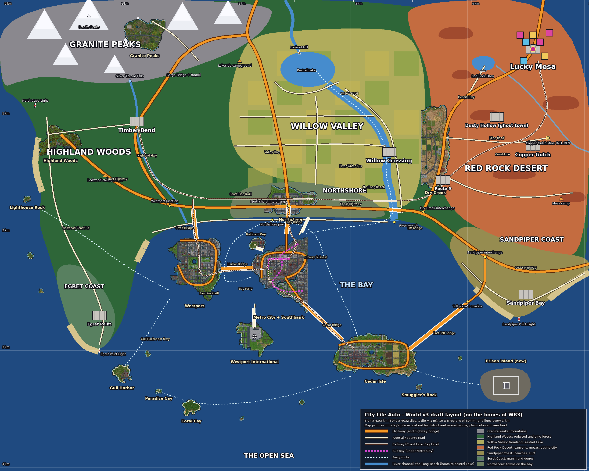

# World v3: the bigger world, on the bones of WR3

The owner (2026-10-10 07:35): "Can you list out every area and district and biome and everything we need included in
the world? Can you give me some prompts to use and what references to include to make this work? ... I like how the
islands connect better than how we have our current world i think the layout of the major arterial infrastructure
looks really good like this. Can we take a lot of the districts and layout we have now that looks good and keep the work
we've done blending things together but rebuild the entire highway and trains and ferry systems and subways and major
arterial roads and connect them similarly to this new world map? The new world map isn't perfect but I think the layout
and bones are there".

**The decision** (the coordinator's, told to the owner): keep every district, the blending between them and all the
generators (buildings, nature, places); rebuild the skeleton to WR3 (`docs/art-v2/targets/WR3_whole-world.png`) - the
highways and major arterials, the railway and subway lines, the ferry routes and the bridges, the islands set in a bay
round the river channel - and re-fit the districts into it. The mainland round the bay holds the new regions. Target
about 5 x 4 km (today 1312 x 1200 tiles, 1 tile = 1 m). Stage 1 is the engine: land generated and kept by region near the
player (client), the server running only the areas near players.

This document has four parts: **1 the inventory** (everything the world needs, marked *exists* / *moves* / *new*),
**2 the layout** (the draft map, `docs/world-v3-layout.png`, made by `tools/world-v3-layout.py`), **3 concept prompts** for
what is still missing, **4 the engine plan**.

Status marks used throughout:
- **exists** - in the game today and stays as it is (where it is relative to its island or region).
- **moves** - in the game today, kept whole (its generator, its blends, its places) and re-fitted to a new spot.
- **new** - not in the game yet.
- **rebuilt** - in the game today, but laid out again for the new skeleton (all the transport).



---

## Part 1 - The inventory

### 1.1 The frame

| | Today | World v3 |
|---|---|---|
| Size | 1312 x 1200 tiles (1.57 km²) | **5040 x 4032 tiles (5.04 x 4.03 km, 20.3 km², 13x today)** |
| Regions | - (one whole world) | 10 x 8 regions of 504 x 504 tiles (21 x 21 net chunks of 24) |
| Layout | islands in an open sea, joined by long bridges | a bay with the city's islands in it, the mainland round three sides, the open sea to the south |
| Land | 0.96 km² (measured: tiles that aren't water) | ~12 km² in the plan: the islands keep their 0.62 km², the mainland is ~11.7 km² (of which today's Highland Woods, Granite Peaks, Northshore and Dry Creek are 0.34 km²) |

Why 5040 x 4032: it is about 5 x 4 km, a whole number of net chunks (210 x 168 of `CHUNK_TILES` 24) and of regions (10 x 8 of
504). The bay is about 2.4 km across; the mainland is a band about 1.8 km deep along the north with arms down the west
(about 1 km wide) and the east (about 1.2 km) - the WR3 shape.

### 1.2 The bay and its islands

The islands keep their shapes, districts, streets and blends; each moves whole (one offset per island, listed in part 2).
What changes is how they are joined: a bridge to every island (WR3), the ring highways tied into one Bay Ring.

| Place | Today | World v3 | Status |
|---|---|---|---|
| **Metro City** (the central island: Downtown, Midtown, Northgate, Civic Center, Arts District, Bayside Heights, Neon Strip, The Pink Mile, Old Town, Sunset Beach, Harbor, The Yards, Greenfield Park) | the middle of the map | the middle of the bay, as WR3's downtown island; its elevated Metro Ring kept | moves |
| **Southbank** (Pine Hills, Southside) | across the river from Metro City | stays joined to Metro City across its river (the two move as one) | moves |
| **Pelican Key** | off Sunset Beach | stays off Sunset Beach (moves with Metro City); Pelican Way bridge | moves |
| **Westport** (Westport Center, Old Quarter, Lakeview, Stadium District, West Hills) | the big west island | WR3's port island west of Metro City; Harbor Bridge east to Metro City, Strait Bridge north to the mainland. WR3's container port with cranes is new ground for Port Westport (district 26, which has no ground today) | moves (without Highland Woods and the airport) |
| **Airport island** (Westport International) | Westport's south-west | its own island south of Metro City (WR3's airport island), the Airport Causeway to The Yards | moves |
| **Cedar Isle** (Cedar Falls, Falls Center, Lake District, Cedar Farms, South Port, Cedar Hills) | the south island | WR3's beach islands south-east of Metro City: Cedar Bridge (the red suspension bridge) from Southbank, the East Toll Bridge to the Sandpiper Coast | moves |
| **Smuggler's Rock** (the syndicate's) | a rock off Dry Creek | a rock at the bay's mouth, boat only | moves |
| **Prison Island** (J1-J4: walls, guard towers, cells, the yard, the pier) | - (cells are in police stations) | out at sea south-east of the bay mouth (WR3), reached by the prison boat only | **new** |
| **Gull Isles** (Gull Harbor, Coral Cay, Paradise Cay) | along the south edge | outside the bay mouth to the south-west and south, boat only (ferries) | moves |
| **Lighthouse Rock, The Islets** (Wreck Island and the Seal Islets among them) | small rocks round the map | Lighthouse Rock off Highland Woods' coast, the islets round the bay's mouth and the west coast | moves |
| **The bay** (Liberty Bay, district 13) | the open water between islands | an enclosed bay: shallows along the shores, a deep fairway from the mouth to the river and the ports, the river mouth, the shark water outside the mouth | rebuilt |
| Beaches in the bay | Sunset Beach, Pelican Key, Cedar Isle's | kept; plus the mainland beaches (Sandpiper Coast, the west coast coves, Egret Point) | exists + new |
| Marinas and docks | the Harbor marina (Metro City), Westport Pier, the docks and jetties round the islands | kept; plus Port Westport's container port, the toll-bridge marina (I4) and quays up the river | exists + new |

### 1.3 Every city district (`shared/map.js` DISTRICTS)

All 47 districts are kept. *Style* is the building/fill style, *tier* the wealth (peds, police, litter).

| id | District | Style / tier | Today on | World v3 | Status |
|---|---|---|---|---|---|
| 0 | Pine Hills | houses / suburb | Southbank | Southbank, with Metro City | moves |
| 1 | Midtown (the hero corner, Holly St x Madison St) | commercial / mid | Metro City | Metro City | moves |
| 2 | Northgate | apartments / mid | Metro City | Metro City (the Bay Bridge lands here) | moves |
| 3 | The Yards | industrial / rough, turf | Metro City | Metro City (Airport Causeway) | moves |
| 4 | Downtown | towers / lux | Metro City | Metro City | moves |
| 5 | Civic Center | civic / mid | Metro City | Metro City | moves |
| 6 | Southside | southside / rough, turf | Southbank | Southbank | moves |
| 7 | Neon Strip | nightlife / neon | Metro City | Metro City | moves |
| 8 | Harbor | harbor / industrial | Metro City | Metro City (Harbor Bridge, Bay Ferry) | moves |
| 9 | Dry Creek (farms) | rural / rural | Dry Creek island | the valley-desert border east of the river: Dry Creek moves whole and becomes where the farmland meets the desert (WR4) | moves |
| 10 | Sunset Beach | beach / mid | Metro City | Metro City | moves |
| 11 | Ironworks | factory / industrial | in the table, but no ground today (no seeds) | the port island's factories, beside Port Westport | **new ground** |
| 12 | Greenfield Park | park / mid | Metro City | Metro City | moves |
| 13 | Liberty Bay | water | the sea | the bay and the open sea | rebuilt |
| 14 | Pelican Key | beach / mid | Pelican Key | Pelican Key (off Sunset Beach) | moves |
| 15 | Smuggler's Rock | rocky / rough, turf | the rock | the bay mouth | moves |
| 16 | Bayside Heights | luxury / lux | Metro City | Metro City | moves |
| 17 | The Pink Mile | redlight / red | Metro City | Metro City | moves |
| 18 | Old Town | oldtown / low | Metro City | Metro City (Old Town Bridge to Northshore, the river water bus quay) | moves |
| 19 | Lighthouse Rock | wild | sea isle | off the west coast | moves |
| 20, 21 | The Islets | wild | sea isles (17 islets, all district 20; 21 has no ground) | round the bay's mouth and the west coast | moves |
| 22 | Gull Isles (wild ground) | wild | no ground today (the isles are Gull Harbor's, Coral Cay's and Paradise Cay's) | outer islands' wild ground | moves |
| 23 | Westport Center | towers / lux | Westport | Westport island | moves |
| 24 | Lakeview | luxury / lux | Westport | Westport island | moves |
| 25 | Stadium District | commercial / mid | Westport | Westport island | moves |
| 26 | Port Westport | harbor / industrial, turf | in the table, but no ground today (its seeds lose to Old Quarter and the airport) | WR3's container port with cranes on Westport's shore | **new ground** |
| 27 | Westport International | airport | Westport | the airport island | moves |
| 28 | West Hills | houses / suburb | Westport | Westport island | moves |
| 29 | Highland Woods | wild (redwood) | Westport (north) | the mainland: the heart of the Highland Woods region (west coast) | moves |
| 30 | Old Quarter | oldtown / low | Westport | Westport island | moves |
| 31 | Northshore | commercial / mid | Northshore island | the mainland's bay shore, north of Metro City (the Bay Bridge's north end) | moves |
| 32 | North Point | apartments / mid | Northshore island | with Northshore | moves |
| 33 | Granite Peaks | wild (mountain) | Northshore island | the mainland: the heart of the Granite Peaks region | moves |
| 34 | The Bluffs | luxury / lux | Northshore island | with Northshore, on the bay cliffs east of it | moves |
| 35 | Cedar Falls | houses / suburb | Cedar Isle | Cedar Isle | moves |
| 36 | Falls Center | commercial / mid | Cedar Isle | Cedar Isle | moves |
| 37 | Lake District | luxury / lux | Cedar Isle | Cedar Isle | moves |
| 38 | Cedar Farms | rural / rural | Cedar Isle | Cedar Isle (island farms; the big farmland is the new Willow Valley) | moves |
| 39 | South Port | harbor / industrial | in the table, but no ground today (Cedar Hills and the town cover its seeds) | Cedar Isle's south shore: the ferry piers and the police dock | **new ground** |
| 40 | Cedar Hills | wild (golf, hills) | Cedar Isle | Cedar Isle | moves |
| 41 | Dry Creek Desert | desert | Dry Creek island | with Dry Creek, the desert's west edge | moves |
| 42 | Dry Creek Airstrip | airport / rural | Dry Creek island | with Dry Creek | moves |
| 43 | Gull Harbor | beach / mid | Gull Isles | the outer islands (car ferry) | moves |
| 44 | Coral Cay | beach / mid | Gull Isles | the outer islands (water bus) | moves |
| 45 | Paradise Cay | wild (jungle) | Gull Isles | the outer islands (water bus) | moves |
| 46 | Arts District | arts / mid | Metro City | Metro City | moves |

New districts the regions need (each a new style for the generators, with blends to its neighbours):

| District | Style / tier | Where | Concepts | Status |
|---|---|---|---|---|
| Timber Bend | small town (logging, main street) / rural | Highland Woods, at the Highland Highway interchange | WR2-A, D15-A/B, HU2, WD1-WD3 | **new** |
| Willow Crossing | farm town (church, grain elevator, main street, weir) / rural | Willow Valley, on the river | WR2-C, D13, D13-B, NT1-D | **new** |
| Lucky Mesa: The Strip | casino resorts / lux + neon | Red Rock Desert, north-east | VG1, GM3, GM4 | **new** |
| Lucky Mesa: Old Downtown | the covered street of lights, pawn shops, motels / low + neon | Red Rock Desert | VG1, VG2 | **new** |
| Lucky Mesa: the side streets and suburbs | motels, wedding chapels, trailer parks, tract homes / low, suburb | Red Rock Desert | VG1, SC2-F, SC2-G | **new** |
| Copper Gulch | mining town (company houses, the assay office, the saloon) / rough | Red Rock Desert, by the mine | MI1, MI6, WR2-B | **new** |
| Dusty Hollow | ghost town (empty, wrecked) / wild | Red Rock Desert | WR2-B, NS1-C | **new** |
| Sandpiper Bay | beach town (surf shops, boardwalk, cottages) / mid | Sandpiper Coast | BE1-BE5, SR1-SR7, D10 | **new** |
| Egret Point | fishing village / low | Egret Coast (the west arm's tip) | NT1-F, N7, FS1 | **new** |
| The Bay Ring's toll plaza and marina | harbor / mid | the East Toll Bridge's east end | I4-A..E | **new** |

### 1.4 Today's places (they move with their district)

**Parks, lakes, airports, farm stands, villages** (`shared/islands.js`, `citylayout.js`): Greenfield Park, Lakeview Park
(and Lakeview Lake), Westport Stadium, Northshore Commons; Cedar Lake, Mirror Pond, Reed Pond, Heron Lake, Mirage Lake,
Summit Tarn; Westport International, Dry Creek Airstrip; Cedar Farms Market; Gull Harbor and Coral Cay villages; the homes
for sale in the wilds (cottages, farmhouses, the desert ranch); the concept scenes laid on wild ground (Cedar Hills Golf
Club, Red Rock Canyon, Paradise Cay). All **move**.

**Designed nature places** (`shared/naturesites.js`, each a scene from the concepts; 45 today): Redwood Creek and
Redwood Creek Falls, Redwood Creek Trapper's Cabin, Giants Loop, Fern Gorge, Redwood Cove, Pine Lake (Highland Woods);
Summit Tarn and its falls, Granite Hot Springs, Granite Cove, Old Granite Mine, Ridge Fire Lookout, Ridge Trail Hunting
Camp, The Sentinel Stones (Granite Peaks); Northshore Botanical Gardens, Bluffs Maze Garden, North Point Courts
(Northshore); Willow River, Willow River Falls, Willow Lake, Willow River Pasture, Orchard and Vineyard, Dry Creek Farm
Co-op Pasture, Red Rock Wash, Canyon Oasis, Mirage Camp, Dry Creek Boneyard, Old Mission Ruins, Dry Creek Balloon Field,
Canyon Track Hunting Camp, Route 9 and its airstrip, Splash Canyon Water Park (Dry Creek); Cedar Creek and Cedar Creek
Falls, Heron Marsh and its Trapper's Cabin, Cedar Point Lavender, Cedar Farms Market Pasture, Cedar Hills Golf Club,
Cedar Farms Game Butcher, Driftwood Point (Cedar Isle); Lighthouse Tidepools (Lighthouse Rock), Wreck Island, Seal
Islets (The Islets); Bonfire Beach (Gull Harbor), Coral Cay Falls and Coral Cay Rainforest (Coral Cay); Old Town Market
(Metro City), Lakeview Park, Stadium Lido, Westport Pier (Westport). All **move** with their district. Dry Creek's own
small Willow River (with its falls, lake, orchard and vineyard) moves with Dry Creek and, in v3, runs west into the new
river channel (the Long Reach) at Willow Crossing.

**Country sites** (`shared/countryside.js` SITES): Pine Ridge Campground, Highland roadside stop, Highland Radio Mast
(Highland Woods); Granite Quarry (and its assay office), Granite Peak Observatory, Granite Cove Campground, Windy Point
Wind Farm, North Ridge Mast (Granite Peaks); Dry Creek Oil Field, Sunfield Solar Farm, Starlite Drive-In, Route 9 stop,
Mesa Radio Mast, Dry Creek Wind Farm, The Rusty Spur (Dry Creek); Cedar Hills Campground, Cedar Point Wind Farm (Cedar
Isle); Westport Raceway; the power lines and the runway lights. They **move** with their district, but each one finds its
own open ground near its spot when the roads are laid, so they can take a new spot in a new region as easily: Windy Point
Wind Farm and the Westport Raceway fit the new mainland better (the raceway went with the airport's open ground - in v3 it
needs a spot on the Egret Coast or in the valley).

**Points of interest and venues** in today's world (`m.pois`, `m.venues`; counted from `generateCity`, see 4.2):
606 points of interest in 52 kinds: 166 homes, 109 ATMs, 108 delivery drops, 35 convenience stores, 21 clothing
stores, 13 clubs, 12 rail stations, 11 gun shops, 11 vending spots, 9 banks, 8 coffee shops, 8 tackle shops, 7 hospitals
(and their receptions), 7 paint shops, 7 rentals, 5 police stations (and their evidence rooms), 5 barbers, 5 gas stations,
3 pharmacies, 3 snack bars, 3 rides, 3 race starts, 2 fish markets, 2 gang hideouts, 2 farms, 2 airports, 2 markets, 2
hunting camps, 2 trappers, and one each of the courthouse, marina, garage, fence, sports store, hardware store, grocery,
pawn shop, dealer, warehouse, assay office, roadhouse (the Rusty Spur), lodge, winery, fruit stand, salvage yard, farm
stand, clubhouse, butcher, charter and smuggler. 4 venues (2 beach volleyball courts, 2 soccer pitches), 45 designed
nature places, 861 buildings, 29,861 props, 1,234 road edges (63 highway, 51 frontage, 223 avenue, 13 boulevard, 320
street, 116 alley, 49 minor, 91 drive, 14 ramp, 208 arterial, 58 rural, 28 dirt).

They all belong to buildings and lots inside districts and move with them. The mainland's new towns need their own: each
new town gets the basics (a gas station, a convenience store, a diner or bar, a clinic or the sheriff, a bus stop), and the
regions get the special ones listed below.

### 1.5 The new mainland regions

Coordinates are World v3 tiles (x east, y south); see the layout picture. Each region lists what it holds from the
biggest roads down to the trails.

**R1 Granite Peaks** (the north-west mountains, about 2.3 x 0.7 km; WR3's snow peaks; WR2-A, NA1-B, N5, NR1-D, SC3-G)
- Moves in: Granite Peaks (district 33) with Summit Tarn and its falls, Granite Hot Springs, Old Granite Mine, The
  Sentinel Stones, the Ridge Trail hunting camp, Granite Quarry and its assay office, the observatory, Ridge Fire Lookout,
  North Ridge Mast, Granite Cove Campground.
- Roads: the Highland Highway over the pass (a tunnel through the ridge and a bridge over the gorge, WR1 view 2); the
  Valley Highway's north end meeting it at the pass; Peak Road up to the observatory; switchback mountain roads on stone
  walls (NT1-C); jeep tracks to the quarry; trails up the granite, cairns, a summit trail.
- New: a mountain lodge on a lake (SC3-G, NT1-C), the ranger station, a ski-less alpine meadow with a stone hut (NS1-D),
  snowfields on the high peaks (white ground, no snow system yet), twin falls off the granite (NA1-B), cliff faces in
  layers with ledges (EL1), a mountain lake boat ramp.
- Activities: hunting (elk, mountain goats, bears, cougars), mining (the old mine, the quarry), fishing (lakes), hot
  springs, camping, hiking, the lookout, off-road.

**R2 Highland Woods** (the west coast forest, about 1.6 x 1.3 km; WR3's forest with lighthouses and the waterfall; NA1-A,
N1-A..E, D15-A/B, NT1-A, NT1-E, SC3-A..C, HU1-HU7)
- Moves in: Highland Woods (district 29) with Redwood Creek and its falls, Giants Loop, Fern Gorge, Redwood Cove, Pine
  Lake, the trapper's cabin, Pine Ridge Campground, the Highland stop and mast.
- New town: **Timber Bend** at the Highland Highway interchange (main street, sawmill and log yard, the hunting lodge and
  butcher (HU2), a motel, a gas station and diner, the Coast Line's west terminus).
- Roads: the Coast Highway along the bay; the Highland Highway north through the forest; the Redwood Coast Road down the
  cliffs (SC3-B, NT1-E: guard rails, culverts spilling to coves, sea stacks); Timber Road; logging roads (dirt); trails
  with trailheads, log steps, footbridges.
- New landmarks: **Silver Thread Falls** (WR3's big waterfall, SC3-A/NR1-E basalt columns, a viewing platform), **North
  Cape Light** (a lighthouse on the headland, N8-B tidepools below), the coves and sea stacks of the west coast, a beaver
  pond (HU4), a hunting camp in autumn (HU5), a lake with a boathouse and islands (WR2-A, NA1-A).
- Activities: hunting, felling (WD1-WD3), foraging, fishing (creeks, the coast), camping, the coast drive, surfing coves.

**R3 Egret Coast** (the west arm, about 0.7 x 1 km; marsh and dunes; N7, NK1-D, NK1-O, E3e)
- New: **Egret Point** fishing village at the arm's tip (piers, a fish market, the fishing fleet, a charter boat to
  the outer islands), **Egret Point Light**, a salt marsh with boardwalks (NK1-O), dunes with board ramps down to the
  beach (EL1), duck blinds, the Westport Raceway's new spot (open flat ground).
- Roads: the Redwood Coast Road's south end; marsh boardwalks and dirt tracks.
- Activities: duck and goose hunting, fishing, crabbing, birding, beachcombing, the raceway.

**R4 Northshore** (the bay's north shore, about 1.4 x 0.3 km)
- Moves in: Northshore, North Point and The Bluffs (districts 31, 32, 34) with Northshore Commons, the Botanical Gardens,
  the Maze Garden, North Point Courts.
- New: the Northshore interchange (Coast Highway x Valley Highway, H1 concept), Northshore station (the Coast Line meets
  the Bay Line), the Bay Ferry pier, Shore Road along the water, the suburbs thinning into fields (WR4 panel 1).

**R5 Willow Valley** (the middle, about 1.6 x 1.5 km; WR3's farmland and the lake with the lookout; WR2-C, NA1-D, D13,
D13-B, SC3-E, NT1-D, FA1)
- New town: **Willow Crossing** on the Long Reach, where Dry Creek's Willow River joins it (church, grain elevator,
  the farm co-op, feed store (ST2), a diner, the farmers' market (D13-B), the weir and the river water bus quay).
- **Kestrel Lake** (WR3's lake, about 500 x 300 m): the river channel ends here; a lookout on **Lookout Hill** (WR3's
  binoculars), a lakeside campground, a boathouse and rentals, fishing docks, an island.
- Roads: the Valley Highway north up the valley; a section grid of county roads every 250 m (Section Roads, County Road
  7); Willow Road along the river; Lake Road; farm tracks between fields; a truck stop with big rigs and silos (WR1 view 3).
- Farms: wheat, corn, lavender, sunflower, pumpkin fields (FA1), orchards and a vineyard with a villa on the hill (NA1-D),
  pastures with cows and horses, red barns and farmsteads with silos (B7, NS1-E), windmill pumps and ponds, irrigation
  ditches and culverts (SC3-E), power lines.
- Activities: farm work (harvest, plant, deliver - DESIGN-NOTES "Farm work"), the farmers' market, fishing (lake, river),
  boating up the river, quail and pheasant hunting, a county fair ground (later), the race track (GM6 Riverside Downs fits
  here, on the river).

**R6 Red Rock Desert** (the north-east, about 1.6 x 2.2 km; WR3's red rock, casino city and mine; WR2-B, NA1-C, N4,
D14, VG1, VG2, MI1-MI7, SC3-F, WR1 view 1)
- Moves in: Dry Creek (districts 9, 41, 42) whole, at the desert's west edge where the farmland meets it - its fields
  face the valley, its desert faces east - with its airstrip, Route 9, the Rusty Spur, the oil field, the solar and wind
  farms, the drive-in, Red Rock Wash, Canyon Oasis, Mirage Lake and Camp, the boneyard, the mission ruins, the balloon
  field, the Canyon Track hunting camp, Splash Canyon Water Park.
- New city: **Lucky Mesa**, the casino city (VG1): the Strip of themed resorts with invented names and looks (a
  lotus-crowned tower, a domed palace, a pyramid with a beam, glass towers), the fountain show, wedding chapels, the old
  downtown's covered street of lights, motels and pawn shops on the side streets, the welcome sign on the highway, the
  syndicate's back rooms (VG2: the counting room, the boss's office, the supper club), a small airport for jets.
- New: **Copper Gulch** mining town and **Copper Gulch Mine** (WR3's mine: the canyon adit MI1, the open pit MI6, the
  underground river MI4 beneath - the cave world of `shared/underground.js` grows here), **Dusty Hollow** ghost town
  (WR2-B), **Red Rock Dam** and its reservoir with the dry wash below (WR2-B), a lookout tower on a mesa, the sheriff's
  post, a gas station and diner, a motel with a pool and billboards (WR1 view 1), the natural arch, mesas and hoodoos
  (NR1-B), a desert camp with pickups and string lights (N11).
- Roads: the Desert Highway (two lanes, long straights) from the Dry Creek interchange to Lucky Mesa; Route 9 (the old
  road east); Mine Road; Canyon Road to the dam; jeep tracks to the mesas (NT1-B); dirt bike trails.
- Activities: the casino games (GM3, GM4), the syndicate's jobs, mining, off-road and dirt bikes, the desert races,
  hunting (coyotes, quail), the drive-in, the balloon field.

**R7 Sandpiper Coast** (the east arm, about 1.2 x 0.8 km; WR3's east beaches and lighthouse; BE1-BE5, SR1-SR7, N8-D,
NT1-E, WR4 panel 3)
- New town: **Sandpiper Bay** (the boardwalk and pier (BE2), the surf shop (SR7), cottages and beach houses, the
  campground).
- New: **Sandpiper Point Light**, the surf point with its contest scaffold (SR1, SR5), public beaches with lifeguard
  towers (BE1), the toll plaza and marina at the East Toll Bridge (I4), the Sandpiper interchange.
- Roads: the Coast Highway's east end; Sandpiper Drive along the beaches; beach car parks with stairs down (WR1 view 4).
- Activities: surfing, the beach, fishing off the pier, boating from the marina, the boardwalk arcade.

**What the new towns hold** (POI kinds in `code` exist today and only need placing; the rest are new kinds):

| Town | Businesses and places |
|---|---|
| Timber Bend | `gasstation`, `convenience`, a diner, the hunting `lodge`, `butcher`, `trapper`, `hardware` (axes and saws), `tackle`, a clinic (`hospital`), the sheriff (`police`), the Coast Line's terminus (`station`), a sawmill (`delivery`: logs), a motel (new), cabins (`home`) |
| Willow Crossing | the co-op (`farm`), a feed store (new, ST2), the farmers' `market`, `farmstand`, `fruitstand`, the `winery` up the hill, a diner, `gasstation`, `bank`, a church (new), the grain elevator (`delivery`), `station`, a clinic, the sheriff, boat `rental` on the river, farmhouses (`home`) |
| Lucky Mesa | casinos (new: GM3, GM4), resort hotels (new), wedding chapels (new), `pawn`, `gunshop`, `club`, `bank` and `atm`, the syndicate's counting room (`gang`), its airport (`airport`), car `rental`, a `hospital`, `police`, the Coast Line's terminus (`station`), motels (new), a penthouse, tract homes and a trailer park (`home`) |
| Copper Gulch | the `assay` office, the mine entrance (new), a saloon (`club`), a general store (`convenience`), the freight yard (`station`, `delivery`: ore), the sheriff, company houses (`home`) |
| Dusty Hollow | nothing open: a hideout (`gang`), a `smuggler`'s drop, loot in the ruins |
| Sandpiper Bay | the surf shop (new, SR7), board and kayak `rental`, `tackle`, `snack` bars, the boardwalk arcade (`ride`), the `marina`, a lifeguard station (new), a clinic, beach houses (`home`) |
| Egret Point | the `fishmarket`, `tackle`, a `charter` boat, a bar, the raceway (`race`), fishing shacks (`home`) |
| The highways | truck stops and roadside stops (countryside.js `stop`), the Rusty Spur (`roadhouse`), motels, the toll plaza |

**R8 The open sea and the outer islands** (south of the bay mouth)
- Moves: the Gull Isles, Lighthouse Rock, The Islets, Smuggler's Rock (see 1.2). New: Prison Island; whales spouting,
  a shipwreck, sea arches (NA1-F); sharks keep to the open sea (DESIGN-NOTES "Sharks").

**Region borders** (WR4): every border is a blend, as between today's districts: the city thinning into farms and
fields (Northshore to Willow Valley); forest thinning into red rock along the highway with a creek and a fire lookout
(Willow Valley's east and Highland Woods' north to the desert and the mountains); the coast meeting the forest with a
lighthouse, a cove and a campground (Highland Woods' west coast). New ones to draw: farmland to desert (Dry Creek's own
border, kept), mountains to forest (the tree line), marsh to forest (Egret Coast), beach town to desert (Sandpiper to
Red Rock).

### 1.6 Biomes, plants and wildlife

The terrain classes today (`map.js` terrainAt / wildBiome): water, grassland, forest, desert, mountain, beach; Highland
Woods is redwood throughout; the habitat tags the wildlife uses (`shared/fauna.js`, `server/systems/wildlife.js`
habitatAt): redwood, forest, meadow, farm, scrub, desert, mountain, cliff, lake, marsh.

| Biome | Where in v3 | Plants (exists in `client/art2/game/statics.js` SPECIES; new from E3a-f, NK1-M) | Wildlife (`shared/fauna.js`) | Status |
|---|---|---|---|---|
| Redwood forest | Highland Woods | giant redwoods (giantL, giant, giantS, redwood2), ferns (fern, fernR), berry shrubs; new: sorrel, moss carpets, fallen logs (NS1-A) | deer, elk, black bear, cougar, bobcat, grey fox, raccoon, squirrel, turkey | exists, grows |
| Pine and oak forest | Highland Woods' edges, the valley's hills | fir, mountain pine, young trees, maple (autumn); new: oak, birch, twisted pine (NK1-M) | deer, boar, black bear, bobcat, red fox, rabbit, squirrel, turkey | exists, grows |
| Mountain and alpine | Granite Peaks | mountain pine, fir; new: alpine flowers, dwarf shrubs, snowfields (E3f) | mountain goat, elk, grizzly, cougar, moose (lakes) | exists, grows |
| Meadow and grassland | the valley's edges, the sea isles | daisies, tulips, dry grass, sunflowers; new: wildflower meadows | deer, rabbit, quail, pheasant, coyote, red fox | exists |
| Farmland | Willow Valley, Dry Creek, Cedar Farms | crops in fields, apple orchard, hedges, sunflowers; new: vineyard, lavender, corn (FA1, E3e) | boar, rabbit, pheasant, quail, coyote, geese | exists, grows |
| Lake, river and marsh | Kestrel Lake, the river channel, Egret Coast | reeds, cattails, willows (E3e, NK1-D/O) | moose, beaver, otter, duck, goose, heron (new), fish | exists, grows |
| Desert and canyon | Red Rock Desert | mesquite, creosote, ocotillo, dry grass; new: saguaro-like and barrel cacti, prickly pear, palo verde, joshua-like trees, agave (E3c) | coyote, quail, rattlesnake (new), roadrunner (new), hawk (new) | exists, grows |
| Beach and dunes | every coast | coconut and small palms, dune grass, hibiscus | gulls, crabs (new), sea otter, seals (new) | exists |
| Tropical jungle | Paradise Cay, Coral Cay | palms, banana, flowering trees (E3d, NS1-G) | parrots (new), fish in the reef | exists |
| City green | the towns | street trees, young trees, hedges, flower beds | dogs, cats, pigeons, squirrels, raccoons | exists |
| Sea | the bay and the open sea | kelp (new) | sharks, fish schools, dolphins, whales (new, NA1-F) | exists, grows |
| Underground | under the cities and the desert | glowing mushrooms (MI4) | bats, spiders, bears asleep (MI5) | exists (sewers, the cave), grows |

The wildlife already has the habitats; the new regions only need their habitat tags painted. New species worth adding:
rattlesnake, roadrunner, hawk, heron, seals, crabs, parrots, whales.

### 1.7 The transport skeleton (all rebuilt)

**Highways** (two lanes each way, grade-separated; WR1, H1, H2):
- **Coast Highway** - the backbone: from Highland Woods along the bay's north shore, over the river mouth on a lift
  bridge, round the east arm to Sandpiper Bay. *new* (replaces today's island-to-island highways).
- **Highland Highway** - from Westport Junction north through the forest (curves, a tunnel, the gorge bridge) to the pass.
  *new*
- **Valley Highway** - from the Bay Bridge north up Willow Valley, along the lake, to the pass. *new*
- **Desert Highway** - from the Dry Creek interchange north-east to Lucky Mesa (today's name, a new road). *rebuilt*
- **The Bay Ring** - the island highways tied into one loop: Strait Bridge - Westport Beltway - Harbor Bridge - the Metro
  Ring - Southbank - Cedar Bridge - Cedar Isle Loop - East Toll Bridge - the Coast Highway. The three ring roads exist
  today (Westport Beltway, Metro Ring with its frontage roads, Cedar Isle Loop); the links between them are new. *rebuilt*
- **Interchanges**: Northshore (Coast x Valley, a cloverleaf), Westport Junction (Coast x Highland x Strait Bridge),
  Dry Creek (Coast x Desert), Sandpiper (Coast x the Bay Ring), Timber Bend (a diamond), the Metro Ring's ramps (exist).

**Bridges** (WR3: a bridge to every island):

| Bridge | Joins | Kind | Status |
|---|---|---|---|
| Bay Bridge | Metro City (Northgate) - Northshore | highway, rail deck for the Bay Line | rebuilt (today's name) |
| Old Town Bridge | Old Town - Northshore east | arterial | new |
| Strait Bridge | Westport - the mainland (Westport Junction) | highway and rail | rebuilt (today's name) |
| Harbor Bridge | Metro City (Harbor) - Westport | highway and rail | new |
| Pelican Way | Sunset Beach - Pelican Key | street | exists (moves) |
| Airport Causeway | The Yards - the airport island | arterial | new |
| Cedar Bridge | Southbank - Cedar Isle | the red suspension bridge, highway and rail | rebuilt (today's name) |
| East Toll Bridge | Cedar Isle - Sandpiper Coast | highway with a toll plaza and marina (I4) | new |
| River Lift Bridge, rail swing bridge | the Coast Highway and the Coast Line over the river mouth | lift / swing spans that open for boats | new |
| River bridges inland | Willow Crossing, the farm roads | stone and steel road bridges, fords on dirt roads (NK1-A) | new |
| Gorge Bridge, the tunnel | the Highland Highway | a high bridge over the gorge, a tunnel through the ridge (WR1) | new |

**Arterials and county roads**: Shore Road (the bay's north shore), the Redwood Coast Road (west cliffs), Willow Road
(the river), Lake Road, the valley's section grid, Timber Road, Peak Road (exists, moves), Route 9 (exists, moves),
Mine Road, Canyon Road, Sandpiper Drive; inside the islands today's avenues and boulevards (exist, move). Below them:
streets (the towns), lanes, alleys, dirt roads and jeep tracks, trails (`shared/roads.js` ROAD_KINDS: the hierarchy holds,
a dirt track never meets a highway).

**Railway** (WR3: along the coast). Today one loop round the whole map with 12 stations (West Hills, Westport Center,
Granite Peaks, Northshore, Old Town, Dry Creek, Southside, Civic Center, Downtown, Midtown, The Yards, Cedar Falls), under
the core in a tunnel. In v3, two lines:
- **Coast Line** (new): Timber Bend - Westport Junction - Northshore - (swing bridge) - Dry Creek - Copper Gulch (the mine's
  freight yard) - Lucky Mesa. Passenger trains and freight (ore, grain, logs: cargo for the open-cargo system).
- **Bay Line** (rebuilt): a loop through the islands - Northshore - Bay Bridge - Old Town - (tunnel) Civic Center, Downtown,
  Midtown - Harbor Bridge - Westport Center - West Hills - Strait Bridge - Westport Junction - Northshore; a spur from
  Midtown through The Yards and Southside over the Cedar Bridge to Cedar Falls. Today's stations keep their names and
  districts.

**Subway** (SU1-SU6, SU5-B): today the railway's tunnel under the core (stations Civic Center, Downtown, Midtown, reached
by kiosks on plazas). In v3: the Bay Line's tunnel (kept) plus a **north-south line** under Metro City: Old Town -
Northgate - Downtown - Neon Strip - The Yards - Pine Hills - Southside (new). Mostly single track with passing places
(the owner, SU6), one level down (SU5).

**Ferries** (`server/systems/ferries.js` finds its routes from the map, so they follow the islands):
- Gull Harbor Ferry (car ferry), Coral Cay, Paradise Cay and Lighthouse Rock water buses - exist, re-routed from the new
  piers: Gull Harbor's car ferry from Port Westport, the cays' water bus from Cedar Isle, Lighthouse Rock's from Westport.
- **Bay Ferry** (new): the walk-on commuter loop - Metro City Harbor, Westport, Northshore pier, Cedar Isle (FE1).
- **River Water Bus** (new): Old Town quay - up the river channel - Willow Crossing - Kestrel Lake.
- **Prison Boat** (new): a police dock on Cedar Isle's east end - Prison Island (custody only).

**Buses** (`server/systems/transit.js`: lines worked out from the bus shelters, one per town zone): Metro Loop,
Southside, Westport, Northshore, Cedar Isle, East (Dry Creek), Key and Gull lines - exist, follow their towns. New:
lines in Timber Bend, Willow Crossing, Lucky Mesa (the Strip shuttle), Sandpiper Bay; **intercity coaches** on the
highways (Metro City - Lucky Mesa, Metro City - Timber Bend - Willow Crossing).

**Air**: Westport International (moves to its island), Dry Creek Airstrip (moves), Lucky Mesa's airport (new),
helipads at the hospitals and police HQ (exist).

**The river channel, the Long Reach** (new; W1, NK1-E/N, SC3-D): from the bay's north-east corner up between the
farmland and the desert to Kestrel Lake, about 2 km, 50-80 m wide, deep enough for boats the whole way (a navigable
fairway, quays at Old Town and Willow Crossing, the lift bridge at the mouth); above the lake the upper river (Kestrel
Creek) comes down from the mountains with rapids and falls (not navigable). Dry Creek's Willow River and the valley's
ditches feed it; Silver Thread Creek runs on its own from the waterfall through the forest to the bay. Generated
by the water generator (`WORLD-V2.md` "Water"; `client/art2/rivergen.js`) along a fixed course.

### 1.8 Systems tied to places

| System | Places it needs in v3 | Status |
|---|---|---|
| Respawn (hospitals, clinics, home) | spread evenly: today's in the islands, plus a clinic in each new town | exists + new places |
| Police (stations, cells, motor pools), the law | today's stations; a sheriff in each new region; Prison Island for long sentences | exists + new |
| Gangs and turf (`isTurf`, turf districts) | today's turf (The Yards, Southside, Smuggler's Rock; Port Westport's once it has ground); the syndicate in Lucky Mesa; the biker clubs on the Desert Highway (MC1-MC5) | exists + new |
| Bounties (BO1) | the bounty office; targets roam the regions | exists |
| Trains (`trains.js`), robbery of the mail car | the two lines, their stations and crossings | rebuilt |
| Buses, taxis, rideshare (`transit.js`) | the towns' shelters; intercity coaches | exists + new |
| Ferries (`ferries.js`) | piers on every island | exists, re-routed + new routes |
| Boats, the marina, boat rentals | the bay, the river channel, the lake | exists + new water |
| Fishing (FS1, FS2) | piers, the river, the lake, the sea (harbour and sea, river, lake and pond fish) | exists, more water |
| Hunting (`hunting.js`, HU1-HU7), wildlife | the wild regions by habitat; hunting camps, butchers, the lodge | exists, much more ground |
| Foraging, felling (WD1-WD3) | forests, beaches, tide pools | exists |
| The sewers and the cave world (`underground.js`, SW1, SW2, MI4, MI5) | under Metro City (sewers, exist), under the desert (the cave and the underground river, grow with the mine) | exists + new |
| Mining (`underground.js`, MI1-MI7) | the old mine and the quarry (move), Copper Gulch Mine and the open pit (new) | exists + new |
| Farming (FA1-FA3), farm work | Willow Valley, Dry Creek, Cedar Farms; the markets and the co-op | exists + new ground |
| Campfires and campsites (`campfires.js`, CF2) | campgrounds, beaches, secluded spots | exists + new |
| Gambling (GM1-GM11): casino, cards, dice, cockfights, the races | Lucky Mesa (new), today's back rooms, a race track (new) | new places |
| Surfing (SR1-SR7), the beaches (BE1-BE5) | Sandpiper Coast (new), today's beaches | new |
| Golf (GO1-GO3) | Cedar Hills (moves) | exists |
| Water park (WP1), the arcade (AC1-AC7), pools and baths (L1-L9) | Splash Canyon (moves), the boardwalks | exists |
| Homes and properties (DESIGN-NOTES) | every tier in every region: cabins, farmhouses, lake houses, desert ranches, beach houses, the casino penthouse | exists + new |
| Contraband (X1) | grow rooms, the shady buyers, tide pools for the star | exists |
| Weather and day/night | every region (fog on the coast, heat in the desert later) | exists |
| The map, the phone's transit app, the respawn map (U7, U12) | a 5 km world: zoom levels, region tiles | rebuilt (part 4) |

---

## Part 2 - The layout

`docs/world-v3-layout.png` (2520 x 2016, 1 px = 2 m, grid lines every 1 km; made by `tools/world-v3-layout.py` from
today's world map picture and today's district grid). Today's places are cut out of the world map picture district by
district and moved whole; the plain colours are new land. It is a plan to OK, not the game: the coastlines and roads are
hand-placed lines.

What it shows:
- **The bay** (about 2.4 x 1.6 km) with **Metro City** (and Southbank and Pelican Key) in the middle, **Westport** to the
  west (its west shore is where WR3 draws the container port), the **airport island** south of Metro City, **Cedar Isle** to the south-east,
  **Smuggler's Rock** at the mouth, **Prison Island** out at sea, the **Gull Isles** outside the mouth to the south-west,
  **Lighthouse Rock** and **The Islets** off the west coast.
- **The mainland** round three sides: Granite Peaks (north-west), Highland Woods (west), Egret Coast (the west arm),
  Northshore (the bay's north shore, with Northshore, North Point and The Bluffs moved there), Willow Valley (the middle,
  the lake and the river), the Red Rock Desert (north-east, with Dry Creek moved whole to its west edge, Lucky Mesa, Copper
  Gulch, Dusty Hollow, the dam), the Sandpiper Coast (the east arm).
- **The skeleton**: the four highways and the Bay Ring with its bridges, the arterials, the Coast Line and the Bay Line,
  the subway under Metro City, the ferry routes, the river channel.

Where today's places go (World v3 tile = today's tile + offset):

| Place | Today (tiles) | World v3 (tiles) | Offset |
|---|---|---|---|
| Metro City + Southbank + Pelican Key | 542..1045, 301..947 | 2133..2636, 2030..2676 | +1591, +1729 |
| Westport (without the airport and Highland Woods) | 34..497, 237..778 | 1434..1897, 2037..2578 | +1400, +1800 |
| Westport International (the airport island) | 68..390, 614..917 | 2018..2340, 2754..3057 | +1950, +2140 |
| Cedar Isle | 270..991, 784..1158 | 2850..3571, 2850..3224 | +2580, +2066 |
| Northshore, North Point, The Bluffs | 748..1207, 29..279 | 2258..2717, 1589..1839 | +1510, +1560 |
| Highland Woods | 31..404, 71..334 | 331..704, 1071..1334 | +300, +1000 |
| Granite Peaks | 459..818, 17..287 | 1059..1418, 167..437 | +600, +150 |
| Dry Creek (farms, desert, airstrip) | 1045..1297, 251..959 | 3600..3852, 900..1608 | +2555, +649 |
| Gull Harbor | 40..209, 939..1100 | 960..1129, 3120..3281 | +920, +2181 |
| Coral Cay | 1040..1197, 997..1142 | 1560..1717, 3420..3565 | +520, +2423 |
| Paradise Cay | 465..520, 660..701 | 1330..1385, 3330..3371 | +865, +2670 |
| Lighthouse Rock | 274..341, 41..98 | 200..267, 1680..1737 | -74, +1639 |
| Smuggler's Rock | 1205..1259, 953..1004 | 3560..3614, 3290..3341 | +2355, +2337 |
| The Islets (the six biggest) | scattered | round the bay's mouth and the west coast | one each |

Every island moves whole, so its streets, blends, nature places and country sites come out as today (each generator
runs inside the island's new rectangle - part 4). What it touches at its edges changes: the bridges land in new places
and the island ring highways join the Bay Ring.

**The seams.** Today Metro City and Dry Creek are one landmass (Metro City's east side, Bayside Heights and Old Town,
runs straight into Dry Creek's fields), Westport and Highland Woods are one island, and so are Northshore and Granite
Peaks, and Westport and its airport. Moving them apart leaves a straight cut on each (the straight east edge of Metro
City in the picture). Each cut gets a new shore - a waterfront strip, a sea wall, a beach or a park, generated by the
district as it does its coasts today - or, where two pieces land beside each other again on the mainland, a new blend.

Things for the owner to decide:
1. **Where Westport's port goes.** Port Westport (district 26) has no ground today - Old Quarter and the airport took its
   west shore - so WR3's container port with its cranes is new ground: on the west channel (as WR3 draws it, beside the
   Old Quarter) or on the bay side facing Metro City's Harbor. Ironworks (11) and South Port (39) are the same: in the
   district table without ground; the port island's factories and Cedar Isle's ferry piers can give them some.
2. **Cedar Isle keeps its farms** (Cedar Farms) as island farms; the big farmland is the new valley. Or Cedar Farms
   moves to the valley and Cedar Isle becomes the beach and golf island.
3. **Dry Creek moves whole** to be the border where farms meet desert. Or it splits: its farms into the valley, its
   desert and airstrip into the Red Rock Desert.
4. **The size**: 5 x 4 km is 13 times today's area, and the plan has about 12 times today's land - some 11.7 km² of new
   mainland against today's 0.96 km² in all, most of it wild (forest, farms, desert) with a handful of towns. The regions
   can start smaller (without the mountains' northern half: about 5 x 3.6 km) and grow north later, since regions are
   generated on their own (part 4); the new land fills region by region, each as designed as today's (nature places,
   country sites, towns), not scattered.
5. **Names**: Lucky Mesa, Copper Gulch, Dusty Hollow, Timber Bend, Willow Crossing, Sandpiper Bay, Egret Point, Silver
   Thread Falls - all invented; change any.

---

## Part 3 - Concept prompts for what's still missing

In the style of the concept prompt pack: paste the style anchor, then the prompt, then the pack's reference line, and
attach the listed images. Adults only; invented names; no readable text (signs show plain shapes). New IDs carry on from
the existing ones (WR, VG, RV, BA, RL, HX, TW, PR, SE, MP).

**WR3-B - The whole world, redrawn from the plan (landscape)**
Attach: `docs/world-v3-layout.png`, WR3_whole-world.png, R1-A_hero-golden.png, R1-D_palette-materials.png

```text
[paste the style anchor]

A finished illustrated world map of the whole game world seen from high above in the game's style, the same composition as the attached plan (follow the plan's layout exactly: where every island, coast, region, road, railway, bridge and river is): a big bay in the middle with a downtown island of glass towers and old brick ringed by an elevated highway, an industrial port island with cranes and container ships to its west, an airport island to its south, a beach and golf island to its south-east, all joined by bridges - a red suspension bridge, long low causeways, a toll bridge with a marina; a fortress prison island out at sea; small jungle and rocky islands outside the bay's mouth with ferries crossing to them. The mainland wraps round the bay: snow-capped granite mountains in the north-west, a redwood forest down the west coast with two lighthouses on the headlands and a tall waterfall, a marsh and dunes on the west arm, suburbs along the bay's north shore, a farm valley in the middle with patchwork fields, a red barn town, a big lake with a lookout hill, a river channel winding from the bay up to the lake with boats on it, a red-rock desert in the north-east with mesas, a casino city glowing with neon shapes, a mining town and an open pit, a dam and a reservoir, and a beach town with a surf point on the east arm. A railway runs along the bay's north shore and over a swing bridge at the river's mouth. Small round icons mark the places of interest. Golden late-afternoon light, clouds only at the corners.
```

**WR2-D - Highland Woods, the west coast region (landscape)**
Attach: WR2-A_region-forest-mountains.png, NA1-A_highland-woods.png, NT1-E_coast-roads.png, SC3-B_redwood-coast-road-rain.png, WR4_region-borders.png

```text
[paste the style anchor]

A zoomed-out planning view of one region, about 1.6 by 1.3 kilometres, in the game's style, like a detailed illustrated map in the game's colours and camera: a redwood forest running down to a rocky west coast. A two-lane coast road on the cliffs with timber guard rails, culverts spilling waterfalls into coves, sea stacks in white surf; a highway climbing inland through the trees to a small logging town at an interchange (a main street, a sawmill and log yard, a hunting lodge with antlers over the door, a motel, a gas station and diner, a little railway station at the end of the line); logging roads and dirt tracks; hiking trails with a trailhead car park and log steps; a tall waterfall over dark basalt columns with a viewing platform; a creek running from it to the sea; a lighthouse and its keeper's house on a headland with tide pools below; a beaver pond; a lake with a boathouse; campgrounds; a hunting camp of wall tents; giant red trunks everywhere. Points of interest marked by small round icons.
```

**WR2-E - Granite Peaks, the mountains (landscape)**
Attach: WR2-A_region-forest-mountains.png, NA1-B_granite-peaks.png, N5_mountains.png, SC3-G_mountain-lake-dawn.png, NT1-C_mountain-roads.png, NR1-D_alpine-rocks.png

```text
[paste the style anchor]

A zoomed-out planning view of a mountain region, about 2 by 0.8 kilometres, in the game's style and camera: granite peaks with snow on the summits and snowfields in the gullies, layered cliff faces with ledges, pine forest below the tree line thinning to alpine meadows. A highway crossing the range over a pass: switchbacks on stone retaining walls, a tunnel through a ridge, a high bridge over a gorge with a river far below. A mountain lake with a log lodge, its car park, a boat ramp and a dock; twin waterfalls off the granite; a hot spring steaming among rocks; an old mine adit with an ore cart; a quarry with terraces; an observatory dome on a ridge; a fire lookout tower; a ranger station; a stone hut in a meadow; trails with cairns up to the summits; a campground by a tarn. Points of interest marked by small round icons.
```

**WR2-F - Willow Valley, the farmland and the lake (landscape)**
Attach: WR2-C_region-farm-valley.png, NA1-D_cedar-farms-willow-river.png, SC3-E_wheat-county-road.png, NT1-D_farmland-roads.png, D13-B_farm-work.png

```text
[paste the style anchor]

A zoomed-out planning view of a farm valley, about 1.6 by 1.5 kilometres, in the game's style and camera: a patchwork of fields on a grid of county roads every 250 metres - wheat, corn, lavender, sunflowers, pumpkins, an orchard, a vineyard climbing a hill to a villa - pastures with cows and horses, red barns and farmsteads with silos, windmill pumps and ponds, irrigation ditches with small culvert bridges, power poles along the roads. A small farm town on a river: a white church, a grain elevator by a railway siding, a main street with a diner, a feed store and a co-op, a farmers' market. The river is wide and slow, with a weir beside a lock, a quay where a small passenger boat ties up, and it opens into a big lake with an island, a boathouse, fishing docks and a lakeside campground; a hill with a lookout over the lake. A highway runs up the valley past a truck stop with big rigs. Points of interest marked by small round icons.
```

**WR2-G - The Red Rock Desert, the mine and the ghost town (landscape)**
Attach: WR2-B_region-desert-canyon.png, NA1-C_dry-creek-desert.png, MI1_canyon-cave-mouth.png, MI6_open-pit-mining.png, SC3-F_desert-dry-wash.png

```text
[paste the style anchor]

A zoomed-out planning view of a red-rock desert region, about 1.6 by 1.4 kilometres, in the game's style and camera: mesas, buttes, hoodoos and a natural arch, a canyon with a dry wash. A long straight two-lane highway with heat shimmer, a gas station and diner, a motel with a pool and billboards with plain shapes. A mining town in a gulch: company houses, an assay office, a saloon, a water tower, a railway yard with ore cars; above it an open-pit mine with terraces and a haul road switching back down, an excavator and dump trucks, a crusher and conveyor, and a timbered adit into the canyon wall. A ghost town of empty wooden buildings with fallen porches. A concrete dam holding a blue reservoir, the dry riverbed below it. A lookout tower on a mesa, a sheriff's post, jeep tracks and dirt bike trails, a desert camp with pickups and string lights. Points of interest marked by small round icons.
```

**WR2-H - The Sandpiper Coast, the east arm (landscape)**
Attach: BE1-A_public-beach.png, BE2_boardwalk-pier.png, SR1_surf-spot.png, N8-D_tidepools-coast-road.png, I4-A_toll-bridge-marina.png

```text
[paste the style anchor]

A zoomed-out planning view of a beach coast, about 1.2 by 0.8 kilometres, in the game's style and camera: a beach town on a sandy bay - a boardwalk with shops, a pier with lamps, a surf shop, cottages and beach houses on stilts, a campground in the dunes - a rocky point where surfers wait in the lineup, a lighthouse on the headland with tide pools below, public beaches with lifeguard towers and car parks with stairs down to the sand. Offshore, a long toll bridge comes in from an island across the bay and lands at a toll plaza with booths and barriers beside a marina full of boats. The coast highway curves along the bluffs to an interchange. Red rock and scrub rise behind the town. Points of interest marked by small round icons.
```

**WR2-I - The Egret Coast, marsh and dunes (landscape)**
Attach: N7_wetlands.png, NK1-O_nature-kit-marsh-boardwalk.png, NK1-D_nature-kit-wetland.png, NT1-F_island-ferry-road.png

```text
[paste the style anchor]

A zoomed-out planning view of a low coastal arm, about 0.7 by 1 kilometres, in the game's style and camera: a salt marsh with winding tidal creeks, reeds and cattails, boardwalks on posts, duck blinds and a birdwatching hide; dunes with grass and board ramps down to a long beach; a small fishing village at the tip with wooden piers, a fish market, boats and nets, a car ferry loading at a stone pier; a lighthouse on the point; a dirt track through the marsh and a coast road along the dunes; a flat open field with a dirt race track and a small grandstand. Herons, ducks and geese. Points of interest marked by small round icons.
```

**BA1 - The bay and its bridges (landscape)**
Attach: WR3_whole-world.png, I4-B_toll-bridge-marina.png, H1-A_interchange.png, D16_islands.png, R1-A_hero-golden.png

```text
[paste the style anchor]

A zoomed-out in-game screenshot of a city bay in the afternoon, people and cars small: the edge of a downtown island with towers and an elevated ring highway, and the bridges leaving it - a red suspension bridge with tall towers and cables over a wide channel to a green island of suburbs and a golf course, a long low concrete causeway on piers out to an airport island with a runway, a steel truss bridge carrying a highway and a railway side by side to the mainland shore. Ferries and sailboats on the water, a container ship heading for the port, wakes behind the boats, buoys marking a fairway, a marina at the foot of one bridge. Traffic on every bridge, a train crossing.
```

**BA2 - Four kinds of bridge (landscape)**
Attach: I4-C_toll-bridge-marina.png, I2-A_overpass.png, N1-C_redwood-road-stone-bridge.png, SC3-D_basalt-river-rapids.png

```text
[paste the style anchor]

Four in-game screenshots of bridges from the game camera, cars and people small: 1. a highway lift bridge over a river mouth, its middle span raised between two towers while a fishing boat passes under and cars wait at the barriers; 2. a railway swing bridge turned open beside it, a train waiting at a signal; 3. a long causeway on low concrete piers across shallow water with a cycle lane and lamps; 4. a high arched bridge carrying a mountain highway over a deep gorge, a river and rapids far below.
```

**RV1 - Up the river channel by boat (landscape)**
Attach: W1_river-country.png, NK1-E_nature-kit-river.png, NK1-N_nature-kit-river-2.png, I4-D_toll-bridge-marina.png, V4_bikes-boats.png

```text
[paste the style anchor]

Four zoomed-out in-game screenshots following a wide, calm river channel from a bay inland, boats small: 1. the mouth: the channel leaving the bay between a quay of old brick warehouses and a fuel dock, a small passenger water bus coming in, a speedboat, channel markers; 2. through farmland: willows and reeds on the banks, fields beyond, a farm road bridge, a farmhouse with its own little dock, cows at the water; 3. the river town: a weir beside a lock with its gates, a quay with a cafe and boat rentals, a church and a grain elevator behind; 4. the river opening into a big lake with an island, a boathouse and anglers in a rowboat, a lookout on the hill above.
```

**VG3 - Lucky Mesa by day (landscape)**
Attach: VG1_desert-casino-city.png, D8_nightlife.png, D3_commercial.png, I6_streets-by-wealth.png, SC2-F_route9-motel.png

```text
[paste the style anchor]

A zoomed-out in-game screenshot of the casino city in the desert at midday, people and cars small: the wide boulevard of themed resort casinos in daylight - a lotus-crowned tower, a domed palace, a pyramid, glass towers - with their pools, palms, porte-cocheres with valets and taxis, pedestrian bridges over the boulevard, a fountain lake, crowds in summer clothes; behind them the side streets: car parks, cheap motels with pools, a wedding chapel with a heart shape, pawn shops, a strip mall, a trailer park, then red-rock desert. Hot hard light, short shadows, heat haze over the asphalt. Every resort a look of its own, like no real one; signs show plain shapes, no words.
```

**VG4 - Lucky Mesa's old downtown and its edges (landscape)**
Attach: VG1_desert-casino-city.png, VG2_syndicate-back-rooms.png, D5_old-town.png, SC2-G_trailer-park.png

```text
[paste the style anchor]

Four in-game screenshots from the casino city's older side, the game camera: 1. the old downtown street under a long arched canopy of lights at night, old casinos with bulb signs in plain shapes, street performers and crowds; 2. a back lot behind a casino: loading docks, an armoured cash truck, guards in suits, a black sedan; 3. a wedding chapel on a side street with a couple coming out and friends throwing rice, a vintage car with cans tied on; 4. the city's edge at dusk: a welcome sign shape on the highway, a gas station, a motel, the desert beyond.
```

**HX1 - Highways at the scale of the world (landscape)**
Attach: H1-A_interchange.png, H1-B_interchange.png, H2-A_highway-kit.png, WR1_long-highways.png, I7_highways-parking.png

```text
[paste the style anchor]

Four zoomed-out in-game screenshots of the highway network between the regions, cars small: 1. a cloverleaf where the coast highway meets the valley highway at the edge of the suburbs, fields beyond; 2. a highway junction in the forest where a highway splits off to climb into the hills, with a gas station and a small town at the exit; 3. a desert interchange beside a river, a truck stop, a railway passing under; 4. a toll plaza with a row of booths and barriers at the end of a long bridge, a marina beside it.
```

**RL1 - The Coast Line (landscape)**
Attach: T1_metro-station.png, I3-A_level-crossing.png, SC4-E_station-rush-hour.png, TR1_buses-taxis.png

```text
[paste the style anchor]

Four zoomed-out in-game screenshots of the railway along the coast, people small: 1. a junction station on the bay's shore where two lines meet, two platforms with canopies, a footbridge, a bus stop and taxi rank outside, a passenger train in; 2. the line running along a sea wall between the coast road and the water; 3. a long freight train of ore cars, grain hoppers and log cars crossing farmland at a level crossing with its gates down and cars waiting; 4. a small country station in a logging town at the end of the line, a turntable and an engine shed.
```

**RL2 - Freight and the mine yard (landscape)**
Attach: MI6_open-pit-mining.png, V5_cargo.png, I3-B_level-crossing.png

```text
[paste the style anchor]

A zoomed-out in-game screenshot of a railway freight yard at a desert mine: several tracks with ore cars being loaded from a conveyor and a tall loading silo, a small switching engine, a wagon of crates and a flatbed of steel, a yard office, floodlights, a pickup on the service road, workers in hard hats and vests, the open pit's terraces rising behind, red rock all round.
```

**TW1 - Three small towns (landscape)**
Attach: WR2-A_region-forest-mountains.png, WR2-C_region-farm-valley.png, WR2-B_region-desert-canyon.png, D13_farms.png, D5_old-town.png

```text
[paste the style anchor]

Three in-game screenshots of small towns, the game camera, people and cars small: 1. a logging town in the redwoods: a main street of wooden shopfronts with porches, a sawmill with stacked logs and a log truck, a hunting lodge, a motel, a gas station; 2. a farm town on a river: a white church, a grain elevator, a feed store, a diner, a co-op with a loading dock, a farmers' market on the square, pickups parked at angles; 3. a desert mining town: company houses in rows, a saloon, an assay office, a water tower, a general store, dust blowing down the street.
```

**WR4-B - More region borders (landscape)**
Attach: WR4_region-borders.png

```text
[paste the style anchor]

Four zoomed-out in-game screenshots of the places where one region meets the next, following the attached example: 1. pine forest thinning into alpine meadow and bare granite with snow patches (the tree line), a switchback road; 2. farmland meeting the red desert: the last irrigated fields, then scrub, then red rock, an irrigation canal ending; 3. a salt marsh meeting the edge of a redwood forest, a boardwalk going in among the trunks; 4. a beach town's last cottages giving way to red rock and cactus, the coast road climbing a bluff.
```

**PR1 - Prison Island from above (landscape)**
Attach: J1_prison-island.png, J4_prison-night-escape.png

```text
[paste the style anchor]

A zoomed-out in-game screenshot of a prison island out at sea by day, the game camera: a walled fortress prison on a rocky island, guard towers at the corners, cell blocks round an exercise yard, a sports court, a kitchen block, a warden's house, a lighthouse, a small harbour with a stone pier where a prison boat is docking and guards escort a line of prisoners in orange up the ramp, razor wire, waves breaking on the rocks, a patrol boat circling.
```

**SE1 - The open sea and the outer islands (landscape)**
Attach: NA1-E_paradise-coral-cay.png, NA1-F_lighthouse-rock-islets.png, FE1_walk-on-ferry-terminal.png, A4-A_sea-life.png

```text
[paste the style anchor]

A zoomed-out in-game screenshot of the open sea outside a bay's mouth, boats small: a car ferry and a little water bus crossing on their routes, their wakes, a fishing trawler with gulls, a sailboat; small islands - a rocky one with a lighthouse, a jungle one with a beach and huts, a sandbar - a shipwreck in the shallows, a whale spouting, a shark fin, the deep water darker than the shallows round the islands.
```

**MP1 - The big map for a 5 km world (landscape)**
Attach: U7_map.png, U12_respawn-map.png, `docs/world-v3-layout.png`

```text
[paste the style anchor]

The game's full-screen map, in the style of the attached map screen, now for a much bigger world: the whole world zoomed out (a bay with islands, the mainland's regions in their colours, highways, railways, ferry routes as dotted lines), then two zoom levels closer (a region with its towns and roads; a town with its streets and icons). A legend of plain icons on the side, the player's arrow, a waypoint, the live trains, buses and ferries on their routes, the region names as blank label plates (no readable words anywhere).
```

**TR2 - Getting between regions (landscape)**
Attach: TR1_buses-taxis.png, FE2_car-ferry-loading.png, U5-A_phone-apps.png

```text
[paste the style anchor]

Four in-game screenshots of travel between the towns, the game camera: 1. an intercity coach at a highway rest stop, passengers stretching their legs, luggage bays open; 2. a river water bus at a farm town's quay, passengers stepping aboard with bicycles; 3. passengers at a junction station changing from a city train to a long-distance train; 4. the phone's transit app over the HUD showing the lines and the next departures as plain icons and numbers.
```

---

## Part 4 - The engine plan

### 4.1 What assumes the world is small and whole

- **The world size is a constant** (`shared/constants.js` MAP_W, MAP_H, WORLD_W/H, CHUNKS_X/Y): `MAP_W`/`MAP_H`/`WORLD_W`/`WORLD_H` appear 362 times in 8 shared files, 44 in 8
  server files, 94 in 15 client files and 7 in 2 tools. Most are
  bounds checks and `y * MAP_W + x` indexing, which a region grid can keep with a region-local index.
- **One CityMap holds every tile** (`shared/map.js` CityMap): about a dozen per-tile layers (tiles, dist, zone, river,
  reserve, deck, lvl0Block, roadAxis, roadRank, bld (Int16), and the propgrid), plus whole-world lists (props, pois,
  buildings, roads, edges, solidProps, venues, natureSites). At 5040 x 4032 every byte layer is 20 MB; today's set of
  per-tile layers would be about 400 MB - not possible on a phone, and slow on the server.
- **generateCity builds everything in one pass** under `withDeterministicMath`, in an order where later steps read the
  whole map (land components and labelling, flood fills for the sea and rivers, roads laid across islands, the railway
  as one loop, countryside sites searching for open ground, the bus lines and ferry routes found by search).
- **client/worldgen.js and worldcache.js** build and keep the whole city as one IndexedDB entry keyed by the world hash.
- **The art v2 chunk baker** (`client/art2/game/chunkbake.js`, `groundbake.js`, `chunkstore.js`) bakes chunks from the
  whole map; the chunks are already the right unit, but it reads the world's tiles by `ty * MAP_W + tx` with the world's
  bounds (and the neighbours freely, a dozen tiles round a chunk), so it needs a region window with a margin instead.
- **The map pictures** (`assets/map/`, `tools/build-worldmap2.mjs`): one picture of the whole world, tiled 5 x 5.
- **The server's world** (`server/world.js`): one map, one road network (`shared/roads.js`: nodes, edges, lanes), systems
  that scan the whole world or search the whole network (traffic, buses, ferries (`ferries.js` floods the whole grid for
  its routes), roadends, reroute, streetlife's Dijkstra over every node), and NPCs, animals and vehicles live everywhere
  at once (interest management already culls what is sent: `server/view.js`).
- **The join check**: the client compares `mapSignature` (a hash over every third tile and the list sizes) with the
  server's; a region world needs per-region signatures.

### 4.2 Today's costs (measured)

Measured with a small node script (`generateCity(1337)` in node 22 on this 2-core machine, under `flock`, with
other light tests running):

| | Today (1312 x 1200) | World v3 if built the same way (13x the area) |
|---|---|---|
| `generateCity` | **10.1 s** (54.5x the perf CPU yardstick of 185 ms) | ~130 s - not possible on a phone, and the server's start |
| The city in memory (heap after build) | **44.8 MB**, of which 31.5 MB typed arrays | ~580 MB |
| Per-tile byte layers | 14 of 1.57 MB each (tiles, dist, zone, river, reserve, deck, lvl0Block, roadAxis, roadRank, land, distSea, distRiver, lake, ringD), `bld` 3.15 MB, `compLab` 6.3 MB | 20.3 MB each |
| Lists | 29,861 props, 21,771 solid props, 861 buildings, 606 POIs, 1,234 road edges / 834 nodes, the railway's 14,127 points | 13x (but most new land is wild: fewer buildings, more trees) |
| What the browser keeps (IndexedDB `cla-world`) | the whole city, one entry | per region |

The art v2 baked chunks (`chunkstore.js`) and their weight are covered by the perf report (`node tools/perf.mjs`); they
are already per chunk and only grow with the land the player visits. A 3 x 3 window of 504 m regions (1.5 km square) is
about the size of today's whole map, so the client's working set stays about what it is today.

### 4.3 The design: a world of regions

1. **The skeleton is global, small and made first.** A new module (say `shared/world3.js`) describes the whole world as
   data: the coastlines and islands as polygons, the regions and their biomes, the highways, arterials, railway, subway,
   ferry routes and bridges as polylines, the towns and landmarks as points, each island's placement (the offsets in part
   2). It is cheap to build (lines and polygons, no tiles), every engine builds it identically, and everything else
   hangs off it: the long roads are decided here, so a region never needs its neighbour to know where a road enters it.
2. **A region is generated on its own** from the skeleton and its seed: `generateRegion(rx, ry)` paints the land, lays
   the region's streets between the skeleton's roads, builds its blocks, nature places and country sites, and records
   only what crosses its border (road ends, river ends, rail) at the positions the skeleton fixed. Today's islands are
   generated by today's generators inside their placed rectangles: a region that holds a part of Metro City runs the
   Metro City generator clipped to it (cached per island while it is near), so nothing about how today's districts look
   changes.
3. **The client keeps regions, not the world.** The worker builds the regions round the player (3 x 3 regions, 1.5 km
   square, about the size of today's whole map), keeps each one in IndexedDB under the world hash and the region id, drops
   them from memory when the player has gone two regions away. The chunk baker already works per chunk; it reads a region
   window instead of the map. The big map shows the skeleton everywhere and region pictures where they exist
   (pre-built map tiles, one picture per region per zoom).
4. **The server runs the regions near players.** A region is *awake* while a player is within about one region of it:
   its NPCs, traffic, animals and props run. Asleep, it keeps only what must persist (parked cars, dropped loot, homes)
   and the scheduled transit runs on the skeleton (trains, ferries, coaches move along their lines by timetable and
   appear when a region wakes). The lane graph is per region with stitched border nodes, and a coarse graph of the
   skeleton's roads routes long trips (a taxi to Lucky Mesa).
5. **The join check becomes per region**: the server sends the skeleton's hash and, for each region it streams, the
   region's signature; a client checks each region it builds.

### 4.4 Stages (each one goes live, as in World v2)

1. **Regions in today's world** (no change to the map): split today's 1312 x 1200 world into regions; the client keeps
   and bakes per region; the server wakes regions near players. Proves the engine with nothing new to look at.
2. **The skeleton module** and the layout of part 2 as data; a test that it is identical in every engine.
3. **Today's islands re-placed** in the bay (generated in their rectangles), the Bay Ring, the bridges, the Bay Line and
   the subway, the ferries re-routed. The mainland is plain land with the new highways.
4. **The regions one by one**: Northshore and Willow Valley with the river channel and the lake; Highland Woods and
   Granite Peaks; the Red Rock Desert with Lucky Mesa; the Sandpiper and Egret coasts; Prison Island and the outer sea.
5. **Transit and the map**: the Coast Line, intercity coaches, the river water bus, the multi-zoom map.

Each stage bumps `WORLD_VERSION` (homes and garages from the old world are released, as World v2 does).

### 4.5 For the next wave (not worked out yet)

- **How a region is generated from today's generators**: `buildCity` runs its steps over the whole map in one order
  (land, districts, roads, the railway, blocks, nature, countryside, transit). Which steps can run on one island's
  rectangle as they are, which read the whole world (the land labelling, the sea and river distance fields, the
  railway, the countryside's search for open ground, the bus and ferry searches), and what each needs from the skeleton
  instead. A spike: generate Metro City alone in its rectangle and compare it tile for tile with today's (done: 4.6).
- **What a sleeping region keeps on the server** (parked and abandoned vehicles, loot on the ground, damaged props, fires,
  wanted players hiding there) and how it wakes (traffic and pedestrians spawned out of sight, animals by habitat).
- **Region seams**: roads, rivers and the railway cross region borders at points the skeleton fixes; buildings, props
  and nature places must not straddle a border (or belong to one region and be drawn by both).
- **The cost per region**: the measured 10.1 s for today's 1.57 km² is about 1.6 s per 504 m region if the cost is
  linear in area (the wild regions cheaper, the city regions dearer). The first 3 x 3 window (2.3 km²) would then cost
  about 1.5x today's whole build, and each region border the player crosses another row of three (about 5 s), so the
  worker must build ahead of the player (the next row as they approach a border) and keep what it built; the generator
  itself has to get faster per km² as well (a target for the perf budgets).
- **The big map** (U7, MP1): a picture per region per zoom, built offline by `tools/build-worldmap2.mjs`, and the
  skeleton drawn live for regions not built yet.
- **Save data**: homes, garages and stashes are stored by world position; with `WORLD_VERSION` bumped they are released
  as World v2 does - or moved by their island's offset (part 2's table), which would keep players' homes.

### 4.6 Stage 1's first spike: the region frame, and Metro City built alone (2026-10-10)

Nothing in the live world moved: `WORLD_VERSION` stays 9 and the world's hash is `b3725c822e36` before and after
(`node tools/stamp-version.mjs`). The art hash changes (`shared/map.js` is in the chunk bake's code), so browsers bake
their chunks again once.

**What was built**
- **`shared/world3.js`** (nothing live imports it): the frame - 5040 x 4032 tiles, 10 x 8 regions of 504 x 504 tiles
  (`REGION_TILES`), each 21 x 21 net chunks of 24 (the art v2 bake chunk is the same 768 px, so a chunk is always in one
  region); `regionIndex`, `regionXY`, `regionKey` ('r3-5'), `regionAt(tx, ty)`, `regionBounds`, `localIndex` (a tile's
  index in its region's own grids, as `ty * MAP_W + tx` is today), `chunkRegion`, `regionsInRect`, `regionsAround` (the
  3 x 3 window); `regionSeed(worldSeed, region)` (integer mixing only, the same in every engine, all 80 distinct);
  `PLACEMENTS` (part 2's offsets for the thirteen pieces), `placedRect`, `placedRegions`, `toFrame` / `fromFrame`,
  `placementsIn(region)` and `placementsAround(tx, ty)` (what has to be built for a region or the window); and
  `cutRegion` - one region's grid of a per-tile layer, cut from a map built in today's frame and placed by an offset.
- **`generateCity(seed, opts)`**: `opts` is the spike's only - `opts.land(land)` masks the land before anything else
  reads it, `opts.special(sp, home, m)` says whether a planned business is this build's, `opts.lines(lines, m)` may
  take road lines out before the network is built. Left out (the server, the client, the stamp), the world is today's
  to the bit: `test/world3.test.js` checks `generateCity(1337)` against the stamped hash.
- **`tools/world3-spike.mjs`** (`node --expose-gc tools/world3-spike.mjs [--twice] [--with-drycreek] [--own-roads]
  [--island metro|cedar]`, heavy - under `flock`): builds Metro City with Southbank and Pelican Key alone (every other
  island's land made sea, the landmass cut at x = 1045 where Dry Creek's fields begin), builds today's world, compares
  them on the island's own land, and places the island in the frame (+1591, +1729: tiles 2133..2636 x 2030..2676, the
  four regions r4-4, r5-4, r4-5, r5-5).

**What it measured** (node 22 on the shared 2-core machine; today's whole build took 4.5-5.4 s in the same runs,
less loaded than 4.2's 10.1 s; Metro City's land is 187,926 tiles, about a fifth of the world's):

| | Metro City alone, cut at x = 1045 | Metro City with Dry Creek still joined on |
|---|---|---|
| Build time | 2.0-3.6 s (buildCity 2.9 s sampled; today 4.9 s) | 4.0 s |
| Kept after the build (JS heap + typed arrays) | 46 MB (30 MB of it the whole map's grids; today 68 MB) | 50 MB |
| Land tiles as today's | 179,180 of 187,926 (95.3%) | 186,547 (99.3%) |
| Road edges as today's (kind, ends, level) | 396 of 414; 63 new (edges split differently at the cut) | 414 of 414, none new |
| Buildings (kind and lot) | 280 of 351 (79.8%) | 337 of 351 (96%) |
| POIs (kind, place and name) | 110 of 221 (145 by kind and place) | 140 of 221 |
| Props | 4,029 of 4,330 | 4,277 of 4,330 |
| `dist`, `zone`, `river`, `deck`, `distRiver` | the same | the same |
| `distSea` | 27,416 tiles differ (the new coast) | the same |
| `bld` (the building index on each tile) | 31,744 tiles differ | 31,515 differ |

Two builds of the spike are identical (canonical hash), and every island tile lands in the frame where the offset says.

**Cedar Isle alone** (`--island cedar`: an island with no seam, to check this isn't Metro City's alone): 3.3 s, 43 MB
kept; 181,111 of its 183,323 land tiles (98.8%), 237 of its 243 road edges (the other 6: three highway edges, an avenue,
an arterial and a rural road), 116 of 130 buildings and 5,419 of 5,982 props as today's; 41 of its 126 POIs
match by kind, place and name, and most of the others are homes (73), whose names are numbered world-wide. Placed at +2580, +2066 it touches six regions (r5-5 .. r7-6).

Where the time goes (the CPU profiler, inclusive time per pass of `buildCity`): Metro City alone - `layoutRoads` 601 ms,
`terrain` 388, `repairRoads` 201, `rasterRoads` 145, `buildNatureSites` 141, `reserveRail` 122, `buildStreetProps` 120;
today's whole world - `layoutRoads` 802, `buildNatureSites` 680, `terrain` 571, `repairRoads` 422, `findBlocks` 213,
`rasterRoads` 190. A fifth of the land costs about 60% of the time: the passes over the whole grid don't shrink with the
island (`terrain`'s land decoding, labelling and three distance fields over 1.57 M tiles; the ring's distance field in
`layoutRoads`; the network repair; the railway, laid whole).

**What can't build one island on its own yet** (each found by the spike):
1. **The planned businesses are world-wide.** `placeSpecials` threw (`no room for strip (Falls Hardware)`): with Cedar Isle
   gone its hardware store had nowhere to go - and before throwing it falls back to "anywhere at all", so another
   island's business would have taken a Metro City lot. `seedOf` only looks in `SEEDS` (the central island's), so
   every other island's district has (800, 500), in Metro City, for its home. The spike's `opts.special` builds a business only where its district's
   seeds (`SEEDS` + `ISLAND_SEEDS`) or its planned spot are on the build's land.
2. **The other islands' roads are laid from data, land or not.** `islandRoads` still laid the Westport Beltway, the
   Northshore, Bluffs and Cedar Isle loops, the Bay, Strait, Harbor, North and Cedar bridges, the Northern Causeway and
   the six country stations' roads, over open sea: 31 edges run off the island. They belong to the skeleton or to their
   own island's build. Leaving out the lines laid wholly over what is now sea (`--own-roads`, the spike's
   `opts.lines`: 10 lines) changes nothing on Metro City - its tiles, streets, buildings and POIs come out exactly as
   without it - so laying only an island's own roads costs nothing; 8 edges still run off it, the bridges that start on
   it (the skeleton's).
3. **The railway is one loop** (`RAIL_ROUTE`, 14,127 points, 12 stations), laid whole whatever land is there: the
   skeleton's, clipped per region. The Metro Ring, on the other hand, is Metro City's own (`ringLine`): it came out as
   today's in every run (its distance field `ringD` is a whole-map grid, item 7).
4. **The seam with Dry Creek.** Metro City and Dry Creek are one landmass; the cut changes about 7,400 tiles in Old Town,
   Southside, Bayside Heights and The Yards: the Eastern Parkway (every street of the grid ends on it), the County Road
   and the Farm Road into Southside go, and the coast distance changes along the cut (waterfront strips, beaches). With
   the landmass whole, every one of Metro City's streets comes out as today's. In v3 the cut is a designed shore (part
   2, "The seams"), so the island is meant to change there.
5. **World-wide ids and numbering.** `bld` stores each building's index in `m.buildings`: with the other islands'
   buildings missing every index shifts, so 31,515 tiles differ under the same buildings. POI ids, prop, node and edge
   indices are the same kind of thing. Names are numbered world-wide ("Old Town Apt #13" became "#1") or drawn in build
   order (a delivery firm's name), and the ATMs are spaced over the whole world (`ATM_SPACING`): 39 homes and 16 ATMs
   differ by name or place even with the landmass whole.
6. **One random stream for the order-dependent passes.** `rand = mulberry32(seed)` is drawn by `layoutRoads` (Pine Hills'
   cul-de-sacs), `islandRoads`, `claimEstates`, `estateHouse`, the mansion, `buildWaterfronts`, `buildFarm`,
   `buildEstates`, `buildOutposts`, `buildGullIsles`, `buildWilds`, `buildOffshore` and `buildCameras` in build order:
   one island fewer shifts every later draw. Most block-level work already has seeds of its own by position
   (`mulberry32(seed ^ (b.x * 97 + b.y * 13))`, each planned business its own) - region-friendly, as long as an island
   is built in its own coordinates.
7. **The grids are the whole map's.** `CityMap`'s per-tile layers are `MAP_W x MAP_H` whatever is built (30 MB of typed
   arrays for Metro City alone); `MAP_W`/`MAP_H` appear 250 times in `map.js`, 176 in `naturesites.js`, 12 in
   `countryside.js`, and `map.js` allocates about 30 whole-map typed arrays along the way (distance fields, labels, the
   ring).
8. **The coordinates are today's.** The generators place everything in today's tiles: the river's trace, Pine Hills'
   collectors, the county roads, `RAIL_ROUTE`, `SEEDS`, `ISLAND_SEEDS`, `LAKES`, `PARKS`, `AIRPORTS`, the countryside's
   `SITES`, `metro.js`'s plan. So an island is built in its own (today's) frame and placed by its offset, as the spike
   does - cheap, and the generators don't change. Building it at its v3 position would mean moving every one of those
   numbers, and the position seeds of item 6 with them (every block would come out different).
9. **Module state.** A build leaves state behind for the next in the same process (`ISLANDS`' boxes, `turfMap`, the
   spike's `OPTS`); a worker building regions one after another must start each build clean (the spike runs its builds
   in a fresh process, the spike first).

**The region size.** 504 stays right: a whole number of net and bake chunks, a 3 x 3 window about today's whole map, one
region's byte layer 254 KB. Kept as today's 20 bytes a tile, a region is 5.1 MB and the window 46 MB (today's whole map
31.5 MB), so a region should keep only what play reads: `compLab` (4 of the 20 bytes) is read only by the generators
(`countryside.js`, `naturesites.js`). One thing for the layout: Metro City is exactly 504 tiles wide (542..1045), so with its x
offset on a region column (2016 or 2520 instead of 2133) it would sit in one column of regions instead of two (it is
647 tall, so two rows either way). Where islands fit, aligning them to region columns halves the regions each touches.

**What a window needs built.** The 3 x 3 window round downtown touches five of the placed pieces (Metro City, Westport,
the airport island, Cedar Isle, Northshore: `placementsAround`); 53 of the 80 regions hold none of today's pieces (new
land and sea only). Built whole the way the spike builds one, five pieces would take some 15-20 s on this machine
against today's 5 s for the whole world - so island builds have to get cheaper (step 2 below), be kept (step 5), and a
region should only need the part of an island inside it and a margin.

**Next steps, in order**
1. **Island builds** (stage 1, no change to the world): `generateCity(seed, { island })` naming a piece of part 2's
   table - the spike's land mask and businesses filter, plus the other islands' roads, bridges and rail left out
   (`islandRoads`, `countrysideRoads` and the railway by island). Proof: every island's build matches today's on its own
   land away from its seams; Metro City with Dry Creek is the first (its streets already 100%).
2. **Grids sized to the island** (`shared/map.js`, `naturesites.js`, `countryside.js`): `CityMap` with an origin and a
   size (the island's rectangle and a margin), its own index function in place of `y * MAP_W + x`, the whole-map passes
   (`terrain`'s distance fields and labels, the ring's distance field) run on the rectangle. Mechanical but big (about
   440 uses). Today's layers take 20 bytes a tile (31.5 MB for the whole map); for Metro City's 504 x 647 rectangle and
   a 24-tile margin that is about 7.7 MB, and `terrain` drops to about a fifth.
3. **Island-local ids, names and random streams**: `bld` and the POI, prop and edge ids per island; names numbered per
   district; the ATM spacing per island; a stream per island (`regionSeed`-style) for the passes of item 6. This changes
   today's world: one `WORLD_VERSION` bump, best taken with stage 1's first live step.
4. **The skeleton module** (stage 2) takes what crosses between islands: the bridges, the island highways' links, the
   railway, the ferry routes, each clipped into the regions it crosses with fixed border points.
5. **`client/worldgen.js` and `worldcache.js`**: the worker builds the islands that touch the 3 x 3 window, cuts their
   regions (`cutRegion`), keeps each region in IndexedDB under the world hash and its `regionKey`, and drops what is two
   regions away. The chunk baker (`chunkbake.js`, `groundbake.js`) reads a region window by `localIndex` with a margin
   (about 12 tiles) instead of `ty * MAP_W + tx`.
6. **The server** (`server/world.js`, `server/index.js`, `server/artbake.js`): the islands near players built and kept,
   `mapSignature` per region (the join check), the lane graph per region stitched at the skeleton's border points, and
   the systems that search the whole network (`ferries.js`, `transit.js`, streetlife's Dijkstra) on the skeleton's
   coarse graph for long trips.

### 4.7 Stage 1, step 1: island builds (2026-10-10)

Nothing in the live world moved: `WORLD_VERSION` stays 9 and the world's hash is `8217a4dcfe71` before and after (the
art hash changes once: `shared/map.js` is in the chunk bake's code). Dry Creek has no island build: part 5 splits it
between the valley and the desert and rebuilds it, so Metro City's east edge is a designed shore.

**What was built**
- **`generateCity(seed, { island })`** builds one of part 2's pieces alone, in today's frame (placed by its offset
  afterwards, as 4.6's spike). The builder is `shared/world3-islands.js` (`islandOpts`): importing it registers it with
  `map.js` (`setIslandBuilds`), so none of it is in the page's code (the page stays at 714 of its 720 KB). An island
  build is:
  - **its land** - `shared/world3.js` `ISLAND_BUILDS` and `islandMask`: a land point on each of its landmasses
    (Metro City and Pelican Key, Cedar Isle, ...), or every landmass lying wholly inside its `from` rectangle (Paradise
    Cay, Lighthouse Rock); Metro City ends at its cut, x = 1045 (`cutX`); where pieces share a landmass today (Westport,
    its airport and Highland Woods; Northshore and Granite Peaks) a tile is the piece's whose nearest district seed is
    one of its districts (map.js's district painting without the wobble). The rest of today's land is sea.
  - **its zones**: a piece cut from a landmass that `ISLAND_AT` names by a point it no longer has (the airport, Highland
    Woods, Granite Peaks) keeps the landmass's zone (`opts.islandAt`), so its districts and ground come out as today's.
  - **its planned businesses**: those whose spot or district seed is on its land (a district without seeds is where
    map.js's `seedOf` puts it: the Arts District's rectangle, else Metro City). One with no lot left on the island is
    skipped and listed (`m.islandBuild.noRoom`), where the live world would throw.
  - **its own roads**: the other islands' (`islandRoads`' rings and grids, `countrysideRoads`' station roads, laid from
    data over what is now sea) are left out; a road that runs from the island to another landmass (a bridge, a
    causeway) is left out and listed with where it ran on the island (`m.islandBuild.leftOut`: the skeleton's, step 4);
    a road over a seam onto land of its own landmass that another piece takes is the island's, kept whole
    (`m.islandBuild.overSeam`: the Westport Beltway round the airport, Dry Creek Station Road).
  - a road that comes from an island not being built starts at this one's shore (`ownShore`: Northshore's two avenues,
    which today run on from the bridges from Metro City).
  - an island with no hospital or police station has no spawn points (the world's are elsewhere).
- **Every build starts clean**: `ISLANDS`' boxes are put back as declared at the start of each `buildCity` (terrain sets
  the boxes of the islands it has; a build of today's world sets them all, so it is unchanged). Island builds in one
  process come out the same in any order: Metro City built first and again after the eleven others is identical
  (canonical hash).
- **`tools/world3-islands.mjs`** (`node --expose-gc tools/world3-islands.mjs [--island metro,cedar] [--twice]
  [--keep-links] [--margin 24] [--json]`, heavy: under `flock`): builds today's world (its hash must still be the
  stamped one), then each island, and compares it with today's on the island's own land away from its seams - more
  than 24 tiles from where it was cut from a shared landmass and from where a road left out ran on it: the tiles, the
  district, zone, reserve, road rank and sea distance layers, the road edges (kind, ends, level), the buildings (kind
  and lot), the POIs (kind and place; names are numbered world-wide), the props; and the tiles that differ by distance
  from a seam (up to 24 tiles, 25 to 64 - the sea distance field's reach - and beyond). `--keep-links` keeps the
  bridges as laid today, to tell what leaving them out costs.
- **`test/world3.test.js`**: Coral Cay built alone (the cheapest island with streets, lots, POIs and nature: 1.2-1.5 s,
  the test about 8 s with today's world to compare with) is today's - every tile, district, zone, road edge, building
  and POI, props 99% or more (1,124 of 1,129: a few are drawn from the shared random stream) - and the same built twice.

**What it measured** (node 22 on the shared 2-core machine; today's whole world 4.3 s and 73 MB kept in the same run;
"away" is the island's land more than 24 tiles from its seams; matches counted there):

| Island | Build | Kept | Land tiles | Away | Tiles as today's | Road edges | Buildings | POIs (kind, place) | Props | Roads left out |
|---|---|---|---|---|---|---|---|---|---|---|
| Metro City (+ Southbank, Pelican Key) | 2.0 s | 44 MB | 187,926 | 165,139 | 98.3% | 365 of 377 | 268 of 292 | 138 of 189 | 3,665 of 3,761 | 7 |
| Westport | 2.3 s | 38 MB | 153,740 | 131,747 | 97.8% | 245 of 248 | 203 of 220 | 99 of 126 | 3,376 of 4,110 | 3 |
| Westport International | 1.5 s | 33 MB | 50,701 | 41,709 | 100.0% | 9 of 11 | 5 of 5 | 4 of 6 | 306 of 312 | 2 |
| Cedar Isle | 2.2 s | 46 MB | 183,162 | 179,950 | 99.1% | 232 of 234 | 126 of 129 | 114 of 124 | 5,391 of 5,905 | 3 |
| Northshore, North Point, The Bluffs | 1.4 s | 38 MB | 71,485 | 63,505 | 97.1% | 83 of 97 | 50 of 65 | 26 of 48 | 1,761 of 2,165 | 2 |
| Highland Woods | 1.7 s | 30 MB | 44,865 | 29,435 | 95.2% | 5 of 5 | 3 of 5 | 3 of 5 | 747 of 1,241 | 1 |
| Granite Peaks | 1.6 s | 35 MB | 66,482 | 49,874 | 99.1% | 8 of 8 | 6 of 7 | 5 of 9 | 3,476 of 3,664 | 1 |
| Gull Harbor | 1.6 s | 34 MB | 15,398 | 14,707 | 98.7% | 13 of 13 | 5 of 9 | 0 of 7 | 509 of 516 | 1 |
| Coral Cay | 1.2 s | 23 MB | 13,369 | all | 100% | 4 of 4 | 5 of 5 | 4 of 4 | 1,124 of 1,129 | 0 |
| Paradise Cay | 1.5 s | 23 MB | 1,276 | all | 100% | - | - | - | - | 0 |
| Lighthouse Rock | 1.2 s | 23 MB | 2,298 | all | 100% | - | 1 of 1 | 1 of 1 | 192 of 192 | 0 |
| Smuggler's Rock | 1.2 s | 23 MB | 1,782 | all | 100% | - | 1 of 1 | 1 of 1 | 62 of 66 | 0 |

"Kept" is the heap and typed arrays after the build (noisy by a few MB: the collector's timing); about 30 MB of it is
the whole map's grids whatever is built, which is also why the smallest island takes 1.2 s - the passes over the whole
grid (4.6 item 7) are the floor of every build, and the island's own work only adds to it (Metro City's 188,000 tiles
add 0.8 s). The district, zone, river and deck layers are today's on every island's land away from its seams.

**Metro City at its designed east shore** (cut at x = 1045). Left out: the Bay, North, Harbor and Cedar bridges, Pelican
Way (to Westport) and the West Hills and Granite Peaks station roads; kept over the seam: Dry Creek Station Road. Of the
island's land, the tiles that differ from today's:
- within 24 tiles of the cut or of a road left out: 8,147 of 22,787 - the Eastern Parkway and the streets that end on it,
  the County Road and the Farm Road into Southside, the bridges' feet (4.6 item 4);
- 25 to 64 tiles away: 1,028 of 34,794 - the sea distance field reaches 64 tiles (it differs on 13,431 tiles away from
  the seams), and the waterfront strips and beaches it decides move with the new shore;
- further: 1,754 of 130,345 (1.3%) - the lots the planned businesses and the world-wide shops took (The Yards, Old
  Town, Pelican Key, Northgate, Midtown, The Pink Mile, Southside, Neon Strip): of the 51 POIs that differ, 17 are ATMs
  (spaced world-wide), the rest clubs, corner stores, clothes shops, banks and the like drawn or placed world-wide
  (4.6 item 5).

Keeping the bridges as today (`--keep-links`): Metro City 98.5% of its tiles, Westport 99.5% (Pelican Way and the Strait
Bridge feed its streets), Granite Peaks 99.6%, Cedar Isle 99.0% - what leaving them out costs, until the skeleton lays
them (step 4).

**What still can't be built on its own** (and why)
1. **Northshore's avenues came from Metro City** (fixed): "the two bridges from Metro City run straight on up through
   town as its avenues" (`islands.js` `islandRoads`: the North Bridge at x = 958 and the Harbor Bridge at x = 1018, each
   one line from Metro City's north shore to y = 118), laid only where `metroNorthEnd` finds Metro City's shore. Built
   alone, Northshore had neither avenue (never laid, so not in the left-out list) and came out 87.3% (61 of 94 road
   edges, 32 of 66 lots) - not the bridges' doing (87.6% with them kept) nor its cut from Granite Peaks (88.5% with
   Granite Peaks joined on); with Metro City built as well, 94.1%. Now an island build answers `ctx.ownShore(x, y)`
   (`islands.js` asks it only when Metro City's shore isn't there) and the avenues start at Northshore's own shore:
   97.1% of its tiles, 83 of 97 road edges, 50 of 65 lots. What still differs is near its seams (3,039 of the 7,980
   tiles within 24 tiles of them) and the businesses (item 3). The general form of this - cut a road that leaves the
   island at its shore, its run on the island the island's and the rest the skeleton's - is the next step.
2. **The random stream**, likely, also gives Highland Woods' wild ground other trees (747 of 1,241 props, the same with
   the bridges kept; `buildWilds` draws from it) and some of Cedar Isle's (5,391 of 5,905). Westport's props are mostly
   the bridges' doing (4,089 of 4,260 with them kept).
3. **The planned businesses are placed world-wide.** Built alone, Gull Harbor has no lot for two of its own: Harbor
   General Store rightly (today it has none there either: `placeSpecials`' last pass, "anywhere at all", puts it in the
   Neon Strip), but The Salty Gull Cafe's lot goes to the fish market, which today stands further south; built with
   Metro City as well, both are where they are today. Which lot a business takes depends on the ones placed before it
   anywhere in the world, so an island's businesses come out as today's only once the fallbacks stay on their own
   island (each island's list placed on its own, and a business with no lot on its island told, as the island build
   does now). Metro City's 51 POIs that differ are mostly this and the ATMs.
4. **The railway is laid whole** in every build (14,127 points, 12 stations - Coral Cay's build has all twelve, none on
   it): clipping it to an island needs the rail code to take open runs instead of one loop (`reserveRail`,
   `stationIndex` and `buildRailway` index it modulo its length). It is the skeleton's (step 4).
5. **World-wide ids and numbering** (4.6 item 5): ATMs, homes' numbers, the delivery firms' names.
6. **The grids are the whole map's** (4.6 item 7): every build costs at least 1.2 s and 23 MB.

**Next steps, in order** (4.6's, updated)
1. **Island builds**: done (this section). Left: cut a road at the island's shore instead of leaving a bridge out whole
   or keeping a road over a seam whole (the Westport Beltway runs on over the sea where the airport was) - the general
   form of `ownShore` (item 1 above).
2. **Grids sized to the island** (4.6 step 2): now measured as the floor of every island build.
3. **Island-local ids, names and random streams** (4.6 step 3; one `WORLD_VERSION` bump).
4. **The skeleton** takes the bridges each build lists (`m.islandBuild.leftOut`: Bay, North, Harbor, Cedar, Strait
   bridges, Pelican Way, the Northern Causeway, the station roads) and the railway, clipped per island and region.
5. and 6. as 4.6.

## Part 5 - The owner's answers and markup (2026-10-10, 12:01)

The owner marked up the draft layout (`docs/world-v3-markup-2026-10-10.png`: 2520 x 2016 px over the 5040 x 4032
frame, so 2 tiles a pixel) and answered part 2's questions.

**The owner's answers**
- **The layout:** yes. "I want to make sure the highway systems loop around in a logical way so its easy to connect
  throughout the world through the highways and there are long stretches of highway to travel on."
- **The markup's colours:**
  - orange: highways;
  - white: arterial roads;
  - green: the main train line;
  - pink: inner-city subway line 1;
  - yellow: subway line 2.

  A dotted stretch of any of them is a tunnel, or underground. Smaller roads (county roads, streets, dirt roads,
  paths) branch off the arterials and aren't drawn.
- **The map's edges:** a highway that runs off the map ends at a closed tunnel for now.
- **Trains:** "I want the main train system to loop around the entire world and cover a large stretch. Maybe the main
  train has two tracks in areas so you can catch it going either way... should be scenic the entire way". More tunnels
  are welcome.
- **The rest:**
  - Westport's port faces the west channel, as in WR3.
  - Dry Creek is split between the valley and the desert, rebuilt to blend.
  - The full 5 x 4 km now.
  - The names are fine.
  - Westport Freight moves: now to another warehouse in Port Westport, in v3 to the new port.

**The rulings** (put to the owner at 12:10; they stand unless the owner says otherwise)
1. **Highways:** all of the owner's, making three loops:
   - the Coast Highway;
   - the North Highway: from the Highland Hwy junction along the north edge, in a tunnel under a raised North
     Ridge, to the Desert Hwy north of Lucky Mesa;
   - the Granite Peaks Highway: the Coast Highway north from Highland Woods, by tunnels into the peaks and across
     them to the Gorge.

   The Granite Peaks Highway, the North Highway, the Highland Hwy and the Valley Hwy meet at one interchange near the
   top middle. The highways running off the map (Valley Hwy north, Desert Hwy north, Coast Highway east) end at a
   closed tunnel mouth. Highways cross nothing at grade: interchanges with highways and towns, bridges over or under
   everything else.
2. **Arterials:** all of the owner's, with two changes:
   - Granite Peaks is thinned to three: the scenic road along the top with its tunnel, a pass down by Silver Thread
     Falls to Timber Bend, and the lookout road.
   - Big roadless areas are kept in the forest and the eastern desert.

   Arterials cross the main line at gated level crossings (on bridges in towns) and each other at intersections.
3. **The west sea road:** the white dotted road round the Egret Coast to Gull Harbor is an island-hopping causeway
   (low bridges from islet to islet), not an undersea tunnel. The owner is to confirm. The Gull Harbor car ferry to
   Westport stays.
4. **The main line:**
   - double track everywhere, one track each way;
   - junctions guarded by signals;
   - three services, each both ways: the Grand Loop (mountains, valley, desert), the Bay Loop (Northshore, Metro
     City, Cedar Isle, Sandpiper) and the Harbor Line (Westport, Metro City, Northshore);
   - tunnels where dotted, and wherever the line meets a mountain or a mesa.
5. **Subways:** underground where dotted, on bridges and viaducts where solid.
   - Line 1 (pink): Northshore, under the bay by the Bay Bridge, Metro City, the airport, a sea viaduct, then a loop
     under Cedar Isle.
   - Line 2 (yellow): a loop under Westport, over the harbour, under Metro City, then Southbank.

---

## Part 6 - The skeleton, v1 (2026-10-10)

The owner's markup and the rulings of part 5, turned into the plan the region generators will build from:
`shared/world3-skeleton.js` (plain data and small pure functions; nothing live imports it yet). The picture
`docs/world-v3-layout-v2.png` is drawn from that data, not by hand: `node tools/world3-skeleton.mjs skel.json` writes it
out as JSON (the lines with their paths, tunnels and bridges, the crossings, the summary) and
`python3 tools/world-v3-skeleton.py skel.json <grids dir> docs/world-v3-layout-v2.png` draws it in the draft's style
(the grids as for `tools/world-v3-layout.py`; `--over docs/world-v3-markup-2026-10-10.png` draws the lines over the
owner's markup instead, which is how the tracing was checked).

**What's in it** (frame tiles, 1 tile = 1 m, integers):
- **The land and water:** the mainland polygon (the draft's, approved), the biome areas in paint order (Highland Woods
  is the mainland's own ground; Granite Peaks, Willow Valley, Red Rock Desert, the new **North Ridge** along the north
  edge, Sandpiper Coast, Egret Coast, Northshore), the islands (today's by their `PLACEMENTS` in `shared/world3.js`,
  Prison Island, the six islets, and four new **Egret Rocks** for the west sea road), **Port Westport** (new fill on
  Westport's west shore facing the west channel, quays and cranes; Westport Freight moves there), the Long Reach, Kestrel
  Creek and Silver Thread Creek, Kestrel Lake and Red Rock Reservoir.
- **Lines** - `HIGHWAYS` (8), `ARTERIALS` (25), `MAIN_LINE` (6 segments between 4 junctions) with `SERVICES` (3),
  `SUBWAYS` (2 lines and their 2 loops), `FERRIES` (6). A line is its control points - for the long lines the points
  where the straights would meet (a road designer's points of intersection) - and the path runs straight between them
  and turns each corner on a circular arc of its kind's design radius: highways 250 m, the main line 300 m, subways
  120 m, arterials 50 m. `tunnels` and `bridges` are stretches given as control-point index pairs `[i, j]` (from where
  the path passes point i to where it passes point j), so a tunnel mouth is a control point and editing a point keeps
  the stretch; `stretchRanges()` gives them as distances along the path.
- **Points:** `STATIONS` (18 main line, 8 on subway line 1, 7 on line 2), `TOWNS` (14), `LANDMARKS` (15),
  `INTERCHANGES` (10), `CLOSURES` (the three closed tunnel mouths at the map edge), `MAIN_JUNCTIONS` (4).
- **Functions:** `linePath()` (the path, the distance at each control point, each corner's radius), `skeletonLines()`,
  `skeletonCrossings()`, `skeletonSummary()`, `skeletonData()` (all of it as JSON), `nearestOnPath()`, `minRadius()`.
  Only `+ - * /` and `Math.sqrt`: the same in every engine (the test checks the source).

**The network**
- **Highways** (ruling 1): Coast Highway (Redwood Junction - Westport Junction - Strait Interchange - Northshore - Dry
  Creek - Sandpiper - the east portal), Granite Peaks Highway (Redwood Junction, the Redwood Tunnel, the Peaks Tunnel,
  across the peaks to the Gorge Junction), Highland Highway (Westport Junction - Timber Bend - the Gorge Bridge - the
  Gorge Junction - Kestrel Pass), Valley Highway (Northshore - Kestrel Pass - the north portal), North Highway (Kestrel
  Pass, twice under the North Ridge, to the North Mesa Interchange), Desert Highway (Dry Creek - Lucky Mesa - North Mesa
  - the north portal), the Bay Ring (the Strait Bridge, round Westport, the Harbor Bridge, Metro City, the Cedar
  Bridge, Cedar Isle, the East Toll Bridge, Sandpiper), the Bay Bridge (Metro City - Northshore). As a graph of
  interchanges and closures: 13 nodes, 17 stretches, one network, **5 independent loops** (west, middle, north-east and
  the Bay Ring's two). **Kestrel Pass Interchange** is ruling 1's one interchange near the top middle (Highland, Valley,
  North).
- **The main line** (ruling 4), double track everywhere: Coast West (Westport Junction - Northshore Junction), Coast
  East (Northshore Junction - the swing bridge - Dry Creek - Route 9 Junction), The Mountains and the Desert (Route 9
  Junction - Copper Gulch - Lucky Mesa - along the north edge under the ridge - Red Rock - under the Long Reach - across
  Willow Valley - the Gorge - the Peaks Tunnel - round the mountain's foot - Timber Bend - Westport Junction), the Bay
  Bridge Line (Northshore - the Bay Bridge's rail deck - Old Town - today's tunnel under the core - Metro Junction), the
  Harbor Line segment (Metro Junction - the Harbor Bridge - Westport Center - West Hills - the Strait Bridge - Westport
  Junction), the Cedar Line (Metro Junction - The Yards - the Cedar Bridge - Cedar Falls - the East Toll Bridge -
  Sandpiper Bay - a tunnel - Route 9 Junction). The services, each both ways: the **Grand Loop** (Coast West, Coast
  East, the Mountains and the Desert: 11 stops), the **Bay Loop** (the Bay Bridge Line, the Cedar Line, Coast East back:
  8 stops), the **Harbor Line** (Westport, Metro City, Northshore: 6 stops). Northshore is the hub: its station is at the
  junction and all three stop there.
- **Subways** (ruling 5): Line 1 from Northshore (underground), beside the Bay Bridge on a viaduct, under Metro City
  (Northgate, Downtown, Southside), a viaduct to the airport, under it, the sea viaduct to Cedar Isle and the loop under
  it (Cedar Falls, Falls Center, Lake District). Line 2: the loop under Westport (Westport Center, Lakeview, Old
  Quarter), over the harbour (Stadium District), under Metro City (Civic Center, Midtown), out to Southbank.

**The numbers** (`skeletonSummary()`): highways 19.8 km, arterials 31.2 km, main line 16.1 km of route (32 km of
track), subways 4.6 km, ferries 9.1 km. Tunnels: 7 on highways (2.2 km), 1 on an arterial (0.24 km), 6 on the main line
(1.8 km), 8 subway stretches underground (2.9 km). Bridges: 7 highway (2.8 km), 8 arterial (2.5 km, 5 of them the
causeway's hops), 6 main line (2.1 km), 5 subway viaducts (1.8 km). Stations: 33. Crossings worked out from the data:
20 bridges (a highway over the rail, or a road over the rail in a town), 16 overpasses, 10 gated level crossings, 7
interchanges (at towns and at Kestrel Pass), 4 intersections, 1 flyover (the Cedar Line over subway line 1), and 28
places where two lines cross but one is in a tunnel there (nothing built). Junctions where lines end on others: 11
interchanges, 17 intersections, 6 rail junctions.

**Decided here - for the owner to look at**
1. **The Gorge Junction.** The Granite Peaks Highway ends on the Highland Highway at the Gorge (a fork), and the two
   run on together the last 550 m to Kestrel Pass - the owner's lines meet at the Gorge and go on as one.
2. **Two interchanges by Westport**, as drawn: Westport Junction (the Highland Highway) and the Strait Interchange (the
   Bay Ring), 240 m apart on the Coast Highway.
3. **Roadless areas:** the owner's wiggly forest loop west of Timber Bend and the loop through the north of the Egret
   Coast are left out (ruling 2: big roadless areas in the forest), as are the farm crosses at the top of the valley
   (county roads, not arterials) and a road from Copper Gulch north to Lucky Mesa (the eastern desert between Route 9
   and the Desert Highway stays empty but for the Mine, Canyon and Hollow roads). Added from the markup: the Mesa Road
   (north of the reservoir, Kestrel Road to Lucky Mesa) and the Mine Road's run west to Willow Crossing.
4. **Granite Peaks' three:** the Summit Road (along the top, with a 240 m tunnel), the Falls Pass Road (from the
   Summit Road down past Silver Thread Falls to Timber Bend - my reading of the owner's lines there) and the Lookout
   Road (to a new Granite Lookout).
5. **Subway line 1 beside the Bay Bridge** is a viaduct: ruling 5's text says "under the bay by the Bay Bridge", but
   the markup draws that stretch solid, and solid means a viaduct. Moving stretch `[1, 3]` from `bridges` to `tunnels`
   makes it a tunnel.
6. **The main line in the islands** runs in today's tunnel under Metro City's core (no room for a double track at
   grade; the markup's line there is under the other colours), and its curves there are 200 m (the Bay Ring's, on
   today's ring roads, 120 m); everywhere else 300 m. **The Grand Loop crosses the Long Reach in a tunnel** (dotted on
   the markup), so boats pass over it.
7. **Curves that needed room:** the owner's subway loops are drawn 100 to 200 m across; at about 110 m radius they come
   out a little bigger (about 230 m squares with round corners). Timber Bend's station is at the town's south edge,
   where the main line's 300 m curve passes. The tests hold every line to within 20% of its radius.
8. **Port Westport** is a 90 x 280 m strip on the west channel, which is about 200 m wide there; if the port
   wants more, the Egret arm's coast could move west.
9. **The west sea road** is a causeway hopping four Egret Rocks to Gull Harbor (`mayBeTunnel: true` marks it, drawn
   with a blue core on the picture); the car ferry stays.

**Tests** (`test/world3.test.js`, about a second): the skeleton is plain data in integer tiles and builds the same
every time with no engine-dependent maths; no highway dead-ends (every end at an interchange on another highway or a
closed tunnel mouth at the edge, which is in a tunnel), one highway network with at least three independent loops,
nothing at grade on a highway; the main line one network, every station on its line, each service's segments joined
end to end into a loop and every stop on its route, every main-line station served; every town within 120 m of an
arterial or a highway; every curve within its kind's radius, measured on the paths; every crossing found from the
data, classified by the rules and none where a line is in a tunnel; wherever a line is over water (off the mainland, the islands and the port, or in a lake) it is on a bridge or in a tunnel; every interchange joins two highways.

**Next:** the region generators read their region's share of it (the roads and rails entering at the positions fixed
here); the skeleton's hash joins the join check (part 4.3, item 5); the train, coach and ferry timetables run on these
lines.

## Part 7 - The gulf (the owner, 2026-10-10, 12:44-12:52)

**The owner's words**
- **12:44:** "making the urban city islands like metro city and Southbank much larger (with a narrower yet still
  boatable waterway that splits the large island up in two ... lots of bridges connecting between the two islands)
  ... cedar Isle and West point are much bigger and closer to metrocity ... keeping metrocity the largest most dense
  urban area and the heart of the city ... making the islands closer together so there aren't huge stretches of
  bridges everywhere over the water, and making the Westport airport smaller nestled right off of the Westport island
  kind of tucked in but still it's own much smaller island with a few bridges ... plenty of bridges that lead off
  these urban islands onto the mainland as well so entry and exit points can't just be camped by players ... Some
  walking bridges too ... the space between the islands and the mainland create enough space for a good waterway for
  boats to travel through and even the walk-on ferry".
- **12:50:** "We can make northshore less dense and the islands not way way bigger, we can also make them a little bit
  bigger and get them closer and still tuck the airport away ... Please help me make sure I don't scale up the city
  too much".
- **12:52:** "Maybe Westport actually stretches in and connects to the mainland but metrocity/southpoint and cedar Isle
  are islands off the bay/large Gulf area created when Westport becomes attached to the mainland".

The plan was sent to the owner as "World v3 gulf - sketch 2" (12:58) and is now the skeleton
(`docs/world-v3-layout-v2.png`).

**What the gulf is**
- **Size:** today's places scaled by 1.15, about 1.3x the area: Westport 0.20 km², Cedar Isle 0.24 km². Metro City
  + Southbank is 0.28 km², with a designed east shore where today's map cuts it straight at Dry Creek. These places
  are built new at that size, not moved whole. In `ISLANDS`/`PIECES`, `picture` says where today's look comes from,
  and `poly` is the land.
- **Westport** is joined to the mainland and forms the gulf's west shore.
  - Port Westport is new ground: a straight quay with cranes on the West Channel, a narrow inlet up Westport's west
    side. Westport Freight moves here.
  - The Egret Coast is the arm beyond the inlet. The Port Bridge (a lift bridge) crosses it.
- **The airport** is a small island (0.65 of today's size) in a cove under Westport, inside a hook of Westport's
  land. Airport Road and Runway Road (150-160 m) reach it, and subway line 2 crosses on a viaduct.
- **Metro City + Southbank** is one island with a 55 m canal (`CANAL`) through it, running from today's inlet between
  The Yards and Pine Hills across to the east shore. Metro City is north of it and Southbank south. Six bridges
  cross the canal, two of them footbridges. Pelican Key sits off Southbank's tip with a footbridge.
- **Cedar Isle** is 200-260 m east of Metro City.
- **Toll Point** is a headland of the Sandpiper Coast, 250-280 m from Cedar Isle.
- **Northshore** keeps today's density and runs on along the coast as beach towns. The Coast Highway moves behind
  them and crosses the Long Reach upriver, so the waterfront is beaches and the Shore Road.

**The water** is 200-260 m between the islands and 200-370 m from them to the mainland: room for boats, the walk-on
ferry loop (the Bay Ferry: Metro City's harbour, Westport, Northshore's pier, Cedar Isle, Southbank) and the Long
Reach's boats.

**The crossings** (none longer than about 410 m):

| Between | Crossings |
|---|---|
| Westport and Metro City | the Harbor Bridge (Bay Ring and the main line), Union Bridge (280 m), the Harbor Footbridge (250 m), subway line 2 under the channel |
| Northshore and Metro City | the Bay Bridge (highway, main line and subway line 1's viaduct side by side), the Northshore Lift Bridge (305 m, it lifts for tall boats), the Harbor Tunnel (402 m, under the channel) |
| Metro City and Cedar Isle | the Cedar Bridge (Bay Ring and the main line), Eastgate Bridge (290 m), the Southbank Walk (a 280 m footbridge), subway line 1 under the channel |
| Cedar Isle and the mainland | the East Toll Bridge (Bay Ring and the main line) to Toll Point, Toll Point Bridge (361 m), Cedar North Bridge (410 m, high: the Long Reach's boats pass under) |

Seven ways on and off the islands to the mainland, besides the Westport ones (which are on the mainland now), so
none can be camped. The airport's two bridges and the Port Bridge come on top.

**What this changes in the plan**
- `shared/world3.js` PLACEMENTS for Metro City, Westport, the airport, Cedar Isle and Northshore no longer place the
  v3 world. They stay for the island builds of 4.7, which build today's pieces alone: the land masks, the businesses
  filter and the seams carry over to building these places at their new size. The test of "nothing over water but
  on a bridge or in a tunnel" counts only the pieces still placed whole.
- **The skeleton's totals now:**
  - highways 19.5 km, arterials 34.9 km, main line 15.5 km, subways 4.4 km;
  - tunnels: 7 highway, 2 arterial, 6 main line, 5 subway;
  - bridges: 6 highway, 22 arterial, 6 main line, 2 subway;
  - 35 stations.
- **The tools:** `tools/world-v3-skeleton.py` draws the gulf's places from their pictures at their new size and draws
  the canal and the footbridges. scratchpad/urban/gulfland.py traced the land: today's pieces scaled, the neck, the
  hook, Toll Point, the West Channel and the cove.

## Part 8 - The engine route: the server builds the world, the client fetches its window (2026-10-10)

**The decision:** the server builds the whole world once per world version and cuts it into region files. The client
never runs the generator: it fetches the regions round the player and keeps them.

**Why** (the alternative, part 4.3's "every client builds its own regions", measured against what 4.6 and 4.7 found):
- **Cost on a phone:** today's whole build is 4-10 s on this machine and more on a phone. At 13x the area, a phone
  building even the 3 x 3 window round the player is 15-20 s (4.6), and more for city regions.
- **Effort:** building regions independently needs the generator rewritten: the whole-map passes (terrain's distance
  fields and labels, the ring), the one random stream, world-wide ids and names, businesses placed world-wide (4.6
  items 1-9). That is a long and risky job for every one of today's 5,000+ lines of `map.js`.
- **The server can afford it:** it has the memory (the Oracle VPS) to build the v3 world as today's clients build
  today's: the same deterministic `generateCity`, at the v3 frame. Its build is an offline job per world version.
- **Downloads:** the first time, a client downloads a few MB (9 regions round the player); after that it reads them
  back from IndexedDB. That is faster than today's build in the worker, so today's world served this way already
  loads quicker.
- **It extends what exists:** the client already takes the city as plain data (`cityData`/`cityFromData`, the worker
  and `worldcache.js`), and the server already serves baked art (`server/artcdn.js`).

**What it needs**
1. **CityMap as a window** onto the world: an origin and a size (`x0`, `y0`, `w`, `h`) and its own index in place of
   `ty * MAP_W + tx`, with every query in world tiles.
   - Today's world is the window (0, 0, MAP_W, MAP_H), so nothing changes until a window is smaller.
   - About 190 lines in `shared/map.js`, 150 in `naturesites.js` (generator code: it can keep the frame), 110 in the
     client, 54 in the server.
   - **Done for the runtime (2026-10-10):** CityMap has `x0`, `y0`, `w`, `h`, `idx`, `row` / `col` and `inside`, and
     every reader of a built map - the shared queries, the server's systems, the client's renderers and the art v2
     bakes - indexes it through them (the DEVLOG has the list; `test/mapwindow.test.js` guards it). `shared/mapwindow.js`
     `windowOf` cuts a window from a whole map, and a window answers every query, the physics and the ground bake
     inside it as the whole map does. The world hash and the map signature are unchanged.
   - **What's left:** (the generator builds in a frame of its own now: `generateCity(seed, { frame: { w, h } })`,
     done 2026-10-10, 8.2); the lists (props, POIs, buildings, roads, solid props' list views) are still whole in a window - splitting them
     is the region file's job (item 2); the client's moving window (item 4) - today the client still holds the whole
     map. **What means the whole world follows the world's frame the map carries** (`m.frame = { w, h }`: a whole map's
     own extent, a window's the world's; done 2026-10-10): the open sea past the edge and the border, the camera's
     bounds, the art's and the ground's chunk grids, the map pictures and the big map's framing, the router's grid, the underground, the
     server's net chunks and its ferry planner (it holds the whole world: the map's own extent). Today's frame's
     constants are left only where they mean today's frame by nature (`test/mapwindow.test.js` lists them).
     Near a window's edge the queries that look round a point (a flood, a ray, the bake's margin) see a wall where the
     whole map has land: the client's window must hold a margin round what it draws and simulates.
2. **The region file:**
   - Per region, the per-tile layers the client reads (tiles, dist, zone, river, deck, cover, lvl0Block, roadAxis,
     roadRank, bld), packed and compressed.
   - The lists that fall in the region with a margin: props, POIs, buildings, road edges, walk-ins, signs, venues.
   - A global index loaded once: districts, POIs, homes, stations, the road graph the phone's GPS needs, and the
     skeleton.
3. **Serving them:** the game server serves the region files as `artcdn.js` serves chunks, keyed by the world hash
   and cached for good.
4. **The client's worker** fetches and assembles the 3 x 3 window. As the player crosses a region border it moves the
   window, keeping the regions the old and new windows share and dropping the far ones. The renderer and the chunk
   baker read the window.
5. **The join check:** the world hash and each region's signature are checked against what was read from the cache.
   **(Done for World v3's window, 2026-10-11: 8.12.2.)**
6. **The server** keeps the whole world in memory: about 300-600 MB at v3. Its systems already run near players;
   whole-world scans per tick move to spatial indexes.

**Stages** (4.4 revised; each goes live):
1. Today's world served as regions: the client fetches instead of building, so first loads get faster. This proves
   the route with nothing new to look at. **First step done (2026-10-10, 8.1):** the server cuts today's world into
   3 x 3 region files and an index (2.04 MB gzipped) and the page's city worker downloads and assembles them (0.5-1.4 s
   in the headless page against 5.7 s built), building only when it can't get them. Next: the window (CityMap as a
   window, the worker fetching the 3 x 3 regions round the player and moving them), the per-region signatures.
2. The skeleton (done: parts 6 and 7). Then the generator at the v3 frame, building today's places at their gulf
   positions and sizes: an offline build. **The frame is a parameter (done, 2026-10-10, 8.2):** today's world builds
   in the v3 frame in 10 s and 0.7 GB. **The land (done, 2026-10-10, 8.3):** the skeleton's land and water as per-tile
   layers (land, water, biome, terrain, district, zone) at the v3 frame, in about a second. Next: the generator
   building on that land.
3. The new land, area by area, on the skeleton: highways, the main line, tunnels, the biomes.
4. Transit on the skeleton (timetables), and the multi-zoom map.

The determinism rules in CLAUDE.md stay: the server's build, the tests and the tools rely on them. Clients no longer
build the world from code, but the region files are still checked against the server's signatures.

### 8.1 Stage 1, step 1: today's world served as region files (done, 2026-10-10)

What was built (docs/DEVLOG.md has the details):
- **The format** (`shared/regionpack.js`): `packRegions(city, { frame })` -> `{ index, regions: [{ key, bytes }] }` and
  `assembleCity(index, regions)` -> the plain city (`cityData`'s fields, less `compLab` and `ringD`, which only the
  generator reads). Regions are `REGION_TILES` squares over the frame (today 3 x 3; a 5040 x 4032 frame splits 10 x 8,
  tested). Per region: every per-tile layer cut to its rectangle (copied row by row through the map's own width and
  origin, so a window map works unchanged) and the items of the positional lists with their world-wide indices. The
  index: the frame, every scalar, the lists that stay whole, propSolid's keys, and the paths of what JSON can't hold
  (objects reached from two places, Maps and Sets, undefined / NaN / -0, typed arrays inside lists).
- **Serving** (`server/worldcdn.js`): cut as the city is built (before the World runs and changes it), gzipped and
  written in the background, `GET /world/<world hash>/<seed>/index.bin | r<x>-<y>.bin` (`?v=` the files' format),
  immutable caching, a 404 that says why (`x-world-miss`).
- **The client** (`client/worldgen.js`): kept city -> served (index and regions in parallel, 15 s) -> built (the
  generator imported only then); the signature checked against the server's as for a kept city.

Measured (this machine, node 22, two shared cores):

| | |
|---|---|
| Today's world, gzipped (level 9) | **2.04 MB** in 10 files (32.8 MB raw): index 0.68 MB; regions 0.05-0.28 MB |
| What dominates | the index's whole lists (the road graph, the railway's 14,127 points, the levels, the leftovers) and the regions' lists (props, solidProps); the per-tile layers are only 0.34 MB of it |
| The cut on the server | 350-360 ms at start (775 ms in a cold script), then gzip 760 ms on libuv's threads and the writing 2-7 ms |
| Assembling | 270 ms in node |
| The city in the headless page | **0.5-1.4 s served** (download, unzip, assemble in the worker) against **5.7 s built** |

For the window (the next steps):
- A region's lists are cut by where each item is; a shared object lives where it is first reached, so with only some
  regions loaded a reference into a missing region can't be pointed at again - the window will need each region's
  shared objects kept in it (or copied), and items that straddle a border drawn by both.
- The index holds the whole road graph and railway (0.68 MB today): at v3 it would be several MB, so the railway's
  points and the levels' segments should move into the regions, and the phone's GPS keep a coarse graph. **(Moved,
  2026-10-10, 8.9: the index is 0.35 MB today, 0.71 MB at v3; the road graph is still whole.)**
- POIs are cut into regions today; the phone's apps and the big map list places world-wide, so a small global list
  (name, kind, position) belongs in the index. **(Done, 2026-10-11, 8.12.2: `places`, and the districts' middles.)**
- The join check is still the whole map's signature; per-region signatures come with the window (part 8 item 5).
  **(Done for the window, 2026-10-11, 8.12.2: each region's signature and the world's in the index.)**

### 8.2 The generator's frame (done, 2026-10-10)

What was built (docs/DEVLOG.md has the details):
- **The frame is a parameter of the build:** `new CityMap(seed, w = MAP_W, h = MAP_H)` and
  `generateCity(seed, { frame: { w, h } })` (without it, today's frame; the frame alone is not an island build, and the
  island builds take one too). The concept picture (its land's RLE rows, its terrain cells) is today's frame by nature,
  read at its own size (worldmask.js `MASK_W` x `MASK_H`): its land goes in the frame's top-left, the open sea beyond.
- **Every pass builds in the map's frame:** map.js from "The generator" on, naturesites.js, countryside.js and
  world3-islands.js index `y * m.w + x` and bound by `m.w` / `m.h` (the map's origin is 0, 0 while it's built), the
  typed arrays sized from the frame. `test/mapwindow.test.js`'s guard now covers the generator's files: no `MAP_W` /
  `MAP_H` in its passes (a whole-frame use would go on its list, with the reason; there are none).
- **Today's world is unchanged to the bit:** every per-tile layer, every list, the map signature, the world hash.

**A bigger frame** (today's + 240 tiles each way, `test/mapwindow.test.js`): inside today's extent nothing differs -
every layer to the bit, every list (the ones keyed by a tile's index - the solid props, the river's flow, the
leftovers, `noTree` - the same re-keyed by x, y); beyond it, the open sea (deep water, no zone, no land). Why nothing
changes near the old edges: the concept picture is sea all round its edge, so the sea's distance fields (to the sea,
the river, the shallows' distance to land) find their nearest sea inside it already (and they're capped at 64 tiles);
the landmasses, zones and island boxes are the same; no road ran to the edge; and the sea's sampling is a fixed grid
with no random draws (every 10 tiles from 4: none of its points was within its 3-tile look of the old edges). What grows with the frame: the sea's sample points (`seaPoints`, `offshore`: buildOffshore samples the
frame's sea every 10 tiles), and the map signature (it samples the frame's tiles).

Measured (`node tools/world-frame.mjs [W H]`, this machine, node 22, two shared cores, under the heavy lock):

| frame | build | peak RSS | per-tile layers (17) | seaPoints / offshore |
|---|---|---|---|---|
| today's, 1312 x 1200 | 4.4 s | 300 MB | 32 MB | 5,432 / 3,524 |
| today's + 240, 1552 x 1440 | 4.9 s | 300 MB | 45 MB | 12,032 / 10,124 |
| **v3, 5040 x 4032** | **9.6-10.3 s** | **630-680 MB** | **407 MB** | **192,824 / 190,916** |

The build's time hardly grows with the frame: most of it is the city, which is the same; the whole-frame passes (the
terrain's distance fields and labels, the districts, the blocks' flood, the wilds' grids) add about 5 s at v3.

For the next steps:
- ~~`seaPoints` and `offshore` at v3 are 190,000 points each, and the server scans them whole (server/systems/boats.js,
  jobs.js)~~ **done (2026-10-10):** they go through a spatial index (`server/pointgrid.js`: 1024 px buckets; a query
  looks only at the cells near it).
- ~~The runtime's whole-frame uses (mapwindow.test.js's list) still mean today's frame~~ **done (2026-10-10):** tileAt's
  soft edge and the border (border.js), the camera's bounds (`clampCam`), the art's and the ground's chunk grids, the
  map pictures, the router's grid, the underground, the server's net chunks (`World.chunksX` / `chunksY`) and the
  ferry planner follow the map's frame (`m.frame`). `test/worldframe.test.js` runs the server's world for 45 s on
  today's world in a bigger frame (MAP_W + 240 x MAP_H + 240) with players by the old edge, past it and past the new
  one. Still today's frame by nature: the page asks for today's frame's region files along with the index (the rest
  once the index says the world's), and the world map's prebuilt pictures (`assets/map`, `assets/worldmap.webp`) are
  today's world's. At v3 the HUD's and the spectator's map pictures (one pixel a tile, 5040 x 4032: 81 MB of pixels)
  want a coarser picture, and the art CDN's background order scores 35,280 chunks (fine on the server, to watch).
- The region files (8.1) at the v3 frame: 10 x 8 regions (tested); the index's whole lists need the changes 8.1 lists.
  **(Done, 8.9: the server packs the v3 world it runs - 8.63 MB, the index 0.71 MB.)**
### 8.3 Stage 2, step 1: the land of the v3 frame (2026-10-10)

The first piece of stage 2 ("the generator at the v3 frame, building today's places at their gulf positions and
sizes"): the skeleton's polygons and lines turned into the per-tile layers a build of the v3 frame starts from.
`shared/world3-land.js` `buildLand3(today)` -> `{ w: 5040, h: 4032, layers, districts, zones }`, where `today` is a
built city of today's world (`generateCity(1337)`). Nothing live imports it. The picture: `node tools/world3-land.mjs`
draws `docs/world-v3-land.png` (1 px = 2 m, 2520 x 2016: the water's shades, the biomes' ground, today's places in their
district colours with darker borders, the skeleton's lines over it) and prints the numbers below. It agrees with
`docs/world-v3-layout-v2.png`: the shapes are smoothed as that picture draws them (Chaikin's corner cutting, its
`smooth`: the mainland 4 rounds, the biomes and lakes 3, Prison Island and the Egret Rocks 2, the gulf's islands 1,
the river and the streams 3; stretches along the frame's edges kept straight), and the canal is the skeleton's own
path (`inCanal`, radius 60). Polygons are filled by scanline (the tiles whose centres are inside), lines stamped as
capsules of their width.

**The layers** (one byte per tile each, row-major, 20.3 M tiles):

| Layer | What it holds |
|---|---|
| `land` | 1 on land, 0 on water. The land is the mainland polygon, the gulf's islands' polygons, today's small islands and islets copied from `today` whole, Port Westport's rectangle, less the inland water. |
| `water` | `WATER3`: 0 land, 1 sea (shallow), 2 deep sea, 3 lake, 4 river (the Long Reach, 70 m), 5 canal (55 m, boatable), 6 stream (Kestrel Creek 26 m, Silver Thread Creek 18 m). The sea is shallow within 3 m of land and deep beyond: today's rule (`map.js`: chamfer `toLand <= 12` quarter tiles). |
| `biome` | 1-8: `BIOMES` in paint order (a later one wins), on the mainland only; 0 on the islands and the water. |
| `terrain` | `TERRAIN3`: today's wild classes (0 water, 1 grass, 2 forest, 3 desert, 4 rock, 5 sand) and three new ones (6 farm, 7 marsh, 8 scrub). Each biome has its ground (`BIOME3`), and beaches (sand) along the sea as wide as its `beach`: Sandpiper Coast 40 m, Northshore 30 m, Egret Coast 24 m (dunes), Highland Woods 10 m, none elsewhere. Today's places take their class from today's tile (sand, dirt, else grass). |
| `dist` | The district. On a gulf island or piece: today's district at the point the picture's transform takes the tile back to (`from + (tile - at) / scale`), only the picture's ids and only on land there. On an island, tiles the picture leaves empty (today's coast differs from the new one; Metro City's new east shore) take the nearest that has one (a flood). Today's small islands and islets: today's tiles, moved. Port Westport: 26. Elsewhere the biome's district (below). The sea: 13 (Liberty Bay, today's). Today's lakes and ponds inside its places are land here (grass, in their district): the generator makes them as it builds the places (`map.js` `LAKES`, the parks' ponds). |
| `zone` | Today's zone where today's places are (Metro City 1, Southbank 2, Pelican Key 5, Westport and the airport 7, Northshore 8, Cedar Isle 9, Gull Harbor and Coral Cay 10, ...); new zones 11-18 for the mainland regions and Prison Island; Northshore's beach towns stay in 8. |

**The new districts** (`DISTRICTS3`, shaped as `shared/map.js` `DISTRICTS` entries, ids after today's 0-46) and zones
(`ZONES3`, after today's 0-10):

| id | District | style | tier | zone | ground | km² |
|---|---|---|---|---|---|---|
| 47 | Highland Woods | wild | wild | 11 | forest | 3.15 |
| 48 | Granite Peaks | wild | wild | 12 | rock | 1.40 |
| 49 | Willow Valley | rural | rural | 13 | farm | 2.10 |
| 50 | Red Rock Desert | desert | wild | 14 | desert | 2.72 |
| 51 | North Ridge | rocky | wild | 15 | scrub | 0.19 |
| 52 | Sandpiper Coast | beach | mid | 16 | grass, beaches | 0.52 |
| 53 | Egret Coast | wild | wild | 17 | marsh, dunes | 0.33 |
| 54 | Northshore Beaches | beach | mid | 8 | grass, beaches | 0.33 |
| 55 | Prison Island | rocky | rough | 18 | grass | 0.10 |
| 56 | Egret Rocks | rocky | wild | 17 | rock | 0.03 |

**The numbers** (this machine, node 22, two shared cores):
- `buildLand3` takes **0.92-0.97 s** (scanline fills, two chamfer passes, the islands' floods); the layers are 122 MB
  (6 x 20.3 MB), the process grows by 115-130 MB. Today's world, built first, takes 4.2-4.7 s.
- The frame is 20.32 km²: **11.47 km² land**; deep sea 8.50, shallows 0.06, lakes 0.13, the Long Reach 0.10, the canal
  0.02, streams 0.04.
- Biomes (land): Highland Woods 3.37 km² (Westport's districts on it), Red Rock Desert 2.72, Willow Valley 2.10, Granite
  Peaks 1.40, Sandpiper Coast 0.52, Northshore 0.40, Egret Coast 0.33, North Ridge 0.19.
- Ground: forest 3.06, desert 2.73, farm 1.89, grass 1.69, rock 1.43, marsh 0.30, scrub 0.19, sand 0.18 km².
- Today's places at their gulf size: Metro City + Southbank 0.28 km² (15 districts), Cedar Isle 0.24, Westport 0.18
  and Port Westport 0.03, the airport 0.02, Northshore 0.07 in today's three districts plus 0.33 of beach towns.

**Checks** (`test/world3land.test.js`, about 8 s: today's world is built once, the land twice):
- built twice it is the same (a hash of every layer); the new districts and zones are numbered after today's; every
  tile of land has a district that exists, a zone and a ground, and every tile of sea is the sea's (district 13, zone 0);
- the canal splits Metro City + Southbank into two landmasses (a flood from Downtown doesn't reach Southbank, neither
  reaches the mainland, Cedar Isle, Pelican Key or Westport, the two hold over 99% of the island's land), and it is
  canal all along its line inside the island;
- each gulf island's land is its polygon (the tiles within 2% of its area; all land but the canal) and today's land at
  the picture's scale squared (Metro City 1.09x for its new east shore, the others 0.99-1.01x); its districts are only
  its picture's, each within 6 points of its share of today's (the largest: Metro City's Bayside Heights, +4.8, which
  runs on to the new east shore; Cedar Isle's within 0.2);
- the lakes, the Long Reach and the streams are water along their lines, the Long Reach about 70 m across; the sea is
  deep out in the gulf and at sea, shallow at the port's quay;
- every station, town and landmark is on land, in its biome (the skeleton's polygons, smoothed) or its place's
  districts; on water on purpose: Silver Thread Falls (on its creek); a stream may run through a town and under its
  station (Silver Thread Creek through Timber Bend, as the skeleton's picture draws it: a culvert);
- every highway and arterial is on land but along its bridges (the Harbor Tunnel goes under the channel; streams get
  culverts);
- the frame's edges: land along the north (but Kestrel Creek's mouth), the mainland's west and east sides as drawn, the
  open sea along the south.

**The skeleton, fixed** (the checks found these; `shared/world3-skeleton.js`, and the picture redrawn):
- **Four arterials crossed the Long Reach with no bridge:** the Shore Road at the river's mouth, Valley Road North,
  Valley Road and the Lake Road. Each has a control point on either bank now, and a bridge between them. The Lake Road,
  Willow Road and Kestrel Road met at [2940, 790], inside the river: the junction moves 35 m east, to [2975, 790] on the
  east bank, and the Lake Road bridges the river to it. Arterial bridges: 22 -> 26.
- **Three subway stations were in the channels** once the gulf brought the islands closer. They move along their lines
  onto land: Arts District (line 1) from mid-channel to Metro City's east shore, [2453, 2355]; Stadium District (line 2)
  into the Stadium District, [1629, 2214]; Civic Center (line 2) onto Metro City's west shore, [2035, 2237]. At the new
  size these two Metro City stations stand in Bayside Heights and Northgate: **for the owner**, rename them or move them
  (and their lines) to the districts they name.
- **Two landmarks were in the water:** Sandpiper Point Light, about 20 m off its point (now [4440, 2700]); Lookout Hill, inside
  Kestrel Lake at the creek's outlet (now [2600, 410], above the lake's north shore).
- The mainland's east side is drawn at x = 5039 (the frame's last tile): the fill reads it as the frame's edge.

**What the generator needs next** (to build on these layers at the v3 frame):
1. **The frame as a parameter** (H15's work): `generateCity` builds `FRAME_W x FRAME_H` and takes these layers in place
   of today's decoded `LAND` and `TERRAIN` strings, the river mask, the lakes, the deep-water rule and the seed-painted
   districts and zones. Its whole-map passes (the chamfers, the labels) cost 13x today's at the v3 frame.
2. **The districts:** `DISTRICTS3` joins `DISTRICTS` (map.js), with `STYLE` entries for the new ones (wild, rural,
   desert, rocky exist; the beach towns use `beach`). The zone lists that steer building (`BUILT_ZONES`, the wild
   zones) take zones 11-18: Northshore's beach towns and the Sandpiper Coast are built, the rest is wild.
3. **Today's places at their new size:** the city passes (blocks, streets, buildings) run inside each island's and
   piece's land, by its districts from this layer, at today's densities: the 1.15 scale gives more blocks, not bigger
   ones. The tiles the picture left empty (Metro City's east shore) need their own blocks.
4. **The skeleton's lines on the land:** the highways, arterials, the main line and the subways laid along their paths,
   bridges where they cross water, tunnels where marked; the stations at their points.
5. **The ground's edges:** biome borders and coasts are polygon-straight at 4 m; a wobble (as `terrainAt` does,
   with `dsin`) would make them ragged. The shallows are today's 3 m: a v3 decision whether boats want more.
6. **Per region:** a region's share of these layers (`cutRegion` / `regionpack.js`) is what a region build reads; the
   server holds the 122 MB whole.

### 8.4 Stage 2, step 2: Metro City + Southbank built at its gulf place (2026-10-10, in progress)

The generator builds a place of today's world at its v3 position and size. Nothing live changes: the world hash stays
`6b6e16fdef9f` (`test/world3.test.js`); everything new is behind the island-build options.

**The placement:** `generateCity(seed, { island: 'metro', frame: { w, h }, place: { at, scale, from } })`, with `at`,
`scale` and `from` from the skeleton's picture (`ISLANDS` 'metro': `at` [1850, 2050], `scale` 1.15, `from`
[559, 301, ...]).
- `shared/world3-islands.js` `placement(place)` adds `dx`, `dy`: the offset `at - from`, whole tiles. `islandOpts` moves
  the island's land, today's land and its landmasses (the seams) to the place. At scale 1 that is the offset; otherwise
  each tile takes today's tile at `from + (p - at) / scale`.
- **In the generator** (`shared/map.js`, the generator's passes only): `PL` is the placement, null for the live world.
  - Every position taken from today's world goes through `PX` / `PY` (tiles) or `QX` / `QY` (px):
    `at + (p - from) * scale`. Sizes don't scale: road widths, lots, a block's pitch, a lake's radii, the river's
    "under 60 tiles" all stay as they are.
  - Position seeds and hashes read today's coordinates back through `LX` / `LY` (`LQX` / `LQY` in px): the tile less
    the offset. Examples: `mulberry32(seed ^ (b.x * 97 + b.y * 13))`, `hash2(tx, ty, k)`, the wobble of the district
    borders, the parity tests (`(tx + ty) % 3`), the wild ground's sampling grids (their origin moves with the place:
    `gridOff`). That is what makes a place built at scale 1 today's, moved. At another scale they are local
    coordinates: deterministic and unique, just not today's.
  - `IX` / `IY` are the true inverse, used where today's grids are read: the concept picture's terrain classes.
- **The sources placed so far:**
  - terrain: the main landmass's point (800, 500), the river's trace (772..1016 x 560..760), the zone line x = 1045,
    `ISLAND_AT`, the lighthouse rock;
  - districts: `SEEDS` and `ISLAND_SEEDS`, Greenfield Park, the Arts District, the lakes;
  - roads: the Metro Ring (citylayout.js `ringLine(tf)`), the coast and river drives' boxes, Pine Hills' collectors,
    the County and Farm roads, the Eastern Parkway, the railway's route and its stations' points;
  - the parts that lay their lines in today's coordinates - `metro.js` (the avenues, Broadway, the hero corner's
    street, each district's streets and their hashes), `islands.js`' roads and the countryside's - run unchanged in
    today's coordinates. Their map lookups go to the placed tile, and what they laid is placed after them, each point
    once;
  - the planned businesses' spots and homes (`seedOf`), the parks (`ALL_PARKS`), the hero corner, the Arts District's
    split, Museum Square, the Sunset Beach pier and court searches.
- **On the v3 land** (`land: buildLand3(today)`, the frame the land's): the build's land is the land of its zones
  (Metro City 1, Southbank 2) in the picture's rectangle: the polygon, less the canal. The canal is the generator's
  river (boatable; bridged where an avenue crosses it). The districts and zones are the land layer's (hooks
  `opts.zones`, `opts.dists`, after the generator's own).

**Step A - scale 1, the proof** (`test/world3place.test.js`, about 7 s in a 2500 x 2800 frame; `node --expose-gc
tools/world3-place.mjs` in the v3 frame). Metro City + Southbank (with Pelican Key: the island build of 4.7) at
[1850, 2050], compared with the island built in today's frame, moved by the offset (+1291, +1749), on its land:

| | as today's, moved |
|---|---|
| land, districts, zones, river, sea distance, road rank | every tile (187,926) |
| tiles | 99.8% (322 differ: Pelican Key's beach end 228, The Yards 47, Harbor 47) |
| road edges (kind, ends, level) | 451 of 451 |
| buildings (kind and lot) | 312 of 316 |
| POIs (kind and place) | 196 of 201 (2 ATMs, a delivery firm, a charter, a rental) |
| props | 4,070 of 4,403 (92.4%: Pelican Key's palms and shrubs, the odd lamp) |

What still differs is Pelican Key's beach end and what is spaced or drawn world-wide (4.6 item 5: the ATMs, the
shared random stream). The build takes 3.8-4.1 s in the 2500 x 2800 frame and 8.1 s in the v3 frame (5040 x 4032,
the same numbers); the island build alone 2.1-2.3 s.

**Step B - scale 1.15 on the gulf's land** (`node --expose-gc tools/world3-place.mjs --land`: today's world, the land,
the island in today's frame, then the place in the v3 frame - 9.0 s for the place). It builds:
- **Area:** 244,894 land tiles against the island build's 187,926 (x1.30; Pelican Key is its own island in v3 and isn't
  in it, so Metro City + Southbank alone grow x1.38: the new east shore, 8.3).
- **Every district has ground, streets and buildings** (tiles / road tiles / buildings, today's buildings):

  | district | tiles | road tiles | buildings (today's) |
  |---|---|---|---|
  | Pine Hills | 23,340 | 5,781 | 29 (25) |
  | Midtown | 18,086 | 6,397 | 55 (47) |
  | Northgate | 18,195 | 5,180 | 23 (11) |
  | The Yards | 13,665 | 4,110 | 19 (15) |
  | Downtown | 13,092 | 4,662 | 37 (25) |
  | Civic Center | 6,431 | 1,654 | 10 (8) |
  | Southside | 42,574 | 13,824 | 104 (83) |
  | Neon Strip | 16,209 | 4,830 | 21 (15) |
  | Harbor | 5,894 | 1,410 | 7 (1) |
  | Sunset Beach | 10,193 | 3,377 | 14 (10) |
  | Greenfield Park | 3,720 | 426 | 0 (0) |
  | Bayside Heights | 23,214 | 5,833 | 17 (3) |
  | The Pink Mile | 10,744 | 3,062 | 20 (11) |
  | Old Town | 32,568 | 10,286 | 89 (39) |
  | Arts District | 6,969 | 1,752 | 22 (19) |

- **POIs:** every kind today's island has (3 hospitals, 2 police stations, 5 banks, 6 clubs, 6 stations, 5 gas
  stations, the courthouse, the marina...), more of the numbered ones (homes 46 / 37, convenience 26 / 15, delivery
  38 / 24, ATMs 50 / 47). Pelican Key's charter and rental stay with Pelican Key.
- **The numbers** (placed / the island build, after the canal fix below): road edges 486 / 451, blocks 212 / 161,
  buildings 470 / 316, POIs 242 / 201, props 5,034 / 4,404.
- **The canal:** today's river bridges, placed, happen to cross it. Before the canal fix both Bridge Avenue and
  Northbridge Avenue crossed, and the graph was 3 pieces (319 junctions, then 8 and 3). After it, the picture shows
  Bridge Avenue stopping at both shores of the inlet and Northbridge Avenue over the canal. The graph is now 4 pieces:
  **Metro City 212 junctions and Southbank 106 apart**, then 8 and 3. Northbridge's crossing doesn't join them in the
  graph - to look at first next time. **The skeleton's six canal bridges (two of them footbridges) are not laid yet.**
- **The streets join up** on each landmass (one piece each, plus the two short pieces cut off by the canal); across the
  canal, see above.
- Left out (other landmasses' roads, the skeleton's): the North Bridge, the Harbor Bridge, the West Hills and Dry Creek
  station roads.

**The picture:** `docs/world-v3-metro.png` (`node --expose-gc tools/world3-place-map.mjs`, heavy: about 3.5 minutes).
On the left, today's Metro City cut from the world map's own tiles. On the right, the place built in the v3 frame and
baked chunk by chunk with the game's chunk bake, lit and shrunk as `tools/build-worldmap2.mjs` does (1/16: a pixel is
half a tile). The bake works on a v3-frame map as it is (it reads the map through its own index); 537 chunks, the
open sea baked once.

What looks right: the Metro Ring 1.15x larger round the core, Broadway's diagonal, Greenfield Park with its pond, the
avenues, the Harbor, Pine Hills' drives, Southside's grid, the new east shore built up, and the canal splitting off
Southbank, crossed by Bridge and Northbridge Avenues.

What looks wrong:
- **The canal's west end showed as a band of river water against the sea** (fixed, the third picture): between the
  Harbor and Pine Hills it runs through a thin strip of the polygon's land (today's river mouth, which the land
  layer's flood made land) and eats it whole. So its water (`m.river`, drawn as river) lay against the open sea
  (drawn as sea), with the canal's stepped edge between them (a probe of the land: 2,278 canal tiles in that box beside
  1,894 of open sea). Now the canal's water within 12 tiles of the open sea is the sea's: its mouths, and that strip.
  The west half reads as today's inlet, and the canal proper is its east half. (Today's river trace is skipped on the
  v3 land as well - `ownRiver` - but that wasn't the band.) The cost: Bridge Avenue no longer crosses (an avenue
  bridges river water, not the sea), so of today's two river bridges only Northbridge Avenue crosses the canal. A
  small wedge of river water is left on Pine Hills' north-west shore.
- **The railway runs over the sea:** its loop is laid whole (4.7 item 4). It shows as the thin line east of the
  island and runs off south-west into the bay. The skeleton's main line replaces it.
- **Cedar Avenue's bridge runs out to nowhere:** today it leads to Cedar Isle. In v3 Cedar Isle is east of Metro City,
  so the placed bridge ends in the sea south-west of the Harbor. It isn't left out because no other land is under it.
  The roads off a place need the skeleton's crossings (item 3 below), and a road that ends over the sea should be
  cut at the shore.
- **The new east shore is ruler-straight:** the polygon's east side, with one long strip of blocks along it. Bayside
  Heights and Southside run on to it with a parkway down its length. It wants the coast's wobble (8.3 item 5) and
  some depth.
- **One avenue crosses the canal** (Northbridge Avenue): the skeleton's six canal bridges, two of them footbridges,
  are still to come (item 2), and the inlet's crossing with them.

**Step C - the crossings, the plan at today's pitches (H21, 2026-10-10)** (`shared/world3-crossings.js` `joinPlace`,
called from the island build's `lines` hook on the v3 land; `test/world3place.test.js`' second test, about 25 s):
- **Why Northbridge Avenue didn't join Metro City and Southbank:** today the water between them is the river, and an
  avenue that bridges (`metro.js` AVES_X `bridge`) may cross river water only and keeps 8 tiles off the sea. On the v3
  land it is the gulf's: the inlet (today's river mouth: sea in the land layer, between Metro City and a strip of
  Southbank's land) and the canal's water within 12 tiles of it (the sea's, above). Northbridge Avenue stopped 8 tiles
  short of the inlet on the north side (y 2374) and its piece over the canal began in the water (y 2461): a dead end
  at each end, 87 tiles apart, which the picture drew as one avenue. Bridge Avenue the same at the inlet's west end.
- **The avenues' bridges back:** an avenue that bridges today and stops at both shores of the place's water is joined
  over it (Bridge Avenue y 2444-2518, Northbridge Avenue y 2374-2461: the inlet, the strip, the canal). A road over
  water is a bridge deck (the generator's own rule).
- **The skeleton's canal bridges** (ARTERIALS 'Canal ...'): laid as road bridges ('art'; the two footbridges as narrow
  lanes, 'minor', marked `foot` - the network has no kind for people only: **for the owner**), each end carried on along
  its line to the first street it crosses (60 tiles), else the nearest street within 30. Two are the avenues' (a middle
  within 30 tiles of an avenue's crossing): Canal Footbridge 2 is Bridge Avenue's, Canal Bridge 3 Northbridge Avenue's.
  Canal Bridge 6 lay along the canal's east mouth, all water: it moves 6 tiles along the canal. Laid: Canal Bridges 1,
  4 and 6 and Canal Footbridge 5.
- **The roads off the place over the sea** are cut where the land is 6 tiles from the sea (room for the turnaround a
  town street's dead end gets), or dropped when none of them is on the land: the Bay Bridge and Cedar Avenue's bridge
  dropped (Cedar Avenue ends in a turnaround at the Harbor's shore), the Desert Highway (which ran on into today's
  desert) cut and made an avenue. The skeleton's crossings to the places around meet this one at (`m.islandBuild
  .crossings`): the Union Bridge (where the Bay Bridge was), the Harbor Footbridge, the Northshore Lift Bridge, the
  Harbor Tunnel, the Eastgate Bridge, the Southbank Walk, Southbank Avenue, the Pelican Walk - the next builds lay them.
- **The railway isn't the island's:** a place on the v3 land is built without it (`OPTS.noRail`: the rail passes take
  an empty line), listed in `leftOut`. Its six stations go with it (the subway's are the skeleton's).
- **The canal is one water:** what the 12-tile rule left of it apart from its body (the wedge on Pine Hills' north-west
  shore) is the sea's.
- **The place's land is its whole polygon:** the land was the polygon inside the picture's rectangle (+40 tiles), and
  the polygon reaches past it in the east: the rectangle cut Metro City ruler-straight at x = 2449, 40-80 tiles short of
  the polygon's slanted, smoothed east side, and left the canal's east mouth in the sea. The rectangle takes in the
  island's polygon now (`world3-islands.js`: `ISLANDS` 'metro' `poly`; **H22's places get it too**), and the coast
  drives' contour box reaches it (`OPTS.box`, `map.js`): Coast Drive and the waterfront strip run along the new shore.
- **The street plan at today's pitches:** `metro.js` `metroRoads(ctx)` takes `ctx.tf` (`{ x, y, lx, ly }`: `PX`, `PY`,
  `LX`, `LY`) and runs in the placed frame: its anchors (the avenues, their bows' ends, Broadway, the through streets,
  `AREAS`, the hero corner, the west end and the north and south ends islands.js asks for) placed, on tile centres or
  edges as today's; its patterns' pitches as they are; its hashes, wobbles and street names on today's coordinates read
  back (`lx`, `ly`). Its lines aren't placed after it (map.js marks them). At scale 1 it is today's plan, moved (Step
  A's test, unchanged). At 1.15 the block depths are today's (the north-south pieces of the side streets between
  junctions: median 18 tiles, today's 19) and there are more streets (130 side-street pieces, today's 99). **Not yet
  today's: the spacing along a row** (the east-west pieces: median 32 tiles, today's 23). The likely cause (from the
  plan's numbers, not yet measured row by row): the cells between the placed avenues are 15% wider, and most hold only
  1.5-2 of their pattern's lengths (the inner cells are 90-94 tiles today, `len` 44-80), so they take the same number
  of north-south streets and the extra width goes into the last block of each row (today's 62 + 32 becomes 62 + 46)
  rather than into another street. The fix wants the row's walk to divide a cell into blocks of today's mean length
  when placed (`tf` only: scale 1 must stay today's), or a through street where a placed gap grows by a pitch.
- **The numbers** (placed / the island build): land 256,920 tiles / 187,926 (x1.37), road edges 546 / 451, blocks
  219 / 161, buildings 484 / 316, POIs 228 / 201 (no stations: the railway), props 5,816 / 4,404; one road network.

**The picture, redrawn** (`docs/world-v3-metro.png`, with all of the above). What looks right: one network over the
canal - Northbridge Avenue over the inlet, the strip and the canal; Bridge Avenue over the inlet's west end; Canal
Bridges 1 and 4 and Canal Footbridge 5 across, Canal Bridge 6 at the east mouth; no railway over the sea, no bridge
running out to nowhere; the east shore is the polygon's curve with Coast Drive and a promenade of palms along it; the
core's blocks read as today's, more of them. What still looks wrong:
- **The canal's west end:** where the 12-tile rule makes the canal's water the sea's, the two blues meet in a straight
  line across the water (a vertical and a diagonal edge east of Northbridge Avenue).
- **The east shore isn't designed:** between the Eastern Parkway (today's cut at Dry Creek) and the new Coast Drive lies
  a strip 40-80 m wide of unplanned ground - trees, a few houses, a dirt patch - with no streets of the plan, no
  piers, no marina. It reads as leftover land, not a waterfront.
- **Canal Bridge 6** lies along the canal's mouth, beside the shore: it reads as part of the coast road, not as a
  bridge across the canal.
- **The side streets along a row** are spaced wider than today's (above), so the blocks are longer east-west.

**What's left** (next steps, in order):
1. **The spacing along a row at today's** (above): the east-west pieces of the side streets are 1.4x today's - the
   row's walk to divide a placed cell into today's block lengths.
2. **The east shore's waterfront:** the land is the polygon's now, with the coast drive and the waterfront strip
   (promenade, palms, lamps) along it, but the plan doesn't reach it (today's `AREAS` stop at today's cut at Dry Creek)
   and nothing is designed: a waterfront park, the promenade, piers, a small marina - generated the way the districts
   do their coasts (`waterfrontStrip`, `buildWaterfronts`, the Harbor's piers, the marina) - and `AREAS` cells for the
   strip between the Eastern Parkway and the shore. The shore itself is polygon-straight (8.3 item 5: a wobble).
3. **The canal's west end:** the 12-tile rule's edge between the inlet's sea and the canal's river water is a straight
   line across the water (two blues meeting).
4. **The sources not placed yet** (grep found them; the Metro City build doesn't reach them): Dry Creek's farm
   (`FARM_FIELDS`, the barn, the drop site, the farmhouses), the Gull Isles' harbours (`buildGullIsles`), the airports
   (`AIRPORTS`), `ISLAND_ESTATES`, `FARM_STANDS`, `VILLAGES`, `naturesites.js`' sites, `countryside.js`' `SITES`, the
   scene islands, the offshore sampling grid. Each place's build will need its own: grep the generator for today's
   coordinates. The Step A test of each place is the check. `islands.js`' roads and the countryside's want the
   street plan's treatment (anchors placed, pitches today's) when their places are built.
5. **For the skeleton's roads to join the places:** `m.islandBuild.crossings` (and `leftOut`) is where the skeleton's
   arterials meet each place; the skeleton's lines are laid in the v3 frame, so they go into a placed build's `lines`
   as they are (no placement).

### 8.5 Stage 2, step 3: Cedar Isle, Westport and the airport at their gulf places (2026-10-10)

The other gulf places built as Metro City + Southbank is (8.4): Step A at scale 1 (today's land moved, compared with
the island build of 4.7 as 8.4 compares them: `test/world3gulf.test.js`), Step B at the gulf size on `buildLand3`'s land
(`node --expose-gc tools/world3-place.mjs --land --island <place>`). Nothing live changes: the world hash stays
`6b6e16fdef9f`.

**Each place's land on the v3 land** (`tools/world3-place.mjs` `LAND_PICK`, handed to the build): Metro City +
Southbank by its zones (1, 2) as before; the others by their districts (`dists`, `shared/world3-islands.js`: Westport
and the airport share zone 7): Cedar Isle 35-40, Westport 23, 24, 25, 28, 30 and Port Westport 26 (on
`PORT_WESTPORT.rect`), the airport 27. A place picked by its districts keeps the planned businesses of every district
it has (Westport Freight's district is Port Westport's new ground).

**What is placed now** (8.4's list 3, for these places; `shared/map.js` unless named):
- Cedar Farms' fields (`FIELDS`) and its market stand (`FARM_STANDS`, built only by the place it stands on), the
  estates (`ISLAND_ESTATES`: the Cedar Farms farmhouses, the Cedar Hills cottage), the golf club's spot (`SCENE_SPOTS`
  `near`, and its search grid's parity, `gridOff`; `naturesites.js` `golfClub` builds on the painting as before), the
  lakes' boat hire (Cedar Lake, Lakeview Lake: `buildBoatDocks`' anchors through `QX` / `QY`). Spots are placed to
  whole tiles (`PTX` / `PTY`); sizes don't scale.
- **The country sites** (`countryside.js` `countrysideRoads(ctx)`, `ctx.at`): each site's spot is placed and the site
  is looked for in the place's frame. Before, it ran in today's coordinates with its lookups placed, but it read the
  river, the landmasses and the districts by today's index and its candidate roads were already placed: at an offset
  no site was found (Cedar Isle had no campground and no wind farm). A site's hashes read its lot back (`hx`, `hy`).
- **The wild ground's terrain class** (`clsAt`: the concept picture read back through the placement, as `terrain`
  does): the outcrops and groves (`buildWilds`), the outposts' desert check, the nature sites' `terrainAt`. (Cedar
  Isle's props went from 51% to 89% with this and the sites.)
- **The nature sites** (`naturesites.js` `H.place`: `PXs` / `PYs` place an anchor, `LXs` / `LYs` read a position hash
  back): Cedar Point Lavender, Cedar Creek, Heron Marsh (its trapper's cabin and the butcher follow it), Lakeview
  Park's hashes. The other sites on these places anchor on what is placed already (the parks' blocks, roads by name,
  the paintings, the farmsteads).
- **The airports** (`airportPlan(A)`): placed, and built only by the place whose land the terminal stands on.

**Step A** (scale 1, each in a frame that holds today's whole map moved - the other islands' land is what tells a
bridge from a road, so a smaller frame keeps bridges the island build leaves out):

| | Westport | Cedar Isle | the airport |
|---|---|---|---|
| at (offset) | [1150, 1950] (+1116, +1713) | [2670, 2210] (+2400, +1426) | [1250, 2480] (+1182, +1866) |
| land, districts, zones, river, sea distance | every tile (153,740) | every tile (183,162) | every tile (50,701) |
| tiles | 100.0% (45 differ) | 99.6% (670 differ: the Lake District 426, Cedar Hills 179) | 99.4% (313 differ: the west beach) |
| road edges | 303 of 303 | 236 of 241 | 19 of 19 |
| buildings | 236 of 236 | 131 of 132 | 5 of 5 |
| POIs | 127 of 127 | 124 of 127 (a home, the trapper, the butcher) | 5 of 6 (the beach snack cart) |
| props | 4,718 of 4,718 | 5,359 of 6,007 (89.2%; 51.4% before) | 330 of 380 (86.8%; 39.5% before) |

Westport is today's to the prop. What still differs: on Cedar Isle the Lake District's drives (Lake Court and a short
Cedar Falls road aren't laid in the placed build, Lake Drive and Lake Road are split at three more points: something in
`islands.js`' courts reads the map unplaced), the props round them and the power lines' poles (`buildPowerLines`); on
the airport its west beach (palms, towels, umbrellas, the lifeguard, the snack cart: a beach site still anchored in
today's coordinates). Cedar Isle's land has 102 tiles off the island's: Paradise Cay, a scene island raised out of the
open sea, isn't placed (8.4 list 3).

**Step B** (each at its gulf size on the land, in the v3 frame: 7-8 s a place; the numbers are placed / the island
build in today's frame):

| | Westport (1.15) | Cedar Isle (1.15) | the airport (0.65) |
|---|---|---|---|
| land tiles | 216,792 / 153,740 (x1.41: Port Westport is 25,112 of it) | 241,727 / 183,162 (x1.32) | 21,126 / 50,701 (x0.42) |
| road edges | 320 / 305 | 246 / 241 | 19 / 19 |
| blocks | 228 / 191 | 165 / 144 | 0 / 0 |
| buildings | 334 / 236 | 205 / 132 | 4 / 5 (the terminal, three hangars) |
| POIs | 170 / 127 | 159 / 127 | 3 / 6 (the airport, two ATMs) |
| props | 6,042 / 4,731 | 8,226 / 6,008 | 228 / 380 |
| the street network | one piece | one piece | 3 pieces (its access road is left out) |

- **Cedar Isle:** every district grows by the scale squared (Cedar Falls 64,289 tiles against 48,548, Falls Center
  15,999 / 12,083, the Lake District 59,643 / 44,994, Cedar Farms 49,038 / 37,199, Cedar Hills 52,758 / 40,338), every
  kind of POI it has today is there (the farm and the market stand, the golf club's clubhouse, the trapper and the
  butcher, Cedar Lake's boat hire, the tackle shops), and so are its sites: Heron Marsh, Cedar Creek, Cedar Point
  Lavender, the golf club, the farms' pastures, the Cedar Hills Campground and the Cedar Point Wind Farm; the six
  fields; the lakes (3,158 tiles of lake). **South Port (39) has no ground:** the skeleton's picture leaves it out
  (its ids are 35-38 and 40) and the land fills Cedar Isle's coast from its neighbours, so there is no harbour district
  on the island. The owner's call: a harbour on the south shore (South Port in the picture's ids) or none.
- **Westport:** its districts each grow by about the scale squared, the stadium and the Stadium Lido, Lakeview Park
  and its lake are built, the West Hills too. **Port Westport** is district 26 on its rectangle: the harbor style's
  warehouses, yards and a junkyard, and **a straight quay** along the West Channel (`buildQuays`: three tiles of dock
  where the land meets the water, 344 tiles of it, stacks of crates behind it and a crane's spot every 48 tiles in
  `m.quays`: 7). **Westport Freight is back as a delivery stop** there (a warehouse in Port Westport): the bowling alley,
  which took its warehouse in today's world, may not take a port's freight stop (`bowling.js` `keep`). **Its joins
  to the mainland are seams:** a road that runs on from Westport onto the mainland is cut where it meets it (the runs
  of its points off the mainland's land; `world3-islands.js` `seamCut`, asked with `seams`) and listed in
  `m.islandBuild.seams`: the Westport Beltway and the Strait Bridge (both highways). A road to another island's land is still left out: the Northern Causeway and the Cedar Falls Station Road.
- **The airport (0.65):** a runway, a terminal and hangars can't simply shrink, and the island is 0.42 of today's
  ground. What it does (`airportPlan`): today's layout across - the 14-tile runway, the 5-tile taxiway, the 96-tile
  apron, the 52 x 16 terminal, the planes and the hangars at today's spacing from the runway's placed corner - and
  shorter along the runway: **the runway 178 -> 116 tiles** (116 m: room for the light aircraft the game shows; nothing
  in the game reads its length but the runway lights), the taxiway the same, **the apron 104 -> 68 deep** (as deep
  as its three planes and the terminal need), **the hangars in a row 10 tiles under the apron, those that stand on
  the land**: all three fit (today one of the three gives way to the access road). The Westport Raceway (a country
  site past the airport) has no room on the small island, so its grandstand and pits, the race POI and the snack stand
  are gone: in v3 the raceway goes on the mainland. The access road from the Beltway is left out (it comes from
  Westport, another place: the skeleton's Airport Road and Runway Road, 8.3, join it later).

**The pictures** (`node --expose-gc tools/world3-place-map.mjs --island <place>`, heavy: 2-3 minutes each):
`docs/world-v3-westport.png`, `docs/world-v3-cedar.png`, `docs/world-v3-airport.png` - today's place from the world
map beside the place at its gulf size, baked with the game's chunk bake. What looks wrong:
- **Westport reads as an island:** only its own land is built, so the mainland round it (Highland Woods to the north
  and west, the Egret Coast) is sea in the picture; its seams are its north edge.
- **Port Westport is one grey slab** (since fixed: a container port, What's left item 1)**:** the harbor style fills the 73-tile strip with wide warehouse roofs and yards
  wall to wall; the quay is a thin band on its west edge, and there are no containers or cranes to see. A container
  port wants open stacking yards (lots with container stacks), a few sheds and the cranes on the quay - the art has a
  gantry crane and containers (`client/art2/props-transit.js`) but no prop draws them yet (`m.quays[].cranes` holds
  their spots).
- **Roads run out over the sea:** Westport's Beltway leaves its south-west corner over the cove towards the airport,
  the Pelican Way and the Bay Bridge run east off the island (their islands are elsewhere now); on Cedar Isle the
  Strait Bridge runs off the north-west, two station roads (Southside's and The Yards', today to Metro City) north,
  and the Cedar Isle Loop crosses the south-west bay straight over the water where the v3 coast is deeper than
  today's; on the airport two station roads run off north and east. (8.4's cut at the shore, which H21 is making for
  Metro City, applies to these too.)
- **The railway's loop crosses each place and runs off into the sea** (laid whole, 4.7 item 4).
- **Cedar Farms' fields don't fill their sections:** the fields keep their size and the farm roads are placed at 1.15,
  so each field has a margin of grass round it; the fields want to be as big as their sections (scaled), or more of
  them.
- **The golf club moved** from the island's south-west (today's) to its south-east: the clear stretch of Cedar Hills
  nearest its placed spot is elsewhere at 1.15.
- **The airport:** the apron's east end reaches the island's north-east shore (a stepped grey edge against the sea);
  today's coastal road and its five cul-de-sacs (the airport district's west strip) keep their size and crowd the
  west half; the long south point, where the raceway was, is empty grass.

**What's left** (in order):
1. ~~The cranes' prop (the art's gantry crane on the quay's spots) and Port Westport as a container yard (open lots
   with container stacks rather than the harbor style's roofs) - a style of its own for district 26.~~ Done (H25,
   2026-10-10): **Port Westport is a container port** (`shared/map.js` `buildContainerPort`, district 26's own pass,
   called from `buildQuays`): the harbor style's warehouse slabs cleared (the Westport Freight row and the junkyard
   stay), the yard paved - an apron along the quay, pairs of 5 x 8-tile blocks of container stacks (three rows of
   40 ft boxes, two to four high) with 4-tile truck lanes between them and a cross lane every four blocks, light masts,
   straddle carriers parked in the lanes, the gate (a lane a pavement from the road nearest the stacks' middle) with
   its barrier and a gatehouse, a chain-link fence along the main yard's street sides; the ship-to-shore gantry cranes on the quay's straight edge (legs on its rails, the
   boom out over the water, a box on every other one's spreader: 5 of the 7 spots - one is on the curve at the north
   end, one on Harbor Road's end) and a container ship (stern, nine holds, bow: 90 tiles) moored along the middle of
   the quay. `m.port` holds the layout; `test/world3port.test.js`; the picture `docs/world-v3-westport.png`. Drawn by
   art v2 (`client/art2/props-transit.js` `stsCrane`, `containerStack`, `straddleCarrier`, `shipSection`; statics.js)
   and the classic renderer (`client/render/portprops.js`, loaded when the first port prop is drawn). What still looks
   wrong: the quay is the dock's wooden planks (a container quay is concrete), the ship is
   small beside the quay (90 tiles of 344), and the corner past the quay's curve at the north end is grass.
2. The roads off the places cut at the shore (8.4 item 2, H21) and the skeleton's crossings laid to them; Westport's
   seams joined when the mainland is built.
3. Cedar Isle: the Lake District's courts (`islands.js` `courts` reads something unplaced), the power poles; the
   fields sized to their sections at 1.15; South Port (the owner's call above).
4. The airport: its west beach site (still anchored in today's coordinates), the Westport Raceway on the mainland.
5. As 8.4 item 1: the street plans (`islands.js`' rings and section roads) run in today's coordinates and are placed
   after, so at 1.15 their pitches scale with the place.

### 8.6 Stage 2, step 4: the whole v3 world in one build (2026-10-10, H24)

The first build of the whole v3 world: `generateCity(seed, { world3: true, frame: { w: 5040, h: 4032 }, land, today })`,
`land` = `buildLand3(today)` (8.3), `today` = today's world built (only its `w`, `h`, `dist` and `land` are read).
One CityMap of the v3 frame. Nothing live changes: the world hash stays `6b6e16fdef9f` (`test/world3.test.js`), and the
city worker's code is still 337 of 340 KB (`tools/perf.mjs` codeReport: map.js +1.2 KB).

**How one build places many pieces** (`shared/world3-world.js` `worldOpts`, registered through
`shared/world3-islands.js` as the island registry's `'world'`; `shared/map.js` the generator's side):
- **The pieces** (`worldPieces`): the gulf's pictures - Metro City + Southbank, Cedar Isle, the airport, Pelican Key
  (`ISLANDS`), Westport and Northshore (`PIECES`) - each `{ at, from, s }`; and today's small islands placed whole (Gull
  Harbor, Coral Cay, Paradise Cay, Lighthouse Rock, Smuggler's Rock: `PLACEMENTS`, scale 1, by their rectangle).
- **The piece of a source position** (`pick`): today's district at that tile - the piece whose `picture.ids` has it
  (Metro City's and Cedar Isle's `from` rectangles overlap; their districts don't) - else the small island whose
  rectangle holds it. On today's water, the nearest land's within 8 tiles. What no piece builds (Dry Creek, today's
  wild land, South Port's 39, which no picture has) goes to `NONE`, off the frame.
- **In the generator** `PL` is the current piece: `pin(x, y)` sets it from a source position (today's tiles), `unpin()`
  puts the base back (Metro City + Southbank's: what isn't pinned is Metro City's - the Metro Ring, `metro.js`' plan, the
  coast drives, Pine Hills' collectors, the hero corner, the Arts District, Museum Square, Sunset Beach's pier and court).
  Pinned: today's lakes, the planned businesses (`seedOf`, a spot `at`), the parks (`ALL_PARKS`), the estates, Cedar
  Farms' fields and market stand, the airports (`airportPlan`), the scene spots, the lakes' boat hire, the country sites
  (`at`), the nature sites' anchors (`naturesites.js` `PXs(H, x, y)`: the anchor's y too), the islands' road lookups
  (`placed`). The lines laid in today's coordinates (`islands.js`, the countryside) are placed point by point
  (`placeLine`): each point by its piece; a point over today's water takes the piece of the point before it (a
  bridge's deck goes with its shore). Hashes and sampling grids read the v3 tile (`LX` / `LY` the identity, `gridOff`
  0): deterministic and unique, not today's - as at any scale but 1.
- **The ground:** the land is the land layer's; its inland water (the Long Reach, the lakes, the streams, the canal) is
  the generator's river water (shallow, fresh), the canal as 8.4 makes it (the sea's within 12 tiles of the sea, one
  body). The terrain class of a tile (`clsAt` -> `cls`): a piece's reads today's picture back through its placement; the
  mainland's is the land layer's (`TERRAIN3`: farm and marsh as grass, scrub as rock), its beaches sand. The mainland's
  districts (47-56) stand in as today's wild ones for now (`STAND_IN`: Highland Woods 29, Granite Peaks 33, Cedar Hills
  40 for Willow Valley, Dry Creek Desert 41, The Islets 20 for the coasts, Smuggler's Rock 15 for Prison Island,
  Lighthouse Rock 19 for the Egret Rocks), and zones 11-18 as `Z.WILD`, until `DISTRICTS3` joins `DISTRICTS` (8.3's
  list, item 2). So the mainland is plain ground with the wild dressing (`buildWilds`' trees, rocks and scrub by class).
- **The roads between places:** a line of today's that leaves one piece for another (today's bridges between today's
  islands) is split there (10 splits); its ends over the sea are cut at the shore (`world3-crossings.js` `joinPlace`,
  which also lays the canal's bridges and the avenues' over the inlet): the Bay Bridge, the Pelican Way and the
  Westport Beltway's two ends. 76 runs of points no piece builds went off the frame and were dropped. The railway isn't
  laid (`noRail`). **The skeleton's crossings between built places** (both ends on land, the sea between) are listed in
  `m.world3.crossings`, not laid: the Union Bridge (280 m), the Harbor Footbridge (250, foot), the Northshore Lift Bridge
  (305), the Harbor Tunnel (402), the Eastgate Bridge (290), the Southbank Walk (280, foot), the Cedar North Bridge (410),
  the Toll Point Bridge (361), the Port Bridge (125), Airport Road (150), Runway Road (160), the Pelican Walk (130,
  foot) and the West Sea Road (2,021 m over the Egret Rocks).

**The numbers** (`node --expose-gc tools/world3-build.mjs`, this machine, node 22, two shared cores):
- **Time:** the world build **15.2 s** (today's world 4.8-6.1 s and the land 0.9 s before it) - against 7-9 s for each
  of the six single builds, about 50 s together. It was 62-64 s at first: the profile (`node --cpu-prof`) put 55 s of
  it in one function, `redwoodGroves`' `roomFor`, which looked for room for each new giant redwood by going over every
  giant so far - quadratic, and the stand-in makes all of Highland Woods (3.4 km²) today's redwood forest: 47,455
  redwoods. The giants are kept by 256 px cell now and only the cells within reach are looked at (the same answer:
  the live world's hash is unchanged); the build's output is the same to the count. What's left of the time: the
  terrain pass 3.3 s, the nature sites 3.0 s (`restSpots`), the road layout 2.9 s (`countrysideRoads`), the chamfers.
- **Memory:** the process's peak **885-892 MB** (today's world and the land held, then the world: 363-375 MB before the
  world build, 838-892 MB after it). Inside the server's 1 GB, with little room: the land's 122 MB can go once the build
  has read it, and today's world isn't needed after `prepare`.
- **Sizes:** 11,472,599 land tiles; 1,253 road edges (832 junctions), 740 blocks, 1,181 buildings, 696 POIs, 207,226
  props (183,324 of them the mainland's wild dressing).

  | place | land tiles | road tiles | road edges | buildings | POIs | props | built alone (8.4, 8.5: edges / buildings / POIs / props) |
  |---|---|---|---|---|---|---|---|
  | Metro City + Southbank | 256,920 | 82,225 | 541 | 476 | 232 | 5,652 | 546 / 484 / 228 / 5,816 |
  | Cedar Isle | 241,720 | 46,567 | 245 | 215 | 168 | 8,004 | 246 / 205 / 159 / 8,226 |
  | Westport + Port Westport | 216,792 | 62,722 | 333 | 354 | 186 | 6,285 | 320 / 334 / 170 / 6,042 |
  | the airport | 21,126 | 2,450 | 21 | 4 | 3 | 217 | 19 / 4 / 3 / 228 |
  | Northshore | 71,493 | 22,230 | 79 | 103 | 80 | 2,141 | (not built alone at its gulf place) |
  | Pelican Key | 10,193 | 2,155 | 14 | 11 | 7 | 297 | (in Metro City's island build) |
  | Gull Harbor | 15,398 | 1,371 | 14 | 10 | 5 | 551 | |
  | Coral Cay | 13,369 | 0 | 4 | 0 | 0 | 573 | |
  | Paradise Cay, Lighthouse Rock, Smuggler's Rock | 1,276 / 2,298 / 1,782 | 0 | 0 | 0 / 0 / 1 | 0 / 0 / 1 | 0 / 63 / 91 | |
  | the mainland | 10,620,232 | 2,946 | 2 | 7 | 12 | 183,324 | |

  Each gulf place comes out within a few percent of its single build: the same land to the tile (Cedar Isle 7 tiles
  less), more buildings and POIs where a place now has its neighbours' businesses' districts and spots on its land
  (Westport +20 buildings, +16 POIs; Cedar Isle +10, +9), Metro City's 5 road edges fewer.

**The test** (`test/world3world.test.js`, one build, about 25 s): each gulf place's land, road edges, buildings and
POIs against its single build's; Pelican Key, Northshore and Gull Harbor have streets and buildings, the small islands
their land; the mainland is dressed (over 100,000 props); every road point, building and POI is in the frame; today's
Bay Bridge is cut at the shore and the skeleton's eleven gulf crossings are listed.

**The picture:** `docs/world-v3-world.png` (`node --expose-gc tools/world3-world-map.mjs`: the built map's tiles over the
whole frame, 1 px = 2 tiles, props as dots - 25 s with the build). **The game's chunk bake over the whole frame is too
slow for now:** timed on samples, 284 ms a chunk of wild ground, 411 of coast, 478 of town; the frame has 18,857 wild,
996 coast and 1,086 town chunks (14,341 of open sea, baked once) - **about 105 minutes on one thread** (175 when the
other helpers had the cores: 415 / 1,702 / 921 ms). The tool bakes it with `--bake [--shrink 64]`
(`docs/world-v3-world-bake.png`) when there is an hour or two to spare. **A region at 1/16** (`--region rx,ry`, lit as
`tools/world3-place-map.mjs` does it): `docs/world-v3-world-r4-4.png`, region 4, 4 (tiles 2016-2519 both ways: Metro
City's north-east, the canal's east half), 338 chunks in 132 s. It reads as the city: the Metro Ring, Broadway's
diagonal, the grid, the car parks, Coast Drive round the new east shore, the canal's bridges. Wrong there: the canal's
water meets the sea at its east mouth in a straight edge (two blues: 8.4's 12-tile rule); the new east shore is a strip
of one red-roofed building repeated sixteen times in a column, and beside it a lot of plain grass and dirt (8.4 item 2:
the shore isn't designed). What the whole picture shows wrong:
- **The mainland reads as one green field:** Highland Woods' forest, Willow Valley's farmland, the Sandpiper Coast and
  Northshore's beach strip are all grass with sparse tree dots (the wild dressing's density is today's, set for small
  wild islands; the forest doesn't read as forest), and Granite Peaks is flat dirt. The biomes want their own dressing
  (dense woods, fields and farmsteads, scrub, mesas), with the new districts' own ids.
- **The Red Rock Desert is wallpaper:** today's desert ground (`terrain`'s sine bands of sand and dirt) repeats every
  140 tiles or so; over 2.7 km² it is rows of identical chevrons.
- **Northshore stands back from the gulf:** its town (scale 1 at [2000, 1600]) ends 60-80 tiles short of the shore, with
  plain grass and the beach between; the beach towns that run on along the coast (54, a stand-in now) aren't built.
- **Strays on the mainland** (7 buildings, 12 POIs, 2 road edges on the mainland's land): **Dry Creek's farm co-op and
  its five estates** (`buildFarm`, `DRY_CREEK_ESTATES`: houses at [1113-1190, 500-545] with their homes, in today's
  coordinates, so in Granite Peaks) - **skipped in the world build now** (Dry Creek is none of its places; its drop
  site too); still there: **a ride and a snack stand** at [1077-1089, 852-855] (a site in today's coordinates, in
  Highland Woods), **a lighthouse and an ATM** at [1667, 1512] by Westport Junction and a patch of sand at about
  [488, 676] on Granite Peaks' edge (neither traced yet).
  And Northshore's own south edge - the Northshore Loop, a delivery stop, a vending machine, an ATM at [2095-2265,
  1804-1846] - lies on land the land layer gives the beach towns (district 54, not one of Northshore's picture's): not
  strays, but Northshore's town running onto the beach strip. The unplaced passes are 8.4's list 4; each wants a
  pin or a skip in the world build.
- **No roads leave the islands** (the crossings are listed, not laid), and the mainland has none: the next step.
- **Prison Island and the Egret Rocks are bare ground**, Port Westport the harbor style's grey slab (H25's work).

**What's left** (in order):
1. Lay the skeleton's lines: the highways, arterials, the main line and the subways on the mainland, and the listed
   crossings between the places (their ends carried on to the places' streets, as `joinPlace` does the canal's).
2. `DISTRICTS3` into `DISTRICTS` (and zones 11-18 into the generator's zone lists), so the mainland has its own
   districts and the beach towns and the Sandpiper Coast can be built.
3. The time (15 s) and the memory (under 900 MB): the terrain pass, the nature sites' `restSpots`, `countrysideRoads`;
   free the land layer once the build has read it.
4. The strays: pin or skip the passes still in today's coordinates (above: the ride and snack stand, the lighthouse),
   `buildGullIsles` first (Gull Harbor is built, its harbour isn't placed: it runs in today's coordinates, where the
   mainland is now).
5. The chunk bake of the whole frame (`--bake`, an hour and three quarters on one thread) or by region.

### 8.7 Stage 3, step 1: the skeleton's roads laid in the world build (2026-10-10, H27)

The world build of 8.6 had every place at its gulf place, but no road left an island and the mainland had none. Now
the skeleton's highways and arterials are laid in it: `shared/world3-roads.js` `layRoads(lines, m, L)` (one call from
`shared/world3-world.js`' `lines` hook, after `joinPlace`) and `roadTunnels(m)` (its `tunnels` hook). The lines are the
skeleton's paths (`linePath` at each kind's radius: highways 250 m, the Bay Ring and the Bay Bridge 120 m, arterials
50 m) in v3 frame tiles, laid as they are (no placement), in px. Nothing live changes: the world hash stays
`6b6e16fdef9f`; the module is only the world build's (the page and the city worker never import it).

**The highways** (`HIGHWAYS`, today's highway kind: two lanes each way, the median, no pavement):
- **At grade in the country, up on the elevated deck where they pass over something.** Each highway is sampled every
  2 tiles: it wants the deck (lvl 1) within 6 tiles of a built place's land (a town) and within 16 tiles of an
  arterial it crosses in the country (the skeleton's `overpass`, `skeletonCrossings`); it must be at grade within 40
  tiles of an interchange (the highways meeting there join), in its tunnels (a bore is at ground level) and at its
  ends. A deck stretch gets a highway-wide ramp of 24 tiles at each end (`lvl: 'ramp'` of the highway's kind: the
  climb is the highway, not a slip road, so its painted gore is dropped); stretches closer than two ramps merge.
  Laid: 15 deck stretches, each an overpass - the highways pass behind the built places, so none is over a town yet
  (the mainland's towns aren't built; when they are, their land should count as a town's: the rule reads the land
  layer's districts below 47).
- **Where an arterial ends at a highway** (a T the skeleton draws a few tiles past it) they meet at grade; **at the
  towns' crossings** (the skeleton's `interchange`: an arterial across a highway at a town) too, as a junction -
  ramps between the two are a later step.
- **The interchanges** (`INTERCHANGES`): the highways meeting there are at grade and join at one junction. A highway
  that ends at an interchange ends on the other highway's path (`SNAP`): the other's corner is a 250 m arc that passes
  a few tiles off the control point (at Westport Junction the Highland Highway stopped 9 tiles short of the Coast
  Highway, a dead end). The Metro Ring Interchange is Metro City's ring (the places' own, below).
- **The Bay Ring and the Bay Bridge** (`existing`): the places' own ring roads carry them (Westport's Beltway, Metro
  City's Metro Ring, Cedar Isle's), so they are laid only off the places' land - their bridges (the Harbor Bridge, the
  Cedar Bridge, the East Toll Bridge, the Bay Bridge over the north channel) and the mainland's stretches; a stretch
  that never leaves a place's land (a scrap by a harbour) is the place's. Each runs on 10 tiles into a place's land as
  an avenue from the shore (a highway's end there would push the place's streets near it back, as 8.4's cut highway),
  carried on into the place's streets if it meets none. Laid: the Bay Ring about 1.5 km of its 3,197 m, the Bay Bridge
  414 m of 782.
- **The bridges** are the generator's: a road over water is a bridge deck (`T.BRIDGE`; boats pass under), the deck over
  water stands on wet pillars. **The tunnels** (`tunnels`, as control-point pairs) are handed to `shared/tunnels.js`
  as stretches of the built edges (`roadTunnels`: each skeleton tunnel's run along the ground edges of its line; a
  sliver under 8 tiles at a junction by a mouth is left out): the Redwood and Peaks Tunnels (Granite Peaks Highway),
  the North Highway's two under the North Ridge, and **the three closures** - the Valley Highway's and the Desert
  Highway's north portals and the Coast Highway's east portal end in a tunnel whose mouth at the frame's edge is
  closed (the barrier of wall tiles across the bore just inside it).

**The arterials** (`ARTERIALS` but the canal's six, which `joinPlace` lays; the arterial kind: two lanes, sidewalks by
the districts it runs through, so in the towns): their bridges by the same rule (the West Sea Road's causeway hops,
the Long Reach's, the gulf's crossings), the Summit Road's tunnel and **the Harbor Tunnel** under the north channel (a
tunnel stretch its whole length: the bore is a bridge deck under cover, and its rock walls stand in the water either
side, so boats can't cross its line - **for the owner:** a bore under the water wants its walls only on land, a
one-line change in `shared/tunnels.js` left out here because that file is in the art's hash, so every player's baked
chunks would bake again for a change only the v3 world uses; it goes in with the next art change).
**The footbridges** (the Harbor Footbridge, the Southbank Walk, the Pelican Walk) are the narrow lanes 8.4 used
(`minor`, marked `foot` on the line: the road kinds have no people-only kind yet), **the lift bridges** (the Northshore
Lift Bridge, the Port Bridge) road bridges listed in `m.world3.roads.lifts` (no lifting span yet). An arterial that
ends at a highway's bore stops 7 tiles short of it: **Kestrel Road ends on the North Highway inside its tunnel under
the North Ridge** (the skeleton's junction there is underground - for the owner: a junction at the tunnel's mouth, or
Kestrel Road over the ridge to the Mesa Road).

**Joined to the places:** the arterials cross the places' streets at grade (Shore Road along Northshore's waterfront,
Westport Avenue across Westport, Southbank Avenue), and **an end that meets no road** (within 1.5 tiles of another line
on the ground) is carried on over land, in a straight run that doesn't pass a bore, to the nearest road within 160
tiles (`carryEnds`): the gulf crossings' ends into the places' streets, the West Sea Road to the Redwood Coast Road and
into Gull Harbor, and the skeleton's loose junctions, where a 250 m arc passes 10-70 tiles off the control point an
arterial starts from (Lake Road to the Valley Highway, Valley Road to the Shore Road). An end within 40 tiles of a
landmark is the landmark's and stays a dead end (the Lookout Road at the Granite Lookout, the Canyon Road at Red Rock
Dam). Left loose: the Redwood Coast Road's and the Mine Road's ends (spurs), **the Toll Point Bridge's mainland end**
and **the Port Bridge's Egret Coast end** (no road within reach over land there yet: Toll Point's marina and the Egret
Coast's roads are to come). Westport's seams (8.5): the Bay Ring's mainland stretch runs from the Westport Interchange
into Westport and on into its streets; the cut Strait Bridge stub at Westport's south edge stays a dead end (the gulf
has no Strait Bridge).

**The network:** one piece (1,010 of the build's 1,015 junctions in the first build; the other 5 are Coral Cay's
lanes, an island only boats reach), every skeleton road's edges in it. No road point is over open water off a bridge,
the deck or a bore. The build takes 17-19 s with the roads (15.2 s in 8.6; measured with the other helpers on the
cores), about 1,500 road edges against 1,253.

**The test** (`test/world3roads.test.js`, one world build, about 70 s; its checks are gathered so one build reports
everything wrong): every point of a laid highway (what isn't the places' own) and of every arterial is on a road
tile, a bridge, the deck or a tunnel's bore (but where the airport's own pass clears its ground over Airport Road's
end); every highway edge has two lanes each way, a skeleton highway is up on the deck with its ramps; the graph is one
network (every skeleton road in it, what's left over far from any of them); at each interchange whose highways are
laid they meet at one junction on the network, and no skeleton highway dead-ends but in a closure; no road over open
water but on a bridge (the Union Bridge, the Cedar North Bridge, the Toll Point Bridge and the West Sea Road have their
bridge tiles); the lift bridges and footbridges are listed; the Granite Peaks Highway, the North Highway, the Summit
Road and the Harbor Tunnel have their tunnels; each closure is a closed mouth at the frame's edge with its barrier.
`test/world3world.test.js`' bound on a place's road edges against its single build is 1.3x (or 10 more) now: the
skeleton's roads cross the places and meet their streets (Westport has 373 against 320 alone, the airport 26 against
19 with Airport Road and Runway Road).

**The pictures:** `docs/world-v3-world.png` (`tools/world3-world-map.mjs` now draws the roads over the tiles: highways
orange, the deck light orange, the skeleton's arterials white, the bores dark red, a closure's barrier black) and
`docs/world-v3-world-r4-3.png` (region 4, 3 through the chunk bake: Northshore, its interchange, the Northshore Lift
Bridge and the Bay Bridge over the north channel; the tool's region bake took a chunk with no land for open sea and
reused the sea's pixels, which left the bridges out: a chunk with a bridge, the deck or a bore is baked now). What
looks right: the three highway loops and the closures at the edges, the Granite Peaks Highway in and out of its
tunnels, the North Highway under the ridge, Willow Valley's grid of arterials over the Long Reach, the desert's Route 9
loop, the West Sea Road hopping the Egret Rocks to Gull Harbor, the gulf's crossings from shore to shore. What looks
wrong:
- **The interchanges are crossroads:** the Northshore Interchange is the Coast Highway, the Valley Highway and the Bay
  Bridge meeting at grade (the skeleton's kinds - trumpet, cloverleaf, the four-level stack at Kestrel Pass - want
  their ramps).
- **The overpasses are short hops:** 30 tiles of deck and two 24-tile ramps at each of 15 arterials the highways cross
  in the country, so a highway rises and falls every kilometre or so; carrying the arterial over the highway instead
  (the arterial's own deck) would keep the highway flat.
- **The Harbor Tunnel shows as a strip across the channel:** the bore is bridge tiles under a cover with rock walls
  either side, and the client draws a hill over a bore - over the water too (a tunnel under water wants its own
  drawing: the water over it, and no walls in the sea).
- **The Bay Bridge lands through the Northshore Loop** (today's Bay Bridge stub, which `joinPlace` cut at the shore):
  the highway runs through a loop of houses on its way to the interchange.

**What's left** (in order):
1. **The main line** (`MAIN_LINE`: six segments between the four `MAIN_JUNCTIONS`, double track, the stations): the
   railway passes in `shared/map.js` (`railLine`, `reserveRail`, `buildRailway`, the stations' lots) lay one loop in
   `m.railPts`; the main line is a graph, so they want a list of lines (each segment's path at the main line's 300 m
   radius, its tunnels and bridges as here) and junctions guarded by signals. The places are built without the
   railway (`noRail`), so nothing else is in the way.
2. The interchanges' ramps (by the skeleton's kinds) and the towns' crossings as interchanges.
3. The lifting span for the lift bridges and a people-only kind for the footbridges (for the owner).
4. Kestrel Road's junction (above), Toll Point's and the Egret Coast's roads (the loose ends above).
5. The tunnels under water (the Harbor Tunnel; subway lines 1 and 2 under the channels) as their own kind of bore.

### 8.8 Stage 3, step 2: the mainland's biomes - their districts, ground and dressing (2026-10-10, H28)

The whole-world build (8.6) made the mainland one green field: its districts stood in as today's wild ones, its
ground was today's terrain classes (the desert today's sine bands of sand, repeating every 140 tiles or so) and its
dressing today's wild density. Now each biome is its own district with its own ground and dressing, designed as
today's wild places are (the concepts WR2-A..C, NA1-A..F, N1..N8, E3c-f). Nothing live changes: the world hash stays
`6b6e16fdef9f` (`test/world3.test.js`); the art hash changes (the snow ground, below).

**The districts and zones in the generator:** `DISTRICTS3` (47-56) are `shared/mapcore.js` `DISTRICTS`' from 47 on
(appended after today's, so today's ids don't move: the page knows them, as it must to show a v3 map;
`shared/world3-land.js` `DISTRICTS3` is that slice), with their styles (wild, rural, desert, rocky, beach) and grounds.
The world build paints them as the land layer has them and keeps zones 11-18 (no `STAND_IN`, no `Z.WILD`). The
Sandpiper Coast and Northshore's beach towns (52, 54: `beach`) stay unbuilt until their streets are laid
(`opts.unbuilt`: the generator's `builtAt` skips them). The renderer and the wildlife take 47 as Highland Woods (the
redwood floor, the redwood habitat).

**How the build does it** (`shared/world3-biomes.js`, called through four hooks of the generator, one call each:
`opts.dists` -> `groundOf3`, `opts.dress` -> `dress3` just before `buildWilds`, `opts.pine` in `redwoodGroves`,
`opts.done` -> `terrain3` before the signature; `buildWilds` leaves 48-56 to `dress3`, `opts.dressed`):
- **The room for the roads:** `skeletonRoom` marks 22 tiles either side of the skeleton's highways and 14 of its
  arterials and the main line; nothing is put there (no field, rock, farmstead, creek or plant), so the roads the next
  step lays (H27) find it clear. Willow Valley's fields keep 12 tiles off a 250-tile section grid lined up on County
  Road 7 and Valley Road (`SECTION`, `SECTION_X0`): room for the section roads.
- **Highland Woods (47):** the generator's `redwoodGroves` (giants in groves with clearings, fairy rings, nurse logs,
  firs and maples by the water), and stands of pine where `pineAt3` says so (the woods' north toward the peaks and
  patches through the redwoods: no giant there, pines, firs, cedars and spruce thick between). Its creeks are the
  land's (Silver Thread Creek, Kestrel Creek). 25,400 trees per km², 13,400 of them pines.
- **Granite Peaks (48):** a height field (`peakHeight`: big and middling noise, higher to the north): above the snow
  line (0.68) **snowfields** - terrain class 9 (`SNOW_CLS`), drawn by the ground bake as wind-packed snow, blue in the
  hollows, rock through it (`ground.js` `snowfield`, `groundbake.js` `M_.SNOW`), bare of plants; scree (dirt in the
  mountain biome) with granite outcrops, more the higher; alpine meadows (grass) below the tree line with lupines,
  paintbrush, alpine daisies, heather; stands of mountain pine, fir, whitebark pine and larch below the tree line (0.56).
  2,200 rocks and 6,500 trees per km².
- **Willow Valley (49):** each 250-tile section cut into two to four strips with hedgerow room between: crop fields
  (`T.FIELD` and `m.fields`: the ground bake's wheat, corn, vegetables, hay and ploughed soil by field; a long strip is
  two or three fields end to end with a track's room between), apple and
  orange orchards, lavender and sunflower rows, pastures with shade trees; a farmstead (the `farmstead` prefab:
  farmhouse, barn, silos, paddock) at the road end of three sections in five, with a windbreak behind it; hedgerows
  (hedges with an oak now and then) along most strip edges. 153 fields (124 with their middle in the valley), 22
  farmsteads, 19 orchards, 4,200 hedges.
- **The Red Rock Desert (50):** hardpan (desert dirt) with sand sheets and dunes where three noises of different sizes
  add up (19% of it: no band, no repeat - sand at a tile says nothing about the tile 150-600 tiles on, 24% at worst),
  dry washes winding across it (gravel: the renderer's shingle, desert scrub on it, mesquite and palo verde along
  them); the rock country in groups with open flats between: mesas (two to four flat-topped sandstone blocks in a row,
  the tallest in the middle, 200-320 px across, 70-120 high), buttes (90-210 across, 80-120 high), outcrops and
  boulders; scrub (creosote, sage, brittlebush, bursage, dry grass), cacti (saguaros, prickly pear, barrel, cholla,
  ocotillo, agave, yucca) and joshua trees by patches. 815 rocks (170 big), 1,200 cacti and 2,000 shrubs per km².
- **North Ridge (51), Prison Island (55), the Egret Rocks (56):** rock and scrub - granite (basalt on the Egret Rocks)
  outcrops, juniper, twisted shrubs, sage, a pine now and then.
- **The Egret Coast (53):** salt marsh (grass) cut by tidal creeks (shallow water, as a river's, within 65 m of the
  sea), reeds and cattails thick along the water and in drifts across the marsh, a willow or cypress now and then;
  dune and beach grass on its dunes. 18,400 plants per km².
- **The Sandpiper Coast and Northshore's beaches (52, 54):** dune and beach grass and ice plant on the beach's landward
  half; the grass behind is the town green's (`buildTownGreen`: groves of palms) until the beach towns are built.
- **The terrain classes at the v3 frame:** the build ends by writing `m.terrainCls` for the v3 frame (4-tile cells:
  the pieces' classes through their pictures, the mainland's from the land layer, snow on the summits) - what the
  ground bake, the plants and the wildlife read. Until now they read today's grid at v3 coordinates.

**The numbers** (this machine): the world build 15.5 s (15.2 before: the biomes cost about 0.5 s); the mainland's
dressing 26,000 trees, 5,900 rocks (148 mesas), 46,000 plants and 4,200 hedges from `dress3`, Highland Woods' trees
from `redwoodGroves`. Ground: 445,000 tiles of desert sand, 64,000 of wash, 262,000 of alpine meadow, 10,800 of tidal
creek. The city worker's code 342 of 360 KB (`world3-biomes.js` is the world build's, not the worker's).

**The test** (`test/world3biomes.test.js`, one world build, about 30 s): the generator's `DISTRICTS` holds the new
ones after today's; every mainland district has its land and its ground (Highland Woods' forest floor, the peaks'
scree and meadows, the valley's fields 20-75%, the desert's hardpan and sand, the coasts' beaches); the terrain classes
read forest, mountain with snow (5-50%) and desert; the densities per km² (trees in the woods and the pines among
them, the peaks' rocks and trees and none above the snow line, the desert's rocks, mesas, cacti and scrub, the marsh's
reeds, the valley's fields, farmsteads, orchards and hedges); nothing on the skeleton's lines; the desert doesn't
repeat; Northshore meets its beach.

**Northshore at its shore:** measured on the build, Northshore's town meets the beach along its middle (55 of 113
columns, the streets and buildings within 8 tiles of the sand): today's south coast there lands 4-20 tiles above the
v3 shore, and the beach is in front of it. What stands back is the town's two ends - the car park at its west end
(13-26 tiles of grass) and **The Bluffs' loop at its east end, 55-127 tiles back**: today's coast is 50-110 tiles
further north there. One `at` can't close both: moving the town down the 60-80 tiles the Bluffs want would put the
middle's south blocks in the sea (the land is the land layer's), so the placement stays (2000, 1600). For the owner:
the ground in front of the Bluffs is the beach towns' (54) - built with their streets, it fills that gap; or the
Bluffs' slope down to the beach can be designed (a cliff path, gardens), as the name says.

**The picture** (`node --expose-gc tools/world3-world-map.mjs --quick`: the picture only, no bake timing): the ground
by its biome as the game paints it (forest floor, alpine and dry grass, pasture, desert, scree, snow), the fields by
crop, the props to their size (tree crowns, outcrops in their rock's colour, plants by kind). It reads as the regions
now. What's wrong in it:
- **Willow Valley is still a grid:** the sections' strips, split into two or three fields each, read as a patchwork
  of crops, orchards, lavender and sunflower rows with farmsteads at the road ends, but every field is a rectangle on
  the 250-tile grid; real fields would bend round the river and the lake, and the room left for the roads reads as
  wide bands of plain grass until the roads are laid.
- **Highland Woods is uniform:** the clearings are small at this scale and the pine stands hardly show against the
  redwoods; a few big meadows, burns or a lake would break it.
- **The snowfields are blobs** of one noise; real snow lies in the north-facing hollows and on the highest ridges.
- **The mesas are small** at 1 px = 2 tiles (a mesa is 7-10 tiles across): the desert reads as flats with patches of
  sand; bigger mesas (raised as Dry Creek's canyon scene paintings are) would carry it.
- The beach towns (52, 54) and the Egret Coast's marsh are plain at this scale, and Prison Island is a patchwork of
  grass and dirt waiting for its prison.

**In the game's renderer** (`--region 1,0`: the chunk bake of tiles 504-1007 x 0-503, Granite Peaks' summits,
`docs/world-v3-world-r1-0.png`, 441 chunks in 104 s): the snowfields render white, the scree brown with grey stones
and granite outcrops, mountain pines and larches in stands below the tree line, the alpine meadows' paler grass. Wrong
there: **the renderer's ground cover grew meadow plants on the snow** (statics.js `coverAt` fell through to its meadow
branch for class 9) - fixed after the bake (nothing grows on snow), not re-baked; the snowfields' edges are blobby,
and the scree reads more brown than grey.
`--region 8,1` (tiles 4032-4535 x 504-1007, the Red Rock Desert by Mirage Lake, `docs/world-v3-world-r8-1.png`, 441
chunks in 110 s): hardpan with sand sheets, dry washes of pale gravel winding across it with mesquite along them,
sandstone buttes and outcrops, scrub and cacti - no repeating pattern. Wrong there: **the mesas and buttes read as
small red towers** (4-7 tiles across, where WR2-B's are tens of metres: they want the canyon's raised mesas or far
bigger outcrops); **some washes close on themselves** (they are a noise's contour lines: a wash should run down to the
lake, the river or off the map); and **the sand sheets grow green dune grass** (the renderer's cover for sand comes
before its desert branch) - fixed after the bake (sparse desert scrub on the Red Rock Desert's sand), not re-baked.

### 8.9 The server runs the v3 world: `CLA_WORLD=v3` (2026-10-10, H29)

A setting the live deploy never sets (`server/config.js` `world`; without it nothing changes - the world hash stays
`6b6e16fdef9f`): `CLA_WORLD=v3 node server/index.js` builds the whole v3 world (8.6) in place of today's and runs it as
it runs today's - the World, the art CDN, the region files (8.1), the pages. `server/world3.js` `buildWorld3`: today's
world, the land (8.3), the world build; the v3 generator modules are imported only then. The page follows the server's
world: see "The page" below.

**What runs**
- The server starts and runs: the World on the 5040 x 4032 map, its systems round the players (people, traffic), the
  art CDN baking round them, the region files served. `test/world3server.test.js` (about 34 s): the v3 world built as
  the server builds it; its region files cut as the server cuts them and read back into the same city (the map's
  signature); the server's world run for 8 s with players at Metro City, Westport's container port, Cedar Isle and the
  mainland's woods - no errors, people and traffic round the three towns.
- The page (a desktop browser) downloads the whole world - the index and all 80 regions - in its city worker,
  assembles it and starts the game in it: the spawn (a hospital by the gulf), the minimap, the dev menu's teleport
  (Midtown, Port Westport, Highland Woods), the art v2 chunks baked for the v3 map by the server's CDN and the page's
  own bake worker. `docs/world-v3-server-metro.png`: Midtown at its gulf place 45 s after the teleport (brick blocks, a
  grocery row, cars) in the headless page.

**What broke, fixed**
1. **The trains** (`server/systems/trains.js`): the v3 build lays no railway yet (`noRail`), and the trains' setup took
   the first station of an empty list. No railway, no trains.
2. **The page asked for today's world:** a browser keeps its city under the world's hash, the same for both worlds (one
   build, one generator). The v3 world is served and kept under the hash + `-v3` (`server/worldcdn.js` `variant`); the
   welcome says `world: 'v3'` (absent for today's: the live welcome is unchanged); a page whose city worker asked for the
   other world remembers the server's (`cla.world`) and loads again (`client/main.js` `worldChanged`); `?world=v3` asks
   for it from the start (a playtest: no reload).
3. **The worker built today's world when the v3 files weren't written yet** (the server listens before its 80 files
   are gzipped: a 404 'packing') - and the page then joined with the wrong map. The worker never builds a v3 world (the
   generator would build today's): it asks again every 2 s while the server is packing, waits up to 2 minutes, and fails
   with an error otherwise. It doesn't keep the v3 city (hundreds of MB in IndexedDB) and hands its layers to the page
   without a copy (transferred).
4. **The index was 1.26 MB gzipped** (5.97 MB raw), **0.71 MB now** (2.06 MB raw; `shared/regionpack.js`, the format's
   version 2; the files still the city to the bit, less what only the generator reads):
   - 3.4 MB of it (raw) were references - 81,745 offshore points that are sea points, 2,796 lamps that are props, 104
     ATMs that are POIs, each a path pair: said in the item's region now (a region's `refs`).
   - The railway's points (`railPts`: none at v3, 14,127 in today's world) and the levels' deck segments
     (`levels.segs`, 282 KB of JSON at v3, by their middle: a list inside a field, by its path) are cut into the
     regions; the levels' grid (cell -> segment indices) stays whole.
   - `leftover` (the lots' scraps' tiles, 283 KB of JSON) is the generator's alone: left out (OMIT).
   - Today's world: the index 0.68 -> 0.35 MB, the whole 2.04 -> 2.01 MB.

**The numbers** (this machine, node 22, two cores shared with other jobs)

| | |
|---|---|
| The server's start | **25-28 s** to listening: the build 19-22 s (today's 4.3-4.6, the land 0.9-1.1, the world 14-16), the cut into region files 2.9-4.8 s, the ferry planner 1.3 s (no ferries: none planned at v3) |
| The server's memory | 850-870 MB after the build (peak 920-960); **1.56-1.66 GB when it starts listening** (the World's state, and the cut's raw copy, 358 MB, held until it's gzipped); **1.16 GB** once the files are written. The Ampere VM (up to 12 GB) holds it. |
| The region files | **81 files, 8.63 MB gzipped** (358 MB raw), gzipped in 4.0-9.1 s on libuv's threads in the background. **The index 0.71 MB** (2.06 MB raw; 1.26 MB before). Regions 34-260 KB, median 63 KB; the 9 largest together 2.03 MB - **a 3 x 3 window is at most about 2 MB plus the index** |
| What's left whole in the index (raw JSON) | the road graph - `roads` 660 KB, `nodes` 285 KB (the GPS's); Port Westport's `port` 181 KB; `gores` 55, `homes` 42, the levels' grid 29. The railway is empty (not laid) |
| The page (headless Chromium, SwiftShader) | **the city served in 9.0-12.1 s** (81 downloads, unzipping and assembling in the worker); **the main thread's JS heap 468-497 MB** (527 MB allocated) with the whole v3 map; the art's bake worker gets its own copy (`worldData`: a structured clone, 1.4 s to post); Midtown's screen drawn after about 45 s (bakes 1.5-6.5 s each on the page's one worker, the server's CDN on one thread); frames in the headless page 0.1-9 s (the bake, the server and SwiftShader on two cores) |

**What breaks or is missing, not fixed** (in order)
1. **The page holds the whole world:** 470-500 MB of heap, and every bake worker a copy of it. A phone can't: the
   window (8.1's notes, part 8 item 4) - the worker fetching the index and the 9 regions round the player and moving them
   - is the next step. The region files are ready for it (a window of 9 is about 2 MB); the regional references
   (`refs` of a region pointing at another region's items: none cross a border today - offshore and sea points, lamps
   and props, ATMs and POIs are at the same spot) and the shared objects straddling borders are its open questions.
2. **The index still has whole lists** a window may not need: the port's lanes and stacks (into the regions), the road
   graph (whole for the GPS, or coarse for the phone: 945 KB of JSON of the index's 2 MB).
3. **A page that can't download the v3 world** (the worker's error after 2 minutes) says so on the title screen and
   stops (`client/main.js` `holdForCity`: the welcome says `world: 'v3'`) - it used to fall back as for today's world
   and build today's. Done, but only when the welcome comes before the worker gives up (it waits 2 minutes, so it
   does); a worker that failed first still lets the page build.
4. **The art after a teleport is slow, or doesn't come:** in the headless page Midtown was half drawn after 15 s and
   whole after 45 s, but Port Westport and Highland Woods were still the sea's stand-in after 40 s - though the
   server's CDN had baked the 5 x 5 chunks round each (`.playtest-data/8229/art/.../q2a2/`), the minimap drew them and
   the player stood on land. Frames of up to 5-9 s (SwiftShader, the page's bake worker, the server and its bake
   thread on two shared cores) may be all of it, or the page may not be asking for (or not taking) those chunks: to
   look at in a real desktop browser first (`?world=v3`, `__S.art2.stats()`).
5. **The server starts in 25-28 s and holds 1.6 GB while it packs:** pack before the World starts (or write the files
   region by region, freeing each), and keep the files between restarts (they're the same world while the hash is).
6. **The kept city:** a v3 city isn't kept in the browser (hundreds of MB); with the window, regions are kept one by
   one.
7. **What the world itself lacks** (8.6's list): the railway (no trains, no stations), the roads off the islands, the
   mainland's districts; no ferries are planned at v3 (the ferry planner finds no routes).

### 8.10 Stage 3, step 3: the main line and its trains (2026-10-10, H30)

The owner (part 5): "I want the main train system to loop around the entire world and cover a large stretch. Maybe the
main train has two tracks in areas so you can catch it going either way, and it does kind of loop into itself so not
sure how that might work with the trains not crashing into each other ... should be scenic the entire way". Ruling 4:
double track everywhere, one track each way; junctions guarded by signals; three services, each both ways. Now the
skeleton's `MAIN_LINE` is laid in the world build and its trains run on it. Nothing live changes: the world hash stays
`6b6e16fdef9f`; the art hash changes (the bake draws a list of loops).

**The line as loops** (`shared/world3-rail.js`, one call from `shared/world3-world.js`' new `rails` hook):
- **A loop per service each way** (`mainLineLoops`): the service's run of segments (`SERVICES[].run`) joined end to
  end, one way as written and the other reversed - six loops: the Grand Loop 10.76 / 10.74 km (11 stops), the Bay
  Loop 4.89 / 4.85 km (8), the Harbor Line 2.66 / 2.63 km (6). Every corner is turned on an arc (`roundLoop`: the
  skeleton's `linePath` with a radius per corner - 300 m, 200 m on the gulf's segments, the tighter of the two at a
  junction - and the closing corner too), so where a service turns off another's segment at a junction it curves off
  on its own arc: a turnout.
- **Double track:** each loop's track is its path offset 48 px to the right of the way it runs (`TRACK_OFF`): a loop
  running a segment one way is always on that segment's track for that way, 96 px (3 tiles) from the other way's.
  Two loops running the same segment the same way share its track (the same arcs to the point); where a loop crosses
  the other way's track at a junction it crosses it at grade (a diamond).
- **The tunnels** (the skeleton's stretches, as distances along the loop) are `under`: the track below ground, as
  today's subway stretch (nothing laid on top; the trains are drawn underground).

**The railway passes take a list of lines** (`shared/map.js`): `OPTS.rails(m)` hands the generator a list of
`{ pts, stations: [{ name, x, y }], side }`; `reserveRail(m, pts, line)` and `buildRailway(m, pts, line)` run for each
(the track bed, the bridge decks over water, the gated level crossings where a road crosses it, the underpasses where
it meets a highway at grade - `UNDERPASS_RAMP` either side - and the stations), each line's stations found as today's
are (`stationIndex`, kept per line), its platforms on `side` (1: the right of the way it runs, the outer side - so a
double track has one platform each side), and a station's map point (its POI) shared by every loop that stops there on
that side. `m.rails` is the list and `m.rail` the first loop. Today's world is the one-loop case, as it was:
`m.railPts`, `RAIL_STATIONS` through `QX`/`QY`, `m.railStationIdx`, the side by what's in the way.

**What's laid** (the world build, seed 1337): the six loops' points (146,000 of them, every 8 px); 18-29 level crossings
on each loop (the arterials and the places' streets it meets), the underpasses under the highways at grade (the Grand
Loop 1,138 points, 284 m), the gulf on decks (the Bay Loop 3,000 points: the Bay Bridge Line's crossing, the Cedar
Bridge, the East Toll Bridge, the lagoon), the skeleton's six tunnels (the Grand Loop 1.2 km under the North Ridge, the
Long Reach and the peaks; the tunnel under Metro City's core), 31 station map points. The build takes about 1.5 s
more (23 s in all with the other helpers on the cores). `shared/regionpack.js` cuts each loop's points into the region
files (`'rail.pts'`, `'rails.1.pts'` ... - today's `rail.pts` is `railPts`, a reference: nothing moves for today's world).

**The trains** (`server/systems/trains.js`): with more than one loop (`map.rails`) each loop gets two trains
(`LOOP_TRAINS`), placed at its stations; a train runs its own loop (`t.r`), and everything that reads a train's line
reads its loop (`railOf`: driving, placing the cars, its stations and stops, the arrivals, boarding and alighting, the
ride's HUD, the timetable's run times). **The signals** (`signals`): the track is cut into 32 px cells - a train's
footprint is its track and 24 px either side, so the two tracks of the double track, 96 px apart, never share a cell -
and a train holds the cells under it and ahead of it as far as it could need to stop (its braking distance and the
block headway). It runs only onto cells it holds, so no two trains are ever on the same cell: none runs into another,
none meets one head on. **A junction** (`boxesOf`: the cells where another loop's track passes on another heading or a
few px aside - a diamond, a turnout - not where two loops run the same track the same way) is taken whole, with a
train's length of clear track beyond it, or not at all: a train never stops inside a junction, so two trains at a
junction can't hold each other up for good. Today's world: one loop, no signals - its trains run exactly as before
(`test/trains.test.js`, 19 of 19).
Measured over 20 minutes of game time: all twelve trains ran (12.5-17 km each), stopped at every one of their stations
in order (a round of the Bay Loop about every 6-7 minutes, of the Grand Loop about every 13), held at a signal 1-19 s in all;
no train stood still for good. The cost (this machine): the signals' setup 0.24 s when the World starts; the index of the
tiles near the line for the NPCs' care, built the first time it's asked, 0.65 s and 38 MB (151,702 tiles: every
loop's nearest point to each); a minute of game time with the twelve trains and no players 1.1 s.

**The level crossings and the people at the line:** the loops' crossings are listed once each (`m.railXings`: two
loops on one track cross a road at one crossing, and the double track's two tracks at one crossing too - its gates
outside both, `arm` 114 px from its middle where a single track's are `CROSSING_ARM`, 66 - so nobody waits between
the tracks: 88 crossings for the loops' 146, 40 of them double track; `uses` gives each loop and where along it), and
the gates go down for any train of those loops (`updateCrossings`); the drivers stop at every loop's (`crossingLimit`), the client draws the
arms by that list (`host.js`). The NPCs keep off every loop's track (`railThreat`, `railBlocked`: each tile near the
line knows the nearest point of every loop near it).

**Riding** is today's on every loop (`test/world3rail.test.js`: board a Bay Loop or Harbor Line train at its platform,
ride to the next stop, get off onto its platform).

**The art:** the chunk bake draws every loop (`client/art2/game/groundbake.js` `railLoop`: a later loop takes a pixel
only where it is clearly the nearer track, so a track two loops share is drawn once and its sleepers keep their
spacing; `statics.js` `addRailLoop`: a platform, a tunnel mouth or a crossing's signals that two loops share are put
once).

**The test** (`test/world3rail.test.js`, one world build as the server builds it, about 40 s): a loop per service each
way, every stop a station on it with its platform on the outer side; on Coast West the two tracks 96 px apart; the
track bed (no track over open water off a deck, the bed under the rest); the gulf on decks; the Grand Loop's tunnels;
level crossings on every loop and the underpasses; loops through every junction; one map point per station place; and
the trains run five minutes of game time: every loop has its trains, each runs and stops at its stations, and no two
trains' cars ever overlap (their outlines, checked every other tick).

**The pictures:** `docs/world-v3-world.png` (the main line drawn green over the tiles: dark in its tunnels, dark grey-green
under the highways, pale on its decks; the stations white) and `docs/world-v3-world-r4-3.png` (region 4, 3 through
the chunk bake: Northshore Junction, the Bay Bridge Line's trestle over the north channel). What looks right: the Grand
Loop round the whole mainland - along the coast, up through the desert past Copper Gulch and Lucky Mesa, under the
North Ridge, across Willow Valley, up through the Gorge into the peaks and down through Timber Bend; the double track
everywhere; the junction's two curves (from the west and from the east) joining the Bay Bridge Line south, each a
double track; the trestle across the channel beside the Bay Bridge; the Cedar Line over the Cedar Bridge. What looks
wrong:
- **Northshore Junction is in the town:** the coast line runs straight through the Northshore Loop (its houses either
  side, level crossings on its loop road) and the junction's curves cut across the loop's south-east corner; the line
  also runs through the top of Northshore's grid at grade. The junction wants to be clear of the town (or the town's
  loop moved), the hub station designed as one station with four platforms beside it.
- **The towns are crossed at grade:** in the gulf the Harbor Line runs at grade through Metro City's grid west of
  Metro Junction (the Harbor Loop has 27-29 level crossings), and the Bay Bridge Line crosses the Shore Road and the
  beach at grade before its trestle. Ruling 2 says bridges in towns: the line in a cutting or a tunnel through Metro
  City (the core's tunnel carried on to the Harbor Bridge), or the streets bridged over it.
- **The tunnels have no mouths in the hills:** a skeleton tunnel is the track below ground (as today's subway); the
  mountains are flat ground, so the line just vanishes and comes back - the bores want `shared/tunnels.js`' cover and
  portals, as the roads' have (8.7).
- **The Northshore station** stands at a different spot for each loop (2449, 1702 for the Grand Loop; 2402-2478,
  1718-1739 for the others' curves): in the bake, short platforms with canopies scattered on the junction's curves and
  one on the coast line - the hub wants one station.
- **The turnouts are drawn as tracks overlapping:** where a curve joins the Bay Bridge Line the two tracks run over
  each other for a few hundred px (the bake draws each loop's track; a switch - points, a frog - isn't drawn).

**What's left** (in order):
1. **What still reads only the first loop** (`off0`): the platform clocks (`timetable`, the `tt` broadcast, by the
   first loop's stations). The station boards and the map point's "next train" list every service that stops there
   (`loopBoard`, `nextTrainIn` by the POI), and every loop's platforms get their waiting crowds (`gatherAt`, kept by
   loop and station: a player at Cedar Falls saw commuters wait on both Bay Loop platforms and board).
2. The junctions designed (above), the towns' crossings as bridges or cuttings, the tunnels' mouths and cover.
3. The in-game world map draws every loop (`client/worldmap.js`); the phone's nearest stations and the v1 renderer's
   crossings (`client/phone.js`, `client/main.js`) read `map.rail` (the first loop) - the cars themselves come from
   the server.
4. More trains (two a loop now: the Grand Loop's stations see one about every 6-7 minutes each way), and a timetable that
   spaces the loops' trains through the shared junctions.

#### 8.10.1 The stations as one, the switches, the mountain bores (2026-10-10, H33)

Four of 8.10's wrongs, put right (the junction's place and the Harbor Line through Metro City left as they are: the
owner is deciding). Nothing live changes: the world hash stays `6b6e16fdef9f` (today's one loop as before).
- **One station per name** (`shared/map.js` `hubIndex` / `hubPlan`, `buildRailHubs`): every station on the main line is
  one station, whichever loops call there (both ways of a service, and at Northshore all three services, six loops).
  Its place is planned once for all the loops calling: each loop's candidates are its points near the skeleton's spot
  where a whole platform stands on straight track, off the bores and tunnels, its outer side clear of every other
  loop's track (a street under the platform costs 1000 px); then each loop takes the cheapest, preferring a spot
  another loop already stops at on the same track (one platform for both) or one facing another's across the double
  track (side by side). One map point for the station (`poi.services`: the services calling), moved to the station's
  building: behind the platform nearest the middle of them, on a paved forecourt; a footbridge over the tracks
  between each pair of platforms that face each other (`m.railHubs`). A subway-style platform below ground (the
  Harbor Line's Old Town, in the tunnel under the core) shares the station's map point too.
- **The junctions' corners are tight** (`shared/world3-rail.js` `HUB_R`, 20 tiles): a loop turning at a junction turns
  on a 640 px curve instead of 200-300 m, so the platforms either side of the junction stand on straight track and the
  junction is compact. Northshore: the stem from the Bay Bridge comes up into the coast line through its turnouts and
  two diamonds; the six loops stop at three platforms each side of the coast line's double track, west and east of
  the junction, the building on the north side.
- **The switches** (`m.railSwitches`: each turnout - where a track leaves another's, its points and its frog - and each
  diamond): the chunk bake keeps a second track through a pixel (`groundbake.js`: `lV2`/`lS2`, `railSecond`), so both
  tracks' rails are drawn where they part and cross - the points closing in, the frog where the rails cross, the
  diamond; the classic renderer draws every loop's bed and ties before any rails (so both tracks' rails show), and the
  switches' marks (`drawRailSwitches`: the frog, the point lever, the diamond's check rails).
- **The mountain bores** (`shared/world3-rail.js` `mountainBores`, `shared/tunnels.js` `addRailBore`, `shared/map.js`
  `addRailBores`): a skeleton tunnel under dry, roadless ground is a bore through the hill - the track at ground level
  (`bore`, not `under`) under `shared/tunnels.js`' cover: the hill drawn over it, its portals, sight blocked, the hill
  fading for whoever is inside, a train in it hidden from outside. Stamped along the track every 8 px (a long bore -
  277 tiles - would take `addTunnel`'s tile-by-tile search minutes); one bore per track, the double track's two side by
  side. A tunnel under water (the Long Reach) or a town's streets (Metro City's core) stays below ground.
- **Every loop's clocks and the phone:** the `tt` broadcast is a list per loop on World v3 (`loopTimetable`), the
  client draws every loop's platform clocks (a platform two loops share shows the sooner train); the phone's railway
  list is one row per station (its map point) with the services calling.
- **The pictures:** `docs/world-v3-hub-northshore.png`, `docs/world-v3-hub-westport-junction.png` and
  `docs/world-v3-hub-old-town.png` (`tools/world3-hub-map.mjs`: the chunk bake at 1/4 round a station, the building, the
  platforms and the switches marked). The numbers (seed 1337): every station one, its loops' platforms within about
  370 px of its building (Northshore's six loops at the two pairs of platforms either side of the junction, 61 tiles
  apart; Metro Central's 100 tiles apart: the Harbor Line through Metro City is the owner's to decide); 8 turnouts and 4 diamonds listed; two bores (the
  Grand Loop's 277-tile one through the mountains, a track each way). What looks right: Northshore's junction compact -
  the stem's double track rising into the coast line through its turnouts (the switch rails and frogs drawn) and two
  diamonds, the platforms side by side with a footbridge over the tracks; Westport Junction's one station, its two
  platforms facing, the building on its forecourt. What looks wrong:
  - **Northshore's junction is still in the town** (its place is the owner's): the Northshore Loop's road runs down the
    stem over its west track (a long level crossing) and across the coast line at grade at the junction itself;
  - **the redwoods stand over Westport Junction's platforms** (the forest's trees aren't cleared off a platform's far
    edge, their crowns hang over the track);
  - **a junction under a highway** (Westport Junction, in the underpass under the Coast Highway) has its switches below
    ground: none drawn, none listed;
  - **Old Town's platforms stand on piers** at the end of the Bay Bridge Line's trestle, and the line crosses the shore
    road at grade right at the mouth of the tunnel under the core; the picture's building stood in the water beside the
    east platform (the building is now set back up to 340 px onto land when there is some - not yet seen in a picture);
  - **Northshore is one station in two halves:** with the junction a T, no stretch carries all three services, so the
    Grand Loop and the Harbor Line call at the pair of platforms west of the junction, the Bay Loop at the pair east of
    it (61 tiles apart along the coast line, the building by the western pair) - a station on the stem with the
    junction moved clear of the town would put them together;
  - the station building is placeholder art (the subway's entrance kiosk) and the concourse just the forecourt and
    the footbridges.
- **The tests:** `test/world3hubs.test.js` (one world build: one station per name, every service calling, its one map
  point, the platforms on the straight, the two ways' platforms side by side; the switches at every junction and the
  bake through one; the bores under their cover, a train inside hidden from outside); `test/world3rail.test.js` (the
  Grand Loop's tunnels count its bores).

### 8.11 Stage 3, step 4: the interchanges, grade-separated (2026-10-10, H31)

8.7 laid the skeleton's interchanges as crossroads: the highways meeting there at grade, at one junction within 40
tiles of the point. Now each is built with its through lanes grade-separated and ramps between the highways:
`shared/world3-roads.js` `interchangeSites(paths, out)` (one call at the top of `layRoads`' highway pass: which
interchanges, their ramps, and the deck each needs) and `layInterchanges(lines, sites, paths, out)` (one call after the
arterials: the stubs and the ramps), with `rampLines(P, arms)` the ramps' geometry. Nothing live changes: the world hash
stays `6b6e16fdef9f`; the module is only the world build's.

**How an interchange is built:**
- **The through highway** - the one whose control point the interchange is - goes up on the deck (lvl 1) over the
  roads that end there, for the run its ramps need (plus 4 tiles), with 8.7's 24-tile climbs either side.
- **The roads that end there** (the other highways - their ends are on the through highway's path, 8.7's `SNAP` - and
  an arterial whose end is on a highway's control point) stay at grade and run on under the deck. Where two end there
  from opposite sides (Northshore: the Valley Highway and the Bay Bridge; Kestrel Pass: the Highland and North
  Highways) they join under it as one road; where one does (a T: a trumpet or a fork), it runs on under the deck as a
  stub to the far side's ramps.
- **The ramps:** each carriageway of the through highway gets an exit before the road below and an on-ramp after it,
  on its own right, meeting the road below 12 tiles (`D_OFF`) out from the centre line - a diamond, laid out as the
  Metro Ring's (`shared/citylayout.js` `diamondRamp`): 20 tiles along the deck (an 8-tile taper from the outer lane out
  to the auxiliary lane), a 30-tile curve down (or up), 10 tiles of level run-out onto the road below. They are the
  one-way `ramp` kind with their climb (`z0`, `z1`, `zr`); `shared/roads.js` joins their deck ends to the deck (a merge:
  the highway runs straight through) and their feet to the road below (a junction). So every movement is there: off
  either carriageway to either way of the road below, from either way of it up to either carriageway.
- **The kinds:** the engine has two levels (the ground and the deck, `shared/levels.js`), so the skeleton's trumpets,
  cloverleaf and four-level stack are all diamonds: the left turns are made at the ramps' feet, not on loops or
  flyovers. For the owner: loops would add nothing a driver can do here; a real stack at Kestrel Pass wants a second
  deck level.

**What's built** (the world build, seed 1337: `m.world3.roads.interchanges`):

| interchange | the skeleton's kind | on the deck | at grade under it | ramps |
|---|---|---|---|---|
| Westport Junction | trumpet | the Coast Highway | the Highland Highway (and its stub south) | 4 |
| Northshore Interchange | cloverleaf | the Coast Highway | the Valley Highway and the Bay Bridge | 4 |
| Dry Creek Interchange | trumpet | the Coast Highway | the Desert Highway (and its stub south) | 4 |
| Kestrel Pass Interchange | four-level stack | the Valley Highway | the Highland and North Highways | 4 |

**Left at grade (as in 8.7), and why** (`built: false` with `why`):
- **Westport Interchange and the Sandpiper Interchange: the main line runs through them.** The rail's Westport
  Junction (1640, 1700) is 10 tiles from the road interchange, and the Cedar Line passes through the Sandpiper
  Interchange's point (4150, 2200): a diamond's ramps, 12 tiles out either side of the highway, would cross the track
  at grade (the railway passes have no crossing for a ramp, and today's slip ramps keep clear of the line). A site
  whose ramps come within 8 tiles of the main line's path (off its tunnels) is not built. For the owner: the rail
  junction moved off the road interchange (or the interchange along the Coast Highway), or the line in a cutting under it.
- **The North Mesa Interchange:** the Desert Highway enters its tunnel to the north portal at the interchange's point;
  there is no room for its deck. For the owner: the North Highway over the Desert Highway instead, or the portal moved
  north.
- **The Gorge Junction:** the Summit Road runs through its point (from the peaks down to the Gorge), so the ramps'
  low halves would cross it at grade (a ramp crosses nothing on the ground but the road it meets: within 7 tiles of
  another road's path, off its tunnels, the site is not built). It was built at first (the Highland Highway over the
  Granite Peaks Highway) and showed the Summit Road through the ramps. For the owner: the Summit Road joined to the
  Granite Peaks Highway's stub (it would be the road below), or moved off the junction.
- **The diamond onto Route 9** (an arterial's end on the Desert Highway's control point, 3720, 1600 - the same code
  builds it): Coast East's track crosses its ramps.
- Not sites: the Redwood Junction (the Coast Highway runs on into the Granite Peaks Highway; nothing crosses) and the
  Metro Ring Interchange (Metro City's ring, the places' own).
- **The towns' crossings** (the skeleton's town `interchange`s, "a diamond onto an arterial"): Timber Bend's (the Gorge
  and Woods Roads cross the Highland Highway 17 tiles from their hub at 1170, 1070: no room for a diamond until the
  town is laid out round it), Lucky Mesa's (Mesa Road and Route 9 end 13 tiles off the Desert Highway's curve: they meet
  beside it, not across it), Westport Avenue and the Shore Road (the Bay Ring and the Bay Bridge: the places' own).

**The test** (`test/world3roads.test.js` check 3, the same one build, about 30 s): at least four interchanges built;
at each, the through highway on the deck at its point and no junction at grade with it there; for each road below, a
ramp down from the through highway's deck to it and one up from it to the deck; an exit and an on-ramp each way; every
ramp on the network; an interchange not built is so for a tunnel, the main line or a road through it, and its highways
meet at a junction as in 8.7. The other checks hold as before (every laid point on a road tile, the deck or a bore; one network; no
highway dead-ends but in a closure - the stubs end at their ramps). **`test/world3interchanges.test.js`** (no build,
under a second) checks the plan from the skeleton alone (`interchangePlan()`): every skeleton interchange with a
highway through it built or listed with its reason; Westport Junction, Northshore, Dry Creek and Kestrel Pass built;
each deck run on its highway and clear of its bores; a road below each side, its ramps' foot 12 tiles out; four
ramps, each joining the deck inside the run and the road below at its foot, its climb inside it; every ramp clear of
the main line (off its tunnels) and its low half clear of every other arterial.

**The pictures:** `docs/world-v3-world.png` (the ramps yellow over the tiles) and `docs/world-v3-world-r4-0.png` (region
4, 0 through the chunk bake: Kestrel Pass). What looks right: each built interchange reads as a diamond - the through
highway's deck (light orange) over the road below, a ramp each side of each carriageway peeling off the deck and coming
down to the road below beside it, the stubs running under the deck to the far side's ramps. What looks wrong:
- **The ramps hug the highway:** 12 tiles out, the ramps and their curves read as a thickening of the highway at 1 px =
  2 tiles; the Metro Ring's are 10 tiles out on a ring of city streets, where the frontage roads carry them. Out in the
  country a wider diamond (20-30 tiles) or real loops would read better.
- **The stubs are short dead ends in spirit:** a T's stub runs 12-15 tiles under the deck to the far side's ramps and
  stops there (its end is the ramps' junction, so nothing dead-ends on the network, but it reads as a road to nowhere).
- **Four of the eight are still crossroads** (above), the busiest two among them (Westport's and Sandpiper's).
- Not looked at in the game yet: driving the ramps (the deck's corridors and barriers come from `shared/levels.js` as
  the Metro Ring's do; a playtest on the v3 world is the next check).

**What's left** (in order):
1. **The mainland's first towns** (this step's second half, not started): Timber Bend, Willow Crossing and Sandpiper
   Bay as districts of their own (appended after 56 in `shared/mapcore.js` `DISTRICTS`), painted with a built zone on
   the land layer round the skeleton's town point (the world build's `zones` and `dists` hooks), a street grid joined
   to the arterials (the `lines` hook), so that today's generator builds their blocks and buildings by style
   (`STYLE`: commercial along the main street, houses round it, beach at Sandpiper Bay) and their businesses from the
   storefronts; the clinic and the sheriff as planned businesses with the town's district (gated to the v3 build, so
   today's world doesn't move); bus stops come with an east-west arterial in a built zone (`buildBusStops`); the gas
   stations want room in `buildCornerStores` (five at most, 3,500 px apart, all in the city now). What the skeleton
   says about each: **Timber Bend** (1170, 1060) is the hub of four arterials, 19 tiles from the Highland Highway
   (inside the highway's 22-tile room) and 105 tiles north of the main line (its station 125 tiles south at 1177,
   1185): the town west of the highway, the hub its main crossroads, and its crossing of the highway (the Gorge and
   Woods Roads, 17 tiles from the hub) a diamond once the hub has room; **Willow Crossing** (3360, 1290) is 21-36
   tiles from Valley Road, Willow Road and the Mine Road's hub on the Long Reach's east bank, beside the River Water
   Bus - the main line doesn't pass it (part 1.5's `station` for it: the nearest is Dry Creek's, 477 tiles off);
   **Sandpiper Bay** (4480, 2540) is 37 tiles from Sandpiper Drive, and the main line's "Sandpiper Bay" station is at
   the Sandpiper Interchange, 488 tiles away (for the owner: a station in the town, or the town by the station).
2. The interchanges left at grade (above): Westport's and Sandpiper's against the main line, North Mesa's tunnel, the
   Summit Road through the Gorge Junction.
3. Wider diamonds in the country (the ramps 20-30 tiles out), and the towns' crossings as diamonds.

### 8.12 The page keeps a window of the world (2026-10-10, H32)

Part 8 items 1 and 4: the page holds the 3 x 3 regions round the player - a window - not the whole world, and moves it
as the player crosses a region's border. Only World v3's world (a server run with `CLA_WORLD=v3`) is windowed: today's
world is 3 x 3 regions, so its window would be the whole map - it keeps today's path untouched (the kept city, the
download of the whole, the build), and the live game is unchanged.

**What moves**
- **The window's city** (`shared/regionpack.js` `assembleCity(index, regions, { window: [x0, y0, w, h] })`): the per-tile
  layers of the rectangle the regions cover (`x0`, `y0`, `w`, `h` and the world's `frame`: shared/mapwindow.js's form,
  so every query answers in world tiles as the whole map does inside it); the regional lists (props, POIs, buildings,
  lamps, parking, signals, cameras, blocks, roofs, prefabs, the levels' segments...) holding only the window's items
  **at their world-wide indices: sparse arrays** - `list[i]` is the world's item i or a hole, `.length` the world's
  count - so every index the server sends (a prop smashed, a POI's menu, a building) means the same item, and
  `forEach` / `filter` / `map` skip the holes; `solidProps` keyed by the window's tiles, `propSolid` its props' entries;
  what the index points at in a region not held left out (a gate's solid pieces: null). The index's lists stay whole:
  the road graph (the GPS and the phone's apps), the homes, the districts, the gates, the stations. The railway's loop
  points are compacted to the window's, in order (railAt searches them by arc length). `regionsNear` (3 x 3 round the
  player's region, shifted in at the frame's edge so a window is always 9 regions) and `windowRect`.
- **Sparse arrays, not Maps:** a Map would change every reader (`list[i]`, `.length`, `.filter`); a sparse array keeps
  them, and only the readers that walk a list with `for...of` or `.find` see a hole. The audit (client and the shared
  runtime): `client/main.js` (the welcome's reset of props and gates, the poles, the cameras, the POIs' and lamps'
  lights and reflections, a gate's pieces), `client/hud.js` (the map's icons), `client/spectator.js`,
  `client/render/buildings.js`, `highway.js`, `lighting.js`, `client/art2/game/statics.js` (the levels' segments, a
  walk-in's building), `shared/mapcore.js` `poiNear`, `shared/bowling.js`, `shared/cinema.js` skip holes now; the
  rest already did (`p && ...`, propgrid, campfires, the sounds) or read by index.
- **The worker** (`client/worldgen.js` `fetchWindow`, `client/worldwindow.js` `WindowKeeper`): fetches the index and only
  the window's 9 regions (round where the player was last - `cla.at3`, kept by the page every 5 s - or the frame's
  middle the first time), assembles the window and hands its layers over (transferred). It stays: the page tells it
  the player's tile every 300 ms (`{ where }`); within 96 tiles of the border of the region the window is centred on,
  the regions the next window brings are fetched early; 16 tiles past it (no back and forth along a border), or
  outside the window altogether (a teleport, a respawn), it assembles the next window from what it has and posts it
  (`{ window, data, win }`). It keeps the regions' files as they came (gzipped, 35-260 KB each), the 24 most recently
  used. `?wholeworld` asks for the whole v3 world as before.
- **The page** (`client/main.js` `keepWindow`, `swapWorld`): swaps the new window in - what the page changed on the
  window's items goes over (broken props, lit fires, open gates, smashed barriers; the server's broken list again);
  the flora, the ground cache, the buildings layer, the router, the spectator (when not watching) are made again for
  the new map, the weather keeps its state; the HUD's minimap paints the new window's part over what it had
  (`hud.js` `setMap`: what was seen stays); **art v2 keeps running** (`host.js` `setMap`): its bake workers get the
  new window (`pool.js` `reworld`, `worker.js` op `reworld`), the grids worked out from the map are dropped, the
  chunks already baked stay (a chunk is the same art in both windows). The welcome's whole-map signature check is
  skipped for a window (per-region signatures: part 8 item 5 - done in 8.12.2: each region checked as it's assembled,
  the world's signature in the index against the welcome's).

**Tests:** `test/regionwindow.test.js` (today's world cut into 256-tile regions, 6 x 5, so a window is a part of it: the
window's layers are windowOf's to the byte, every query the whole map's inside it, each regional list holds exactly
the window's items at their world indices, solidProps re-keyed; today's own 3 x 3 regions: the window round any tile,
a corner's too, is the whole map, as assembled whole; the keeper's moves - early fetches near a border, the
hysteresis, the move with nothing waited for, back, a teleport, the frame's corner). `test/world3window.test.js` (the
v3 world built once, cut as the server cuts it: a window round a hospital - 1512 x 1512 tiles, the tiles to the byte,
its items only - and the moves across a border and to the corner).

**The numbers** (this machine, node 22, two cores shared with two other helpers)

| | |
|---|---|
| A window of the v3 world (r3-3 ... r5-5, round a hospital by the gulf) | **1512 x 1512 tiles; its per-tile layers 36.6 MB** (the whole world's 426.7 MB); props 20,520 of the world's 205,276 (the list's length stays the world's), POIs 460 of 713, buildings 825 of 1,179 - the cities are round the gulf |
| Assembling it (node, from the files) | **0.19 s**; a move east 0.28 s (`test/world3window.test.js`) |
| Getting it (node, from a local v3 server: the index and 9 regions downloaded, unzipped and assembled) | **0.72 s**; the JS heap after it 40 MB (and the layers' 37 MB outside it) |
| The region files the server writes now | 81 files, 11.7 MB gzipped (the world has grown since 8.9: the main line, the biomes) |
| **The page** (headless Chromium, `CLA_WORLD=v3`, `?world=v3`) | **in the city after 10.6-45 s** (45 s with the server's bake thread and two other helpers' jobs on the two cores); **the main thread's JS heap 177 MB with the frame drawing** (`performance.memory`, coarse: the same 177 after each move; 81-148 MB in runs where the frame or art v2 stopped early) - **468-497 MB with the whole world** (8.9) |
| The swap on the page | art v2's `setMap` (the window cloned to its bake worker): **0.06-0.40 s** on the main thread - a hitch to take out (what's left, 5) |
| The window's moves in the page | at joining (the frame's middle -> round the player, when they spawn outside it), across a region border (teleported 40 tiles short of the centre region's edge, then 40 past: r4-3 ... r6-5 -> r5-3 ... r7-5, the regions coming in fetched before) and a teleport 1,700 tiles west (-> r1-3 ... r3-5): no errors once the readers below were fixed (the walk-ins' doors stopped the frame drawing; art v2's resync stopped its start) |

**What's left** (in order)
1. ~~**Per-region signatures** (part 8 item 5): the welcome's whole-map signature check is skipped for a window; each
   region's own signature in the index, checked as each region comes in.~~ **Done (8.12.2):** the index carries each
   region's signature and the world's; each region is checked as it's assembled, the world's against the welcome.
2. **The first window** is round where the player was last (`cla.at3`) or the frame's middle the first time: a new
   player usually spawns outside it, and the window moves at once after joining (one more assembly, about a second,
   the player held by the window's walls meanwhile). The welcome could say where the player will be (World v3 only).
3. ~~**The phone's apps and the big map list only the window's places** (`pois` holds only the window's): a small global
   list (name, kind, position) belongs in the index (8.1's note).~~ **Done (8.12.2):** `places` in the index, read by
   the phone's apps, the big map's icons and its panel.
4. **The railway's loops in a window** are the window's part of each loop, compacted (railAt searches by arc length):
   the minimap draws no line across where a loop leaves the window; the art's stations and the trains near a window's
   edge want a look.
5. **The swap copies**: every bake worker gets a structured clone of the new window (0.21-0.26 s on the page's main
   thread: a hitch at each border), and the page makes the flora, ground cache, buildings layer and router again. The
   city worker could post the window to the bake workers itself (a MessageChannel), or only the regions coming in; the
   router (the whole road graph) could be kept.
8. **The art after a far teleport**: the hospital at joining is drawn in full after the window moved (picture:
   `docs/world-v3-window.png`), and the gulf after crossing a border; 1,700 tiles west the minimap showed the land and
   the art still the sea's stand-in 30 s later - 8.9's open item 4 (seen with the whole world too), or chunks baked by
   the page's worker before the new window reached it: `setMap` now bakes again the chunks baked outside the old window
   (not yet seen in a playtest). To look at in a real browser.
6. ~~**The minimap is a frame-sized canvas** (5040 x 4032, 81 MB of pixels): wants a coarser picture at v3 (8.2's
   note).~~ **Done (8.12.2):** a coarse picture of the frame from the index (5.1 MB of pixels) and the window's own.
7. ~~**Regions aren't kept in the browser** (IndexedDB): each visit downloads the window (about 2 MB).~~ **Done
   (8.12.2):** kept under the world, a return visit downloads nothing it has.

### 8.12.1 The art after a far teleport, and the renderer's room (2026-10-10, H36)

8.9's open item 4 and 8.12's item 8: after a far teleport (and in the v3 world after the window moved) art v2 showed
stand-ins - the sea's - for 40 s and more in the headless page, though the server's art CDN had the chunks baked and the
minimap showed land. And the renderer's code was at its budget (363 of 363 KB).

**What was wrong** (the paths a teleport takes, read through and measured in today's world)
1. **The server baked each look back to front.** A page asks for what its screen needs nearest first, a few at a time
   as the answers come back; the server took its asks newest first - so of one look the farthest chunk was baked first
   and the one the player stands in last. Now (`server/artcdn.js` `askNext`, `askAhead`): the latest look first (the
   asks within 2 s of the newest), in the order it asked; then the look before it. The 404's eta follows the same order.
2. **A run of misses paused the page's asking for 15 s, and each missed chunk for 30 s** (`worker.js` `fromCdn`). After
   a teleport every chunk on screen is a miss at first - the server queues it, and its 404 says when it should be ready
   (the eta) - so six of them paused the asking, and the chunks the server then baked were never asked for again: the
   page baked them itself, one at a time on its one worker. Now a 404 with an eta isn't a miss in a row: that chunk is
   asked for again about when the eta says (1-30 s). Only misses without one (the server won't bake it) pause the asking.
3. **The page looked in the store and on the server once per chunk** (`host.js` `_chunks`): a chunk the server didn't
   have at the first look waited for a bake here. Now a chunk the view still needs is looked for again every 2.5 s (a
   look in the browser's store, and past its back-off one request).
4. **One chunk uploaded a frame** (two on High and Ultra): in a slow page - the headless one draws a frame every 1-2 s -
   that was most of the wait once the chunks were in. Just after a jump (a teleport, a respawn) the screen is all
   stand-ins: up to 4 a frame now, until it's drawn.
5. **World v3's window swap** (`setMap`; its work now in `hostextra.js` `reworld`): it baked again only the chunks
   already drawn outside the old window; the bakes asked for once the camera had jumped - against the old window, its
   walls and sea - came back and were drawn; and the stand-ins drawn from the old window (the sea's where it had no
   land) stayed up until a bake landed. Now those bakes are dropped and asked for again, and the stand-ins drawn again
   from the new window. And the bake worker keeps nothing it baked against a window's walls (`worker.js` `inWindow`: a
   chunk, with a chunk round it, not wholly inside the window - the world's frame aside); before, such a chunk could go
   into the browser's store and stand for the real art on the next visit. (Never so in today's world: not windowed.)
6. **The headless page itself:** one bake worker (two cores), a frame every 1-2 s, the server's bake thread and other
   jobs on the same two cores - the rest of the time below. `__S.art2.stats().jump` says, for the last jump, when every
   chunk on screen was in the page (`landed`), when all were drawn (`drawn`) and in how many frames.

**The numbers** (today's world, headless Chromium 1280 x 720, Medium, one bake worker; from the dev teleport sent to
every chunk on screen drawn - the woods (6500, 6500), the farms (25000, 31100), downtown (26500, 16500), the woods again)

| | woods | farms | downtown | woods again |
|---|---|---|---|---|
| A fresh server (its CDN cold), before | 30.2 s | 23.8 s | 34.2 s | 7.6 s |
| A fresh server, after (1-3, 5) | 24.9 s | 23.6 s | 25.7 s | 8.4 s |
| The CDN warm (the chunks baked on the server), before | 21.0 s | 15.7 s | 17.3 s | 7.4 s |
| The CDN warm, before, again (timed from the camera's jump too) | 18.7 s | 17.9 s | 16.4 s | 11.0 s |
| ... of which from the camera's jump: in the page / drawn | 8.8 / 11.0 s, 5 frames | 6.2 / 10.1 s, 4 frames | 5.6 / 8.5 s, 4 frames | 0 (still resident) |
| The CDN warm, after (1-3, 5) | 19.3 s | 16.4 s | 18.1 s | 10.0 s |
| The CDN warm, after (all) | 16.8 s | 13.4 s | 15.7 s | 10.5 s |
| ... of which from the camera's jump: in the page / drawn (`stats().jump`) | 8.7 / 8.7 s, 4 frames | 5.0 / 5.0 s, 3 frames | 5.8 / 5.8 s, 3 frames | 0 (still resident) |
| The final code, the server on its new build (this build's art baking, the build before's chunks standing in) | 16.8 s | 13.6 s | 12.8 s | 8.3 s |
| ... of which from the camera's jump: in the page / drawn | 8.2 / 8.2 s, 4 frames | 5.2 / 5.2 s, 3 frames | 4.6 / 4.6 s, 3 frames | 0 (still resident) |

In the headless page most of what's left is frames: the camera follows the teleport a few seconds after it's sent, and
then every chunk on screen was in the page 5.0-8.7 s after the camera's jump, in 3-4 frames (`stats().jump`), and
drawn in the same frame it was in (the uploads after a jump, 4) - before, 2.2-3.9 s and a frame or two later. With the
CDN warm the chunks come in as fast as before (the server has them all: 1-3 don't matter there); on a fresh server
(1-3) the screen was drawn up to 8.5 s sooner. The woods again: drawn at the jump (the chunks still
resident), and still 10.5 s after the teleport was sent - in this page that much is the teleport reaching the camera. On a cold server the
screen's 7 chunks are baked between the server's bake thread and the page's one worker on two shared cores.

**The renderer's room** (tools/perf.mjs: KB as sent, gzipped)
- `client/art2/game/chunkgeom.js` (new): the chunk's geometry (`CHUNK`, `DECK_Z`, the ground-height grid) and `groundZ`;
  host.js and standin.js read them there, chunkbake.js re-exports them - **the page's thread no longer loads the bake
  code** (chunkbake.js, 6.9 KB: it runs in the workers).
- `client/art2/game/hostextra.js` (new, loaded the first time it's needed): the window swap (`reworld`), the debug
  overlay's line (`diag`: '...' until it's in), the 2D stand-in engine (`?art2stub`).
- **The renderer 362.5 -> 356.0 KB** of its 363 (26 files); nothing drawn changes. The page's code is unchanged (464 of
  485 KB): its one easy-looking win, the dev menu's sections (`client/devcats.js`, 5 KB), is built synchronously by
  main.js - left. The art's hash changes once (chunkgeom.js joins the art's code, moved, not changed): the server's CDN
  and the browsers' kept chunks are baked afresh after the deploy.

**Tests:** `test/art2teleport.test.js` (new: after a teleport the chunk under the camera is asked for first, every look
in the store and the server before any bake, nearest first; a chunk the server didn't have is looked for again, and
not when there's no server art; the window swap loads hostextra.js then and bakes again what was baked or asked for
against the old window, drops its stand-ins, gives the workers the new window; the renderer's first load leaves out
chunkbake.js and hostextra.js), `test/artcdn.test.js` (the asks' order: the latest look first, each in the order it
asked; the etas).

**What's left**
- The v3 world wasn't playtested after these changes (the machine's heavy-job lock was taken by the v3 builds): the
  window swap is covered by the unit test; a far teleport in `CLA_WORLD=v3` with `stats().jump` is the check.
- On a fresh server the page and the server may bake the same chunk at once (the page bakes when the server's eta is
  over 6 s): on two cores they share the CPU. A real desktop (three bake workers, 60 frames a second) and the live
  server (warm) should take a second or two: to measure there with `__S.art2.stats().jump`.

### 8.12.2 The window's follow-ups: the signatures, the world's places, the kept regions, the minimap (2026-10-11, H39)

8.12's "what's left" items 1, 3, 6 and 7, and part 8 item 5. Only a windowed world (World v3's, `CLA_WORLD=v3`) reads
any of it: today's world keeps its path - the kept city, the download of the whole, the whole-map signature check
(nothing in it changed; its index carries the new lists too, a few KB, unread); the world hash stays `6b6e16fdef9f`.

**The signatures** (part 8 item 5; `shared/regionpack.js`)
- The index carries `sigs` - each region's signature, `regionSig`: a 32-bit hash of the region's file as written (raw,
  before gzip; about 5 ms a region at v3) - and `sig`, the world's: the map's signature (`mapSignature`) as the server
  cut it (`server/worldcdn.js cutWorld`), what the welcome says.
- **Each region is checked as it's assembled** (`client/worldwindow.js` `region`): a file whose signature isn't the
  index's, or that doesn't open (a bad gzip), is dropped - from the keeper's memory and from the browser's store - and
  fetched again past every cache (`cache: 'reload'`); refused again, the window isn't assembled and the error names the
  region: at the start the title screen says so (8.9's `holdForCity`), on a move the page toasts it and the worker
  waits 10 s before asking again. Nothing is ever built in its place (a v3 world is never built on the page).
- **The world's** (`client/main.js` `windowNotServers`): the welcome's signature against the index's. Another build:
  the page reloads into it (as for today's world); the same build: the page reloads once, then plays on and tells the
  server (`diag`). Either way the next load is afresh (`cla.fresh3`, read by `client/boot.js`): the kept files are
  cleared and the window is downloaded past the HTTP cache - **the v3 world's files keep their URL** while today's
  world's hash does (`version.json`'s world is today's city's hash; a change to the v3 build alone doesn't change it),
  so after such a change a browser's kept or cached files are another world's, and this is how they go.
- An index without them (a server from before) is read as before: nothing checked.

**The world's places** (8.1's note)
- The index carries `places`: every POI as `[id, kind, label, x, y, district, home]` (the district: the dist layer's at
  its tile, at the cut). A window's city gets `places` - an array by the POI's world index (`places[i].id === i`, the
  same index the server sends) of `{ id, kind, label, x, y, d, home }` - while `pois` still holds only the window's.
- Read by the phone's Places app (the list, the district under each place, the waypoint on a tap), its nearest
  courthouse and ATM, the big map's icons (`client/worldmap.js` `placesByRank`), its panel's lists
  (`client/mapwaypoints.js`) and the icons' merging (`client/hud.js` `iconSkip`): `map.places || map.pois`. The
  waypoint's route is the router's, on the whole road graph (still whole in the index). The minimap's icons round the
  player read the window's POIs (always inside it).
- At v3: 860 places, 339 of them outside the window round the gulf's hospital (the mainland's towns, Westport, the
  airport...).
- **The districts' names on the big map** likewise: the index carries each district's middle (`mids`: `[d, x, y, here]`,
  `client/hud.js` `districtCentroids`' way over the whole map, at the cut), and a window's big map names every district
  of the world - before, the window's alone, and kept from the first window (a cache for the page's one map).

**The regions kept in the browser** (`client/regionstore.js`, new; IndexedDB `cla-regions`)
- The city worker (`client/worldgen.js` `fetchWindow`) looks in the store first for the index and each region, and
  downloads only what it hasn't kept (each file kept as it came, gzipped, keyed by name under `${world}:${seed}`: the
  first file a new world keeps clears the old world's). A kept index that doesn't read is dropped and downloaded again;
  a kept region that doesn't match its signature likewise (above).
- The page's window says what came from where (`S.win.kept`, `.fetched`; the console's "[world] the window ...").
- All of the v3 world kept would be 81 files, about 12 MB: kept as visited, nothing evicted (a new world clears it).

**The minimap at v3** (`client/hud.js`; 8.2's note)
- The index carries a coarse picture of a big frame (`picture`: a tile every 4 - the middle of each 4 x 4 block - only
  when the frame is over 4 M tiles: World v3's, 1260 x 1008, 1.27 MB raw). The minimap at v3 is that picture (a pixel
  every 4 tiles: **5.1 MB of pixels, not 81**) with the window's own picture over it, a pixel a tile (1512 x 1512,
  9.1 MB), and the railway and the elevated roads drawn into both as windows come. Without a picture (an older
  index) the coarse canvas is painted from each window as it comes.
- `drawMini` draws a part of it (the radar, and the big map when it has no baked picture: `client/worldmap.js`): the
  coarse picture scaled, the window's over it. Today's world: one canvas, a pixel a tile, as before.

**Tests**
- `test/regionwindow.test.js` (today's world in 256-tile regions): the index's signatures - every file's its own, the
  world's the map's, a bit off or another region's file refused, no signatures nothing checked; a corrupted region
  dropped (here and in the store) and fetched again fresh, refused again (and a file that doesn't open) no window and
  the region named; the whole world's places in a window - every POI with its district and home, those outside the
  window too, today's whole assembly unchanged (no places, no picture); the kept regions - the first visit downloads
  10 files and keeps them, the return visit downloads none (the same tiles), a move downloads the 3 regions it hadn't
  kept, a spoiled kept region is downloaded again past the HTTP cache and the good one kept, a kept index that doesn't
  read downloaded again; a load afresh - nothing read from the store, which is cleared, every file past the HTTP
  cache; the districts' middles in a window - every district of the world, as the whole map's.
- `test/world3window.test.js` (the v3 world built once): every region's signature and the world's; a window round the
  gulf's hospital lists all 860 places, the 339 outside it as the world has them; the picture 1260 x 1008, its tiles
  the world's.

**The numbers** (this machine, node 22, two cores shared with two other helpers)

| | |
|---|---|
| The v3 index | 5.22 MB raw, **0.95 MB gzipped**; of it the new fields, each gzipped alone: **the picture 51 KB**, the places 13 KB, the signatures 1 KB (the rest is the world grown since 8.9's 0.71: the towns, the main line) |
| Today's index | 0.359 -> **0.371 MB** gzipped (1.406 -> 1.438 MB raw); its 9 region files byte for byte as before |
| The signatures | 81 x 7 characters; checking a region about 5 ms (a 4.4 MB region; 45 ms for 9) |
| The minimap at v3 | **5.1 MB** (the coarse picture) + **9.1 MB** (the window's) of pixels, against 81.3 MB |
| The places | 860 at v3 (339 outside the window round the gulf's hospital) |
| **The page** (headless Chromium, `CLA_WORLD=v3`, `?world=v3`, a fresh browser) | the window (the index and 9 regions) downloaded and the Play button live **1.9 s** after opening; in the city after 28 s; the window moved at once to round the spawn (r1-1 ... r3-3, Timber Bend): assembled in 1.1 s, swapped in 0.14 s; the minimap 1260 x 1008 (k 4) + the window's 1512 x 1512 |
| The phone's Places app (hospitals and police), at Timber Bend | 17 places, **15 of them outside the window** - Westport PD and Westport General (Westport Center), Northshore Medical and Sheriff, the city's clinics and Metro City PD (Midtown, Northgate, Downtown, Civic Center) - with their districts and distances (`docs/world-v3-window-places.png`) |
| The big map | the coarse picture of the whole frame, the whole world's places' icons (Metro City's, Westport's) beyond the window; with the districts' middles (a second run, in the city after 13 s) **every district of the world named** - 50, North Ridge to Prison Island, Gull Harbor and Sandpiper Bay (`docs/world-v3-window-bigmap.png`) |
| A far teleport (the second run: to tile 3300, 2600) | the window r2-3 ... r4-5 -> r5-4 ... r7-6: assembled in 0.76 s, swapped in 0.12 s; the minimap's window picture drawn again over the coarse one |
| **A return visit** (the page loaded again, the same browser) | the window round where the player was: **10 files from the browser, 0 downloaded**, ready 3.0 s after the reload |

**What's left**
- The kept regions are never evicted (the whole v3 world is about 12 MB) and a stale world's are cleared only when a
  new world keeps its first file.
- 8.12's items 2, 4, 5 and 8 stand (the first window round where the player was last, the railway's loops in a window,
  the swap's copies, the art after a far teleport). Item 4 showed in the playtest: art v2's statics bake warned
  `railAt ... reading 's'` (`statics.js` `addRailLoop` on a window's compacted loop) - the bake fell back, the game ran on.
- The stock `tools/playtest.py` hung at its Play click on the v3 page (the page busy past the click's 30 s; its failure
  screenshot timed out and left the servers up): the look above was taken with a short script of the same launch
  against the same server (in the city after 28 s). The tool could wait for the page with its own timeout.

### 8.13 Stage 3, step 5: the first mainland towns (2026-10-10, H34)

8.11's "what's left" item 1: Timber Bend, Willow Crossing and Sandpiper Bay built by today's generator on new ground,
each a district of its own with a street grid, blocks and buildings by style, its basics and its own places. Nothing
live changes: the world hash stays `6b6e16fdef9f`; the towns' code is `shared/world3-towns.js` (the world build's only:
the page and the city worker never import it); the generator gained two small hooks (`opts.specials`, a special's
`fixed`), and `shared/mapcore.js` `DISTRICTS` three entries.

**How a town is built** (`shared/world3-towns.js`, one call each from `shared/world3-world.js`):
- **Its district** (`DISTRICTS` 57-59, after the biomes' 47-56, so no id moves: Timber Bend and Willow Crossing in
  today's `oldtown` style, Sandpiper Bay in `beach`) and **a built zone** (Northshore's, 8: `BUILT_ZONES` and
  `buildBusStops`' list) are painted on the land layer in the town's box round the skeleton's town point
  (`paintTowns3(L, W, H)`, at the top of `worldOpts`, before the build reads the layer): on land, off the highways'
  room (24 tiles of their line), the main line (18) and its stations (30). The biomes read the land layer's districts,
  so their ground and dressing make way (8.8: `dress3` dresses 48-56, `redwoodGroves` Highland Woods' 47): no field,
  farmstead, redwood or dune grass in a town. The generator then lays the town's ground as any built district's
  (plain ground for the lots, the beach town's sand kept).
- **Its streets** (`layTowns3(lines, m)`, in the `lines` hook after `layRoads`): a grid of streets (`st`) and a main
  street (an east-west `art`: one lane each way with sidewalks, so `buildBusStops` gives it bus stops), each line
  clipped to the town's ground in runs of 8 tiles or more, and kept off an arterial running alongside it within 10
  tiles; the arterials through the town (Timber Road; Willow Road and the Mine Road; Sandpiper Drive's two arms) cross
  the grid and the generator joins them where they cross, so the town's streets are on the one network.
- **Its blocks and buildings** are the generator's, from the free ground between the streets (`findBlocks`, `STYLE`):
  rows of shops, houses, the corner store, a diner, a bar in the country towns; beach houses, cafes, a beach bar and a
  hotel at Sandpiper Bay.
- **Its planned businesses** (`TOWN_SPECIALS`, the generator's `SPECIALS` form, handed in as `opts.specials` so only
  the v3 build places them; `fixed`, so the generator's later passes don't make one a gun shop, a tackle shop or a
  bank):

  | Town | The basics | Its own places |
  |---|---|---|
  | Timber Bend (57) | Timber Bend Fuel (gas station), Timber Bend Clinic (`hospital`), Timber Bend Sheriff (`police`), The Sawdust Diner | a strip of the hunting lodge (`lodge`), Bend Game Butcher (`butcher`), Axe & Saw Hardware (`hardware`), Redwood Creek Tackle (`tackle`); Timber Bend Sawmill; Pine Rest Motel |
  | Willow Crossing (58) | Willow Crossing Fuel, Willow Crossing Clinic, Willow County Sheriff, Crossroads Diner | Willow Valley Farm Co-op (`farm`, the farmstead prefab), Willow Crossing Grain Elevator, Willow Crossing Chapel (the church), a strip of the farmers' `market`, a `farmstand`, a `fruitstand` and Valley Feed & Seed |
  | Sandpiper Bay (59) | Sandpiper Bay Fuel, Sandpiper Bay Clinic, Boardwalk Diner, The Sandpiper (the beach bar) | a strip of Sandpiper Surf Co. (`sports`: the surf shop), Pier Tackle & Bait (`tackle`), Shorebird Snack Bar (`snack`) and the Lifeguard Station |

- **The gas stations** (`townsDone(m)`, in the `done` hook): `buildCornerStores` makes five at most, 3,500 px apart,
  and they are all in the city; each town's planned store is a convenience store (so it isn't one of the five) and
  becomes its gas station here, with its two pumps on the paving in front (`m.pumps`, solid). A town whose main street
  `buildBusStops` left no bus stop (doors all along it) gets one on its main street's sidewalk. The summary is
  `m.world3.towns` (`painted`, `streets`, `built`).

**The test** (`test/world3towns.test.js`, one world build, about 40 s): the districts after the biomes'; each town's
ground (over 8,000 tiles), its streets laid and every edge of them on the one network, its main street an arterial;
over 20 buildings; a gas station with its pumps, a clinic or the sheriff, a diner or a bar, a bus stop; every planned
place in the town with its kind; no building corner within 22 tiles of a highway's line or 14 of the main line's; the
bowling alley still in the city (a town's plain warehouse would have taken it: the sawmill and the grain elevator are
the industrial prefab). `test/world3biomes.test.js` counts 60 districts now.

**What's built** (the world build, seed 1337: `m.world3.towns`; the build takes 25-27 s, as before):

| town | its ground | streets (edges) | buildings | POIs | bus stops |
|---|---|---|---|---|---|
| Timber Bend | 14,803 tiles, west of Redwood Creek (the highway's room takes the strip between the creek and the highway) | 7 lines, 853 tiles | 32 | 19 | 1 (the fallback) |
| Willow Crossing | 19,320 tiles on the Long Reach's east bank round the hub | 6 lines, 815 tiles | 43 | 21 | 3 |
| Sandpiper Bay | 26,496 tiles between Sandpiper Drive's arms and the beach | 10 lines, 1,518 tiles | 36 | 27 | 2 |

Each town also has what the generator's district passes give a built district: ATMs, a gun shop (what's left, 7), a
tackle shop by the water, homes (`home`: the apartments and houses for sale).

**The pictures** (`node --expose-gc tools/world3-world-map.mjs --sample 0 --towns`: each town's box and 24 tiles round
it through the game's chunk bake at 1/8, 56-99 chunks, 22-28 s a town): `docs/world-v3-town-timber.png`,
`docs/world-v3-town-willow.png`, `docs/world-v3-town-sandpiper.png`. What looks right: each reads as a town in its
biome - Timber Bend a clearing of streets and brick shops in the redwoods, Timber Road coming in from the west across
the grid and over Redwood Creek to the hub, Falls Pass Road along the creek's far bank, the main line in the trees to
the south; Willow Crossing on the Long Reach's bank with Valley Road's bridge in from the west, Willow Road through it
and the Mine Road out east, wheat, orchards and vineyard rows right up to its edge (the valley's fields made way, none
under the town); Sandpiper Bay in the palms and dune grass with Sandpiper Drive's two arms through it. What looks
wrong:
- **Too much street:** a 28-30 tile grid of the generator's streets is a city's: in a town of 32-43 buildings it is
  more asphalt than lots, and every street end on the town's edge is a dead end with a turnaround (8-12 per town). A
  small town wants a main street with a few side streets, not a grid - fewer lines, ending on the arterials.
- **The arterials cut the grid on the slant** (Timber Road, Willow Road, Sandpiper Drive's arms): slivers of blocks
  and acute junctions where they cross the grid. The grid could be laid along the arterial (its own axis) instead.
- **City buildings:** the oldtown style's brick shops and apartment blocks, parking lots; the beach style's beach
  houses and hotel with wide brown paving between them (its `plaza` filler). The wooden shopfronts, the sawmill and log
  yard, the grain elevator's silos, the boardwalk want their own prefabs or a small-town style (the art).
- **Sandpiper Bay stands back from its beach:** its box ends where the sand begins at its south-east corner; no
  beachfront row, boardwalk, pier (BE2) or lifeguard towers. The town wants laying along the beach (a box south-east,
  a beachfront drive), its blocks facing the sea.

**What's left** (in order):
1. ~~The towns' layout (above): a main street and side streets instead of a grid, laid on the arterial's axis; Sandpiper
   Bay along its beach with the boardwalk and the pier.~~ Done in 8.13.1 (the layout, the towns' styles and wood looks;
   the new prefabs not yet).
2. **The stations:** Timber Bend's main-line station is 125 tiles south of the town (8.10's, not joined to the town's
   streets: no road from the town to it was laid), Sandpiper Bay's 488 tiles away at the Sandpiper Interchange, Willow
   Crossing has none (for the owner, 8.11: a station in the town, or the town by the station).
3. **The zone:** the towns take Northshore's built zone (8: `BUILT_ZONES`, `buildBusStops`), so the generator's box
   for Northshore (`ISLANDS.N.box`, the tour's and the map's) spans the mainland; a zone of the towns' own wants
   `BUILT_ZONES` and `buildBusStops`' list to take it (map.js).
4. **Part 1.5's table, not yet in the towns:** the trapper at Timber Bend (the Redwood Creek trapper's cabin is in the
   woods nearby), boat `rental` on the river at Willow Crossing (a boat hire needs its water and its boats' spots, as
   the lakes' `rental`), the `winery` up the hill, a `bank`, the boardwalk arcade (`ride`), the `marina` (Toll
   Point's, at the East Toll Bridge), the feed store and the lifeguard station as kinds of their own (named places now).
5. **Not checked in the game:** the strips' new storefront kinds (`lodge`, `butcher`, `market`, `farmstand`,
   `fruitstand`, `snack` as a strip's units: the hunting lodge's counter, the market's menu) and the towns' gas
   stations - a playtest on the v3 world (`CLA_WORLD=v3`).
6. Timber Bend's crossing of the Highland Highway as a diamond (8.11 item 3), now that the town is laid out.
7. **The generator's world-wide passes reach the towns:** `buildGunShops` spreads its 11 gun shops by farthest point
   (2,400 px apart, one a district), so the three towns, far from the gulf, each take one - the gulf has three fewer
   in the v3 world than built alone; `buildTackleShops` puts one by the water at Timber Bend and Willow Crossing. For
   the owner: the count by the world's size (v3), or the towns' hunting stores as their gun shops.

### 8.14 Northshore's beach towns; the stations' houses and clear platforms (2026-10-10, H35)

Part 7: "Northshore keeps today's density and runs on along the coast as beach towns. The Coast Highway moves behind
them ... so the waterfront is beaches and the Shore Road" (the owner, 12:44, asked for a large urban area with lots of
beachfront, then at 12:50 "We can make northshore less dense"). 8.8 left district 54 (Northshore Beaches) unbuilt and
The Bluffs 55-127 tiles back from the sand; 8.10.1 left trees over Westport Junction's platforms and the station
building as the subway's kiosk. Nothing live changes: the world hash stays `6b6e16fdef9f`; the art hash changes (the
station house and the lifeguard tower are new art).

**The beach towns** (`shared/world3-beach.js`, two calls from `shared/world3-world.js`: `beachStreets` at the end of its
`lines` hook, `beachFront` at the start of its `rails` hook; 54 is no longer `unbuilt`):
- **The streets:** a loose grid on district 54's land (not its beach) either side of today's Northshore, from the
  Coast Highway's room down to the Shore Road (the beachfront road, an arterial of the skeleton): streets parallel to
  the Shore Road every 46 tiles inland (`ROW`, following its curve), cross streets every 76 (`COL`) from the Shore Road
  up (north of the main line every third of them). They keep clear of the roads already laid (by kind: 26 tiles off a highway's middle, 11 off an arterial's), 18
  tiles off the main line's polyline and 5 off Northshore's own blocks; every third cross street goes over the main
  line (the generator makes the gated level crossing), the rest stop short of its bed. A street's end within 14 tiles
  of a road (not a highway) is carried on to it: a junction. Invented names (Surf Street, Dune Street, Pier Avenue,
  Driftwood Lane, ...).
- **The blocks** are the generator's, in the district's `beach` style: beach houses (house1/2/5/9), cafes,
  restaurants, diners and beach bars, hotels, a few small apartment blocks and corner stores, the rest low roofs -
  less dense than a city (`ROW` 46 x `COL` 76 against the city's 24-30; the test: building cover under 3/4 of
  Metro City's). The Bluffs' gap down to the beach is the beach town's blocks now.
- **The front** (before the blocks): the promenade - 3 tiles of paving on the sand along the Shore Road's sea side;
  car parks (14 x 8 tiles of LOT) on the Shore Road's land side every 150 tiles or so, steps (a paved flight) from the
  promenade down onto the sand opposite each; lifeguard towers on the sand every 120 tiles, two thirds of the way down
  to the water (`m.lifeguards`, solid; art v2 `lifeguardTower`, the classic renderer `drawLifeguardTower`). Nothing
  the dressing grew stays on the promenade or the car parks (`clearBeachFront`, from the `done` hook).
- **The beach** in front stays the land layer's (`beach: 30` tiles for Northshore's biome): sand all along between the
  Shore Road and the sea.

**The stations** (`shared/world3-rail.js`, from the `done` hook, which now gets map.js `removeProps`):
- **No trees over the track or a platform** (`clearRailDressing`): the build kept props only 46 px off the track
  (map.js `clearPropsOnRail`); now a tree keeps its crown's reach off the track (`CROWN` by its felling size: 70-150
  px, plus a platform's width beside one), nothing but a lamp stands on a platform, and nothing on the station house
  or under a tree's crown over it. A bore's and a tunnel's track is under cover: what grows on top stays.
- **A station house** for each station (`m.railHubs`): a modest one-storey building in cream render under a hipped
  slate roof, tall windows lit at night, a canopy on iron posts along its platform side, the doors and a clock gable on
  the street side (art v2: `client/art2/props-road.js` `stationHouse`, put by `statics.js` `railHubs` in place of the
  subway kiosk; the classic renderer: `client/render/trains.js` `drawStationHouse`, from above). **Seated on open
  ground** (`seatStationHouses`): where buildRailHubs' spot is wet, a road, a building or within 70 px of a track, the
  house moves to the nearest spot round the platforms that is clear, facing away from the nearest track (its map
  point and forecourt with it) - Old Town's stood in the water. It is art only: it doesn't block the way yet.

**The numbers** (seed 1337): 19 streets along the shore and 17 cross streets (4 over the main line), 6,125 tiles of
street, 14 ends carried on to a road; 358 buildings in the beach towns - 49 houses, 55 cafes, restaurants, diners and
beach bars, 9 hotels, 9 corner stores, a small tower, the rest low roofs - covering 16.7% of the district's land (its
beach included; Metro City's built districts 19.8%, Northshore's town 20.4% in this build: less dense, if not by much -
wider spacing makes bigger blocks, which the generator fills as full - 8.13.1 gives them a sparser style of their own:
307 buildings, 15.2%); 3,439 tiles of promenade, 5 car parks, 6
lifeguard towers. Along the main line 392 trees cleared, 5 props off platforms, 7 off station houses.

**The pictures** (through the chunk bake): `docs/world-v3-world-r5-3.png` (`tools/world3-world-map.mjs --region 5,3`:
the beach towns east of Northshore, tiles 2520-3023 x 1512-2015) and `docs/world-v3-hub-westport-junction.png`,
`docs/world-v3-hub-old-town.png` (`tools/world3-hub-map.mjs`). What looks right: south of the main line a beach town -
red-roofed beach houses, small blocks, cafes and parking courts in a grid off the Shore Road, the beach in front all
along; the station house with its canopy on Westport Junction's forecourt. What looks wrong:
- **The first bake left the land north of the main line green:** its streets along the shore had no cross streets, so
  it was one free region and the generator's block cutter (at most 40 rectangles a region) built none of it. Cross
  streets now run north of the line too (every third column: less dense up there; the region's picture was re-baked
  with them on every column in between, so it shows more blocks than the build now makes).
- **The redwoods still read as standing over Westport Junction's platforms:** the props on and beside the platforms
  are gone (the test), but a giant redwood is drawn upward by its height (365-770 px), so the giants south of the line
  - their trunks 150-700 px off it - cover the track and the platforms in the picture. Wants the corridor cleared by
  the trees' drawn height on the south side (or only shorter trees, firs and redwood2, along the line).
- **Old Town's house stands on the water** beside its platforms on piers (no open ground within reach of them).
- **A grid:** straight cross streets every 76 tiles; a beach town's would wander, and the rows follow the Shore Road's
  curve only. The Shore Road runs on the land layer's beach, so a strip of sand runs behind it up to the first houses.
- **Three level crossings** in the town (the cross streets over the main line at grade): ruling 2 wants bridges in
  towns - the owner's call (bridge them, or stop them short as the others do).
- The station house and the lifeguard towers are art only (they don't block the way; the towers do, by a solid).

**The test** (`test/world3beach.test.js`, one world build, about 35 s): the beach towns' streets (rows, cross streets,
some over the line) on the network with the Shore Road; their buildings (houses, cafes and bars), less dense than
Northshore; the beach in front all along, the promenade, the car parks, the lifeguard towers on the sand; no tree on a
platform or with its crown over the track at a station; every station's house on open ground; the art v2 models.

### 8.13.1 The towns laid out as towns; Northshore's beach towns sparser (2026-10-11, H37)

8.13's "what looks wrong": the first mainland towns and Northshore's beach towns (8.14) read as pieces of city - a
street grid, more asphalt than lots, dead ends on every edge, the arterials cutting the grid on the slant, city
buildings (brick shops, apartment blocks, car parks). The owner asked for towns: a main street along the arterial with a
few side streets off it, lots fronting it, houses thinning into the countryside, few dead ends; Sandpiper Bay along its
beach with a boardwalk and a pier; each town its own style; the beach towns less dense than the city. Nothing live
changes: the world hash stays `6b6e16fdef9f`; the art hash changes (the towns' wood looks).

**The layout** (`shared/world3-towns.js`, `TOWNS3`; the same calls from `shared/world3-world.js`):
- **The main street is the arterial through the town, pulled straight** (`main`: `pull(line, axis, at, from, to, ramp)`
  in `layTowns3`): its points across the town's stretch are set on one row, east-west, and eased back onto its own
  course over the ramp each side (resampled a tile apart there); the other arterials through a town are straightened
  onto its axes too (`pulls`: Willow Road and Valley Road North north-south through Willow Crossing's hub, Valley Road
  onto its row). So nothing cuts a town's blocks on the slant, and the town's lots front its main street (Timber Road,
  the Mine Road, Sandpiper Drive), the bus stops on it.
- **Side streets as loops** (`streets`: tile polylines, `st`): a lane off the main street round the back of the lots
  and back onto it, either side (Mill Street and Sawyer Street at Timber Bend, Grange Street and Church Street at Willow
  Crossing, Shell Street and Pier Street at Sandpiper Bay), 30 tiles back - two rows of lots deep: the shops fronting the
  main street, the houses behind on the lane; a cross street through the middle (Cedar Street) or one closing a loop
  onto the other arterial (River Street onto Willow Road; Gull Lane). Their ends stop on the main street or another
  street (roads.js snaps an end onto the line it stops on: a T junction), so there is no dead end but **one lane out
  into the country** each (Logger Lane, Orchard Lane, Dune Street) ending in the generator's turnaround.
- **The ground thins out** (`ground`: the union of tile boxes, painted by `paintTowns3`): wide along the main street
  (the loops and a row beyond them), narrow along the lane out and Willow Road's south arm - houses along them into
  the countryside, nothing built beyond; never the beach's sand (`TERRAIN3.SAND`).
- **Sandpiper Bay on its beach:** its box moved south-east down to the sand; Pier Street's loop runs along above the
  beach, its houses' backs to the sand; **the boardwalk** - three tiles of planks (`T.DOCK`) along the top of the sand
  below the town in each column, following the diagonal shore - and **the pier**, three tiles wide, straight out from
  the boardwalk over the sand and 34 tiles over the sea (`townsFront(m)`, from the `rails` hook as world3-beach.js
  `beachFront`; reserved as the promenade is, so nothing is dressed on them; `m.world3.towns.front`).

**The buildings** (`TOWN_STYLES`, the generator's `STYLE` form by district, handed in as `opts.styles` - map.js reads
`OPTS.styles[d]` before `STYLE[style]` in three places: the block split, `fillRow`, `fillRowV2`; only the v3 build
passes it): no brick shop rows, apartment blocks or car parks - Timber Bend (57) houses, cabins and workshops (house3,
house7, repair, the quick stop, a liquor store, a diner), metal and tar roofs; Willow Crossing (58)
farmhouses and the store, the repair shop, the diner, metal and tile roofs; Sandpiper Bay (59) beach houses, cafes and
the beach bar, tile roofs; gardens between in all three (the `park` filler: the `yard` one lays striped car parks, the
beach style's `plaza` brown paving); few plain roofs anywhere.
**The art:** art v2 (`client/art2/game/statics.js`, `TOWN_LOOK` by district) draws a town's houses, shop rows and
blocks in wood siding - the logging town's dark timber, the farm town's white and cream clapboard (a red barn board
now and then), the beach towns' pastel boards - one or two storeys under a shingled gable or hip roof (a section up to
16 tiles: the generator's buildings are cut into sections no bigger), a shopfront six times in ten flat-roofed behind a
false front (its parapet); the motel, the clinic and the sheriff two storeys at most; the gardens' trees by town -
Timber Bend's firs, cedars and spruces, Willow Crossing's oaks, maples and apple trees (the oldtown style's cherries
and magnolias were the city's), Sandpiper Bay's palms. The classic renderer (`client/render/buildings.js`) paints the towns' facades in the same woods (`TOWN_WALLS`).

**Northshore's beach towns less dense** (district 54, 8.14): the beach town's style, sparser still (`TOWN_STYLES[54]`:
lots 16 tiles at least, houses three to one over cafes and bars, gardens for the gaps, almost no plain roofs).
In the world build: 307 buildings in the beach towns (358 in 8.14's) - 50 houses, 26 cafes and restaurants, 11
diners, 9 beach bars, 10 corner stores, a small tower - covering 15.2% of the district's land, its beach included
(16.7% in 8.14's; Metro City's built districts 19.8%: `test/world3beach.test.js`). The region's picture:
`docs/world-v3-world-r5-3.png` (`--region 5,3`).

**What's built** (the world build, seed 1337; `test/world3towns.test.js`):

| town | its ground | main street | side streets (dead ends) | buildings | fronting the main street | road / buildings (tiles) |
|---|---|---|---|---|---|---|
| Timber Bend | 10,422 tiles | Timber Road, row 1071 | 4 (1: Logger Lane) | 29 | 8 | 2,841 / 3,905 |
| Willow Crossing | 14,160 tiles | the Mine Road, row 1270 | 4 (1: Orchard Lane) | 32 | 10 | 3,832 / 4,771 |
| Sandpiper Bay | 19,912 tiles | Sandpiper Drive, row 2574 | 4 (1: Dune Street) | 45 | 20 | 3,815 / 4,177 |

Sandpiper Bay's front: 480 tiles of boardwalk, 222 of pier. 8.13's grid had 7-10 lines of street and 8-12 dead ends a
town; the basics and the planned places are all still there (the test).

**The test** (`test/world3towns.test.js`, one world build): each town's side streets laid and on the one network, at
most two dead ends; its main street (the arterial) straight on its row across the town; 16 buildings or more, 5 or more
fronting the main street (the side toward it within 10 tiles of its row), less road than building; the boardwalk (200
tiles or more), the pier (60 or more, 10 over the water); and 8.13's checks (the basics, the planned places, clear of
the main line and the highways). `test/world3beach.test.js` as 8.14 (the beach towns less dense than the city);
`test/world3roads.test.js` passes by an arterial's skeleton points where a town pulls it onto its main street
(`pulledAt`: its own course there).

**The pictures** (`node --expose-gc tools/world3-world-map.mjs --sample 0 --towns`): `docs/world-v3-town-timber.png`,
`docs/world-v3-town-willow.png`, `docs/world-v3-town-sandpiper.png`. What looks right: each is a main street with its
lots and two loops of lanes behind, the arterial straight through it and curving away beyond, the countryside close
round; Sandpiper Bay's red-roofed beach houses in gardens, the boardwalk along the top of the beach and the pier out
into the bay; Willow Crossing's shops along the Mine Road, the chapel's red roof in the north loop, the houses along
Willow Road's south arm thinning into the fields. What looks wrong:
- **Timber Bend still reads a little city:** its loop blocks hold the planned places, each one big flat-roofed building
  (the clinic, the sheriff, the motel, the sawmill as the industrial prefab) in its paving; the rows at the town's ends
  are flat roofs - from above the wood siding only shows on the south walls. The new prefabs are what's missing: the
  wooden shopfronts with porches, the sawmill with its log yard, the lodge.
- **Willow Crossing's long grey roofs:** the rows along Willow Road's south arm and at the east end of the main street
  are long plain buildings and a car park (the market strip's); the striped car parks the `yard` filler laid at every
  corner are gardens now (the first pictures had them); the grain elevator is the industrial prefab (no silos), the
  co-op the farmstead.
- **Sandpiper Bay's boardwalk is a stair-step** on the diagonal shore (planks by columns), the pier plain planks (no
  rails, no end); the beachfront row along Pier Street is two houses; the green between the loops and the sand is park
  (no street faces it). A third loop along the top of the beach (Beach Street, 24 tiles below Pier Street) was tried:
  884 more tiles of road for 152 more of building - more asphalt than lots again, left out. The beachfront wants its own
  row of beach houses facing the boardwalk (a lot that fronts planks, not a street: the generator's rows face streets).
- The drives' ramps back onto their courses bend 20-25 degrees just outside the towns (Timber Road west of Timber
  Bend, the Mine Road east of Willow Crossing).

**What's left:** ~~the towns' own prefabs (art v2 models and the classic renderer's drawing, `shared/prefab-data.js`) -
the logging town's wooden shopfronts with porches, the sawmill and log yard, the lodge; the farm town's white church,
grain elevator and silos, the feed store, the co-op with its loading dock; the beach town's surf shop, cottages, beach
houses on stilts - and the planned places put in them (`TOWN_SPECIALS`); the boardwalk as a model of its own (rails,
benches, the pier's end)~~ (done in 8.13.2, as looks and models over the generator's lots - not new sheet prefabs); the
lots at the corners of Willow Crossing's loops.

### 8.13.2 The towns' own models (2026-10-11, H40)

8.13.1's "what looks wrong": Timber Bend still read a little like a city (its loop blocks taken by the planned places,
each one big flat-roofed building - the clinic, the sheriff, the motel, the sawmill as the industrial prefab), Willow
Crossing's grain elevator had no silos, Sandpiper Bay's boardwalk was plain planks. The towns' own buildings, in art v2
and the classic renderer, after the concepts (WR2-A, WR2-C, D13, D13-B, D15-A/B, BE1, BE2, SR7). Nothing live changes:
the world hash stays `6b6e16fdef9f`; the art hash changes.

**How:** not new prefabs on the concept sheet (`shared/prefab-data.js` is generated from it, and a new key would need
the classic renderer's sheet art and the generator's lot tables) but **looks over the generator's lots**: the build
gives each town building a look (`townModels(m)` in `shared/world3-towns.js`, one call from `shared/world3-world.js`'s
`done` hook after `townsDone`): `b.look` and its lot's (`m.prefabs[i].look`), which both renderers draw in place of
the prefab's city art, and what stands round it in `m.townKit` (`{ k, x, y, a, len, n, z, ff, c, s }`, px).
- **The looks:** Timber Bend - `shopfront` (the diner, the store, the generator's shops and the big plain-roof rows:
  one storey of boards under a low gable, a false front and a porch along the street), `lodgerow` (the hunting lodge's
  strip: the lodge's unit in dark logs with antlers over its door, the butcher, the hardware store and the tackle shop
  beside it), `sawmill`, `clinic`, `sheriff`, `motel`, `cabin` (the houses: dark log siding, a green or tar gable, a
  porch); Willow Crossing - `church` (white clapboard under slate, the steeple standing out from its front), `elevator`,
  `coop` (a barn-red shed under a metal gable with its loading dock), `feedrow` (the market's strip with the feed
  store's sacks out front), `farmhouse` (white clapboard, a long porch), its shopfronts; Sandpiper Bay - `surfrow` (the
  surf shop's strip, its boards in a rack out front), `beachshop`, `cottage` and `stilts` (a raised porch on posts with
  steps down), its clinic. The clinic, the sheriff and the motel are one storey of clapboard under a gable (Timber
  Bend's and Willow Crossing's clinics on a store's lot now, `liquor`'s 15 x 8 tiles, not the hospital's 18 x 12 -
  Sandpiper Bay's keeps the hospital's: on a store's lot the town came out with more road than building, 3,815 tiles to
  3,601, and the towns test wants less; the co-op on `quickstop`'s with room in front for its dock). The shopfronts and
  the shop rows: the false front is a boarded facade on the porch's model, standing up over the porch roof in front of
  the low gable behind it (art v2's buildings draw a parapet round a flat roof only).
- **The sawmill and the elevator** take part of their lot (`b.lookW`: the west 56% the mill's open shed - a wide open
  bay, the saw line out front; the west 32% the elevator's tall corrugated head house); the rest of the solid footprint
  is the yard - three log stacks and the log loader, or a row of silos with their gallery - so nothing new blocks a
  street (only the saw line is solid, on the lot's apron).
- **The boardwalk and the pier** (Sandpiper Bay, `t.front`): a rail along the boardwalk's sea side, stepping with its
  planks down the diagonal shore and open where the pier leaves it; benches facing the sea and lamps along its land
  side; rails down both sides of the pier and across its end, a shelter at the end; the lifeguard station's tower on
  the sand east of the pier (`m.lifeguards`, solid, drawn as the beach towns' are).
- **Art v2** (`client/art2/props-towns.js`, voxel models: `porch` with its false front, `antlers`, `logStack`,
  `logLoader`, `sawLine`, `silos`, `steeple`, `loadingDock`, `feedSacks`, `boardRack`, `pierShelter`; the rails,
  benches and lamps are today's `pierRail`, `bench` and `lampPost`; `client/art2/game/statics.js`: `LOOK_ARCH` - the
  archetype each look is drawn from - `townLook` - its wood, roof and doors - and `townKit`, which puts `m.townKit`).
  **The classic renderer** (`client/render/townart.js`, from `tiles.js`): the look's roof over the lot's painted art
  (gables, the false front's top, the mill's ribbed shed and dirt yard, the head house) and the kit from above.

**What's built** (seed 1337, `m.world3.towns.models`; the generator's plain-roof lots take the looks too - a small
one a house's, a bigger one a shopfront's):

| town | looks | round them |
|---|---|---|
| Timber Bend | 13 cabins, 11 shopfronts, the sawmill, the lodge row, the clinic, the sheriff, the motel | 19 porches, 3 log stacks, the loader, the saw line, the antlers |
| Willow Crossing | 13 farmhouses, 13 shopfronts, the church, the elevator, the co-op, the feed row, the clinic, the sheriff | 20 porches, the steeple, 4 silos, the dock, the sacks |
| Sandpiper Bay | 20 cottages, 10 houses on stilts, 11 beach shops, the surf row, the clinic | 31 porches, the boards, 165 pieces of rail, 10 benches, 13 lamps, the pier's shelter, the tower |

(Plain roofs with no street on either side get no porch.) The towns test passes as before (8.13.1's numbers, less
road than building in each town).

**The test** (`test/world3townmodels.test.js`, one world build): each town has its looks and its kit; every planned
place with a look is in it (the building, its lot, its POI); the sawmill's and the elevator's yards inside their
footprints; nothing solid on a road (the saw line; the tower on the sand); no model on a road; the boardwalk's rails,
benches and the shelter on the planks.

**The pictures** (`node --expose-gc tools/world3-world-map.mjs --sample 0 --towns --close`): the towns at 1/8,
`docs/world-v3-town-timber.png`, `docs/world-v3-town-willow.png`, `docs/world-v3-town-sandpiper.png`; and up close at
1/2 (`--close`, new: 2 x 2 chunks round one model) `docs/world-v3-town-timber-loader.png` (the sawmill),
`docs/world-v3-town-timber-antlers.png` (the lodge row), `docs/world-v3-town-willow-steeple.png` (the church, the
elevator), `docs/world-v3-town-willow-dock.png` (the co-op), `docs/world-v3-town-sandpiper-boards.png` (the surf shop
row, the clinic), `docs/world-v3-town-sandpiper-shelter.png` (the pier's end). What looks right: from above the towns
are pitched roofs now - no flat roofs with the city's rooftop kit; the sawmill a ribbed shed with its name over the
open bay, the saw line out in front, three stacks of logs and the yellow loader in its yard; the lodge row's false
front with the antlers over the lodge's door and the porch's posts and rail along the street; the white church with
its steeple standing out from its front (the doors in its foot, the spire, the gilt cross); the elevator's head house
with four tall white silos; the co-op's barn-red front; the surf shop's boards in their rack before its peach false
front; the boardwalk railed along its sea side, the pier railed out to its shelter, the lifeguard tower on the sand.
What looks wrong:
- **At 1/8 the porches, false fronts, antlers, sacks and boards are a few pixels;** in the game (a playtest on the v3
  world, `CLA_WORLD=v3`) they are not checked yet.
- **The big plain-roof lots** (the generator's lots it had no prefab for, at the towns' ends and along Willow Road's
  south arm) are big: as houses (up to 16 x 14 tiles) they are barn-sized farmhouses and cabins, as shop rows one long
  shopfront each (one porch and one false front the length of the row, art v2 cutting the roof into sections of 7-13
  tiles) - separate shopfronts each with its own front, and smaller houses, would read better (the generator's lot
  sizes: `TOWN_STYLES`).
- **The yards stand on the building's ground:** the log yard and the silos are inside the solid footprint, so the
  ground under them is the building's dark paving, and the silos stand right against the next lot's building behind.
- (Fixed while looking: a plain roof with no street on either side got a porch and a false front floating between two
  buildings - no porch now; the mill's shed and the head house had the city's rooftop kit, AC units and red stacks -
  none now.)
- **The elevator is not by the track:** the generator puts the planned places in the town's blocks; Willow Crossing has
  no station and the main line passes outside the town (8.13's item 2) - the elevator with its siding wants the line.
- **The boardwalk still stair-steps** with the diagonal shore (planks by columns) and its rail with it.
- **The classic renderer** is not checked in the game (its drawing is from above, compact - `townart.js`).
- The houses on stilts are a raised porch on posts in front of an ordinary house, not a house lifted on piles.

benches, the pier's end); the lots at the corners of Willow Crossing's loops.

### 8.15 Lucky Mesa, the casino city (2026-10-11, H38)

Part 1.3's three new districts and 1.5 R6: the Strip of themed resorts, the old downtown's covered street of lights, the
side streets with motels, wedding chapels, pawn shops, a trailer park and tract homes, the syndicate's back rooms
(concepts VG1, VG2; prompts VG3, VG4). Built by today's generator on new ground round the skeleton's town point
(4600, 420), where Mesa Road and Route 9 meet the Desert Highway at grade. Nothing live changes: the world hash stays
`6b6e16fdef9f`; the city's code is `shared/world3-mesa.js` (the world build's only: the page and the city worker never
import it); `shared/mapcore.js` `DISTRICTS` has three more entries (60-62).

**How it is built** (`shared/world3-mesa.js`, one call each from `shared/world3-world.js`, as the towns, 8.13):
- **Its districts** (`DISTRICTS` 60-62, after the towns' 57-59, so no id moves): **The Strip** (`nightlife`, `lux`),
  **Old Downtown** (`nightlife`, `low`) and **Mesa Flats**, the side streets and suburbs (`houses`, `suburb`), painted
  with the mainland's built zone (8) on the land layer by `paintMesa3` (`MESA.ground`: boxes, a later district over an
  earlier) off the Desert Highway's room (24 tiles), the main line's (18) and its station's (30); the desert's sand under
  the city is made plain desert, so the build lays lots there, not a beach.
- **Its streets** (`layMesa3`, the `lines` hook after the towns' and the beach towns'): **the Strip is Mesa Road pulled
  straight** on row 392 from Gold Street to the hub (the towns' `pull`, 8.13.1; `pulledAt` knows it) and its straight
  run laid as a boulevard (`blvd`: two lanes each way with a median, commercial pavements) - 308 tiles of it; the side
  streets (`st`): Palm Row behind the north resorts, Chapel Street, Gold Street and Silver Street round Old Downtown (both
  across the Strip), Lucky Street and Cactus Street, Mesa Flats Drive and the trailer park's loop (Trailer Lane), a lane
  out into the desert (Chapel Lane, ending in a turnaround) and **Station Road** from Route 9 down to the main line's
  Lucky Mesa station (8.10), ending beside its platforms.
- **The lots** (`mesaLots`, the `rails` hook, before the blocks): the seven resorts' lots along the Strip, end to end,
  and Old Downtown's covered street with its old casinos' lots, kept as paving (reserve 4, the promenade's: no block
  takes them, nothing is dressed on them).
- **The resorts** (`buildMesa`, the `dress` hook: the props have their pass), each a big footprint of its own invented
  look, the casino's door on the Strip (a named place, `delivery`, fixed, marked `casino`: the gambling to come, GM3 and
  GM4 - not walk-ins yet): **The Golden Lotus** (a gold glass tower behind a cream casino podium, pink neon at its top),
  **Palazzo Aurelio** (a palace of two cream wings round a copper-green domed hall, a pool each side), **The Sunstone
  Pyramid** (a black glass pyramid, 26 tiles square, with its beam of light and a black glass hall), **The Prism**
  (twin glass towers, blue and violet, over a dark glass podium), **Starfall Tower** (a white glass spire over a white
  podium), **The Silver Lagoon** (three cream wings behind the fountain lake, six fountains in it) and **Castillo Dorado**
  (a white castle with red and blue coned turrets and a blue-roofed keep). Each has its porte-cochere drive along the
  Strip (palms along it, lamps at the door), its pools with loungers and umbrellas, palms round them. Their looks are
  the buildings' `art` (art v2's `statics.js` reads it, as the hero corner's: the spec - floors, walls, the pitched roofs
  of the pyramid, the dome and the turrets - and the neon along their top edges at night); no art code changed. The
  classic renderer draws them as hotels with their roofs (`resort` on the roof record says which look, for later).
- **Old Downtown's covered street of lights** (`MESA.canopy`): a pedestrian street of paving seven tiles wide between
  Gold and Silver streets, lamps down its middle, three old casinos either side fronting it - The Gilded Spur, The Dusty
  Ace, The Prospector, Wagon Wheel Casino, Silver Mule Casino, Rattlesnake Ruby - with bulb-sign neon along their fronts.
- **The planned places** (`MESA_SPECIALS`, handed in with the towns' as `opts.specials`; fixed): in Old Downtown
  Second Roll Pawn and Blue Chip Pawn & Loan (a strip with a jeweller and a cash exchange), The Copper Room Supper Club
  with **The Counting Room** (`gang`: the syndicate's back rooms, VG2), Mesa Savings & Trust (`bank`), Club Neon Cactus,
  the Horseshoe Motor Inn; in Mesa Flats Mesa Sportsman Arms (`gunshop`) with Third Roll Pawn, the bridal shop and the
  loans, the Desert Rose Wedding Chapel and the Chapel of the Lucky Heart, the Blue Mesa and Cactus Flower motels,
  Lucky Mesa General (`hospital`), Lucky Mesa Police, the Jackpot Diner, Club Mojave Nights, and Lucky Mesa Fuel (a store
  that becomes the gas station with its pumps, `mesaDone`). The districts' styles (`MESA_STYLES`, with the towns' as
  `opts.styles`): the Strip's leftovers clubs and show rooms, Old Downtown low shops, motels, arcades, bars and tattoo
  parlours with car parks, the flats tract homes and trailers (the shacks) with car parks. The generator's own passes
  add ATMs (at the casinos' doors too), a gas station, homes for sale and bus stops on the Strip.

**What's built** (the world build, seed 1337: `m.world3.mesa`; `test/world3mesa.test.js`):

| district | its ground | buildings | what's in it |
|---|---|---|---|
| The Strip (60) | 26,595 tiles | 25 | the seven resorts' 23 buildings (786-912 tiles of building a resort), 8 pools, the lagoon's lake and its 6 fountains, 90 palms on the drives |
| Old Downtown (61) | 13,500 tiles | 20 | the covered street (7 x 61 tiles, 30 strings of bulbs across it) and its six old casinos, the pawn strip, the supper club and the counting room, the bank, Club Neon Cactus, the motor inn and motels |
| Mesa Flats (62) | 47,415 tiles | 110 | tract homes and trailers, the motels, the chapels, the gun shop's strip, the hospital, the police, the diner, a club, two gas stations |

The streets: 308 tiles of the Strip (boulevard), 10 side streets (1,554 tiles); Station Road ends 23 tiles from the
station's point, beside its platforms. 23,280 tiles of lots kept for the resorts and the covered street. 89 places in
the city: 13 casinos (7 resorts, 6 old), 5 clubs, 3 pawn shops, a gun shop, the bank, 13 ATMs, the counting room, the
hospital, the police, 2 gas stations, 26 homes for sale; 4 bus stops on the Strip.

**The test** (`test/world3mesa.test.js`, one world build, about 40 s): the districts after the towns' (ids, names,
styles); their ground; every street laid and on the one network; the Strip a boulevard straight on its row for 280
tiles or more; Station Road ending within 32 tiles of the station; each resort on its lot with its look, 400 tiles of
building or more, its casino door, its pool (the lagoon its lake), six palms or more; the covered street paved and its
six old casinos fronting it; every planned place in the city with its kind, the pawn shops, the gun shop, the clubs,
the bank, the counting room, the hospital, the police, the gas station and its pumps, two wedding chapels, three motels,
a bus stop, an ATM; no building corner within 22 tiles of a highway's line or 14 of the main line's.
`test/world3biomes.test.js` counts 63 districts now.

**The pictures** (`node --expose-gc tools/world3-world-map.mjs --sample 0 --towns --only mesa --night`: the city's box
and 24 tiles round it through the game's chunk bake at 1/8, 320 chunks, about two minutes; `--only` and `--night` are
new: the night picture is the albedo under a dim blue sky, the bake's emissive map and the chunk's lights splashed on
the ground): `docs/world-v3-town-mesa.png`, `docs/world-v3-town-mesa-night.png`. What looks right: the Strip reads as a
casino boulevard - the black pyramid, the copper-green domed hall between the palace's wings, the castle's red and blue
cones round its blue-roofed keep, the twin glass towers, the lagoon's long cream front behind its fountain lake, the gold
tower and the white spire on their podiums - palms along every drive, pools beside the towers; Old Downtown's six old
casinos face each other across the covered street; the motels' long rows south of the Strip in Old Downtown; the flats'
houses along Chapel Street and Palm Row; Station Road down to the platforms east of the highway; by night the resorts'
neon (violet, pink, cyan, gold) and their towers' lit windows. What looks wrong:
- **Too much bare paving:** the south resorts' lots run 66 tiles back from the Strip and only their front two thirds are
  built - the rest is paving with palms and the generator's lamps (it lays lamps over every paved lot, which also
  crowds the night picture with their pools of light). The resorts want car parks and garages at the back, fewer lamps.
- **The crowns don't read from above:** the towers' roofs are flat (a helipad, a tank, air handlers): the lotus crown,
  the star on the spire and the pyramid's beam (a light) aren't shapes yet, and the dome is a hip roof in copper green,
  not round - art v2 models of their own (a crown, a spire's top, a dome) are what's missing.
- **Mesa Flats is green:** the tract homes' prefabs bring lawns and gardens (the `houses` look); a desert suburb wants
  gravel yards, cactus and pools. The south-west corner is one big car park (the flats' `parking` filler on a big
  leftover lot) and the trailer park is a few shacks on its loop: trailers want a prefab.
- The night picture is the tool's approximation, not the game's lighting: each chunk's lights stop at its edge (the
  square cut-offs).

**What's left:** pedestrian bridges over the Strip (the road network has no kind for people only - 8.4's footbridges are
narrow lanes - so none are laid); the canopy of lights as a model of its own (strings of bulbs across the street for
now); the casinos as walk-ins with their games (GM3, GM4), the counting room and the boss's office as rooms (VG2); the
resorts' crowns and the classic renderer's drawing of their looks (`resort` on the roof record); the airport, the welcome
sign on the highway, the fountain show; the resorts' car parks; a desert look for the flats (yards, trailers).

### 8.16 The subways: Line 1 and Line 2 (2026-10-11, H41)

The owner's markup (part 5): pink subway line 1, yellow line 2, dotted = underground; ruling 5 ("underground where
dotted, on bridges and viaducts where solid"); SU6 ("for the most part I imagine it would be a single track in a lot of
places"). The skeleton's `SUBWAYS` and their `STATIONS` are laid in the world build and their trains run. Nothing live
changes: the world hash stays `6b6e16fdef9f`, the art hash `b5402d70daae` (today's subway exactly as before).

**The lines** (`shared/world3-subway.js` `subwayLoops`, one call from `shared/world3-world.js`' `rails` hook, after the
main line's loops): double track - the simpler of the two the brief allowed - one track each way, 96 px apart as the main
line's. Each line is ONE closed loop for the trains: out along the line on one track, round the line's own loop, back on
the other track, and round a turning loop below ground beyond each free end (`SUB_TURN`: a 110-tile square with 24-tile
corners, 30 tiles past the end), so a train never reverses and the two ways never share a track.
- **Line 1** (pink, 3.65 km of route round the loop): Northshore (its turning loop north of the station, under the main
  line and the Coast Highway), the viaduct beside the Bay Bridge, under Metro City (Northgate, Downtown, Arts District),
  under the channel to Cedar Falls and the loop under Cedar Isle (Falls Center, Lake District, Cedar Hills). The loop
  at the line's end is run so the line enters and leaves it with right turns: the two tracks run into its two ends
  without crossing.
- **Line 2** (yellow, 5.66 km): the airport (its turning loop under the airport), the viaduct over the strait, Old
  Quarter, Westport Center, the loop under Westport (Lakeview) run both ways (one way per track), under the channel
  (Stadium District) and Metro City (Civic Center, Midtown), under the canal to Southbank and Southside, a turning loop
  under the water past Southbank. At Westport Center the loop meets the line in the middle: its tracks cross there
  (diamonds below ground, which the signals take whole).
- **Below ground** everywhere (`under`, `subway`: nothing laid on top, the trains drawn underground, as today's subway)
  but on the skeleton's viaducts, where the track is at grade from 12 tiles before the water to 12 past it (`RAMP`):
  the generator lays the bed and decks it over the water (Line 1: about 250 tiles of deck each way, Line 2 about 160).
- **The stations**: each a stop on both tracks (a terminal - Northshore, the airport, Southside - once, after its
  turning loop; the three on the Cedar Isle loop once, it is run one way): Line 1 has 12 stops, Line 2 16. A station
  where a line meets its loop (Cedar Falls, Westport Center) stands 50 tiles back along the line, clear of the
  junction. A stop whose name the main line has too is "... Subway" (Northshore, Cedar Falls, Westport Center,
  Lakeview), so each has a map point of its own.

**The way down** (`shared/map.js`): `reserveSubwayPlazas` reserves a plaza for each subway stop as for today's (an 8 x 4
plaza fronting a street, within 48 tiles in the dense core; failing that, a looser pass on grass kept for anything but
the railway, another plaza or a deck, most of its edge on the pavement), one plaza for the stops on the two tracks;
`buildRailway` puts one kiosk on it for both (`plazaKiosks`) and one map point (`poi.sub`, `poi.services`: the line).
The subway lines' stops aren't the main line's hubs (`buildRailHubs` skips them) and they have no switches
(`railSwitches` skips them: they are below ground where they meet the main line). 14 of the 17 stations have a kiosk on
a plaza; Arts District (its stops under a park) and Lake District and Falls Center (Cedar Isle's east and north) found
none and use today's fallback, the stairs from the nearest pavement (Lake District has none within 700 px: its way down
is at the track). Two plazas are paved over afterwards in part: the airport's by its apron, Northshore's 4 of 32 tiles.

**The trains** (`server/systems/trains.js`): the loops machinery of 8.10 - two trains a line, the signals' cells. Two
changes: a subway line's points below ground take cells a level deeper (`DEEP`), so a subway train passes under a main
line train (the Bay Loop's tunnel under the core crosses Line 1 at Downtown at about 22 degrees: with shared cells the
cars' outlines met outside the cells - W 76 px against a 48 px footprint); and a loop's own track far along it counts
for its junctions (`boxesOf`: Line 2 crosses itself at Westport Center). Measured over five minutes of game time with
the main line's twelve trains: the four subway trains each ran and stopped at their stations, and no two trains' cars
(at the same level) ever overlapped.

**The tests**: `test/world3subway.test.js` (one world build: the lines laid as one loop each, every station a stop, both
tracks' stops side by side, below ground but on the viaducts, the decks over the water, nothing at grade over open
water; the kiosks on their plazas, one per station for both tracks, one map point each listing its line; the trains, five
minutes: every subway train runs and stops at its stations, no train runs into another, the boards list the line).
`test/world3rail.test.js` and `test/world3hubs.test.js` count the main line's loops (`!r.subway`); the overlap check
skips a subway car below ground against one above it.

**The pictures** (`tools/world3-hub-map.mjs --hub Downtown --hub Airport`: a subway stop through the chunk bake at 1/4,
its kiosk ringed white, the stairs' mouth yellow, the stops below pink, the subways below ground dotted in their
colours): `docs/world-v3-hub-downtown.png`, `docs/world-v3-hub-airport.png`. What looks right: the SU5-B kiosk on its
plaza by the street (the airport's by the terminal road's turning circle, Downtown's on the block south of the stops);
the double track's two stops side by side below; Line 2's turning loop under the airport and out under the sea. What
looks wrong:
- **the kiosk can stand far from the platform**: Downtown's is about 14 tiles from its stops, across a block - the
  plaza search takes the nearest free street frontage, not one over the platform;
- **no portals**: where a viaduct goes below ground the track just stops (as the main line's tunnels, 8.10); the
  ramps want cuttings and mouths (`client/render/trains.js` `drawPortals` draws today's line's only);
- **Arts District, Lake District and Falls Center** have no plaza (above), and Downtown's kiosk sits in the front
  garden of the block's big building, its bushes round it (the kiosk is small at 1/4: hard to make out);
- **the turning loops are big** (110 tiles) and Line 1's at Northshore passes under the main line and the Coast
  Highway (harmless below ground: its own cells);
- **single track with passing places** (SU6) is not done: double track throughout.

**What's left:** single track with passing places at the stations, where the owner wants it (SU6) - the signals
already keep the two ways apart, so a single track is the loop's two tracks drawn as one between stations; the portals
and cuttings at the viaducts' ends; plazas over the platforms; the underground view's tunnel and platforms for the v3
subway (today's `client/underground/view.js` draws today's line); the in-game world map's subway lines; transfers at
the stations the subway shares with the main line (Northshore, Cedar Falls, Westport Center, Lakeview).

### 8.17 The ferries at their v3 piers (2026-10-11, H42)

The skeleton's six ferry routes (`shared/world3-skeleton.js` FERRIES; part 1.7, part 7's water) built and run in the
v3 world: the piers and terminals laid by the world build where each route calls, the routes planned per corridor on
the v3 map, the boats on their timetable. Nothing live changes: the world hash stays `6b6e16fdef9f`, and today's
ferries are found and run as before (`test/ferries.test.js`: today's world has no `m.world3`, so `ferryRoutes` takes
today's way).

**Where each route calls** (`shared/world3-ferries.js` FERRY3: which of a route's skeleton points is a stop, whose
land the pier stands on, what is built there):

| Route | Stops (built) | Boat |
|---|---|---|
| Bay Ferry (round) | Metro City Harbor, Westport, Northshore Pier, Cedar Isle, Southbank - walk-on terminals | water bus |
| River Water Bus | Old Town Quay, Willow Crossing, Kestrel Lake - pontoons | water bus |
| Gull Harbor Car Ferry | Port Westport, Gull Harbor - ramps | the car ferry |
| Cay Water Bus | Cedar Isle South, Coral Cay, Paradise Cay - pontoons | water bus |
| Lighthouse Water Bus | Westport South Quay, Lighthouse Rock - pontoons | water bus |
| Prison Boat (custody only) | Cedar Isle Police Dock, Prison Island - pontoons | listed, not run |

**The piers** (`buildFerries3(m, H3)`, one call at the end of the world build's `done`, after the towns, the main line
and the beach front: nothing laid later moves them). For each stop, the shore nearest the skeleton's point (within 240
tiles) of that place's districts (Metro City's picture's for the harbour and Southbank, Westport's and Port Westport's,
Northshore's and its beach towns', Cedar Isle's, the small islands' and Prison Island's own, the mainland's for the
river and the lake) where a pier can run straight out - north, south, east or west - onto open water with room for the
boat to lie at its end (no bridge over the berth), with open ground behind it, off the container port's crane apron and
clear of the ship moored at its quay (`m.port`); the nearest such shore wins, with a street near behind it counting for
it. What is built (tiles out from the shore tile):
- **A walk-on terminal** (FE1): a deck out over the water, 15 across and 6 out (its first two rows may cover the open
  shore), the waiting room on it (7 x 4, a metal roof, the route's sign), benches, a lamp and a bin on the open half;
  the gangway (3 across, 4 out) with bollards along it to the pier head (7 across) where the boat lies stern-in;
  mooring posts at the head's corners. The street or the promenade behind is left as it is: the deck meets it. (Built
  out over the water because the cities' waterfronts have no room ashore: a forecourt and a waiting room behind the
  shore found no place at Metro City's harbour, Northshore or Southbank.)
- **The car ferry's ramp** (FE2): the marshalling lot (12 x 10, paving) by a street (within 14 tiles), a ticket booth
  on it, the slip (7 across, 3 out) down to the ferry's stern, bollards beside it; where no such shore is found, a
  smaller lot (8 x 5) with no street needed (Gull Harbor's).
- **A water bus stop:** a patch of boards ashore, a gangway (3 across, 3 out) to a pontoon (5 across, 2 out), a lamp, a
  bollard, mooring posts.
- **The way ashore** (a terminal, a pontoon): boards 3 across straight back over the beach or the grass to the street,
  the promenade or a path, when one is within 30 tiles.

Each stop is listed in `m.world3.ferries` (`[{ name, model, car, loop, custody, stops: [{ name, kind, x, y, ox, oy,
shore, land, building, pt }], hint }]`; `x, y` the pier's end where the boat's stern lies, `ox, oy` the way out,
`land` the car ferry's landing); a stop that found no shore would be named in `missing` (none).

**The routes on the v3 map** (`server/systems/ferries.js` `routes3`, `shared/world3-ferries.js` `berth3`,
`corridorWay`, `hintBetween`). Today the planner floods the whole grid (the land masses, the distance to land, A* over
all of it - 8.9: 1.3 s at v3 and no routes found). At v3 it reads the listed stops instead and plans each leg between
two stops inside its corridor: the box round the skeleton's points between them (the route's line is the hint), 60
tiles each side (three times that if no way is found); in that box only, the water (with whatever stands over it on a
deck - a bridge, its sidewalks and parapets: the boats pass under, as `BOAT_BLOCK` lets them pass under a bridge; not a
pier, a quay or a building on one), how far each water tile is from land (to 16), A* over cells of 2 x 2 tiles
at least the boat's clearance from land, straightened. Where the water narrows below the boat's clearance (the
river), the leg is planned again keeping nearer the banks (clearance 2, then 1). A boat's berth at a stop: lying
stern-in at the pier's end, bow out; its turning point the first place out with water `turn` tiles all round it.

**The boats** run as today's do (the same trip: out of the pier bow first, swinging round, across, turning round,
backing in; 20 s at each pier), leg after leg: each leg is shaped as a route of two piers is (`ends`, `ways`, `heads`,
`swings`, `len`), the boat's state keeps which leg it is on (`F.leg`), and in at a stop it goes on to the leg that
leaves from there - round the Bay Ferry's loop, out to the last stop and back on the others. Riding is today's: walk
aboard while it's in (free) - "Board the Bay Ferry to Westport" - stay aboard past stops, get off at any with the
vehicle key; drive aboard the car ferry at the ramp and off onto the far lot. The HUD's next stop and time, the Transit
app's list (`ferryInfo`: every stop, the way round, when the boat next leaves each stop - the timetable walked on from
where the boat is) follow the legs. The Prison Boat is planned and listed (`custody: true`) but runs no boat: no
arrests system takes prisoners to the island yet (`server/systems/custody.js` walks them to the cells at the police
stations); the buses leave it out.

**The numbers** (this machine, node 22, two shared cores): **the planner 263-275 ms for the six routes** at v3 (8.9: the
whole-grid flood took 1.3 s and found nothing; with a leg failing and retried in its wider box, 0.8 s). The ways: the
Bay Ferry 2,791 m round its five stops, the River Water Bus 2,340 m out to Kestrel Lake, the Gull Harbor car ferry
768 m, the Cay Water Bus 1,824 m, the Lighthouse Water Bus 2,337 m, the Prison Boat 997 m. Two things the first runs
found: the bridges' sidewalks and parapets stand over the water as tiles of their own, so a planner that took only
water and bridge decks as water found the channels under the Bay Ring's bridges shut (no Bay Ferry, no River Water Bus)
- the boats' water is now whatever isn't land, a pier or a building; and the first ramp and pontoon at Port Westport
stood on the container quay between two gantry cranes, beside the moored ship - the whole quay strip is kept clear now,
and both stand at the port's south end ([1209, 2399] and [1308, 2403]).

**Tests** (`test/world3ferries.test.js`, one world build, about 41 s: the build 39 s, the rest 1.2 s): every route's stops built (the six routes, no
stop missing, each within 250 tiles of its skeleton point, the pier's boards to its end and open water off it; each
terminal's waiting room and deck, each ramp's lot and booth, each pontoon's boards ashore); the routes planned in time
(under 5 s), a leg between each pair of stops, every way from turning point to turning point on the water; a boat on
each route calling at every stop in turn and lying at its pier (the Bay Ferry round its five and back to the first,
the others out and back), the timetable knowing every stop; a rider on foot boarding at Metro City Harbor, staying
aboard past Westport, getting off onto Northshore Pier; a car driven aboard at Port Westport and off onto Gull Harbor's
lot. `test/ferries.test.js` (today's, unchanged) and `test/world3server.test.js` (the server's world on the v3 map, which
now plans and runs the ferries too: no errors) pass.

**The pictures** (`node tools/world3-ferry-map.mjs [--stop <name>] [--span 1600]`: one world build, the chunks round
each stop through the game's chunk bake at 1/4, the boat's outline where it lies, its turning point and the way on):
`docs/world-v3-ferry-westport.png`, `-metro-city-harbor.png`, `-northshore-pier.png` (terminals),
`-port-westport.png`, `-gull-harbor.png` (the car ferry's ramps), `-willow-crossing.png`, `-westport-west-quay.png`
(pontoons; the lighthouse bus's Westport stop, named Westport South Quay since). What reads right: each pier runs
straight out from its shore onto open water with the boat's berth clear beyond it and its way out (Westport's from the
promenade, Northshore's from the beach, Metro City's from the west shore's sand between the Harbor Bridge's road and
rail decks); the River Water Bus's pontoon at Willow Crossing sits on the east bank just below the road bridge, the way
going on upriver under it; the car ferry's ramp at the port's south end clear of the cranes and the moored ship, and at
Gull Harbor a lot off the island's ring road. What's wrong:
- **The waiting rooms are plain boxes:** a roof record (metal, the route's sign) drawn as the classic flat roof - not
  FE1's pitched green roof, its clock and ticket window, the covered gangway beside it; the decks are the dock tile's
  plain boards, no concrete quay edge, piles or rails; bollards and mooring posts are specks at 1/4. A terminal model in
  art v2 (as the stations' houses have) is what's missing; the ramp's lot is plain paving (FE2's lanes, barriers and
  booth window aren't drawn) and the booth reads as a small house.
- **Metro City Harbor's deck is close under the bridges:** its south edge 2-3 tiles from the road bridge's deck - the
  nearest shore to the skeleton's point with room; a few tiles north would read better.
- **Northshore Pier stood on the beach**, 20-odd tiles of sand from the street with no way to it: a terminal or a
  pontoon now gets boards (3 across) straight back over the sand or the grass to the street, the promenade or a path
  when one is within 30 tiles (`-northshore-pier.png` and `-metro-city-harbor.png` are drawn with them).
- **The boats aren't in the bake** (they are vehicles): the white outline is where the boat lies.
- **Gull Harbor's lot** sits beside the ring road's sidewalk with no drive of its own (the relaxed spec: no street
  needed within reach); cars cross the kerb to it.

**What's left:** the terminal and ramp models (FE1, FE2); the Prison
Boat as the arrests system's transport, once prisoners go to the island; the lift bridges opening for tall boats (the
boats pass under every deck today). The Transit app (`client/phone.js`) lists every stop of a route of many by its
own name with its time (`ferryInfo`'s `stops`, `piers`, `leaves`) and leaves the Prison Boat out.

### 8.18 The Red Rock Desert's places: Copper Gulch and its mine, Dusty Hollow, the dam, the lookout, the motel (2026-10-11, H43)

Part 1.5 R6's places besides Lucky Mesa (concepts WR2-B, NA1-C, MI1, MI6, SC3-F, N4, NR1-B), in the whole-world build at
the skeleton's TOWNS / LANDMARKS points, on the skeleton's arterials (Mine Road, Hollow Road, Canyon Road, Route 9) and
jeep tracks off them, clear of the highways' room and the main line's. All of it in `shared/world3-desert.js` (one call
each from `shared/world3-world.js`: `paintDesert3`, `layDesert3`, `buildDesert`, `desertDone`, plus its specials and
style handed in with the towns'); the page and the city worker never import it. Two districts after Lucky Mesa's in
`shared/mapcore.js`: **63 Copper Gulch** (`oldtown`, built by the generator) and **64 Dusty Hollow** (`desert`: the
generator builds nothing there, its ruins are built whole). The live world doesn't change (the world hash stays
6b6e16fdef9f).

- **Copper Gulch** (the town point 4560, 1230): Mine Road pulled straight on row 1205 as its main street (towns' `pull`),
  Assay Street and Company Row looping off it north and south, Depot Road across them up to the main line's Copper Gulch
  station (it ends 20 tiles from it), Tailings Lane out south. Its own style: company houses and shacks, workshops, few
  plain roofs. The planned places (`DESERT_SPECIALS`): the **assay office** (`assay`, buying ore at its counter, as the
  quarry's), **The Copper Spur Saloon** (`club`), the **general store** (`convenience`), the **sheriff** (`police`), the Ore
  Cart Diner, the clinic. The **water tower** by the main street's east end. The **freight yard** by the main line north
  of the town: a gravel pad 12-30 tiles off the line on the town's side, ten ore cars in a row 15 tiles off it, the
  loading hopper, spoil and crates; a named place (`delivery`, `ore`).
- **Copper Gulch Mine** (the landmark point 4690, 1180, at Mine Road's end): the **open pit** (MI6) is a quarry as today's
  (`m.quarries`, named: the ground bake paints it, art v2 draws its benches and the crane, the miners work its face), its
  haul road up from Mine Road's end, the **crusher** by its rim with an ore cart and the spoil heaps; the **canyon adit**
  (MI1) in its cliff east of the road's end, built as the Old Granite Mine's (`shared/naturesites.js` oldMine: the cliff
  band solid, the timbered portal, rails and a cart, lanterns, crates, the crystal seams) and a `mine` nature site with
  its seams. The v3 world has no other mine or quarry (the Old Granite Mine and the Granite Quarry aren't in it yet), so
  today's mining works here unchanged: **the cave world** of `shared/underground.js` (7 chambers, the river, the boat)
  opens through the adit, **the ore veins** lie round the pit's faces (7) and on the cave's walls (20), the seams take the
  old pick (`server/systems/places.js`), the miners stand at the pit's face and the portal (`server/systems/activities.js`).
- **Dusty Hollow** (4250, 1000): one gravel street off Hollow Road's end, twelve empty wooden buildings either side of it
  (weathered siding, gabled, no lights - the saloon, the livery, the bank, the hotel, the jail, the chapel...), their
  porches fallen in front of them (planks, debris, rubble), crates and barrels; nothing open but the **hideout** (`gang`,
  the boarding house) and the **smuggler's drop** (`smuggler`, the livery); loot chests in the ruins.
- **Red Rock Dam** (4130, 610): a concrete wall along the Red Rock Reservoir's south shore (the skeleton's lake), 129
  tiles of it in 24-tile blocks (art v2 draws a building whole), lights along its crest; Canyon Road comes up to its foot;
  **the dry wash** below it - gravel bars and dirt - winding south toward the Desert Highway's room.
- **The lookout on its mesa** (4330, 880): a sandstone mesa with the fire lookout on its shoulder, a jeep track up to it
  from Dusty Hollow; **the natural arch** (art v2's sea arch, on land) and five **hoodoos** by it (4372, 846).
- **The Sundowner Motel** on Mine Road by the Desert Highway (3846-3880, 1160-1188): the rooms, a wing and the office
  round its car park, the pool with loungers and an umbrella, neon on the eaves; **four billboards** 16 tiles off the
  Desert Highway, 30 tiles or more apart, along its run past Mine Road's crossing.
- **Mesa Camp** (the skeleton's point 4800, 1700) off Route 9: tents round a campfire, string lights, a picnic table, a
  cooler, a burn barrel, two pickups' spaces; a jeep track down from the road.
- The **jeep tracks** (haul road, adit, Dusty Hollow's street and the track on to the lookout, the camp's) are gravel:
  dirt doesn't show on the desert's ground (it is the ground). Everything built is kept from the biomes' dressing
  (reserve 4).

Tests: `test/world3desert.test.js` (one world build: the districts after Lucky Mesa's, the streets on the one network,
the main street straight, Depot Road to the station, every planned place, the assay counter, the freight yard and its
ore cars, the water tower; the pit, the adit, its seams, the crusher, the cave world through the adit and the veins round
the pit and in the cave; Dusty Hollow's buildings, hideout and drop and nothing else open; the dam, the wash, the
lookout, the arch and hoodoos, the motel and its pool, the billboards, the camp, the tracks; every building of ours
clear of the highways and the main line), `test/world3biomes.test.js` (65 districts).

Pictures (`tools/world3-world-map.mjs --towns --only gulch,hollow,dam,motel,camp`; `--only` takes a list now):
`docs/world-v3-town-gulch.png`, `-hollow.png`, `-dam.png`, `-motel.png`, `-camp.png`. What looks right: Copper Gulch
is a small grid town on its straight main street with Depot Road up to the station's platforms; the pit is a big quarry
east of it with the crusher by its rim and the gravel haul road; the adit's cliff and portal at the track's end; the
freight yard's gravel pad along the main line; Dusty Hollow's two rows of brown-roofed wooden buildings on their gravel
street, the track on to the red mesa with the lookout beside it, the arch and the hoodoos; the dam across the
reservoir's south end with Canyon Road's turnaround at its foot; the motel's three buildings and pool on their car park
by the crossing. What looks wrong:
- **The pit is flat:** today's quarry drawing - a grey floor with three benches along its north side only. MI6 wants
  terraces all round, the haul road spiralling down them, the excavator and the dump trucks (no models yet: the crane
  stands in for them), and the conveyor to the crusher (an ore cart on rails for now; the crusher is a plain shed).
- **Copper Gulch is green and paved:** the company houses' prefabs bring lawns, and the `parking` filler lays a big car
  park south of Company Row - a mining town wants dirt yards, porches, the head frame's silhouette over it.
- **Dusty Hollow is too neat:** a regular grid of whole roofs; at 1/8 nothing says ghost town - it wants sagging roofs
  with holes, gaps between the buildings, tumbleweeds; the fallen porches are too small to read at this scale.
- **The lookout isn't on the mesa:** it stands beside the outcrop (the player can't climb a prop); a mesa with a ramp or
  stairs up to its top is a model of its own. The arch is the sea arch's model on dry ground.
- The ore cars and the camp are too small to read at 1/8: the camp is its gravel track, the bare ground it keeps and
  three dots of tent (two of them were first asked for by a model's name, `domeTent`, which the map doesn't draw - now
  `tent`s by colour round a lit fire). It wants a closer picture, and pickups parked there (spaces only for now).

**What's left:** loot to search in Dusty Hollow's ruins (a `search` site as the wreck's - `server/systems/places.js`
takes the first one); the sheriff's post and a gas station out on the highway (the town has its sheriff; no roadside gas
station or diner yet); the underground river MI4 under the mine (the cave world's river is today's, not one laid to the
canyon); the Old Granite Mine and the Granite Quarry once Granite Peaks' places move in (then `underground.js` and
`places.js` take the first mine and the first pit: they'll want a list); dirt bike trails; the jeep tracks on the
road network (they are ground, not roads: the traffic doesn't use them).

### 8.19 Today's wild land's places in the v3 world: Highland Woods', Granite Peaks' and Dry Creek's (2026-10-11, H44, H47, in progress)

8.6 sends whatever of today's world no piece builds off the frame - today's Highland Woods (district 29), Granite Peaks
(33) and Dry Creek (9, 41, 42) - but part 1.5 moves their designed places into the new regions, and the owner split Dry
Creek between Willow Valley and the Red Rock Desert (part 5). All of it in `shared/world3-wild.js` (one call from the
world build's `lines` hook, `wildSites3`, and `wildDone` from its `done`; `movedAt` and `wildDist` handed to the
generator through `world`); the page and the city worker never import it. The live world doesn't change (the world hash
stays 6b6e16fdef9f; the city worker 34 files, 358 KB of 360).

- **The country sites by rules** (`WILD_SITES`, the placement table: each of today's `shared/countryside.js` SITES of the
  wild districts at a spot in its v3 region): placed after the skeleton's roads and the towns' streets are laid, as
  today's are - a lot of open ground of the site's region within 60 tiles of its spot, clear of every road line (the
  highways and ramps by 24 tiles), the skeleton's main line (18) and stations (30), the towns (their own districts),
  the desert's places (8.18's boxes, 12 tiles round) and each other; its own access road to the nearest road it may join
  within 90 tiles (rural or dirt, as today's - never a highway: they cross nothing at grade - nor a tunnel's stretch),
  over dry land, across no highway and clear of the main line. `map.js` buildCountryside builds what stands on each lot
  as today's. All fifteen are placed:
  - Highland Woods: **the Highland roadside stop** (quick stop, diner, filling station) and **Pine Ridge Campground** either
    side of Pine Lake on Timber Road, **the Highland Radio Mast** further east on it.
  - Granite Peaks: **the Granite Quarry** off Falls Pass Road (the pit, its benches and crane, the ore round its faces),
    **the Granite Peak Observatory** below Summit Road (its scopes: the stargazing), **Granite Cove Campground** above
    Lookout Road, **Windy Point Wind Farm** at Lookout Road's west end, **North Ridge Mast** above Summit Road.
  - The Red Rock Desert's west (Dry Creek's desert): **the Dry Creek Oil Field** north of Mine Road, **The Rusty Spur**
    (the biker roadhouse, `m.roadhouse`) on Mine Road by the Desert Highway's crossing, west of the motel, **the Route
    9 stop** at the skeleton's Route 9 point, **Sunfield Solar Farm** and **the Starlite Drive-In** on Route 9, **the Mesa
    Radio Mast** and **the Dry Creek Wind Farm** on Mesa Road.
- **The nature sites moved whole** (`MOVED`: a square of today's tiles round each site's anchor goes to its v3 spot at
  scale 1): the world build's `pick` (`shared/world3-world.js`) asks `movedAt` for a position no piece builds, so the
  generator's pins carry the site's anchor - and today's lake there (islands.js LAKES) - to the spot;
  `shared/naturesites.js` takes the anchors through `PXs` / `PYs` and the district through `DS` (`H.place.d`, the world
  build's `wildDist`: 29 -> 47, 33 -> 48, 9 and 42 -> 49, 41 -> 50; one-line hook in `map.js`). Moved: **Pine Lake** (its
  lake, its camp and paths, between the stop and the campground as today's), **Summit Tarn** with its falls, creek and cabin meadow, **Granite Hot
  Springs** above Summit Road (the road below it is its way in), **The Sentinel Stones** by the observatory's road;
  Dry Creek's **boneyard** (the stored planes you strip for parts), **Old Mission Ruins** (the bells) and **the balloon
  field** in the desert's west, between the Desert Highway and Canyon Road.
- **Every pit, every mine** (8.18's list): `shared/underground.js` lays the ore veins round each quarry's faces (the
  Granite Quarry's and Copper Gulch Mine's, each named), `server/systems/places.js` takes every mine's seams.

Tests: `test/world3wild.test.js` (one world build: every wild country site in the table; each placed and built once, near
its spot, on its region's ground, its road in laid, on the one network, reaching its gate and meeting no highway; every
lot clear of the highways', the main line's and the stations' room; The Rusty Spur, two quarries with their veins; each
moved nature site built once at its spot on its region's ground, its landmark clear of the highways and the main line,
no road over Summit Tarn or Pine Lake), `test/world3.test.js`, `test/world3desert.test.js` (Copper Gulch's pit and
its veins with the Granite Quarry's beside it), `test/world3roads.test.js`, `test/world3world.test.js`: all pass.

Pictures (`tools/world3-world-map.mjs --towns --only pinelake,tarn,summit,drycreek`; `WILD_VIEWS`, also `quarry`,
`route9`): `docs/world-v3-town-pinelake.png`, `-tarn.png`, `-summit.png`, `-drycreek.png`. What looks right: the stop's forecourt and
diner on its spur off Timber Road with the lake and its trail north-west of it and the campground's tents by the road
to the west, all in the dense redwoods; the hot springs' three pools, lanterns and fence on the slope above Summit Road
with their path down to it; the observatory's dome on its lot at the end of its road; the tarn's dark water with the
falls and the creek running south from it. What looks wrong:
- **The main line runs close past Pine Lake** (outside its room, but its lake trail runs to within a few tiles of it).
- **The Sentinel Stones and Summit Tarn stand in the snow** (the peaks' snow class above the snow line is painted over
  their ground): they read as stones and a tarn on a snowfield; no trail reaches the stones (the observatory's road is
  just beyond the 40 tiles they look for one in), no road or trail reaches the tarn's cabin.
- The radio mast is hard to make out at 1/8; the campground is small at this scale.
- **Dry Creek's desert** (`-drycreek.png`): the boneyard's twelve planes in their fenced rows read well, the balloon field
  is a green circle with three balloons, the oil field's tanks and shed sit at the end of their road north of Mine Road,
  The Rusty Spur on its lot north of Mine Road west of the Desert Highway. Wrong: **8.18's dry wash winds straight
  through the boneyard** (its gravel under the plane rows: the wash wants to keep off the moved sites, or the boneyard
  off the wash); **the moved sites have no road in** (the boneyard, the balloon field: today's stood by today's roads -
  each wants a track to Mine Road or the highway's frontage); The Rusty Spur stands against **a strip of redwoods**
  between the valley and the desert (8.8's biomes leave Highland Woods' ground in the gap between their polygons at
  x 3640-3700); the oil field's pumpjacks don't read at 1/8.

**H47: the hard-wired nature sites, the rest of the desert** (H44's "What's left", in part). Same module, same calls
(`wildSites3` lays the tracks too: `wildTracks3`); the live world doesn't change (the world hash stays 6b6e16fdef9f; the
city worker 34 files, 359 KB of 360).

- **Moved whole** (`MOVED`, each site's anchor through `PXs` / `PYs`, its district through `DS`):
  - **Redwood Creek** where Timber Road crosses it (to 560, 1135): the falls, the pool, the camp, the picnic pull-off and
    the bridge. `redwoodCreek` looked for today's Highland Road by name; in the world build it takes the ground-level
    road nearest its moved spot (`roadNear`, no highway) and the point on it as the bridge. The beaver pond upstream
    (`BEAVER_CREEKS` through `PXs`: the creek's anchor square carries it; Tarn Creek's comes with Summit Tarn's) and **the
    Redwood Creek trapper's cabin** by it (`huntingCamps`, by the pond).
  - **Giants Loop** further east on Timber Road (604, 1128): the trailhead lot north of the road, the loop through the
    redwoods; **the Highland Hunting Lodge** west of the lot in the world build (east and south of it, as today's, it
    would stand on the road).
  - **Fern Gorge** south of Timber Road (693, 1140; west of where the main line meets the road, outside its room):
    `fernGorge` moved whole by its anchor's offset, its track the road by it (`roadNear`); the pull-off off the road's
    far edge (an arterial, not today's dirt track). Its spot is tight: today's rules want its whole box open ground
    (at 681 it wasn't), its trailhead within 24 tiles of the road (at 693, 1144 it was 24.5) and the landmark outside
    the main line's room (at 693, 1136 a corner was 14.6 tiles from it).
  - **The Old Granite Mine** above Lookout Road (745, 452): its search box and target round its moved spot, the peaks'
    district. **One cave**: `shared/underground.js` takes the first mine with a cave, and the world build marks this one
    `cave: false` - the cave world stays under Copper Gulch Mine's adit (8.18); its seams are worked (`places.js`).
  - **Red Rock Canyon** (the scene painting, `SCENE_SPOTS`' canyon: map.js's scene spots take their district through the
    world build's `dist` - one line) south of Mesa Road (3850, 525), **Canyon Oasis** and **Red Rock Wash** in it as
    today's (placed relative to the painting); the wash's track in from the nearest road (the Canyon Track's end).
  - **Mirage Lake** (islands.js LAKES, pinned with its anchor) and **Mirage Camp** west of Canyon Road (3930, 760).
  - **Splash Canyon Water Park** on Mine Road's south side (its corner at 4030, 1214) - it was being built at today's
    coordinates in the v3 frame (`WP_AT` wasn't placed).
  - Route 9's airstrip came with the Route 9 stop (H44).
- **The tracks the sites look for by name** (`WILD_TRACKS`): each from the nearest point of a road a dirt track may join
  (within 160 tiles, never a highway or within 14 tiles of one, nor a tunnel) straight to its end, over dry land, across
  no highway, clear of the main line and of its keep-out box: **the Ridge Trail** from Summit Road up to Summit Tarn
  (summitTarn's **Ridge Fire Lookout** on its high stretch, **the Ridge Trail Hunting Camp** by it - and the tarn's cabin
  has a way in now), **the Canyon Track** from Mesa Road to the canyon's west side (the oasis's turnaround, **the
  Canyon Track Hunting Camp**), **the Mirage Track** from Canyon Road down to the lake (the camp at its end); and the
  ways in to H44's moved sites that had none: **the Sentinel Trail** from Summit Road to the stones, **the Boneyard
  Track** from Mine Road to the boneyard's gate, **the Balloon Field Track** and **the Mission Track** (from Canyon Road
  to the ruins).
- **The desert's dry washes kept off the moved sites**: the biomes' gravel (reserve 128, painted first) is cleared to
  plain ground in each moved desert site's box (`keep`): the boneyard's plane rows, the mission ruins, the balloon field,
  the canyon, the lake, the water park.

Tests: `test/world3wild.test.js` (one world build, as before and: each newly moved site built once at its spot on its
region's ground, its landmark clear of the highways and the main line; the tracks on the one network, reaching their
ends, meeting no highway; the lookout, the two hunting camps and the trapper's cabin in their regions, the beaver pond
on Redwood Creek; the Old Granite Mine's seams and the one cave under Copper Gulch Mine; the canyon in the desert, the
wash, the oasis's track; the water park's slides), `test/world3desert.test.js` (the cave still under Copper Gulch
Mine's adit), `test/world3roads.test.js`, `test/world3world.test.js`: all pass.

Pictures (`tools/world3-world-map.mjs --towns --only redwoods,ridge,oldmine,canyon,splash,drycreek`):
`docs/world-v3-town-redwoods.png`, `-ridge.png`, `-oldmine.png`, `-canyon.png`, `-splash.png`, and `-drycreek.png`
again. What looks right: Redwood Creek's falls, pool and camp north of Timber Road in the redwoods, the creek under the
road and on south-west; the hunting lodge's cabin in its clearing west of Giants Loop's lot; the Ridge Trail from
Summit Road down to Summit Tarn's meadow with the fire lookout beside it; the Old Granite Mine's cliff and portal just
above Lookout Road's end; the canyon south of Mesa Road with the Canyon Track down its west side and the wash out of
its south-east corner; Mirage Lake with its track in from Canyon Road; the water park whole on Mine Road's south side,
its pool, island and slides; the boneyard's planes on plain ground now, the Boneyard Track to its gate. What looks
wrong:
- **Fern Gorge reads as three ponds in the redwoods** (the spring pool, the lily pool below the ledge, the reedy pond,
  its trail up from the pull-off on Timber Road's south edge): the granite ledge and its falls are too small to read
  at 1/8, and the redwoods crowd it - today's stood among firs and maples; Giants Loop's trail doesn't read at 1/8 (a
  thin path in the redwoods).
- **The canyon is a flat red rectangle**: the painting's own ground (red rock, its cliffs drawn) on the v3 desert's tan,
  with a hard edge - it wants the painting's edge blended into the ground or the canyon built of the desert's mesas; a
  biome wash runs into its north-east corner and out of its south-east one (kept off inside its box only). (H50, 8.22:
  its floor the desert's ground, its rock at its walls spilling past them, the box cut 7 m into the plateau; the washes
  end 6-14 tiles short of each moved site's box.)
- **The tracks are dead straight** (the Ridge Trail across the snowfield, the Canyon Track, the Mirage Track): a
  mountain trail wants switchbacks, a desert track a wander; the Ridge Trail and the lookout stand in the snow. (H50,
  8.22: each laid as the cheapest way along the land - its grade, the snow, the tables, the other roads, a wander -
  `trackPath`; the straight way only as a fallback.)
- **The Old Granite Mine is a lone cliff on an open slope** (a short band of rock with a door in it) - it wants the
  mountain behind it: the peaks' relief (H48's) or a bigger band.
- The water park sits against the road with no car park, a biome wash skirting its fence; the dry washes stop at the
  boneyard's and the water park's boxes (they read as running under them).

**What's left** (in order): **Redwood Cove** (a cove on today's west shore: the woods have no shore now - a lake shore
or the Egret Coast) and **Granite Cove** (a bay of the sea: the peaks have no sea - the Long Reach or Kestrel Lake);
**Dry Creek's farmland into Willow Valley's east side** (map.js `buildFarm`, `DRY_CREEK_ESTATES` and its fields, the
Willow River's orchard on today's Farm Road and the vineyard at fixed coordinates - skipped in the world build now:
each wants its anchor placed and its fields blended with 8.8's); **a cave of its own for the Old Granite Mine** (the
cave world is one - `undergroundOf(m).cave`, the server's `L.cave` - and it wants a list: one cave region per mine,
entered by its own mouth); the tracks are polylines on the road network as the sites' roads in (dirt): the traffic
may take them, as it does the country sites' roads.

### 8.20 The west coast: Egret Point, its light, the raceway and the marsh; Silver Thread Falls, North Cape Light, the coves (2026-10-11, H45)

Part 1.5 R3 (the Egret Coast: concepts N7, NK1-D, NK1-O, E3e, NT1-F) and R2's coast (the Highland Woods': NT1-E, SC3-A,
SC3-B, NR1-E, N8-B, NA1-A), in the whole-world build at the skeleton's TOWNS / LANDMARKS / STREAMS points, on the Redwood
Coast Road (the skeleton's arterial down the coast to its end at Egret Point) and streets and tracks off it. All of it in
`shared/world3-west.js` (one call each from `shared/world3-world.js`: `paintWest3`, `layWest3`, `buildWest`,
`westDone`); the page and the city worker never import it. One district after Dusty Hollow's in `shared/mapcore.js`:
**65 Egret Point** (`wild`, tier `low`: the generator builds nothing there, the village is built whole, as Dusty
Hollow). It is painted on the land layer over the village, the raceway and the strips of Light Road and Raceway Road -
so the marsh's tidal creeks (`world3-biomes.js` groundOf3 cuts them in the Egret Coast's own district, 53) don't cut
them. The live world doesn't change (the world hash stays 6b6e16fdef9f).

- **Egret Point** (the town point 850, 2700, where the Redwood Coast Road ends): **Wharf Street** along row 2630 from
  just west of the arterial (it crosses its last stretch) east to the quay on the arm's sheltered east shore, facing the
  cove under the airport. The **quay**: decking along the top of the beach, ten tiles deep; **four piers** three tiles
  wide, 22 tiles out into the water, a lamp at each end, crates and drums on them; **the fleet** moored along both sides
  of them (33 boats: dock motorboats and speedboats, `m.marina` - the boats you can take, as Gull Harbor's); **the charter
  boat** at the end of the second pier (`charter: true`) and **Egret Point Charters** (`charter`) on the quay, its POI
  knowing its boat (`boat`) - the desk sells today's deep-sea charter (`server/systems/economy.js`), not yet a run to the
  outer islands. By the quay: **Egret Point Fish Market** (`fishmarket`), **The Gaff Hook** (the bar,
  `club`), **Egret Point Bait & Tackle** (`tackle`). Along Wharf Street, **21 fishing shacks** either side (weathered
  siding, tin roofs; widths, setbacks and gaps irregular) - homes for sale as today's shacks (`m.homes`, `shack`, $6,000, one car). Nets, pots, crates, fish
  tables, rods and life rings on the quay. The buildings of ours have no `prefab`, so the shops serve at their doors
  (no walk-in interiors: `buildInteriors` wants a prefab).
- **Light Road** (a country lane, `rural`: no pavements) off Wharf Street south down the arm to the top of the beach at
  the tip, a track on over the sand to **Egret Point Light** on the beach by the water (905, 3022, by the skeleton's
  landmark 905, 3010), basalt rocks round its foot and boulders down to the waterline, the keeper's cottage and a bench
  above it.
- **The Westport Raceway's new spot** (882-944, 2466-2502, on the flat ground east of the Redwood Coast Road): a **dirt
  oval** (the stadium shape of today's, its band dirt, not asphalt: the bake paints it as dirt, no kerbs), **the
  grandstand's bleachers** along its north straight, the pit garages and the snack bar by the gate, a START banner by
  the line, tyres on the infield; **Raceway Road** (a country lane) across the arterial to its gate and a drive in. It is the first
  raceway with a start line, so `map.js` buildOffshore makes **today's race** there unchanged - the Westport Raceway,
  three laps for anything with wheels, its start on the map (`race`) - with no change to map.js.
- **The salt marsh** (N7, NK1-O): a **boardwalk** (decking two tiles wide) winding from Light Road west-north-west across
  the reeds and over the tidal creeks to **Egret Marsh Bird Hide** (a hut with a spotting scope and a map board), and a
  spur off Light Road out to a **platform over the big pond** (a rail, a bench); herons and ducks along its creeks; **three duck blinds** (reed-coloured huts) on the creek banks with decoys on the water and
  a path to each; **three board ramps** over the dunes down to the west beach (the open sea side), posts at their heads.
- **Silver Thread Falls** (the head of Silver Thread Creek, 1107, 681, by Falls Pass Road; SC3-A, NR1-E): a band of
  rock across the creek's head (solid) faced with **basalt columns** (`cliffwall`), **the falls** over it in three streams
  (`coastfall`, 40-72 px wide, a 140 px drop, mist), the **plunge pool** widened round its foot with mossy basalt boulders, the upper
  creek above the band; **the viewing platform** (decking with a rail, a scope and a bench) on the west bank between the
  road and the pool, a path and a map board from the road. The creek runs on to the bay as the land laid it (STREAMS).
- **North Cape Light** (the skeleton's point 300, 900 is a hundred tiles inland: built on the cliff top west of it, at
  210, 900): the light and its keeper's cottage on a dirt yard, a track east to the Redwood Coast Road; the **cliff
  band** along the beach's inland edge (solid, basalt faces), stairs down through a gap; the beach widened below it with
  **twelve tide pools** (shallow pools in the sand, a barnacled rock by each, starfish, urchins and anemones in them,
  crabs) and **four sea stacks** in the surf, a gull on one.
- **The coves down the Redwood Coast Road** (rows 1290, 1530, 1720): from a gravel pull-off with a picnic table by the
  road, a track west through the redwoods to a **cove** - a bay bitten into the shore with its beach round it, basalt
  points either side, sea stacks in its mouth, driftwood on the sand: Redwood Cove North, Sea Stack Cove, Driftwood
  Cove.
- Everything built is kept from the biomes' and the wilds' dressing (reserve 4).

Tests: `test/world3west.test.js` (one world build: the district after Dusty Hollow's and no creek in it, the three
streets laid and on the one network, the village's places, the shacks for sale, the quay, the piers and the boats on
the water, the charter boat, the light at Light Road's end, the raceway - its oval, today's race starting on it with
its checkpoints on the dirt, the bleachers - the boardwalk over the creeks, the hide, the blinds, the ramps; the falls,
the basalt band, the platform, the creek wet all the way to the bay; North Cape Light, its tide pools and stacks; the
coves; every building of ours whole and clear of the highways), `test/world3biomes.test.js` (66 districts).

Pictures (`tools/world3-world-map.mjs --towns --only egret,egretlight,silverfalls,northcape`, and `--region 1,5` for
the arm): `docs/world-v3-town-egret.png`, `-egretlight.png`, `-silverfalls.png`, `-northcape.png`,
`docs/world-v3-world-r1-5.png`. What looks right: Wharf Street crossing the Redwood Coast Road to the quay, the shacks
either side in weathered colours, the fish market and the bar by the quay, the four piers out into the cove's water; the
dirt oval with its bleachers, the pits and the snack bar on Raceway Road; Light Road down the arm through the marsh to the
light on the beach at the tip with its rocks (Light Road and Raceway Road narrow country lanes now); the boardwalk
zigzagging over the creeks to the hide, the spur to the pond's platform; at the falls the pool under the band with the white streams and the
platform by the road; North Cape Light and its cottage in a clearing, the track to the road, the tide pools along the
waterline and the stacks offshore; the three coves bitten into the shore. What looks wrong:
- **Egret Point is still a row:** the shacks staggered (irregular widths, setbacks and gaps) but in two lines along a
  straight street ending in turnarounds - NT1-F's village is a cluster round the harbour, shacks on stilts at the water, nets and boats pulled up on the shore. The quay is a wide
  brown deck on the beach with a strip of sand between it and the street's end; the fish market is the convenience
  store's archetype (no awnings, no fish on ice). The fleet isn't in the bake (boats are vehicles: they show in the game).
- **The Redwood Coast Road runs on past Wharf Street** to a stub with a turnaround (the arterial's end, 20 tiles on).
- **The raceway is plain:** a dirt band on grass with no kerbs, no start line painted (the bake's chequer is the
  asphalt track's), no fence round it, the bleachers small; today's 62 x 34 footprint.
- **The marsh is one flat green:** thin creeks, the reeds as ground speckle, the boardwalk a thin brown line - N7 wants
  open pools with lilies, willows, reed beds in clumps, the boardwalk on posts with landings; the hide and the duck blinds
  are dots at 1/8.
- **Silver Thread Falls reads as a weir:** the band of basalt columns is a low wall across the creek, no gorge, the
  drop small - SC3-A/NR1-E want a tall cliff in a gorge, the falls dropping into a pool walled on three sides, stairs
  down to the platform. The creek above it is a narrow channel on the peaks' scree.
- **North Cape has no headland:** the coast there is a smooth curve, so the light stands in a square clearing (the kept
  ground, bare of trees) behind a row of basalt faces on a flat beach; the cliff faces read as a fence at 1/8.

**What's left:** a headland for North Cape Light (the land layer's coast, `shared/world3-land.js`) and a gorge for the
falls (raised ground: the land has no heights yet); the village clustered round the harbour, stilted shacks, the fish
market's own look (stalls, ice tables: `mstall`, `fishtable`); the charter's run to the outer islands; R2's inland places
(a lake with a boathouse and islands, the beaver pond, the hunting camp - H44's wild places may bring some); crabbing and
beachcombing as activities; the raceway's kerbs and fence.

### 8.21 The places on the water: Prison Island, the Long Reach, Kestrel Lake (2026-10-11, H46)

Part 1.2's Prison Island (J1-J4), part 1.7's river channel (the Long Reach: the quays at Old Town and Willow Crossing,
the weir and the lock at Willow Crossing) and part 1.5 R5's Kestrel Lake (the lookout on Lookout Hill, the lakeside
campground, the boathouse and its rentals, the fishing docks, the island), in the whole-world build. Concepts J1, J4,
W1, NK1-E, NK1-N. All of it in `shared/world3-water.js`, three calls from `shared/world3-world.js`: `paintWater3(L, W,
H)` (with the other paints, at the start), `buildWater3(m, addProp)` (the dress hook, before the biomes' dressing: what
it builds is reserved, bit 4, so the fields and the trees keep off it) and `waterDone(m, H3)` (the done hook, after
`buildFerries3`: the things that stand by the ferries' piers or go in `m.rentals`, which `buildBoatDocks` makes after
the dress hook). No new districts (Prison Island is 55, the lake and the river Willow Valley's 49). The page and the
city worker never import the module; `shared/map.js` is unchanged; the live world doesn't change (the world hash stays
6b6e16fdef9f).

**Prison Island** (`PRISON`): the Kestrel Bay Penitentiary, a walled compound of 100 x 76 tiles in the middle of the
island (4280-4380, 3262-3338), as J1 lays it out:
- **The walls:** two tiles of `T.WALL` all round (632 tiles), a **guard tower** on each corner (7 x 7, four storeys,
  each a guard's post), **the gate** in the south wall (four tiles) - a sliding gate in `m.gates` with the motor pools'
  rule, `police`: `server/systems/gates.js` opens it for an officer (a badge, a police car) and lets anyone inside back
  out; nobody else gets in (the test floods the island with the gate shut: the yard isn't reached).
- **Inside:** concrete throughout; **Cell Block A** along the north wall (68 x 14, four storeys), **B** and **C** down
  the west and east sides (14 x 38), round **the exercise yard** (56 x 34): **the sports court** in its middle (a
  basketball court, 26 x 14, hoops at its ends), bleachers along it, benches, the chain-link fence round the yard,
  floodlights at its corners; **the kitchen block** and **the gatehouse** along the south wall either side of the gate.
- **Outside:** the path from the gate south and round to the harbour (stone, three across), **the warden's house** in its
  garden east of the walls with its own path to the gate, **Prison Island Light** on the island's east point (a
  `lighthouse` building, art v2's lighthouse model). A cleared band 12 tiles round the walls (no trees, no rocks).
- **The harbour** (`waterDone`, round the Prison Boat's island stop, 8.17's pontoon at [4115, 3305] on the west shore): a
  **stone pier** (5 x 18, paving over the water) beside the pontoon, bollards along both its edges, a lamp at its head;
  **the harbour office** ashore; the path up to the gate (688 tiles: a walk of about 230 m). The Prison Boat's route
  (`shared/world3-skeleton.js` FERRIES, planned by `server/systems/ferries.js` `routes3`) ends there: its last stop is
  the harbour's pontoon, the pier beside its berth.
- **The guards** (`m.prison`: `{ name, x, y, compound, gate, guards, yard, dock }`): 14 posts - the four towers, the gate
  outside and in, the yard's corners and its middle, the cell blocks' doors, two at the harbour. **Listed, not wired:** no
  server system spawns guards there yet. The pattern is the Syndicate's on Smuggler's Rock (`server/systems/gang.js`:
  spawn at the posts when a player comes within reach, warn an outsider seen on the island, then open fire); the
  prison's would spawn officers (`police` NPCs), warn anyone without a badge who lands, and arrest or fight. No road
  reaches the island (the test: no junction on district 55): the Prison Boat, and boats of your own, are the way there.
- **Prisoners there (not wired: it would change today's game).** Today `server/systems/custody.js` takes an arrested
  player to the nearest station's cells (`shared/cells.js`, the block found by the station's police POI: `blockOf(world,
  poi)`), bail or `JAIL_S`, and out of the front door. To send prisoners to the island: build cells inside the cell
  blocks as the stations' are (a `prison` POI and `m.cellBlocks` entries for its blocks: bars, benches, toilets -
  `cells.js` `cellBlock` takes a walk-in's unit, so the blocks would need walk-in interiors first), and in custody, for
  a long sentence (high stars, a repeat offender), a stage after the station: a police car to the Cedar Isle Police
  Dock, aboard the Prison Boat (8.17: planned, `custody: true`, no boat runs - it would sail on demand with the prisoner
  and an officer aboard), walked from the harbour through the gate to a cell; released at the harbour, the boat back.
  A breakout (J4, the night escape) would be custody's "on the way it can go wrong" made a mission: over the wall, a
  boat waiting.

**The Long Reach** (`REACH`):
- **The weir beside the lock at Willow Crossing**, 70 tiles upriver of Valley Road's bridge (centre [3283, 1200]): **the
  weir's crest** across the river (`T.WALL`, three tiles thick, 167 tiles) from the west bank to the lock, the white
  water below it (the falls' curtain); **the lock** along the east bank: its channel 10 tiles wide and 48 long between
  stone walls (the wall between it and the weir, three across; the east side a stone quay four across), gate posts at
  both ends, bollards along its quay, lamps on its wall; **the lock keeper's house** on the bank. **The boats go
  through:** the River Water Bus's way from Willow Crossing up to Kestrel Lake passes through the lock's channel (the
  planner's clearance holds in it; `test/world3ferries.test.js` sails the boat to every stop and back). The gates are
  drawn open (posts, no gate model) and nothing stops a boat at them: a lock that fills and empties (the boat waiting
  for the gates) is a later step (`m.locks`: the lock's place, its channel, `open: true`).
- **The quays** (`waterDone`, at the River Water Bus's stops, either side of the pontoon's gangway, 20 tiles each way):
  **Willow Crossing Quay** on the east bank below the bridge - stone three tiles deep along the bank (60 tiles laid),
  bollards on its edge, lamps, the cafe's tables and umbrellas, and **The Lock Keeper's Cafe** (7 x 5, brick, a tiled
  roof) by the bridge; **Old Town Quay** on Metro City's east shore - the promenade's paving is already there (77 tiles):
  bollards along its edge, lamps, seven cafe tables with umbrellas; its cafe found no room behind (the street and the
  buildings come down to the promenade): a terrace only.
- **The banks:** reeds and cattails at the water's edge every 9 tiles of the river (255), a willow a few tiles back from
  every third (80), from the lake down to the Coast Highway (not round the mouth: Northshore's beach towns).
- **The farm docks:** Hollins Farm Dock, Brightwater Farm Dock (below Willow Crossing) and Mill Farm Dock (above it),
  each a wooden jetty (3 x 8) out from the farmland's west bank, a canoe tied up, a mooring post, crates, a dirt track
  back to the fields.
- Not done: the lift bridge at the mouth that opens (the Coast Highway's Long Reach Bridge and Shore Road's are fixed
  decks; the boats pass under every deck, 8.17).

**Kestrel Lake** (`KESTREL`):
- **The island** (`paintWater3`: the lake's water in an ellipse of 28 x 19 tiles round [2470, 610] made Willow Valley's
  land on the land layer before the build: 1,672 tiles), its own dressing (oaks, birches, willows round a clearing with
  a picnic table and a fire ring, reeds round its shore), a landing jetty on its east side. Away from the River Water
  Bus's lake stop, so the ferries' pier stays on the mainland's shore.
- **The lookout on Lookout Hill** ([2600, 410], the skeleton's point north of the lake): a viewing platform of boards
  (11 x 7), three coin binoculars along its lake side (`scope`, art v2's viewer), a rail, a bench, a map board, a lamp;
  a trail down to the north shore's fishing dock and one east to Kestrel Road (about 470 m).
- **The lakeside campground** on the west shore (36 x 38 tiles of dirt): six tents, the campfire, picnic tables, a
  cooler, string lights, a woodpile, a lantern; a track to Lake Road. (The skeleton's "Lakeside campground" point at
  [2050, 520] is 330 tiles west of the lake on dry land: this one is on the shore, facing the island.)
- **The boathouse** on the south shore: the building (11 x 7, timber, a shingle roof) by the water, its pier (3 x 10)
  out into the lake with the boathouse's slip beside it and canoes tied up, a track down to Lake Road; **the boat
  rental** (`waterDone`: today's kind - a `rental` POI, `m.rentals` with six spots along the pier, `lake: true`, as the
  Cedar Lake and Lakeview Lake hires: `server/systems/rentals.js` hires its boats).
- **The fishing docks:** East Shore, North Shore and Reed Bay Fishing Docks, each a jetty (3 x 7) with rod holders, a
  fish table, a life ring and a bench.
- **A green belt round the lake:** the shore's six tiles kept from the biomes' fields and orchards (7,888 tiles), reeds
  and cattails along the water's edge (510), willows four tiles back (92).

**Tests** (`test/world3water.test.js`, one world build, about 45 s): the walls whole but for the gate, the four towers,
the blocks, the kitchen, the gatehouse, the warden's house, the lighthouse and the harbour office on Prison Island's
ground; the yard concrete, its court and hoops, its fence; the gate police-only round the compound; the guards' posts;
the yard shut in but for the gate (a flood with the gate shut doesn't reach it, with it open does); no road on the
island; the harbour at the Prison Boat's last stop, its pier beside the boat's berth, the pier to the gate on foot;
the weir's crest across the river, the lock's channel open from end to end, the lock keeper's house, the River Water
Bus's way through the lock; the two quays' stone and bollards, Willow Crossing's cafe; the banks' reeds and willows;
the three farm docks' boards over the water; the island's land with water all round it; the lookout's deck and three
binoculars; the campground's tents round a fire; the three fishing docks with their rods; the rental at the boathouse,
its boats' spots on the water; the places on the map (`m.landmarks`). `test/world3ferries.test.js` (unchanged) passes:
every route's way on the water, the River Water Bus's boat calling at Kestrel Lake through the lock and back.

**Pictures** (`node --expose-gc tools/world3-world-map.mjs --towns --only prison,lock,kestrel,oldquay`; `WATER_VIEWS`):
`docs/world-v3-town-prison.png`, `-lock.png`, `-kestrel.png`, `-oldquay.png`. What looks right: the compound reads as a
prison - the grey walls with the gap of the gate, the three blocks round the yard with the court's orange and white in
its middle, the kitchen and the gatehouse along the south wall, the corner towers; the stone pier beside the pontoon
on the west shore and the path up to the gate; the warden's house east of the walls. The weir across the river with
its white water, the lock's long channel between its stone wall and the quay along the east bank, the lock keeper's
house; the quay south of Willow Crossing's pontoon, the cafe by the bridge. The lake: the wooded island with its
landing, the jetties round the shore, the boathouse's pier and its track down to Lake Road, the long trail from the
lookout to Kestrel Road. What looks wrong:
- **Prison Island is too big for its prison:** the island is 460 x 310 tiles of grass and dirt (the skeleton's
  polygon); the compound fills a fifth of it. J1 is a prison that fills a rocky island - the island wants shrinking to
  about 160 x 120, or the rest of it rock and scrub, cliffs and boulders round the shore.
- **The blocks are houses:** a building of kind `prison` has no model of its own: art v2 draws it as rows of pitched
  dark roofs (the spec's flat roof isn't honoured), not J1's flat concrete blocks with their rooftop units; the towers
  are small houses, not tall towers with lamps; no razor wire on the walls, no searchlights. A prison model set
  (blocks, towers, the wall with its walkway) is what's missing.
- **The weir is a dark bar:** `T.WALL` across the water reads as a stone bar with the falls' curtain below; W1's weir
  is a stepped stone sill with water pouring over its whole length. The lock's gates aren't drawn (posts only).
- **Lookout Hill isn't a hill:** the land layer has no height there; the platform stands in an orchard on flat ground.
  It wants a rise (the peaks' height field reaches only Granite Peaks) or a rocky knoll drawn round the deck.
- **The power lines cross the lake** (thin grey lines over the water: `buildPowerLines`, not this module's) - they
  should go round it.
- **Old Town Quay is the promenade as it was:** the curving paved walk along Old Town's east shore with the pontoon off
  it; the bollards, lamps and tables are specks at 1/8 and nothing says quay (no stone edge, no steps down, no cafe -
  the city comes down to the walk). A quay edge model (stone coping, mooring rings) would make both quays read.
- At 1/8 the small things don't read: the tents, the binoculars, the bollards, the cafe tables are specks; the reeds and
  willows round the lake a green fringe (the orchards' rows still come close to it on the east shore).

**What's left:** the prison's guards (a server system as the Rock's), its cells (interiors and `m.cellBlocks`) and
custody's transfer by the Prison Boat (above); the lock working (the gates closing, the water level, a boat waiting);
the lift bridge at the mouth opening; Prison Island's ground (rock, the shore's cliffs) and its size; models for the
prison's blocks, towers and walls, the weir and the lock gates; Lookout Hill's rise; the power lines round the lake.

### 8.22 The land's relief: heights, cliff bands, the hillshade (2026-10-11, H48)

The v3 land was flat: Silver Thread Falls read as a low weir (8.20), Lookout Hill as an orchard (8.21), North Cape had no
headland, 8.18's lookout stood beside its mesa, 8.8's mesas were 4-7 tile towers. Now the frame has a height field and
the game draws it. All of it in `shared/world3-relief.js` (one call from the world build's dress hook, before the biomes'
dressing: `buildRelief3`); the page and the city worker never import it; `shared/map.js` is unchanged. The live world
doesn't change (the world hash stays 6b6e16fdef9f); the art hash does (the ground bake).

**The height field** (metres; a tile is a metre), from the skeleton's BIOMES and LANDMARKS plus a little noise:
- **The biomes**, on an 8-tile grid: each biome's level blurred wide (its borders become long slopes: Willow Valley a
  basin, the woods rising to the peaks) plus its own shape blurred a little - Granite Peaks 70 + 175 x `peakHeight` (the
  snow's field, so the snow lies on the summits: up to about 245 m) with **crags** in patches above the tree line
  (stepped bands: each step's rise in its last seventh, steep enough to be a cliff); the **North Ridge** a ridge (its
  crest along the polygon's middle, 30-110 m); Highland Woods' rolling hills; the Red Rock Desert a plateau (26-40 m);
  the coasts low and the gulf's islands flat (today's places stay as they are). The land comes down to the sea over 60
  tiles - but at a headland.
- **Lookout Hill** (34 m round its point above Kestrel Lake) and **the headlands** (`HIGH_SPOTS`: North Cape, Egret
  Point, Sandpiper Point, Toll Point): high ground that meets the sea in cliffs behind the beach (the beach stays at the
  sea, the knoll at the point stays up).
- **The desert's mesas and buttes**: tables on a jittered 230-tile grid over the desert where nothing is built, kept or
  wet (a road may cross one: a cutting) - a mesa 50-110 tiles across before it shrinks to fit, a butte 32-64, 26-50 m
  high: a flat top inside a ragged superellipse rim, a cliff three tiles wide, an 11-tile talus apron. **The lookout's
  mesa** (`LOOKOUT_MESA`, by Dusty Hollow) is one: the lookout and the arch on its top, the jeep track from Dusty Hollow
  the ramp through its south rim.
- **The gorge under the Gorge Bridge** (the Highland Highway's bridge): 46 m deep, its floor 10-13 tiles either side of
  its line, walls up to the land 16-25 tiles out.
- **Each falls** (`fallsOf3`: Silver Thread Falls, and every nature site with `falls` - Summit Tarn's today, Redwood Creek
  Falls when it moves): the land north of the lip raised 22 m (the band a real cliff across the creek, 70 tiles either
  side, fading by 120) and its gorge below, walls either side of the pool and the creek, open to the south over 90 tiles.

**Roads keep their grade:** a road's height is the land's averaged along it (the road tiles' heights in 4-tile cells,
averaged 24 tiles round), and the land beside it comes back to its own over 14 tiles (`GRADE_R`): cuttings through the
tables and the hills, embankments over the hollows. A road's ground is the street and what's built along it, rails and
gravel tracks; a bridge isn't (its deck spans the relief: the gorge stays under the Gorge Bridge).

**The cliff bands:** open wild ground (no road, no place, no water, a wild district) more than 15 tiles from a road and
steeper than 2.2 m a tile (`CLIFF_SLOPE`) is solid rock (`T.WALL`, reserve 32: the bake's rubble under it, red rock in the
desert); lone tiles are dropped. Each run (2-8 tiles) of band over lower open ground to its south gets its face: `cliff`
(granite) in the desert, the peaks and the rocky districts, `cliffwall` (basalt columns) elsewhere, 50-160 px high by its
drop. `m.relief`: one byte a tile (metres, ordered-dithered so a 4 x 4 box averages back to the decimetres).

**The hillshade** (`client/art2/game/groundbake.js`, a last phase `relief`): each tile's slope from 4 x 4 boxes of
`M.relief` three tiles either side, lit from the north-west (the light the region pictures use), exaggerated 1.4x, a
touch lighter the higher it stands (0.55-1.3); bilinear per pixel over everything on the ground but the water. A map
without `relief` (today's) bakes as before.

**The test** (`test/world3relief.test.js`, one world build, about 50 s): the field built twice from the same map and land
is the same; the cliff bands are solid, none within a tile of a road, lot, pavement, bridge or rail and no road edge over
one; next to each other two road tiles never differ by a cliff's step; each high spot stands above the land round it;
the lookout above Dusty Hollow; eight tables or more, four of them mesas over 80 tiles across, each top well above its
foot and its rim a cliff band; Silver Thread Falls' land above the band 10 m over the pool's; the peaks' top over 180 m,
the North Ridge's crest 40 m over its foot, the gorge's floor 15 m under its sides; Metro City flat.

**The pictures** (`tools/world3-world-map.mjs --sample 0 --region 8,1 --towns --only hollow,silverfalls`;
`docs/world-v3-world-r8-1.png` - baked before the last two fixes below - `docs/world-v3-town-hollow.png`,
`docs/world-v3-town-silverfalls.png`). What looks right: the lookout's mesa is a table - the lookout and the arch on its top, the jeep
track climbing through a gap in its south rim, a talus slope in shade round its south-east foot; the butte west of it the
same; the falls' escarpment either side of the pool with its basalt faces, Falls Pass Road through it on its grade. What
looks wrong:
- **The tables read as rings** (H50: fixed - below)**:** the band's ground is red rock (the region picture's dark grey scree is from before), the faces are the
  `cliff` model's granite (the desert wants a sandstone face), and only the south rims have faces: the north, east and
  west rims are their rubble and the hillshade. The tops are the plain's colour (a flat top is not shaded; it wants its
  own ground - bare rock, sparse scrub - or a rim's shadow).
- **8.8's small red mesas still stand** (H50: kept off the tables, thinned) across the desert and on the tables' tops (`dress3`): they want to go, or to
  become boulders, now that the tables are there.
- **The old gorge line crossed Silver Thread Falls** in the first bake (broad dark bands across the view): moved east,
  clear of the falls; the falls' picture now shows the escarpment's slopes in shade and the band's faces. A thin line of
  red rock west of the lookout's mesa (`-hollow.png`) is a one-tile band where a slope steepens by a track: to look at
  (H50: no band under two tiles thick now).
- At 1/8 the hillshade hardly reads **under trees and crops**: North Cape's headland is under the redwoods' canopy (only
  the ground is shaded), Lookout Hill under the orchard's rows (`--only northcape,kestrel`; not kept in docs). (H50: the
  chunk bake shades after its statics now.)

**What's left:** the cliff bands are solid both ways - `shared/ledges.js` could make them one-way drops as the falls'
(the city worker's code is full: it would have to be the world build that marks them); the faces on the other rims;
`m.relief` is a per-tile layer, so the region files carry it (shared/regionpack.js cuts every layer) - the page's window
(`shared/mapwindow.js`) is to be checked for it, and nothing moves in height (`groundHeight`, the physics: the relief is
drawn, not felt); Redwood Creek Falls gets its escarpment when H47 moves it (any nature site with `falls` does).

**H50: the land's looks** (2026-10-11; the brief: "the land's looks" - the tables that read as rings, the canyon's flat
red rectangle, the hillshade under the trees and the crops, the dead straight tracks). The live world doesn't change
(the world hash stays 6b6e16fdef9f); the art hash does (the bake's code); a map without `relief` (today's) bakes as
before.
- **The desert's tables** (`shared/world3-relief.js`): **red sandstone all round each rim** - the band in blocks on a
  6-tile grid, each block a `cliff` face with the new sandstone look (`client/art2/game/statics.js` `cliff`: `st:
  'sandstone'` - the rock kit's sandstone, sage in its joints, no moss), as tall as the table on the south rim, two
  thirds of it east and west, a low lip on the north (the face looks away); the desert's other bands' faces sandstone
  too. **Each top its own cap-rock ground** and **a talus at the foot**: the tables are on the map (`m.tables`: x, y, rx,
  ry, s - the index carries them) and the ground bake (`groundbake.js` `tabMat`, its copy of `tableEdge`) paints the top
  red rock in patches with hardpan between, the 11 tiles below the rim a scatter of red rock thinning outward; the
  biomes' dressing gives the top its sparse scrub. **8.8's small mesas** (`world3-biomes.js` `dress3`) are kept off
  each table, its rim and talus (a superellipse round its rim, 30 tiles out) and thinned on the flats (a few buttes;
  two to four blocks in a row one time in eight, not one in two); near a table (twice its size) one in twelve. **No band
  under two tiles thick** (the one-tile line west of the lookout's mesa: a tile is kept only in a 2 x 2 of band).
- **Red Rock Canyon** (v3 only): cut into the plateau (`canyonCut`: its floor 7 m down, rising to its walls and its
  box's edge over 7 tiles - the hillshade draws its sides); the bake paints its floor the desert's ground and its rock
  at its walls, spilling up to 6 tiles past them inside the box and out (`canyonRock`) - no flat red rectangle, no hard
  edge. Today's canyon bakes as before.
- **The dry washes end short of the moved sites** (`world3-wild.js`): cleared in each site's box and 6-14 tiles round it
  (noise), so a wash ends before the boneyard, the water park, the canyon, rather than running under them.
- **The hillshade over the canopy and the crops** (`chunkbake.js`, `groundbake.js` `shadeRelief`): the chunk bake shades
  the whole chunk once its statics stand - the trees, the orchards' rows, the rocks - and the chunk's `under` layer the
  same; the ground bake leaves it then (`opt.reliefLater`; a plain ground bake still shades its ground). North Cape's
  headland reads under the redwoods, Lookout Hill under its orchard.
- **The tracks laid along the land** (`world3-wild.js` `trackPath`, 8.19's `WILD_TRACKS`): the cheapest way on a 2-tile
  grid from the roads a dirt track may join to the track's end - a step's cost its length times (1 + (grade / 18%)^2)
  on the land's height before anything is built (`landHeight3`: the relief's coarse ground, kept per land so the lines
  hook reads it), 20 times over snow, 8 on a desert table's spot (`tableSpots3`: the tables are laid after the roads),
  6 on another road (a track leaves its road and keeps off the others), 0.55-1.65 by a slow noise (the wander); never
  on water or within 2 tiles of it, 4 of a highway, 10 of the main line; simplified to 1.2 tiles and rounded (3-tile
  corners). The snow is the world build's own (the done hook's SNOW_CLS test, handed to `wildSites3`). The straight way
  stays as the fallback. The relief keeps its cliff bands GRADE_R off a dirt track's line.

**The pictures** (`tools/world3-world-map.mjs --sample 0 --region 8,1 --towns --only
hollow,canyon,ridge,silverfalls,northcape,lookouthill`): `docs/world-v3-world-r8-1.png` (baked before the last fixes: the
small mesas kept off the tables' corners, the warmer tops), `docs/world-v3-town-hollow.png`, `-canyon.png`, `-ridge.png`,
`-silverfalls.png`, `-northcape.png`, `-lookouthill.png` (new: Lookout Hill's orchard). What looks right: the tables
read as mesas - a red sandstone rim all round with its faces, the talus scattered at the foot, each top its own red
rock and pale hardpan; the plain between them open, a few buttes; the lookout's mesa with the jeep track through a gap
in its south rim and no red line west of it; Red Rock Canyon's floor the desert's ground, its rock at its walls, no
flat red rectangle; the Canyon Track and the Mirage Track winding in; the woods on the falls' escarpment, North Cape's
headland under the redwoods and Lookout Hill's orchard shaded with the land. What's still wrong:
- **The canyon's rock is still a block** with straight south and west edges (the painting's walls fill its box's bottom
  rows; their tiles are solid, so the bake doesn't paint them as ground), and the cut's shade reads as dark smudges round
  the oasis: building the canyon from the relief (a cut with walls of its own, the oasis and the wash placed in it, the
  painting left out) would end both.
- The tables' tops: the patches of red rock and hardpan are blocky at 1/8 (tile-sized edges); the north rims' low lips
  read as a red band rather than an edge seen from above.
- The snowfields' hillshade (H48's): the crags' steps read as dark smudges on the white - the snow wants a softer shade.
- **The Ridge Trail** keeps to the bare ground along the snow line and down to the tarn, and the fire lookout stands off
  the snow now; but Summit Road, where it starts, runs in the snowfield, so its first two fifths are the way down through
  the snow (53 of 125 points in the build of 07:45), and **the Ridge Trail Hunting Camp still stands in the snow**
  (naturesites.js `huntingCamps` sets it by the trail's middle, at the snow line, and looks for room round it: it wants
  to look for room off the snow, or a spot along the trail's bare stretch). The trail is faint at 1/8 (a dirt trail on
  dark alpine ground).

Tests: `test/world3relief.test.js` (as before, and: `m.tables` as the relief's, the bake's rim the relief's; sandstone
faces on three sides of each table at least; no 8.8 mesa on a table or its talus; no band under two tiles thick; the
canyon's floor below the ground round it; Lookout Hill's canopy shaded - a chunk baked with and without the relief),
`test/world3wild.test.js` (as before, and: each track found its way along the land, most wander off the straight line,
none over a table's top; the Ridge Trail at most half on the snow (its way down from Summit Road), the fire lookout off
it; no dry wash within 5 tiles of a moved site's box). Both pass (the wild test's last run before its two snow checks were
eased to these: the trail 53 of 125 points on the snow, the camp in it - the rest passed).

### 8.23 The switch: the server and the deploy carry World v3 - measured, the cheap wins, the runbook (2026-10-11, H49)

The owner's brief: "Before the owner can switch, the server and the deploy must carry it. Measure, fix the cheap wins,
and write down the rest" - the server with `CLA_WORLD=v3` (its start, its memory, the tick with players spread over
the world, the systems that still scan the whole world each tick, the art CDN's background bake), the city worker's
code budget, and the switch itself as a runbook. **No switch is made**; the live game is unchanged (below: what changed
and why it's safe).

**The numbers** (this machine, node 22, two cores shared with two other helpers. In process: a script that builds the
world as the server does, cuts it, makes the World and runs it 30 s with 6 players at the world's POIs picked farthest
apart - Old Town Station, Mesa Flats, Granite Peak Observatory, Sandpiper Bay, an ATM in the south-west, a farmstead;
today's world the same way. The server: `CLA_WORLD=v3 node server/index.js`, twice)

| | |
|---|---|
| The build | **42.6-45.3 s** (today's 4.9-5.1, the land 0.9-1.2, the world 36.6-39.2) - 8.9's 19-22 s: the world has grown since (the main line, the biomes, the towns and their models, Lucky Mesa, the desert, the wild places, the west coast, the places on the water) |
| The server's start | **50.1-53.3 s to listening** (the build 44-45, the cut 4.4-6.9, the ferry planner 0.45 - nine routes now) - 8.9's 25-28 s |
| The server's memory | peak 1.42-1.49 GB in the build; **1.84-1.85 GB when it starts listening** (the cut's 384 MB raw held until it's gzipped); in process, once the cut is let go, 1.40-1.48 GB. The server process **2.19 GB** steady with its art thread as it was (it built today's world: below); with the art thread building World v3 (the fix below) **3.6 GB** while the thread builds, **3.2 GB** after |
| The region files | **81 files, 13.2 MB gzipped** (384 MB raw), gzipped in 3.9-4.0 s on libuv's threads, written in 13-96 ms |
| The tick, 6 players spread | **World v3: 11.4-12.3 ms** a tick on average (p50 10.0-10.2, p95 19.6-22.0, the worst 162-165 - once in 600 ticks, in both runs); **today's world: 7.3-7.6 ms** (p95 14.0-14.6, the worst 29-32); 470-480 entities against 400-410 |
| ... by system (ms a tick, v3 / today's) | vehicles 2.2 / 1.8, traffic 1.8-1.9 / 1.0, npc 1.5-1.7 / 1.3-1.4, net 1.5-1.6 / 1.1-1.2, **trains 1.0-1.2 / 0.2-0.3**, **wildlife 0.9-1.1 / 0.2-0.3**, props 0.5-0.6 / 0.3, **ems 0.3-0.4 / under 0.03**, combat 0.3 / 0.1-0.2 |
| The server idle (nobody on) | 3.0 ms a tick (`/stats`): **the trains 1.6 ms of it** - every train on every loop runs, players or not |
| The art CDN's chunks | **35,280 a quality** (210 x 168 chunks of 768 px) - today's 2,750 (55 x 50): 12.8 times |

**What scanned the whole world, fixed** (each now looks at what's near the player through a spatial index; the picks
are the whole lists' picks, in the same order - `test/world3passes.test.js` - so today's game does just what it did)
- **The traffic** (`server/systems/traffic.js` `manage`, every 15 ticks for each player): every parking spot of the
  world (a hash each before the distance test), every bike rack, and every road edge (a box test each, for where a car
  comes in) - now the spots and racks through `server/pointgrid.js` (`near`: the indices in the cells round the
  player, ascending) and the edges through `edgesNear` (a grid of the edges' boxes, 2048 px cells, made once per map).
- **The ambulances** (`server/systems/ems.js` `starts`, every second for each body waiting and not yet reached - one
  off any street was looked for again every second): every junction of the world - now `pointGrid(m.nodes).within`.
- In the tick these don't show above this machine's noise (each system moves 10-15% between runs): the per-player
  scans were a small part of those systems' time; the rest is per entity. They grow with the world's lists, though,
  and a v3 world with 50-100 players would have paid them 50-100 times every 15 ticks.

**What grows at v3 and isn't a whole-world scan** (next, in order)
1. **The trains: 1.0-1.6 ms a tick with nobody on.** Every train on every loop (the main line's services, the subways)
   steps, signals, places its cars and looks for riders every tick. A train no player is near could step coarsely (its
   place along its loop is all the timetable needs) and place its cars only when someone is near.
2. **The worst tick, 160 ms once in 600** (both runs, before and after these changes; today's world 30 ms): to find -
   a collection of the v3 heap, or a system's first look at something big.
3. **wildlife, vehicles, npc, net** grow with what's round the players - more of the world's players out in the open
   country means more animals; that's the game, not a scan. The ferries (0.04 ms a tick: nine routes) and the people's
   density (npc 1.5-1.7 ms against 1.3-1.4, for 206-212 people against 219-226) aren't scans of the world either.
4. **The start: 50-53 s.** The deploy's health check (`deploy/auto-update.sh` `healthy`) waits 90 s for `/health`
   before it rolls a version back: on the VM's cores the margin may be thin (the runbook's step 3). Writing the region
   files region by region (the cut's raw 384 MB never whole) and keeping them between restarts while the world's
   signature is the same (8.9's item 5) would take 5-7 s and 0.4 GB off; not done here.

**The art CDN at v3**
- **It baked today's world** (found here, fixed): the bake thread (`server/artbake.js`) built its city from the seed -
  `generateCity(seed)`, today's world - and baked it at the v3 map's chunks: today's art in the frame's north-west
  corner (chunks 0-54 x 0-49), **the sea everywhere else**. That's 8.9's item 4 and 8.12's item 8 (Port Westport and
  Highland Woods "still the sea's stand-in after 40 s - though the server's CDN had baked the 5 x 5 chunks round each"):
  it had baked them, as sea. Now the thread builds the world the server runs (`createArtCdn({ world: 'v3' })` ->
  `server/world3.js` `buildWorld3`), and **the CDN checks the thread's city against its own** before it bakes anything
  (`mapSignature`, posted with `ready`): a thread with another city is stopped - no art from the server, the pages bake
  their own. Today's world: the thread builds it as before (the same signature; `test/artcdn.test.js` passes).
- **Its cost at v3:** the thread builds the world itself - another 45 s and more of a core at the lowest priority
  (longer while the game and the first players take the CPU), and the memory above while it builds. Measured: the thread's city checked (the same signature), its first chunks out about a minute after the server listened, then 131 in a minute and a half - 0.82 s each, the busiest first, on this shared machine; Old Town Station's chunk (101, 86) served at 206 KB, a city's (before: the sea's).
- **The order:** a page's asks first (the latest look first, 8.12.1), then round the players online (focus), then the
  background: the busiest chunks first (each POI 40, each road point 1, the land), the open sea last.
- **The time a quality:** today's map takes about 40 minutes a quality on one Ampere core (`docs/DEPLOY.md`), about
  0.9 s a chunk; at v3's 35,280 chunks that is **about 8-9 hours a quality** on the VM's one bake thread
  (`CLA_ART_THREADS` is 1 on two cores; the sea's chunks are quicker, the towns' slower). Medium is the background's
  default; High (`CLA_ART_PREWARM=1,2`) as long again.
- **The disk:** about 0.6 GB a quality today; at v3 **about 5-8 GB a quality** (the land's chunks as today's, the sea's
  small), kept for this build and the build before.
- **What players see meanwhile:** the chunk on their screen is asked for first and baked next (the 404 says when: its
  eta); the page bakes it itself when the eta is over 6 s (a phone: slowly); the build before's chunks stand in (marked
  stale, never kept) - only the same world's now: each art directory says which world it's of (`world.txt`), so at
  the switch today's chunks don't stand in for v3's places, and a directory of the shared art hash holding the other
  world's chunks is baked afresh (`test/artcdn.test.js`).

**The city worker's code** (`tools/perf.mjs` `city`: the worker's own 5 files, and the generator it loads when the
server can't serve the city - only today's world is ever built there: a v3 world is never built on the page)
- **358 -> 349 KB of its 360** (34 of 34 files): what only v3 builds reach moved out of `shared/map.js` verbatim into
  **`shared/world3-passes.js`** (new) - Port Westport's container quays and container port (8.5: `buildQuays`,
  `buildContainerPort`), the main line's loops as one (each its own rail, their level crossings once each, the stations'
  hubs, the switches: 8.10, 8.10.1 - `rails`, `hubIndex`, `hubPlan`, `buildRailHubs`, `railSwitches`) and its bores
  (`addRailBore(s)`). It registers them with map.js (`setWorld3Passes`; map.js hands it `addProp`, `clearArea`,
  `simpleBuilding`, `buildRailway`, `markUnderpasses` and the platforms' measures) when it's imported, and
  `shared/world3-islands.js` imports it - as it registers the island builds with `setIslandBuilds` - so every v3 build
  (they all import world3-islands.js) has them and the worker never loads them. A v3 build without them throws
  ("import shared/world3-islands.js first").
- **The same worlds to the bit:** today's world hash stays `6b6e16fdef9f` (stamped), the v3 world's signature stays
  `gjhk97` (built before and after the move). The budget stays 360 KB, its comment says why: World v3's next passes go
  into world3-passes.js (or a module of their own), not into map.js.

**The switch, a runbook** (nothing here is done; what must be built first is step 0)
0. **Before the switch, to build:**
   a. **The art key per world.** The page keeps baked chunks (IndexedDB) and asks the server's CDN under version.json's
      `art` - the same hash for both worlds today. A browser that played the v3 test server keeps v3 chunks under the
      live art hash and draws them in the live game at the same chunk (and the other way round). Today that's only the
      testers' browsers: **play the v3 test server in its own browser profile, or clear the site's data after**. For
      the switch: the art (and world) hash must change with it (b), and the test server's art served and kept under
      `<art>-v3` as its region files are (`-v3`, 8.9).
   b. **version.json's `world` for v3.** `tools/stamp-version.mjs` hashes today's world (`generateCity(seed)`): with v3
      live it must hash the v3 world - a 45 s build at every stamp, too slow for every commit - or the v3 build's code
      (the generator's modules and `shared/world3-*.js`), so that the browsers' kept regions and chunks go when the v3
      world changes. Today the v3 world's files keep their URL while today's world's hash does (8.12.2).
   c. **A playtest on the test server with the art fix:** the CDN's chunks round Port Westport and Highland Woods
      drawn (8.9's item 4 should be gone), `__S.art2.stats().jump` after a far teleport.
   d. **The world's home list for the note:** `server/systems/legacy-homes.js` `LEGACY_HOMES[9]` - today's homes'
      prices and names, generated from today's map before the switch (the refund itself comes from the deeds).
1. **The bump:** `shared/constants.js` `WORLD_VERSION` 9 -> 10, with its line in the list ("10 World v3: the whole
   world - the mainland, the gulf, the main line..."). Every profile saved in world 9 goes through `homes.checkWorld` on
   its next join - **World v2's way, as it was released then** (tested since): its homes released and bought back at
   what was paid for them (the deeds) into the bank, the spawn home and the saved position cleared (they wake at a
   hospital), the note shown once. **Kept:** money, bank, items, weapons, EXP, the cars (`prof.vehicles`: models and
   paint, no places - the garage opens again with a new home) and the stash (likewise), **bounties** (they're on
   players, not places).
   - Also holding today's places, to clear in `checkWorld` with the bump: `lastSpawn` (`h:<i>` is a hospital by its
     index - another hospital at v3; `home:<id>` goes with the homes), `hotAt` (where hot money was stolen), a
     bounty's last-seen spot. They're px of today's frame: in v3's they're somewhere else, or sea.
   - **Moving the homes with their places instead** (not recommended for the switch): World v3 builds today's
     districts at their placements (8.4: a place built at scale 1 is today's, moved), but the homes' ids, names and
     numbers are the whole world's (v3's house #95 isn't today's #95). A tool could map each of today's homes to the
     v3 home nearest its placed spot (same kind, within a few tiles), run once into a table `checkWorld` reads,
     buying back only what it can't map. Releasing is what World v2 did, refunds what was paid, and is tested.
2. **Stamp** with the v3 world (0b): the world and art hashes change - every browser's kept city and chunks go; the
   pages reload into the new build (`client/update.js`).
3. **The server:** `Environment=CLA_WORLD=v3` in `deploy/city-life-auto.service` (re-run `deploy/setup-oracle.sh`, or
   edit the unit and `sudo systemctl daemon-reload`). `CLA_FRESH_ON_UPDATE=spawn` (the default) brings everyone in at
   a spawn point anyway.
   - **The health check:** the server listens 50-53 s after it starts here (the build); `deploy/auto-update.sh`
     `healthy` waits 90 s and then rolls the version back. Time the start on the VM first (`journalctl -u
     city-life-auto`: "World v3 up in ... s"); if it's over about 70 s, raise `healthy`'s wait (e.g. 180) in the same
     push, before the switch.
   - **Memory:** 1.85 GB at listening, 3.6 GB while the art thread builds the world, 3.2 GB after: the 12 GB VM
     holds it.
   - Players see "Server restarting" for about a minute (the build).
4. **Warm before the switch:**
   - **The art:** run the switch's commit (stamped: its art hash is the switch's) on the VM beside the live server -
     `CLA_WORLD=v3 PORT=8090 CLA_DATA_DIR=~/cla-data-v3 node server/index.js` - for the 8-9 hours a quality takes
     (its bake thread at the lowest priority; the live game's tick comes first); then, at the switch, move
     `~/cla-data-v3/art/<art hash>` into `~/cla-data/art/`: the live server finds the chunks on disk and serves them
     at once.
   - **The stand-ins:** at the switch the build before's art is today's world's. The CDN now marks each art directory
     with its world (`world.txt`: `today` or `v3`; none - the directories from before - is today's) and stands in only
     the build before of the same world; a directory of this build's hash holding the other world's chunks (the two
     worlds share an art hash until 0a) is emptied and baked afresh (`server/artcdn.js` `start`; the live server, on
     today's world, stands in as before). Keep today's art directory for the rollback (it's the build before: kept
     until the next build).
   - **The region files:** written within about 10 s of listening, every start (nothing to warm; 8.9's item 5 would
     keep them).
5. **The rollback:** unset `CLA_WORLD` (the unit), revert the bump and stamp (today's world and art hashes come back:
   the browsers reload and download today's city again), move today's art directory back. **Profiles that joined v3
   are world 10:** `checkWorld` tests `wv !== WORLD_VERSION`, so going back to 9 releases what they bought at v3 (the
   deeds again) - a second world change for everyone who played it; the homes they had before the switch were bought
   back at the switch and stay so. **Take a backup of the profiles at the switch** (`~/cla-backups/` is nightly; take
   one by hand): restoring it is the full rollback - everyone as they were before the switch, losing what they did at
   v3 - the owner's choice.

**Nothing live changes** (measured): today's world hash `6b6e16fdef9f` and art hash `cdd307a65f3a` are unchanged; the
traffic's and the ambulances' lookups pick what they picked (the test); the art thread builds today's world as before
when the server runs it, and posts its signature (the same: `test/artcdn.test.js`); the live art directory gets a
`world.txt` saying `today`, and its build before (no marker: today's) stands in as before; `shared/map.js` builds
today's world from the same code, the v3-only passes out of it.

**Tests:** `test/world3passes.test.js` (new: the worker's code without the passes, map.js without their functions,
world3-islands.js importing them; the parking spots' and racks' grid indices every spot in reach in the list's order;
the spawn edges by the grid the whole list's filter, in order; the ambulances' junctions within lo-hi the whole list's,
in order), `test/artcdn.test.js` (the thread's ready carries the signature; new: art of another world - the build
before marked `v3` doesn't stand in for today's, this build's directory marked `v3` is emptied, a page on the build
before still gets its own chunk), `test/ems.test.js`,
`test/bikes.test.js`, `test/worldframe.test.js`.
